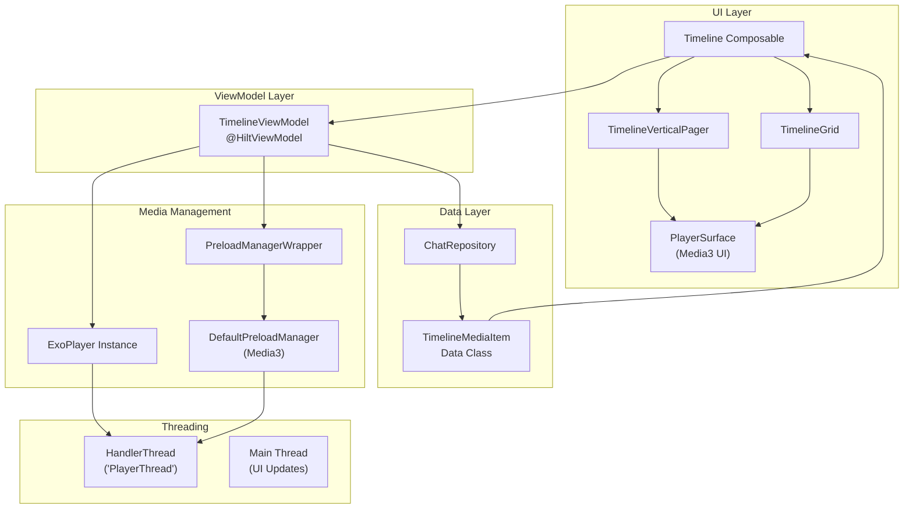
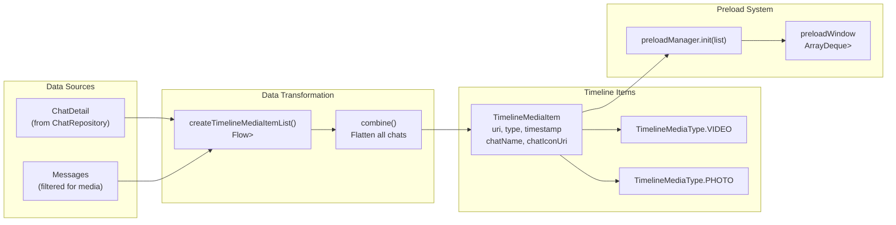
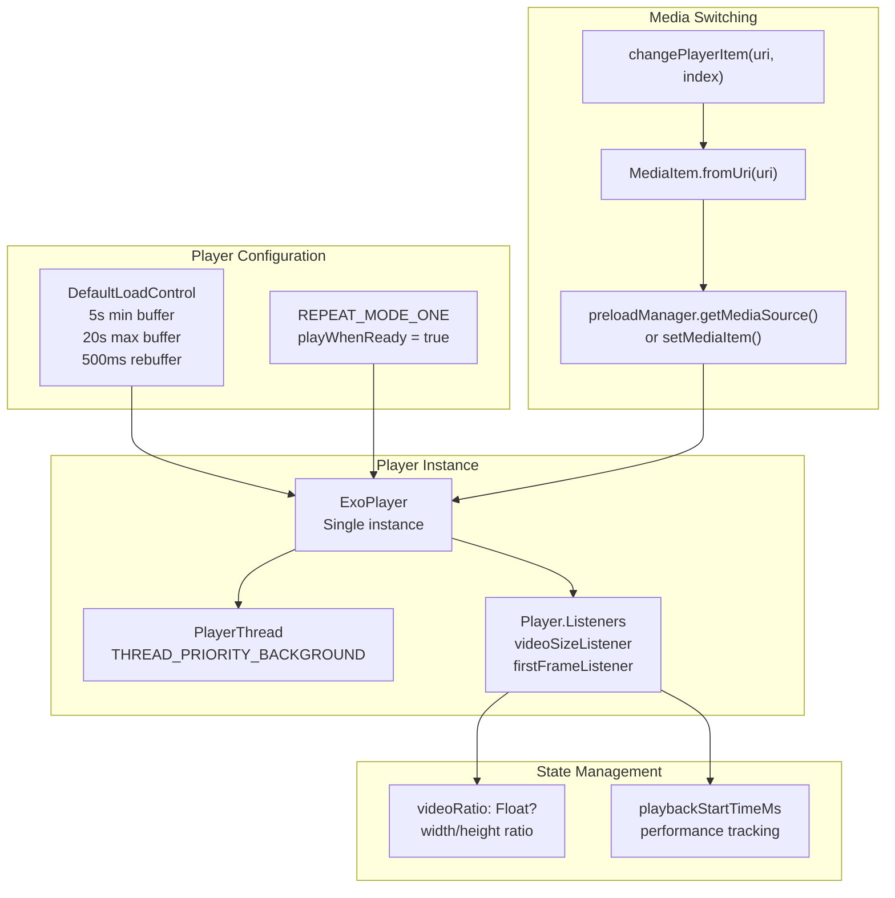
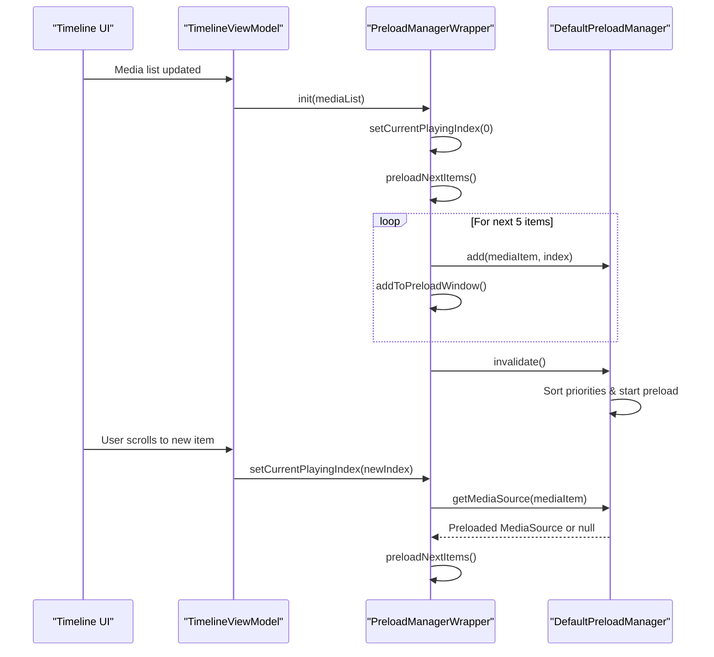
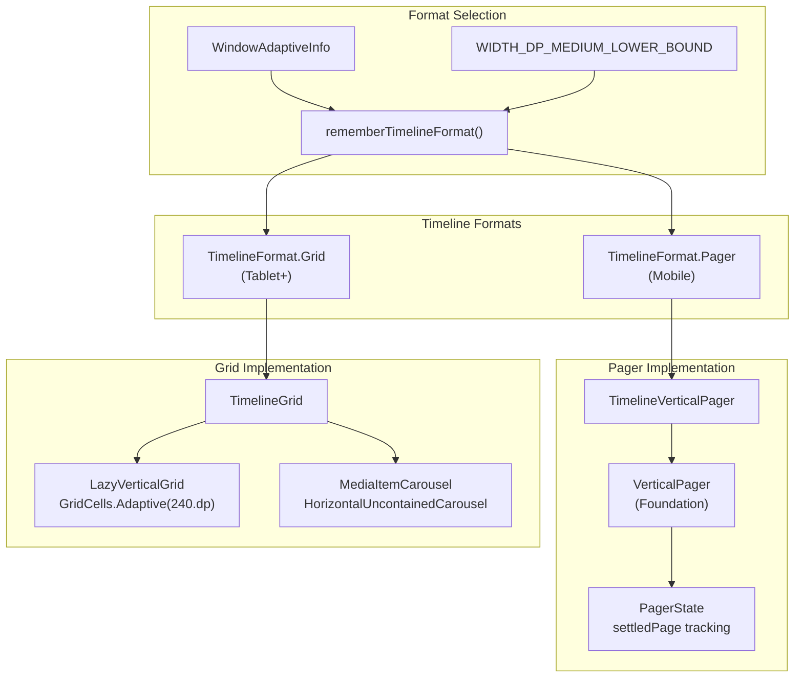
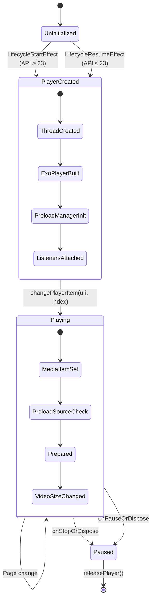

<!-- source: DeepWiki mcp.deepwiki.com · repo android/socialite · page 4.5 Timeline and Playback · fetched 2026-10-23 -->

# Timeline and Playback

<details>
<summary>Relevant source files</summary>

The following files were used as context for generating this wiki page:

- [app/src/main/java/com/google/android/samples/socialite/data/utils/ShortsVideoList.kt](app/src/main/java/com/google/android/samples/socialite/data/utils/ShortsVideoList.kt)
- [app/src/main/java/com/google/android/samples/socialite/ui/components/VideoPreview.kt](app/src/main/java/com/google/android/samples/socialite/ui/components/VideoPreview.kt)
- [app/src/main/java/com/google/android/samples/socialite/ui/home/timeline/Timeline.kt](app/src/main/java/com/google/android/samples/socialite/ui/home/timeline/Timeline.kt)
- [app/src/main/java/com/google/android/samples/socialite/ui/home/timeline/TimelineViewModel.kt](app/src/main/java/com/google/android/samples/socialite/ui/home/timeline/TimelineViewModel.kt)
- [app/src/main/java/com/google/android/samples/socialite/ui/home/timeline/component/EmptyTimeline.kt](app/src/main/java/com/google/android/samples/socialite/ui/home/timeline/component/EmptyTimeline.kt)
- [app/src/main/java/com/google/android/samples/socialite/ui/home/timeline/component/MetadataOverlay.kt](app/src/main/java/com/google/android/samples/socialite/ui/home/timeline/component/MetadataOverlay.kt)
- [app/src/main/java/com/google/android/samples/socialite/ui/home/timeline/component/TimelineCard.kt](app/src/main/java/com/google/android/samples/socialite/ui/home/timeline/component/TimelineCard.kt)
- [app/src/main/java/com/google/android/samples/socialite/ui/home/timeline/component/TimelineFormat.kt](app/src/main/java/com/google/android/samples/socialite/ui/home/timeline/component/TimelineFormat.kt)
- [app/src/main/java/com/google/android/samples/socialite/ui/home/timeline/component/TimelineGrid.kt](app/src/main/java/com/google/android/samples/socialite/ui/home/timeline/component/TimelineGrid.kt)
- [app/src/main/java/com/google/android/samples/socialite/ui/home/timeline/component/TimelineScaffold.kt](app/src/main/java/com/google/android/samples/socialite/ui/home/timeline/component/TimelineScaffold.kt)
- [app/src/main/java/com/google/android/samples/socialite/ui/home/timeline/component/TimelineVerticalPager.kt](app/src/main/java/com/google/android/samples/socialite/ui/home/timeline/component/TimelineVerticalPager.kt)
- [app/src/main/java/com/google/android/samples/socialite/ui/player/preloadmanager/PreloadManagerWrapper.kt](app/src/main/java/com/google/android/samples/socialite/ui/player/preloadmanager/PreloadManagerWrapper.kt)

</details>


The Timeline and Playback system provides a media feed experience that displays photos and videos from chat messages in an optimized, short-form content format. This system includes adaptive UI layouts, intelligent video preloading, and efficient media playback using ExoPlayer.

For information about media capture and processing, see [Media Capture](#4.3) and [Media Processing](#4.4). For details about the video player with Picture-in-Picture support, see [Video Player](#4.6).

## System Architecture

The timeline system follows an MVVM architecture with specialized components for media playback optimization:



Sources: [app/src/main/java/com/google/android/samples/socialite/ui/home/timeline/TimelineViewModel.kt:51-54](), [app/src/main/java/com/google/android/samples/socialite/ui/home/timeline/Timeline.kt:42-46](), [app/src/main/java/com/google/android/samples/socialite/ui/player/preloadmanager/PreloadManagerWrapper.kt:40-43]()

## Timeline Data Flow

The timeline converts chat messages with media attachments into a unified media feed:



Sources: [app/src/main/java/com/google/android/samples/socialite/ui/home/timeline/TimelineViewModel.kt:90-106](), [app/src/main/java/com/google/android/samples/socialite/ui/home/timeline/TimelineViewModel.kt:108-126]()

## Video Playback System

The timeline uses a single `ExoPlayer` instance with optimized configuration for short-form content:



Sources: [app/src/main/java/com/google/android/samples/socialite/ui/home/timeline/TimelineViewModel.kt:129-161](), [app/src/main/java/com/google/android/samples/socialite/ui/home/timeline/TimelineViewModel.kt:199-231]()

## Preload Manager System

The `PreloadManagerWrapper` optimizes video playback by preloading upcoming content:

| Component | Description | Configuration |
|-----------|-------------|---------------|
| `PreloadManagerWrapper` | Manages preloading queue and strategy | Window size: 5 items |
| `DefaultPreloadManager` | Media3's preload implementation | 3 seconds preload duration |
| `PreloadWindow` | `ArrayDeque<Pair<MediaItem, Int>>` | Rolling window of preloaded items |
| `PreloadStatusControl` | Custom preload target control | `STAGE_LOADED_FOR_DURATION_MS: 3000L` |



Sources: [app/src/main/java/com/google/android/samples/socialite/ui/player/preloadmanager/PreloadManagerWrapper.kt:81-89](), [app/src/main/java/com/google/android/samples/socialite/ui/player/preloadmanager/PreloadManagerWrapper.kt:92-118](), [app/src/main/java/com/google/android/samples/socialite/ui/player/preloadmanager/PreloadManagerWrapper.kt:160-165]()

## Timeline UI Components

The timeline supports two adaptive formats based on screen size:



Sources: [app/src/main/java/com/google/android/samples/socialite/ui/home/timeline/component/TimelineFormat.kt:29-42](), [app/src/main/java/com/google/android/samples/socialite/ui/home/timeline/Timeline.kt:101-122](), [app/src/main/java/com/google/android/samples/socialite/ui/home/timeline/component/TimelineGrid.kt:75-86]()

## Player Lifecycle Management

The timeline manages ExoPlayer lifecycle based on Android lifecycle events:



Sources: [app/src/main/java/com/google/android/samples/socialite/ui/home/timeline/Timeline.kt:85-99](), [app/src/main/java/com/google/android/samples/socialite/ui/home/timeline/TimelineViewModel.kt:184-197]()

## Key Data Structures

### TimelineMediaItem

The core data structure representing media in the timeline:

```kotlin
data class TimelineMediaItem(
    val uri: String,
    val type: TimelineMediaType, // VIDEO or PHOTO
    val timestamp: Long,
    val chatName: String,
    val chatIconUri: String?
)
```

### Player Configuration

The ExoPlayer is configured with reduced buffer durations optimized for short-form content:

| Buffer Setting | Value | Purpose |
|----------------|-------|---------|
| Min Buffer Duration | 5,000ms | Reduced for quick starts |
| Max Buffer Duration | 20,000ms | Limited memory usage |
| Buffer for Playback | 500ms | Fast initial playback |
| Rebuffer Duration | Default | Standard rebuffering |

Sources: [app/src/main/java/com/google/android/samples/socialite/ui/home/timeline/TimelineViewModel.kt:133-140]()

---

