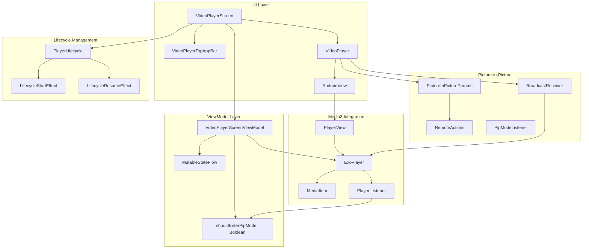
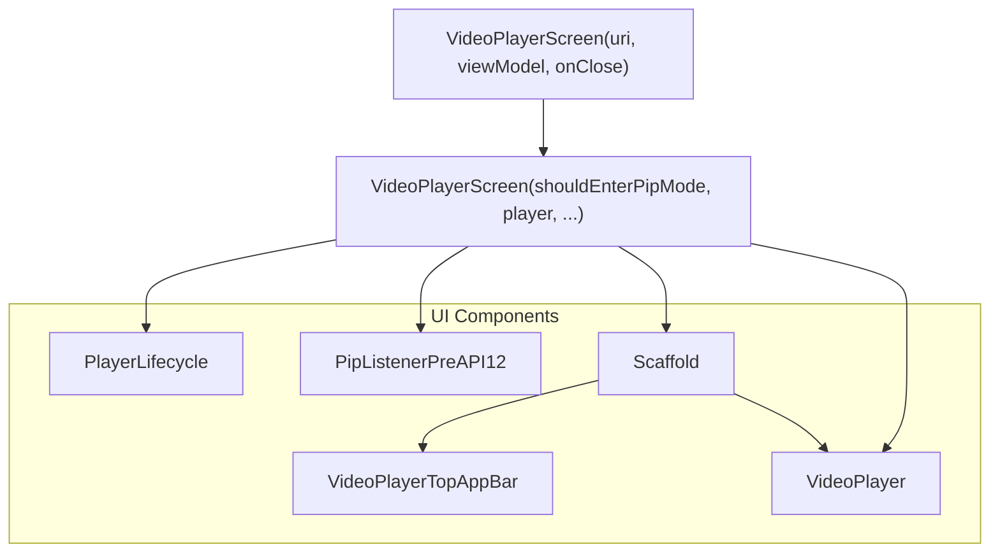
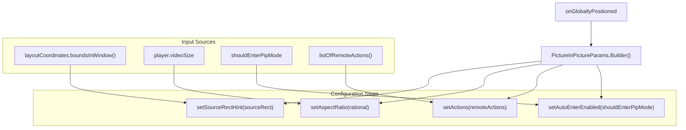
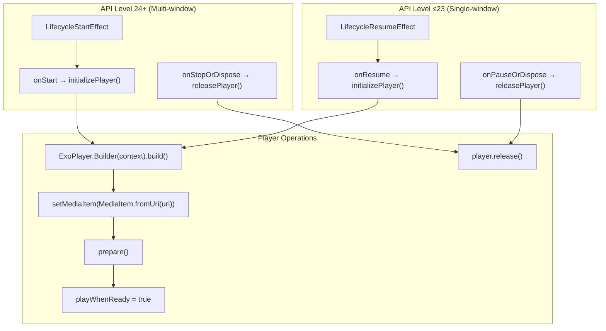

<!-- source: DeepWiki mcp.deepwiki.com · repo android/socialite · page 4.6 Video Player · fetched 2026-10-23 -->

# Video Player

<details>
<summary>Relevant source files</summary>

The following files were used as context for generating this wiki page:

- [app/src/main/java/com/google/android/samples/socialite/ui/player/RemoteActions.kt](app/src/main/java/com/google/android/samples/socialite/ui/player/RemoteActions.kt)
- [app/src/main/java/com/google/android/samples/socialite/ui/player/VideoPlayerScreen.kt](app/src/main/java/com/google/android/samples/socialite/ui/player/VideoPlayerScreen.kt)
- [app/src/main/java/com/google/android/samples/socialite/ui/player/VideoPlayerScreenViewModel.kt](app/src/main/java/com/google/android/samples/socialite/ui/player/VideoPlayerScreenViewModel.kt)
- [app/src/main/res/drawable/ic_ff_24dp.xml](app/src/main/res/drawable/ic_ff_24dp.xml)
- [app/src/main/res/drawable/ic_pause_24dp.xml](app/src/main/res/drawable/ic_pause_24dp.xml)
- [app/src/main/res/drawable/ic_play_24dp.xml](app/src/main/res/drawable/ic_play_24dp.xml)
- [app/src/main/res/drawable/ic_rw_24dp.xml](app/src/main/res/drawable/ic_rw_24dp.xml)

</details>


This document covers the video player implementation in SociaLite, which provides full-screen video playback with Picture-in-Picture (PiP) support. The video player uses Media3's ExoPlayer for media playback and integrates Android's Picture-in-Picture APIs for seamless multitasking.

For information about video editing and processing, see [Media Processing](#4.4). For timeline media playback and preloading, see [Timeline and Playback](#4.5).

## Architecture Overview

The video player system consists of several key components that work together to provide a full-featured video playback experience with Picture-in-Picture support.



Sources: [app/src/main/java/com/google/android/samples/socialite/ui/player/VideoPlayerScreen.kt:89-135](), [app/src/main/java/com/google/android/samples/socialite/ui/player/VideoPlayerScreenViewModel.kt:30-59]()

## Core Components

### VideoPlayerScreenViewModel

The `VideoPlayerScreenViewModel` manages the ExoPlayer instance and Picture-in-Picture state. It provides a simple interface for initializing and releasing the player.

| Property | Type | Purpose |
|----------|------|---------|
| `player` | `StateFlow<Player?>` | Exposes the current ExoPlayer instance |
| `shouldEnterPipMode` | `Boolean` | Controls whether PiP mode should be enabled |

Key methods:
- `initializePlayer(uri: String, context: Context)` - Creates and configures ExoPlayer
- `releasePlayer()` - Releases ExoPlayer resources and resets state

The ViewModel automatically enables PiP mode when video starts playing through a `Player.Listener`.

Sources: [app/src/main/java/com/google/android/samples/socialite/ui/player/VideoPlayerScreenViewModel.kt:30-59]()

### VideoPlayerScreen Composable

The main entry point provides two variants - a public composable that uses the ViewModel and a private composable for testing/preview purposes.



The screen conditionally renders different layouts based on Picture-in-Picture mode:
- **Normal mode**: Full scaffold with top app bar and centered video player
- **PiP mode**: Video player only, filling the entire screen

Sources: [app/src/main/java/com/google/android/samples/socialite/ui/player/VideoPlayerScreen.kt:89-135]()

## Picture-in-Picture Implementation

### PiP Parameter Configuration

The video player configures Picture-in-Picture parameters dynamically based on video content and player state.



Key PiP features:
- **Source rect hint**: Smooth transition animation from current video bounds
- **Aspect ratio**: Maintains video's original aspect ratio in PiP window
- **Auto-enter**: Automatically enters PiP on Android S+ when conditions are met
- **Custom controls**: Play, pause, fast forward, and rewind actions

Sources: [app/src/main/java/com/google/android/samples/socialite/ui/player/VideoPlayerScreen.kt:174-195]()

### Remote Actions and Broadcast Receiver

The PiP mode includes custom playback controls implemented through `RemoteAction` and `BroadcastReceiver`.

| Control | Icon | Action | Intent Extra |
|---------|------|--------|--------------|
| Rewind | `ic_rw_24dp` | `seekBack()` | `EXTRA_CONTROL_RW` |
| Play/Pause | `ic_play_24dp`/`ic_pause_24dp` | `play()`/`pause()` | `EXTRA_CONTROL_PLAY`/`EXTRA_CONTROL_PAUSE` |
| Fast Forward | `ic_ff_24dp` | `seekForward()` | `EXTRA_CONTROL_FF` |

The broadcast receiver listens for `ACTION_BROADCAST_CONTROL` intents and executes the corresponding player actions.

Sources: [app/src/main/java/com/google/android/samples/socialite/ui/player/RemoteActions.kt:31-65](), [app/src/main/java/com/google/android/samples/socialite/ui/player/VideoPlayerScreen.kt:330-359]()

### PiP Mode Detection and Lifecycle

The player implements PiP mode detection that works across different Android versions:

```mermaid
graph TB
    subgraph "API Level O+ (26+)"
        PipModeChangedListener["addOnPictureInPictureModeChangedListener"]
        PipModeState["mutableStateOf(isInPictureInPictureMode)"]
        Consumer["Consumer<PictureInPictureModeChangedInfo>"]
    end
    
    subgraph "API Level O to R (26-30)"
        UserLeaveHintListener["addOnUserLeaveHintListener"]
        OnUserLeaveBehavior["enterPictureInPictureMode()"]
    end
    
    subgraph "API Level S+ (31+)"
        AutoEnterEnabled["setAutoEnterEnabled(true)"]
        SystemManagedPip["System-managed PiP entry"]
    end
    
    PipModeChangedListener --> Consumer
    Consumer --> PipModeState
    
    UserLeaveHintListener --> OnUserLeaveBehavior
    
    AutoEnterEnabled --> SystemManagedPip
```



- **API 26+**: Uses `PictureInPictureModeChangedInfo` for real-time PiP state tracking
- **API 26-30**: Uses `onUserLeaveHint` for manual PiP entry
- **API 31+**: Supports automatic PiP entry when media is playing

Sources: [app/src/main/java/com/google/android/samples/socialite/ui/player/VideoPlayerScreen.kt:272-323]()

## Player Lifecycle Management

The video player implements proper lifecycle management that varies based on Android API level to optimize resource usage.



The lifecycle strategy optimizes for:
- **Multi-window support**: Initialize on start for split-screen scenarios (API 24+)
- **Resource conservation**: Initialize on resume for older devices (API ≤23)
- **Proper cleanup**: Always release player when lifecycle ends

Sources: [app/src/main/java/com/google/android/samples/socialite/ui/player/VideoPlayerScreen.kt:232-264]()

## Integration Points

### ExoPlayer Configuration

The player uses a standard ExoPlayer setup with the following configuration:

```kotlin
ExoPlayer.Builder(context.applicationContext)
    .build().apply {
        setMediaItem(MediaItem.fromUri(uri))
        prepare()
        playWhenReady = true
    }
```

The player automatically:
- Prepares media for playback
- Starts playing when ready
- Updates PiP mode based on playback state

Sources: [app/src/main/java/com/google/android/samples/socialite/ui/player/VideoPlayerScreenViewModel.kt:36-52]()

### PlayerView Integration

The video player uses Media3's `PlayerView` wrapped in Compose's `AndroidView` for seamless integration:

- **Controller visibility**: Hidden during PiP mode, visible in normal mode
- **Focus handling**: Supports keyboard/remote control navigation
- **Version compatibility**: Graceful degradation for pre-API 26 devices

Sources: [app/src/main/java/com/google/android/samples/socialite/ui/player/VideoPlayerScreen.kt:198-216]()

### Activity Context Requirements

The PiP functionality requires access to `ComponentActivity` for:
- Setting PiP parameters
- Entering PiP mode
- Registering lifecycle listeners

The `Context.findActivity()` extension function safely traverses the context hierarchy to locate the required activity instance.

Sources: [app/src/main/java/com/google/android/samples/socialite/ui/player/VideoPlayerScreen.kt:362-369]()

---

