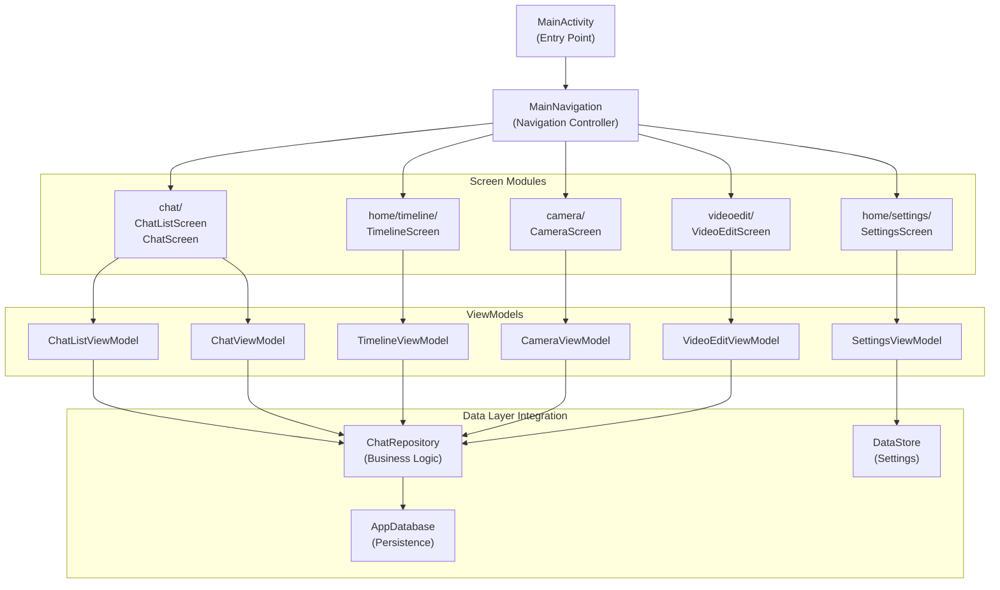
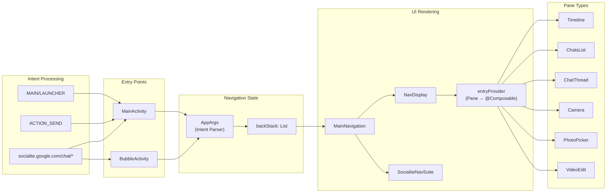
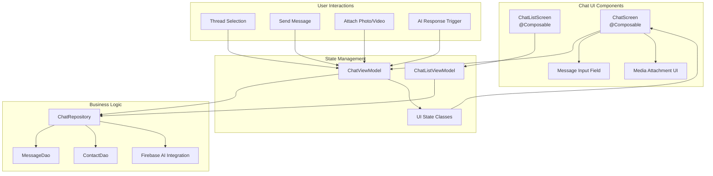
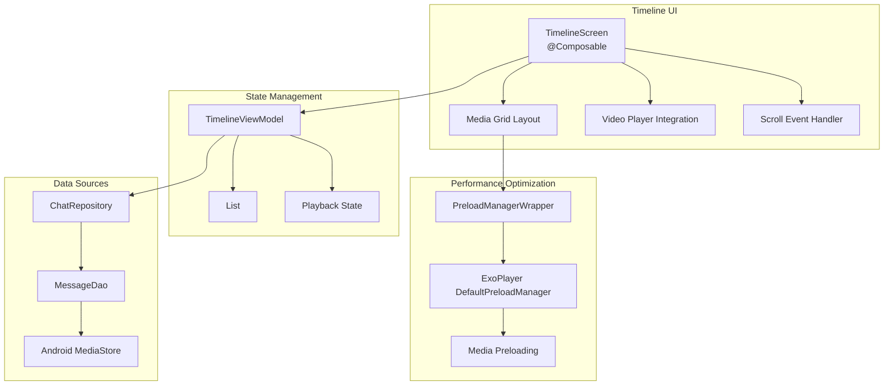
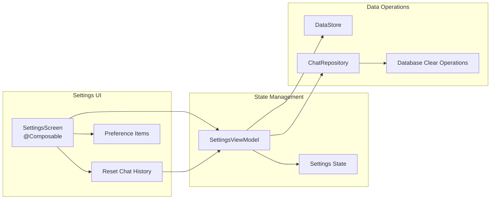
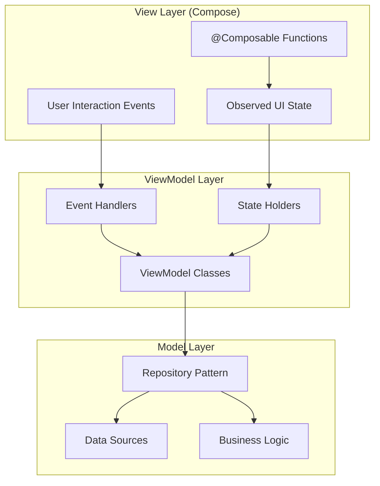

<!-- source: DeepWiki mcp.deepwiki.com · repo android/socialite · page 5 User Interface · fetched 2026-10-23 -->

# User Interface

Relevant source files

The following files were used as context for generating this wiki page:

- [app/src/main/java/com/google/android/samples/socialite/data/README.md](app/src/main/java/com/google/android/samples/socialite/data/README.md)
- [app/src/main/java/com/google/android/samples/socialite/ui/README.md](app/src/main/java/com/google/android/samples/socialite/ui/README.md)
- [app/src/main/java/com/google/android/samples/socialite/ui/chat/README.md](app/src/main/java/com/google/android/samples/socialite/ui/chat/README.md)
- [app/src/main/java/com/google/android/samples/socialite/ui/home/settings/README.md](app/src/main/java/com/google/android/samples/socialite/ui/home/settings/README.md)
- [app/src/main/java/com/google/android/samples/socialite/ui/home/timeline/README.md](app/src/main/java/com/google/android/samples/socialite/ui/home/timeline/README.md)

This document covers the user interface implementation of the SociaLite application, built using Jetpack Compose with an MVVM architecture pattern. The UI layer handles all user-facing screens, navigation, input handling, and state management through ViewModels.

For information about the underlying data flow and business logic, see [Architecture](#3). For details about specific media processing features, see [Core Features](#4). For system-level integrations like notifications and widgets, see [System Integration](#6).

## UI Architecture Overview

The SociaLite UI follows a modular, screen-based organization with clear separation between UI components and business logic through ViewModels.

### UI Component Structure

Sources: [app/src/main/java/com/google/android/samples/socialite/ui/README.md:1-10](), [app/src/main/java/com/google/android/samples/socialite/ui/chat/README.md:1-11](), [app/src/main/java/com/google/android/samples/socialite/ui/home/timeline/README.md:1-10]()

## Navigation System

The application uses a pane-based navigation system that adapts to different screen sizes and orientations.

### Navigation Flow

Sources: Based on overall architecture diagrams and navigation system description

## Chat Interface

The chat system provides both a list view of conversations and detailed chat threads with rich media support.

### Chat Screen Components

| Component | File Location | Purpose |
|-----------|---------------|---------|
| `ChatListScreen` | `ui/chat/ChatListScreen.kt` | Displays list of chat threads |
| `ChatScreen` | `ui/chat/ChatScreen.kt` | Individual chat conversation view |
| `ChatListViewModel` | `ui/chat/ChatListViewModel.kt` | State management for chat list |
| `ChatViewModel` | `ui/chat/ChatViewModel.kt` | State management for chat thread |

### Chat UI Data Flow

Sources: [app/src/main/java/com/google/android/samples/socialite/ui/chat/README.md:3-8]()

## Timeline Interface

The timeline displays a vertical feed of all shared media across chat threads with smooth scrolling and preloading.

### Timeline Implementation

Sources: [app/src/main/java/com/google/android/samples/socialite/ui/home/timeline/README.md:3-7]()

## Settings Interface

The settings screen provides configuration options and administrative functions like resetting chat history.

### Settings Structure

| Component | Purpose |
|-----------|---------|
| `SettingsScreen` | Main settings UI composable |
| `SettingsViewModel` | Settings state management |
| Reset Chat History | Clears all chat data via data layer |
| Application Preferences | Managed through DataStore |

Sources: [app/src/main/java/com/google/android/samples/socialite/ui/home/settings/README.md:3-8]()

## Compose Implementation Patterns

The application follows consistent Jetpack Compose patterns across all UI components.

### MVVM Pattern Implementation

### Key Implementation Details

- **State Management**: ViewModels expose `Flow` and `StateFlow` for reactive UI updates
- **Navigation**: Pane-based system with `backStack` management
- **Media Integration**: Direct integration with CameraX, ExoPlayer, and Media3
- **AI Integration**: Firebase AI responses integrated into chat flows
- **Accessibility**: Compose semantics for screen reader support
- **Performance**: Preloading for smooth media playback in timeline

Sources: [app/src/main/java/com/google/android/samples/socialite/ui/README.md:6-9]()

---

