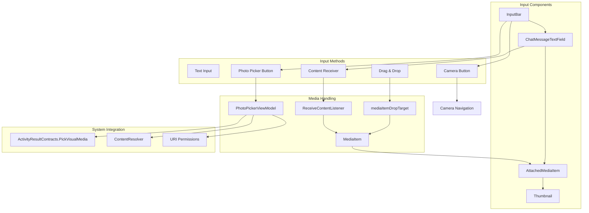
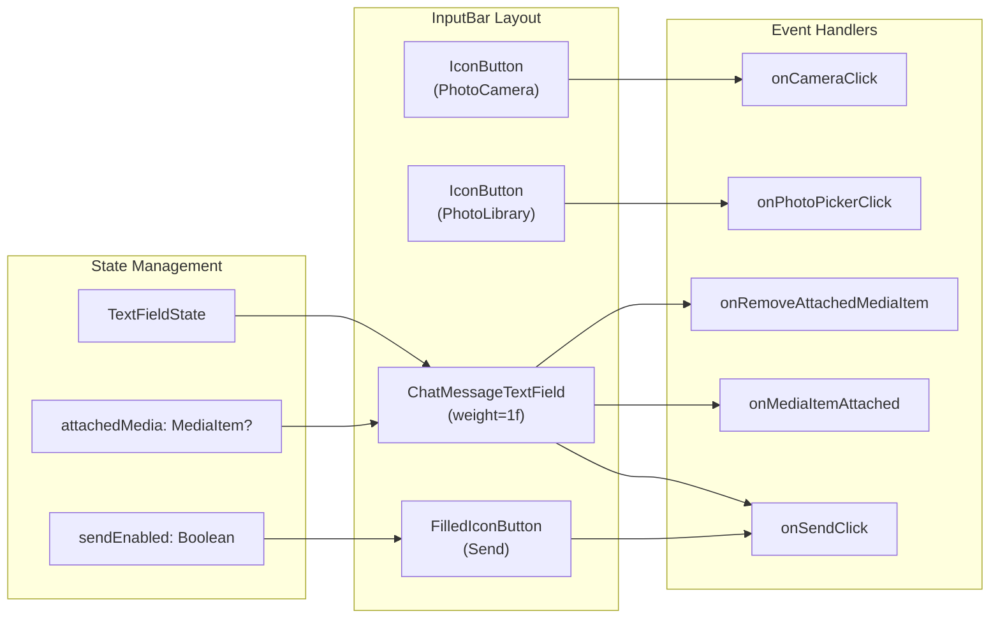
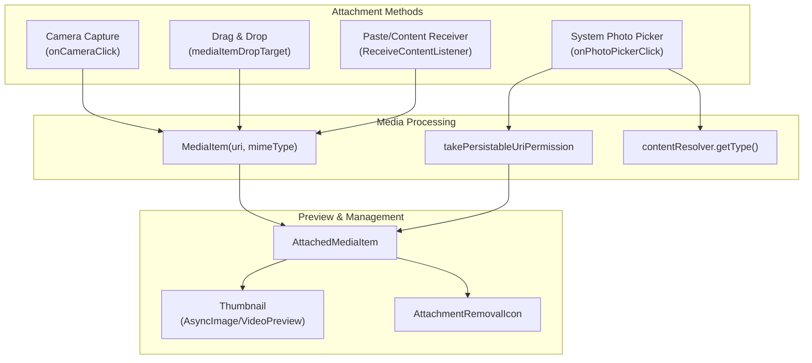
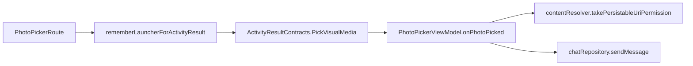
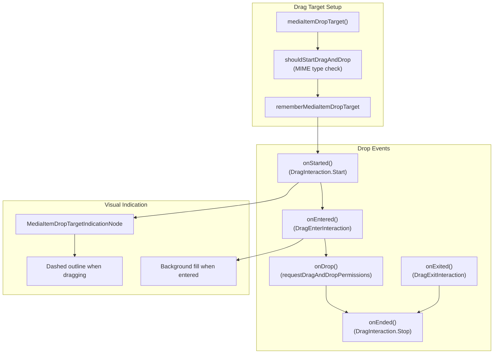
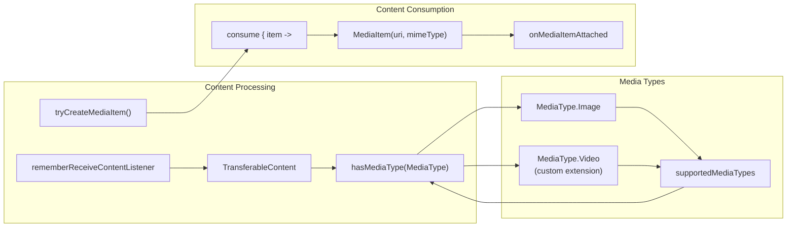
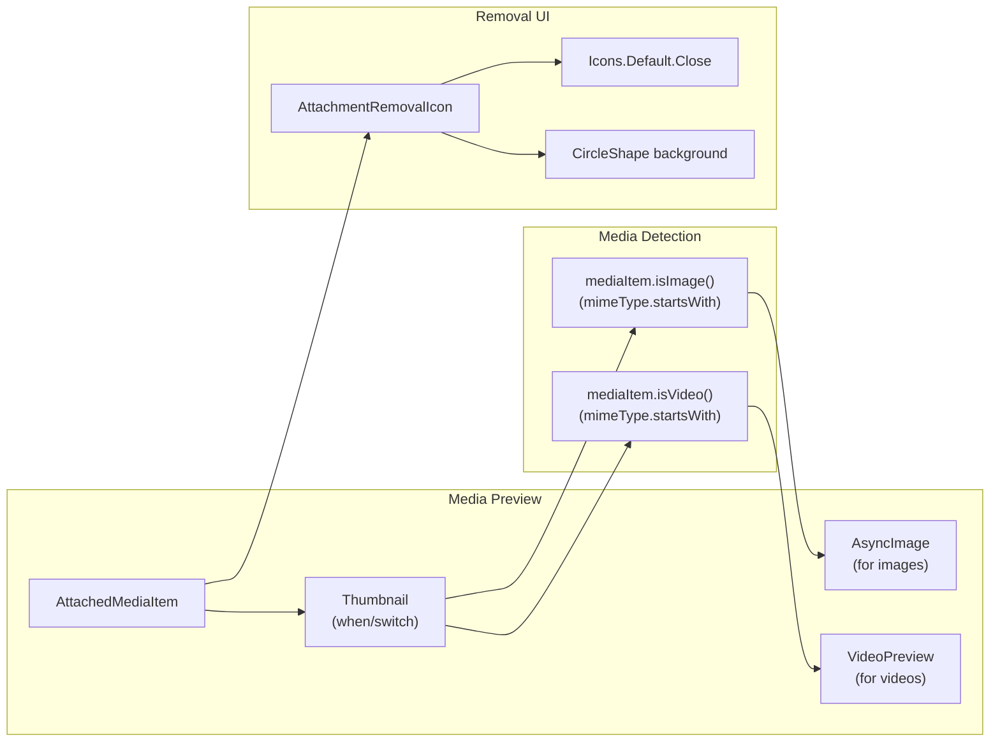

<!-- source: DeepWiki mcp.deepwiki.com · repo android/socialite · page 5.1 Input Components · fetched 2026-10-23 -->

# Input Components

Relevant source files

The following files were used as context for generating this wiki page:

- [app/src/main/java/com/google/android/samples/socialite/ui/chat/component/DropTarget.kt](app/src/main/java/com/google/android/samples/socialite/ui/chat/component/DropTarget.kt)
- [app/src/main/java/com/google/android/samples/socialite/ui/chat/component/InputBar.kt](app/src/main/java/com/google/android/samples/socialite/ui/chat/component/InputBar.kt)
- [app/src/main/java/com/google/android/samples/socialite/ui/chat/component/TransferableContent.kt](app/src/main/java/com/google/android/samples/socialite/ui/chat/component/TransferableContent.kt)
- [app/src/main/java/com/google/android/samples/socialite/ui/components/FocusRequester.kt](app/src/main/java/com/google/android/samples/socialite/ui/components/FocusRequester.kt)
- [app/src/main/java/com/google/android/samples/socialite/ui/components/Icon.kt](app/src/main/java/com/google/android/samples/socialite/ui/components/Icon.kt)
- [app/src/main/java/com/google/android/samples/socialite/ui/photopicker/PhotoPickerViewModel.kt](app/src/main/java/com/google/android/samples/socialite/ui/photopicker/PhotoPickerViewModel.kt)
- [app/src/main/java/com/google/android/samples/socialite/ui/photopicker/navigation/PhotoPickerRoute.kt](app/src/main/java/com/google/android/samples/socialite/ui/photopicker/navigation/PhotoPickerRoute.kt)

This document covers the input system for the SociaLite chat interface, including text input, media attachment handling, drag-and-drop functionality, and content receiving capabilities. The input components provide multiple ways for users to compose and send messages with text, images, and videos.

For information about timeline UI components and media display, see [Timeline Components](#5.2). For details about the underlying chat business logic, see [Chat System](#4.1).

## Input System Architecture

The input system consists of several interconnected components that handle different types of user input and media attachment methods:

Sources: [app/src/main/java/com/google/android/samples/socialite/ui/chat/component/InputBar.kt:1-297](), [app/src/main/java/com/google/android/samples/socialite/ui/chat/component/DropTarget.kt:1-314]()

## InputBar Component

The `InputBar` is the main input component that provides a comprehensive interface for message composition. It combines text input with media attachment capabilities in a single row layout:

The component uses a `Surface` with tonal elevation and implements focus management through `focusGroup()` and `FocusRequester`. The layout arranges elements horizontally with consistent spacing.

Sources: [app/src/main/java/com/google/android/samples/socialite/ui/chat/component/InputBar.kt:75-142]()

## Text Input and Keyboard Handling

The `ChatMessageTextField` component handles text input with sophisticated keyboard interaction and content receiving capabilities:

| Feature | Implementation | Location |
|---------|---------------|----------|
| Text State | `TextFieldState` from Foundation API | [InputBar.kt:36]() |
| Keyboard Actions | `KeyboardActionHandler` for Send action | [InputBar.kt:174]() |
| Key Events | `onPreviewKeyEvent` for Enter key | [InputBar.kt:188-199]() |
| IME Action | `ImeAction.Send` with sentence capitalization | [InputBar.kt:170-173]() |
| Content Receiver | `contentReceiver()` modifier for paste/drop | [InputBar.kt:187]() |

The text field is styled with rounded corners using `MaterialTheme.shapes.extraLarge` and transparent indicators for a modern appearance.

Sources: [app/src/main/java/com/google/android/samples/socialite/ui/chat/component/InputBar.kt:144-202]()

## Media Attachment System

The input system supports multiple methods for attaching media content to messages:

### Photo Picker Integration

The `PhotoPickerViewModel` handles system photo picker integration with proper URI permission management:

The system uses `PickVisualMediaRequest(ImageAndVideo)` to allow selection of both images and videos, and automatically requests persistable URI permissions to maintain access after app restart.

Sources: [app/src/main/java/com/google/android/samples/socialite/ui/photopicker/PhotoPickerViewModel.kt:34-46](), [app/src/main/java/com/google/android/samples/socialite/ui/photopicker/navigation/PhotoPickerRoute.kt:28-49]()

## Drag and Drop Functionality

The drag-and-drop system provides visual feedback and handles media content from external applications:

The system supports both `image/*` and `video/*` MIME types with wildcard matching. Drop permissions are requested using `Activity.requestDragAndDropPermissions()` and properly released after processing.

Sources: [app/src/main/java/com/google/android/samples/socialite/ui/chat/component/DropTarget.kt:58-161](), [app/src/main/java/com/google/android/samples/socialite/ui/chat/component/DropTarget.kt:192-310]()

## Content Receiver System

The content receiver handles pasted content and transferable media through the Foundation API:

The system extends `MediaType.Companion` with a custom `Video` type and defines `supportedMediaTypes` as a list of accepted media types. Content is consumed through the `TransferableContent.consume()` API.

Sources: [app/src/main/java/com/google/android/samples/socialite/ui/chat/component/InputBar.kt:252-271](), [app/src/main/java/com/google/android/samples/socialite/ui/chat/component/TransferableContent.kt:25-44]()

## Focus Management and Accessibility

The input system implements comprehensive focus management for keyboard navigation and accessibility:

| Component | Focus Feature | Implementation |
|-----------|---------------|----------------|
| InputBar | Focus Group | `focusGroup()` with `onEnter` handler |
| TextField | Focus Requester | `FocusRequester.tryRequestFocus()` |
| Focus Helper | Safe Focus Request | Wraps `requestFocus()` in try-catch |
| Accessibility | Icon Descriptions | Content descriptions for all interactive elements |

The `tryRequestFocus()` extension function handles potential `IllegalArgumentException` when requesting focus on unmounted components, returning a `Result<Unit>` for safe handling.

Sources: [app/src/main/java/com/google/android/samples/socialite/ui/chat/component/InputBar.kt:87-96](), [app/src/main/java/com/google/android/samples/socialite/ui/components/FocusRequester.kt:21-28]()

## Attached Media Preview

When media is attached, the system displays a preview with removal capabilities:

The preview system uses MIME type prefix matching to determine display method and provides a consistent removal interface with visual feedback.

Sources: [app/src/main/java/com/google/android/samples/socialite/ui/chat/component/InputBar.kt:204-249](), [app/src/main/java/com/google/android/samples/socialite/ui/chat/component/InputBar.kt:273-279](), [app/src/main/java/com/google/android/samples/socialite/ui/components/Icon.kt:57-73]()

---

