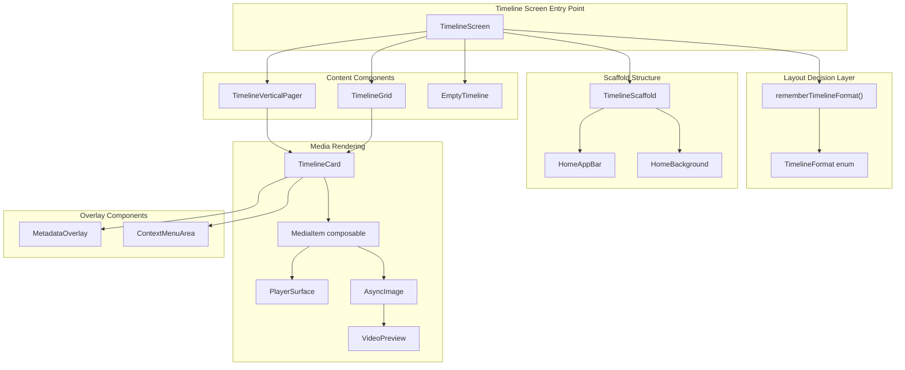
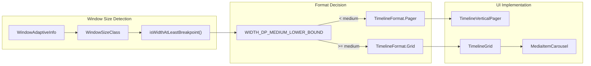
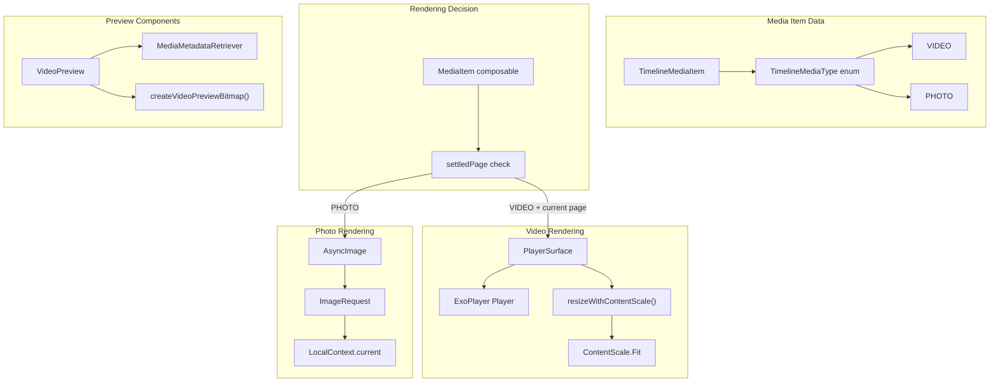
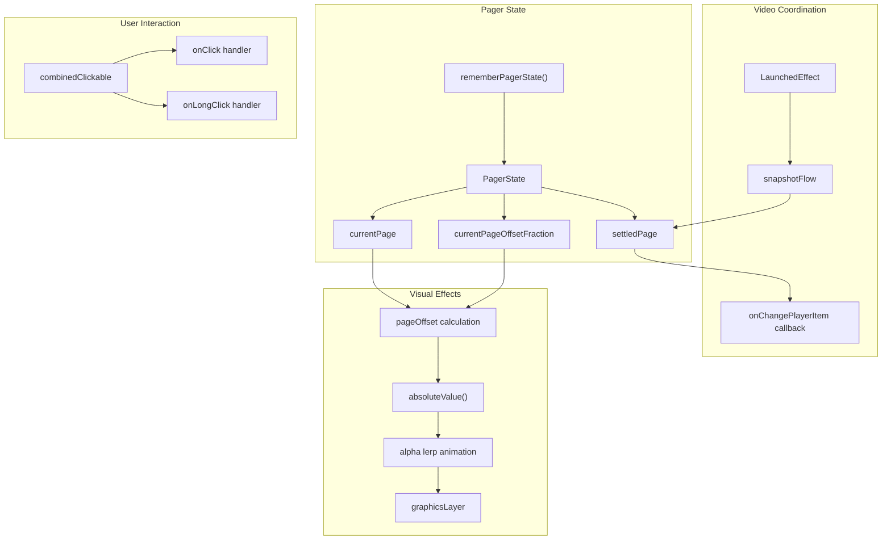
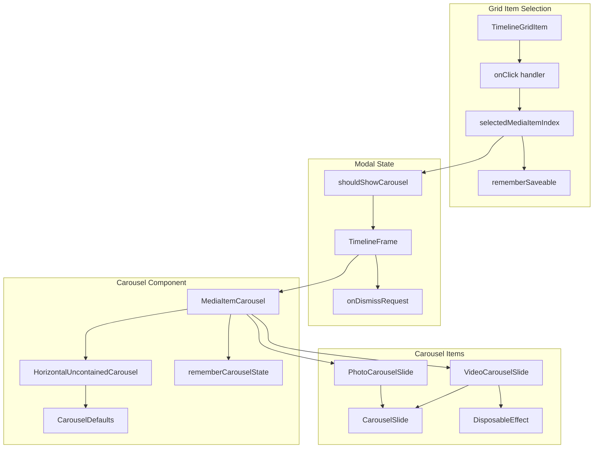
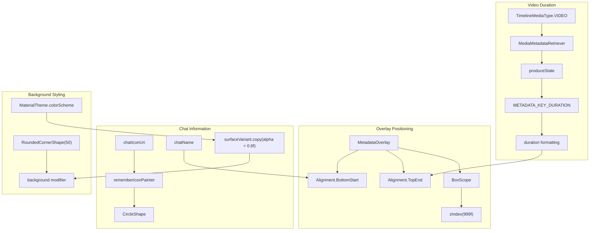
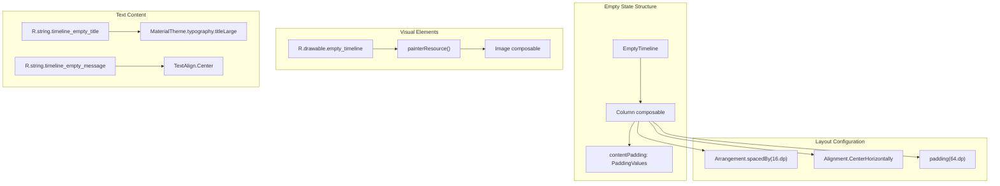

<!-- source: DeepWiki mcp.deepwiki.com · repo android/socialite · page 5.2 Timeline Components · fetched 2026-10-23 -->

# Timeline Components

<details>
<summary>Relevant source files</summary>

The following files were used as context for generating this wiki page:

- [app/src/main/java/com/google/android/samples/socialite/ui/components/VideoPreview.kt](app/src/main/java/com/google/android/samples/socialite/ui/components/VideoPreview.kt)
- [app/src/main/java/com/google/android/samples/socialite/ui/home/settings/README.md](app/src/main/java/com/google/android/samples/socialite/ui/home/settings/README.md)
- [app/src/main/java/com/google/android/samples/socialite/ui/home/timeline/README.md](app/src/main/java/com/google/android/samples/socialite/ui/home/timeline/README.md)
- [app/src/main/java/com/google/android/samples/socialite/ui/home/timeline/component/EmptyTimeline.kt](app/src/main/java/com/google/android/samples/socialite/ui/home/timeline/component/EmptyTimeline.kt)
- [app/src/main/java/com/google/android/samples/socialite/ui/home/timeline/component/MetadataOverlay.kt](app/src/main/java/com/google/android/samples/socialite/ui/home/timeline/component/MetadataOverlay.kt)
- [app/src/main/java/com/google/android/samples/socialite/ui/home/timeline/component/TimelineCard.kt](app/src/main/java/com/google/android/samples/socialite/ui/home/timeline/component/TimelineCard.kt)
- [app/src/main/java/com/google/android/samples/socialite/ui/home/timeline/component/TimelineFormat.kt](app/src/main/java/com/google/android/samples/socialite/ui/home/timeline/component/TimelineFormat.kt)
- [app/src/main/java/com/google/android/samples/socialite/ui/home/timeline/component/TimelineGrid.kt](app/src/main/java/com/google/android/samples/socialite/ui/home/timeline/component/TimelineGrid.kt)
- [app/src/main/java/com/google/android/samples/socialite/ui/home/timeline/component/TimelineScaffold.kt](app/src/main/java/com/google/android/samples/socialite/ui/home/timeline/component/TimelineScaffold.kt)
- [app/src/main/java/com/google/android/samples/socialite/ui/home/timeline/component/TimelineVerticalPager.kt](app/src/main/java/com/google/android/samples/socialite/ui/home/timeline/component/TimelineVerticalPager.kt)

</details>


This document covers the UI components that implement the timeline feature in SociaLite. The timeline displays a vertical feed of all photos and videos shared across chat threads, with adaptive layouts that switch between pager and grid views based on screen size. For information about the underlying data layer and media processing, see [Data Layer](#3.2) and [Media Processing](#4.4).

## Component Architecture

The timeline UI follows a composable component hierarchy built with Jetpack Compose, featuring adaptive layouts and smooth media playback integration.

### Timeline Component Hierarchy



**Sources:** [app/src/main/java/com/google/android/samples/socialite/ui/home/timeline/component/TimelineFormat.kt:24-42](), [app/src/main/java/com/google/android/samples/socialite/ui/home/timeline/component/TimelineScaffold.kt:29-44](), [app/src/main/java/com/google/android/samples/socialite/ui/home/timeline/component/TimelineVerticalPager.kt:52-82]()

## Adaptive Layout System

The timeline uses responsive design patterns to provide optimal viewing experiences across different screen sizes, automatically switching between pager and grid layouts.

### Layout Format Decision



The `rememberTimelineFormat` function determines the appropriate layout based on screen width:

| Screen Size | Format | Component | Behavior |
|-------------|--------|-----------|----------|
| < Medium | `TimelineFormat.Pager` | `TimelineVerticalPager` | Vertical scrolling, full-screen media |
| >= Medium | `TimelineFormat.Grid` | `TimelineGrid` | Grid layout with modal carousel |

**Sources:** [app/src/main/java/com/google/android/samples/socialite/ui/home/timeline/component/TimelineFormat.kt:29-42](), [app/src/main/java/com/google/android/samples/socialite/ui/home/timeline/component/TimelineGrid.kt:77-141]()

## Media Rendering Components

The timeline supports both photo and video content with optimized rendering strategies for smooth scrolling performance.

### Media Type Handling



**Sources:** [app/src/main/java/com/google/android/samples/socialite/ui/home/timeline/component/TimelineVerticalPager.kt:166-210](), [app/src/main/java/com/google/android/samples/socialite/ui/components/VideoPreview.kt:116-129]()

## Pager Implementation

The vertical pager provides an immersive, full-screen experience optimized for mobile viewing with smooth transitions and video playback coordination.

### Pager State Management



The pager implements sophisticated page transition effects using `graphicsLayer` modifiers:

```kotlin
// From TimelineVerticalPager.kt lines 113-127
val pageOffset = (
    (pagerState.currentPage - page) + pagerState
        .currentPageOffsetFraction
    ).absoluteValue

alpha = lerp(
    start = 0f,
    stop = 1f,
    fraction = 1f - pageOffset.coerceIn(0f, 1f),
)
```

**Sources:** [app/src/main/java/com/google/android/samples/socialite/ui/home/timeline/component/TimelineVerticalPager.kt:61-71](), [app/src/main/java/com/google/android/samples/socialite/ui/home/timeline/component/TimelineVerticalPager.kt:113-127]()

## Grid Implementation

The grid layout provides efficient browsing for larger screens with modal carousel viewing for detailed media examination.

### Grid Layout Configuration

| Property | Default Value | Purpose |
|----------|---------------|---------|
| `columns` | `GridCells.Adaptive(minSize = 240.dp)` | Responsive column count |
| `verticalArrangement` | `Arrangement.spacedBy(16.dp)` | Vertical spacing |
| `horizontalArrangement` | `Arrangement.spacedBy(16.dp)` | Horizontal spacing |
| `aspectRatio` | `0.7072f` | Item aspect ratio |

### Modal Carousel System



**Sources:** [app/src/main/java/com/google/android/samples/socialite/ui/home/timeline/component/TimelineGrid.kt:87-88](), [app/src/main/java/com/google/android/samples/socialite/ui/home/timeline/component/TimelineGrid.kt:191-232]()

## Metadata Overlay System

The metadata overlay provides contextual information about media items, including duration for videos and chat source information.

### Overlay Components



**Sources:** [app/src/main/java/com/google/android/samples/socialite/ui/home/timeline/component/MetadataOverlay.kt:50-117](), [app/src/main/java/com/google/android/samples/socialite/ui/home/timeline/component/MetadataOverlay.kt:61-76]()

## Empty State Handling

The timeline provides a user-friendly empty state when no media items are available.

### Empty State Components



**Sources:** [app/src/main/java/com/google/android/samples/socialite/ui/home/timeline/component/EmptyTimeline.kt:35-61]()

## Integration Points

The timeline components integrate with several external systems for complete functionality.

### System Dependencies

| Component | External Dependency | Purpose |
|-----------|-------------------|----------|
| `TimelineVerticalPager` | `androidx.media3.ui.compose.PlayerSurface` | Video playback |
| `AsyncImage` | `coil.compose.AsyncImage` | Image loading |
| `MediaMetadataRetriever` | `android.media.MediaMetadataRetriever` | Video metadata |
| `VideoPreview` | `MediaMetadataRetriever.frameAtTime` | Video thumbnails |
| `TimelineFormat` | `androidx.compose.material3.adaptive` | Responsive layout |

**Sources:** [app/src/main/java/com/google/android/samples/socialite/ui/home/timeline/component/TimelineVerticalPager.kt:42-46](), [app/src/main/java/com/google/android/samples/socialite/ui/components/VideoPreview.kt:19-39](), [app/src/main/java/com/google/android/samples/socialite/ui/home/timeline/component/TimelineFormat.kt:19-22]()

---

