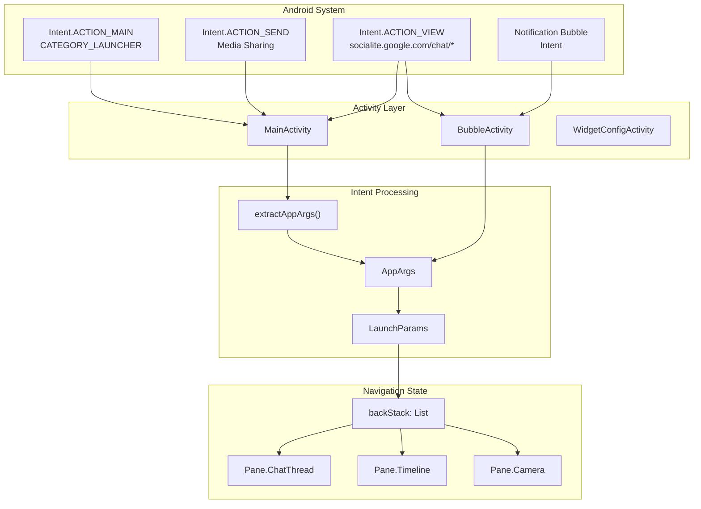
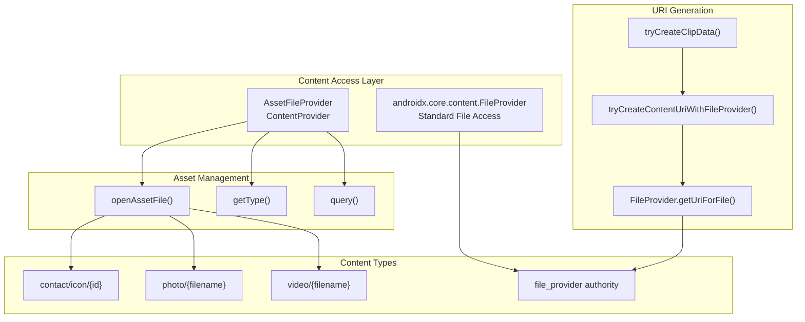
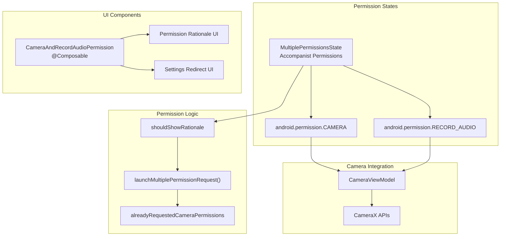
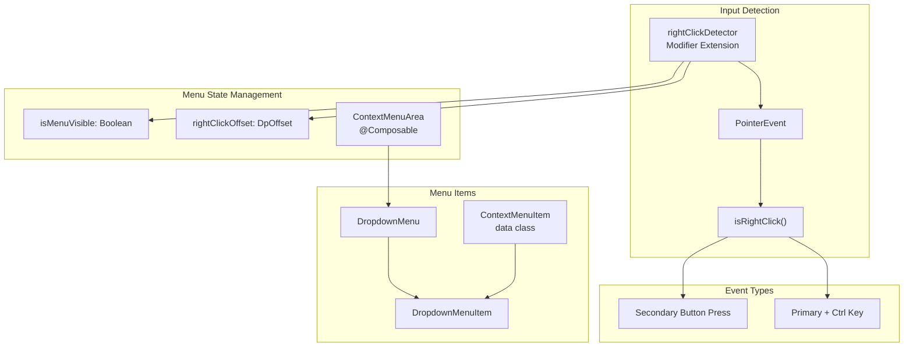

<!-- source: DeepWiki mcp.deepwiki.com · repo android/socialite · page 6 System Integration · fetched 2026-10-23 -->

# System Integration

Relevant source files

The following files were used as context for generating this wiki page:

- [app/src/main/java/com/google/android/samples/socialite/AssetFileProvider.kt](app/src/main/java/com/google/android/samples/socialite/AssetFileProvider.kt)
- [app/src/main/java/com/google/android/samples/socialite/repository/NotificationHelper.kt](app/src/main/java/com/google/android/samples/socialite/repository/NotificationHelper.kt)
- [app/src/main/java/com/google/android/samples/socialite/ui/camera/CameraAndRecordAudioPermission.kt](app/src/main/java/com/google/android/samples/socialite/ui/camera/CameraAndRecordAudioPermission.kt)
- [app/src/main/java/com/google/android/samples/socialite/ui/components/ClipData.kt](app/src/main/java/com/google/android/samples/socialite/ui/components/ClipData.kt)
- [app/src/main/java/com/google/android/samples/socialite/ui/components/ContextMenuArea.kt](app/src/main/java/com/google/android/samples/socialite/ui/components/ContextMenuArea.kt)

This document covers how the SociaLite application integrates with core Android platform services and APIs. The system integration encompasses intent handling, content sharing mechanisms, notification systems, permission management, and inter-app communication protocols. 

For detailed information about notification bubbles and shortcuts, see [Notifications and Bubbles](#6.1). For app widget implementation details, see [App Widgets](#6.2) and [Widget Resources](#6.3). For content sharing and FileProvider configuration, see [Content Sharing](#6.4).

## Overview

SociaLite integrates with the Android platform through multiple system entry points and services. The application supports deep linking, content sharing, notification bubbles, dynamic shortcuts, and secure file access through ContentProviders.

## System Entry Points and Intent Processing

The application handles various Android system intents and provides multiple entry points for user interactions.

### Intent Flow Architecture

Sources: [app/src/main/java/com/google/android/samples/socialite/repository/NotificationHelper.kt:173-177](), [app/src/main/java/com/google/android/samples/socialite/repository/NotificationHelper.kt:112-116]()

## Content Provider Architecture

The application implements secure content sharing through custom ContentProviders that handle both asset files and user-generated media.

### ContentProvider Implementation

Sources: [app/src/main/java/com/google/android/samples/socialite/AssetFileProvider.kt:28-102](), [app/src/main/java/com/google/android/samples/socialite/ui/components/ClipData.kt:27-49]()

The `AssetFileProvider` class extends `ContentProvider` to serve application assets through secure URIs. It handles three main content types:

| Content Type | URI Pattern | Purpose |
|--------------|-------------|---------|
| Contact Icons | `content://authority/icon/{contactId}` | Provides contact avatar images |
| Photos | `content://authority/photo/{filename}` | Serves bundled photo assets |
| Videos | `content://authority/video/{filename}` | Serves bundled video assets |

## Permission Management

The application implements a comprehensive permission management system, particularly for camera and microphone access required for media capture features.

### Permission Request Flow

Sources: [app/src/main/java/com/google/android/samples/socialite/ui/camera/CameraAndRecordAudioPermission.kt:47-112]()

## Context Menu Integration

The application provides desktop-style context menus for enhanced user interaction, particularly useful for content manipulation and sharing.

### Context Menu System

Sources: [app/src/main/java/com/google/android/samples/socialite/ui/components/ContextMenuArea.kt:46-133]()

## Clipboard and Sharing Integration

The application implements sophisticated clipboard and content sharing mechanisms that work across different Android versions and security contexts.

### ClipData Generation

The `tryCreateClipData` function in [app/src/main/java/com/google/android/samples/socialite/ui/components/ClipData.kt:27-35]() creates shareable `ClipData` objects by:

1. Attempting to create a secure content URI via `FileProvider`
2. Falling back to the original URI if FileProvider creation fails
3. Wrapping the final URI in a `ClipData` object with appropriate metadata

This approach ensures content can be shared securely while maintaining compatibility with various content sources and target applications.

## System Service Integration

The application integrates with core Android system services for enhanced functionality:

| Service | Integration Point | Purpose |
|---------|------------------|---------|
| NotificationManager | `NotificationHelper` | Bubble notifications and shortcuts |
| ShortcutManager | `pushDynamicShortcut()` | Conversation shortcuts |
| ContentResolver | `tryCreateClipData()` | Content URI permissions |
| PackageManager | Permission validation | Feature availability checks |

Sources: [app/src/main/java/com/google/android/samples/socialite/repository/NotificationHelper.kt:61-301](), [app/src/main/java/com/google/android/samples/socialite/ui/components/ClipData.kt:27-49]()

---

