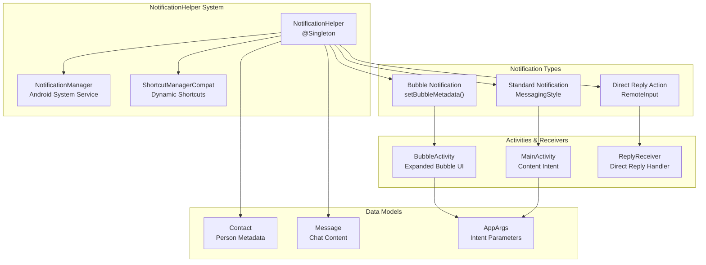
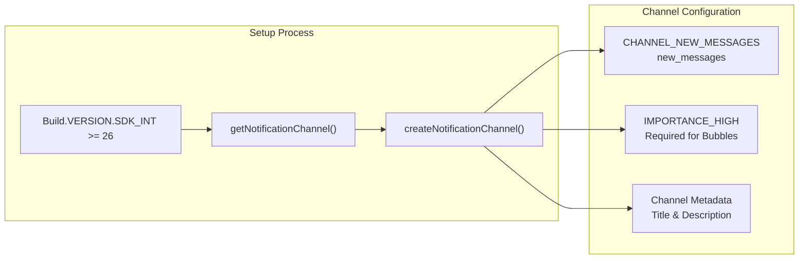
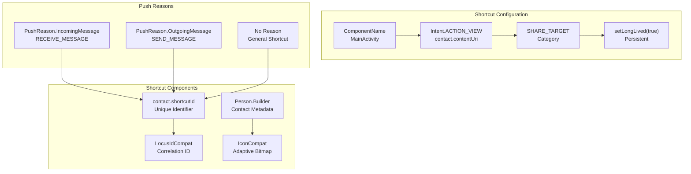
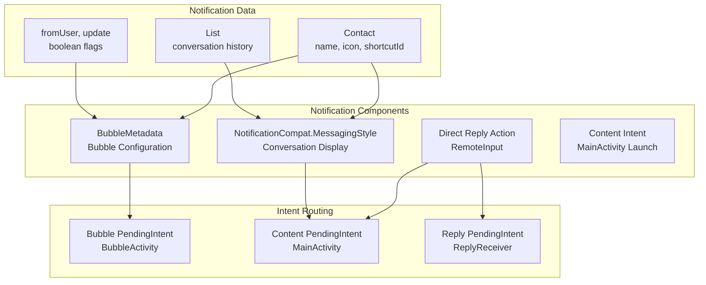
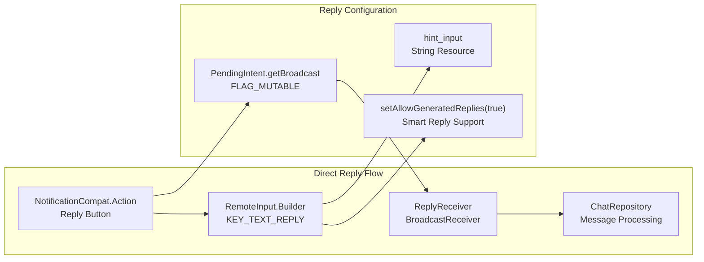
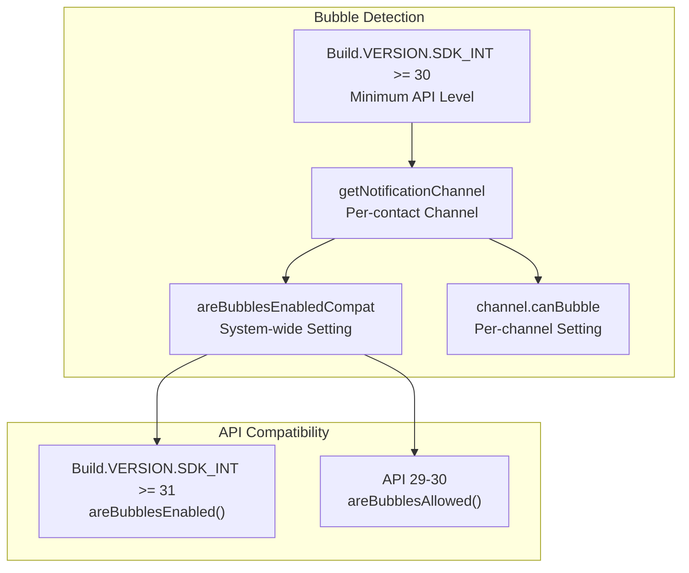

<!-- source: DeepWiki mcp.deepwiki.com · repo android/socialite · page 6.1 Notifications and Bubbles · fetched 2026-10-23 -->

# Notifications and Bubbles

Relevant source files

The following files were used as context for generating this wiki page:

- [app/src/main/java/com/google/android/samples/socialite/repository/NotificationHelper.kt](app/src/main/java/com/google/android/samples/socialite/repository/NotificationHelper.kt)
- [app/src/main/java/com/google/android/samples/socialite/ui/camera/CameraAndRecordAudioPermission.kt](app/src/main/java/com/google/android/samples/socialite/ui/camera/CameraAndRecordAudioPermission.kt)

This page covers the notification system and bubble functionality in SociaLite, which provides rich messaging notifications with direct reply capabilities and conversation bubbles. The system handles notification channels, dynamic shortcuts, and seamless integration between notification UI and the main application.

For information about the chat system that generates these notifications, see [Chat System](#4.1). For details about the app widgets that complement the notification system, see [App Widgets](#6.2).

## Overview

The notification system is primarily implemented through the `NotificationHelper` class, which manages all notification-related operations including bubble notifications, direct replies, and dynamic shortcuts. The system leverages Android's modern notification APIs to provide rich, interactive messaging experiences that can appear as traditional notifications or conversation bubbles.

## Core Components

### NotificationHelper Architecture

The `NotificationHelper` class serves as the central coordinator for all notification operations:

Sources: [app/src/main/java/com/google/android/samples/socialite/repository/NotificationHelper.kt:1-301]()

### Notification Channel Setup

The system creates a dedicated notification channel for messaging with bubble support:

The notification channel is configured with `IMPORTANCE_HIGH` which is required for bubble functionality to work properly.

Sources: [app/src/main/java/com/google/android/samples/socialite/repository/NotificationHelper.kt:79-95]()

## Dynamic Shortcuts Integration

### Shortcut Creation and Management

The system creates dynamic shortcuts for contacts to improve system integration and enable features like conversation shortcuts:

The `pushShortcut` method creates shortcuts with different capability bindings based on the message context.

Sources: [app/src/main/java/com/google/android/samples/socialite/repository/NotificationHelper.kt:97-145]()

## Bubble Notifications

### Bubble Metadata Configuration

Bubble notifications are created using `NotificationCompat.BubbleMetadata` with specific configuration for the chat experience:

| Property | Purpose | Configuration |
|----------|---------|---------------|
| `pendingIntent` | Launch target for expanded bubble | `BubbleActivity` with contact URI |
| `icon` | Bubble icon display | Contact's adaptive bitmap icon |
| `desiredHeight` | Expanded bubble size | `R.dimen.bubble_height` resource |
| `autoExpandBubble` | Auto-expand behavior | `true` when opened by user |
| `suppressNotification` | Hide notification | `true` for user-initiated or updates |

### Notification Building Process

Sources: [app/src/main/java/com/google/android/samples/socialite/repository/NotificationHelper.kt:159-277]()

### Message History Integration

The notification system processes message history to create rich messaging-style notifications:

- **Recent messages**: Added using `addMessage()` for current conversation
- **Historic messages**: Added using `addHistoricMessage()` for context
- **Media attachments**: Supported via `setData()` with MIME type and URI
- **Person attribution**: Messages attributed to sender or marked as from user

## Direct Reply System

### RemoteInput Configuration

Direct replies are implemented using `RemoteInput` with the following components:

The reply system integrates with Android's smart reply suggestions and processes responses through the `ReplyReceiver`.

Sources: [app/src/main/java/com/google/android/samples/socialite/repository/NotificationHelper.kt:246-267]()

## Bubble Capability Detection

### Runtime Bubble Support Check

The system includes capability detection to determine if bubbles are available:

The `canBubble` method provides a comprehensive check that accounts for system-wide settings, per-channel permissions, and API level compatibility.

Sources: [app/src/main/java/com/google/android/samples/socialite/repository/NotificationHelper.kt:283-300]()

## Integration Points

### Activity Launch Patterns

The notification system supports multiple launch patterns:

| Launch Type | Target Activity | Intent Action | Data | Purpose |
|-------------|----------------|---------------|------|---------|
| Bubble Expand | `BubbleActivity` | `ACTION_VIEW` | `contact.contentUri` | Expanded bubble interface |
| Content Click | `MainActivity` | `ACTION_VIEW` | `contact.contentUri` + chat ID | Full app experience |
| Direct Reply | `ReplyReceiver` | Broadcast | `contact.contentUri` | Quick message response |

### PendingIntent Configuration

The system uses different `PendingIntent` configurations based on mutability requirements:

- **Mutable intents**: Used for bubble expansion and direct replies where the system may modify the intent
- **Immutable intents**: Used for content clicks where the intent should remain unchanged
- **API level compatibility**: Handles `FLAG_MUTABLE` requirements for Android 12+

Sources: [app/src/main/java/com/google/android/samples/socialite/repository/NotificationHelper.kt:147-157](), [app/src/main/java/com/google/android/samples/socialite/repository/NotificationHelper.kt:170-244]()

---

