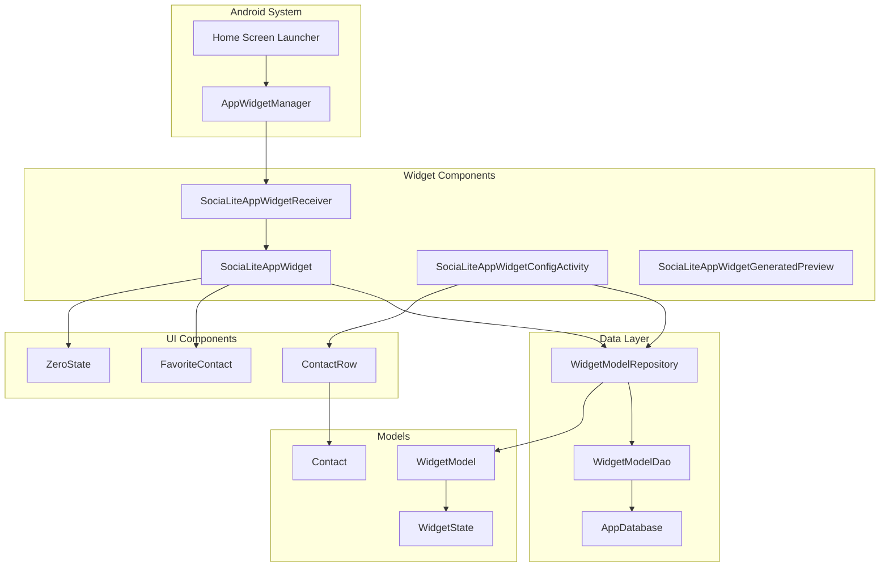
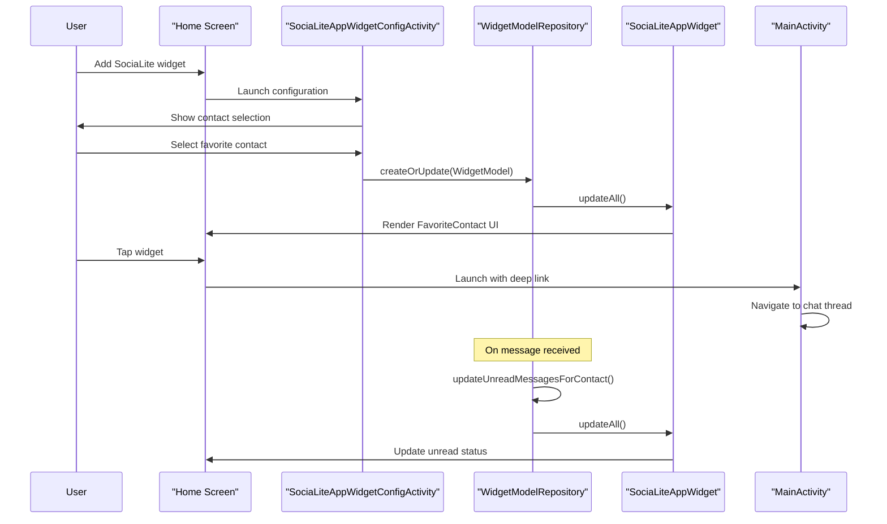
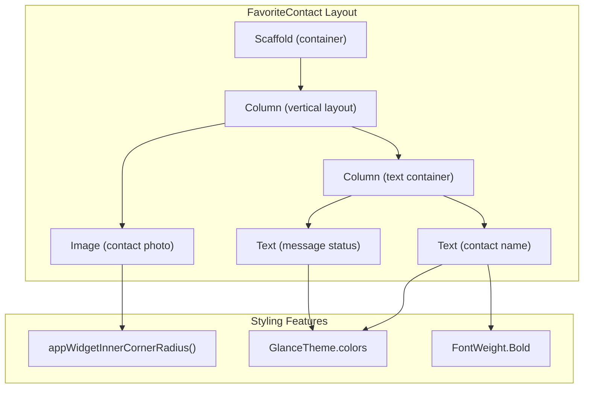
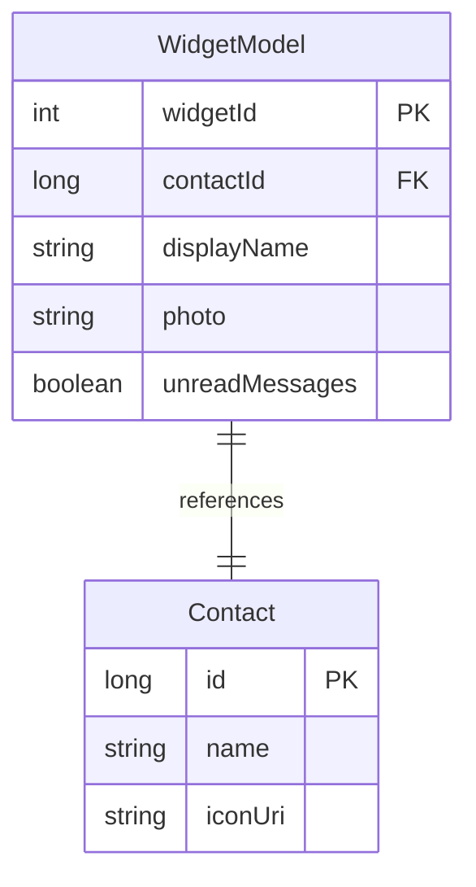

<!-- source: DeepWiki mcp.deepwiki.com · repo android/socialite · page 6.2 App Widgets · fetched 2026-10-23 -->

# App Widgets

<details>
<summary>Relevant source files</summary>

The following files were used as context for generating this wiki page:

- [app/src/main/java/com/google/android/samples/socialite/widget/SociaLiteAppWidget.kt](app/src/main/java/com/google/android/samples/socialite/widget/SociaLiteAppWidget.kt)
- [app/src/main/java/com/google/android/samples/socialite/widget/SociaLiteAppWidgetConfigActivity.kt](app/src/main/java/com/google/android/samples/socialite/widget/SociaLiteAppWidgetConfigActivity.kt)
- [app/src/main/java/com/google/android/samples/socialite/widget/SociaLiteAppWidgetGeneratedPreview.kt](app/src/main/java/com/google/android/samples/socialite/widget/SociaLiteAppWidgetGeneratedPreview.kt)
- [app/src/main/java/com/google/android/samples/socialite/widget/SociaLiteAppWidgetReceiver.kt](app/src/main/java/com/google/android/samples/socialite/widget/SociaLiteAppWidgetReceiver.kt)
- [app/src/main/java/com/google/android/samples/socialite/widget/model/WidgetModel.kt](app/src/main/java/com/google/android/samples/socialite/widget/model/WidgetModel.kt)
- [app/src/main/java/com/google/android/samples/socialite/widget/model/WidgetModelRepository.kt](app/src/main/java/com/google/android/samples/socialite/widget/model/WidgetModelRepository.kt)
- [app/src/main/java/com/google/android/samples/socialite/widget/ui/FavoriteContact.kt](app/src/main/java/com/google/android/samples/socialite/widget/ui/FavoriteContact.kt)
- [app/src/main/java/com/google/android/samples/socialite/widget/ui/ZeroState.kt](app/src/main/java/com/google/android/samples/socialite/widget/ui/ZeroState.kt)
- [app/src/main/res/xml/socialite_widget_info.xml](app/src/main/res/xml/socialite_widget_info.xml)

</details>


This document covers the home screen widget implementation in SociaLite that allows users to add favorite contacts to their device's home screen. The widget system uses Jetpack Glance framework for modern Compose-based widgets and integrates with the app's chat functionality.

For information about widget resource layouts and styling, see [Widget Resources](#6.3). For content sharing mechanisms used by widgets, see [Content Sharing](#6.4).

## Overview

The SociaLite app widget displays a selected favorite contact on the home screen, showing their photo, name, and unread message status. Users can tap the widget to navigate directly to the chat with that contact. The widget system consists of configuration screens, data management, and UI rendering components built with Jetpack Glance.

## Widget Architecture



Sources: [app/src/main/java/com/google/android/samples/socialite/widget/SociaLiteAppWidget.kt:40-70](), [app/src/main/java/com/google/android/samples/socialite/widget/SociaLiteAppWidgetReceiver.kt:26-37](), [app/src/main/java/com/google/android/samples/socialite/widget/model/WidgetModelRepository.kt:38-111]()

## Widget Lifecycle and Data Flow



Sources: [app/src/main/java/com/google/android/samples/socialite/widget/SociaLiteAppWidgetConfigActivity.kt:98-122](), [app/src/main/java/com/google/android/samples/socialite/widget/model/WidgetModelRepository.kt:93-110](), [app/src/main/java/com/google/android/samples/socialite/widget/SociaLiteAppWidget.kt:61-67]()

## Core Components

### SociaLiteAppWidget

The main widget implementation extends `GlanceAppWidget` and handles rendering the widget content based on the stored configuration:

| Method | Purpose |
|--------|---------|
| `provideGlance()` | Sets up widget content and data loading |
| `Content()` | Renders appropriate UI based on widget state |

The widget displays three possible states:
- `Loading`: Empty box during initialization
- `Empty`: `ZeroState` UI with configuration button
- `WidgetModel`: `FavoriteContact` UI with contact details

Sources: [app/src/main/java/com/google/android/samples/socialite/widget/SociaLiteAppWidget.kt:40-70]()

### Widget Configuration

The `SociaLiteAppWidgetConfigActivity` provides a contact selection interface using standard Jetpack Compose UI:

- Displays list of available contacts from `Contact.CONTACTS`
- Creates `WidgetModel` when user selects a contact
- Updates widget preview using `SociaLiteAppWidgetGeneratedPreview`
- Returns `RESULT_OK` to complete widget creation

Sources: [app/src/main/java/com/google/android/samples/socialite/widget/SociaLiteAppWidgetConfigActivity.kt:62-169]()

### Data Management

The `WidgetModelRepository` handles widget data persistence and updates:

| Method | Purpose |
|--------|---------|
| `createOrUpdate()` | Stores widget configuration |
| `loadModel()` | Reactive data loading with Flow |
| `cleanupWidgetModels()` | Removes orphaned widget data |
| `updateUnreadMessagesForContact()` | Updates message status |

The repository uses Hilt dependency injection and integrates with the Room database through `WidgetModelDao`.

Sources: [app/src/main/java/com/google/android/samples/socialite/widget/model/WidgetModelRepository.kt:38-111]()

## UI Components

### FavoriteContact Component

The `FavoriteContact` composable renders the configured widget using Glance components:



Key features:
- Contact photo with adaptive corner radius on Android 12+
- Contact name with bold typography
- Unread message indicator ("New Message!" or "No messages")
- Tap action that launches deep link to chat

Sources: [app/src/main/java/com/google/android/samples/socialite/widget/ui/FavoriteContact.kt:46-110]()

### ZeroState Component

The `ZeroState` displays when no contact is configured:

- Uses `Scaffold` with `TitleBar` showing app branding
- Central configuration button to launch `SociaLiteAppWidgetConfigActivity`
- Handles widget ID parameter passing for configuration

Sources: [app/src/main/java/com/google/android/samples/socialite/widget/ui/ZeroState.kt:38-62]()

## Widget Configuration Metadata

The widget behavior is defined in `socialite_widget_info.xml`:

| Property | Value | Purpose |
|----------|-------|---------|
| `minWidth/minHeight` | 110dp/116dp | Minimum widget size |
| `targetCellWidth/targetCellHeight` | 2x2 | Default grid placement |
| `resizeMode` | horizontal\|vertical | Allows resizing |
| `configure` | `SociaLiteAppWidgetConfigActivity` | Configuration screen |
| `widgetFeatures` | configuration_optional\|reconfigurable | User options |
| `updatePeriodMillis` | 3600000 | Update frequency (1 hour) |

Sources: [app/src/main/res/xml/socialite_widget_info.xml:17-35]()

## Data Model

The `WidgetModel` entity stores widget configuration:



The model implements `WidgetState` sealed interface alongside `Empty` and `Loading` states for reactive UI updates.

Sources: [app/src/main/java/com/google/android/samples/socialite/widget/model/WidgetModel.kt:25-50]()

## Deep Link Integration

Widget taps generate deep links to navigate directly to chat threads:

```kotlin
"https://socialite.google.com/chat/${model.contactId}"
```

The intent includes:
- `Intent.ACTION_VIEW` action
- `Intent.FLAG_ACTIVITY_CLEAR_TOP` flag
- Deep link URI for chat navigation

Sources: [app/src/main/java/com/google/android/samples/socialite/widget/SociaLiteAppWidget.kt:61-66]()

---

