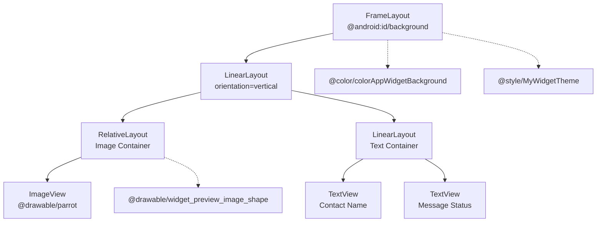
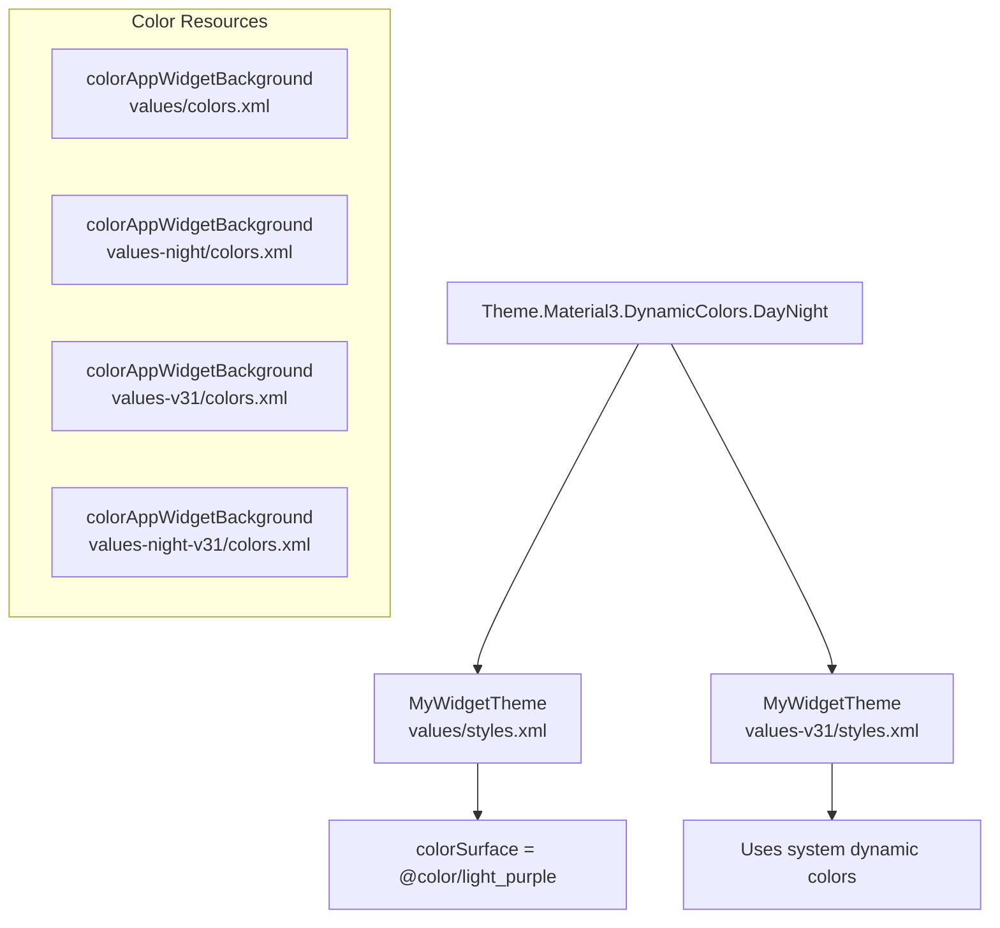
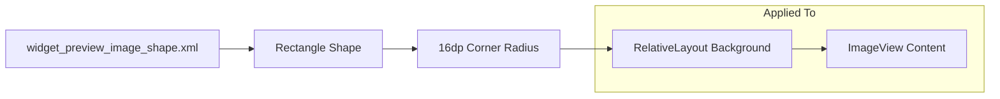
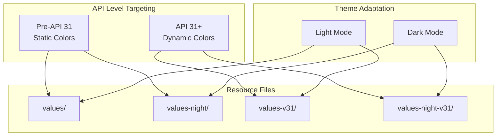

<!-- source: DeepWiki mcp.deepwiki.com · repo android/socialite · page 6.3 Widget Resources · fetched 2026-10-23 -->

# Widget Resources

<details>
<summary>Relevant source files</summary>

The following files were used as context for generating this wiki page:

- [app/src/main/res/drawable/widget_preview_image_shape.xml](app/src/main/res/drawable/widget_preview_image_shape.xml)
- [app/src/main/res/layout/widget_preview.xml](app/src/main/res/layout/widget_preview.xml)
- [app/src/main/res/values-night-v31/colors.xml](app/src/main/res/values-night-v31/colors.xml)
- [app/src/main/res/values-night/colors.xml](app/src/main/res/values-night/colors.xml)
- [app/src/main/res/values-v31/colors.xml](app/src/main/res/values-v31/colors.xml)
- [app/src/main/res/values-v31/styles.xml](app/src/main/res/values-v31/styles.xml)
- [app/src/main/res/values/styles.xml](app/src/main/res/values/styles.xml)

</details>


This document covers the visual resources, layout files, styling configurations, and theme adaptations that support the SociaLite app widget functionality. These resources define the appearance, colors, and visual structure used in widget previews and theming.

For information about the actual widget implementation logic and Glance framework integration, see [App Widgets](#6.2).

## Widget Preview Layout

The widget preview layout defines the visual structure shown to users when configuring the app widget. The main layout is implemented in `widget_preview.xml` and provides a template showing how contact information and media will be displayed.

### Layout Structure



The layout consists of a main `FrameLayout` container with the background color and theme applied, containing a vertical `LinearLayout` that organizes the image area and text information sections.

**Sources:** [app/src/main/res/layout/widget_preview.xml:17-72]()

### Image Container Configuration

The image container uses a `RelativeLayout` with specific styling attributes:

| Attribute | Value | Purpose |
|-----------|-------|---------|
| `android:background` | `@drawable/widget_preview_image_shape` | Applies rounded corners |
| `android:layout_weight` | `1` | Takes up remaining vertical space |
| `android:clipToOutline` | `true` | Clips content to background shape |
| `android:outlineProvider` | `background` | Uses background for outline |

The contained `ImageView` uses `centerCrop` scaling and displays the default parrot image resource.

**Sources:** [app/src/main/res/layout/widget_preview.xml:30-43]()

### Text Display Configuration

The text container displays contact information with two `TextView` elements:

| Element | Configuration | Content |
|---------|---------------|---------|
| Contact Name | `textSize="24sp"`, `textStyle="bold"` | "Parrot" |
| Message Status | `textSize="16sp"`, `textStyle="bold"` | "No messages" |

Both text views use `?attr/colorOnSurface` for theming compatibility and `textAlignment="center"` for consistent layout.

**Sources:** [app/src/main/res/layout/widget_preview.xml:44-70]()

## Theme and Color Resources

The widget theme system adapts to different Android versions and user preferences through a layered resource configuration approach.

### Theme Adaptation System



### Background Color Configuration

The widget background color adapts to system themes and Android versions:

| Configuration | Resource Value | Usage |
|---------------|----------------|-------|
| Default | Static color value | Pre-API 31 devices |
| Night Mode | `#ff20333d` | Dark theme on pre-API 31 |
| API 31+ Light | `@android:color/system_accent2_50` | Dynamic theming light mode |
| API 31+ Dark | `@android:color/system_accent2_800` | Dynamic theming dark mode |

**Sources:** [app/src/main/res/values-night/colors.xml:18](), [app/src/main/res/values-v31/colors.xml:18](), [app/src/main/res/values-night-v31/colors.xml:18]()

### Style Theme Inheritance

The widget theme configuration varies by Android version:

#### Pre-API 31 Theme
```xml
<style name="MyWidgetTheme" parent="Theme.Material3.DynamicColors.DayNight">
    <item name="colorSurface">@color/light_purple</item>
</style>
```

#### API 31+ Theme
```xml
<style name="MyWidgetTheme" parent="Theme.Material3.DynamicColors.DayNight">
    <!-- No color overrides - uses system dynamic colors -->
</style>
```

**Sources:** [app/src/main/res/values/styles.xml:18-21](), [app/src/main/res/values-v31/styles.xml:18-19]()

## Drawable Resources

### Image Shape Definition

The widget preview image uses a rounded rectangle shape defined in `widget_preview_image_shape.xml`:



The shape drawable provides a 16dp corner radius for a modern, rounded appearance that integrates well with Material Design principles.

**Sources:** [app/src/main/res/drawable/widget_preview_image_shape.xml:17-20]()

## Cross-Platform Compatibility

The resource system ensures compatibility across different Android versions and user configurations through strategic resource qualification.

### Resource Qualification Strategy



### Compatibility Matrix

| Android Version | Light Theme | Dark Theme | Color Source |
|-----------------|-------------|------------|--------------|
| API < 31 | Custom colors | `#ff20333d` | Static definitions |
| API ≥ 31 | `system_accent2_50` | `system_accent2_800` | Dynamic theming |

This approach ensures the widget appearance adapts appropriately to both system capabilities and user preferences while maintaining visual consistency across the platform.

**Sources:** [app/src/main/res/values-night/colors.xml:18](), [app/src/main/res/values-v31/colors.xml:18](), [app/src/main/res/values-night-v31/colors.xml:18](), [app/src/main/res/values/styles.xml:18-21](), [app/src/main/res/values-v31/styles.xml:18-19]()

---

