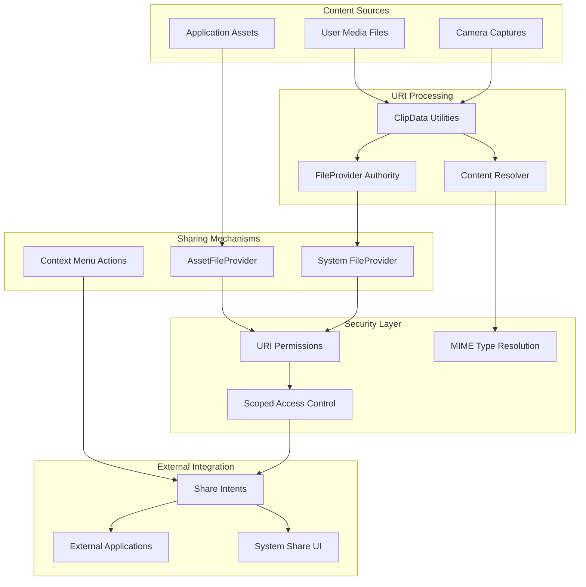
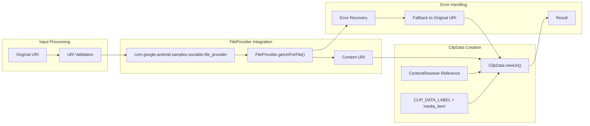
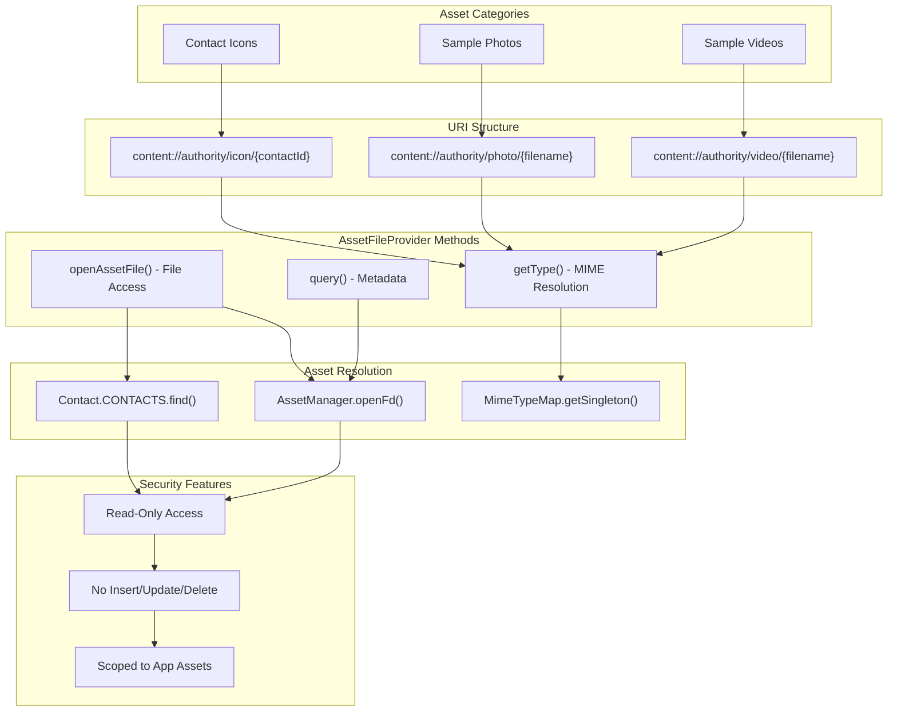
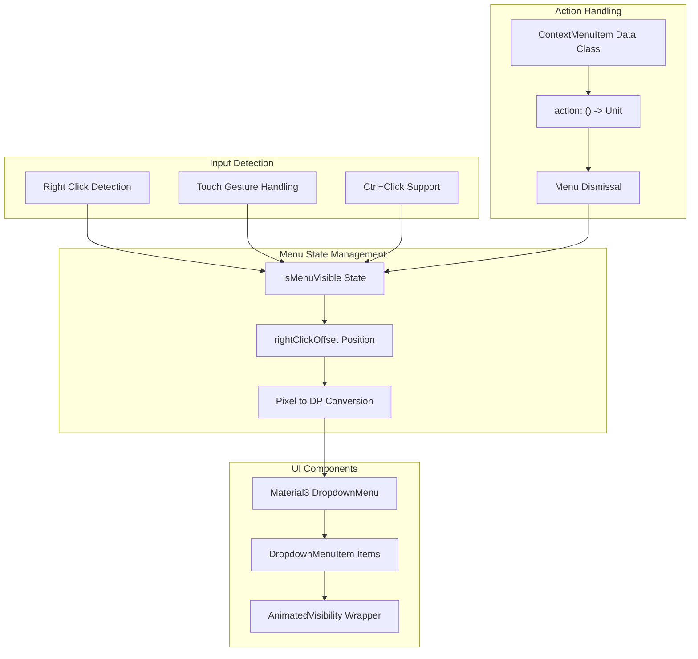

<!-- source: DeepWiki mcp.deepwiki.com · repo android/socialite · page 6.4 Content Sharing · fetched 2026-10-23 -->

# Content Sharing

<details>
<summary>Relevant source files</summary>

The following files were used as context for generating this wiki page:

- [app/src/main/java/com/google/android/samples/socialite/AssetFileProvider.kt](app/src/main/java/com/google/android/samples/socialite/AssetFileProvider.kt)
- [app/src/main/java/com/google/android/samples/socialite/ui/components/ClipData.kt](app/src/main/java/com/google/android/samples/socialite/ui/components/ClipData.kt)
- [app/src/main/java/com/google/android/samples/socialite/ui/components/ContextMenuArea.kt](app/src/main/java/com/google/android/samples/socialite/ui/components/ContextMenuArea.kt)

</details>


This document explains the content sharing mechanisms in SociaLite, covering ClipData generation for secure content sharing, FileProvider configuration for URI access control, and the asset sharing system for bundled application resources. For information about media processing and video editing, see [Media Processing](#4.4). For details about notifications and external app integration, see [Notifications and Bubbles](#6.1).

## Overview

SociaLite implements a comprehensive content sharing system that enables secure sharing of media files and application assets both within the app and with external applications. The system uses Android's ContentProvider framework and FileProvider mechanisms to ensure proper URI permissions and security boundaries.

## Content Sharing Architecture

The content sharing system consists of three main components: ClipData utilities for secure URI sharing, a custom AssetFileProvider for bundled resources, and UI integration for context-sensitive sharing actions.



Sources: [app/src/main/java/com/google/android/samples/socialite/ui/components/ClipData.kt:1-50](), [app/src/main/java/com/google/android/samples/socialite/AssetFileProvider.kt:1-103]()

## ClipData Generation

The `ClipData` utility system provides secure mechanisms for creating shareable content URIs. The primary entry point is the `tryCreateClipData` function which handles URI transformation and permission management.

### URI Transformation Flow



Sources: [app/src/main/java/com/google/android/samples/socialite/ui/components/ClipData.kt:27-35](), [app/src/main/java/com/google/android/samples/socialite/ui/components/ClipData.kt:37-49]()

### Implementation Details

The `tryCreateClipData` function implements a two-stage approach:

1. **Primary Path**: Convert file URIs to content URIs using FileProvider with authority `com.google.android.samples.socialite.file_provider`
2. **Fallback Path**: Use the original URI if FileProvider conversion fails

```kotlin
// Key function signature from ClipData.kt
internal fun Context.tryCreateClipData(uri: Uri): Result<ClipData>
```

The function uses the `Result<T>` pattern for error handling, allowing callers to recover gracefully from URI transformation failures. The `CLIP_DATA_LABEL` constant "media_item" provides a descriptive label for the clipboard entry.

Sources: [app/src/main/java/com/google/android/samples/socialite/ui/components/ClipData.kt:25-35](), [app/src/main/java/com/google/android/samples/socialite/ui/components/ClipData.kt:38-49]()

## Asset File Provider

The `AssetFileProvider` class extends Android's `ContentProvider` to enable secure access to bundled application assets including contact icons, sample photos, and videos.

### Asset Provider Architecture



Sources: [app/src/main/java/com/google/android/samples/socialite/AssetFileProvider.kt:28-61](), [app/src/main/java/com/google/android/samples/socialite/AssetFileProvider.kt:86-101]()

### URI Path Handling

The `AssetFileProvider` supports three distinct URI patterns:

| Asset Type | URI Pattern | Resolution Method |
|------------|-------------|------------------|
| Contact Icons | `/icon/{contactId}` | Lookup in `Contact.CONTACTS` by ID |
| Sample Photos | `/photo/{filename}` | Direct asset file access |
| Sample Videos | `/video/{filename}` | Direct asset file access |

The provider implements MIME type resolution using `MimeTypeMap` with special handling for contact icons, which default to JPEG format. The `openAssetFile` method returns `AssetFileDescriptor` objects that provide direct access to asset resources.

Sources: [app/src/main/java/com/google/android/samples/socialite/AssetFileProvider.kt:44-61](), [app/src/main/java/com/google/android/samples/socialite/AssetFileProvider.kt:34-42]()

## Context Menu Integration

The `ContextMenuArea` component provides UI integration for content sharing actions through right-click context menus and touch-based interactions.

### Context Menu Implementation



Sources: [app/src/main/java/com/google/android/samples/socialite/ui/components/ContextMenuArea.kt:89-108](), [app/src/main/java/com/google/android/samples/socialite/ui/components/ContextMenuArea.kt:46-85]()

The component supports both traditional right-click and Ctrl+primary-click interactions, making it accessible across different input methods. The `ContextMenuItem` data class encapsulates menu actions with string labels and callback functions.

Sources: [app/src/main/java/com/google/android/samples/socialite/ui/components/ContextMenuArea.kt:129-132](), [app/src/main/java/com/google/android/samples/socialite/ui/components/ContextMenuArea.kt:110-127]()

## Security Considerations

The content sharing system implements several security measures:

1. **FileProvider Authority**: Uses dedicated authority `com.google.android.samples.socialite.file_provider` for scoped file access
2. **Read-Only Assets**: AssetFileProvider explicitly throws `UnsupportedOperationException` for write operations
3. **URI Validation**: ClipData generation includes path validation and graceful error handling
4. **MIME Type Safety**: Proper MIME type resolution prevents content type confusion

The system ensures that external applications can only access explicitly shared content through well-defined provider interfaces, maintaining the security boundary between the application and external consumers.

Sources: [app/src/main/java/com/google/android/samples/socialite/ui/components/ClipData.kt:40-48](), [app/src/main/java/com/google/android/samples/socialite/AssetFileProvider.kt:86-101]()

---

