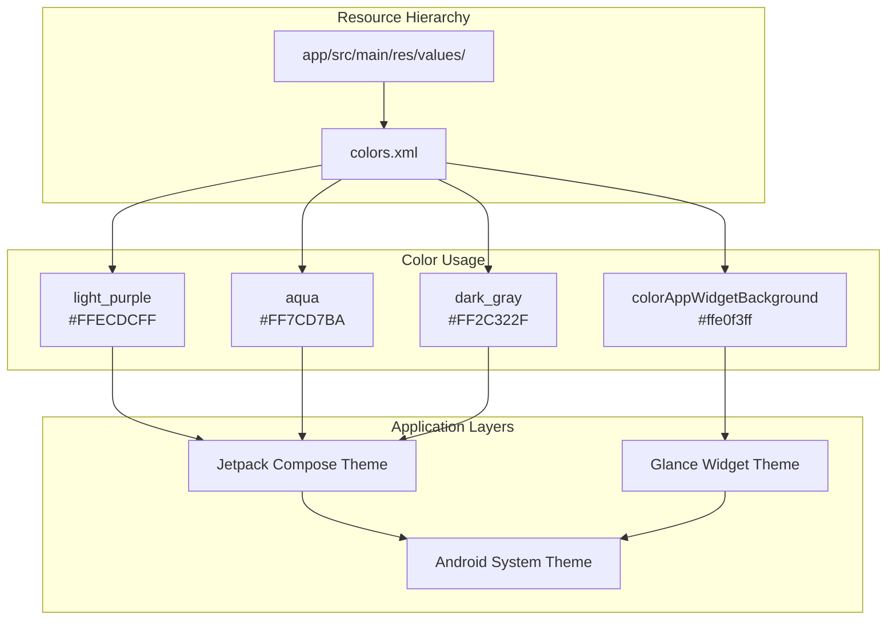
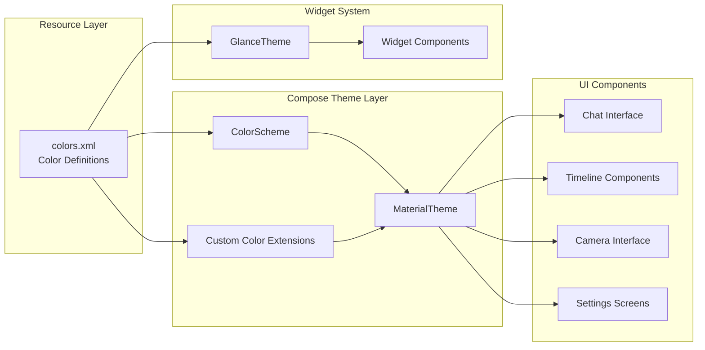

<!-- source: DeepWiki mcp.deepwiki.com · repo android/socialite · page 7 Resources and Styling · fetched 2026-10-23 -->

# Resources and Styling

Relevant source files

The following files were used as context for generating this wiki page:

- [app/src/main/res/values/colors.xml](app/src/main/res/values/colors.xml)

## Purpose and Scope

This document covers the visual resources and styling approach used throughout the SociaLite application. It focuses on the color system, resource organization, and how styling integrates with the Jetpack Compose UI framework and Android app widgets. For information about specific UI components and their implementation, see [User Interface](#5). For widget-specific resource layouts, see [Widget Resources](#6.3).

## Color System

The application uses a focused color palette defined in the main color resources file. The color system supports both the main application interface and app widget theming.

### Primary Color Definitions

| Color Name | Hex Value | Purpose |
|------------|-----------|---------|
| `light_purple` | `#FFECDCFF` | Light theme accent color |
| `aqua` | `#FF7CD7BA` | Secondary accent color |
| `dark_gray` | `#FF2C322F` | Dark theme background/text |
| `colorAppWidgetBackground` | `#ffe0f3ff` | Widget-specific background |

The color palette reflects a modern, accessible design approach with sufficient contrast ratios. The `colorAppWidgetBackground` specifically targets the Glance-based app widget system, providing a distinct visual identity for home screen widgets.

**Sources:** [app/src/main/res/values/colors.xml:17-24]()

## Resource Organization

The styling resources follow Android's standard resource organization pattern, with colors centralized in the values directory structure.

**Sources:** [app/src/main/res/values/colors.xml:1-24]()

## Jetpack Compose Integration

The color resources integrate with Jetpack Compose through Material Design 3 theming. The custom colors complement the Material You dynamic color system while providing consistent brand colors across different Android versions and device configurations.

### Theme Integration Flow

**Sources:** [app/src/main/res/values/colors.xml:19-23]()

## Widget-Specific Styling

The application includes dedicated styling for app widgets through the Glance framework. The `colorAppWidgetBackground` provides a consistent background color for widget content, ensuring proper contrast and readability on various home screen backgrounds.

### Widget Color System

The widget theming system operates independently from the main application theme to account for the different rendering context of home screen widgets:

- **Background Color**: `colorAppWidgetBackground` (#ffe0f3ff) provides a light, semi-transparent background
- **System Integration**: Colors adapt to system-level theming preferences
- **Accessibility**: Color choices maintain proper contrast ratios for widget content

**Sources:** [app/src/main/res/values/colors.xml:22]()

## Design Philosophy

The color system reflects several key design principles:

1. **Minimal Palette**: A focused set of four colors reduces complexity and maintains visual consistency
2. **Accessibility First**: Color choices prioritize contrast and readability
3. **System Integration**: Colors work harmoniously with Material You dynamic theming
4. **Cross-Context Consistency**: Separate but coordinated theming for app and widget contexts

The styling approach supports the application's role as a demonstration of modern Android development practices, showcasing how to implement cohesive visual design across different UI frameworks and system contexts.

**Sources:** [app/src/main/res/values/colors.xml:17-24]()