# Page: Overview

# Overview

<details>
<summary>Relevant source files</summary>

The following files were used as context for generating this wiki page:

- [README.md](README.md)
- [app/build.gradle.kts](app/build.gradle.kts)
- [app/google-services.json](app/google-services.json)
- [app/src/main/java/com/google/android/samples/socialite/README.md](app/src/main/java/com/google/android/samples/socialite/README.md)
- [app/src/main/java/com/google/android/samples/socialite/model/README.md](app/src/main/java/com/google/android/samples/socialite/model/README.md)
- [app/src/main/java/com/google/android/samples/socialite/repository/ChatRepository.kt](app/src/main/java/com/google/android/samples/socialite/repository/ChatRepository.kt)
- [app/src/main/java/com/google/android/samples/socialite/ui/camera/README.md](app/src/main/java/com/google/android/samples/socialite/ui/camera/README.md)
- [app/src/main/java/com/google/android/samples/socialite/ui/videoedit/README.md](app/src/main/java/com/google/android/samples/socialite/ui/videoedit/README.md)
- [app/src/main/res/values/strings.xml](app/src/main/res/values/strings.xml)
- [gradle/libs.versions.toml](gradle/libs.versions.toml)

</details>


This document provides a comprehensive overview of the SociaLite Android application, covering its purpose, architecture, core technologies, and main features. SociaLite is a sample application that demonstrates modern Android development practices using Jetpack components, AI integration, and media processing capabilities.

For detailed information about specific subsystems, see [Getting Started](#2), [Architecture](#3), [Core Features](#4), [User Interface](#5), and [System Integration](#6).

## Purpose and Scope

SociaLite is an Android sample application designed to showcase the implementation of features commonly found in social networking apps. The application serves as a comprehensive demonstration of modern Android development practices, leveraging various [Jetpack APIs](https://developer.android.com/jetpack/getting-started) and external services to achieve complex functionality with reliable performance across different devices.

**Sources:** [README.md:1-22]()

## Application Architecture

SociaLite follows the Model-View-ViewModel (MVVM) architectural pattern with a layered approach that promotes separation of concerns and maintainability.

### High-Level Architecture Diagram

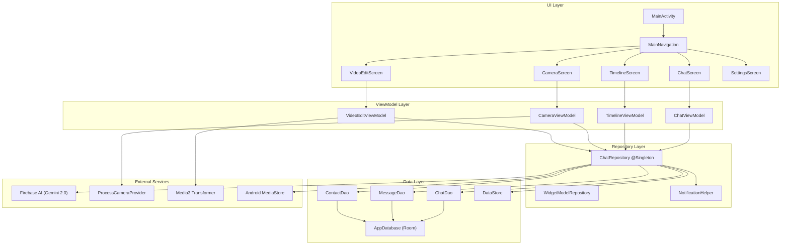

**Sources:** [app/src/main/java/com/google/android/samples/socialite/README.md:1-13](), [app/src/main/java/com/google/android/samples/socialite/repository/ChatRepository.kt:61-71]()

### Core Technologies and Dependencies

The application is built using modern Android development technologies managed through Gradle's version catalog system.

| Category | Technologies | Version Catalog Reference |
|----------|-------------|---------------------------|
| **UI Framework** | Jetpack Compose, Material3 | `compose_bom = "2025.05.01"` |
| **Architecture** | Hilt DI, Room Database, ViewModel | `hilt = "2.56.1"`, `room = "2.7.1"` |
| **Media Processing** | Media3, CameraX, ExoPlayer | `media3 = "1.5.0"`, `camera = "1.5.0-beta01"` |
| **AI Integration** | Firebase AI, Gemini API | `firebaseBoM = "33.14.0"`, `generativeai = "0.9.0"` |
| **System Integration** | Glance Widgets, Notifications | `glance = "1.1.1"`, `core = "1.16.0"` |

**Sources:** [gradle/libs.versions.toml:15-67](), [app/build.gradle.kts:92-192]()

## Main Application Features

SociaLite implements several core features that demonstrate different aspects of Android development:

### Core Feature Set

- **Chat System**: Real-time messaging with AI-powered responses via Gemini API
- **Media Capture**: In-app camera with CameraX integration for photos and videos  
- **Media Processing**: Video editing capabilities using Media3 Transformer
- **Timeline Display**: Media gallery with ExoPlayer-based video playback
- **Smart Notifications**: Bubble notifications and direct reply functionality
- **Home Screen Widgets**: Glance-based favorite contact widgets
- **AI Integration**: Firebase AI with Gemini 2.0 Flash for intelligent chat responses

**Sources:** [README.md:23-42](), [app/src/main/res/values/strings.xml:17-93]()

### Data Flow Architecture

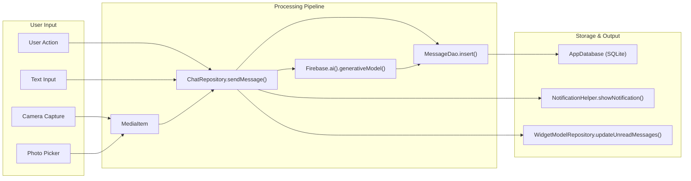

**Sources:** [app/src/main/java/com/google/android/samples/socialite/repository/ChatRepository.kt:96-206](), [app/src/main/java/com/google/android/samples/socialite/ui/chat/MediaItem.kt]()

## Project Structure

The application follows a multi-module structure with clear separation of concerns:

```
socialite/
├── app/                          # Main application module
│   ├── src/main/java/com/google/android/samples/socialite/
│   │   ├── data/                 # Data layer (Room, DAOs)
│   │   ├── model/                # Data models and entities
│   │   ├── repository/           # Business logic layer
│   │   ├── ui/                   # Jetpack Compose UI layer
│   │   │   ├── camera/          # Camera feature
│   │   │   ├── chat/            # Chat and messaging
│   │   │   ├── timeline/        # Media timeline
│   │   │   ├── videoedit/       # Video editing
│   │   │   └── settings/        # App settings
│   │   └── widget/              # Glance app widgets
│   ├── src/main/res/            # Android resources
│   └── build.gradle.kts         # Module build configuration
├── baselineprofile/             # Performance optimization profiles
├── gradle/libs.versions.toml    # Dependency version catalog
└── build.gradle.kts            # Root project configuration
```

**Sources:** [README.md:43-69](), [app/src/main/java/com/google/android/samples/socialite/README.md:1-13]()

## Getting Started

To run SociaLite:

1. **Clone and Build**: Open the project in Android Studio and sync dependencies
2. **Basic Functionality**: Run the `app` configuration for core features  
3. **AI Features** (Optional): Set up Firebase project and replace `google-services.json` for Gemini AI integration
4. **Enable AI Chatbot**: In Settings, toggle the "AI Chatbot" option after Firebase setup

The application requires Android API level 21+ and targets API level 35 with compilation against API level 36.

**Sources:** [README.md:70-80](), [app/build.gradle.kts:44-48](), [app/google-services.json:1-31]()

---

# Page: Getting Started

# Getting Started

<details>
<summary>Relevant source files</summary>

The following files were used as context for generating this wiki page:

- [README.md](README.md)
- [app/build.gradle.kts](app/build.gradle.kts)
- [app/google-services.json](app/google-services.json)
- [app/src/main/java/com/google/android/samples/socialite/repository/ChatRepository.kt](app/src/main/java/com/google/android/samples/socialite/repository/ChatRepository.kt)
- [app/src/main/res/values/strings.xml](app/src/main/res/values/strings.xml)
- [baselineprofile/.gitignore](baselineprofile/.gitignore)
- [baselineprofile/build.gradle.kts](baselineprofile/build.gradle.kts)
- [baselineprofile/src/main/AndroidManifest.xml](baselineprofile/src/main/AndroidManifest.xml)
- [build.gradle.kts](build.gradle.kts)
- [gradle/libs.versions.toml](gradle/libs.versions.toml)
- [settings.gradle.kts](settings.gradle.kts)

</details>


This document provides technical guidance for setting up, building, and running the SociaLite Android application. It covers the build system configuration, dependency management, and module structure required for development.

For information about the overall application architecture and component interactions, see [Architecture](#3). For details about specific features like chat, media, and AI integration, see [Core Features](#4).

## Prerequisites

The SociaLite project requires the following development environment:

| Component | Version | Configuration |
|-----------|---------|---------------|
| Android Studio | Latest stable | With Kotlin support |
| Java | 17 | JVM toolchain configured |
| Android SDK | API 21-36 | Min SDK 21, Target SDK 35, Compile SDK 36 |
| Gradle | 8.9+ | Managed by wrapper |

Sources: [app/build.gradle.kts:32-34](), [app/build.gradle.kts:42-47](), [app/build.gradle.kts:60-67]()

## Project Structure

SociaLite uses a multi-module Gradle project with dependency management via version catalogs:

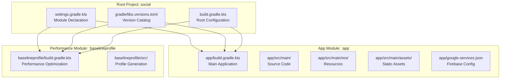

Sources: [settings.gradle.kts:40-42](), [build.gradle.kts:19-29](), [gradle/libs.versions.toml:15-67]()

## Build System Configuration

### Version Catalog Management

The project uses Gradle's version catalog system for centralized dependency management:

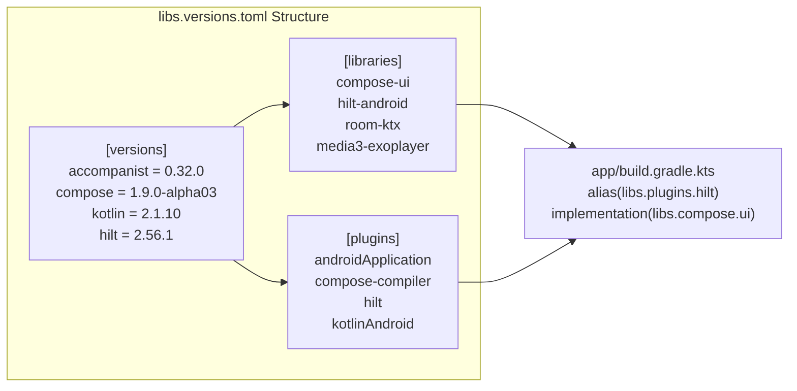

Key dependency categories managed in the version catalog:

| Category | Key Libraries | Purpose |
|----------|---------------|---------|
| UI Framework | `compose-bom`, `compose-ui`, `compose-material3` | Jetpack Compose UI |
| Dependency Injection | `hilt-android`, `hilt-compiler` | Dependency management |
| Database | `room-ktx`, `room-compiler` | Local data persistence |
| Media Processing | `media3-exoplayer`, `camera-core`, `camera-compose` | Media capture and playback |
| AI Integration | `firebase-ai`, `generativeai` | Gemini AI capabilities |

Sources: [gradle/libs.versions.toml:70-147](), [gradle/libs.versions.toml:149-162](), [app/build.gradle.kts:92-192]()

### Build Configuration

The main application module configuration includes:

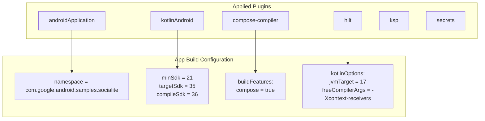

Sources: [app/build.gradle.kts:18-30](), [app/build.gradle.kts:40-52](), [app/build.gradle.kts:64-73]()

## Building and Running

### Standard Build Process

1. **Clone and Setup**:
   ```bash
   git clone https://github.com/android/socialite
   cd socialite
   ```

2. **Build with Gradle**:
   ```bash
   ./gradlew :app:assembleDebug
   ```

3. **Run Tests**:
   ```bash
   ./gradlew :app:testDebugUnitTest
   ./gradlew :app:connectedDebugAndroidTest
   ```

### Code Quality and Formatting

The project includes automated code formatting via Spotless:

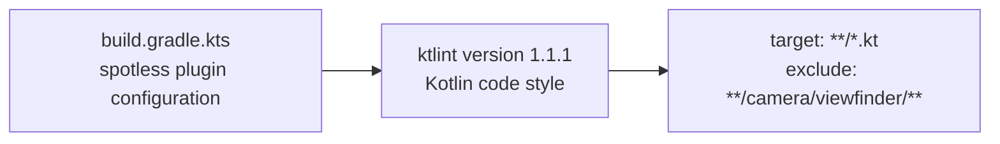

Apply formatting before committing:
```bash
./gradlew spotlessApply
```

Sources: [build.gradle.kts:32-43](), [gradle/libs.versions.toml:141]()

## Firebase AI Integration (Optional)

### Default Configuration

The project includes a mock Firebase configuration for basic functionality:

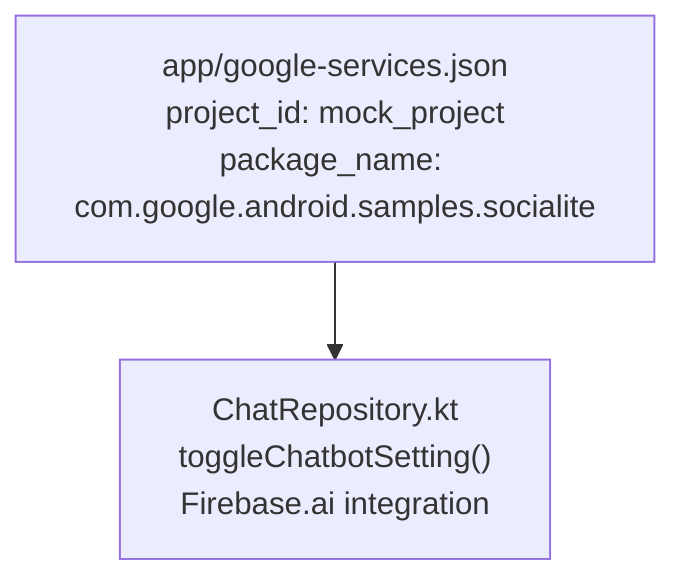

### Production Setup

To enable full AI capabilities:

1. **Create Firebase Project**: Follow [Firebase AI setup guide](https://firebase.google.com/docs/ai-logic/get-started?platform=android&api=dev)

2. **Replace Configuration**: Replace `app/google-services.json` with your project's configuration

3. **Enable AI Features**: 
   - Launch app
   - Navigate to Settings screen
   - Toggle "AI Chatbot" setting

The `ChatRepository` class handles AI integration through the Firebase AI SDK:

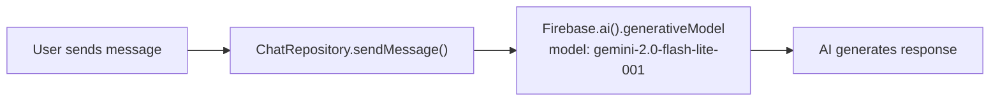

Sources: [app/google-services.json:1-30](), [app/src/main/java/com/google/android/samples/socialite/repository/ChatRepository.kt:114-120](), [app/src/main/java/com/google/android/samples/socialite/repository/ChatRepository.kt:396-414]()

## Performance Optimization

### Baseline Profiles

The project includes a dedicated module for generating baseline profiles to improve app startup performance:

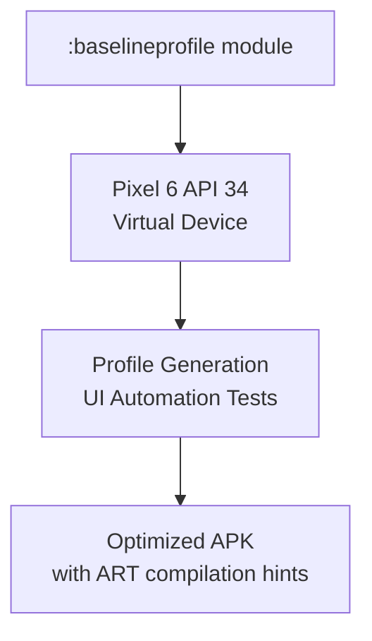

The baseline profile is automatically generated during release builds and included in the main app module.

Sources: [baselineprofile/build.gradle.kts:40-45](), [app/build.gradle.kts:114]()

## Asset Management

### Model Downloads

The project includes automatic download of ML models for camera effects:

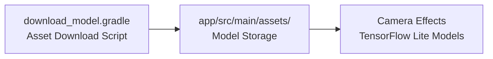

Models are downloaded automatically during build unless manually placed in the assets directory.

Sources: [app/build.gradle.kts:84-90]()

---

# Page: Build Configuration

# Build Configuration

<details>
<summary>Relevant source files</summary>

The following files were used as context for generating this wiki page:

- [README.md](README.md)
- [app/build.gradle.kts](app/build.gradle.kts)
- [app/google-services.json](app/google-services.json)
- [app/src/main/java/com/google/android/samples/socialite/repository/ChatRepository.kt](app/src/main/java/com/google/android/samples/socialite/repository/ChatRepository.kt)
- [app/src/main/res/values/strings.xml](app/src/main/res/values/strings.xml)
- [gradle.properties](gradle.properties)
- [gradle/libs.versions.toml](gradle/libs.versions.toml)
- [gradle/wrapper/gradle-wrapper.properties](gradle/wrapper/gradle-wrapper.properties)
- [settings.gradle.kts](settings.gradle.kts)

</details>


This document covers the Gradle build system configuration for the SociaLite Android application, including dependency management through version catalogs, multi-module project structure, and compilation settings. For information about the CI/CD pipeline and automated testing, see [CI/CD Pipeline](#2.2).

## Project Structure and Module Configuration

The SociaLite project follows a multi-module Gradle setup with centralized dependency management through version catalogs.

### Project Module Structure

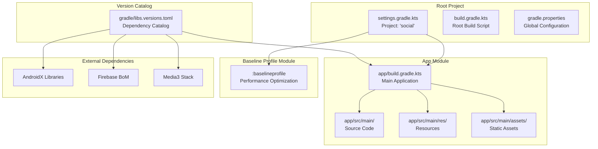

**Sources:** [settings.gradle.kts:40-42](), [app/build.gradle.kts:1-193](), [gradle/libs.versions.toml:1-163]()

## Version Catalog System

The project uses Gradle's version catalog feature for centralized dependency management, defined in `gradle/libs.versions.toml`.

### Version Catalog Structure

```mermaid
graph TB
    subgraph "libs.versions.toml"
        VersionsSection["[versions]<br/>Version Declarations"]
        LibrariesSection["[libraries]<br/>Library Declarations"]
        PluginsSection["[plugins]<br/>Plugin Declarations"]
    end
    
    subgraph "Key Versions"
        AGP["agp = '8.9.3'<br/>Android Gradle Plugin"]
        Kotlin["kotlin = '2.1.10'<br/>Kotlin Compiler"]
        ComposeBom["compose_bom = '2025.05.01'<br/>Compose Bill of Materials"]
        Hilt["hilt = '2.56.1'<br/>Dependency Injection"]
        Media3["media3 = '1.5.0'<br/>Media Framework"]
    end
    
    subgraph "Core Libraries"
        ComposeUI["compose-ui<br/>UI Framework"]
        ActivityCompose["activity-compose<br/>Activity Integration"]
        HiltAndroid["hilt-android<br/>DI Runtime"]
        Media3Exoplayer["media3-exoplayer<br/>Video Player"]
        CameraX["camera-core<br/>Camera APIs"]
    end
    
    subgraph "Plugin Aliases"
        AndroidApp["androidApplication<br/>Android App Plugin"]
        ComposeCompiler["compose-compiler<br/>Compose Compiler"]
        KSP["ksp<br/>Symbol Processing"]
    end
    
    VersionsSection --> AGP
    VersionsSection --> Kotlin
    VersionsSection --> ComposeBom
    VersionsSection --> Hilt
    VersionsSection --> Media3
    
    LibrariesSection --> ComposeUI
    LibrariesSection --> ActivityCompose
    LibrariesSection --> HiltAndroid
    LibrariesSection --> Media3Exoplayer
    LibrariesSection --> CameraX
    
    PluginsSection --> AndroidApp
    PluginsSection --> ComposeCompiler
    PluginsSection --> KSP
```

**Sources:** [gradle/libs.versions.toml:15-67](), [gradle/libs.versions.toml:70-147](), [gradle/libs.versions.toml:149-163]()

### Key Version Specifications

| Component | Version | Purpose |
|-----------|---------|---------|
| `agp` | 8.9.3 | Android Gradle Plugin for Android builds |
| `kotlin` | 2.1.10 | Kotlin compiler and language features |
| `compose_bom` | 2025.05.01 | Jetpack Compose Bill of Materials |
| `hilt` | 2.56.1 | Dependency injection framework |
| `media3` | 1.5.0 | Media playback and processing |
| `camera` | 1.5.0-beta01 | CameraX implementation |

**Sources:** [gradle/libs.versions.toml:18](), [gradle/libs.versions.toml:40](), [gradle/libs.versions.toml:26](), [gradle/libs.versions.toml:37](), [gradle/libs.versions.toml:49](), [gradle/libs.versions.toml:21]()

## App Module Build Configuration

The main application module is configured in `app/build.gradle.kts` with Android-specific settings and extensive dependency declarations.

### Plugin Configuration

```kotlin
plugins {
    alias(libs.plugins.androidApplication)
    alias(libs.plugins.baselineprofile)
    alias(libs.plugins.compose.compiler)
    alias(libs.plugins.hilt)
    alias(libs.plugins.kotlinAndroid)
    alias(libs.plugins.kotlinSerialization)
    alias(libs.plugins.ksp)
    alias(libs.plugins.secrets)
    alias(libs.plugins.download)
    alias(libs.plugins.google.gms.google.services)
    alias(libs.plugins.parcelize)
}
```

**Sources:** [app/build.gradle.kts:18-30]()

### Android Configuration Block

The `android` configuration block defines compilation settings, build variants, and feature flags:

```kotlin
android {
    namespace = "com.google.android.samples.socialite"
    compileSdk = 36
    
    defaultConfig {
        applicationId = "com.google.android.samples.socialite"
        minSdk = 21
        targetSdk = 35
        versionCode = 1
        versionName = "1.0"
        testInstrumentationRunner = "androidx.test.runner.AndroidJUnitRunner"
        vectorDrawables.useSupportLibrary = true
    }
}
```

**Sources:** [app/build.gradle.kts:40-52]()

### Compilation Settings

| Setting | Value | Purpose |
|---------|-------|---------|
| `compileSdk` | 36 | Target Android API level for compilation |
| `minSdk` | 21 | Minimum supported Android API level |
| `targetSdk` | 35 | Target Android API level for optimization |
| `jvmTarget` | "17" | Java bytecode target version |
| `kotlinCompilerExtensionVersion` | libs.versions.composeCompiler.get() | Compose compiler version |

**Sources:** [app/build.gradle.kts:42](), [app/build.gradle.kts:46](), [app/build.gradle.kts:47](), [app/build.gradle.kts:65](), [app/build.gradle.kts:72]()

### Kotlin Compiler Options

```kotlin
kotlinOptions {
    jvmTarget = "17"
    freeCompilerArgs = listOf("-Xcontext-receivers")
}
```

The `-Xcontext-receivers` flag enables experimental context receiver functionality for advanced Kotlin language features.

**Sources:** [app/build.gradle.kts:64-67]()

## Dependency Management

The project organizes dependencies into logical groups using the version catalog system.

### Core Android Dependencies

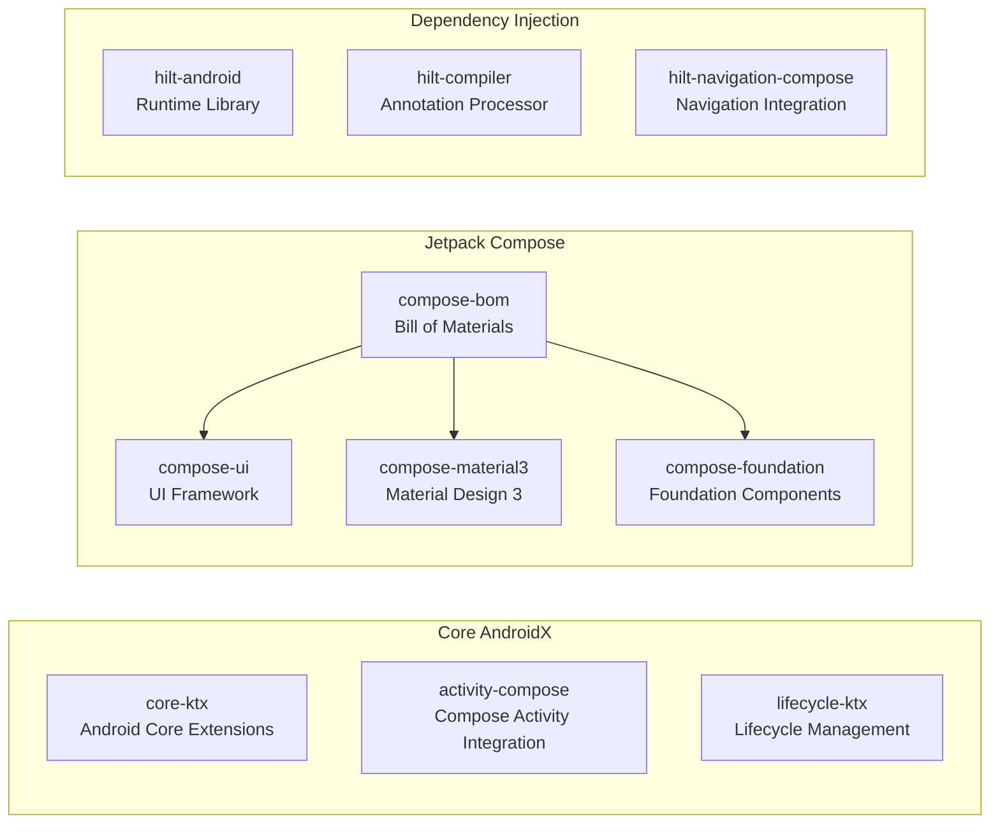

**Sources:** [app/build.gradle.kts:119-133](), [app/build.gradle.kts:170-172]()

### Media and Camera Dependencies

The application includes comprehensive media processing capabilities:

| Library Group | Components | Purpose |
|---------------|------------|---------|
| **CameraX** | `camera-core`, `camera-compose`, `camera2`, `camera-effects`, `camera-lifecycle`, `camera-view` | Camera capture and processing |
| **Media3** | `media3-common`, `media3-effect`, `media3-exoplayer`, `media3-transformer`, `media3-ui`, `media3-ui-compose` | Video playback and editing |
| **ML Kit** | `segmentation-selfie`, `vision-common` | Computer vision features |

**Sources:** [app/build.gradle.kts:156-162](), [app/build.gradle.kts:163-169](), [app/build.gradle.kts:104-105]()

### Firebase and AI Integration

```kotlin
implementation(platform(libs.firebase.bom))
implementation(libs.firebase.ai)
```

Firebase dependencies are managed through a Bill of Materials (BoM) to ensure version compatibility across Firebase services.

**Sources:** [app/build.gradle.kts:184-185]()

## Build Features and Configuration

### Compose Configuration

```kotlin
buildFeatures {
    compose = true
}
composeOptions {
    kotlinCompilerExtensionVersion = libs.versions.composeCompiler.get()
}
```

**Sources:** [app/build.gradle.kts:68-73]()

### Packaging Options

```kotlin
packaging {
    resources {
        excludes += "/META-INF/{AL2.0,LGPL2.1}"
    }
}
```

This configuration excludes license files to prevent packaging conflicts.

**Sources:** [app/build.gradle.kts:74-78]()

### Asset Management

The project includes an asset download system for ML models:

```kotlin
project.ext.set("ASSET_DIR", "$projectDir/src/main/assets")
project.ext.set("TEST_ASSETS_DIR", "$projectDir/src/androidTest/assets")
apply {
    from("download_model.gradle")
}
```

**Sources:** [app/build.gradle.kts:84-90]()

## Repository Configuration

The project uses multiple Maven repositories for dependency resolution:

```kotlin
repositories {
    google()
    mavenCentral()
    maven {
        url = uri("https://androidx.dev/snapshots/builds/13508953/artifacts/repository")
    }
}
```

This includes access to AndroidX snapshot builds for testing pre-release components.

**Sources:** [settings.gradle.kts:31-37]()

## Global Gradle Properties

Key configuration properties are defined in `gradle.properties`:

| Property | Value | Purpose |
|----------|-------|---------|
| `org.gradle.jvmargs` | `-Xmx2048m -Dfile.encoding=UTF-8` | JVM memory and encoding settings |
| `android.useAndroidX` | `true` | Enable AndroidX library usage |
| `kotlin.code.style` | `official` | Kotlin code formatting standard |
| `org.gradle.configuration-cache` | `true` | Enable Gradle configuration caching |

**Sources:** [gradle.properties:9](), [gradle.properties:17](), [gradle.properties:19](), [gradle.properties:28]()

---

# Page: CI/CD Pipeline

# CI/CD Pipeline

<details>
<summary>Relevant source files</summary>

The following files were used as context for generating this wiki page:

- [.github/workflows/build.yml](.github/workflows/build.yml)
- [.gitignore](.gitignore)
- [.idea/vcs.xml](.idea/vcs.xml)
- [CONTRIBUTING.md](CONTRIBUTING.md)
- [LICENSE](LICENSE)
- [baselineprofile/.gitignore](baselineprofile/.gitignore)
- [baselineprofile/build.gradle.kts](baselineprofile/build.gradle.kts)
- [baselineprofile/src/main/AndroidManifest.xml](baselineprofile/src/main/AndroidManifest.xml)
- [build.gradle.kts](build.gradle.kts)

</details>


This document describes the Continuous Integration and Continuous Deployment (CI/CD) pipeline for the SociaLite application. The pipeline automates code quality checks, builds, and performance optimization using GitHub Actions and Gradle build tools.

For information about the overall build configuration and dependency management, see [Build Configuration](#2.1).

## Workflow Overview

The SociaLite project uses GitHub Actions to automate the CI/CD process. The pipeline is triggered on pull requests, pushes to the main branch, and manual workflow dispatches. The primary workflow ensures code quality and successful builds before changes are merged.

## GitHub Actions Configuration

### Workflow Triggers and Permissions

The main workflow is defined in [.github/workflows/build.yml:1-13]() and supports multiple trigger mechanisms:

| Trigger Type | Description |
|--------------|-------------|
| `workflow_dispatch` | Manual trigger from GitHub UI |
| `push` to `main` | Automatic trigger on main branch updates |
| `pull_request` | Automatic trigger on PR events (opened, synchronized, reopened) |

The workflow runs with specific permissions configured in [.github/workflows/build.yml:10-12]():
- `contents: write` - Allows reading repository contents and writing build artifacts
- `actions: read` - Permits reading workflow and action metadata

### Build Environment

The CI environment is configured in [.github/workflows/build.yml:15-17]() with the following specifications:

```yaml
runs-on: ubuntu-latest
timeout-minutes: 60
```

The pipeline uses Ubuntu as the base operating system with a 60-minute timeout to prevent hanging builds.

### Build Steps

The workflow executes the following steps in sequence:

1. **Repository Checkout** - Uses `actions/checkout@v4` for source code retrieval
2. **Gradle Wrapper Validation** - Ensures build script integrity using `gradle/wrapper-validation-action@v2`
3. **JDK Setup** - Configures Java 17 with Zulu distribution via `actions/setup-java@v4`
4. **Gradle Setup** - Initializes Gradle build system using `gradle/gradle-build-action@v3`
5. **Code Quality Check** - Runs Spotless formatting verification
6. **Application Build** - Compiles the debug variant of the main application

Sources: [.github/workflows/build.yml:19-40]()

## Code Quality Pipeline

### Spotless Integration

The project enforces consistent code formatting using the Spotless plugin, configured across all subprojects in [build.gradle.kts:31-43]():

```kotlin
subprojects {
    plugins.apply(rootProject.libs.plugins.spotless.get().pluginId)
    configure<SpotlessExtension> {
        kotlin {
            target("**/*.kt")
            targetExclude("**/camera/viewfinder/**")
            ktlint(libs.ktlint.get().version)
        }
        kotlinGradle {
            ktlint(libs.ktlint.get().version)
        }
    }
}
```

The configuration applies `ktlint` formatting rules to:
- All Kotlin source files (`**/*.kt`)
- Kotlin Gradle build scripts (`**/*.gradle.kts`)
- Excludes camera viewfinder components from formatting checks

### Quality Gate Enforcement

The CI pipeline enforces code quality through [.github/workflows/build.yml:35-36]():

```bash
./gradlew spotlessCheck
```

This step must pass before the build proceeds, ensuring all code adheres to the established formatting standards.

Sources: [build.gradle.kts:17-43](), [.github/workflows/build.yml:35-36]()

## Build Process

### Multi-Module Build

The build process targets the main application module using [.github/workflows/build.yml:38-39]():

```bash
./gradlew :app:assembleDebug
```

This command:
- Builds only the `:app` module in debug configuration
- Skips other modules like `:baselineprofile` during CI
- Produces a debug APK for validation purposes

### Performance Optimization

The project includes a dedicated baseline profile module for runtime performance optimization. The configuration in [baselineprofile/build.gradle.kts:29-44]() defines:

- Target project path pointing to the main app
- Managed virtual device configuration using Pixel 6 API 34
- Baseline profile generation settings for ART optimization

The baseline profile module uses separate testing dependencies including:
- UI Automator for automated interactions
- Macro Benchmark for performance measurement
- JUnit and Espresso for test infrastructure

Sources: [.github/workflows/build.yml:38-39](), [baselineprofile/build.gradle.kts:29-44]()

## CI/CD Pipeline Flow

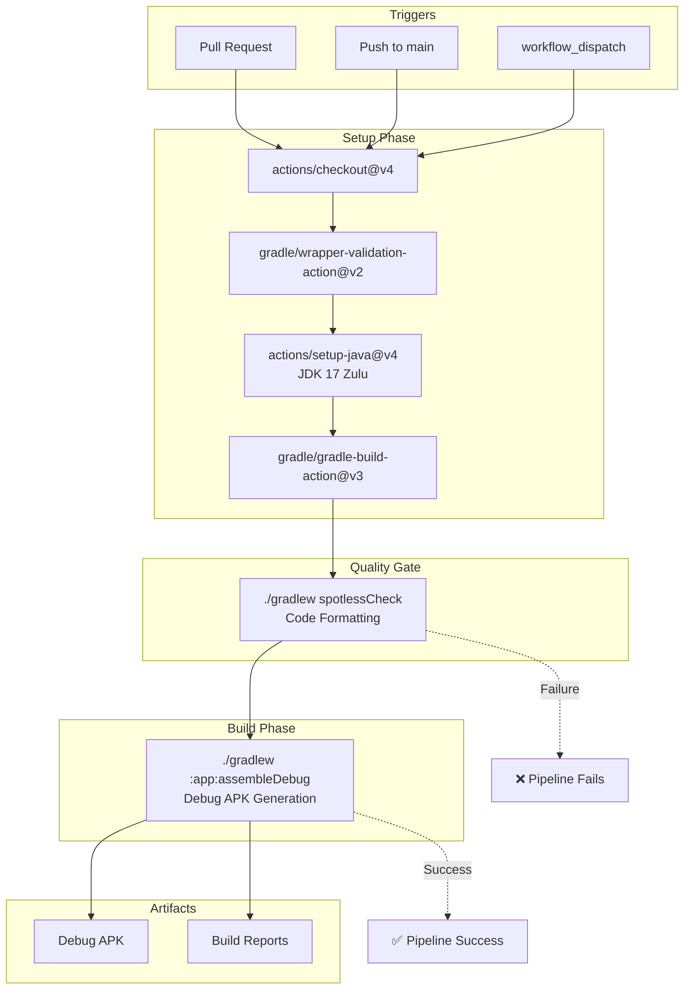

Sources: [.github/workflows/build.yml:1-40]()

## Build Configuration Integration

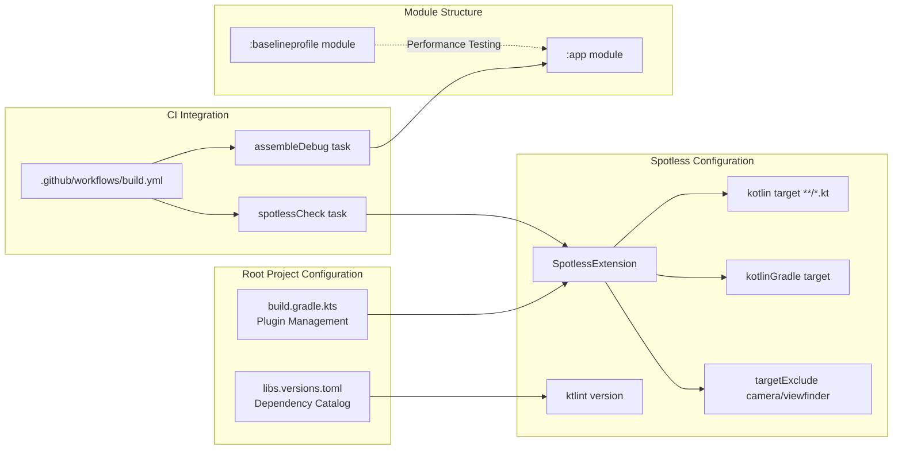

Sources: [build.gradle.kts:31-43](), [.github/workflows/build.yml:35-39](), [baselineprofile/build.gradle.kts:29]()

## Repository Configuration

The project maintains standard repository hygiene through [.gitignore:1-24](), excluding:

- Build artifacts (`/build`, `.gradle`)
- IDE configurations (`.idea` directories)
- Local development files (`local.properties`)
- Platform-specific files (`.DS_Store`)

This ensures clean repository state and prevents environment-specific artifacts from entering version control.

Sources: [.gitignore:1-24]()

---

# Page: Architecture

# Architecture

<details>
<summary>Relevant source files</summary>

The following files were used as context for generating this wiki page:

- [app/src/main/java/com/google/android/samples/socialite/README.md](app/src/main/java/com/google/android/samples/socialite/README.md)
- [app/src/main/java/com/google/android/samples/socialite/data/README.md](app/src/main/java/com/google/android/samples/socialite/data/README.md)
- [app/src/main/java/com/google/android/samples/socialite/model/README.md](app/src/main/java/com/google/android/samples/socialite/model/README.md)
- [app/src/main/java/com/google/android/samples/socialite/ui/README.md](app/src/main/java/com/google/android/samples/socialite/ui/README.md)
- [app/src/main/java/com/google/android/samples/socialite/ui/camera/README.md](app/src/main/java/com/google/android/samples/socialite/ui/camera/README.md)
- [app/src/main/java/com/google/android/samples/socialite/ui/chat/README.md](app/src/main/java/com/google/android/samples/socialite/ui/chat/README.md)
- [app/src/main/java/com/google/android/samples/socialite/ui/videoedit/README.md](app/src/main/java/com/google/android/samples/socialite/ui/videoedit/README.md)

</details>


This document explains the overall MVVM (Model-View-ViewModel) architecture of the SociaLite application, including data flow patterns and layer interactions. It provides a high-level view of how the different components and modules work together to deliver the app's functionality.

For detailed information about the navigation system implementation, see [Navigation System](#3.1). For specifics about data persistence and the Repository pattern, see [Data Layer](#3.2).

## Overall Architecture Overview

SociaLite follows a clean architecture pattern with clear separation of concerns across multiple layers. The application is structured around the MVVM architectural pattern, which promotes testability, maintainability, and clear data flow.

### High-Level Layer Structure

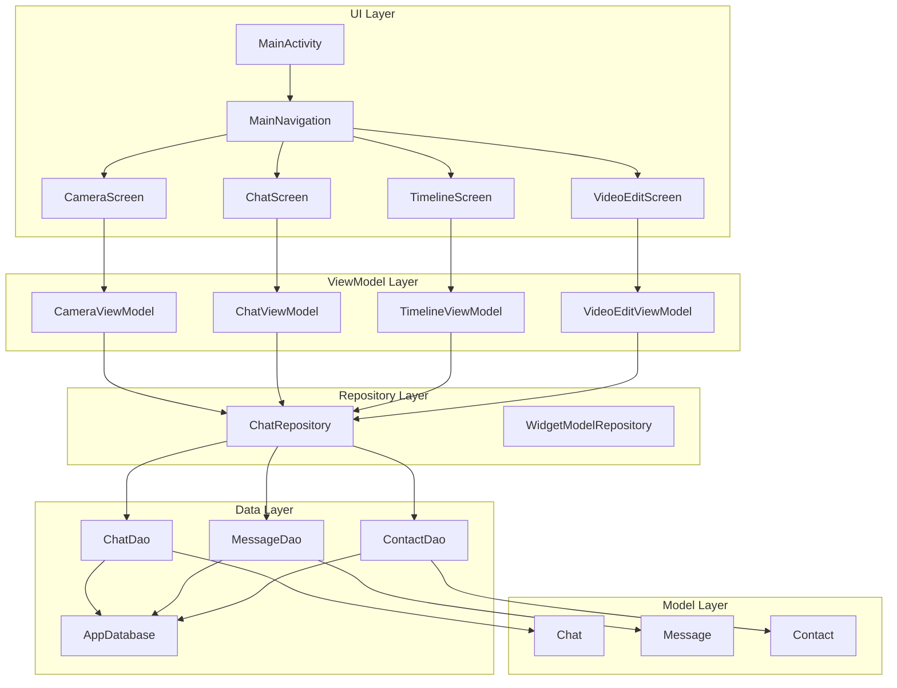

Sources: [app/src/main/java/com/google/android/samples/socialite/README.md:7-11](), [app/src/main/java/com/google/android/samples/socialite/ui/README.md:5-8](), [app/src/main/java/com/google/android/samples/socialite/data/README.md:5-7]()

## MVVM Pattern Implementation

The application strictly follows the MVVM architectural pattern with clear responsibilities for each component:

### Package Structure and Responsibilities

| Layer | Package | Responsibilities | Key Classes |
|-------|---------|------------------|-------------|
| **UI Layer** | `ui/` | Jetpack Compose screens, user interactions | `CameraScreen`, `ChatScreen`, `TimelineScreen` |
| **ViewModel Layer** | `ui/*/` | UI state management, business logic coordination | `CameraViewModel`, `ChatViewModel` |
| **Repository Layer** | `repository/` | Data abstraction, business logic | `ChatRepository`, `WidgetModelRepository` |
| **Data Layer** | `data/` | Data access, persistence | `AppDatabase`, DAOs |
| **Model Layer** | `model/` | Data structures, entities | `Message`, `Chat`, `Contact` |

### Component Interaction Pattern

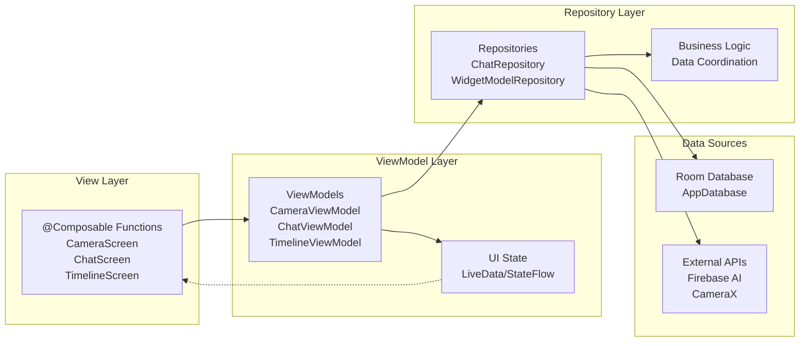

Sources: [app/src/main/java/com/google/android/samples/socialite/ui/README.md:7-9](), [app/src/main/java/com/google/android/samples/socialite/data/README.md:6-7]()

## Layer Interaction and Data Flow

### Unidirectional Data Flow

The application implements unidirectional data flow where data flows down through the layers and events flow up:

1. **User Interactions**: Captured in Compose UI components
2. **Event Handling**: ViewModels process user actions
3. **Data Operations**: Repositories handle business logic and data access
4. **State Updates**: ViewModels expose updated state to UI
5. **UI Recomposition**: Compose reacts to state changes

### Core Data Flow Example

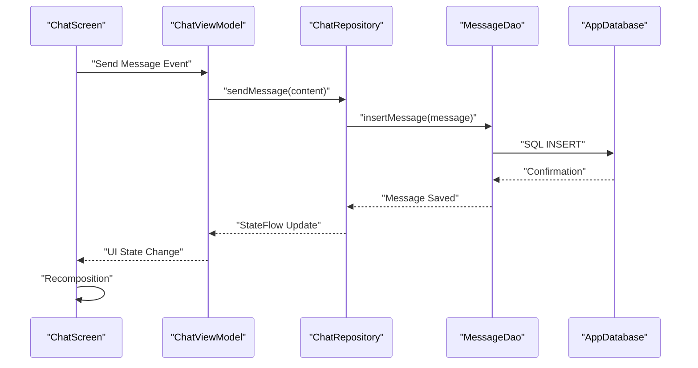

Sources: [app/src/main/java/com/google/android/samples/socialite/ui/chat/README.md:7-8](), [app/src/main/java/com/google/android/samples/socialite/data/README.md:6]()

## Module Organization

### Feature-Based Module Structure

Each major feature is organized into its own module within the `ui/` package, following a consistent structure:

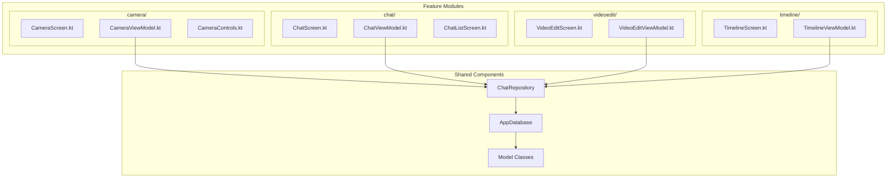

### Cross-Module Dependencies

| Module | Dependencies | Purpose |
|--------|-------------|---------|
| `camera/` | `ChatRepository`, CameraX APIs | Photo/video capture and effects |
| `chat/` | `ChatRepository`, Firebase AI | Messaging and AI responses |
| `videoedit/` | `ChatRepository`, Media3 Transformer | Video editing and processing |
| `timeline/` | `ChatRepository`, ExoPlayer | Media playback and timeline |

Sources: [app/src/main/java/com/google/android/samples/socialite/README.md:5-10](), [app/src/main/java/com/google/android/samples/socialite/ui/camera/README.md:5-6](), [app/src/main/java/com/google/android/samples/socialite/ui/videoedit/README.md:5-6]()

## Dependency Management

### Dependency Injection with Hilt

The application uses Hilt for dependency injection to manage object creation and provide dependencies across layers:

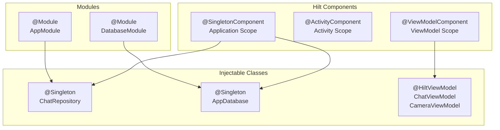

### Key Architectural Patterns

| Pattern | Implementation | Purpose |
|---------|---------------|---------|
| **Repository Pattern** | `ChatRepository` centralizes data access | Abstract data sources, provide clean API |
| **Observer Pattern** | `StateFlow`/`LiveData` in ViewModels | Reactive UI updates |
| **Dependency Injection** | Hilt annotations and modules | Loose coupling, testability |
| **Single Source of Truth** | Repository layer manages all data | Data consistency, conflict resolution |

Sources: [app/src/main/java/com/google/android/samples/socialite/data/README.md:6-7](), [app/src/main/java/com/google/android/samples/socialite/model/README.md:9]()

The architecture provides a solid foundation for the SociaLite application, enabling clean separation of concerns, testability, and maintainability while supporting complex features like real-time messaging, media processing, and AI integration.

---

# Page: Navigation System

# Navigation System

<details>
<summary>Relevant source files</summary>

The following files were used as context for generating this wiki page:

- [app/src/main/AndroidManifest.xml](app/src/main/AndroidManifest.xml)
- [app/src/main/java/com/google/android/samples/socialite/AppArgs.kt](app/src/main/java/com/google/android/samples/socialite/AppArgs.kt)
- [app/src/main/java/com/google/android/samples/socialite/MainActivity.kt](app/src/main/java/com/google/android/samples/socialite/MainActivity.kt)
- [app/src/main/java/com/google/android/samples/socialite/ui/Main.kt](app/src/main/java/com/google/android/samples/socialite/ui/Main.kt)
- [app/src/main/java/com/google/android/samples/socialite/ui/chat/ChatScreen.kt](app/src/main/java/com/google/android/samples/socialite/ui/chat/ChatScreen.kt)
- [app/src/main/java/com/google/android/samples/socialite/ui/chat/ChatViewModel.kt](app/src/main/java/com/google/android/samples/socialite/ui/chat/ChatViewModel.kt)
- [app/src/main/java/com/google/android/samples/socialite/ui/chat/component/KeyEvent.kt](app/src/main/java/com/google/android/samples/socialite/ui/chat/component/KeyEvent.kt)
- [app/src/main/java/com/google/android/samples/socialite/ui/navigation/SocialiteNavigation.kt](app/src/main/java/com/google/android/samples/socialite/ui/navigation/SocialiteNavigation.kt)
- [app/src/main/res/xml/sharing_shortcuts.xml](app/src/main/res/xml/sharing_shortcuts.xml)

</details>


The Navigation System implements a pane-based navigation architecture that handles multiple entry points, adaptive UI layouts, and deep linking capabilities. This system manages screen transitions, back stack state, and intent-based navigation using Navigation3 library components and Material3 adaptive design patterns.

For information about UI components and screens, see [User Interface](#5). For details about data flow and business logic, see [Data Layer](#3.2).

## Overview

The navigation system uses a stack-based approach where each screen is represented as a `Pane` object. The system supports multiple entry points including launcher intents, deep links, share intents, and notification bubbles. Navigation state is maintained in a saveable back stack that persists across configuration changes.

```mermaid
graph TB
    AndroidSystem["Android System"]
    MainActivity["MainActivity"]
    BubbleActivity["BubbleActivity"]
    AppArgs["AppArgs"]
    MainNavigation["MainNavigation"]
    BackStack["backStack: SnapshotStateList<Pane>"]
    NavDisplay["NavDisplay"]
    SocialiteNavSuite["SocialiteNavSuite"]
    
    AndroidSystem --> MainActivity
    AndroidSystem --> BubbleActivity
    MainActivity --> AppArgs
    BubbleActivity --> AppArgs
    AppArgs --> MainNavigation
    MainNavigation --> BackStack
    BackStack --> NavDisplay
    BackStack --> SocialiteNavSuite
    NavDisplay --> "Screen Composables"
    SocialiteNavSuite --> "Navigation UI"
```

Sources: [app/src/main/java/com/google/android/samples/socialite/ui/Main.kt:68-310](), [app/src/main/java/com/google/android/samples/socialite/MainActivity.kt:38-107]()

## Core Navigation Components

### MainNavigation Function

The `MainNavigation` composable serves as the central navigation coordinator, managing the back stack and screen transitions using Navigation3 library components.

| Component | Type | Purpose |
|-----------|------|---------|
| `backStack` | `SnapshotStateList<Pane>` | Maintains navigation state with automatic save/restore |
| `NavDisplay` | Navigation3 Component | Renders screens based on back stack entries |
| `entryProvider` | Lambda | Maps `Pane` objects to `NavEntry` composables |
| `sceneStrategy` | `ListDetailSceneStrategy` | Handles adaptive list-detail layouts |

The system uses several navigation decorators for enhanced functionality:

```mermaid
graph LR
    NavEntry["NavEntry"]
    SharedElementDecorator["sharedEntryInSceneNavEntryDecorator"]
    SceneSetupDecorator["rememberSceneSetupNavEntryDecorator"]
    SavedStateDecorator["rememberSavedStateNavEntryDecorator"]
    ViewModelDecorator["rememberViewModelStoreNavEntryDecorator"]
    
    NavEntry --> SharedElementDecorator
    SharedElementDecorator --> SceneSetupDecorator
    SceneSetupDecorator --> SavedStateDecorator
    SavedStateDecorator --> ViewModelDecorator
```

Sources: [app/src/main/java/com/google/android/samples/socialite/ui/Main.kt:78-271]()

### Back Stack Management

Navigation state is managed through a saveable mutable state list that persists across process death:

```mermaid
graph TD
    rememberSavableMutableStateListOf["rememberSavableMutableStateListOf"]
    snapshotStateListSaver["snapshotStateListSaver"]
    BackStackOperations["Back Stack Operations"]
    
    rememberSavableMutableStateListOf --> snapshotStateListSaver
    snapshotStateListSaver --> BackStackOperations
    
    BackStackOperations --> Add["backStack.add(pane)"]
    BackStackOperations --> Remove["backStack.removeLastOrNull()"]
    BackStackOperations --> Navigate["Navigation Triggers"]
```

Sources: [app/src/main/java/com/google/android/samples/socialite/ui/Main.kt:274-284]()

## Pane System

### Pane Definitions

The `Pane` sealed interface defines all possible navigation destinations in the application:

| Pane Type | Parameters | Purpose |
|-----------|------------|---------|
| `Timeline` | None | Media timeline view |
| `ChatsList` | None | Chat conversations list |
| `Settings` | None | Application settings |
| `ChatThread` | `chatId`, `text?`, `imageUri?` | Individual chat conversation |
| `Camera` | `chatId` | Camera capture interface |
| `PhotoPicker` | `chatId` | System photo picker |
| `VideoEdit` | `chatId`, `uri` | Video editing interface |
| `VideoPlayer` | `uri` | Full-screen video playback |

Sources: [app/src/main/java/com/google/android/samples/socialite/ui/navigation/SocialiteNavigation.kt:40-80]()

### Entry Provider Mapping

The `entryProvider` function maps each `Pane` type to its corresponding screen composable:

```mermaid
graph LR
    EntryProvider["entryProvider"]
    
    EntryProvider --> Timeline["Timeline(Modifier.fillMaxSize())"]
    EntryProvider --> Settings["Settings(Modifier.fillMaxSize())"]
    EntryProvider --> ChatsList["ChatList + ListDetailSceneStrategy.listPane()"]
    EntryProvider --> ChatThread["ChatScreen + ListDetailSceneStrategy.detailPane()"]
    EntryProvider --> Camera["Camera(chatId, onMediaCaptured)"]
    EntryProvider --> PhotoPicker["PhotoPickerRoute(chatId)"]
    EntryProvider --> VideoEdit["VideoEditScreen(chatId, uri)"]
    EntryProvider --> VideoPlayer["VideoPlayerScreen(uri)"]
```

Sources: [app/src/main/java/com/google/android/samples/socialite/ui/Main.kt:131-248]()

## Intent Handling and Deep Linking

### AppArgs System

The `AppArgs` sealed interface processes different types of app launch scenarios:

```mermaid
graph TB
    IntentSystem["Android Intent System"]
    
    IntentSystem --> MainLauncher["MAIN/LAUNCHER"]
    IntentSystem --> ShareIntent["ACTION_SEND"]
    IntentSystem --> DeepLink["VIEW socialite.google.com/chat/*"]
    IntentSystem --> BubbleIntent["Bubble Notification"]
    
    MainLauncher --> AppArgsNull["AppArgs = null"]
    ShareIntent --> ShortcutParams["AppArgs.ShortcutParams"]
    DeepLink --> LaunchParams["AppArgs.LaunchParams"]
    BubbleIntent --> LaunchParams
    
    ShortcutParams --> ChatThreadWithText["ChatThread(chatId, text, mediaUri)"]
    LaunchParams --> ChatThreadPlain["ChatThread(chatId)"]
    AppArgsNull --> DefaultDestination["TopLevelDestination.START_DESTINATION.pane"]
```

### Intent Filter Configuration

The application handles multiple intent types through manifest declarations:

| Intent Type | Action | Data | Target Activity |
|-------------|--------|------|-----------------|
| Launcher | `MAIN` | None | `MainActivity` |
| Share Text | `SEND` | `text/plain` | `MainActivity` |
| Share Image | `SEND` | `image/*` | `MainActivity` |
| Deep Link | `VIEW` | `https://socialite.google.com/chat/*` | `MainActivity`, `BubbleActivity` |

Sources: [app/src/main/AndroidManifest.xml:78-108](), [app/src/main/java/com/google/android/samples/socialite/AppArgs.kt:28-78]()

### Multi-Instance Support

The system supports launching multiple app instances for enhanced multitasking:

```mermaid
graph LR
    ChatOpenRequest["ChatOpenRequest"]
    
    ChatOpenRequest --> SameWindow["SameWindow"]
    ChatOpenRequest --> NewWindow["NewWindow"]
    
    SameWindow --> AddToBackStack["backStack.add(Pane.ChatThread(chatId))"]
    NewWindow --> LaunchNewInstance["Activity.launchAnotherInstance()"]
    
    LaunchNewInstance --> IntentFlags["Intent Flags"]
    IntentFlags --> MultiTask["FLAG_ACTIVITY_MULTIPLE_TASK"]
    IntentFlags --> LaunchAdjacent["FLAG_ACTIVITY_LAUNCH_ADJACENT"]
```

Sources: [app/src/main/java/com/google/android/samples/socialite/ui/Main.kt:286-310](), [app/src/main/java/com/google/android/samples/socialite/AppArgs.kt:80-93]()

## Adaptive Navigation UI

### TopLevelDestination System

The navigation UI adapts to different screen sizes using Material3 adaptive components:

| Destination | Icon | Label Resource |
|-------------|------|----------------|
| `Timeline` | `Icons.Outlined.VideoLibrary` | `R.string.timeline` |
| `ChatsList` | `Icons.Outlined.ChatBubbleOutline` | `R.string.chats` |
| `Settings` | `Icons.Outlined.Settings` | `R.string.settings` |

### Navigation Layout Strategy

The `SocialiteNavSuite` determines navigation UI layout based on screen size and current destination:

```mermaid
graph TD
    CurrentPane["Current Pane"]
    DefaultLayoutType["Default Layout Type"]
    CalculateLayout["calculateNavigationLayoutType()"]
    
    CurrentPane --> CalculateLayout
    DefaultLayoutType --> CalculateLayout
    
    CalculateLayout --> CameraCheck{"pane is Camera?"}
    CalculateLayout --> TopLevelCheck{"pane.isTopLevel()?"}
    CalculateLayout --> BottomNavCheck{"defaultLayoutType is NavigationBar?"}
    
    CameraCheck -->|Yes| NoneLayout["NavigationSuiteType.None"]
    TopLevelCheck -->|Yes| DefaultLayout["Use defaultLayoutType"]
    BottomNavCheck -->|Yes| HideBottomNav["NavigationSuiteType.None"]
    BottomNavCheck -->|No| DefaultLayout
```

Sources: [app/src/main/java/com/google/android/samples/socialite/ui/navigation/SocialiteNavigation.kt:118-133](), [app/src/main/java/com/google/android/samples/socialite/ui/navigation/SocialiteNavigation.kt:135-178]()

### Screen Orientation Management

The system manages screen orientation based on the current screen type:

```mermaid
graph LR
    LaunchedEffect["LaunchedEffect(backStack.lastOrNull())"]
    
    LaunchedEffect --> CameraPane{"Camera Pane?"}
    CameraPane -->|Yes| LockOrientation["SCREEN_ORIENTATION_NOSENSOR"]
    CameraPane -->|No| FreeOrientation["SCREEN_ORIENTATION_UNSPECIFIED"]
```

Sources: [app/src/main/java/com/google/android/samples/socialite/ui/Main.kt:259-268]()

## Navigation Flow Examples

### Chat Navigation Flow

Starting from the chat list and navigating to various chat-related screens:

```mermaid
graph TD
    ChatsList["Pane.ChatsList"]
    ChatThread["Pane.ChatThread(chatId)"]
    Camera["Pane.Camera(chatId)"]
    PhotoPicker["Pane.PhotoPicker(chatId)"]
    VideoEdit["Pane.VideoEdit(chatId, uri)"]
    VideoPlayer["Pane.VideoPlayer(uri)"]
    
    ChatsList -->|"onOpenChatRequest"| ChatThread
    ChatThread -->|"onCameraClick"| Camera
    ChatThread -->|"onPhotoPickerClick"| PhotoPicker
    ChatThread -->|"onVideoClick"| VideoPlayer
    Camera -->|"Video Captured"| VideoEdit
    Camera -->|"Photo Captured"| ChatThread
    VideoEdit -->|"Finish Editing"| ChatThread
    PhotoPicker -->|"Photo Selected"| ChatThread
    VideoPlayer -->|"Back"| ChatThread
```

### Shared Element Transitions

The navigation system supports shared element transitions between screens using Navigation3's shared transition framework:

```mermaid
graph LR
    SharedTransitionLayout["SharedTransitionLayout"]
    LocalNavSharedTransitionScope["LocalNavSharedTransitionScope"]
    SharedElementDecorator["sharedEntryInSceneNavEntryDecorator"]
    SharedContentState["rememberSharedContentState(entry.key)"]
    
    SharedTransitionLayout --> LocalNavSharedTransitionScope
    LocalNavSharedTransitionScope --> SharedElementDecorator
    SharedElementDecorator --> SharedContentState
```

Sources: [app/src/main/java/com/google/android/samples/socialite/ui/Main.kt:88-113](), [app/src/main/java/com/google/android/samples/socialite/ui/Main.kt:115-116]()

---

# Page: Data Layer

# Data Layer

<details>
<summary>Relevant source files</summary>

The following files were used as context for generating this wiki page:

- [app/src/androidTest/java/com/google/android/samples/socialite/data/AppDatabaseTest.kt](app/src/androidTest/java/com/google/android/samples/socialite/data/AppDatabaseTest.kt)
- [app/src/androidTest/java/com/google/android/samples/socialite/repository/TestRepository.kt](app/src/androidTest/java/com/google/android/samples/socialite/repository/TestRepository.kt)
- [app/src/main/java/com/google/android/samples/socialite/data/AppDatabase.kt](app/src/main/java/com/google/android/samples/socialite/data/AppDatabase.kt)
- [app/src/main/java/com/google/android/samples/socialite/data/DatabaseManager.kt](app/src/main/java/com/google/android/samples/socialite/data/DatabaseManager.kt)
- [app/src/main/java/com/google/android/samples/socialite/di/DatabaseModule.kt](app/src/main/java/com/google/android/samples/socialite/di/DatabaseModule.kt)
- [app/src/main/java/com/google/android/samples/socialite/ui/home/di/DevicePerformanceBindingModule.kt](app/src/main/java/com/google/android/samples/socialite/ui/home/di/DevicePerformanceBindingModule.kt)
- [app/src/main/java/com/google/android/samples/socialite/widget/model/WidgetModelDao.kt](app/src/main/java/com/google/android/samples/socialite/widget/model/WidgetModelDao.kt)

</details>


**Purpose and scope**: This document explains the data layer architecture of the SociaLite application, including the Room database setup, Repository pattern implementation, and dependency injection configuration with Hilt. For AI integration and external data sources, see [AI Integration](#4.2). For UI data binding patterns, see [User Interface](#5).

## Overview

The data layer follows a clean architecture pattern with three main components: the Room SQLite database for local persistence, repositories that encapsulate business logic and data access, and Hilt dependency injection to wire everything together. The `AppDatabase` serves as the central data store, while repositories like `ChatRepository` provide a clean API for the UI layer.

```mermaid
graph TB
    subgraph "Repository Layer"
        ChatRepository["ChatRepository<br/>@Singleton"]
        WidgetModelRepository["WidgetModelRepository"]
        DatabaseManager["DatabaseManager<br/>Interface"]
        RoomDatabaseManager["RoomDatabaseManager<br/>@Inject"]
    end
    
    subgraph "Database Layer"
        AppDatabase["AppDatabase<br/>@Database"]
        ChatDao["ChatDao"]
        MessageDao["MessageDao"] 
        ContactDao["ContactDao"]
        WidgetModelDao["WidgetModelDao"]
    end
    
    subgraph "Entities"
        Contact["Contact<br/>@Entity"]
        Chat["Chat<br/>@Entity"]
        ChatAttendee["ChatAttendee<br/>@Entity"]
        Message["Message<br/>@Entity"]
        WidgetModel["WidgetModel<br/>@Entity"]
        ChatWithLastMessage["ChatWithLastMessage<br/>@DatabaseView"]
    end
    
    subgraph "Dependency Injection"
        DatabaseModule["DatabaseModule<br/>@Module @InstallIn(SingletonComponent)"]
        DatabaseBindingModule["DatabaseBindingModule<br/>@Module"]
        AppCoroutineScope["@AppCoroutineScope<br/>CoroutineScope"]
    end
    
    ChatRepository --> ChatDao
    ChatRepository --> MessageDao
    ChatRepository --> ContactDao
    WidgetModelRepository --> WidgetModelDao
    RoomDatabaseManager --> AppDatabase
    DatabaseManager --> RoomDatabaseManager
    
    AppDatabase --> ChatDao
    AppDatabase --> MessageDao
    AppDatabase --> ContactDao
    AppDatabase --> WidgetModelDao
    
    ChatDao --> Contact
    ChatDao --> Chat
    ChatDao --> ChatAttendee
    ChatDao --> ChatWithLastMessage
    MessageDao --> Message
    ContactDao --> Contact
    WidgetModelDao --> WidgetModel
    
    DatabaseModule --> AppDatabase
    DatabaseModule --> ChatDao
    DatabaseModule --> MessageDao
    DatabaseModule --> ContactDao
    DatabaseModule --> WidgetModelDao
    DatabaseModule --> AppCoroutineScope
    DatabaseBindingModule --> DatabaseManager
```

**Sources**: [app/src/main/java/com/google/android/samples/socialite/di/DatabaseModule.kt](), [app/src/main/java/com/google/android/samples/socialite/data/AppDatabase.kt](), [app/src/main/java/com/google/android/samples/socialite/data/DatabaseManager.kt]()

## Room Database Configuration

The `AppDatabase` is the central Room database that manages all local data persistence. It's configured as a singleton through Hilt and includes automatic initialization with sample data.

```mermaid
classDiagram
    class AppDatabase {
        <<@Database>>
        +contactDao() ContactDao
        +chatDao() ChatDao  
        +messageDao() MessageDao
        +widgetDao() WidgetModelDao
        +wipeAndReinitializeData()
    }
    
    class Contact {
        <<@Entity>>
        +id: Long
        +name: String
        +icon: String
        +replyModel: String
    }
    
    class Chat {
        <<@Entity>>
        +id: Long
    }
    
    class ChatAttendee {
        <<@Entity>>
        +chatId: Long
        +attendeeId: Long
    }
    
    class Message {
        <<@Entity>>
        +id: Long
        +chatId: Long
        +senderId: Long
        +text: String
        +timestamp: Long
    }
    
    class WidgetModel {
        <<@Entity>>
        +widgetId: Int
        +contactId: Long
    }
    
    class ChatWithLastMessage {
        <<@DatabaseView>>
        +id: Long
        +lastMessage: String
    }
    
    AppDatabase --> Contact
    AppDatabase --> Chat
    AppDatabase --> ChatAttendee
    AppDatabase --> Message
    AppDatabase --> WidgetModel
    AppDatabase --> ChatWithLastMessage
    
    Chat ||--o{ ChatAttendee
    Contact ||--o{ ChatAttendee
    Chat ||--o{ Message
    Contact ||--o{ Message
    Contact ||--o{ WidgetModel
```

The database is initialized with sample data through the `populateInitialData()` function that runs during database creation. This includes creating a "You" contact with ID 0, and populating predefined contacts with their associated chats and initial messages.

**Sources**: [app/src/main/java/com/google/android/samples/socialite/data/AppDatabase.kt:31-47](), [app/src/main/java/com/google/android/samples/socialite/data/AppDatabase.kt:55-120]()

## Data Access Objects (DAOs)

Each entity type has a corresponding DAO interface that provides typed database operations. The DAOs are automatically implemented by Room and injected through Hilt.

| DAO | Entity | Key Operations |
|-----|--------|----------------|
| `ChatDao` | `Chat`, `ChatAttendee` | Load chat details with attendees and last messages |
| `MessageDao` | `Message` | CRUD operations for messages in specific chats |
| `ContactDao` | `Contact` | Contact management and lookup |
| `WidgetModelDao` | `WidgetModel` | Widget configuration persistence |

The `WidgetModelDao` demonstrates typical DAO patterns with Flow-based reactive queries:

```kotlin
@Query("SELECT * FROM WidgetModel where widgetId = :widgetId")
fun loadWidgetModel(widgetId: Int): Flow<WidgetModel?>

@Query("SELECT * FROM WidgetModel where widgetId NOT IN (:widgetIds)")
fun findOrphanModels(widgetIds: List<Int>): List<WidgetModel>
```

**Sources**: [app/src/main/java/com/google/android/samples/socialite/widget/model/WidgetModelDao.kt:29-46](), [app/src/main/java/com/google/android/samples/socialite/data/AppDatabase.kt:43-46]()

## Repository Pattern Implementation

The repository layer abstracts data access and provides business logic coordination. The `ChatRepository` serves as the primary data orchestrator, coordinating between multiple DAOs and external services.

```mermaid
graph LR
    subgraph "Repository Construction"
        TestRepository["createTestRepository()"]
        ChatRepository["ChatRepository"]
        WidgetModelRepository["WidgetModelRepository"]
    end
    
    subgraph "Dependencies"
        ChatDao["chatDao"]
        ContactDao["contactDao"] 
        MessageDao["messageDao"]
        NotificationHelper["NotificationHelper"]
        CoroutineScope["coroutineScope"]
        AppContext["appContext"]
    end
    
    subgraph "External Services"
        Database["AppDatabase"]
        TestDatabase["createTestDatabase()"]
    end
    
    TestRepository --> ChatRepository
    ChatRepository --> ChatDao
    ChatRepository --> ContactDao
    ChatRepository --> MessageDao
    ChatRepository --> NotificationHelper
    ChatRepository --> WidgetModelRepository
    ChatRepository --> CoroutineScope
    ChatRepository --> AppContext
    
    Database --> ChatDao
    Database --> ContactDao
    Database --> MessageDao
    TestDatabase --> ChatDao
    TestDatabase --> ContactDao
    TestDatabase --> MessageDao
```

The repository construction pattern is demonstrated in the test setup, showing how dependencies are injected:

**Sources**: [app/src/androidTest/java/com/google/android/samples/socialite/repository/TestRepository.kt:26-38]()

## Dependency Injection with Hilt

The `DatabaseModule` configures all database-related dependencies as singletons, ensuring consistent data access across the application.

```mermaid
graph TB
    subgraph "Hilt Configuration"
        DatabaseModule["DatabaseModule<br/>@Module @InstallIn(SingletonComponent::class)"]
        DatabaseBindingModule["DatabaseBindingModule<br/>@Module @InstallIn(SingletonComponent::class)"]
        AppCoroutineScope["@AppCoroutineScope<br/>@Qualifier"]
    end
    
    subgraph "Provided Dependencies"
        AppDatabase["providesAppDatabase()<br/>@Provides @Singleton"]
        ChatDao["providesChatDao()<br/>@Provides"]
        MessageDao["providesMessageDao()<br/>@Provides"]
        ContactDao["providesContactDao()<br/>@Provides"]
        WidgetModelDao["providesWidgetModelDao()<br/>@Provides"]
        CoroutineScope["providesApplicationCoroutineScope()<br/>@Provides @Singleton @AppCoroutineScope"]
    end
    
    subgraph "Interface Binding"
        DatabaseManager["DatabaseManager<br/>Interface"]
        RoomDatabaseManager["RoomDatabaseManager<br/>@Binds"]
    end
    
    DatabaseModule --> AppDatabase
    DatabaseModule --> ChatDao
    DatabaseModule --> MessageDao 
    DatabaseModule --> ContactDao
    DatabaseModule --> WidgetModelDao
    DatabaseModule --> CoroutineScope
    
    AppDatabase --> ChatDao
    AppDatabase --> MessageDao
    AppDatabase --> ContactDao
    AppDatabase --> WidgetModelDao
    
    DatabaseBindingModule --> DatabaseManager
    DatabaseManager --> RoomDatabaseManager
```

Key configuration details:

- **Database Creation**: `Room.databaseBuilder()` with callback for initial data population [app/src/main/java/com/google/android/samples/socialite/di/DatabaseModule.kt:50-59]()
- **DAO Providers**: Each DAO is provided through the database instance [app/src/main/java/com/google/android/samples/socialite/di/DatabaseModule.kt:62-71]()
- **Background Scope**: `@AppCoroutineScope` provides a dedicated coroutine scope for database operations [app/src/main/java/com/google/android/samples/socialite/di/DatabaseModule.kt:75-78]()
- **Interface Binding**: `DatabaseManager` interface is bound to `RoomDatabaseManager` implementation [app/src/main/java/com/google/android/samples/socialite/di/DatabaseModule.kt:85-86]()

**Sources**: [app/src/main/java/com/google/android/samples/socialite/di/DatabaseModule.kt:45-87]()

## Database Management and Testing

The `DatabaseManager` interface provides operations for database maintenance, with `RoomDatabaseManager` implementing the Room-specific logic:

```kotlin
interface DatabaseManager {
    fun wipeAndReinitializeDatabase()
}

class RoomDatabaseManager @Inject constructor(private val appDatabase: AppDatabase) : DatabaseManager {
    override fun wipeAndReinitializeDatabase() = appDatabase.wipeAndReinitializeData()
}
```

For testing, the data layer provides `createTestDatabase()` function that creates an in-memory database instance, allowing isolated testing of database operations without affecting the production database.

**Sources**: [app/src/main/java/com/google/android/samples/socialite/data/DatabaseManager.kt:21-27](), [app/src/androidTest/java/com/google/android/samples/socialite/data/AppDatabaseTest.kt:34-51]()

---

# Page: Core Features

# Core Features

<details>
<summary>Relevant source files</summary>

The following files were used as context for generating this wiki page:

- [README.md](README.md)
- [app/build.gradle.kts](app/build.gradle.kts)
- [app/google-services.json](app/google-services.json)
- [app/src/main/java/com/google/android/samples/socialite/README.md](app/src/main/java/com/google/android/samples/socialite/README.md)
- [app/src/main/java/com/google/android/samples/socialite/model/README.md](app/src/main/java/com/google/android/samples/socialite/model/README.md)
- [app/src/main/java/com/google/android/samples/socialite/repository/ChatRepository.kt](app/src/main/java/com/google/android/samples/socialite/repository/ChatRepository.kt)
- [app/src/main/java/com/google/android/samples/socialite/ui/camera/README.md](app/src/main/java/com/google/android/samples/socialite/ui/camera/README.md)
- [app/src/main/java/com/google/android/samples/socialite/ui/videoedit/README.md](app/src/main/java/com/google/android/samples/socialite/ui/videoedit/README.md)
- [app/src/main/res/values/strings.xml](app/src/main/res/values/strings.xml)
- [gradle/libs.versions.toml](gradle/libs.versions.toml)

</details>


This document provides an overview of the main application features in SociaLite, including chat messaging, AI integration, media capture and processing, timeline display, and system integration capabilities. This covers the functional components that users interact with directly.

For architectural patterns and data flow, see [Architecture](#3). For detailed UI implementation, see [User Interface](#5). For Android system integrations like notifications and widgets, see [System Integration](#6).

## Feature Overview

SociaLite implements a comprehensive social messaging application with the following core capabilities:

| Feature | Primary Components | Key Technologies |
|---------|-------------------|------------------|
| Chat System | `ChatRepository`, `ChatViewModel` | Room database, Firebase AI |
| AI Integration | Gemini 2.0 Flash, `generativeModel` | Firebase AI SDK, ML Kit |
| Media Capture | `CameraViewModel`, CameraX | Camera2, MediaStore |
| Media Processing | Media3 Transformer, `CompositionPlayer` | ExoPlayer, video effects |
| Timeline Playback | `TimelineViewModel`, preload manager | ExoPlayer, adaptive UI |
| System Integration | Notification bubbles, app widgets | Glance framework |

```mermaid
graph TB
    subgraph "Core Application Features"
        ChatSystem["ChatRepository<br/>Central Business Logic"]
        AIIntegration["Firebase AI<br/>Gemini 2.0 Flash"]
        MediaCapture["CameraViewModel<br/>CameraX Integration"]
        MediaProcessing["Media3 Transformer<br/>Video Effects Pipeline"]
        TimelinePlayback["TimelineViewModel<br/>ExoPlayer + Preload"]
        SystemIntegration["NotificationHelper<br/>Bubbles + Widgets"]
    end
    
    subgraph "Data Layer"
        AppDatabase["AppDatabase<br/>Room SQLite"]
        DataStore["DataStore<br/>Preferences"]
        MediaStore["Android MediaStore"]
    end
    
    subgraph "External Services"
        Firebase["Firebase AI Backend"]
        CameraX["CameraX Provider"]
        Media3["Media3 Framework"]
    end
    
    ChatSystem --> AppDatabase
    ChatSystem --> AIIntegration
    ChatSystem --> SystemIntegration
    
    AIIntegration --> Firebase
    MediaCapture --> CameraX
    MediaCapture --> MediaStore
    MediaProcessing --> Media3
    TimelinePlayback --> Media3
    
    ChatSystem --> DataStore
    SystemIntegration --> AppDatabase
```

**Sources:** [gradle/libs.versions.toml:15-67](), [app/build.gradle.kts:92-192](), [app/src/main/java/com/google/android/samples/socialite/repository/ChatRepository.kt:62-71]()

## Chat and Messaging System

The messaging system centers around `ChatRepository` as the primary business logic coordinator, managing message persistence, AI responses, and notification delivery.

```mermaid
graph LR
    subgraph "Message Flow"
        SendMessage["sendMessage()<br/>ChatRepository"]
        SaveMessage["saveMessageAndNotify()<br/>Database Insert"]
        AIResponse["generativeModel<br/>Gemini 2.0 Flash"]
        NotificationPush["NotificationHelper<br/>Bubble + Shortcuts"]
    end
    
    subgraph "Data Persistence"
        MessageDao["MessageDao<br/>Room Database"]
        ChatDao["ChatDao<br/>Room Database"]
        ContactDao["ContactDao<br/>Room Database"]
    end
    
    subgraph "External Integration"
        FirebaseAI["Firebase AI<br/>GenerativeBackend.googleAI"]
        MLKit["ML Kit<br/>Image Analysis"]
        WidgetRepo["WidgetModelRepository<br/>Unread Count Updates"]
    end
    
    SendMessage --> SaveMessage
    SaveMessage --> MessageDao
    SendMessage --> AIResponse
    AIResponse --> FirebaseAI
    AIResponse --> MLKit
    SendMessage --> NotificationPush
    SendMessage --> WidgetRepo
    
    MessageDao --> ChatDao
    MessageDao --> ContactDao
```

**Key Implementation Details:**

- **Message Processing**: [ChatRepository.kt:96-206]() handles outgoing messages, AI response generation, and notification triggering
- **AI Integration**: Uses `generativeModel` with system instruction for personality-based responses [ChatRepository.kt:115-120]()
- **Image Analysis**: Supports image input to AI model via `BitmapFactory.decodeStream()` [ChatRepository.kt:138-150]()
- **Chat History**: Combines consecutive messages from same sender for AI context [ChatRepository.kt:316-352]()

**Sources:** [app/src/main/java/com/google/android/samples/socialite/repository/ChatRepository.kt:84-206](), [gradle/libs.versions.toml:142-145]()

## AI Integration and Response Generation

The application integrates Firebase AI with Gemini 2.0 Flash model for intelligent chat responses, including image understanding capabilities.

```mermaid
graph TB
    subgraph "AI Configuration"
        GenerativeModel["generativeModel<br/>gemini-2.0-flash-lite-001"]
        SystemInstruction["systemInstruction<br/>Personality Context"]
        ChatHistory["Chat History<br/>Message Consolidation"]
    end
    
    subgraph "Input Processing"
        TextInput["Text Messages<br/>Direct Processing"]
        ImageInput["Image Messages<br/>BitmapFactory.decodeStream"]
        MLKitAnalysis["ML Kit<br/>Selfie Segmentation"]
    end
    
    subgraph "Response Generation"
        ChatAPI["chat.sendMessage()<br/>Firebase AI API"]
        ErrorHandling["Exception Handling<br/>Gemini Error Messages"]
        ResponseSaving["saveMessageAndNotify()<br/>AI Response Storage"]
    end
    
    GenerativeModel --> SystemInstruction
    GenerativeModel --> ChatHistory
    
    TextInput --> ChatAPI
    ImageInput --> ChatAPI
    ImageInput --> MLKitAnalysis
    
    ChatAPI --> ErrorHandling
    ChatAPI --> ResponseSaving
    
    SystemInstruction --> ChatAPI
    ChatHistory --> ChatAPI
```

**AI Features:**

- **Model Configuration**: Gemini 2.0 Flash Lite with personality-based system instructions [ChatRepository.kt:115-120]()
- **Multi-modal Input**: Text and image processing with `BitmapFactory` integration [ChatRepository.kt:138-150]()
- **Error Handling**: Comprehensive exception handling with user-friendly error messages [ChatRepository.kt:154-160]()
- **Chat Memory**: Message history consolidation for context preservation [ChatRepository.kt:316-352]()
- **Settings Toggle**: DataStore-based chatbot enable/disable functionality [ChatRepository.kt:396-414]()

**Sources:** [app/src/main/java/com/google/android/samples/socialite/repository/ChatRepository.kt:114-171](), [gradle/libs.versions.toml:62-64](), [app/build.gradle.kts:184-186]()

## Media Capture and Camera Integration

The camera system leverages CameraX for photo and video capture with real-time effects and permission management.

```mermaid
graph TB
    subgraph "Camera Setup"
        ProcessCameraProvider["ProcessCameraProvider<br/>CameraX Lifecycle"]
        CameraSelector["CameraSelector<br/>Front/Back Selection"]
        UseCases["Use Cases<br/>Preview + ImageCapture + VideoCapture"]
    end
    
    subgraph "Effects Pipeline"
        CameraEffects["Camera Effects<br/>Green Screen + B&W"]
        MLKitSegmentation["ML Kit<br/>Selfie Segmentation"]
        RealTimeProcessing["Real-time Processing<br/>Camera Media3 Effect"]
    end
    
    subgraph "Output Management"
        MediaStore["Android MediaStore<br/>Photo/Video Storage"]
        InternalStorage["Internal Storage<br/>Fallback Copy"]
        FileProvider["FileProvider<br/>Secure URI Sharing"]
    end
    
    ProcessCameraProvider --> CameraSelector
    CameraSelector --> UseCases
    UseCases --> CameraEffects
    CameraEffects --> MLKitSegmentation
    
    UseCases --> MediaStore
    MediaStore --> InternalStorage
    InternalStorage --> FileProvider
```

**Camera Implementation:**

- **CameraX Integration**: Uses `ProcessCameraProvider` for lifecycle-aware camera management
- **Effects Pipeline**: Real-time green screen and black & white effects via `camera-media3-effect` [gradle/libs.versions.toml:85]()
- **ML Kit Integration**: Selfie segmentation for green screen effects [gradle/libs.versions.toml:64]()
- **Permission Handling**: Comprehensive camera and microphone permission flow
- **Storage Management**: MediaStore integration with internal storage fallback [ChatRepository.kt:208-272]()

**Sources:** [gradle/libs.versions.toml:21-23,85-88](), [app/build.gradle.kts:156-161](), [app/src/main/java/com/google/android/samples/socialite/repository/ChatRepository.kt:208-272]()

## Media Processing and Video Editing

Video processing utilizes Media3 Transformer for effects application and CompositionPlayer for preview playback.

```mermaid
graph LR
    subgraph "Video Editing Pipeline"
        MediaInput["Media Input<br/>CameraX Capture"]
        Transformer["Media3 Transformer<br/>Effects Application"]
        CompositionPlayer["CompositionPlayer<br/>Preview Playback"]
        OutputGeneration["Output Generation<br/>Processed Video"]
    end
    
    subgraph "Effects Library"
        RGBAdjustment["RGB Adjustment<br/>Color Correction"]
        PeriodicVignette["Periodic Vignette<br/>Time-based Effects"]
        StyleTransfer["Style Transfer<br/>TensorFlow Lite"]
        TextOverlay["Text Overlay<br/>Custom Graphics"]
    end
    
    subgraph "AI Processing"
        LiteRT["LiteRT Runtime<br/>TensorFlow Models"]
        GPUAcceleration["LiteRT GPU<br/>Hardware Acceleration"]
        SupportAPI["LiteRT Support API<br/>Model Management"]
    end
    
    MediaInput --> Transformer
    Transformer --> CompositionPlayer
    CompositionPlayer --> OutputGeneration
    
    RGBAdjustment --> Transformer
    PeriodicVignette --> Transformer
    StyleTransfer --> LiteRT
    TextOverlay --> Transformer
    
    LiteRT --> GPUAcceleration
    LiteRT --> SupportAPI
```

**Video Processing Features:**

- **Media3 Transformer**: Core video processing engine [gradle/libs.versions.toml:49,126]()
- **CompositionPlayer**: Real-time preview during editing
- **Effect Types**: RGB adjustment, periodic vignette, style transfer, text overlay [app/src/main/res/values/strings.xml:62-69]()
- **TensorFlow Lite**: AI-powered style transfer effects [gradle/libs.versions.toml:65,120-122]()
- **GPU Acceleration**: Hardware-accelerated processing via LiteRT GPU

**Sources:** [gradle/libs.versions.toml:49-50,65,120-126](), [app/build.gradle.kts:163-168](), [app/src/main/res/values/strings.xml:61-69]()

## Timeline and Media Playback

The timeline system provides smooth media browsing with ExoPlayer integration and intelligent preloading for performance optimization.

```mermaid
graph TB
    subgraph "Timeline Display"
        GridLayout["Grid Layout<br/>Adaptive Columns"]
        PagerLayout["Pager Layout<br/>Full-screen Carousel"]
        MediaPreview["Media Preview<br/>Thumbnail Generation"]
    end
    
    subgraph "Playback Engine"
        ExoPlayer["ExoPlayer<br/>Media3 Framework"]
        PreloadManager["PreloadManager<br/>Background Loading"]
        CompositionPlayer["CompositionPlayer<br/>Effects Playback"]
    end
    
    subgraph "Performance Optimization"
        BaselineProfiles["Baseline Profiles<br/>ART Optimization"]
        CorePerformance["Core Performance<br/>Play Services"]
        ShortsVideoList["ShortsVideoList<br/>Test Preload Content"]
    end
    
    GridLayout --> MediaPreview
    PagerLayout --> ExoPlayer
    MediaPreview --> ExoPlayer
    
    ExoPlayer --> PreloadManager
    ExoPlayer --> CompositionPlayer
    PreloadManager --> ShortsVideoList
    
    BaselineProfiles --> ExoPlayer
    CorePerformance --> PreloadManager
```

**Timeline Features:**

- **Adaptive Layout**: Grid and pager layouts for different screen sizes
- **ExoPlayer Integration**: Media3-based video playback [gradle/libs.versions.toml:49,123-128]()
- **Preload Manager**: Background loading for smooth scrolling [ChatRepository.kt:275-291]()
- **Performance Optimization**: Baseline profiles and Core Performance API [gradle/libs.versions.toml:20,30-31]()
- **Compose UI**: Media3 Compose integration for seamless UI [gradle/libs.versions.toml:50,128]()

**Sources:** [gradle/libs.versions.toml:49-50,123-128](), [app/build.gradle.kts:163-168](), [app/src/main/java/com/google/android/samples/socialite/repository/ChatRepository.kt:275-291]()

---

# Page: Chat System

# Chat System

<details>
<summary>Relevant source files</summary>

The following files were used as context for generating this wiki page:

- [README.md](README.md)
- [app/build.gradle.kts](app/build.gradle.kts)
- [app/google-services.json](app/google-services.json)
- [app/src/main/java/com/google/android/samples/socialite/repository/ChatRepository.kt](app/src/main/java/com/google/android/samples/socialite/repository/ChatRepository.kt)
- [app/src/main/java/com/google/android/samples/socialite/ui/home/chatlist/ChatList.kt](app/src/main/java/com/google/android/samples/socialite/ui/home/chatlist/ChatList.kt)
- [app/src/main/java/com/google/android/samples/socialite/ui/home/chatlist/ChatListItem.kt](app/src/main/java/com/google/android/samples/socialite/ui/home/chatlist/ChatListItem.kt)
- [app/src/main/java/com/google/android/samples/socialite/ui/home/chatlist/ChatOpenRequest.kt](app/src/main/java/com/google/android/samples/socialite/ui/home/chatlist/ChatOpenRequest.kt)
- [app/src/main/res/values/strings.xml](app/src/main/res/values/strings.xml)
- [gradle/libs.versions.toml](gradle/libs.versions.toml)

</details>


This document covers the messaging functionality in SociaLite, including the `ChatRepository` business logic, message sending/receiving flows, AI integration via Firebase Gemini, and chat-related UI components. For AI-specific implementation details, see [AI Integration](#4.2). For notification bubbles and shortcuts, see [Notifications and Bubbles](#6.1).

## System Architecture

The chat system follows a repository pattern with clear separation between data, business logic, and UI layers:

```mermaid
graph TB
    subgraph "UI Layer"
        ChatList["ChatList"]
        ChatListItem["ChatListItem"] 
        ChatThread["ChatThread"]
        ChatInput["ChatInput"]
    end
    
    subgraph "ViewModel Layer"
        ChatListViewModel["ChatListViewModel"]
        ChatViewModel["ChatViewModel"]
    end
    
    subgraph "Repository Layer"
        ChatRepository["ChatRepository"]
        NotificationHelper["NotificationHelper"]
        WidgetModelRepository["WidgetModelRepository"]
    end
    
    subgraph "Data Layer"
        ChatDao["ChatDao"]
        MessageDao["MessageDao"]
        ContactDao["ContactDao"]
        AppDatabase["AppDatabase"]
        DataStore["DataStore<Preferences>"]
    end
    
    subgraph "External Services"
        FirebaseAI["Firebase.ai"]
        GeminiModel["generativeModel"]
    end
    
    ChatList --> ChatListViewModel
    ChatThread --> ChatViewModel
    ChatListViewModel --> ChatRepository
    ChatViewModel --> ChatRepository
    
    ChatRepository --> ChatDao
    ChatRepository --> MessageDao
    ChatRepository --> ContactDao
    ChatRepository --> NotificationHelper
    ChatRepository --> WidgetModelRepository
    ChatRepository --> DataStore
    ChatRepository --> FirebaseAI
    
    ChatDao --> AppDatabase
    MessageDao --> AppDatabase
    ContactDao --> AppDatabase
    
    FirebaseAI --> GeminiModel
```

**Sources:** [app/src/main/java/com/google/android/samples/socialite/repository/ChatRepository.kt:1-415](), [app/src/main/java/com/google/android/samples/socialite/ui/home/chatlist/ChatList.kt:1-274]()

## Core Repository Components

### ChatRepository

The `ChatRepository` serves as the central business logic coordinator for all chat operations:

| Method | Purpose | Key Operations |
|--------|---------|----------------|
| `getChats()` | Retrieve all chat details | Returns `Flow<List<ChatDetail>>` from `chatDao.allDetails()` |
| `findChat(chatId)` | Get specific chat | Returns `Flow<ChatDetail?>` from `chatDao.detailById()` |
| `findMessages(chatId)` | Get chat messages | Returns `Flow<List<Message>>` from `messageDao.allByChatId()` |
| `sendMessage()` | Send message with AI response | Saves message, triggers AI response, sends notifications |
| `activateChat()` | Mark chat as active | Sets `currentChat`, dismisses notifications, updates widgets |

**Sources:** [app/src/main/java/com/google/android/samples/socialite/repository/ChatRepository.kt:62-415]()

### Data Access Objects

The chat system uses three primary DAOs:

- `ChatDao` - Manages chat entities and provides `allDetails()` and `detailById()` flows
- `MessageDao` - Handles message CRUD operations with `allByChatId()` and `insert()` methods  
- `ContactDao` - Manages contact information for chat participants

**Sources:** [app/src/main/java/com/google/android/samples/socialite/repository/ChatRepository.kt:32-34]()

## Message Sending Flow

The message sending process involves multiple coordinated steps:

```mermaid
sequenceDiagram
    participant "UI" as UI
    participant "ChatRepository" as CR
    participant "MessageDao" as MD
    participant "Firebase AI" as AI
    participant "NotificationHelper" as NH
    participant "WidgetModelRepository" as WR
    
    UI->>CR: sendMessage(chatId, text, mediaUri, mediaMimeType)
    CR->>MD: insert(outgoing message)
    CR->>NH: pushShortcut(contact, OutgoingMessage)
    
    alt AI enabled
        CR->>CR: getMessageHistory(chatId)
        CR->>AI: generativeModel.startChat(history)
        alt has image
            CR->>AI: chat.sendMessage(bitmap)
        else text only
            CR->>AI: chat.sendMessage(text)
        end
        AI-->>CR: AI response text
        CR->>MD: insert(incoming AI response)
    else AI disabled
        CR->>CR: delay(5000L)
        CR->>CR: contact.reply(text)
        CR->>MD: insert(simulated response)
    end
    
    alt chat not active
        CR->>NH: showNotification(contact, messages)
    end
    
    CR->>WR: updateUnreadMessagesForContact(contactId, true)
```

**Sources:** [app/src/main/java/com/google/android/samples/socialite/repository/ChatRepository.kt:96-206]()

### AI Response Generation

When AI chatbot is enabled, the system uses Firebase AI with Gemini 2.0 Flash:

```kotlin
val generativeModel = Firebase.ai(backend = GenerativeBackend.googleAI()).generativeModel(
    modelName = "gemini-2.0-flash-lite-001",
    systemInstruction = content {
        text("Please respond to this chat conversation like a friendly ${detail.firstContact.replyModel}.")
    },
)
```

The AI integration supports both text and image inputs, with error handling for network issues and invalid responses.

**Sources:** [app/src/main/java/com/google/android/samples/socialite/repository/ChatRepository.kt:114-171]()

## Chat UI Components

### ChatList Display

The `ChatList` composable displays all active chats with permission handling:

```mermaid
graph TD
    ChatList["ChatList"] --> Scaffold["Scaffold"]
    Scaffold --> HomeAppBar["HomeAppBar"]
    Scaffold --> LazyColumn["LazyColumn"]
    
    LazyColumn --> PermissionCard["NotificationPermissionCard"]
    LazyColumn --> ChatListItems["ChatListItem[]"]
    
    ChatListItems --> ChatListItem["ChatListItem"]
    ChatListItem --> ContactImage["Image (contact.iconUri)"]
    ChatListItem --> ContactInfo["Column (name, lastMessage)"]
    ChatListItem --> Timestamp["Text (timestamp)"]
    ChatListItem --> OptionsButton["ChatListItemOptionButton"]
    
    OptionsButton --> DropdownMenu["DropdownMenu"]
    DropdownMenu --> OpenNewWindow["'Open in new window'"]
```

**Sources:** [app/src/main/java/com/google/android/samples/socialite/ui/home/chatlist/ChatList.kt:73-151](), [app/src/main/java/com/google/android/samples/socialite/ui/home/chatlist/ChatListItem.kt:56-174]()

### Chat Opening Mechanisms

The system supports multiple ways to open chats:

| Method | Implementation | Target |
|--------|----------------|---------|
| Same Window | `ChatOpenRequest.SameWindow` | Current app context |
| New Window | `ChatOpenRequest.NewWindow` | Separate activity via `AppArgs.LaunchParams` |
| Drag & Drop | `draggableWithIntentToOpenChat()` | External window (API 35+) |

**Sources:** [app/src/main/java/com/google/android/samples/socialite/ui/home/chatlist/ChatOpenRequest.kt:22-36](), [app/src/main/java/com/google/android/samples/socialite/ui/home/chatlist/ChatList.kt:154-220]()

## Media Attachment Handling

The chat system supports media attachments through the `MediaItem` class and provides URI permission management:

```mermaid
graph LR
    MediaItem["MediaItem(uri, mimeType)"] --> SaveProcess["saveAttachedMediaItem()"]
    SaveProcess --> TryPersistentUri["tryTakePersistableUriPermission()"]
    TryPersistentUri --> Success["Result.success(mediaItem)"]
    TryPersistentUri --> Fallback["trySaveAttachedMediaItem()"]
    Fallback --> InternalStorage["Copy to app internal storage"]
    InternalStorage --> FileUri["file:// URI"]
```

**Sources:** [app/src/main/java/com/google/android/samples/socialite/repository/ChatRepository.kt:208-262]()

## Settings and Configuration

### AI Chatbot Toggle

The chat system includes a settings toggle for enabling/disabling AI responses:

- Setting stored in `DataStore<Preferences>` with key `enableChatbotKey`
- Flow `isBotEnabled` provides reactive state updates
- `toggleChatbotSetting()` validates Firebase project configuration before enabling

**Sources:** [app/src/main/java/com/google/android/samples/socialite/repository/ChatRepository.kt:72-414]()

### Chat State Management

The repository tracks active chat state through:
- `currentChat: Long` field for currently active chat ID
- `activateChat(chatId)` and `deactivateChat(chatId)` methods
- Integration with notification dismissal and widget updates

**Sources:** [app/src/main/java/com/google/android/samples/socialite/repository/ChatRepository.kt:78-383]()

---

# Page: AI Integration

# AI Integration

<details>
<summary>Relevant source files</summary>

The following files were used as context for generating this wiki page:

- [README.md](README.md)
- [app/build.gradle.kts](app/build.gradle.kts)
- [app/google-services.json](app/google-services.json)
- [app/src/main/java/com/google/android/samples/socialite/repository/ChatRepository.kt](app/src/main/java/com/google/android/samples/socialite/repository/ChatRepository.kt)
- [app/src/main/res/values/strings.xml](app/src/main/res/values/strings.xml)
- [gradle/libs.versions.toml](gradle/libs.versions.toml)

</details>


This document covers the AI integration system in SociaLite, which provides intelligent chat responses using Firebase AI and the Gemini API. The system enables automated responses from chat contacts using Google's Gemini 2.0 Flash model, including support for text and image analysis.

For information about the broader chat messaging system, see [Chat System](#4.1). For media processing capabilities, see [Media Processing](#4.4).

## Overview

The AI integration in SociaLite provides intelligent chatbot functionality through Firebase AI services. The system uses Google's Gemini 2.0 Flash Lite model to generate contextual responses in chat conversations, with support for both text and image inputs. Users can enable or disable the AI chatbot through application settings, with fallback to simulated responses when disabled.

## Architecture

The AI integration is built around the `ChatRepository` class, which orchestrates AI interactions with Firebase services and manages conversation context.

### AI Integration Architecture

```mermaid
graph TB
    subgraph "UI Layer"
        SettingsScreen["SettingsScreen"]
        ChatScreen["ChatScreen"]
        MessageInput["Message Input"]
    end
    
    subgraph "Repository Layer"
        ChatRepository["ChatRepository"]
        DataStore["DataStore<Preferences>"]
        BotSettings["enableChatbotKey"]
    end
    
    subgraph "Firebase AI"
        FirebaseAI["Firebase.ai()"]
        GeminiModel["generativeModel('gemini-2.0-flash-lite-001')"]
        GenerativeBackend["GenerativeBackend.googleAI()"]
    end
    
    subgraph "Data Processing"
        MessageHistory["getMessageHistory()"]
        ContentResolver["ContentResolver"]
        BitmapFactory["BitmapFactory"]
    end
    
    subgraph "Configuration"
        GoogleServices["google-services.json"]
        FirebaseApp["FirebaseApp.getInstance()"]
        ProjectValidation["Project ID Validation"]
    end
    
    SettingsScreen --> ChatRepository
    ChatScreen --> MessageInput
    MessageInput --> ChatRepository
    
    ChatRepository --> DataStore
    ChatRepository --> BotSettings
    ChatRepository --> FirebaseAI
    
    FirebaseAI --> GeminiModel
    FirebaseAI --> GenerativeBackend
    
    ChatRepository --> MessageHistory
    ChatRepository --> ContentResolver
    ContentResolver --> BitmapFactory
    
    ChatRepository --> FirebaseApp
    FirebaseApp --> GoogleServices
    FirebaseApp --> ProjectValidation
    
    style ChatRepository fill:#f9f,stroke:#333,stroke-width:2px
    style FirebaseAI fill:#bbf,stroke:#333,stroke-width:2px
    style GeminiModel fill:#bbf,stroke:#333,stroke-width:2px
```

**Sources:** [app/src/main/java/com/google/android/samples/socialite/repository/ChatRepository.kt:1-416](), [gradle/libs.versions.toml:142-146](), [app/build.gradle.kts:184-186]()

## Firebase AI Setup

The Firebase AI integration uses the Google AI Client SDK to communicate with Gemini models. The configuration requires proper Firebase project setup and API key management.

### Dependencies

| Dependency | Version | Purpose |
|------------|---------|---------|
| `firebase-bom` | 33.14.0 | Firebase Bill of Materials |
| `firebase-ai` | (from BOM) | Firebase AI services |
| `generativeai` | 0.9.0 | Google AI Client SDK |

### Configuration Files

The system relies on `google-services.json` for Firebase configuration:

[app/google-services.json:1-30]()

The default configuration uses a mock project ID that must be replaced with a valid Firebase project for AI functionality to work.

**Sources:** [gradle/libs.versions.toml:33-62](), [app/build.gradle.kts:184-186](), [app/google-services.json:1-30]()

## Chat Generation System

The AI chat generation system processes user messages and generates contextual responses using conversation history and system instructions.

### Message Processing Flow

```mermaid
graph TD
    UserMessage["User sends message"]
    SaveMessage["saveMessageAndNotify()"]
    CheckBotEnabled["isBotEnabled.firstOrNull()"]
    
    subgraph "AI Processing"
        CreateModel["Create generativeModel"]
        SystemInstruction["Set system instruction"]
        GetHistory["getMessageHistory(chatId)"]
        StartChat["generativeModel.startChat()"]
        
        CheckMediaType{"mediaMimeType contains 'image'?"}
        ProcessImage["Process image with BitmapFactory"]
        ProcessText["Process text message"]
        
        SendToGemini["chat.sendMessage()"]
        ReceiveResponse["Get AI response"]
    end
    
    HandleError["Handle exceptions"]
    SaveResponse["Save AI response to database"]
    ShowNotification["Show notification if needed"]
    
    UserMessage --> SaveMessage
    SaveMessage --> CheckBotEnabled
    CheckBotEnabled -->|enabled| CreateModel
    CheckBotEnabled -->|disabled| SimulateResponse["Simulate response (fallback)"]
    
    CreateModel --> SystemInstruction
    SystemInstruction --> GetHistory
    GetHistory --> StartChat
    StartChat --> CheckMediaType
    
    CheckMediaType -->|yes| ProcessImage
    CheckMediaType -->|no| ProcessText
    
    ProcessImage --> SendToGemini
    ProcessText --> SendToGemini
    SendToGemini --> ReceiveResponse
    SendToGemini --> HandleError
    
    ReceiveResponse --> SaveResponse
    HandleError --> SaveResponse
    SaveResponse --> ShowNotification
    
    style CreateModel fill:#bbf,stroke:#333,stroke-width:2px
    style SendToGemini fill:#bbf,stroke:#333,stroke-width:2px
    style ReceiveResponse fill:#bbf,stroke:#333,stroke-width:2px
```

**Sources:** [app/src/main/java/com/google/android/samples/socialite/repository/ChatRepository.kt:96-206](), [app/src/main/java/com/google/android/samples/socialite/repository/ChatRepository.kt:114-121]()

### Model Configuration

The system configures the Gemini model with specific parameters:

[app/src/main/java/com/google/android/samples/socialite/repository/ChatRepository.kt:115-120]()

The model uses `GenerativeBackend.googleAI()` backend and includes system instructions that reference the contact's `replyModel` property to personalize responses.

**Sources:** [app/src/main/java/com/google/android/samples/socialite/repository/ChatRepository.kt:114-121]()

## Image Analysis

The AI system supports image analysis through bitmap processing and content resolution.

### Image Processing Pipeline

```mermaid
graph LR
    MediaInput["Media input with URI"]
    CheckMimeType["Check mediaMimeType.contains('image')"]
    OpenInputStream["contentResolver.openInputStream()"]
    DecodeBitmap["BitmapFactory.decodeStream()"]
    SendToModel["chat.sendMessage(bitmap)"]
    ReceiveResponse["AI analyzes image"]
    
    ErrorHandling["Handle image_error"]
    
    MediaInput --> CheckMimeType
    CheckMimeType -->|true| OpenInputStream
    OpenInputStream --> DecodeBitmap
    DecodeBitmap --> SendToModel
    SendToModel --> ReceiveResponse
    
    OpenInputStream -->|fails| ErrorHandling
    DecodeBitmap -->|fails| ErrorHandling
    SendToModel -->|fails| ErrorHandling
    
    style DecodeBitmap fill:#bbf,stroke:#333,stroke-width:2px
    style SendToModel fill:#bbf,stroke:#333,stroke-width:2px
    style ReceiveResponse fill:#bbf,stroke:#333,stroke-width:2px
```

**Sources:** [app/src/main/java/com/google/android/samples/socialite/repository/ChatRepository.kt:138-150]()

The image processing implementation:

[app/src/main/java/com/google/android/samples/socialite/repository/ChatRepository.kt:138-150]()

**Sources:** [app/src/main/java/com/google/android/samples/socialite/repository/ChatRepository.kt:138-150]()

## Context Management

The AI system maintains conversation context through message history processing.

### Message History Processing

The `getMessageHistory()` function processes past messages to provide context to the AI model:

[app/src/main/java/com/google/android/samples/socialite/repository/ChatRepository.kt:316-352]()

Key processing steps:
1. Filter messages with non-empty text
2. Sort by timestamp
3. Combine consecutive messages from same sender
4. Convert to `Content` objects with appropriate roles ("user" or "model")
5. Remove the most recent message to avoid duplication

**Sources:** [app/src/main/java/com/google/android/samples/socialite/repository/ChatRepository.kt:316-352]()

## Settings and Configuration

The AI chatbot can be enabled or disabled through user preferences stored in `DataStore`.

### Settings Management

```mermaid
graph TB
    SettingsUI["Settings UI Toggle"]
    ToggleFunction["toggleChatbotSetting()"]
    ValidateProject["Validate Firebase project"]
    
    subgraph "DataStore"
        PreferencesKey["enableChatbotKey"]
        DataStoreEdit["dataStore.edit()"]
        BooleanValue["Toggle boolean value"]
    end
    
    subgraph "Validation"
        FirebaseApp["FirebaseApp.getInstance()"]
        ProjectCheck["Check project ID != 'mock_project'"]
        ShowToast["Show setup toast message"]
    end
    
    IsBotEnabled["isBotEnabled Flow"]
    
    SettingsUI --> ToggleFunction
    ToggleFunction --> ValidateProject
    ValidateProject --> FirebaseApp
    FirebaseApp --> ProjectCheck
    ProjectCheck -->|valid| DataStoreEdit
    ProjectCheck -->|invalid| ShowToast
    
    DataStoreEdit --> PreferencesKey
    PreferencesKey --> BooleanValue
    
    PreferencesKey --> IsBotEnabled
    
    style DataStoreEdit fill:#bbf,stroke:#333,stroke-width:2px
    style IsBotEnabled fill:#bbf,stroke:#333,stroke-width:2px
```

**Sources:** [app/src/main/java/com/google/android/samples/socialite/repository/ChatRepository.kt:72-76](), [app/src/main/java/com/google/android/samples/socialite/repository/ChatRepository.kt:396-414]()

### DataStore Configuration

The settings are managed through `DataStore<Preferences>`:

[app/src/main/java/com/google/android/samples/socialite/repository/ChatRepository.kt:72-76]()

**Sources:** [app/src/main/java/com/google/android/samples/socialite/repository/ChatRepository.kt:72-76]()

## Error Handling

The AI system includes comprehensive error handling for various failure scenarios.

### Error Types and Responses

| Error Type | Trigger | Response String Key |
|------------|---------|-------------------|
| Image processing failure | `openInputStream()` returns null | `R.string.image_error` |
| Gemini API error | Exception during `chat.sendMessage()` | `R.string.gemini_error` |
| Unknown error | Generic exception without message | `R.string.unknown_error` |
| Configuration error | Mock project detected | `R.string.set_api_key_toast` |

The error handling implementation:

[app/src/main/java/com/google/android/samples/socialite/repository/ChatRepository.kt:154-160]()

**Sources:** [app/src/main/java/com/google/android/samples/socialite/repository/ChatRepository.kt:154-160](), [app/src/main/res/values/strings.xml:80-83]()

## Integration Points

The AI system integrates with several other application components:

- **Chat UI**: Receives user input and displays AI responses
- **Settings Screen**: Provides toggle for enabling/disabling AI chatbot
- **Notification System**: Shows notifications for AI responses when app is backgrounded
- **Media System**: Processes image attachments for AI analysis
- **Widget System**: Updates unread message counts when AI responds

**Sources:** [app/src/main/java/com/google/android/samples/socialite/repository/ChatRepository.kt:62-71](), [app/src/main/java/com/google/android/samples/socialite/repository/ChatRepository.kt:192-205]()

---

# Page: Media Capture

# Media Capture

<details>
<summary>Relevant source files</summary>

The following files were used as context for generating this wiki page:

- [app/src/main/java/com/google/android/samples/socialite/ui/camera/Camera.kt](app/src/main/java/com/google/android/samples/socialite/ui/camera/Camera.kt)
- [app/src/main/java/com/google/android/samples/socialite/ui/camera/CameraProviderManager.kt](app/src/main/java/com/google/android/samples/socialite/ui/camera/CameraProviderManager.kt)
- [app/src/main/java/com/google/android/samples/socialite/ui/camera/CameraViewModel.kt](app/src/main/java/com/google/android/samples/socialite/ui/camera/CameraViewModel.kt)
- [app/src/main/java/com/google/android/samples/socialite/ui/camera/ViewFinder.kt](app/src/main/java/com/google/android/samples/socialite/ui/camera/ViewFinder.kt)

</details>


This document covers the camera capture system in SociaLite, including photo and video capture, visual effects, permissions management, and integration with the chat system. For information about media processing and editing, see [Media Processing](#4.4). For media playback functionality, see [Timeline and Playback](#4.5).

## Architecture Overview

The media capture system is built on CameraX and follows the MVVM pattern with Jetpack Compose UI. The system supports both photo and video capture with real-time visual effects.

```mermaid
graph TB
    subgraph "UI Layer"
        Camera["Camera Composable"]
        ViewFinder["ViewFinder Composable"]
        CameraControls["Camera Controls UI"]
        EffectsMenu["Effects Dropdown Menu"]
    end
    
    subgraph "ViewModel Layer"
        CameraViewModel["CameraViewModel (@HiltViewModel)"]
        ViewFinderState["ViewFinderState (StateFlow)"]
        SurfaceRequest["SurfaceRequest (StateFlow)"]
    end
    
    subgraph "Camera System"
        CameraXProvider["CameraXProcessCameraProviderManager"]
        ProcessCameraProvider["ProcessCameraProvider"]
        ImageCapture["ImageCapture UseCase"]
        VideoCapture["VideoCapture<Recorder> UseCase"]
        Preview["Preview UseCase"]
        ImageAnalysis["ImageAnalysis UseCase"]
    end
    
    subgraph "Effects System"
        OverlayEffect["OverlayEffect (Green Screen)"]
        Media3Effect["Media3Effect (B&W Filter)"]
        SelfieSegmentationAnalyzer["SelfieSegmentationAnalyzer"]
        MLKitSegmentation["ML Kit Selfie Segmentation"]
    end
    
    subgraph "Permissions"
        PermissionsState["MultiplePermissionsState"]
        CameraPermission["CAMERA Permission"]
        AudioPermission["RECORD_AUDIO Permission"]
    end
    
    subgraph "Integration"
        ChatRepository["ChatRepository"]
        MediaStore["Android MediaStore"]
    end
    
    Camera --> CameraViewModel
    Camera --> ViewFinder
    Camera --> PermissionsState
    ViewFinder --> SurfaceRequest
    
    CameraViewModel --> ViewFinderState
    CameraViewModel --> SurfaceRequest
    CameraViewModel --> CameraXProvider
    CameraViewModel --> ChatRepository
    
    CameraXProvider --> ProcessCameraProvider
    ProcessCameraProvider --> ImageCapture
    ProcessCameraProvider --> VideoCapture
    ProcessCameraProvider --> Preview
    ProcessCameraProvider --> ImageAnalysis
    
    Preview --> SurfaceRequest
    ImageAnalysis --> SelfieSegmentationAnalyzer
    SelfieSegmentationAnalyzer --> MLKitSegmentation
    
    OverlayEffect --> ImageAnalysis
    Media3Effect --> ProcessCameraProvider
    
    ImageCapture --> MediaStore
    VideoCapture --> MediaStore
    CameraViewModel --> MediaStore
    
    PermissionsState --> CameraPermission
    PermissionsState --> AudioPermission
```

Sources: [app/src/main/java/com/google/android/samples/socialite/ui/camera/CameraViewModel.kt:1-615](), [app/src/main/java/com/google/android/samples/socialite/ui/camera/Camera.kt:1-486](), [app/src/main/java/com/google/android/samples/socialite/ui/camera/CameraProviderManager.kt:1-33]()

## Core Components

### CameraViewModel

The `CameraViewModel` serves as the central coordinator for camera operations, managing CameraX use cases, effects, and integration with the chat system.

| Component | Purpose | Key Dependencies |
|-----------|---------|------------------|
| `CameraViewModel` | Main camera business logic and state management | `CameraXProcessCameraProviderManager`, `ChatRepository` |
| `ViewFinderState` | Camera state (NOT_READY, READY, PREVIEW_STOPPED) | Exposed as `MutableStateFlow` |
| `SurfaceRequest` | Camera surface provider for preview | CameraX `Preview` use case |

```mermaid
graph LR
    subgraph "CameraViewModel Dependencies"
        ApplicationContext["@ApplicationContext Context"]
        CameraProviderManager["CameraXProcessCameraProviderManager"]
        ChatRepository["ChatRepository"]
    end
    
    subgraph "Use Cases"
        PreviewUseCase["previewUseCase: Preview"]
        ImageCaptureUseCase["imageCaptureUseCase: ImageCapture"]
        VideoCaptureUseCase["videoCaptureUseCase: VideoCapture<Recorder>"]
        ImageAnalysisUseCase["imageAnalysisUseCase: ImageAnalysis"]
    end
    
    subgraph "Effects"
        GreenScreenEffect["greenScreenEffect: OverlayEffect"]
        Media3Effect["Media3Effect (RgbFilter)"]
        SelfieSegmentationAnalyzer["SelfieSegmentationAnalyzer"]
    end
    
    CameraViewModel --> ApplicationContext
    CameraViewModel --> CameraProviderManager
    CameraViewModel --> ChatRepository
    
    CameraViewModel --> PreviewUseCase
    CameraViewModel --> ImageCaptureUseCase
    CameraViewModel --> VideoCaptureUseCase
    CameraViewModel --> ImageAnalysisUseCase
    
    CameraViewModel --> GreenScreenEffect
    CameraViewModel --> Media3Effect
    ImageAnalysisUseCase --> SelfieSegmentationAnalyzer
```

Sources: [app/src/main/java/com/google/android/samples/socialite/ui/camera/CameraViewModel.kt:95-100](), [app/src/main/java/com/google/android/samples/socialite/ui/camera/CameraViewModel.kt:116-138]()

### Camera Composable

The main `Camera` composable provides the full camera UI experience with adaptive layouts for foldable devices.

```mermaid
graph TB
    subgraph "Camera Composable State"
        SurfaceProvider["surfaceProvider: Preview.SurfaceProvider?"]
        CameraSelector["cameraSelector: CameraSelector"]
        CaptureMode["captureMode: CaptureMode"]
        EffectMode["effectMode: EffectMode"]
        PermissionsState["cameraAndRecordAudioPermissionState"]
    end
    
    subgraph "UI Components"
        ViewFinder["ViewFinder"]
        CameraControls["CameraControls (Photo/Video buttons)"]
        ShutterButton["ShutterButton"]
        CameraSwitcher["CameraSwitcher (Front/Back)"]
        EffectsDropdown["Effects DropdownMenu"]
    end
    
    subgraph "Foldable Support"
        WindowInfoTracker["WindowInfoTracker"]
        FoldingFeature["FoldingFeature detection"]
        AdaptiveLayout["Adaptive UI layout"]
    end
    
    Camera --> SurfaceProvider
    Camera --> CameraSelector
    Camera --> CaptureMode
    Camera --> EffectMode
    Camera --> PermissionsState
    
    Camera --> ViewFinder
    Camera --> CameraControls
    Camera --> ShutterButton
    Camera --> CameraSwitcher
    Camera --> EffectsDropdown
    
    Camera --> WindowInfoTracker
    WindowInfoTracker --> FoldingFeature
    FoldingFeature --> AdaptiveLayout
```

Sources: [app/src/main/java/com/google/android/samples/socialite/ui/camera/Camera.kt:83-389](), [app/src/main/java/com/google/android/samples/socialite/ui/camera/Camera.kt:104-119]()

## Capture Modes and Effects

### Capture Modes

The system supports three distinct capture modes defined in the `CaptureMode` enum:

| Mode | Description | UI State |
|------|-------------|----------|
| `PHOTO` | Still image capture | White circular shutter button |
| `VIDEO_READY` | Ready to record video | Red circular shutter button |
| `VIDEO_RECORDING` | Currently recording | Red square stop button |

### Visual Effects

The camera system supports multiple real-time visual effects:

```mermaid
graph LR
    subgraph "Effect Modes"
        NONE["EffectMode.NONE"]
        BLACK_AND_WHITE["EffectMode.BLACK_AND_WHITE"]
        GREEN_SCREEN["EffectMode.GREEN_SCREEN"]
        NIGHT_MODE["EffectMode.NIGHT_MODE"]
    end
    
    subgraph "Implementation"
        NoEffect["No processing"]
        RgbFilter["Media3Effect + RgbFilter.createGrayscaleFilter()"]
        ConcurrentCamera["ConcurrentCamera + OverlayEffect"]
        ExtensionsManager["ExtensionsManager + ExtensionMode.NIGHT"]
    end
    
    subgraph "Requirements"
        None["Always available"]
        Media3["Media3 Effect connector"]
        MLKit["ML Kit Selfie Segmentation + Android Q+"]
        CameraExtensions["Camera Extensions API"]
    end
    
    NONE --> NoEffect
    BLACK_AND_WHITE --> RgbFilter
    GREEN_SCREEN --> ConcurrentCamera
    NIGHT_MODE --> ExtensionsManager
    
    NoEffect --> None
    RgbFilter --> Media3
    ConcurrentCamera --> MLKit
    ExtensionsManager --> CameraExtensions
```

Sources: [app/src/main/java/com/google/android/samples/socialite/ui/camera/CameraViewModel.kt:648-653](), [app/src/main/java/com/google/android/samples/socialite/ui/camera/CameraViewModel.kt:289-300](), [app/src/main/java/com/google/android/samples/socialite/ui/camera/CameraViewModel.kt:302-354]()

### Green Screen Effect Implementation

The green screen effect uses concurrent cameras and ML Kit for real-time background removal:

```mermaid
graph TB
    subgraph "Concurrent Camera Setup"
        FrontCamera["Front Camera (Primary)"]
        BackCamera["Back Camera (Secondary)"]
        ConcurrentCameraInfo["availableConcurrentCameraInfos"]
    end
    
    subgraph "Image Analysis Pipeline"
        ImageAnalysisUseCase["ImageAnalysis UseCase"]
        SelfieSegmentationAnalyzer["SelfieSegmentationAnalyzer"]
        MLKitSegmentation["ML Kit Selfie Segmentation"]
        MaskGeneration["Mask bitmap generation"]
    end
    
    subgraph "Overlay Rendering"
        OverlayEffect["OverlayEffect"]
        OnDrawListener["setOnDrawListener"]
        CanvasCompositing["Canvas compositing with PorterDuff"]
    end
    
    ConcurrentCameraInfo --> FrontCamera
    ConcurrentCameraInfo --> BackCamera
    
    FrontCamera --> ImageAnalysisUseCase
    ImageAnalysisUseCase --> SelfieSegmentationAnalyzer
    SelfieSegmentationAnalyzer --> MLKitSegmentation
    MLKitSegmentation --> MaskGeneration
    
    BackCamera --> OverlayEffect
    OverlayEffect --> OnDrawListener
    MaskGeneration --> OnDrawListener
    OnDrawListener --> CanvasCompositing
```

Sources: [app/src/main/java/com/google/android/samples/socialite/ui/camera/CameraViewModel.kt:140-194](), [app/src/main/java/com/google/android/samples/socialite/ui/camera/CameraViewModel.kt:514-614](), [app/src/main/java/com/google/android/samples/socialite/ui/camera/CameraViewModel.kt:309-354]()

## Permissions and Lifecycle

### Permission Management

The camera system uses Accompanist's permission handling for required camera and audio permissions:

```mermaid
graph LR
    subgraph "Permissions Required"
        CameraPermission["Manifest.permission.CAMERA"]
        AudioPermission["Manifest.permission.RECORD_AUDIO"]
    end
    
    subgraph "Permission State"
        MultiplePermissionsState["rememberMultiplePermissionsState"]
        AllGranted["allPermissionsGranted"]
        PermissionUI["CameraAndRecordAudioPermission UI"]
    end
    
    subgraph "Camera Operations"
        PhotoCapture["capturePhoto()"]
        VideoCapture["startVideoCapture() @RequiresPermission"]
        PreviewStart["startPreview()"]
    end
    
    CameraPermission --> MultiplePermissionsState
    AudioPermission --> MultiplePermissionsState
    MultiplePermissionsState --> AllGranted
    
    AllGranted --> PhotoCapture
    AllGranted --> VideoCapture
    AllGranted --> PreviewStart
    
    MultiplePermissionsState --> PermissionUI
```

Sources: [app/src/main/java/com/google/android/samples/socialite/ui/camera/Camera.kt:94-99](), [app/src/main/java/com/google/android/samples/socialite/ui/camera/Camera.kt:192-388](), [app/src/main/java/com/google/android/samples/socialite/ui/camera/CameraViewModel.kt:419-451]()

### Lifecycle Integration

Camera operations are tied to the Android lifecycle through CameraX's lifecycle-aware components:

| Component | Lifecycle Binding | Purpose |
|-----------|------------------|---------|
| `ProcessCameraProvider` | `bindToLifecycle(lifecycleOwner, cameraSelector, useCaseGroup)` | Automatic camera resource management |
| `RotationProvider` | `addListener()` / `removeListener()` in `DisposableEffect` | Device rotation handling |
| `Preview.SurfaceProvider` | Bound to preview use case | Surface management for viewfinder |

Sources: [app/src/main/java/com/google/android/samples/socialite/ui/camera/CameraViewModel.kt:356-364](), [app/src/main/java/com/google/android/samples/socialite/ui/camera/Camera.kt:125-145]()

## Integration with Chat System

### Media Output and Storage

Captured media is automatically integrated with the chat system through the `ChatRepository`:

```mermaid
graph LR
    subgraph "Capture Operations"
        CapturePhoto["capturePhoto(chatId, onMediaCaptured)"]
        StartVideoCapture["startVideoCapture(onMediaCaptured)"]
        SaveVideo["saveVideo()"]
    end
    
    subgraph "MediaStore Integration"
        ContentValues["ContentValues (DISPLAY_NAME, MIME_TYPE, RELATIVE_PATH)"]
        OutputOptions["ImageCapture.OutputFileOptions / MediaStoreOutputOptions"]
        MediaStoreURI["MediaStore URI result"]
    end
    
    subgraph "Chat Integration"
        SendPhotoMessage["sendPhotoMessage(photoUri, chatId)"]
        RepositorySendMessage["repository.sendMessage()"]
        MediaCallback["onMediaCaptured(Media)"]
    end
    
    CapturePhoto --> ContentValues
    StartVideoCapture --> ContentValues
    ContentValues --> OutputOptions
    OutputOptions --> MediaStoreURI
    
    MediaStoreURI --> SendPhotoMessage
    SendPhotoMessage --> RepositorySendMessage
    MediaStoreURI --> MediaCallback
```

Sources: [app/src/main/java/com/google/android/samples/socialite/ui/camera/CameraViewModel.kt:372-417](), [app/src/main/java/com/google/android/samples/socialite/ui/camera/CameraViewModel.kt:453-462](), [app/src/main/java/com/google/android/samples/socialite/ui/camera/CameraViewModel.kt:420-451]()

### Media Data Types

The system uses a simple `Media` data class to represent captured content:

| Property | Type | Description |
|----------|------|-------------|
| `uri` | `Uri` | Content URI from MediaStore |
| `type` | `MediaType` | `PHOTO` or `VIDEO` enum value |

Sources: [app/src/main/java/com/google/android/samples/socialite/ui/camera/CameraViewModel.kt:409](), [app/src/main/java/com/google/android/samples/socialite/ui/camera/CameraViewModel.kt:442]()

---

# Page: Media Processing

# Media Processing

<details>
<summary>Relevant source files</summary>

The following files were used as context for generating this wiki page:

- [app/src/main/java/com/google/android/samples/socialite/data/utils/ShortsVideoList.kt](app/src/main/java/com/google/android/samples/socialite/data/utils/ShortsVideoList.kt)
- [app/src/main/java/com/google/android/samples/socialite/ui/home/timeline/Timeline.kt](app/src/main/java/com/google/android/samples/socialite/ui/home/timeline/Timeline.kt)
- [app/src/main/java/com/google/android/samples/socialite/ui/home/timeline/TimelineViewModel.kt](app/src/main/java/com/google/android/samples/socialite/ui/home/timeline/TimelineViewModel.kt)
- [app/src/main/java/com/google/android/samples/socialite/ui/player/preloadmanager/PreloadManagerWrapper.kt](app/src/main/java/com/google/android/samples/socialite/ui/player/preloadmanager/PreloadManagerWrapper.kt)
- [app/src/main/java/com/google/android/samples/socialite/ui/videoedit/StyleTransferEffect.kt](app/src/main/java/com/google/android/samples/socialite/ui/videoedit/StyleTransferEffect.kt)
- [app/src/main/java/com/google/android/samples/socialite/ui/videoedit/VideoEditScreen.kt](app/src/main/java/com/google/android/samples/socialite/ui/videoedit/VideoEditScreen.kt)
- [app/src/main/java/com/google/android/samples/socialite/ui/videoedit/VideoEditScreenViewModel.kt](app/src/main/java/com/google/android/samples/socialite/ui/videoedit/VideoEditScreenViewModel.kt)

</details>


This document covers the media processing capabilities in SociaLite, including video editing, effects application, style transfer, and optimized playback infrastructure. The media processing system transforms captured or imported media through various effects and filters before integrating it back into the chat messaging system.

For media capture functionality, see [Media Capture](#4.3). For timeline UI and playback components, see [Timeline and Playback](#4.5).

## Video Editing Pipeline

The core video editing functionality is built around Media3's Transformer API, which provides a powerful framework for applying effects and transformations to video content. The system follows a composition-based architecture where effects are layered and applied in sequence.

```mermaid
graph LR
    subgraph "Input Sources"
        VideoURI["Video URI"]
        EffectParams["Effect Parameters"]
    end
    
    subgraph "Composition Building"
        MediaItem["MediaItem.fromUri()"]
        EditedMediaItem["EditedMediaItem.Builder"]
        Effects["Effects.Builder"]
        Composition["Composition.Builder"]
    end
    
    subgraph "Effect Processing"
        RgbAdjustment["RgbAdjustment"]
        TextOverlay["TextOverlay"]
        PeriodicVignette["PeriodicVignetteShaderProgram"]
        StyleTransfer["StyleTransferEffect"]
    end
    
    subgraph "Output Processing"
        Transformer["Transformer.Builder"]
        OutputFile["External Cache File"]
        ChatRepository["ChatRepository.sendMessage()"]
    end
    
    VideoURI --> MediaItem
    EffectParams --> Effects
    MediaItem --> EditedMediaItem
    Effects --> Composition
    EditedMediaItem --> Composition
    
    RgbAdjustment --> Effects
    TextOverlay --> Effects
    PeriodicVignette --> Effects
    StyleTransfer --> Effects
    
    Composition --> Transformer
    Transformer --> OutputFile
    OutputFile --> ChatRepository
```

The `VideoEditScreenViewModel` orchestrates the entire editing pipeline through the `applyVideoTransformation` method. It builds a composition containing the original media item and selected effects, then uses the Transformer to process and export the result.

**Sources:** [app/src/main/java/com/google/android/samples/socialite/ui/videoedit/VideoEditScreenViewModel.kt:110-149]()

## Composition Architecture

The system uses Media3's composition model to define video transformations declaratively. Each composition contains an `EditedMediaItemSequence` with applied effects and processing parameters.

```mermaid
graph TB
    subgraph "Composition Structure"
        Composition["Composition"]
        EditedMediaItemSequence["EditedMediaItemSequence"]
        EditedMediaItem["EditedMediaItem"]
        MediaItem["MediaItem"]
        Effects["Effects"]
    end
    
    subgraph "Effect Categories"
        VideoEffects["Video Effects List"]
        AudioEffects["Audio Effects List"]
    end
    
    subgraph "Individual Effects"
        OverlayEffect["OverlayEffect<br/>(Text Overlay)"]
        RgbAdjustmentEffect["RgbAdjustment<br/>(Color Balance)"]
        CustomGlEffect["GlEffect<br/>(Vignette)"]
        ByteBufferEffect["ByteBufferGlEffect<br/>(Style Transfer)"]
    end
    
    Composition --> EditedMediaItemSequence
    EditedMediaItemSequence --> EditedMediaItem
    EditedMediaItem --> MediaItem
    Composition --> Effects
    
    Effects --> VideoEffects
    Effects --> AudioEffects
    
    VideoEffects --> OverlayEffect
    VideoEffects --> RgbAdjustmentEffect
    VideoEffects --> CustomGlEffect
    VideoEffects --> ByteBufferEffect
```

The `prepareComposition` method in `VideoEditScreenViewModel` demonstrates how effects are assembled into a composition. HDR content is tone-mapped to SDR when style transfer effects are applied, ensuring compatibility across different video formats.

**Sources:** [app/src/main/java/com/google/android/samples/socialite/ui/videoedit/VideoEditScreenViewModel.kt:155-205]()

## Video Effects System

The application implements multiple categories of video effects, each using different APIs within the Media3 effects framework.

| Effect Type | Implementation | Purpose |
|-------------|----------------|---------|
| RGB Adjustment | `RgbAdjustment` | Color balance modification |
| Text Overlay | `TextOverlay` with `SpannableString` | Customizable text rendering |
| Periodic Vignette | `GlEffect` with custom shader | Dynamic vignette effect |
| Style Transfer | `ByteBufferGlEffect` with TensorFlow Lite | AI-powered style application |

### Text Overlay Processing

Text overlays support rich formatting through Android's `SpannableString` system. The implementation allows for color changes and size scaling:

```mermaid
graph LR
    subgraph "Text Processing"
        InputText["Text Input"]
        SpannableBuilder["SpannableStringBuilder"]
        ColorSpan["ForegroundColorSpan"]
        SizeSpan["RelativeSizeSpan"]
        TextOverlay["TextOverlay.createStaticTextOverlay()"]
    end
    
    subgraph "Configuration"
        RedOption["Red Text Option"]
        LargeOption["Large Text Option"]
    end
    
    InputText --> SpannableBuilder
    RedOption --> ColorSpan
    LargeOption --> SizeSpan
    ColorSpan --> SpannableBuilder
    SizeSpan --> SpannableBuilder
    SpannableBuilder --> TextOverlay
```

The text overlay system applies spans based on user selections, supporting both color modification and size scaling simultaneously.

**Sources:** [app/src/main/java/com/google/android/samples/socialite/ui/videoedit/VideoEditScreenViewModel.kt:224-256]()

## Style Transfer Integration

The style transfer effect leverages TensorFlow Lite models to apply artistic styles to video frames. The implementation uses GPU acceleration and multi-threading for optimal performance.

```mermaid
graph TB
    subgraph "TensorFlow Lite Setup"
        PredictModel["predict_float16.tflite"]
        TransferModel["transfer_float16.tflite"]
        StyleAsset["style.jpg"]
        GpuDelegate["GpuDelegate"]
    end
    
    subgraph "Processing Pipeline"
        PreProcess["Pre-processing<br/>(Scaling, Normalization)"]
        StylePrediction["Style Prediction"]
        StyleTransfer["Style Transfer"]
        PostProcess["Post-processing<br/>(Dequantization)"]
    end
    
    subgraph "Threading"
        PreProcessExecutor["preProcess Executor"]
        TfRunExecutor["tfRun Executor"]
        PostProcessExecutor["postProcess Executor"]
    end
    
    subgraph "Frame Processing"
        InputFrame["Video Frame"]
        TensorImage["TensorImage"]
        TensorBuffer["TensorBuffer"]
        OutputBitmap["Styled Bitmap"]
    end
    
    StyleAsset --> StylePrediction
    PredictModel --> StylePrediction
    TransferModel --> StyleTransfer
    GpuDelegate --> StylePrediction
    GpuDelegate --> StyleTransfer
    
    InputFrame --> PreProcess
    PreProcess --> TensorImage
    TensorImage --> StyleTransfer
    StyleTransfer --> TensorBuffer
    TensorBuffer --> PostProcess
    PostProcess --> OutputBitmap
    
    PreProcessExecutor --> PreProcess
    TfRunExecutor --> StyleTransfer
    PostProcessExecutor --> PostProcess
```

The `StyleTransferEffect` class implements the `ByteBufferGlEffect.Processor<Bitmap>` interface, providing frame-by-frame processing with GPU acceleration. The system uses separate thread pools for different processing stages to maximize throughput.

**Sources:** [app/src/main/java/com/google/android/samples/socialite/ui/videoedit/StyleTransferEffect.kt:57-108]()

## Media Playback Infrastructure

The timeline system uses ExoPlayer with advanced preloading capabilities to ensure smooth playback of processed media content. The architecture separates playback control from preload management.

```mermaid
graph TB
    subgraph "Playback Management"
        TimelineViewModel["TimelineViewModel"]
        ExoPlayer["ExoPlayer"]
        PlayerThread["PlayerThread<br/>(Background)"]
        LoadControl["DefaultLoadControl<br/>(Reduced Buffers)"]
    end
    
    subgraph "Preload System"
        PreloadManagerWrapper["PreloadManagerWrapper"]
        DefaultPreloadManager["DefaultPreloadManager"]
        PreloadWindow["ArrayDeque<br/>Preload Queue"]
        PreloadStatusControl["PreloadStatusControl<br/>(3 second preload)"]
    end
    
    subgraph "Media Sources"
        TimelineMediaItem["TimelineMediaItem"]
        MediaItem["MediaItem"]
        MediaSource["MediaSource"]
        PreloadedSource["Preloaded MediaSource"]
    end
    
    subgraph "UI Integration"
        Timeline["Timeline Composable"]
        VideoSizeListener["VideoSize Listener"]
        FirstFrameListener["FirstFrame Listener"]
    end
    
    TimelineViewModel --> ExoPlayer
    TimelineViewModel --> PreloadManagerWrapper
    ExoPlayer --> PlayerThread
    ExoPlayer --> LoadControl
    
    PreloadManagerWrapper --> DefaultPreloadManager
    DefaultPreloadManager --> PreloadWindow
    DefaultPreloadManager --> PreloadStatusControl
    
    TimelineMediaItem --> MediaItem
    MediaItem --> MediaSource
    PreloadManagerWrapper --> PreloadedSource
    ExoPlayer --> PreloadedSource
    
    Timeline --> TimelineViewModel
    ExoPlayer --> VideoSizeListener
    ExoPlayer --> FirstFrameListener
```

The `TimelineViewModel` manages a single ExoPlayer instance optimized for short-form video content. Buffer durations are reduced compared to standard playback scenarios, and the preload manager maintains a window of upcoming content.

**Sources:** [app/src/main/java/com/google/android/samples/socialite/ui/home/timeline/TimelineViewModel.kt:128-183]()

## Preload Management

The preload system optimizes the user experience by intelligently buffering upcoming media content. The `PreloadManagerWrapper` maintains a sliding window of preloaded content based on the current playback position.

```mermaid
graph LR
    subgraph "Preload Queue Management"
        CurrentIndex["Current Playing Index"]
        PreloadWindow["Preload Window<br/>(ArrayDeque)"]
        WindowSize["Window Size: 5"]
        RemainingThreshold["Remaining Threshold: 2"]
    end
    
    subgraph "Media List Processing"
        MediaItemsList["List<TimelineMediaItem>"]
        MediaItem["MediaItem.fromUri()"]
        RankingData["Index as Ranking Data"]
    end
    
    subgraph "Preload Operations"
        AddMediaItem["addMediaItem()"]
        RemoveMediaItem["removeMediaItem()"]
        SetCurrentIndex["setCurrentPlayingIndex()"]
        PreloadNext["preloadNextItems()"]
    end
    
    CurrentIndex --> PreloadNext
    RemainingThreshold --> PreloadNext
    PreloadNext --> AddMediaItem
    PreloadNext --> RemoveMediaItem
    AddMediaItem --> PreloadWindow
    RemoveMediaItem --> PreloadWindow
    
    MediaItemsList --> MediaItem
    MediaItem --> AddMediaItem
    RankingData --> AddMediaItem
```

The preload manager uses a target preload status of 3 seconds per video, balancing memory usage with smooth playback transitions. The system automatically invalidates and reprioritizes content as the user navigates through the timeline.

**Sources:** [app/src/main/java/com/google/android/samples/socialite/ui/player/preloadmanager/PreloadManagerWrapper.kt:81-118]()

## Real-time Preview System

The video editing interface provides real-time preview capabilities using Media3's `CompositionPlayer`. This allows users to see the effects of their edits before committing to the transformation process.

```mermaid
graph TB
    subgraph "Preview Architecture"
        VideoPreviewConfig["VideoPreviewConfig<br/>(Immutable State)"]
        CompositionPlayer["CompositionPlayer"]
        PlayerView["PlayerView<br/>(AndroidView)"]
        LaunchedEffect["LaunchedEffect<br/>(Config Changes)"]
    end
    
    subgraph "Preview Updates"
        ConfigChange["Configuration Change"]
        PlayerRelease["Previous Player Release"]
        NewPlayer["New CompositionPlayer"]
        CompositionPrep["Composition Preparation"]
        PlayerSetup["Player Setup & Play"]
    end
    
    subgraph "UI State"
        EffectToggles["Effect Toggle States"]
        TextInput["Text Overlay Input"]
        PreviewState["Remember Preview Config"]
    end
    
    EffectToggles --> PreviewState
    TextInput --> PreviewState
    PreviewState --> VideoPreviewConfig
    VideoPreviewConfig --> LaunchedEffect
    
    LaunchedEffect --> ConfigChange
    ConfigChange --> PlayerRelease
    PlayerRelease --> NewPlayer
    NewPlayer --> CompositionPrep
    CompositionPrep --> PlayerSetup
    PlayerSetup --> CompositionPlayer
    CompositionPlayer --> PlayerView
```

The preview system automatically updates whenever effect parameters change, providing immediate visual feedback. The `CompositionPlayer` handles the complex task of rendering compositions in real-time without requiring full export.

**Sources:** [app/src/main/java/com/google/android/samples/socialite/ui/videoedit/VideoEditScreen.kt:302-352]()

## Integration with Messaging System

Processed media content flows back into the chat system through the `ChatRepository`. The transformation pipeline outputs files to external cache storage before sending them as messages.

```mermaid
graph LR
    subgraph "Processing Output"
        TransformerListener["Transformer.Listener"]
        ExportResult["ExportResult"]
        CacheFile["External Cache File"]
    end
    
    subgraph "Message Integration"
        SendVideo["sendVideo()"]
        ChatRepository["ChatRepository.sendMessage()"]
        ChatId["Chat ID"]
        VideoMimeType["video/mp4"]
    end
    
    subgraph "User Feedback"
        ToastMessage["Toast Notification"]
        ProcessingState["Processing State"]
        FinishedState["Finished State"]
    end
    
    TransformerListener --> ExportResult
    ExportResult --> CacheFile
    ExportResult --> ToastMessage
    CacheFile --> SendVideo
    SendVideo --> ChatRepository
    ChatId --> ChatRepository
    VideoMimeType --> ChatRepository
    
    TransformerListener --> ProcessingState
    ProcessingState --> FinishedState
```

The system manages the complete lifecycle from effect application through file creation to message transmission. Error handling provides user feedback for failed transformations, while successful exports trigger automatic message sending.

**Sources:** [app/src/main/java/com/google/android/samples/socialite/ui/videoedit/VideoEditScreenViewModel.kt:87-108](), [app/src/main/java/com/google/android/samples/socialite/ui/videoedit/VideoEditScreenViewModel.kt:311-315]()

---

# Page: Timeline and Playback

# Timeline and Playback

<details>
<summary>Relevant source files</summary>

The following files were used as context for generating this wiki page:

- [app/src/main/java/com/google/android/samples/socialite/data/utils/ShortsVideoList.kt](app/src/main/java/com/google/android/samples/socialite/data/utils/ShortsVideoList.kt)
- [app/src/main/java/com/google/android/samples/socialite/ui/components/VideoPreview.kt](app/src/main/java/com/google/android/samples/socialite/ui/components/VideoPreview.kt)
- [app/src/main/java/com/google/android/samples/socialite/ui/home/timeline/Timeline.kt](app/src/main/java/com/google/android/samples/socialite/ui/home/timeline/Timeline.kt)
- [app/src/main/java/com/google/android/samples/socialite/ui/home/timeline/TimelineViewModel.kt](app/src/main/java/com/google/android/samples/socialite/ui/home/timeline/TimelineViewModel.kt)
- [app/src/main/java/com/google/android/samples/socialite/ui/home/timeline/component/EmptyTimeline.kt](app/src/main/java/com/google/android/samples/socialite/ui/home/timeline/component/EmptyTimeline.kt)
- [app/src/main/java/com/google/android/samples/socialite/ui/home/timeline/component/MetadataOverlay.kt](app/src/main/java/com/google/android/samples/socialite/ui/home/timeline/component/MetadataOverlay.kt)
- [app/src/main/java/com/google/android/samples/socialite/ui/home/timeline/component/TimelineCard.kt](app/src/main/java/com/google/android/samples/socialite/ui/home/timeline/component/TimelineCard.kt)
- [app/src/main/java/com/google/android/samples/socialite/ui/home/timeline/component/TimelineFormat.kt](app/src/main/java/com/google/android/samples/socialite/ui/home/timeline/component/TimelineFormat.kt)
- [app/src/main/java/com/google/android/samples/socialite/ui/home/timeline/component/TimelineGrid.kt](app/src/main/java/com/google/android/samples/socialite/ui/home/timeline/component/TimelineGrid.kt)
- [app/src/main/java/com/google/android/samples/socialite/ui/home/timeline/component/TimelineScaffold.kt](app/src/main/java/com/google/android/samples/socialite/ui/home/timeline/component/TimelineScaffold.kt)
- [app/src/main/java/com/google/android/samples/socialite/ui/home/timeline/component/TimelineVerticalPager.kt](app/src/main/java/com/google/android/samples/socialite/ui/home/timeline/component/TimelineVerticalPager.kt)
- [app/src/main/java/com/google/android/samples/socialite/ui/player/preloadmanager/PreloadManagerWrapper.kt](app/src/main/java/com/google/android/samples/socialite/ui/player/preloadmanager/PreloadManagerWrapper.kt)

</details>


The Timeline and Playback system provides a media feed experience that displays photos and videos from chat messages in an optimized, short-form content format. This system includes adaptive UI layouts, intelligent video preloading, and efficient media playback using ExoPlayer.

For information about media capture and processing, see [Media Capture](#4.3) and [Media Processing](#4.4). For details about the video player with Picture-in-Picture support, see [Video Player](#4.6).

## System Architecture

The timeline system follows an MVVM architecture with specialized components for media playback optimization:

```mermaid
graph TB
    subgraph "UI Layer"
        Timeline["Timeline Composable"]
        TimelineVerticalPager["TimelineVerticalPager"]
        TimelineGrid["TimelineGrid"]
        PlayerSurface["PlayerSurface<br/>(Media3 UI)"]
    end
    
    subgraph "ViewModel Layer"
        TimelineViewModel["TimelineViewModel<br/>@HiltViewModel"]
    end
    
    subgraph "Media Management"
        ExoPlayer["ExoPlayer Instance"]
        PreloadManagerWrapper["PreloadManagerWrapper"]
        DefaultPreloadManager["DefaultPreloadManager<br/>(Media3)"]
    end
    
    subgraph "Data Layer"
        ChatRepository["ChatRepository"]
        TimelineMediaItem["TimelineMediaItem<br/>Data Class"]
    end
    
    subgraph "Threading"
        PlayerThread["HandlerThread<br/>('PlayerThread')"]
        MainThread["Main Thread<br/>(UI Updates)"]
    end
    
    Timeline --> TimelineViewModel
    Timeline --> TimelineVerticalPager
    Timeline --> TimelineGrid
    TimelineVerticalPager --> PlayerSurface
    TimelineGrid --> PlayerSurface
    
    TimelineViewModel --> ExoPlayer
    TimelineViewModel --> PreloadManagerWrapper
    TimelineViewModel --> ChatRepository
    
    PreloadManagerWrapper --> DefaultPreloadManager
    ExoPlayer --> PlayerThread
    DefaultPreloadManager --> PlayerThread
    
    ChatRepository --> TimelineMediaItem
    TimelineMediaItem --> Timeline
```

Sources: [app/src/main/java/com/google/android/samples/socialite/ui/home/timeline/TimelineViewModel.kt:51-54](), [app/src/main/java/com/google/android/samples/socialite/ui/home/timeline/Timeline.kt:42-46](), [app/src/main/java/com/google/android/samples/socialite/ui/player/preloadmanager/PreloadManagerWrapper.kt:40-43]()

## Timeline Data Flow

The timeline converts chat messages with media attachments into a unified media feed:

```mermaid
flowchart LR
    subgraph "Data Sources"
        ChatDetail["ChatDetail<br/>(from ChatRepository)"]
        Messages["Messages<br/>(filtered for media)"]
    end
    
    subgraph "Data Transformation"
        createTimelineMediaItemList["createTimelineMediaItemList()<br/>Flow<List<TimelineMediaItem>>"]
        combine["combine()<br/>Flatten all chats"]
    end
    
    subgraph "Timeline Items"
        TimelineMediaItem["TimelineMediaItem<br/>uri, type, timestamp<br/>chatName, chatIconUri"]
        VIDEO["TimelineMediaType.VIDEO"]
        PHOTO["TimelineMediaType.PHOTO"]
    end
    
    subgraph "Preload System"
        PreloadInit["preloadManager.init(list)"]
        PreloadWindow["preloadWindow<br/>ArrayDeque<Pair<MediaItem, Int>>"]
    end
    
    ChatDetail --> createTimelineMediaItemList
    Messages --> createTimelineMediaItemList
    createTimelineMediaItemList --> combine
    combine --> TimelineMediaItem
    TimelineMediaItem --> VIDEO
    TimelineMediaItem --> PHOTO
    TimelineMediaItem --> PreloadInit
    PreloadInit --> PreloadWindow
```

Sources: [app/src/main/java/com/google/android/samples/socialite/ui/home/timeline/TimelineViewModel.kt:90-106](), [app/src/main/java/com/google/android/samples/socialite/ui/home/timeline/TimelineViewModel.kt:108-126]()

## Video Playback System

The timeline uses a single `ExoPlayer` instance with optimized configuration for short-form content:

```mermaid
graph TB
    subgraph "Player Configuration"
        DefaultLoadControl["DefaultLoadControl<br/>5s min buffer<br/>20s max buffer<br/>500ms rebuffer"]
        RepeatMode["REPEAT_MODE_ONE<br/>playWhenReady = true"]
    end
    
    subgraph "Player Instance"
        ExoPlayer["ExoPlayer<br/>Single instance"]
        PlayerThread["PlayerThread<br/>THREAD_PRIORITY_BACKGROUND"]
        Listeners["Player.Listeners<br/>videoSizeListener<br/>firstFrameListener"]
    end
    
    subgraph "Media Switching"
        changePlayerItem["changePlayerItem(uri, index)"]
        MediaItem["MediaItem.fromUri(uri)"]
        MediaSource["preloadManager.getMediaSource()<br/>or setMediaItem()"]
    end
    
    subgraph "State Management"
        videoRatio["videoRatio: Float?<br/>width/height ratio"]
        playbackStartTimeMs["playbackStartTimeMs<br/>performance tracking"]
    end
    
    DefaultLoadControl --> ExoPlayer
    RepeatMode --> ExoPlayer
    ExoPlayer --> PlayerThread
    ExoPlayer --> Listeners
    
    changePlayerItem --> MediaItem
    MediaItem --> MediaSource
    MediaSource --> ExoPlayer
    
    Listeners --> videoRatio
    Listeners --> playbackStartTimeMs
```

Sources: [app/src/main/java/com/google/android/samples/socialite/ui/home/timeline/TimelineViewModel.kt:129-161](), [app/src/main/java/com/google/android/samples/socialite/ui/home/timeline/TimelineViewModel.kt:199-231]()

## Preload Manager System

The `PreloadManagerWrapper` optimizes video playback by preloading upcoming content:

| Component | Description | Configuration |
|-----------|-------------|---------------|
| `PreloadManagerWrapper` | Manages preloading queue and strategy | Window size: 5 items |
| `DefaultPreloadManager` | Media3's preload implementation | 3 seconds preload duration |
| `PreloadWindow` | `ArrayDeque<Pair<MediaItem, Int>>` | Rolling window of preloaded items |
| `PreloadStatusControl` | Custom preload target control | `STAGE_LOADED_FOR_DURATION_MS: 3000L` |

```mermaid
sequenceDiagram
    participant UI as "Timeline UI"
    participant VM as "TimelineViewModel"
    participant PMW as "PreloadManagerWrapper"
    participant DPM as "DefaultPreloadManager"
    
    UI->>VM: Media list updated
    VM->>PMW: init(mediaList)
    PMW->>PMW: setCurrentPlayingIndex(0)
    PMW->>PMW: preloadNextItems()
    
    loop For next 5 items
        PMW->>DPM: add(mediaItem, index)
        PMW->>PMW: addToPreloadWindow()
    end
    
    PMW->>DPM: invalidate()
    DPM->>DPM: Sort priorities & start preload
    
    UI->>VM: User scrolls to new item
    VM->>PMW: setCurrentPlayingIndex(newIndex)
    PMW->>DPM: getMediaSource(mediaItem)
    DPM-->>PMW: Preloaded MediaSource or null
    PMW->>PMW: preloadNextItems()
```

Sources: [app/src/main/java/com/google/android/samples/socialite/ui/player/preloadmanager/PreloadManagerWrapper.kt:81-89](), [app/src/main/java/com/google/android/samples/socialite/ui/player/preloadmanager/PreloadManagerWrapper.kt:92-118](), [app/src/main/java/com/google/android/samples/socialite/ui/player/preloadmanager/PreloadManagerWrapper.kt:160-165]()

## Timeline UI Components

The timeline supports two adaptive formats based on screen size:

```mermaid
graph TB
    subgraph "Format Selection"
        rememberTimelineFormat["rememberTimelineFormat()"]
        WindowAdaptiveInfo["WindowAdaptiveInfo"]
        WidthBreakpoint["WIDTH_DP_MEDIUM_LOWER_BOUND"]
    end
    
    subgraph "Timeline Formats"
        TimelineFormatPager["TimelineFormat.Pager<br/>(Mobile)"]
        TimelineFormatGrid["TimelineFormat.Grid<br/>(Tablet+)"]
    end
    
    subgraph "Pager Implementation"
        TimelineVerticalPager["TimelineVerticalPager"]
        VerticalPager["VerticalPager<br/>(Foundation)"]
        PagerState["PagerState<br/>settledPage tracking"]
    end
    
    subgraph "Grid Implementation"
        TimelineGrid["TimelineGrid"]
        LazyVerticalGrid["LazyVerticalGrid<br/>GridCells.Adaptive(240.dp)"]
        MediaItemCarousel["MediaItemCarousel<br/>HorizontalUncontainedCarousel"]
    end
    
    WindowAdaptiveInfo --> rememberTimelineFormat
    WidthBreakpoint --> rememberTimelineFormat
    rememberTimelineFormat --> TimelineFormatPager
    rememberTimelineFormat --> TimelineFormatGrid
    
    TimelineFormatPager --> TimelineVerticalPager
    TimelineVerticalPager --> VerticalPager
    VerticalPager --> PagerState
    
    TimelineFormatGrid --> TimelineGrid
    TimelineGrid --> LazyVerticalGrid
    TimelineGrid --> MediaItemCarousel
```

Sources: [app/src/main/java/com/google/android/samples/socialite/ui/home/timeline/component/TimelineFormat.kt:29-42](), [app/src/main/java/com/google/android/samples/socialite/ui/home/timeline/Timeline.kt:101-122](), [app/src/main/java/com/google/android/samples/socialite/ui/home/timeline/component/TimelineGrid.kt:75-86]()

## Player Lifecycle Management

The timeline manages ExoPlayer lifecycle based on Android lifecycle events:

```mermaid
stateDiagram-v2
    [*] --> Uninitialized
    
    Uninitialized --> PlayerCreated : LifecycleStartEffect<br/>(API > 23)
    Uninitialized --> PlayerCreated : LifecycleResumeEffect<br/>(API ≤ 23)
    
    PlayerCreated --> Playing : changePlayerItem(uri, index)
    Playing --> Playing : Page change
    Playing --> Paused : onStopOrDispose
    Playing --> Paused : onPauseOrDispose
    
    Paused --> [*] : releasePlayer()
    
    state PlayerCreated {
        [*] --> ThreadCreated
        ThreadCreated --> ExoPlayerBuilt
        ExoPlayerBuilt --> PreloadManagerInit
        PreloadManagerInit --> ListenersAttached
    }
    
    state Playing {
        [*] --> MediaItemSet
        MediaItemSet --> PreloadSourceCheck
        PreloadSourceCheck --> Prepared
        Prepared --> VideoSizeChanged
    }
```

Sources: [app/src/main/java/com/google/android/samples/socialite/ui/home/timeline/Timeline.kt:85-99](), [app/src/main/java/com/google/android/samples/socialite/ui/home/timeline/TimelineViewModel.kt:184-197]()

## Key Data Structures

### TimelineMediaItem

The core data structure representing media in the timeline:

```kotlin
data class TimelineMediaItem(
    val uri: String,
    val type: TimelineMediaType, // VIDEO or PHOTO
    val timestamp: Long,
    val chatName: String,
    val chatIconUri: String?
)
```

### Player Configuration

The ExoPlayer is configured with reduced buffer durations optimized for short-form content:

| Buffer Setting | Value | Purpose |
|----------------|-------|---------|
| Min Buffer Duration | 5,000ms | Reduced for quick starts |
| Max Buffer Duration | 20,000ms | Limited memory usage |
| Buffer for Playback | 500ms | Fast initial playback |
| Rebuffer Duration | Default | Standard rebuffering |

Sources: [app/src/main/java/com/google/android/samples/socialite/ui/home/timeline/TimelineViewModel.kt:133-140]()

---

# Page: Video Player

# Video Player

<details>
<summary>Relevant source files</summary>

The following files were used as context for generating this wiki page:

- [app/src/main/java/com/google/android/samples/socialite/ui/player/RemoteActions.kt](app/src/main/java/com/google/android/samples/socialite/ui/player/RemoteActions.kt)
- [app/src/main/java/com/google/android/samples/socialite/ui/player/VideoPlayerScreen.kt](app/src/main/java/com/google/android/samples/socialite/ui/player/VideoPlayerScreen.kt)
- [app/src/main/java/com/google/android/samples/socialite/ui/player/VideoPlayerScreenViewModel.kt](app/src/main/java/com/google/android/samples/socialite/ui/player/VideoPlayerScreenViewModel.kt)
- [app/src/main/res/drawable/ic_ff_24dp.xml](app/src/main/res/drawable/ic_ff_24dp.xml)
- [app/src/main/res/drawable/ic_pause_24dp.xml](app/src/main/res/drawable/ic_pause_24dp.xml)
- [app/src/main/res/drawable/ic_play_24dp.xml](app/src/main/res/drawable/ic_play_24dp.xml)
- [app/src/main/res/drawable/ic_rw_24dp.xml](app/src/main/res/drawable/ic_rw_24dp.xml)

</details>


This document covers the video player implementation in SociaLite, which provides full-screen video playback with Picture-in-Picture (PiP) support. The video player uses Media3's ExoPlayer for media playback and integrates Android's Picture-in-Picture APIs for seamless multitasking.

For information about video editing and processing, see [Media Processing](#4.4). For timeline media playback and preloading, see [Timeline and Playback](#4.5).

## Architecture Overview

The video player system consists of several key components that work together to provide a full-featured video playback experience with Picture-in-Picture support.

```mermaid
graph TB
    subgraph "UI Layer"
        VideoPlayerScreen["VideoPlayerScreen"]
        VideoPlayerTopAppBar["VideoPlayerTopAppBar"]
        VideoPlayer["VideoPlayer"]
        AndroidView["AndroidView<PlayerView>"]
    end
    
    subgraph "ViewModel Layer"
        VideoPlayerScreenViewModel["VideoPlayerScreenViewModel"]
        PlayerStateFlow["MutableStateFlow<Player?>"]
        ShouldEnterPipMode["shouldEnterPipMode: Boolean"]
    end
    
    subgraph "Media3 Integration"
        ExoPlayer["ExoPlayer"]
        PlayerView["PlayerView"]
        MediaItem["MediaItem"]
        PlayerListener["Player.Listener"]
    end
    
    subgraph "Picture-in-Picture"
        PictureInPictureParams["PictureInPictureParams"]
        RemoteActions["RemoteActions"]
        BroadcastReceiver["BroadcastReceiver"]
        PipModeListener["PipModeListener"]
    end
    
    subgraph "Lifecycle Management"
        PlayerLifecycle["PlayerLifecycle"]
        LifecycleStartEffect["LifecycleStartEffect"]
        LifecycleResumeEffect["LifecycleResumeEffect"]
    end
    
    VideoPlayerScreen --> VideoPlayerScreenViewModel
    VideoPlayerScreen --> VideoPlayer
    VideoPlayerScreen --> VideoPlayerTopAppBar
    VideoPlayerScreen --> PlayerLifecycle
    
    VideoPlayer --> AndroidView
    VideoPlayer --> PictureInPictureParams
    VideoPlayer --> BroadcastReceiver
    
    VideoPlayerScreenViewModel --> PlayerStateFlow
    VideoPlayerScreenViewModel --> ShouldEnterPipMode
    VideoPlayerScreenViewModel --> ExoPlayer
    
    ExoPlayer --> MediaItem
    ExoPlayer --> PlayerListener
    AndroidView --> PlayerView
    PlayerView --> ExoPlayer
    
    PictureInPictureParams --> RemoteActions
    BroadcastReceiver --> ExoPlayer
    PlayerListener --> ShouldEnterPipMode
    
    PlayerLifecycle --> LifecycleStartEffect
    PlayerLifecycle --> LifecycleResumeEffect
```

Sources: [app/src/main/java/com/google/android/samples/socialite/ui/player/VideoPlayerScreen.kt:89-135](), [app/src/main/java/com/google/android/samples/socialite/ui/player/VideoPlayerScreenViewModel.kt:30-59]()

## Core Components

### VideoPlayerScreenViewModel

The `VideoPlayerScreenViewModel` manages the ExoPlayer instance and Picture-in-Picture state. It provides a simple interface for initializing and releasing the player.

| Property | Type | Purpose |
|----------|------|---------|
| `player` | `StateFlow<Player?>` | Exposes the current ExoPlayer instance |
| `shouldEnterPipMode` | `Boolean` | Controls whether PiP mode should be enabled |

Key methods:
- `initializePlayer(uri: String, context: Context)` - Creates and configures ExoPlayer
- `releasePlayer()` - Releases ExoPlayer resources and resets state

The ViewModel automatically enables PiP mode when video starts playing through a `Player.Listener`.

Sources: [app/src/main/java/com/google/android/samples/socialite/ui/player/VideoPlayerScreenViewModel.kt:30-59]()

### VideoPlayerScreen Composable

The main entry point provides two variants - a public composable that uses the ViewModel and a private composable for testing/preview purposes.

```mermaid
graph TB
    PublicVideoPlayerScreen["VideoPlayerScreen(uri, viewModel, onClose)"]
    PrivateVideoPlayerScreen["VideoPlayerScreen(shouldEnterPipMode, player, ...)"]
    
    PublicVideoPlayerScreen --> PrivateVideoPlayerScreen
    
    subgraph "UI Components"
        Scaffold["Scaffold"]
        VideoPlayerTopAppBar["VideoPlayerTopAppBar"]
        VideoPlayer["VideoPlayer"]
        PlayerLifecycle["PlayerLifecycle"]
        PipListenerPreAPI12["PipListenerPreAPI12"]
    end
    
    PrivateVideoPlayerScreen --> PlayerLifecycle
    PrivateVideoPlayerScreen --> PipListenerPreAPI12
    PrivateVideoPlayerScreen --> Scaffold
    PrivateVideoPlayerScreen --> VideoPlayer
    
    Scaffold --> VideoPlayerTopAppBar
    Scaffold --> VideoPlayer
```

The screen conditionally renders different layouts based on Picture-in-Picture mode:
- **Normal mode**: Full scaffold with top app bar and centered video player
- **PiP mode**: Video player only, filling the entire screen

Sources: [app/src/main/java/com/google/android/samples/socialite/ui/player/VideoPlayerScreen.kt:89-135]()

## Picture-in-Picture Implementation

### PiP Parameter Configuration

The video player configures Picture-in-Picture parameters dynamically based on video content and player state.

```mermaid
graph TB
    OnGloballyPositioned["onGloballyPositioned"]
    PipParamsBuilder["PictureInPictureParams.Builder()"]
    
    subgraph "Configuration Steps"
        SourceRectHint["setSourceRectHint(sourceRect)"]
        AspectRatio["setAspectRatio(rational)"]
        RemoteActions["setActions(remoteActions)"]
        AutoEnterEnabled["setAutoEnterEnabled(shouldEnterPipMode)"]
    end
    
    subgraph "Input Sources"
        LayoutCoordinates["layoutCoordinates.boundsInWindow()"]
        VideoSize["player.videoSize"]
        ShouldEnterPipMode["shouldEnterPipMode"]
        ListOfRemoteActions["listOfRemoteActions()"]
    end
    
    OnGloballyPositioned --> PipParamsBuilder
    PipParamsBuilder --> SourceRectHint
    PipParamsBuilder --> AspectRatio
    PipParamsBuilder --> RemoteActions
    PipParamsBuilder --> AutoEnterEnabled
    
    LayoutCoordinates --> SourceRectHint
    VideoSize --> AspectRatio
    ShouldEnterPipMode --> AutoEnterEnabled
    ListOfRemoteActions --> RemoteActions
```

Key PiP features:
- **Source rect hint**: Smooth transition animation from current video bounds
- **Aspect ratio**: Maintains video's original aspect ratio in PiP window
- **Auto-enter**: Automatically enters PiP on Android S+ when conditions are met
- **Custom controls**: Play, pause, fast forward, and rewind actions

Sources: [app/src/main/java/com/google/android/samples/socialite/ui/player/VideoPlayerScreen.kt:174-195]()

### Remote Actions and Broadcast Receiver

The PiP mode includes custom playback controls implemented through `RemoteAction` and `BroadcastReceiver`.

| Control | Icon | Action | Intent Extra |
|---------|------|--------|--------------|
| Rewind | `ic_rw_24dp` | `seekBack()` | `EXTRA_CONTROL_RW` |
| Play/Pause | `ic_play_24dp`/`ic_pause_24dp` | `play()`/`pause()` | `EXTRA_CONTROL_PLAY`/`EXTRA_CONTROL_PAUSE` |
| Fast Forward | `ic_ff_24dp` | `seekForward()` | `EXTRA_CONTROL_FF` |

The broadcast receiver listens for `ACTION_BROADCAST_CONTROL` intents and executes the corresponding player actions.

Sources: [app/src/main/java/com/google/android/samples/socialite/ui/player/RemoteActions.kt:31-65](), [app/src/main/java/com/google/android/samples/socialite/ui/player/VideoPlayerScreen.kt:330-359]()

### PiP Mode Detection and Lifecycle

The player implements PiP mode detection that works across different Android versions:

```mermaid
graph TB
    subgraph "API Level O+ (26+)"
        PipModeChangedListener["addOnPictureInPictureModeChangedListener"]
        PipModeState["mutableStateOf(isInPictureInPictureMode)"]
        Consumer["Consumer<PictureInPictureModeChangedInfo>"]
    end
    
    subgraph "API Level O to R (26-30)"
        UserLeaveHintListener["addOnUserLeaveHintListener"]
        OnUserLeaveBehavior["enterPictureInPictureMode()"]
    end
    
    subgraph "API Level S+ (31+)"
        AutoEnterEnabled["setAutoEnterEnabled(true)"]
        SystemManagedPip["System-managed PiP entry"]
    end
    
    PipModeChangedListener --> Consumer
    Consumer --> PipModeState
    
    UserLeaveHintListener --> OnUserLeaveBehavior
    
    AutoEnterEnabled --> SystemManagedPip
```

- **API 26+**: Uses `PictureInPictureModeChangedInfo` for real-time PiP state tracking
- **API 26-30**: Uses `onUserLeaveHint` for manual PiP entry
- **API 31+**: Supports automatic PiP entry when media is playing

Sources: [app/src/main/java/com/google/android/samples/socialite/ui/player/VideoPlayerScreen.kt:272-323]()

## Player Lifecycle Management

The video player implements proper lifecycle management that varies based on Android API level to optimize resource usage.

```mermaid
graph TB
    subgraph "API Level 24+ (Multi-window)"
        LifecycleStartEffect["LifecycleStartEffect"]
        OnStart["onStart → initializePlayer()"]
        OnStop["onStopOrDispose → releasePlayer()"]
    end
    
    subgraph "API Level ≤23 (Single-window)"
        LifecycleResumeEffect["LifecycleResumeEffect"]
        OnResume["onResume → initializePlayer()"]
        OnPause["onPauseOrDispose → releasePlayer()"]
    end
    
    subgraph "Player Operations"
        InitializePlayer["ExoPlayer.Builder(context).build()"]
        SetMediaItem["setMediaItem(MediaItem.fromUri(uri))"]
        PreparePlayer["prepare()"]
        SetPlayWhenReady["playWhenReady = true"]
        ReleasePlayer["player.release()"]
    end
    
    LifecycleStartEffect --> OnStart
    OnStart --> InitializePlayer
    InitializePlayer --> SetMediaItem
    SetMediaItem --> PreparePlayer
    PreparePlayer --> SetPlayWhenReady
    
    OnStop --> ReleasePlayer
    
    LifecycleResumeEffect --> OnResume
    OnResume --> InitializePlayer
    OnPause --> ReleasePlayer
```

The lifecycle strategy optimizes for:
- **Multi-window support**: Initialize on start for split-screen scenarios (API 24+)
- **Resource conservation**: Initialize on resume for older devices (API ≤23)
- **Proper cleanup**: Always release player when lifecycle ends

Sources: [app/src/main/java/com/google/android/samples/socialite/ui/player/VideoPlayerScreen.kt:232-264]()

## Integration Points

### ExoPlayer Configuration

The player uses a standard ExoPlayer setup with the following configuration:

```kotlin
ExoPlayer.Builder(context.applicationContext)
    .build().apply {
        setMediaItem(MediaItem.fromUri(uri))
        prepare()
        playWhenReady = true
    }
```

The player automatically:
- Prepares media for playback
- Starts playing when ready
- Updates PiP mode based on playback state

Sources: [app/src/main/java/com/google/android/samples/socialite/ui/player/VideoPlayerScreenViewModel.kt:36-52]()

### PlayerView Integration

The video player uses Media3's `PlayerView` wrapped in Compose's `AndroidView` for seamless integration:

- **Controller visibility**: Hidden during PiP mode, visible in normal mode
- **Focus handling**: Supports keyboard/remote control navigation
- **Version compatibility**: Graceful degradation for pre-API 26 devices

Sources: [app/src/main/java/com/google/android/samples/socialite/ui/player/VideoPlayerScreen.kt:198-216]()

### Activity Context Requirements

The PiP functionality requires access to `ComponentActivity` for:
- Setting PiP parameters
- Entering PiP mode
- Registering lifecycle listeners

The `Context.findActivity()` extension function safely traverses the context hierarchy to locate the required activity instance.

Sources: [app/src/main/java/com/google/android/samples/socialite/ui/player/VideoPlayerScreen.kt:362-369]()

---

# Page: User Interface

# User Interface

<details>
<summary>Relevant source files</summary>

The following files were used as context for generating this wiki page:

- [app/src/main/java/com/google/android/samples/socialite/data/README.md](app/src/main/java/com/google/android/samples/socialite/data/README.md)
- [app/src/main/java/com/google/android/samples/socialite/ui/README.md](app/src/main/java/com/google/android/samples/socialite/ui/README.md)
- [app/src/main/java/com/google/android/samples/socialite/ui/chat/README.md](app/src/main/java/com/google/android/samples/socialite/ui/chat/README.md)
- [app/src/main/java/com/google/android/samples/socialite/ui/home/settings/README.md](app/src/main/java/com/google/android/samples/socialite/ui/home/settings/README.md)
- [app/src/main/java/com/google/android/samples/socialite/ui/home/timeline/README.md](app/src/main/java/com/google/android/samples/socialite/ui/home/timeline/README.md)

</details>


This document covers the user interface implementation of the SociaLite application, built using Jetpack Compose with an MVVM architecture pattern. The UI layer handles all user-facing screens, navigation, input handling, and state management through ViewModels.

For information about the underlying data flow and business logic, see [Architecture](#3). For details about specific media processing features, see [Core Features](#4). For system-level integrations like notifications and widgets, see [System Integration](#6).

## UI Architecture Overview

The SociaLite UI follows a modular, screen-based organization with clear separation between UI components and business logic through ViewModels.

### UI Component Structure

```mermaid
graph TB
    MainActivity["MainActivity<br/>(Entry Point)"]
    MainNavigation["MainNavigation<br/>(Navigation Controller)"]
    
    subgraph "Screen Modules"
        ChatModule["chat/<br/>ChatListScreen<br/>ChatScreen"]
        TimelineModule["home/timeline/<br/>TimelineScreen"]
        SettingsModule["home/settings/<br/>SettingsScreen"]
        CameraModule["camera/<br/>CameraScreen"]
        VideoEditModule["videoedit/<br/>VideoEditScreen"]
    end
    
    subgraph "ViewModels"
        ChatListViewModel["ChatListViewModel"]
        ChatViewModel["ChatViewModel"]
        TimelineViewModel["TimelineViewModel"]
        SettingsViewModel["SettingsViewModel"]
        CameraViewModel["CameraViewModel"]
        VideoEditViewModel["VideoEditViewModel"]
    end
    
    subgraph "Data Layer Integration"
        ChatRepository["ChatRepository<br/>(Business Logic)"]
        DataStore["DataStore<br/>(Settings)"]
        Database["AppDatabase<br/>(Persistence)"]
    end
    
    MainActivity --> MainNavigation
    MainNavigation --> ChatModule
    MainNavigation --> TimelineModule
    MainNavigation --> SettingsModule
    MainNavigation --> CameraModule
    MainNavigation --> VideoEditModule
    
    ChatModule --> ChatListViewModel
    ChatModule --> ChatViewModel
    TimelineModule --> TimelineViewModel
    SettingsModule --> SettingsViewModel
    CameraModule --> CameraViewModel
    VideoEditModule --> VideoEditViewModel
    
    ChatListViewModel --> ChatRepository
    ChatViewModel --> ChatRepository
    TimelineViewModel --> ChatRepository
    SettingsViewModel --> DataStore
    CameraViewModel --> ChatRepository
    VideoEditViewModel --> ChatRepository
    
    ChatRepository --> Database
```

Sources: [app/src/main/java/com/google/android/samples/socialite/ui/README.md:1-10](), [app/src/main/java/com/google/android/samples/socialite/ui/chat/README.md:1-11](), [app/src/main/java/com/google/android/samples/socialite/ui/home/timeline/README.md:1-10]()

## Navigation System

The application uses a pane-based navigation system that adapts to different screen sizes and orientations.

### Navigation Flow

```mermaid
graph LR
    subgraph "Intent Processing"
        LauncherIntent["MAIN/LAUNCHER"]
        ShareIntent["ACTION_SEND"]
        DeepLink["socialite.google.com/chat/*"]
    end
    
    subgraph "Entry Points"
        MainActivity["MainActivity"]
        BubbleActivity["BubbleActivity"]
    end
    
    subgraph "Navigation State"
        AppArgs["AppArgs<br/>(Intent Parser)"]
        BackStack["backStack: List<Pane>"]
    end
    
    subgraph "Pane Types"
        Timeline["Timeline"]
        ChatsList["ChatsList"]
        ChatThread["ChatThread"]
        Camera["Camera"]
        PhotoPicker["PhotoPicker"]
        VideoEdit["VideoEdit"]
    end
    
    subgraph "UI Rendering"
        MainNavigation["MainNavigation"]
        NavDisplay["NavDisplay"]
        SocialiteNavSuite["SocialiteNavSuite"]
        EntryProvider["entryProvider<br/>(Pane → @Composable)"]
    end
    
    LauncherIntent --> MainActivity
    ShareIntent --> MainActivity
    DeepLink --> MainActivity
    DeepLink --> BubbleActivity
    
    MainActivity --> AppArgs
    BubbleActivity --> AppArgs
    AppArgs --> BackStack
    
    BackStack --> MainNavigation
    MainNavigation --> NavDisplay
    MainNavigation --> SocialiteNavSuite
    NavDisplay --> EntryProvider
    
    EntryProvider --> Timeline
    EntryProvider --> ChatsList
    EntryProvider --> ChatThread
    EntryProvider --> Camera
    EntryProvider --> PhotoPicker
    EntryProvider --> VideoEdit
```

Sources: Based on overall architecture diagrams and navigation system description

## Chat Interface

The chat system provides both a list view of conversations and detailed chat threads with rich media support.

### Chat Screen Components

| Component | File Location | Purpose |
|-----------|---------------|---------|
| `ChatListScreen` | `ui/chat/ChatListScreen.kt` | Displays list of chat threads |
| `ChatScreen` | `ui/chat/ChatScreen.kt` | Individual chat conversation view |
| `ChatListViewModel` | `ui/chat/ChatListViewModel.kt` | State management for chat list |
| `ChatViewModel` | `ui/chat/ChatViewModel.kt` | State management for chat thread |

### Chat UI Data Flow

```mermaid
graph TB
    subgraph "Chat UI Components"
        ChatListScreen["ChatListScreen<br/>@Composable"]
        ChatScreen["ChatScreen<br/>@Composable"]
        MessageInput["Message Input Field"]
        MediaAttachment["Media Attachment UI"]
    end
    
    subgraph "State Management"
        ChatListViewModel["ChatListViewModel"]
        ChatViewModel["ChatViewModel"]
        UIState["UI State Classes"]
    end
    
    subgraph "User Interactions"
        SelectThread["Thread Selection"]
        SendMessage["Send Message"]
        AttachMedia["Attach Photo/Video"]
        AIResponse["AI Response Trigger"]
    end
    
    subgraph "Business Logic"
        ChatRepository["ChatRepository"]
        MessageDao["MessageDao"]
        ContactDao["ContactDao"]
        FirebaseAI["Firebase AI Integration"]
    end
    
    ChatListScreen --> ChatListViewModel
    ChatScreen --> ChatViewModel
    ChatScreen --> MessageInput
    ChatScreen --> MediaAttachment
    
    SelectThread --> ChatViewModel
    SendMessage --> ChatViewModel
    AttachMedia --> ChatViewModel
    AIResponse --> ChatViewModel
    
    ChatListViewModel --> ChatRepository
    ChatViewModel --> ChatRepository
    
    ChatRepository --> MessageDao
    ChatRepository --> ContactDao
    ChatRepository --> FirebaseAI
    
    ChatViewModel --> UIState
    UIState --> ChatScreen
```

Sources: [app/src/main/java/com/google/android/samples/socialite/ui/chat/README.md:3-8]()

## Timeline Interface

The timeline displays a vertical feed of all shared media across chat threads with smooth scrolling and preloading.

### Timeline Implementation

```mermaid
graph TB
    subgraph "Timeline UI"
        TimelineScreen["TimelineScreen<br/>@Composable"]
        MediaGrid["Media Grid Layout"]
        VideoPlayer["Video Player Integration"]
        ScrollHandler["Scroll Event Handler"]
    end
    
    subgraph "Performance Optimization"
        PreloadManagerWrapper["PreloadManagerWrapper"]
        DefaultPreloadManager["ExoPlayer DefaultPreloadManager"]
        MediaPreloading["Media Preloading"]
    end
    
    subgraph "State Management"
        TimelineViewModel["TimelineViewModel"]
        MediaItems["List<MediaItem>"]
        PlaybackState["Playback State"]
    end
    
    subgraph "Data Sources"
        ChatRepository["ChatRepository"]
        MessageDao["MessageDao"]
        MediaStore["Android MediaStore"]
    end
    
    TimelineScreen --> MediaGrid
    TimelineScreen --> VideoPlayer
    TimelineScreen --> ScrollHandler
    
    TimelineScreen --> TimelineViewModel
    TimelineViewModel --> MediaItems
    TimelineViewModel --> PlaybackState
    
    MediaGrid --> PreloadManagerWrapper
    PreloadManagerWrapper --> DefaultPreloadManager
    DefaultPreloadManager --> MediaPreloading
    
    TimelineViewModel --> ChatRepository
    ChatRepository --> MessageDao
    MessageDao --> MediaStore
```

Sources: [app/src/main/java/com/google/android/samples/socialite/ui/home/timeline/README.md:3-7]()

## Settings Interface

The settings screen provides configuration options and administrative functions like resetting chat history.

### Settings Structure

| Component | Purpose |
|-----------|---------|
| `SettingsScreen` | Main settings UI composable |
| `SettingsViewModel` | Settings state management |
| Reset Chat History | Clears all chat data via data layer |
| Application Preferences | Managed through DataStore |

```mermaid
graph LR
    subgraph "Settings UI"
        SettingsScreen["SettingsScreen<br/>@Composable"]
        ResetButton["Reset Chat History"]
        PreferenceItems["Preference Items"]
    end
    
    subgraph "State Management"
        SettingsViewModel["SettingsViewModel"]
        SettingsState["Settings State"]
    end
    
    subgraph "Data Operations"
        DataStore["DataStore<Preferences>"]
        DatabaseClear["Database Clear Operations"]
        ChatRepository["ChatRepository"]
    end
    
    SettingsScreen --> ResetButton
    SettingsScreen --> PreferenceItems
    SettingsScreen --> SettingsViewModel
    
    SettingsViewModel --> SettingsState
    ResetButton --> SettingsViewModel
    
    SettingsViewModel --> DataStore
    SettingsViewModel --> ChatRepository
    ChatRepository --> DatabaseClear
```

Sources: [app/src/main/java/com/google/android/samples/socialite/ui/home/settings/README.md:3-8]()

## Compose Implementation Patterns

The application follows consistent Jetpack Compose patterns across all UI components.

### MVVM Pattern Implementation

```mermaid
graph TB
    subgraph "View Layer (Compose)"
        Composables["@Composable Functions"]
        UIState["Observed UI State"]
        UserEvents["User Interaction Events"]
    end
    
    subgraph "ViewModel Layer"
        ViewModels["ViewModel Classes"]
        StateHolders["State Holders"]
        EventHandlers["Event Handlers"]
    end
    
    subgraph "Model Layer"
        Repositories["Repository Pattern"]
        DataSources["Data Sources"]
        BusinessLogic["Business Logic"]
    end
    
    Composables --> UIState
    UserEvents --> EventHandlers
    
    UIState --> StateHolders
    EventHandlers --> ViewModels
    StateHolders --> ViewModels
    
    ViewModels --> Repositories
    Repositories --> DataSources
    Repositories --> BusinessLogic
```

### Key Implementation Details

- **State Management**: ViewModels expose `Flow` and `StateFlow` for reactive UI updates
- **Navigation**: Pane-based system with `backStack` management
- **Media Integration**: Direct integration with CameraX, ExoPlayer, and Media3
- **AI Integration**: Firebase AI responses integrated into chat flows
- **Accessibility**: Compose semantics for screen reader support
- **Performance**: Preloading for smooth media playback in timeline

Sources: [app/src/main/java/com/google/android/samples/socialite/ui/README.md:6-9]()

---

# Page: Input Components

# Input Components

<details>
<summary>Relevant source files</summary>

The following files were used as context for generating this wiki page:

- [app/src/main/java/com/google/android/samples/socialite/ui/chat/component/DropTarget.kt](app/src/main/java/com/google/android/samples/socialite/ui/chat/component/DropTarget.kt)
- [app/src/main/java/com/google/android/samples/socialite/ui/chat/component/InputBar.kt](app/src/main/java/com/google/android/samples/socialite/ui/chat/component/InputBar.kt)
- [app/src/main/java/com/google/android/samples/socialite/ui/chat/component/TransferableContent.kt](app/src/main/java/com/google/android/samples/socialite/ui/chat/component/TransferableContent.kt)
- [app/src/main/java/com/google/android/samples/socialite/ui/components/FocusRequester.kt](app/src/main/java/com/google/android/samples/socialite/ui/components/FocusRequester.kt)
- [app/src/main/java/com/google/android/samples/socialite/ui/components/Icon.kt](app/src/main/java/com/google/android/samples/socialite/ui/components/Icon.kt)
- [app/src/main/java/com/google/android/samples/socialite/ui/photopicker/PhotoPickerViewModel.kt](app/src/main/java/com/google/android/samples/socialite/ui/photopicker/PhotoPickerViewModel.kt)
- [app/src/main/java/com/google/android/samples/socialite/ui/photopicker/navigation/PhotoPickerRoute.kt](app/src/main/java/com/google/android/samples/socialite/ui/photopicker/navigation/PhotoPickerRoute.kt)

</details>


This document covers the input system for the SociaLite chat interface, including text input, media attachment handling, drag-and-drop functionality, and content receiving capabilities. The input components provide multiple ways for users to compose and send messages with text, images, and videos.

For information about timeline UI components and media display, see [Timeline Components](#5.2). For details about the underlying chat business logic, see [Chat System](#4.1).

## Input System Architecture

The input system consists of several interconnected components that handle different types of user input and media attachment methods:

```mermaid
graph TB
    subgraph "Input Components"
        InputBar["InputBar"]
        ChatMessageTextField["ChatMessageTextField"]
        AttachedMediaItem["AttachedMediaItem"]
        Thumbnail["Thumbnail"]
    end
    
    subgraph "Input Methods"
        TextInput["Text Input"]
        CameraButton["Camera Button"]
        PhotoPickerButton["Photo Picker Button"]
        DragDrop["Drag & Drop"]
        ContentReceiver["Content Receiver"]
    end
    
    subgraph "Media Handling"
        MediaItem["MediaItem"]
        PhotoPickerViewModel["PhotoPickerViewModel"]
        ReceiveContentListener["ReceiveContentListener"]
        DropTarget["mediaItemDropTarget"]
    end
    
    subgraph "System Integration"
        ActivityResultContracts["ActivityResultContracts.PickVisualMedia"]
        ContentResolver["ContentResolver"]
        UriPermissions["URI Permissions"]
    end
    
    InputBar --> ChatMessageTextField
    InputBar --> CameraButton
    InputBar --> PhotoPickerButton
    ChatMessageTextField --> ContentReceiver
    ChatMessageTextField --> AttachedMediaItem
    
    CameraButton --> CameraCapture["Camera Navigation"]
    PhotoPickerButton --> PhotoPickerViewModel
    DragDrop --> DropTarget
    ContentReceiver --> ReceiveContentListener
    
    DropTarget --> MediaItem
    ReceiveContentListener --> MediaItem
    PhotoPickerViewModel --> ActivityResultContracts
    PhotoPickerViewModel --> ContentResolver
    PhotoPickerViewModel --> UriPermissions
    
    MediaItem --> AttachedMediaItem
    AttachedMediaItem --> Thumbnail
```

Sources: [app/src/main/java/com/google/android/samples/socialite/ui/chat/component/InputBar.kt:1-297](), [app/src/main/java/com/google/android/samples/socialite/ui/chat/component/DropTarget.kt:1-314]()

## InputBar Component

The `InputBar` is the main input component that provides a comprehensive interface for message composition. It combines text input with media attachment capabilities in a single row layout:

```mermaid
graph LR
    subgraph "InputBar Layout"
        CameraBtn["IconButton\n(PhotoCamera)"]
        PhotoBtn["IconButton\n(PhotoLibrary)"]
        TextField["ChatMessageTextField\n(weight=1f)"]
        SendBtn["FilledIconButton\n(Send)"]
    end
    
    subgraph "State Management"
        TextFieldState["TextFieldState"]
        AttachedMedia["attachedMedia: MediaItem?"]
        SendEnabled["sendEnabled: Boolean"]
    end
    
    subgraph "Event Handlers"
        OnSendClick["onSendClick"]
        OnCameraClick["onCameraClick"]
        OnPhotoPickerClick["onPhotoPickerClick"]
        OnMediaItemAttached["onMediaItemAttached"]
        OnRemoveAttachedMediaItem["onRemoveAttachedMediaItem"]
    end
    
    CameraBtn --> OnCameraClick
    PhotoBtn --> OnPhotoPickerClick
    TextField --> OnSendClick
    TextField --> OnMediaItemAttached
    TextField --> OnRemoveAttachedMediaItem
    SendBtn --> OnSendClick
    
    TextFieldState --> TextField
    AttachedMedia --> TextField
    SendEnabled --> SendBtn
```

The component uses a `Surface` with tonal elevation and implements focus management through `focusGroup()` and `FocusRequester`. The layout arranges elements horizontally with consistent spacing.

Sources: [app/src/main/java/com/google/android/samples/socialite/ui/chat/component/InputBar.kt:75-142]()

## Text Input and Keyboard Handling

The `ChatMessageTextField` component handles text input with sophisticated keyboard interaction and content receiving capabilities:

| Feature | Implementation | Location |
|---------|---------------|----------|
| Text State | `TextFieldState` from Foundation API | [InputBar.kt:36]() |
| Keyboard Actions | `KeyboardActionHandler` for Send action | [InputBar.kt:174]() |
| Key Events | `onPreviewKeyEvent` for Enter key | [InputBar.kt:188-199]() |
| IME Action | `ImeAction.Send` with sentence capitalization | [InputBar.kt:170-173]() |
| Content Receiver | `contentReceiver()` modifier for paste/drop | [InputBar.kt:187]() |

The text field is styled with rounded corners using `MaterialTheme.shapes.extraLarge` and transparent indicators for a modern appearance.

Sources: [app/src/main/java/com/google/android/samples/socialite/ui/chat/component/InputBar.kt:144-202]()

## Media Attachment System

The input system supports multiple methods for attaching media content to messages:

```mermaid
graph TB
    subgraph "Attachment Methods"
        Camera["Camera Capture\n(onCameraClick)"]
        PhotoPicker["System Photo Picker\n(onPhotoPickerClick)"]
        DragDrop["Drag & Drop\n(mediaItemDropTarget)"]
        Paste["Paste/Content Receiver\n(ReceiveContentListener)"]
    end
    
    subgraph "Media Processing"
        MediaItemCreation["MediaItem(uri, mimeType)"]
        UriPermission["takePersistableUriPermission"]
        MimeTypeDetection["contentResolver.getType()"]
    end
    
    subgraph "Preview & Management"
        AttachedMediaItem["AttachedMediaItem"]
        ThumbnailDisplay["Thumbnail\n(AsyncImage/VideoPreview)"]
        RemovalIcon["AttachmentRemovalIcon"]
    end
    
    Camera --> MediaItemCreation
    PhotoPicker --> UriPermission
    PhotoPicker --> MimeTypeDetection
    DragDrop --> MediaItemCreation
    Paste --> MediaItemCreation
    
    MediaItemCreation --> AttachedMediaItem
    UriPermission --> AttachedMediaItem
    AttachedMediaItem --> ThumbnailDisplay
    AttachedMediaItem --> RemovalIcon
```

### Photo Picker Integration

The `PhotoPickerViewModel` handles system photo picker integration with proper URI permission management:

```mermaid
graph LR
    PhotoPickerRoute["PhotoPickerRoute"] --> ActivityResultLauncher["rememberLauncherForActivityResult"]
    ActivityResultLauncher --> PickVisualMedia["ActivityResultContracts.PickVisualMedia"]
    PickVisualMedia --> PhotoPickerViewModel["PhotoPickerViewModel.onPhotoPicked"]
    PhotoPickerViewModel --> TakePersistablePermission["contentResolver.takePersistableUriPermission"]
    PhotoPickerViewModel --> ChatRepository["chatRepository.sendMessage"]
```

The system uses `PickVisualMediaRequest(ImageAndVideo)` to allow selection of both images and videos, and automatically requests persistable URI permissions to maintain access after app restart.

Sources: [app/src/main/java/com/google/android/samples/socialite/ui/photopicker/PhotoPickerViewModel.kt:34-46](), [app/src/main/java/com/google/android/samples/socialite/ui/photopicker/navigation/PhotoPickerRoute.kt:28-49]()

## Drag and Drop Functionality

The drag-and-drop system provides visual feedback and handles media content from external applications:

```mermaid
graph TB
    subgraph "Drag Target Setup"
        MediaItemDropTarget["mediaItemDropTarget()"]
        ShouldStartDragAndDrop["shouldStartDragAndDrop\n(MIME type check)"]
        DropTargetImpl["rememberMediaItemDropTarget"]
    end
    
    subgraph "Drop Events"
        OnStarted["onStarted()\n(DragInteraction.Start)"]
        OnEntered["onEntered()\n(DragEnterInteraction)"]
        OnExited["onExited()\n(DragExitInteraction)"]
        OnDrop["onDrop()\n(requestDragAndDropPermissions)"]
        OnEnded["onEnded()\n(DragInteraction.Stop)"]
    end
    
    subgraph "Visual Indication"
        IndicationNode["MediaItemDropTargetIndicationNode"]
        DashedOutline["Dashed outline when dragging"]
        BackgroundFill["Background fill when entered"]
    end
    
    MediaItemDropTarget --> ShouldStartDragAndDrop
    ShouldStartDragAndDrop --> DropTargetImpl
    DropTargetImpl --> OnStarted
    OnStarted --> OnEntered
    OnEntered --> OnDrop
    OnDrop --> OnEnded
    OnExited --> OnEnded
    
    OnStarted --> IndicationNode
    OnEntered --> BackgroundFill
    IndicationNode --> DashedOutline
```

The system supports both `image/*` and `video/*` MIME types with wildcard matching. Drop permissions are requested using `Activity.requestDragAndDropPermissions()` and properly released after processing.

Sources: [app/src/main/java/com/google/android/samples/socialite/ui/chat/component/DropTarget.kt:58-161](), [app/src/main/java/com/google/android/samples/socialite/ui/chat/component/DropTarget.kt:192-310]()

## Content Receiver System

The content receiver handles pasted content and transferable media through the Foundation API:

```mermaid
graph LR
    subgraph "Content Processing"
        ReceiveContentListener["rememberReceiveContentListener"]
        TransferableContent["TransferableContent"]
        HasMediaType["hasMediaType(MediaType)"]
        TryCreateMediaItem["tryCreateMediaItem()"]
    end
    
    subgraph "Media Types"
        ImageType["MediaType.Image"]
        VideoType["MediaType.Video\n(custom extension)"]
        SupportedTypes["supportedMediaTypes"]
    end
    
    subgraph "Content Consumption"
        ConsumeItem["consume { item ->"]
        MediaItemCreation["MediaItem(uri, mimeType)"]
        OnMediaItemAttached["onMediaItemAttached"]
    end
    
    ReceiveContentListener --> TransferableContent
    TransferableContent --> HasMediaType
    HasMediaType --> ImageType
    HasMediaType --> VideoType
    TryCreateMediaItem --> ConsumeItem
    ConsumeItem --> MediaItemCreation
    MediaItemCreation --> OnMediaItemAttached
    
    ImageType --> SupportedTypes
    VideoType --> SupportedTypes
    SupportedTypes --> HasMediaType
```

The system extends `MediaType.Companion` with a custom `Video` type and defines `supportedMediaTypes` as a list of accepted media types. Content is consumed through the `TransferableContent.consume()` API.

Sources: [app/src/main/java/com/google/android/samples/socialite/ui/chat/component/InputBar.kt:252-271](), [app/src/main/java/com/google/android/samples/socialite/ui/chat/component/TransferableContent.kt:25-44]()

## Focus Management and Accessibility

The input system implements comprehensive focus management for keyboard navigation and accessibility:

| Component | Focus Feature | Implementation |
|-----------|---------------|----------------|
| InputBar | Focus Group | `focusGroup()` with `onEnter` handler |
| TextField | Focus Requester | `FocusRequester.tryRequestFocus()` |
| Focus Helper | Safe Focus Request | Wraps `requestFocus()` in try-catch |
| Accessibility | Icon Descriptions | Content descriptions for all interactive elements |

The `tryRequestFocus()` extension function handles potential `IllegalArgumentException` when requesting focus on unmounted components, returning a `Result<Unit>` for safe handling.

Sources: [app/src/main/java/com/google/android/samples/socialite/ui/chat/component/InputBar.kt:87-96](), [app/src/main/java/com/google/android/samples/socialite/ui/components/FocusRequester.kt:21-28]()

## Attached Media Preview

When media is attached, the system displays a preview with removal capabilities:

```mermaid
graph LR
    subgraph "Media Preview"
        AttachedMediaItem["AttachedMediaItem"]
        ThumbnailSwitch["Thumbnail\n(when/switch)"]
        AsyncImage["AsyncImage\n(for images)"]
        VideoPreview["VideoPreview\n(for videos)"]
    end
    
    subgraph "Media Detection"
        IsImage["mediaItem.isImage()\n(mimeType.startsWith)"]
        IsVideo["mediaItem.isVideo()\n(mimeType.startsWith)"]
    end
    
    subgraph "Removal UI"
        RemovalIcon["AttachmentRemovalIcon"]
        CloseIcon["Icons.Default.Close"]
        CircleBackground["CircleShape background"]
    end
    
    AttachedMediaItem --> ThumbnailSwitch
    ThumbnailSwitch --> IsImage
    ThumbnailSwitch --> IsVideo
    IsImage --> AsyncImage
    IsVideo --> VideoPreview
    
    AttachedMediaItem --> RemovalIcon
    RemovalIcon --> CloseIcon
    RemovalIcon --> CircleBackground
```

The preview system uses MIME type prefix matching to determine display method and provides a consistent removal interface with visual feedback.

Sources: [app/src/main/java/com/google/android/samples/socialite/ui/chat/component/InputBar.kt:204-249](), [app/src/main/java/com/google/android/samples/socialite/ui/chat/component/InputBar.kt:273-279](), [app/src/main/java/com/google/android/samples/socialite/ui/components/Icon.kt:57-73]()

---

# Page: Timeline Components

# Timeline Components

<details>
<summary>Relevant source files</summary>

The following files were used as context for generating this wiki page:

- [app/src/main/java/com/google/android/samples/socialite/ui/components/VideoPreview.kt](app/src/main/java/com/google/android/samples/socialite/ui/components/VideoPreview.kt)
- [app/src/main/java/com/google/android/samples/socialite/ui/home/settings/README.md](app/src/main/java/com/google/android/samples/socialite/ui/home/settings/README.md)
- [app/src/main/java/com/google/android/samples/socialite/ui/home/timeline/README.md](app/src/main/java/com/google/android/samples/socialite/ui/home/timeline/README.md)
- [app/src/main/java/com/google/android/samples/socialite/ui/home/timeline/component/EmptyTimeline.kt](app/src/main/java/com/google/android/samples/socialite/ui/home/timeline/component/EmptyTimeline.kt)
- [app/src/main/java/com/google/android/samples/socialite/ui/home/timeline/component/MetadataOverlay.kt](app/src/main/java/com/google/android/samples/socialite/ui/home/timeline/component/MetadataOverlay.kt)
- [app/src/main/java/com/google/android/samples/socialite/ui/home/timeline/component/TimelineCard.kt](app/src/main/java/com/google/android/samples/socialite/ui/home/timeline/component/TimelineCard.kt)
- [app/src/main/java/com/google/android/samples/socialite/ui/home/timeline/component/TimelineFormat.kt](app/src/main/java/com/google/android/samples/socialite/ui/home/timeline/component/TimelineFormat.kt)
- [app/src/main/java/com/google/android/samples/socialite/ui/home/timeline/component/TimelineGrid.kt](app/src/main/java/com/google/android/samples/socialite/ui/home/timeline/component/TimelineGrid.kt)
- [app/src/main/java/com/google/android/samples/socialite/ui/home/timeline/component/TimelineScaffold.kt](app/src/main/java/com/google/android/samples/socialite/ui/home/timeline/component/TimelineScaffold.kt)
- [app/src/main/java/com/google/android/samples/socialite/ui/home/timeline/component/TimelineVerticalPager.kt](app/src/main/java/com/google/android/samples/socialite/ui/home/timeline/component/TimelineVerticalPager.kt)

</details>


This document covers the UI components that implement the timeline feature in SociaLite. The timeline displays a vertical feed of all photos and videos shared across chat threads, with adaptive layouts that switch between pager and grid views based on screen size. For information about the underlying data layer and media processing, see [Data Layer](#3.2) and [Media Processing](#4.4).

## Component Architecture

The timeline UI follows a composable component hierarchy built with Jetpack Compose, featuring adaptive layouts and smooth media playback integration.

### Timeline Component Hierarchy

```mermaid
graph TB
    subgraph "Timeline Screen Entry Point"
        TimelineScreen["TimelineScreen"]
    end
    
    subgraph "Layout Decision Layer"
        TimelineFormat["TimelineFormat enum"]
        rememberTimelineFormat["rememberTimelineFormat()"]
    end
    
    subgraph "Scaffold Structure"
        TimelineScaffold["TimelineScaffold"]
        HomeAppBar["HomeAppBar"]
        HomeBackground["HomeBackground"]
    end
    
    subgraph "Content Components"
        TimelineVerticalPager["TimelineVerticalPager"]
        TimelineGrid["TimelineGrid"]
        EmptyTimeline["EmptyTimeline"]
    end
    
    subgraph "Media Rendering"
        TimelineCard["TimelineCard"]
        MediaItem["MediaItem composable"]
        PlayerSurface["PlayerSurface"]
        AsyncImage["AsyncImage"]
        VideoPreview["VideoPreview"]
    end
    
    subgraph "Overlay Components"
        MetadataOverlay["MetadataOverlay"]
        ContextMenuArea["ContextMenuArea"]
    end
    
    TimelineScreen --> rememberTimelineFormat
    rememberTimelineFormat --> TimelineFormat
    TimelineScreen --> TimelineScaffold
    TimelineScaffold --> HomeAppBar
    TimelineScaffold --> HomeBackground
    
    TimelineScreen --> TimelineVerticalPager
    TimelineScreen --> TimelineGrid
    TimelineScreen --> EmptyTimeline
    
    TimelineVerticalPager --> TimelineCard
    TimelineGrid --> TimelineCard
    TimelineCard --> MediaItem
    TimelineCard --> MetadataOverlay
    TimelineCard --> ContextMenuArea
    
    MediaItem --> PlayerSurface
    MediaItem --> AsyncImage
    AsyncImage --> VideoPreview
```

**Sources:** [app/src/main/java/com/google/android/samples/socialite/ui/home/timeline/component/TimelineFormat.kt:24-42](), [app/src/main/java/com/google/android/samples/socialite/ui/home/timeline/component/TimelineScaffold.kt:29-44](), [app/src/main/java/com/google/android/samples/socialite/ui/home/timeline/component/TimelineVerticalPager.kt:52-82]()

## Adaptive Layout System

The timeline uses responsive design patterns to provide optimal viewing experiences across different screen sizes, automatically switching between pager and grid layouts.

### Layout Format Decision

```mermaid
graph LR
    subgraph "Window Size Detection"
        WindowAdaptiveInfo["WindowAdaptiveInfo"]
        WindowSizeClass["WindowSizeClass"]
        isWidthAtLeastBreakpoint["isWidthAtLeastBreakpoint()"]
    end
    
    subgraph "Format Decision"
        WIDTH_DP_MEDIUM_LOWER_BOUND["WIDTH_DP_MEDIUM_LOWER_BOUND"]
        TimelineFormatPager["TimelineFormat.Pager"]
        TimelineFormatGrid["TimelineFormat.Grid"]
    end
    
    subgraph "UI Implementation"
        TimelineVerticalPager["TimelineVerticalPager"]
        TimelineGrid["TimelineGrid"]
        MediaItemCarousel["MediaItemCarousel"]
    end
    
    WindowAdaptiveInfo --> WindowSizeClass
    WindowSizeClass --> isWidthAtLeastBreakpoint
    isWidthAtLeastBreakpoint --> WIDTH_DP_MEDIUM_LOWER_BOUND
    
    WIDTH_DP_MEDIUM_LOWER_BOUND -->|"< medium"| TimelineFormatPager
    WIDTH_DP_MEDIUM_LOWER_BOUND -->|">= medium"| TimelineFormatGrid
    
    TimelineFormatPager --> TimelineVerticalPager
    TimelineFormatGrid --> TimelineGrid
    TimelineGrid --> MediaItemCarousel
```

The `rememberTimelineFormat` function determines the appropriate layout based on screen width:

| Screen Size | Format | Component | Behavior |
|-------------|--------|-----------|----------|
| < Medium | `TimelineFormat.Pager` | `TimelineVerticalPager` | Vertical scrolling, full-screen media |
| >= Medium | `TimelineFormat.Grid` | `TimelineGrid` | Grid layout with modal carousel |

**Sources:** [app/src/main/java/com/google/android/samples/socialite/ui/home/timeline/component/TimelineFormat.kt:29-42](), [app/src/main/java/com/google/android/samples/socialite/ui/home/timeline/component/TimelineGrid.kt:77-141]()

## Media Rendering Components

The timeline supports both photo and video content with optimized rendering strategies for smooth scrolling performance.

### Media Type Handling

```mermaid
graph TB
    subgraph "Media Item Data"
        TimelineMediaItem["TimelineMediaItem"]
        TimelineMediaType["TimelineMediaType enum"]
        VIDEO["VIDEO"]
        PHOTO["PHOTO"]
    end
    
    subgraph "Rendering Decision"
        MediaItemComposable["MediaItem composable"]
        settledPage["settledPage check"]
    end
    
    subgraph "Video Rendering"
        PlayerSurface["PlayerSurface"]
        ExoPlayer["ExoPlayer Player"]
        resizeWithContentScale["resizeWithContentScale()"]
        ContentScaleFit["ContentScale.Fit"]
    end
    
    subgraph "Photo Rendering"
        AsyncImage["AsyncImage"]
        ImageRequest["ImageRequest"]
        CoilContext["LocalContext.current"]
    end
    
    subgraph "Preview Components"
        VideoPreview["VideoPreview"]
        MediaMetadataRetriever["MediaMetadataRetriever"]
        createVideoPreviewBitmap["createVideoPreviewBitmap()"]
    end
    
    TimelineMediaItem --> TimelineMediaType
    TimelineMediaType --> VIDEO
    TimelineMediaType --> PHOTO
    
    MediaItemComposable --> settledPage
    settledPage -->|"VIDEO + current page"| PlayerSurface
    settledPage -->|"PHOTO"| AsyncImage
    
    PlayerSurface --> ExoPlayer
    PlayerSurface --> resizeWithContentScale
    resizeWithContentScale --> ContentScaleFit
    
    AsyncImage --> ImageRequest
    ImageRequest --> CoilContext
    
    VideoPreview --> MediaMetadataRetriever
    VideoPreview --> createVideoPreviewBitmap
```

**Sources:** [app/src/main/java/com/google/android/samples/socialite/ui/home/timeline/component/TimelineVerticalPager.kt:166-210](), [app/src/main/java/com/google/android/samples/socialite/ui/components/VideoPreview.kt:116-129]()

## Pager Implementation

The vertical pager provides an immersive, full-screen experience optimized for mobile viewing with smooth transitions and video playback coordination.

### Pager State Management

```mermaid
graph TB
    subgraph "Pager State"
        PagerState["PagerState"]
        rememberPagerState["rememberPagerState()"]
        settledPage["settledPage"]
        currentPage["currentPage"]
        currentPageOffsetFraction["currentPageOffsetFraction"]
    end
    
    subgraph "Video Coordination"
        snapshotFlow["snapshotFlow"]
        onChangePlayerItem["onChangePlayerItem callback"]
        LaunchedEffect["LaunchedEffect"]
    end
    
    subgraph "Visual Effects"
        graphicsLayer["graphicsLayer"]
        pageOffset["pageOffset calculation"]
        alphaLerp["alpha lerp animation"]
        absoluteValue["absoluteValue()"]
    end
    
    subgraph "User Interaction"
        combinedClickable["combinedClickable"]
        onClick["onClick handler"]
        onLongClick["onLongClick handler"]
    end
    
    rememberPagerState --> PagerState
    PagerState --> settledPage
    PagerState --> currentPage
    PagerState --> currentPageOffsetFraction
    
    LaunchedEffect --> snapshotFlow
    snapshotFlow --> settledPage
    settledPage --> onChangePlayerItem
    
    currentPage --> pageOffset
    currentPageOffsetFraction --> pageOffset
    pageOffset --> absoluteValue
    absoluteValue --> alphaLerp
    alphaLerp --> graphicsLayer
    
    combinedClickable --> onClick
    combinedClickable --> onLongClick
```

The pager implements sophisticated page transition effects using `graphicsLayer` modifiers:

```kotlin
// From TimelineVerticalPager.kt lines 113-127
val pageOffset = (
    (pagerState.currentPage - page) + pagerState
        .currentPageOffsetFraction
    ).absoluteValue

alpha = lerp(
    start = 0f,
    stop = 1f,
    fraction = 1f - pageOffset.coerceIn(0f, 1f),
)
```

**Sources:** [app/src/main/java/com/google/android/samples/socialite/ui/home/timeline/component/TimelineVerticalPager.kt:61-71](), [app/src/main/java/com/google/android/samples/socialite/ui/home/timeline/component/TimelineVerticalPager.kt:113-127]()

## Grid Implementation

The grid layout provides efficient browsing for larger screens with modal carousel viewing for detailed media examination.

### Grid Layout Configuration

| Property | Default Value | Purpose |
|----------|---------------|---------|
| `columns` | `GridCells.Adaptive(minSize = 240.dp)` | Responsive column count |
| `verticalArrangement` | `Arrangement.spacedBy(16.dp)` | Vertical spacing |
| `horizontalArrangement` | `Arrangement.spacedBy(16.dp)` | Horizontal spacing |
| `aspectRatio` | `0.7072f` | Item aspect ratio |

### Modal Carousel System

```mermaid
graph TB
    subgraph "Grid Item Selection"
        TimelineGridItem["TimelineGridItem"]
        selectedMediaItemIndex["selectedMediaItemIndex"]
        rememberSaveable["rememberSaveable"]
        onClick["onClick handler"]
    end
    
    subgraph "Modal State"
        shouldShowCarousel["shouldShowCarousel"]
        TimelineFrame["TimelineFrame"]
        onDismissRequest["onDismissRequest"]
    end
    
    subgraph "Carousel Component"
        MediaItemCarousel["MediaItemCarousel"]
        HorizontalUncontainedCarousel["HorizontalUncontainedCarousel"]
        rememberCarouselState["rememberCarouselState"]
        CarouselDefaults["CarouselDefaults"]
    end
    
    subgraph "Carousel Items"
        PhotoCarouselSlide["PhotoCarouselSlide"]
        VideoCarouselSlide["VideoCarouselSlide"]
        CarouselSlide["CarouselSlide"]
        DisposableEffect["DisposableEffect"]
    end
    
    TimelineGridItem --> onClick
    onClick --> selectedMediaItemIndex
    selectedMediaItemIndex --> rememberSaveable
    selectedMediaItemIndex --> shouldShowCarousel
    
    shouldShowCarousel --> TimelineFrame
    TimelineFrame --> onDismissRequest
    TimelineFrame --> MediaItemCarousel
    
    MediaItemCarousel --> HorizontalUncontainedCarousel
    MediaItemCarousel --> rememberCarouselState
    HorizontalUncontainedCarousel --> CarouselDefaults
    
    MediaItemCarousel --> PhotoCarouselSlide
    MediaItemCarousel --> VideoCarouselSlide
    PhotoCarouselSlide --> CarouselSlide
    VideoCarouselSlide --> CarouselSlide
    VideoCarouselSlide --> DisposableEffect
```

**Sources:** [app/src/main/java/com/google/android/samples/socialite/ui/home/timeline/component/TimelineGrid.kt:87-88](), [app/src/main/java/com/google/android/samples/socialite/ui/home/timeline/component/TimelineGrid.kt:191-232]()

## Metadata Overlay System

The metadata overlay provides contextual information about media items, including duration for videos and chat source information.

### Overlay Components

```mermaid
graph TB
    subgraph "Overlay Positioning"
        MetadataOverlay["MetadataOverlay"]
        BoxScope["BoxScope"]
        zIndex["zIndex(999f)"]
        AlignmentTopEnd["Alignment.TopEnd"]
        AlignmentBottomStart["Alignment.BottomStart"]
    end
    
    subgraph "Video Duration"
        TimelineMediaTypeVIDEO["TimelineMediaType.VIDEO"]
        MediaMetadataRetriever["MediaMetadataRetriever"]
        produceState["produceState"]
        METADATA_KEY_DURATION["METADATA_KEY_DURATION"]
        formatDuration["duration formatting"]
    end
    
    subgraph "Chat Information"
        chatIconUri["chatIconUri"]
        chatName["chatName"]
        rememberIconPainter["rememberIconPainter"]
        CircleShape["CircleShape"]
        surfaceVariant["surfaceVariant.copy(alpha = 0.6f)"]
    end
    
    subgraph "Background Styling"
        RoundedCornerShape["RoundedCornerShape(50)"]
        MaterialThemeColorScheme["MaterialTheme.colorScheme"]
        backgroundModifier["background modifier"]
    end
    
    MetadataOverlay --> BoxScope
    BoxScope --> zIndex
    MetadataOverlay --> AlignmentTopEnd
    MetadataOverlay --> AlignmentBottomStart
    
    TimelineMediaTypeVIDEO --> MediaMetadataRetriever
    MediaMetadataRetriever --> produceState
    produceState --> METADATA_KEY_DURATION
    METADATA_KEY_DURATION --> formatDuration
    formatDuration --> AlignmentTopEnd
    
    chatIconUri --> rememberIconPainter
    rememberIconPainter --> CircleShape
    chatName --> AlignmentBottomStart
    
    RoundedCornerShape --> backgroundModifier
    MaterialThemeColorScheme --> surfaceVariant
    surfaceVariant --> backgroundModifier
```

**Sources:** [app/src/main/java/com/google/android/samples/socialite/ui/home/timeline/component/MetadataOverlay.kt:50-117](), [app/src/main/java/com/google/android/samples/socialite/ui/home/timeline/component/MetadataOverlay.kt:61-76]()

## Empty State Handling

The timeline provides a user-friendly empty state when no media items are available.

### Empty State Components

```mermaid
graph TB
    subgraph "Empty State Structure"
        EmptyTimeline["EmptyTimeline"]
        Column["Column composable"]
        contentPadding["contentPadding: PaddingValues"]
    end
    
    subgraph "Visual Elements"
        emptyTimelineDrawable["R.drawable.empty_timeline"]
        Image["Image composable"]
        painterResource["painterResource()"]
    end
    
    subgraph "Text Content"
        timelineEmptyTitle["R.string.timeline_empty_title"]
        timelineEmptyMessage["R.string.timeline_empty_message"]
        MaterialThemeTypography["MaterialTheme.typography.titleLarge"]
        TextAlign["TextAlign.Center"]
    end
    
    subgraph "Layout Configuration"
        ArrangementSpacedBy["Arrangement.spacedBy(16.dp)"]
        AlignmentCenterHorizontally["Alignment.CenterHorizontally"]
        padding64dp["padding(64.dp)"]
    end
    
    EmptyTimeline --> Column
    Column --> contentPadding
    Column --> ArrangementSpacedBy
    Column --> AlignmentCenterHorizontally
    
    emptyTimelineDrawable --> painterResource
    painterResource --> Image
    
    timelineEmptyTitle --> MaterialThemeTypography
    timelineEmptyMessage --> TextAlign
    
    Column --> padding64dp
```

**Sources:** [app/src/main/java/com/google/android/samples/socialite/ui/home/timeline/component/EmptyTimeline.kt:35-61]()

## Integration Points

The timeline components integrate with several external systems for complete functionality.

### System Dependencies

| Component | External Dependency | Purpose |
|-----------|-------------------|----------|
| `TimelineVerticalPager` | `androidx.media3.ui.compose.PlayerSurface` | Video playback |
| `AsyncImage` | `coil.compose.AsyncImage` | Image loading |
| `MediaMetadataRetriever` | `android.media.MediaMetadataRetriever` | Video metadata |
| `VideoPreview` | `MediaMetadataRetriever.frameAtTime` | Video thumbnails |
| `TimelineFormat` | `androidx.compose.material3.adaptive` | Responsive layout |

**Sources:** [app/src/main/java/com/google/android/samples/socialite/ui/home/timeline/component/TimelineVerticalPager.kt:42-46](), [app/src/main/java/com/google/android/samples/socialite/ui/components/VideoPreview.kt:19-39](), [app/src/main/java/com/google/android/samples/socialite/ui/home/timeline/component/TimelineFormat.kt:19-22]()

---

# Page: System Integration

# System Integration

<details>
<summary>Relevant source files</summary>

The following files were used as context for generating this wiki page:

- [app/src/main/java/com/google/android/samples/socialite/AssetFileProvider.kt](app/src/main/java/com/google/android/samples/socialite/AssetFileProvider.kt)
- [app/src/main/java/com/google/android/samples/socialite/repository/NotificationHelper.kt](app/src/main/java/com/google/android/samples/socialite/repository/NotificationHelper.kt)
- [app/src/main/java/com/google/android/samples/socialite/ui/camera/CameraAndRecordAudioPermission.kt](app/src/main/java/com/google/android/samples/socialite/ui/camera/CameraAndRecordAudioPermission.kt)
- [app/src/main/java/com/google/android/samples/socialite/ui/components/ClipData.kt](app/src/main/java/com/google/android/samples/socialite/ui/components/ClipData.kt)
- [app/src/main/java/com/google/android/samples/socialite/ui/components/ContextMenuArea.kt](app/src/main/java/com/google/android/samples/socialite/ui/components/ContextMenuArea.kt)

</details>


This document covers how the SociaLite application integrates with core Android platform services and APIs. The system integration encompasses intent handling, content sharing mechanisms, notification systems, permission management, and inter-app communication protocols. 

For detailed information about notification bubbles and shortcuts, see [Notifications and Bubbles](#6.1). For app widget implementation details, see [App Widgets](#6.2) and [Widget Resources](#6.3). For content sharing and FileProvider configuration, see [Content Sharing](#6.4).

## Overview

SociaLite integrates with the Android platform through multiple system entry points and services. The application supports deep linking, content sharing, notification bubbles, dynamic shortcuts, and secure file access through ContentProviders.

## System Entry Points and Intent Processing

The application handles various Android system intents and provides multiple entry points for user interactions.

### Intent Flow Architecture

```mermaid
graph TB
    subgraph "Android System"
        LauncherIntent["Intent.ACTION_MAIN<br/>CATEGORY_LAUNCHER"]
        ShareIntent["Intent.ACTION_SEND<br/>Media Sharing"]
        DeepLinkIntent["Intent.ACTION_VIEW<br/>socialite.google.com/chat/*"]
        BubbleIntent["Notification Bubble<br/>Intent"]
    end
    
    subgraph "Activity Layer"
        MainActivity["MainActivity"]
        BubbleActivity["BubbleActivity"]
        WidgetConfigActivity["WidgetConfigActivity"]
    end
    
    subgraph "Intent Processing"
        extractAppArgs["extractAppArgs()"]
        AppArgs["AppArgs"]
        LaunchParams["LaunchParams"]
    end
    
    subgraph "Navigation State"
        backStack["backStack: List<Pane>"]
        ChatThread["Pane.ChatThread"]
        Timeline["Pane.Timeline"]
        Camera["Pane.Camera"]
    end
    
    LauncherIntent --> MainActivity
    ShareIntent --> MainActivity
    DeepLinkIntent --> MainActivity
    DeepLinkIntent --> BubbleActivity
    BubbleIntent --> BubbleActivity
    
    MainActivity --> extractAppArgs
    BubbleActivity --> AppArgs
    extractAppArgs --> AppArgs
    AppArgs --> LaunchParams
    
    LaunchParams --> backStack
    backStack --> ChatThread
    backStack --> Timeline
    backStack --> Camera
```

Sources: [app/src/main/java/com/google/android/samples/socialite/repository/NotificationHelper.kt:173-177](), [app/src/main/java/com/google/android/samples/socialite/repository/NotificationHelper.kt:112-116]()

## Content Provider Architecture

The application implements secure content sharing through custom ContentProviders that handle both asset files and user-generated media.

### ContentProvider Implementation

```mermaid
graph TB
    subgraph "Content Access Layer"
        AssetFileProvider["AssetFileProvider<br/>ContentProvider"]
        FileProvider["androidx.core.content.FileProvider<br/>Standard File Access"]
    end
    
    subgraph "Asset Management"
        openAssetFile["openAssetFile()"]
        getType["getType()"]
        query["query()"]
    end
    
    subgraph "URI Generation"
        tryCreateClipData["tryCreateClipData()"]
        tryCreateContentUriWithFileProvider["tryCreateContentUriWithFileProvider()"]
        getUriForFile["FileProvider.getUriForFile()"]
    end
    
    subgraph "Content Types"
        ContactIcons["contact/icon/{id}"]
        Photos["photo/{filename}"]
        Videos["video/{filename}"]
        UserMedia["file_provider authority"]
    end
    
    AssetFileProvider --> openAssetFile
    AssetFileProvider --> getType
    AssetFileProvider --> query
    
    openAssetFile --> ContactIcons
    openAssetFile --> Photos  
    openAssetFile --> Videos
    
    tryCreateClipData --> tryCreateContentUriWithFileProvider
    tryCreateContentUriWithFileProvider --> getUriForFile
    getUriForFile --> UserMedia
    
    FileProvider --> UserMedia
```

Sources: [app/src/main/java/com/google/android/samples/socialite/AssetFileProvider.kt:28-102](), [app/src/main/java/com/google/android/samples/socialite/ui/components/ClipData.kt:27-49]()

The `AssetFileProvider` class extends `ContentProvider` to serve application assets through secure URIs. It handles three main content types:

| Content Type | URI Pattern | Purpose |
|--------------|-------------|---------|
| Contact Icons | `content://authority/icon/{contactId}` | Provides contact avatar images |
| Photos | `content://authority/photo/{filename}` | Serves bundled photo assets |
| Videos | `content://authority/video/{filename}` | Serves bundled video assets |

## Permission Management

The application implements a comprehensive permission management system, particularly for camera and microphone access required for media capture features.

### Permission Request Flow

```mermaid
graph TB
    subgraph "Permission States"
        MultiplePermissionsState["MultiplePermissionsState<br/>Accompanist Permissions"]
        CameraPermission["android.permission.CAMERA"]
        AudioPermission["android.permission.RECORD_AUDIO"]
    end
    
    subgraph "UI Components"
        CameraAndRecordAudioPermission["CameraAndRecordAudioPermission<br/>@Composable"]
        PermissionRationale["Permission Rationale UI"]
        SettingsRedirect["Settings Redirect UI"]
    end
    
    subgraph "Permission Logic"
        shouldShowRationale["shouldShowRationale"]
        launchMultiplePermissionRequest["launchMultiplePermissionRequest()"]
        alreadyRequestedCameraPermissions["alreadyRequestedCameraPermissions"]
    end
    
    subgraph "Camera Integration"
        CameraViewModel["CameraViewModel"]
        CameraX["CameraX APIs"]
    end
    
    MultiplePermissionsState --> CameraPermission
    MultiplePermissionsState --> AudioPermission
    MultiplePermissionsState --> shouldShowRationale
    
    CameraAndRecordAudioPermission --> PermissionRationale
    CameraAndRecordAudioPermission --> SettingsRedirect
    shouldShowRationale --> launchMultiplePermissionRequest
    launchMultiplePermissionRequest --> alreadyRequestedCameraPermissions
    
    CameraPermission --> CameraViewModel
    AudioPermission --> CameraViewModel
    CameraViewModel --> CameraX
```

Sources: [app/src/main/java/com/google/android/samples/socialite/ui/camera/CameraAndRecordAudioPermission.kt:47-112]()

## Context Menu Integration

The application provides desktop-style context menus for enhanced user interaction, particularly useful for content manipulation and sharing.

### Context Menu System

```mermaid
graph TB
    subgraph "Input Detection"
        rightClickDetector["rightClickDetector<br/>Modifier Extension"]
        PointerEvent["PointerEvent"]
        isRightClick["isRightClick()"]
    end
    
    subgraph "Menu State Management"
        isMenuVisible["isMenuVisible: Boolean"]
        rightClickOffset["rightClickOffset: DpOffset"]
        ContextMenuArea["ContextMenuArea<br/>@Composable"]
    end
    
    subgraph "Menu Items"
        ContextMenuItem["ContextMenuItem<br/>data class"]
        DropdownMenu["DropdownMenu"]
        DropdownMenuItem["DropdownMenuItem"]
    end
    
    subgraph "Event Types"
        SecondaryPress["Secondary Button Press"]
        PrimaryPlusCtrl["Primary + Ctrl Key"]
    end
    
    rightClickDetector --> PointerEvent
    PointerEvent --> isRightClick
    isRightClick --> SecondaryPress
    isRightClick --> PrimaryPlusCtrl
    
    rightClickDetector --> isMenuVisible
    rightClickDetector --> rightClickOffset
    
    ContextMenuArea --> DropdownMenu
    DropdownMenu --> DropdownMenuItem
    ContextMenuItem --> DropdownMenuItem
```

Sources: [app/src/main/java/com/google/android/samples/socialite/ui/components/ContextMenuArea.kt:46-133]()

## Clipboard and Sharing Integration

The application implements sophisticated clipboard and content sharing mechanisms that work across different Android versions and security contexts.

### ClipData Generation

The `tryCreateClipData` function in [app/src/main/java/com/google/android/samples/socialite/ui/components/ClipData.kt:27-35]() creates shareable `ClipData` objects by:

1. Attempting to create a secure content URI via `FileProvider`
2. Falling back to the original URI if FileProvider creation fails
3. Wrapping the final URI in a `ClipData` object with appropriate metadata

This approach ensures content can be shared securely while maintaining compatibility with various content sources and target applications.

## System Service Integration

The application integrates with core Android system services for enhanced functionality:

| Service | Integration Point | Purpose |
|---------|------------------|---------|
| NotificationManager | `NotificationHelper` | Bubble notifications and shortcuts |
| ShortcutManager | `pushDynamicShortcut()` | Conversation shortcuts |
| ContentResolver | `tryCreateClipData()` | Content URI permissions |
| PackageManager | Permission validation | Feature availability checks |

Sources: [app/src/main/java/com/google/android/samples/socialite/repository/NotificationHelper.kt:61-301](), [app/src/main/java/com/google/android/samples/socialite/ui/components/ClipData.kt:27-49]()

---

# Page: Notifications and Bubbles

# Notifications and Bubbles

<details>
<summary>Relevant source files</summary>

The following files were used as context for generating this wiki page:

- [app/src/main/java/com/google/android/samples/socialite/repository/NotificationHelper.kt](app/src/main/java/com/google/android/samples/socialite/repository/NotificationHelper.kt)
- [app/src/main/java/com/google/android/samples/socialite/ui/camera/CameraAndRecordAudioPermission.kt](app/src/main/java/com/google/android/samples/socialite/ui/camera/CameraAndRecordAudioPermission.kt)

</details>


This page covers the notification system and bubble functionality in SociaLite, which provides rich messaging notifications with direct reply capabilities and conversation bubbles. The system handles notification channels, dynamic shortcuts, and seamless integration between notification UI and the main application.

For information about the chat system that generates these notifications, see [Chat System](#4.1). For details about the app widgets that complement the notification system, see [App Widgets](#6.2).

## Overview

The notification system is primarily implemented through the `NotificationHelper` class, which manages all notification-related operations including bubble notifications, direct replies, and dynamic shortcuts. The system leverages Android's modern notification APIs to provide rich, interactive messaging experiences that can appear as traditional notifications or conversation bubbles.

## Core Components

### NotificationHelper Architecture

The `NotificationHelper` class serves as the central coordinator for all notification operations:

```mermaid
graph TB
    subgraph "NotificationHelper System"
        NotificationHelper["NotificationHelper<br/>@Singleton"]
        NotificationManager["NotificationManager<br/>Android System Service"]
        ShortcutManager["ShortcutManagerCompat<br/>Dynamic Shortcuts"]
    end
    
    subgraph "Notification Types"
        BubbleNotification["Bubble Notification<br/>setBubbleMetadata()"]
        StandardNotification["Standard Notification<br/>MessagingStyle"]
        DirectReply["Direct Reply Action<br/>RemoteInput"]
    end
    
    subgraph "Activities & Receivers"
        BubbleActivity["BubbleActivity<br/>Expanded Bubble UI"]
        MainActivity["MainActivity<br/>Content Intent"]
        ReplyReceiver["ReplyReceiver<br/>Direct Reply Handler"]
    end
    
    subgraph "Data Models"
        Contact["Contact<br/>Person Metadata"]
        Message["Message<br/>Chat Content"]
        AppArgs["AppArgs<br/>Intent Parameters"]
    end
    
    NotificationHelper --> NotificationManager
    NotificationHelper --> ShortcutManager
    NotificationHelper --> BubbleNotification
    NotificationHelper --> StandardNotification
    NotificationHelper --> DirectReply
    
    BubbleNotification --> BubbleActivity
    StandardNotification --> MainActivity
    DirectReply --> ReplyReceiver
    
    NotificationHelper --> Contact
    NotificationHelper --> Message
    BubbleActivity --> AppArgs
    MainActivity --> AppArgs
```

Sources: [app/src/main/java/com/google/android/samples/socialite/repository/NotificationHelper.kt:1-301]()

### Notification Channel Setup

The system creates a dedicated notification channel for messaging with bubble support:

```mermaid
graph LR
    subgraph "Channel Configuration"
        ChannelId["CHANNEL_NEW_MESSAGES<br/>new_messages"]
        Importance["IMPORTANCE_HIGH<br/>Required for Bubbles"]
        ChannelMeta["Channel Metadata<br/>Title & Description"]
    end
    
    subgraph "Setup Process"
        VersionCheck["Build.VERSION.SDK_INT >= 26"]
        ChannelExists["getNotificationChannel()"]
        CreateChannel["createNotificationChannel()"]
    end
    
    VersionCheck --> ChannelExists
    ChannelExists --> CreateChannel
    CreateChannel --> ChannelId
    CreateChannel --> Importance
    CreateChannel --> ChannelMeta
```

The notification channel is configured with `IMPORTANCE_HIGH` which is required for bubble functionality to work properly.

Sources: [app/src/main/java/com/google/android/samples/socialite/repository/NotificationHelper.kt:79-95]()

## Dynamic Shortcuts Integration

### Shortcut Creation and Management

The system creates dynamic shortcuts for contacts to improve system integration and enable features like conversation shortcuts:

```mermaid
graph TB
    subgraph "Shortcut Components"
        ShortcutId["contact.shortcutId<br/>Unique Identifier"]
        LocusId["LocusIdCompat<br/>Correlation ID"]
        Person["Person.Builder<br/>Contact Metadata"]
        Icon["IconCompat<br/>Adaptive Bitmap"]
    end
    
    subgraph "Shortcut Configuration"
        Activity["ComponentName<br/>MainActivity"]
        Intent["Intent.ACTION_VIEW<br/>contact.contentUri"]
        Categories["SHARE_TARGET<br/>Category"]
        LongLived["setLongLived(true)<br/>Persistent"]
    end
    
    subgraph "Push Reasons"
        IncomingMsg["PushReason.IncomingMessage<br/>RECEIVE_MESSAGE"]
        OutgoingMsg["PushReason.OutgoingMessage<br/>SEND_MESSAGE"]
        NoReason["No Reason<br/>General Shortcut"]
    end
    
    ShortcutId --> LocusId
    Person --> Icon
    Activity --> Intent
    Intent --> Categories
    Categories --> LongLived
    
    IncomingMsg --> ShortcutId
    OutgoingMsg --> ShortcutId
    NoReason --> ShortcutId
```

The `pushShortcut` method creates shortcuts with different capability bindings based on the message context.

Sources: [app/src/main/java/com/google/android/samples/socialite/repository/NotificationHelper.kt:97-145]()

## Bubble Notifications

### Bubble Metadata Configuration

Bubble notifications are created using `NotificationCompat.BubbleMetadata` with specific configuration for the chat experience:

| Property | Purpose | Configuration |
|----------|---------|---------------|
| `pendingIntent` | Launch target for expanded bubble | `BubbleActivity` with contact URI |
| `icon` | Bubble icon display | Contact's adaptive bitmap icon |
| `desiredHeight` | Expanded bubble size | `R.dimen.bubble_height` resource |
| `autoExpandBubble` | Auto-expand behavior | `true` when opened by user |
| `suppressNotification` | Hide notification | `true` for user-initiated or updates |

### Notification Building Process

```mermaid
graph TB
    subgraph "Notification Data"
        ContactData["Contact<br/>name, icon, shortcutId"]
        MessageList["List<Message><br/>conversation history"]
        UserFlags["fromUser, update<br/>boolean flags"]
    end
    
    subgraph "Notification Components"
        MessagingStyle["NotificationCompat.MessagingStyle<br/>Conversation Display"]
        BubbleMetadata["BubbleMetadata<br/>Bubble Configuration"]
        DirectReplyAction["Direct Reply Action<br/>RemoteInput"]
        ContentIntent["Content Intent<br/>MainActivity Launch"]
    end
    
    subgraph "Intent Routing"
        BubbleIntent["Bubble PendingIntent<br/>BubbleActivity"]
        ContentIntentTarget["Content PendingIntent<br/>MainActivity"]
        ReplyIntent["Reply PendingIntent<br/>ReplyReceiver"]
    end
    
    ContactData --> MessagingStyle
    MessageList --> MessagingStyle
    ContactData --> BubbleMetadata
    UserFlags --> BubbleMetadata
    
    BubbleMetadata --> BubbleIntent
    DirectReplyAction --> ReplyIntent
    DirectReplyAction --> ContentIntentTarget
    MessagingStyle --> ContentIntentTarget
```

Sources: [app/src/main/java/com/google/android/samples/socialite/repository/NotificationHelper.kt:159-277]()

### Message History Integration

The notification system processes message history to create rich messaging-style notifications:

- **Recent messages**: Added using `addMessage()` for current conversation
- **Historic messages**: Added using `addHistoricMessage()` for context
- **Media attachments**: Supported via `setData()` with MIME type and URI
- **Person attribution**: Messages attributed to sender or marked as from user

## Direct Reply System

### RemoteInput Configuration

Direct replies are implemented using `RemoteInput` with the following components:

```mermaid
graph LR
    subgraph "Direct Reply Flow"
        NotificationAction["NotificationCompat.Action<br/>Reply Button"]
        RemoteInput["RemoteInput.Builder<br/>KEY_TEXT_REPLY"]
        ReplyReceiver["ReplyReceiver<br/>BroadcastReceiver"]
        ChatRepo["ChatRepository<br/>Message Processing"]
    end
    
    subgraph "Reply Configuration"
        Label["hint_input<br/>String Resource"]
        AllowGenerated["setAllowGeneratedReplies(true)<br/>Smart Reply Support"]
        PendingIntent["PendingIntent.getBroadcast<br/>FLAG_MUTABLE"]
    end
    
    NotificationAction --> RemoteInput
    RemoteInput --> Label
    RemoteInput --> AllowGenerated
    NotificationAction --> PendingIntent
    PendingIntent --> ReplyReceiver
    ReplyReceiver --> ChatRepo
```

The reply system integrates with Android's smart reply suggestions and processes responses through the `ReplyReceiver`.

Sources: [app/src/main/java/com/google/android/samples/socialite/repository/NotificationHelper.kt:246-267]()

## Bubble Capability Detection

### Runtime Bubble Support Check

The system includes capability detection to determine if bubbles are available:

```mermaid
graph TB
    subgraph "Bubble Detection"
        VersionCheck["Build.VERSION.SDK_INT >= 30<br/>Minimum API Level"]
        ChannelCheck["getNotificationChannel<br/>Per-contact Channel"]
        SystemCheck["areBubblesEnabledCompat<br/>System-wide Setting"]
        ContactCheck["channel.canBubble<br/>Per-channel Setting"]
    end
    
    subgraph "API Compatibility"
        API31Plus["Build.VERSION.SDK_INT >= 31<br/>areBubblesEnabled()"]
        API29Plus["API 29-30<br/>areBubblesAllowed()"]
    end
    
    VersionCheck --> ChannelCheck
    ChannelCheck --> SystemCheck
    ChannelCheck --> ContactCheck
    SystemCheck --> API31Plus
    SystemCheck --> API29Plus
```

The `canBubble` method provides a comprehensive check that accounts for system-wide settings, per-channel permissions, and API level compatibility.

Sources: [app/src/main/java/com/google/android/samples/socialite/repository/NotificationHelper.kt:283-300]()

## Integration Points

### Activity Launch Patterns

The notification system supports multiple launch patterns:

| Launch Type | Target Activity | Intent Action | Data | Purpose |
|-------------|----------------|---------------|------|---------|
| Bubble Expand | `BubbleActivity` | `ACTION_VIEW` | `contact.contentUri` | Expanded bubble interface |
| Content Click | `MainActivity` | `ACTION_VIEW` | `contact.contentUri` + chat ID | Full app experience |
| Direct Reply | `ReplyReceiver` | Broadcast | `contact.contentUri` | Quick message response |

### PendingIntent Configuration

The system uses different `PendingIntent` configurations based on mutability requirements:

- **Mutable intents**: Used for bubble expansion and direct replies where the system may modify the intent
- **Immutable intents**: Used for content clicks where the intent should remain unchanged
- **API level compatibility**: Handles `FLAG_MUTABLE` requirements for Android 12+

Sources: [app/src/main/java/com/google/android/samples/socialite/repository/NotificationHelper.kt:147-157](), [app/src/main/java/com/google/android/samples/socialite/repository/NotificationHelper.kt:170-244]()

---

# Page: App Widgets

# App Widgets

<details>
<summary>Relevant source files</summary>

The following files were used as context for generating this wiki page:

- [app/src/main/java/com/google/android/samples/socialite/widget/SociaLiteAppWidget.kt](app/src/main/java/com/google/android/samples/socialite/widget/SociaLiteAppWidget.kt)
- [app/src/main/java/com/google/android/samples/socialite/widget/SociaLiteAppWidgetConfigActivity.kt](app/src/main/java/com/google/android/samples/socialite/widget/SociaLiteAppWidgetConfigActivity.kt)
- [app/src/main/java/com/google/android/samples/socialite/widget/SociaLiteAppWidgetGeneratedPreview.kt](app/src/main/java/com/google/android/samples/socialite/widget/SociaLiteAppWidgetGeneratedPreview.kt)
- [app/src/main/java/com/google/android/samples/socialite/widget/SociaLiteAppWidgetReceiver.kt](app/src/main/java/com/google/android/samples/socialite/widget/SociaLiteAppWidgetReceiver.kt)
- [app/src/main/java/com/google/android/samples/socialite/widget/model/WidgetModel.kt](app/src/main/java/com/google/android/samples/socialite/widget/model/WidgetModel.kt)
- [app/src/main/java/com/google/android/samples/socialite/widget/model/WidgetModelRepository.kt](app/src/main/java/com/google/android/samples/socialite/widget/model/WidgetModelRepository.kt)
- [app/src/main/java/com/google/android/samples/socialite/widget/ui/FavoriteContact.kt](app/src/main/java/com/google/android/samples/socialite/widget/ui/FavoriteContact.kt)
- [app/src/main/java/com/google/android/samples/socialite/widget/ui/ZeroState.kt](app/src/main/java/com/google/android/samples/socialite/widget/ui/ZeroState.kt)
- [app/src/main/res/xml/socialite_widget_info.xml](app/src/main/res/xml/socialite_widget_info.xml)

</details>


This document covers the home screen widget implementation in SociaLite that allows users to add favorite contacts to their device's home screen. The widget system uses Jetpack Glance framework for modern Compose-based widgets and integrates with the app's chat functionality.

For information about widget resource layouts and styling, see [Widget Resources](#6.3). For content sharing mechanisms used by widgets, see [Content Sharing](#6.4).

## Overview

The SociaLite app widget displays a selected favorite contact on the home screen, showing their photo, name, and unread message status. Users can tap the widget to navigate directly to the chat with that contact. The widget system consists of configuration screens, data management, and UI rendering components built with Jetpack Glance.

## Widget Architecture

```mermaid
graph TB
    subgraph "Android System"
        AppWidgetManager["AppWidgetManager"]
        HomeScreen["Home Screen Launcher"]
    end
    
    subgraph "Widget Components"
        SociaLiteAppWidgetReceiver["SociaLiteAppWidgetReceiver"]
        SociaLiteAppWidget["SociaLiteAppWidget"]
        SociaLiteAppWidgetConfigActivity["SociaLiteAppWidgetConfigActivity"]
        SociaLiteAppWidgetGeneratedPreview["SociaLiteAppWidgetGeneratedPreview"]
    end
    
    subgraph "Data Layer"
        WidgetModelRepository["WidgetModelRepository"]
        WidgetModelDao["WidgetModelDao"]
        AppDatabase["AppDatabase"]
    end
    
    subgraph "UI Components"
        FavoriteContact["FavoriteContact"]
        ZeroState["ZeroState"]
        ContactRow["ContactRow"]
    end
    
    subgraph "Models"
        WidgetModel["WidgetModel"]
        WidgetState["WidgetState"]
        Contact["Contact"]
    end
    
    HomeScreen --> AppWidgetManager
    AppWidgetManager --> SociaLiteAppWidgetReceiver
    SociaLiteAppWidgetReceiver --> SociaLiteAppWidget
    
    SociaLiteAppWidget --> WidgetModelRepository
    SociaLiteAppWidgetConfigActivity --> WidgetModelRepository
    
    WidgetModelRepository --> WidgetModelDao
    WidgetModelDao --> AppDatabase
    
    SociaLiteAppWidget --> FavoriteContact
    SociaLiteAppWidget --> ZeroState
    SociaLiteAppWidgetConfigActivity --> ContactRow
    
    WidgetModelRepository --> WidgetModel
    WidgetModel --> WidgetState
    ContactRow --> Contact
```

Sources: [app/src/main/java/com/google/android/samples/socialite/widget/SociaLiteAppWidget.kt:40-70](), [app/src/main/java/com/google/android/samples/socialite/widget/SociaLiteAppWidgetReceiver.kt:26-37](), [app/src/main/java/com/google/android/samples/socialite/widget/model/WidgetModelRepository.kt:38-111]()

## Widget Lifecycle and Data Flow

```mermaid
sequenceDiagram
    participant User
    participant HomeScreen as "Home Screen"
    participant ConfigActivity as "SociaLiteAppWidgetConfigActivity"
    participant Repository as "WidgetModelRepository"
    participant AppWidget as "SociaLiteAppWidget"
    participant MainActivity as "MainActivity"
    
    User->>HomeScreen: Add SociaLite widget
    HomeScreen->>ConfigActivity: Launch configuration
    ConfigActivity->>User: Show contact selection
    User->>ConfigActivity: Select favorite contact
    ConfigActivity->>Repository: createOrUpdate(WidgetModel)
    Repository->>AppWidget: updateAll()
    AppWidget->>HomeScreen: Render FavoriteContact UI
    
    User->>HomeScreen: Tap widget
    HomeScreen->>MainActivity: Launch with deep link
    MainActivity->>MainActivity: Navigate to chat thread
    
    Note over Repository: On message received
    Repository->>Repository: updateUnreadMessagesForContact()
    Repository->>AppWidget: updateAll()
    AppWidget->>HomeScreen: Update unread status
```

Sources: [app/src/main/java/com/google/android/samples/socialite/widget/SociaLiteAppWidgetConfigActivity.kt:98-122](), [app/src/main/java/com/google/android/samples/socialite/widget/model/WidgetModelRepository.kt:93-110](), [app/src/main/java/com/google/android/samples/socialite/widget/SociaLiteAppWidget.kt:61-67]()

## Core Components

### SociaLiteAppWidget

The main widget implementation extends `GlanceAppWidget` and handles rendering the widget content based on the stored configuration:

| Method | Purpose |
|--------|---------|
| `provideGlance()` | Sets up widget content and data loading |
| `Content()` | Renders appropriate UI based on widget state |

The widget displays three possible states:
- `Loading`: Empty box during initialization
- `Empty`: `ZeroState` UI with configuration button
- `WidgetModel`: `FavoriteContact` UI with contact details

Sources: [app/src/main/java/com/google/android/samples/socialite/widget/SociaLiteAppWidget.kt:40-70]()

### Widget Configuration

The `SociaLiteAppWidgetConfigActivity` provides a contact selection interface using standard Jetpack Compose UI:

- Displays list of available contacts from `Contact.CONTACTS`
- Creates `WidgetModel` when user selects a contact
- Updates widget preview using `SociaLiteAppWidgetGeneratedPreview`
- Returns `RESULT_OK` to complete widget creation

Sources: [app/src/main/java/com/google/android/samples/socialite/widget/SociaLiteAppWidgetConfigActivity.kt:62-169]()

### Data Management

The `WidgetModelRepository` handles widget data persistence and updates:

| Method | Purpose |
|--------|---------|
| `createOrUpdate()` | Stores widget configuration |
| `loadModel()` | Reactive data loading with Flow |
| `cleanupWidgetModels()` | Removes orphaned widget data |
| `updateUnreadMessagesForContact()` | Updates message status |

The repository uses Hilt dependency injection and integrates with the Room database through `WidgetModelDao`.

Sources: [app/src/main/java/com/google/android/samples/socialite/widget/model/WidgetModelRepository.kt:38-111]()

## UI Components

### FavoriteContact Component

The `FavoriteContact` composable renders the configured widget using Glance components:

```mermaid
graph TB
    subgraph "FavoriteContact Layout"
        Scaffold["Scaffold (container)"]
        Column["Column (vertical layout)"]
        Image["Image (contact photo)"]
        TextColumn["Column (text container)"]
        DisplayName["Text (contact name)"]
        MessageStatus["Text (message status)"]
    end
    
    Scaffold --> Column
    Column --> Image
    Column --> TextColumn
    TextColumn --> DisplayName
    TextColumn --> MessageStatus
    
    subgraph "Styling Features"
        CornerRadius["appWidgetInnerCornerRadius()"]
        GlanceTheme["GlanceTheme.colors"]
        FontWeight["FontWeight.Bold"]
    end
    
    Image --> CornerRadius
    DisplayName --> GlanceTheme
    DisplayName --> FontWeight
    MessageStatus --> GlanceTheme
```

Key features:
- Contact photo with adaptive corner radius on Android 12+
- Contact name with bold typography
- Unread message indicator ("New Message!" or "No messages")
- Tap action that launches deep link to chat

Sources: [app/src/main/java/com/google/android/samples/socialite/widget/ui/FavoriteContact.kt:46-110]()

### ZeroState Component

The `ZeroState` displays when no contact is configured:

- Uses `Scaffold` with `TitleBar` showing app branding
- Central configuration button to launch `SociaLiteAppWidgetConfigActivity`
- Handles widget ID parameter passing for configuration

Sources: [app/src/main/java/com/google/android/samples/socialite/widget/ui/ZeroState.kt:38-62]()

## Widget Configuration Metadata

The widget behavior is defined in `socialite_widget_info.xml`:

| Property | Value | Purpose |
|----------|-------|---------|
| `minWidth/minHeight` | 110dp/116dp | Minimum widget size |
| `targetCellWidth/targetCellHeight` | 2x2 | Default grid placement |
| `resizeMode` | horizontal\|vertical | Allows resizing |
| `configure` | `SociaLiteAppWidgetConfigActivity` | Configuration screen |
| `widgetFeatures` | configuration_optional\|reconfigurable | User options |
| `updatePeriodMillis` | 3600000 | Update frequency (1 hour) |

Sources: [app/src/main/res/xml/socialite_widget_info.xml:17-35]()

## Data Model

The `WidgetModel` entity stores widget configuration:

```mermaid
erDiagram
    WidgetModel {
        int widgetId PK
        long contactId FK
        string displayName
        string photo
        boolean unreadMessages
    }
    
    Contact {
        long id PK
        string name
        string iconUri
    }
    
    WidgetModel ||--|| Contact : references
```

The model implements `WidgetState` sealed interface alongside `Empty` and `Loading` states for reactive UI updates.

Sources: [app/src/main/java/com/google/android/samples/socialite/widget/model/WidgetModel.kt:25-50]()

## Deep Link Integration

Widget taps generate deep links to navigate directly to chat threads:

```kotlin
"https://socialite.google.com/chat/${model.contactId}"
```

The intent includes:
- `Intent.ACTION_VIEW` action
- `Intent.FLAG_ACTIVITY_CLEAR_TOP` flag
- Deep link URI for chat navigation

Sources: [app/src/main/java/com/google/android/samples/socialite/widget/SociaLiteAppWidget.kt:61-66]()

---

# Page: Widget Resources

# Widget Resources

<details>
<summary>Relevant source files</summary>

The following files were used as context for generating this wiki page:

- [app/src/main/res/drawable/widget_preview_image_shape.xml](app/src/main/res/drawable/widget_preview_image_shape.xml)
- [app/src/main/res/layout/widget_preview.xml](app/src/main/res/layout/widget_preview.xml)
- [app/src/main/res/values-night-v31/colors.xml](app/src/main/res/values-night-v31/colors.xml)
- [app/src/main/res/values-night/colors.xml](app/src/main/res/values-night/colors.xml)
- [app/src/main/res/values-v31/colors.xml](app/src/main/res/values-v31/colors.xml)
- [app/src/main/res/values-v31/styles.xml](app/src/main/res/values-v31/styles.xml)
- [app/src/main/res/values/styles.xml](app/src/main/res/values/styles.xml)

</details>


This document covers the visual resources, layout files, styling configurations, and theme adaptations that support the SociaLite app widget functionality. These resources define the appearance, colors, and visual structure used in widget previews and theming.

For information about the actual widget implementation logic and Glance framework integration, see [App Widgets](#6.2).

## Widget Preview Layout

The widget preview layout defines the visual structure shown to users when configuring the app widget. The main layout is implemented in `widget_preview.xml` and provides a template showing how contact information and media will be displayed.

### Layout Structure

```mermaid
graph TB
    FrameLayout["FrameLayout<br/>@android:id/background"]
    LinearLayoutRoot["LinearLayout<br/>orientation=vertical"]
    RelativeLayoutImage["RelativeLayout<br/>Image Container"]
    LinearLayoutText["LinearLayout<br/>Text Container"]
    ImageView["ImageView<br/>@drawable/parrot"]
    TextViewName["TextView<br/>Contact Name"]
    TextViewStatus["TextView<br/>Message Status"]
    
    FrameLayout --> LinearLayoutRoot
    LinearLayoutRoot --> RelativeLayoutImage
    LinearLayoutRoot --> LinearLayoutText
    RelativeLayoutImage --> ImageView
    LinearLayoutText --> TextViewName
    LinearLayoutText --> TextViewStatus
    
    FrameLayout -.-> WidgetBackground["@color/colorAppWidgetBackground"]
    FrameLayout -.-> WidgetTheme["@style/MyWidgetTheme"]
    RelativeLayoutImage -.-> ImageShape["@drawable/widget_preview_image_shape"]
```

The layout consists of a main `FrameLayout` container with the background color and theme applied, containing a vertical `LinearLayout` that organizes the image area and text information sections.

**Sources:** [app/src/main/res/layout/widget_preview.xml:17-72]()

### Image Container Configuration

The image container uses a `RelativeLayout` with specific styling attributes:

| Attribute | Value | Purpose |
|-----------|-------|---------|
| `android:background` | `@drawable/widget_preview_image_shape` | Applies rounded corners |
| `android:layout_weight` | `1` | Takes up remaining vertical space |
| `android:clipToOutline` | `true` | Clips content to background shape |
| `android:outlineProvider` | `background` | Uses background for outline |

The contained `ImageView` uses `centerCrop` scaling and displays the default parrot image resource.

**Sources:** [app/src/main/res/layout/widget_preview.xml:30-43]()

### Text Display Configuration

The text container displays contact information with two `TextView` elements:

| Element | Configuration | Content |
|---------|---------------|---------|
| Contact Name | `textSize="24sp"`, `textStyle="bold"` | "Parrot" |
| Message Status | `textSize="16sp"`, `textStyle="bold"` | "No messages" |

Both text views use `?attr/colorOnSurface` for theming compatibility and `textAlignment="center"` for consistent layout.

**Sources:** [app/src/main/res/layout/widget_preview.xml:44-70]()

## Theme and Color Resources

The widget theme system adapts to different Android versions and user preferences through a layered resource configuration approach.

### Theme Adaptation System

```mermaid
graph TD
    BaseTheme["Theme.Material3.DynamicColors.DayNight"]
    DefaultWidgetTheme["MyWidgetTheme<br/>values/styles.xml"]
    API31WidgetTheme["MyWidgetTheme<br/>values-v31/styles.xml"]
    
    BaseTheme --> DefaultWidgetTheme
    BaseTheme --> API31WidgetTheme
    
    DefaultWidgetTheme --> CustomSurface["colorSurface = @color/light_purple"]
    API31WidgetTheme --> SystemColors["Uses system dynamic colors"]
    
    subgraph "Color Resources"
        DefaultBackground["colorAppWidgetBackground<br/>values/colors.xml"]
        NightBackground["colorAppWidgetBackground<br/>values-night/colors.xml"]
        API31Background["colorAppWidgetBackground<br/>values-v31/colors.xml"]
        API31NightBackground["colorAppWidgetBackground<br/>values-night-v31/colors.xml"]
    end
```

### Background Color Configuration

The widget background color adapts to system themes and Android versions:

| Configuration | Resource Value | Usage |
|---------------|----------------|-------|
| Default | Static color value | Pre-API 31 devices |
| Night Mode | `#ff20333d` | Dark theme on pre-API 31 |
| API 31+ Light | `@android:color/system_accent2_50` | Dynamic theming light mode |
| API 31+ Dark | `@android:color/system_accent2_800` | Dynamic theming dark mode |

**Sources:** [app/src/main/res/values-night/colors.xml:18](), [app/src/main/res/values-v31/colors.xml:18](), [app/src/main/res/values-night-v31/colors.xml:18]()

### Style Theme Inheritance

The widget theme configuration varies by Android version:

#### Pre-API 31 Theme
```xml
<style name="MyWidgetTheme" parent="Theme.Material3.DynamicColors.DayNight">
    <item name="colorSurface">@color/light_purple</item>
</style>
```

#### API 31+ Theme
```xml
<style name="MyWidgetTheme" parent="Theme.Material3.DynamicColors.DayNight">
    <!-- No color overrides - uses system dynamic colors -->
</style>
```

**Sources:** [app/src/main/res/values/styles.xml:18-21](), [app/src/main/res/values-v31/styles.xml:18-19]()

## Drawable Resources

### Image Shape Definition

The widget preview image uses a rounded rectangle shape defined in `widget_preview_image_shape.xml`:

```mermaid
graph LR
    ShapeDrawable["widget_preview_image_shape.xml"]
    RectangleShape["Rectangle Shape"]
    RoundedCorners["16dp Corner Radius"]
    
    ShapeDrawable --> RectangleShape
    RectangleShape --> RoundedCorners
    
    subgraph "Applied To"
        ImageContainer["RelativeLayout Background"]
        ClippedContent["ImageView Content"]
    end
    
    RoundedCorners --> ImageContainer
    ImageContainer --> ClippedContent
```

The shape drawable provides a 16dp corner radius for a modern, rounded appearance that integrates well with Material Design principles.

**Sources:** [app/src/main/res/drawable/widget_preview_image_shape.xml:17-20]()

## Cross-Platform Compatibility

The resource system ensures compatibility across different Android versions and user configurations through strategic resource qualification.

### Resource Qualification Strategy

```mermaid
graph TB
    subgraph "API Level Targeting"
        PreAPI31["Pre-API 31<br/>Static Colors"]
        API31Plus["API 31+<br/>Dynamic Colors"]
    end
    
    subgraph "Theme Adaptation"
        LightMode["Light Mode"]
        DarkMode["Dark Mode"]
    end
    
    subgraph "Resource Files"
        ValuesDefault["values/"]
        ValuesNight["values-night/"]
        ValuesV31["values-v31/"]
        ValuesNightV31["values-night-v31/"]
    end
    
    PreAPI31 --> ValuesDefault
    PreAPI31 --> ValuesNight
    API31Plus --> ValuesV31
    API31Plus --> ValuesNightV31
    
    LightMode --> ValuesDefault
    LightMode --> ValuesV31
    DarkMode --> ValuesNight
    DarkMode --> ValuesNightV31
```

### Compatibility Matrix

| Android Version | Light Theme | Dark Theme | Color Source |
|-----------------|-------------|------------|--------------|
| API < 31 | Custom colors | `#ff20333d` | Static definitions |
| API ≥ 31 | `system_accent2_50` | `system_accent2_800` | Dynamic theming |

This approach ensures the widget appearance adapts appropriately to both system capabilities and user preferences while maintaining visual consistency across the platform.

**Sources:** [app/src/main/res/values-night/colors.xml:18](), [app/src/main/res/values-v31/colors.xml:18](), [app/src/main/res/values-night-v31/colors.xml:18](), [app/src/main/res/values/styles.xml:18-21](), [app/src/main/res/values-v31/styles.xml:18-19]()

---

# Page: Content Sharing

# Content Sharing

<details>
<summary>Relevant source files</summary>

The following files were used as context for generating this wiki page:

- [app/src/main/java/com/google/android/samples/socialite/AssetFileProvider.kt](app/src/main/java/com/google/android/samples/socialite/AssetFileProvider.kt)
- [app/src/main/java/com/google/android/samples/socialite/ui/components/ClipData.kt](app/src/main/java/com/google/android/samples/socialite/ui/components/ClipData.kt)
- [app/src/main/java/com/google/android/samples/socialite/ui/components/ContextMenuArea.kt](app/src/main/java/com/google/android/samples/socialite/ui/components/ContextMenuArea.kt)

</details>


This document explains the content sharing mechanisms in SociaLite, covering ClipData generation for secure content sharing, FileProvider configuration for URI access control, and the asset sharing system for bundled application resources. For information about media processing and video editing, see [Media Processing](#4.4). For details about notifications and external app integration, see [Notifications and Bubbles](#6.1).

## Overview

SociaLite implements a comprehensive content sharing system that enables secure sharing of media files and application assets both within the app and with external applications. The system uses Android's ContentProvider framework and FileProvider mechanisms to ensure proper URI permissions and security boundaries.

## Content Sharing Architecture

The content sharing system consists of three main components: ClipData utilities for secure URI sharing, a custom AssetFileProvider for bundled resources, and UI integration for context-sensitive sharing actions.

```mermaid
graph TB
    subgraph "Content Sources"
        UserMedia["User Media Files"]
        AppAssets["Application Assets"]
        CameraCapture["Camera Captures"]
    end
    
    subgraph "URI Processing"
        ClipDataUtils["ClipData Utilities"]
        FileProviderAuth["FileProvider Authority"]
        ContentResolver["Content Resolver"]
    end
    
    subgraph "Sharing Mechanisms"
        AssetFileProvider["AssetFileProvider"]
        SystemFileProvider["System FileProvider"]
        ContextMenu["Context Menu Actions"]
    end
    
    subgraph "Security Layer"
        URIPermissions["URI Permissions"]
        ScopedAccess["Scoped Access Control"]
        MimeTypeMapping["MIME Type Resolution"]
    end
    
    subgraph "External Integration"
        ShareIntents["Share Intents"]
        ExternalApps["External Applications"]
        SystemUI["System Share UI"]
    end
    
    UserMedia --> ClipDataUtils
    CameraCapture --> ClipDataUtils
    AppAssets --> AssetFileProvider
    
    ClipDataUtils --> FileProviderAuth
    ClipDataUtils --> ContentResolver
    
    FileProviderAuth --> SystemFileProvider
    AssetFileProvider --> URIPermissions
    SystemFileProvider --> URIPermissions
    
    URIPermissions --> ScopedAccess
    ContentResolver --> MimeTypeMapping
    
    ContextMenu --> ShareIntents
    ScopedAccess --> ShareIntents
    ShareIntents --> ExternalApps
    ShareIntents --> SystemUI
```

Sources: [app/src/main/java/com/google/android/samples/socialite/ui/components/ClipData.kt:1-50](), [app/src/main/java/com/google/android/samples/socialite/AssetFileProvider.kt:1-103]()

## ClipData Generation

The `ClipData` utility system provides secure mechanisms for creating shareable content URIs. The primary entry point is the `tryCreateClipData` function which handles URI transformation and permission management.

### URI Transformation Flow

```mermaid
graph LR
    subgraph "Input Processing"
        OriginalURI["Original URI"]
        URIValidation["URI Validation"]
    end
    
    subgraph "FileProvider Integration"
        FileProviderAuth["com.google.android.samples.socialite.file_provider"]
        FileProviderGetURI["FileProvider.getUriForFile()"]
        ContentURI["Content URI"]
    end
    
    subgraph "ClipData Creation"
        ClipDataNewURI["ClipData.newUri()"]
        ContentResolverRef["ContentResolver Reference"]
        MediaItemLabel["CLIP_DATA_LABEL = 'media_item'"]
    end
    
    subgraph "Error Handling"
        ResultWrapper["Result<ClipData>"]
        FallbackURI["Fallback to Original URI"]
        ErrorRecovery["Error Recovery"]
    end
    
    OriginalURI --> URIValidation
    URIValidation --> FileProviderAuth
    FileProviderAuth --> FileProviderGetURI
    FileProviderGetURI --> ContentURI
    
    ContentURI --> ClipDataNewURI
    ContentResolverRef --> ClipDataNewURI
    MediaItemLabel --> ClipDataNewURI
    ClipDataNewURI --> ResultWrapper
    
    FileProviderGetURI --> ErrorRecovery
    ErrorRecovery --> FallbackURI
    FallbackURI --> ClipDataNewURI
```

Sources: [app/src/main/java/com/google/android/samples/socialite/ui/components/ClipData.kt:27-35](), [app/src/main/java/com/google/android/samples/socialite/ui/components/ClipData.kt:37-49]()

### Implementation Details

The `tryCreateClipData` function implements a two-stage approach:

1. **Primary Path**: Convert file URIs to content URIs using FileProvider with authority `com.google.android.samples.socialite.file_provider`
2. **Fallback Path**: Use the original URI if FileProvider conversion fails

```kotlin
// Key function signature from ClipData.kt
internal fun Context.tryCreateClipData(uri: Uri): Result<ClipData>
```

The function uses the `Result<T>` pattern for error handling, allowing callers to recover gracefully from URI transformation failures. The `CLIP_DATA_LABEL` constant "media_item" provides a descriptive label for the clipboard entry.

Sources: [app/src/main/java/com/google/android/samples/socialite/ui/components/ClipData.kt:25-35](), [app/src/main/java/com/google/android/samples/socialite/ui/components/ClipData.kt:38-49]()

## Asset File Provider

The `AssetFileProvider` class extends Android's `ContentProvider` to enable secure access to bundled application assets including contact icons, sample photos, and videos.

### Asset Provider Architecture

```mermaid
graph TB
    subgraph "Asset Categories"
        ContactIcons["Contact Icons"]
        SamplePhotos["Sample Photos"] 
        SampleVideos["Sample Videos"]
    end
    
    subgraph "URI Structure"
        IconURI["content://authority/icon/{contactId}"]
        PhotoURI["content://authority/photo/{filename}"]
        VideoURI["content://authority/video/{filename}"]
    end
    
    subgraph "AssetFileProvider Methods"
        GetType["getType() - MIME Resolution"]
        OpenAssetFile["openAssetFile() - File Access"]
        Query["query() - Metadata"]
    end
    
    subgraph "Asset Resolution"
        ContactLookup["Contact.CONTACTS.find()"]
        AssetManager["AssetManager.openFd()"]
        MimeTypeMap["MimeTypeMap.getSingleton()"]
    end
    
    subgraph "Security Features"
        ReadOnlyAccess["Read-Only Access"]
        NoInsertUpdate["No Insert/Update/Delete"]
        ScopedAssets["Scoped to App Assets"]
    end
    
    ContactIcons --> IconURI
    SamplePhotos --> PhotoURI
    SampleVideos --> VideoURI
    
    IconURI --> GetType
    PhotoURI --> GetType
    VideoURI --> GetType
    
    GetType --> MimeTypeMap
    OpenAssetFile --> ContactLookup
    OpenAssetFile --> AssetManager
    Query --> AssetManager
    
    ContactLookup --> ReadOnlyAccess
    AssetManager --> ReadOnlyAccess
    ReadOnlyAccess --> NoInsertUpdate
    NoInsertUpdate --> ScopedAssets
```

Sources: [app/src/main/java/com/google/android/samples/socialite/AssetFileProvider.kt:28-61](), [app/src/main/java/com/google/android/samples/socialite/AssetFileProvider.kt:86-101]()

### URI Path Handling

The `AssetFileProvider` supports three distinct URI patterns:

| Asset Type | URI Pattern | Resolution Method |
|------------|-------------|------------------|
| Contact Icons | `/icon/{contactId}` | Lookup in `Contact.CONTACTS` by ID |
| Sample Photos | `/photo/{filename}` | Direct asset file access |
| Sample Videos | `/video/{filename}` | Direct asset file access |

The provider implements MIME type resolution using `MimeTypeMap` with special handling for contact icons, which default to JPEG format. The `openAssetFile` method returns `AssetFileDescriptor` objects that provide direct access to asset resources.

Sources: [app/src/main/java/com/google/android/samples/socialite/AssetFileProvider.kt:44-61](), [app/src/main/java/com/google/android/samples/socialite/AssetFileProvider.kt:34-42]()

## Context Menu Integration

The `ContextMenuArea` component provides UI integration for content sharing actions through right-click context menus and touch-based interactions.

### Context Menu Implementation

```mermaid
graph TB
    subgraph "Input Detection"
        RightClick["Right Click Detection"]
        TouchGestures["Touch Gesture Handling"] 
        KeyboardModifiers["Ctrl+Click Support"]
    end
    
    subgraph "Menu State Management"
        MenuVisibility["isMenuVisible State"]
        ClickOffset["rightClickOffset Position"]
        DensityConversion["Pixel to DP Conversion"]
    end
    
    subgraph "UI Components"
        DropdownMenu["Material3 DropdownMenu"]
        DropdownMenuItem["DropdownMenuItem Items"]
        AnimatedVisibility["AnimatedVisibility Wrapper"]
    end
    
    subgraph "Action Handling"
        ContextMenuItem["ContextMenuItem Data Class"]
        ActionCallback["action: () -> Unit"]
        MenuDismiss["Menu Dismissal"]
    end
    
    RightClick --> MenuVisibility
    TouchGestures --> MenuVisibility
    KeyboardModifiers --> MenuVisibility
    
    MenuVisibility --> ClickOffset
    ClickOffset --> DensityConversion
    DensityConversion --> DropdownMenu
    
    DropdownMenu --> DropdownMenuItem
    DropdownMenuItem --> AnimatedVisibility
    
    ContextMenuItem --> ActionCallback
    ActionCallback --> MenuDismiss
    MenuDismiss --> MenuVisibility
```

Sources: [app/src/main/java/com/google/android/samples/socialite/ui/components/ContextMenuArea.kt:89-108](), [app/src/main/java/com/google/android/samples/socialite/ui/components/ContextMenuArea.kt:46-85]()

The component supports both traditional right-click and Ctrl+primary-click interactions, making it accessible across different input methods. The `ContextMenuItem` data class encapsulates menu actions with string labels and callback functions.

Sources: [app/src/main/java/com/google/android/samples/socialite/ui/components/ContextMenuArea.kt:129-132](), [app/src/main/java/com/google/android/samples/socialite/ui/components/ContextMenuArea.kt:110-127]()

## Security Considerations

The content sharing system implements several security measures:

1. **FileProvider Authority**: Uses dedicated authority `com.google.android.samples.socialite.file_provider` for scoped file access
2. **Read-Only Assets**: AssetFileProvider explicitly throws `UnsupportedOperationException` for write operations
3. **URI Validation**: ClipData generation includes path validation and graceful error handling
4. **MIME Type Safety**: Proper MIME type resolution prevents content type confusion

The system ensures that external applications can only access explicitly shared content through well-defined provider interfaces, maintaining the security boundary between the application and external consumers.

Sources: [app/src/main/java/com/google/android/samples/socialite/ui/components/ClipData.kt:40-48](), [app/src/main/java/com/google/android/samples/socialite/AssetFileProvider.kt:86-101]()

---

# Page: Resources and Styling

# Resources and Styling

<details>
<summary>Relevant source files</summary>

The following files were used as context for generating this wiki page:

- [app/src/main/res/values/colors.xml](app/src/main/res/values/colors.xml)

</details>


## Purpose and Scope

This document covers the visual resources and styling approach used throughout the SociaLite application. It focuses on the color system, resource organization, and how styling integrates with the Jetpack Compose UI framework and Android app widgets. For information about specific UI components and their implementation, see [User Interface](#5). For widget-specific resource layouts, see [Widget Resources](#6.3).

## Color System

The application uses a focused color palette defined in the main color resources file. The color system supports both the main application interface and app widget theming.

### Primary Color Definitions

| Color Name | Hex Value | Purpose |
|------------|-----------|---------|
| `light_purple` | `#FFECDCFF` | Light theme accent color |
| `aqua` | `#FF7CD7BA` | Secondary accent color |
| `dark_gray` | `#FF2C322F` | Dark theme background/text |
| `colorAppWidgetBackground` | `#ffe0f3ff` | Widget-specific background |

The color palette reflects a modern, accessible design approach with sufficient contrast ratios. The `colorAppWidgetBackground` specifically targets the Glance-based app widget system, providing a distinct visual identity for home screen widgets.

**Sources:** [app/src/main/res/values/colors.xml:17-24]()

## Resource Organization

The styling resources follow Android's standard resource organization pattern, with colors centralized in the values directory structure.

```mermaid
graph TB
    subgraph "Resource Hierarchy"
        ValuesDir["app/src/main/res/values/"]
        ColorsXML["colors.xml"]
        
        ValuesDir --> ColorsXML
    end
    
    subgraph "Application Layers"
        ComposeTheme["Jetpack Compose Theme"]
        WidgetTheme["Glance Widget Theme"]
        SystemTheme["Android System Theme"]
    end
    
    subgraph "Color Usage"
        LightPurple["light_purple<br/>#FFECDCFF"]
        Aqua["aqua<br/>#FF7CD7BA"]
        DarkGray["dark_gray<br/>#FF2C322F"]
        WidgetBg["colorAppWidgetBackground<br/>#ffe0f3ff"]
    end
    
    ColorsXML --> LightPurple
    ColorsXML --> Aqua
    ColorsXML --> DarkGray
    ColorsXML --> WidgetBg
    
    LightPurple --> ComposeTheme
    Aqua --> ComposeTheme
    DarkGray --> ComposeTheme
    WidgetBg --> WidgetTheme
    
    ComposeTheme --> SystemTheme
    WidgetTheme --> SystemTheme
```

**Sources:** [app/src/main/res/values/colors.xml:1-24]()

## Jetpack Compose Integration

The color resources integrate with Jetpack Compose through Material Design 3 theming. The custom colors complement the Material You dynamic color system while providing consistent brand colors across different Android versions and device configurations.

### Theme Integration Flow

```mermaid
graph LR
    subgraph "Resource Layer"
        ColorsXML["colors.xml<br/>Color Definitions"]
    end
    
    subgraph "Compose Theme Layer"
        MaterialTheme["MaterialTheme"]
        ColorScheme["ColorScheme"]
        CustomColors["Custom Color Extensions"]
    end
    
    subgraph "UI Components"
        ChatUI["Chat Interface"]
        TimelineUI["Timeline Components"]
        CameraUI["Camera Interface"]
        SettingsUI["Settings Screens"]
    end
    
    subgraph "Widget System"
        GlanceTheme["GlanceTheme"]
        WidgetComponents["Widget Components"]
    end
    
    ColorsXML --> ColorScheme
    ColorsXML --> CustomColors
    ColorsXML --> GlanceTheme
    
    ColorScheme --> MaterialTheme
    CustomColors --> MaterialTheme
    
    MaterialTheme --> ChatUI
    MaterialTheme --> TimelineUI
    MaterialTheme --> CameraUI
    MaterialTheme --> SettingsUI
    
    GlanceTheme --> WidgetComponents
```

**Sources:** [app/src/main/res/values/colors.xml:19-23]()

## Widget-Specific Styling

The application includes dedicated styling for app widgets through the Glance framework. The `colorAppWidgetBackground` provides a consistent background color for widget content, ensuring proper contrast and readability on various home screen backgrounds.

### Widget Color System

The widget theming system operates independently from the main application theme to account for the different rendering context of home screen widgets:

- **Background Color**: `colorAppWidgetBackground` (#ffe0f3ff) provides a light, semi-transparent background
- **System Integration**: Colors adapt to system-level theming preferences
- **Accessibility**: Color choices maintain proper contrast ratios for widget content

**Sources:** [app/src/main/res/values/colors.xml:22]()

## Design Philosophy

The color system reflects several key design principles:

1. **Minimal Palette**: A focused set of four colors reduces complexity and maintains visual consistency
2. **Accessibility First**: Color choices prioritize contrast and readability
3. **System Integration**: Colors work harmoniously with Material You dynamic theming
4. **Cross-Context Consistency**: Separate but coordinated theming for app and widget contexts

The styling approach supports the application's role as a demonstration of modern Android development practices, showcasing how to implement cohesive visual design across different UI frameworks and system contexts.

**Sources:** [app/src/main/res/values/colors.xml:17-24]()