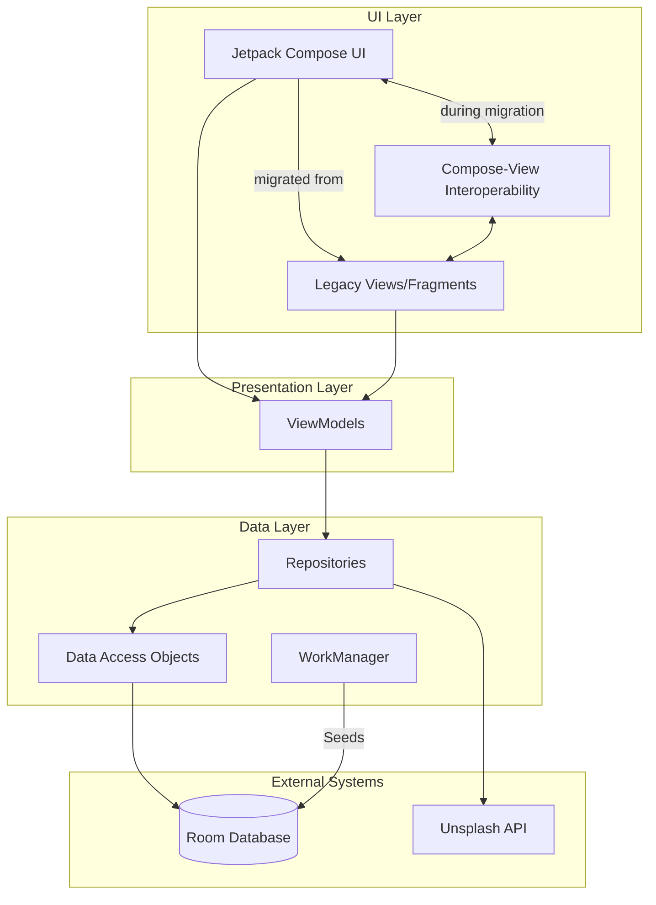
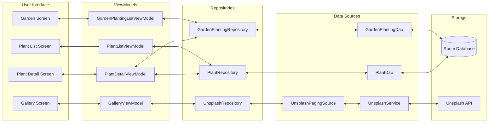
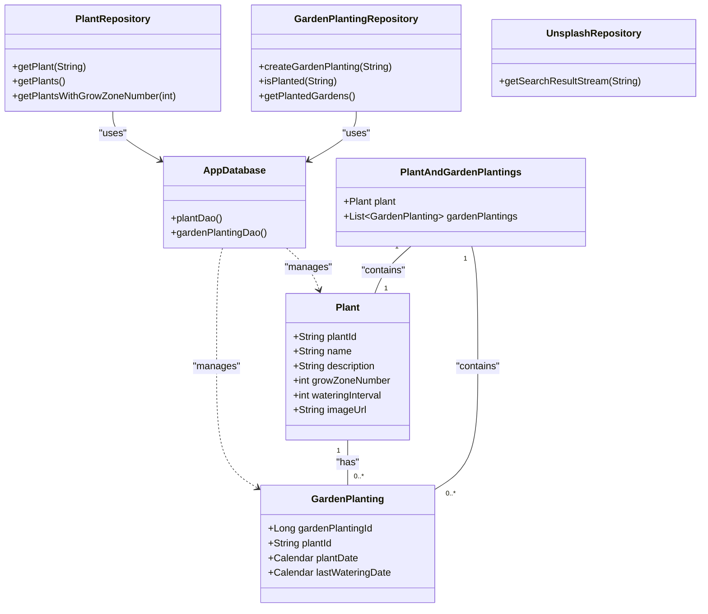
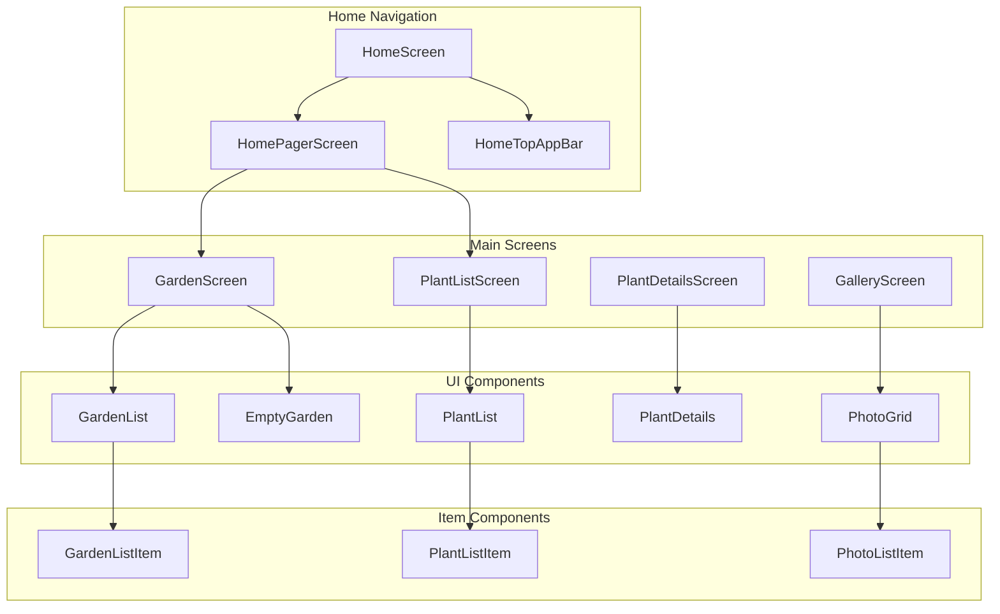
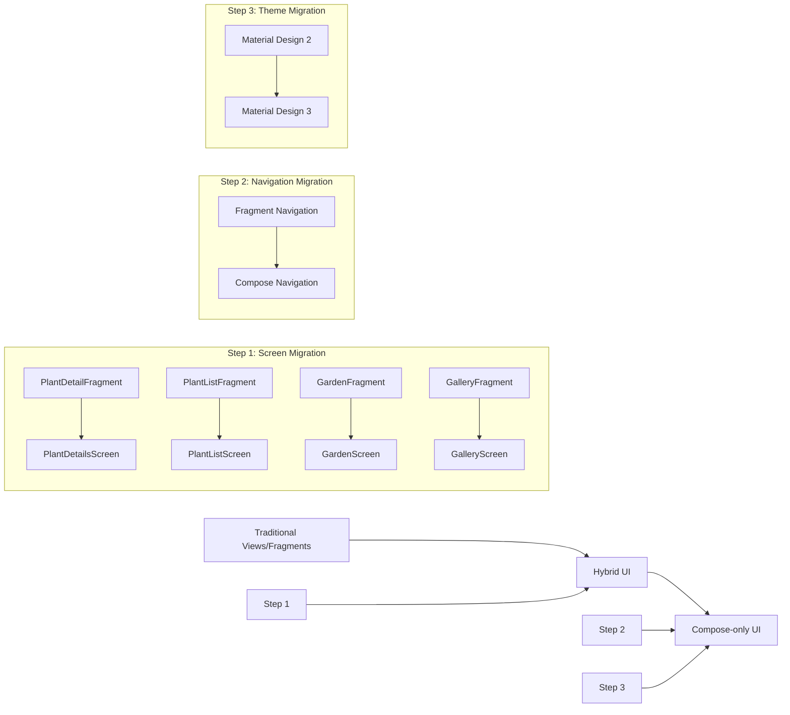

<!-- source: DeepWiki mcp.deepwiki.com · repo android/sunflower · page 1 Overview · fetched 2026-10-23 -->

# Overview

Relevant source files

The following files were used as context for generating this wiki page:

- [.google/packaging.yaml](.google/packaging.yaml)
- [CONTRIBUTING.md](CONTRIBUTING.md)
- [README.md](README.md)
- [docs/MigrationJourney.md](docs/MigrationJourney.md)
- [screenshots/ic_launcher-web.png](screenshots/ic_launcher-web.png)
- [screenshots/jetpack_donut.png](screenshots/jetpack_donut.png)
- [screenshots/phone_my_garden.png](screenshots/phone_my_garden.png)
- [screenshots/phone_plant_detail.png](screenshots/phone_plant_detail.png)
- [screenshots/phone_plant_list.png](screenshots/phone_plant_list.png)
- [screenshots/screenshots.png](screenshots/screenshots.png)

The Android Sunflower application is a gardening app that demonstrates Android development best practices with a particular focus on the migration from traditional View-based UI to Jetpack Compose. It serves as a reference implementation showcasing proper architecture, component integration, and modern Android development techniques.

For detailed information about specific aspects of the application, refer to:
- For architecture patterns and implementation details, see [Architecture](#2)
- For details about the Compose migration process, see [Compose Migration Journey](#3)
- For build system configuration and dependency management, see [Build System](#4)
- For testing approaches used in the application, see [Testing](#5)

Sources: [README.md:3-10]()

## Application Features

Sunflower demonstrates the following functionalities:

- Browsing a catalog of plants
- Viewing detailed information about each plant
- Adding plants to a user's garden
- Tracking planted plants with watering schedule
- Searching for plant images using the Unsplash API

The application showcases these technical implementations:

- Modern Android UI with Jetpack Compose
- MVVM Architecture with ViewModels
- Repository pattern for data operations
- Local persistence with Room database
- Background processing with WorkManager
- Navigation using Navigation Compose
- Reactive programming with Flow

Sources: [README.md:16-25](), [.google/packaging.yaml:20-47]()

## High-Level Architecture

### Application Architecture Overview

The Sunflower app follows a clean architecture approach with clear separation of concerns between layers:

- **UI Layer**: Contains the app's user interface, fully migrated from Views to Compose
- **Presentation Layer**: Contains ViewModels that expose data to the UI and handle user interactions
- **Data Layer**: Contains repositories that abstract data sources and WorkManager for background tasks
- **External Systems**: Room database for local storage and Unsplash API for remote image retrieval

Sources: [README.md:5-10](), [.google/packaging.yaml:20-47]()

## Data Flow and Component Interaction

The data flow diagram illustrates how data moves through the application:

1. Each screen is backed by a dedicated ViewModel
2. ViewModels interact with repositories to fetch and modify data
3. Repositories abstract the data sources (Room database and Unsplash API)
4. Data is exposed to the UI using LiveData or StateFlow for reactive updates

Sources: [README.md:16-25](), [.google/packaging.yaml:20-47]()

## Database and Data Model

The data model consists of two primary entities:

- **Plant**: Represents a plant in the catalog with details like name, description, and watering requirements
- **GardenPlanting**: Represents a plant that has been added to the user's garden with planting date and watering information

The `PlantAndGardenPlantings` class is a convenience container that combines a Plant with its associated GardenPlantings. Each repository handles specific data access operations for its domain.

Sources: [.google/packaging.yaml:25-30]()

## UI Component Hierarchy

The UI structure follows a hierarchical organization:

- **HomeScreen**: Serves as the main container with a top app bar and view pager
- **Main Screens**: Include GardenScreen, PlantListScreen, PlantDetailScreen, and GalleryScreen
- **UI Components**: Reusable components like lists and grid displays
- **Item Components**: Individual items within lists and grids

This structure demonstrates a modular, component-based UI architecture that facilitates maintenance and reuse.

Sources: [README.md:24-25](), [docs/MigrationJourney.md:27-36]()

## Migration Journey from Views to Compose

The Sunflower app demonstrates a phased, incremental migration approach from traditional Views to Jetpack Compose:

1. **Screen Migration**: Each screen was migrated individually, starting with PlantDetailFragment
2. **Navigation Migration**: After all screens were migrated, Fragment-based navigation was replaced with Navigation Compose
3. **Theme Migration**: UI styling was updated from Material Design 2 to Material Design 3

This migration strategy, known as the "bottom-up approach," allows for incremental adoption of Compose while maintaining app functionality throughout the process.

Sources: [README.md:5-10](), [docs/MigrationJourney.md:9-43]()

## External Dependencies

The Sunflower app integrates with the following external systems:

| External System | Purpose |
|-----------------|---------|
| Room Database | Local storage for plant catalog and garden plantings |
| Unsplash API | Provides plant-related images for the gallery screen |
| WorkManager | Handles background tasks like database seeding |
| Hilt | Provides dependency injection throughout the app |
| Navigation Compose | Manages navigation between screens |

To use the app with the Unsplash API, developers need to obtain an API key as described in the README.

Sources: [README.md:29-42](), [.google/packaging.yaml:42-47]()

## Development Status

It's important to note that as of the time of this documentation, the Sunflower repository is no longer under maintenance. The Android team is prioritizing https://github.com/android/compose-samples as the up-to-date source of truth for Compose best practices.

Sources: [README.md:3-10]()

---

