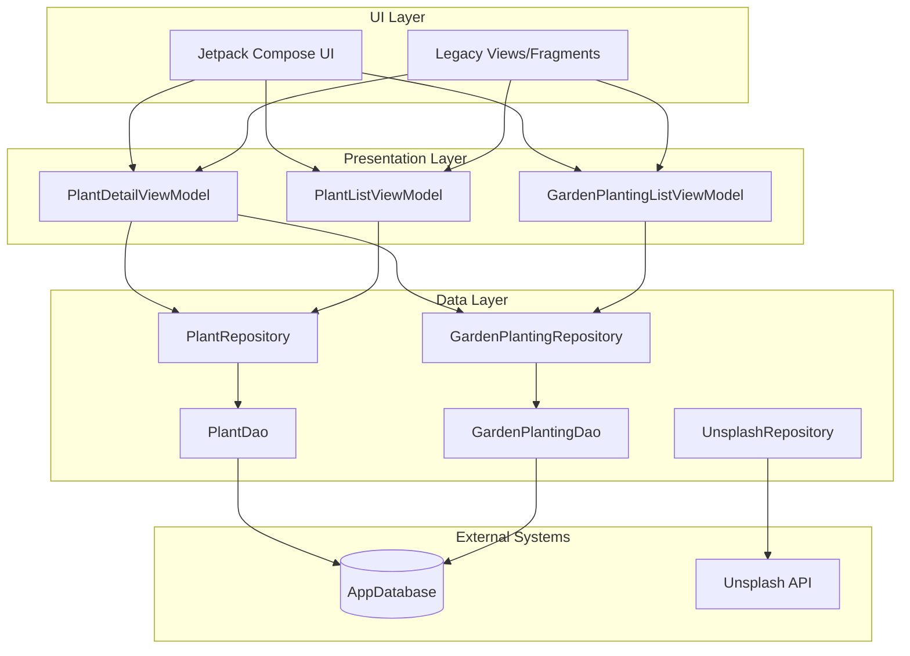
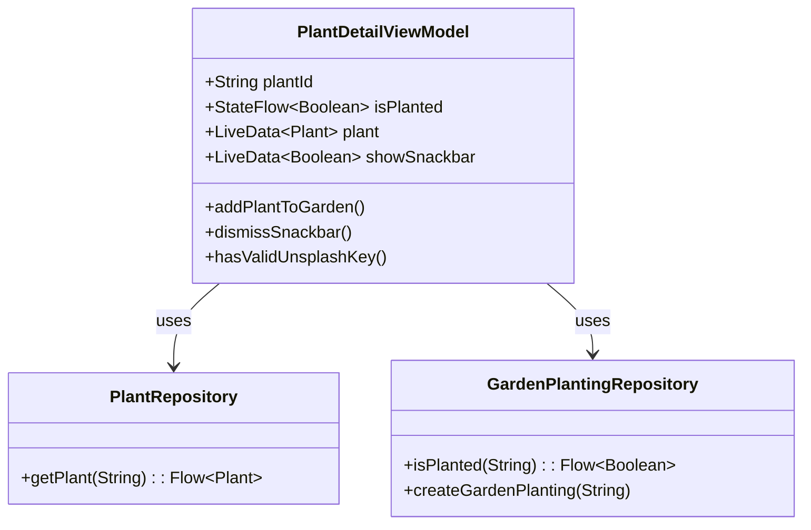
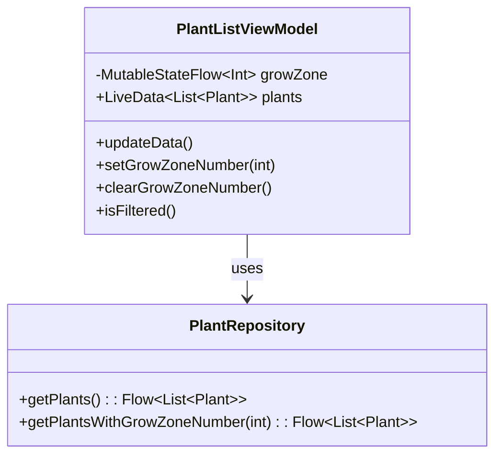
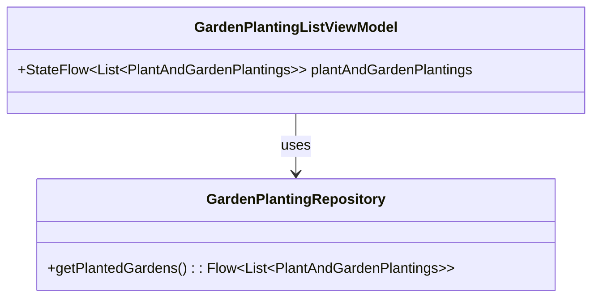
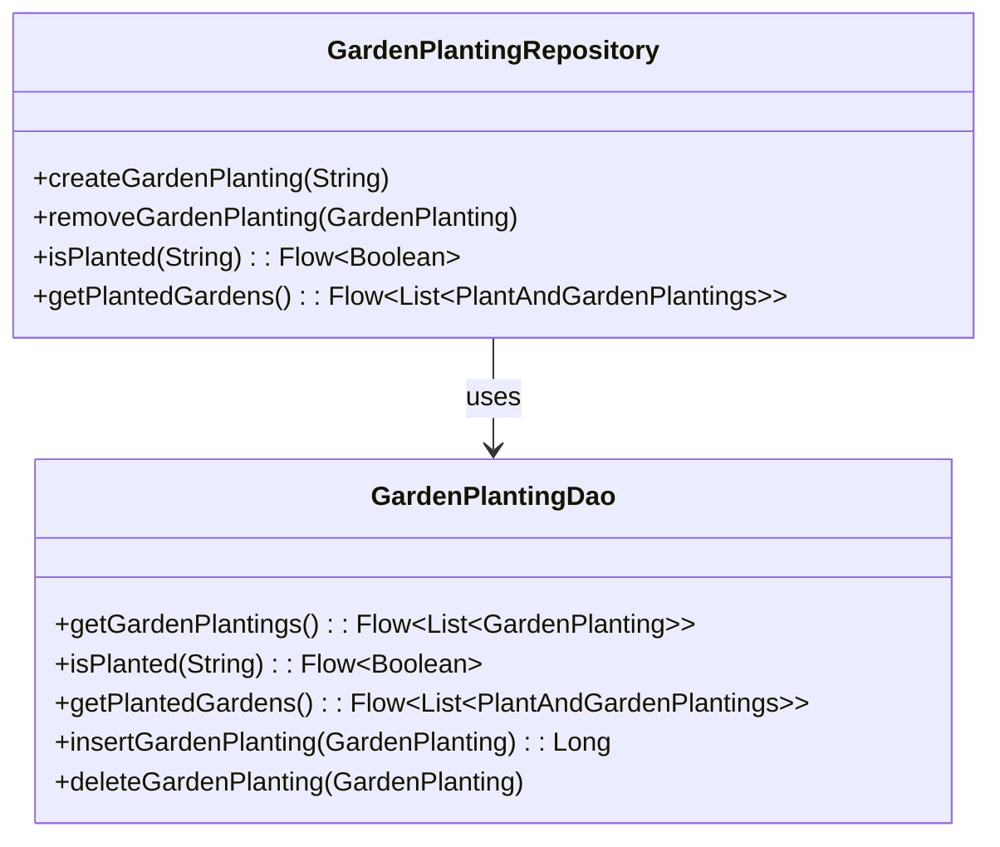
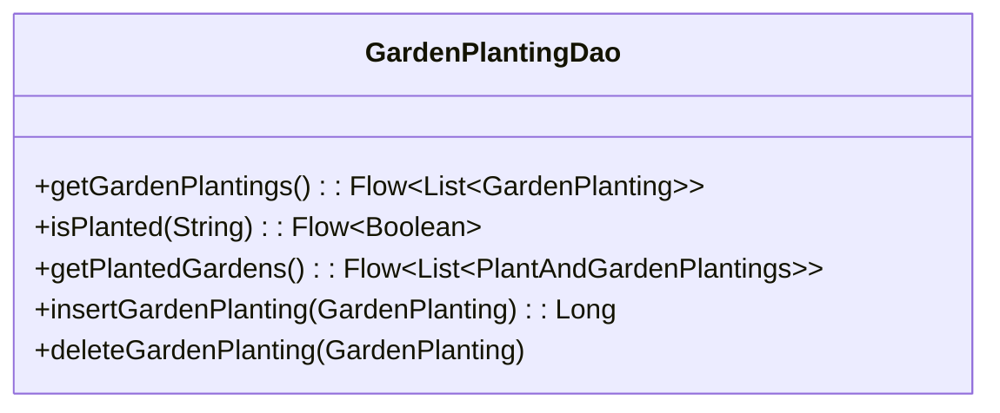
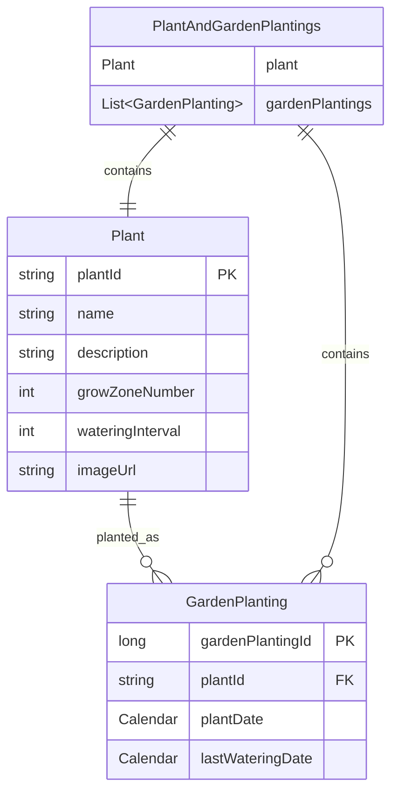
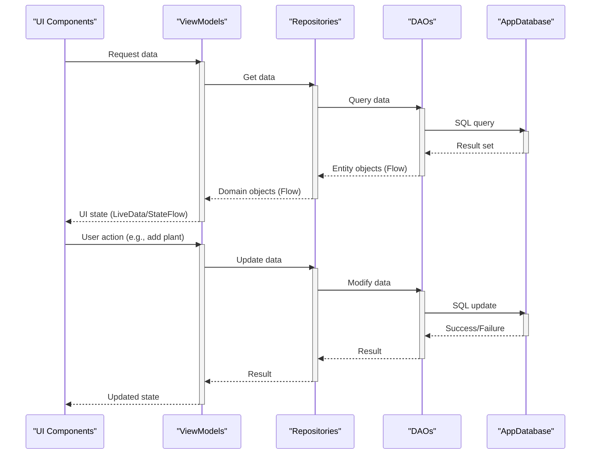
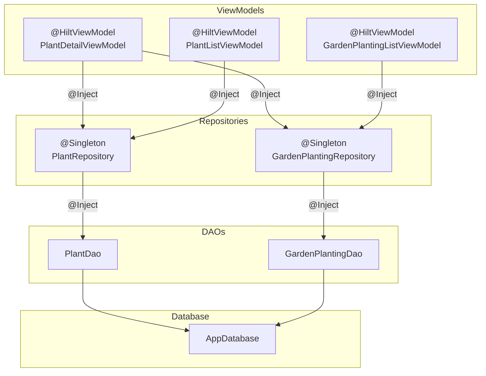
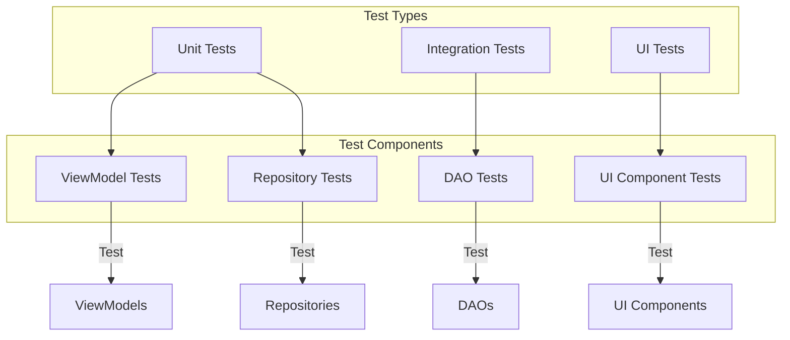

<!-- source: DeepWiki mcp.deepwiki.com · repo android/sunflower · page 2 Architecture · fetched 2026-10-23 -->

# Architecture

Relevant source files

The following files were used as context for generating this wiki page:

- [app/src/androidTest/java/com/google/samples/apps/sunflower/data/GardenPlantingDaoTest.kt](app/src/androidTest/java/com/google/samples/apps/sunflower/data/GardenPlantingDaoTest.kt)
- [app/src/main/java/com/google/samples/apps/sunflower/data/GardenPlanting.kt](app/src/main/java/com/google/samples/apps/sunflower/data/GardenPlanting.kt)
- [app/src/main/java/com/google/samples/apps/sunflower/data/GardenPlantingDao.kt](app/src/main/java/com/google/samples/apps/sunflower/data/GardenPlantingDao.kt)
- [app/src/main/java/com/google/samples/apps/sunflower/data/GardenPlantingRepository.kt](app/src/main/java/com/google/samples/apps/sunflower/data/GardenPlantingRepository.kt)
- [app/src/main/java/com/google/samples/apps/sunflower/viewmodels/GardenPlantingListViewModel.kt](app/src/main/java/com/google/samples/apps/sunflower/viewmodels/GardenPlantingListViewModel.kt)
- [app/src/main/java/com/google/samples/apps/sunflower/viewmodels/PlantDetailViewModel.kt](app/src/main/java/com/google/samples/apps/sunflower/viewmodels/PlantDetailViewModel.kt)
- [app/src/main/java/com/google/samples/apps/sunflower/viewmodels/PlantListViewModel.kt](app/src/main/java/com/google/samples/apps/sunflower/viewmodels/PlantListViewModel.kt)
- [app/src/test/java/com/google/samples/apps/sunflower/data/GardenPlantingTest.kt](app/src/test/java/com/google/samples/apps/sunflower/data/GardenPlantingTest.kt)

## Purpose and Scope

This document outlines the high-level architecture of the Sunflower application, explaining the separation of concerns, data flow patterns, and key architectural components. It provides a technical overview of how different parts of the system interact with each other. For specific implementation details about the MVVM pattern, see [MVVM Pattern](#2.1). For details about how repositories are implemented, see [Repository Pattern](#2.2). For in-depth information about the database and data entities, see [Data Layer](#2.3).

## Architectural Overview

Sunflower implements a clean architecture with distinct layers that separate concerns to promote testability and maintainability.

Sources:
- [app/src/main/java/com/google/samples/apps/sunflower/viewmodels/PlantDetailViewModel.kt]()
- [app/src/main/java/com/google/samples/apps/sunflower/viewmodels/PlantListViewModel.kt]()
- [app/src/main/java/com/google/samples/apps/sunflower/viewmodels/GardenPlantingListViewModel.kt]()
- [app/src/main/java/com/google/samples/apps/sunflower/data/GardenPlantingRepository.kt]()
- [app/src/main/java/com/google/samples/apps/sunflower/data/GardenPlantingDao.kt]()

## Key Components

### ViewModels

ViewModels serve as the bridge between UI and data layers, exposing data through LiveData or StateFlow for reactive UI updates.

#### PlantDetailViewModel

Sources:
- [app/src/main/java/com/google/samples/apps/sunflower/viewmodels/PlantDetailViewModel.kt:38-74]()

The `PlantDetailViewModel` retrieves plant details and manages garden planting operations. It uses `SavedStateHandle` to persist the plant ID across configuration changes and process death, and exposes plant data and planting status through reactive streams.

#### PlantListViewModel

Sources:
- [app/src/main/java/com/google/samples/apps/sunflower/viewmodels/PlantListViewModel.kt:36-111]()

`PlantListViewModel` manages the plant list and filtering functionality. It uses `flatMapLatest` to switch between data sources when the grow zone filter changes, ensuring the UI always displays the most current data.

#### GardenPlantingListViewModel

Sources:
- [app/src/main/java/com/google/samples/apps/sunflower/viewmodels/GardenPlantingListViewModel.kt:30-41]()

`GardenPlantingListViewModel` provides access to the user's garden plants, exposing them as a `StateFlow` for reactive UI updates.

### Repositories

Repositories abstract data access logic and provide a clean API for ViewModels.

#### GardenPlantingRepository

Sources:
- [app/src/main/java/com/google/samples/apps/sunflower/data/GardenPlantingRepository.kt:23-51]()
- [app/src/main/java/com/google/samples/apps/sunflower/data/GardenPlantingDao.kt:30-50]()

`GardenPlantingRepository` manages garden-related operations, delegating database operations to the DAO. It's annotated with `@Singleton` to ensure a single instance exists throughout the application's lifecycle.

### Data Access Objects (DAOs)

DAOs define the interface for database operations, using Room annotations to generate SQL queries.

#### GardenPlantingDao

Sources:
- [app/src/main/java/com/google/samples/apps/sunflower/data/GardenPlantingDao.kt:30-50]()

`GardenPlantingDao` defines database operations for garden plantings, returning results as Kotlin Flows to enable reactive programming. The `@Transaction` annotation on `getPlantedGardens()` ensures atomicity when fetching related entities.

### Data Entities

#### Entity Relationships

Sources:
- [app/src/main/java/com/google/samples/apps/sunflower/data/GardenPlanting.kt:41-60]()
- [app/src/androidTest/java/com/google/samples/apps/sunflower/data/GardenPlantingDaoTest.kt:88-98]()

The diagram illustrates the relationships between database entities:
- `Plant` represents a plant species with cultivation information
- `GardenPlanting` represents a plant added to the user's garden with tracking metadata
- `PlantAndGardenPlantings` is a convenience class that combines a `Plant` with its associated `GardenPlanting` entries

## Data Flow

Sources:
- [app/src/main/java/com/google/samples/apps/sunflower/viewmodels/PlantDetailViewModel.kt:46-67]()
- [app/src/main/java/com/google/samples/apps/sunflower/viewmodels/PlantListViewModel.kt:45-51]()
- [app/src/main/java/com/google/samples/apps/sunflower/data/GardenPlantingRepository.kt:27-39]()
- [app/src/main/java/com/google/samples/apps/sunflower/data/GardenPlantingDao.kt:31-49]()

This diagram illustrates the reactive data flow pattern used in Sunflower:

1. UI layer requests data from ViewModels
2. ViewModels delegate to Repositories
3. Repositories retrieve data from DAOs or remote sources
4. Data flows back as reactive streams (Flows)
5. ViewModels transform Flows to LiveData/StateFlow for UI consumption
6. Updates follow the same path in reverse

## Dependency Injection with Hilt

Sources:
- [app/src/main/java/com/google/samples/apps/sunflower/viewmodels/PlantDetailViewModel.kt:37-38]()
- [app/src/main/java/com/google/samples/apps/sunflower/viewmodels/PlantListViewModel.kt:35-36]()
- [app/src/main/java/com/google/samples/apps/sunflower/viewmodels/GardenPlantingListViewModel.kt:29-30]()
- [app/src/main/java/com/google/samples/apps/sunflower/data/GardenPlantingRepository.kt:22-23]()

Sunflower uses Hilt for dependency injection:
- `@HiltViewModel` identifies ViewModels for Hilt to inject
- `@Inject` constructor parameters receive dependencies from Hilt
- `@Singleton` ensures only one instance of repositories exist

This approach eliminates manual dependency management and facilitates testing through dependency substitution.

## Testing Architecture

Sources:
- [app/src/androidTest/java/com/google/samples/apps/sunflower/data/GardenPlantingDaoTest.kt:37-99]()
- [app/src/test/java/com/google/samples/apps/sunflower/data/GardenPlantingTest.kt:25-35]()

The clean architecture facilitates extensive testing:

| Layer | Test Type | Testing Focus | Example |
|-------|-----------|---------------|---------|
| ViewModel | Unit Tests | Business logic, state management | Testing `PlantListViewModel.updateData()` |
| Repository | Unit Tests | Data transformation, caching | Testing `GardenPlantingRepository.createGardenPlanting()` |
| DAO | Integration Tests | SQL queries, data persistence | `GardenPlantingDaoTest.testGetPlantAndGardenPlantings()` |
| UI | UI Tests | Component rendering, user interaction | Testing navigation between screens |

This layered approach enables precise testing of each component with appropriate isolation or integration.

---

