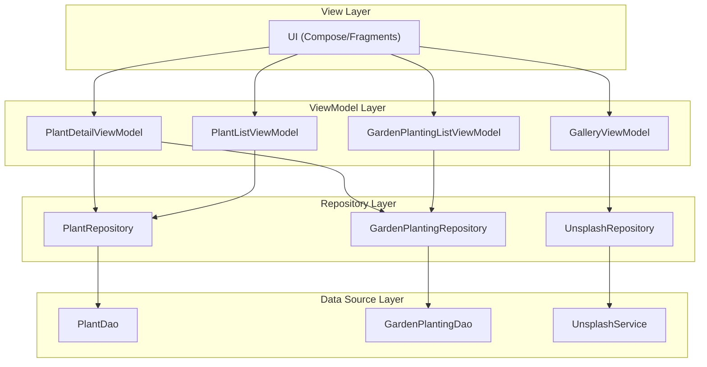
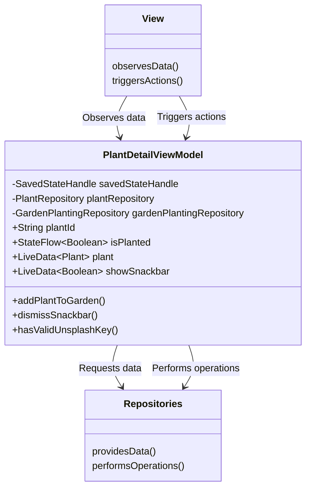
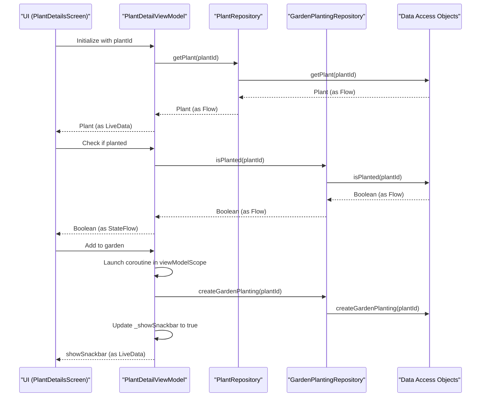
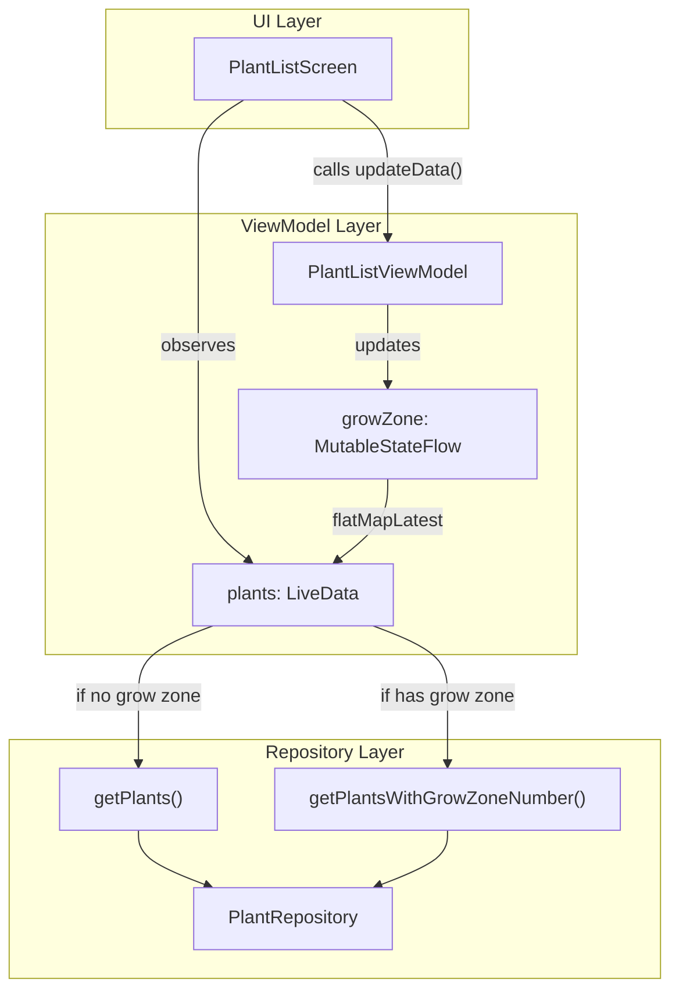
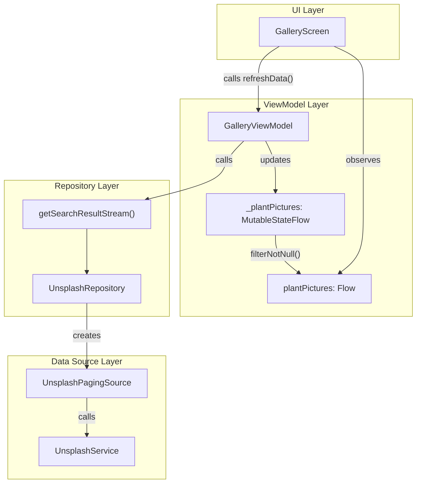

<!-- source: DeepWiki mcp.deepwiki.com · repo android/sunflower · page 2.1 MVVM Pattern · fetched 2026-10-23 -->

# MVVM Pattern

<details>
<summary>Relevant source files</summary>

The following files were used as context for generating this wiki page:

- [app/src/main/java/com/google/samples/apps/sunflower/api/UnsplashService.kt](app/src/main/java/com/google/samples/apps/sunflower/api/UnsplashService.kt)
- [app/src/main/java/com/google/samples/apps/sunflower/data/UnsplashPagingSource.kt](app/src/main/java/com/google/samples/apps/sunflower/data/UnsplashPagingSource.kt)
- [app/src/main/java/com/google/samples/apps/sunflower/data/UnsplashPhotoUrls.kt](app/src/main/java/com/google/samples/apps/sunflower/data/UnsplashPhotoUrls.kt)
- [app/src/main/java/com/google/samples/apps/sunflower/data/UnsplashRepository.kt](app/src/main/java/com/google/samples/apps/sunflower/data/UnsplashRepository.kt)
- [app/src/main/java/com/google/samples/apps/sunflower/data/UnsplashSearchResponse.kt](app/src/main/java/com/google/samples/apps/sunflower/data/UnsplashSearchResponse.kt)
- [app/src/main/java/com/google/samples/apps/sunflower/data/UnsplashUser.kt](app/src/main/java/com/google/samples/apps/sunflower/data/UnsplashUser.kt)
- [app/src/main/java/com/google/samples/apps/sunflower/viewmodels/GalleryViewModel.kt](app/src/main/java/com/google/samples/apps/sunflower/viewmodels/GalleryViewModel.kt)
- [app/src/main/java/com/google/samples/apps/sunflower/viewmodels/GardenPlantingListViewModel.kt](app/src/main/java/com/google/samples/apps/sunflower/viewmodels/GardenPlantingListViewModel.kt)
- [app/src/main/java/com/google/samples/apps/sunflower/viewmodels/PlantAndGardenPlantingsViewModel.kt](app/src/main/java/com/google/samples/apps/sunflower/viewmodels/PlantAndGardenPlantingsViewModel.kt)
- [app/src/main/java/com/google/samples/apps/sunflower/viewmodels/PlantDetailViewModel.kt](app/src/main/java/com/google/samples/apps/sunflower/viewmodels/PlantDetailViewModel.kt)
- [app/src/main/java/com/google/samples/apps/sunflower/viewmodels/PlantListViewModel.kt](app/src/main/java/com/google/samples/apps/sunflower/viewmodels/PlantListViewModel.kt)

</details>


## Purpose and Scope

This document details the implementation of the Model-View-ViewModel (MVVM) architectural pattern in the Sunflower application. It covers how ViewModels interact with repositories to provide data to the UI, the data flow between components, and the specific implementations of key ViewModels. For information about the Repository pattern implementation, see [Repository Pattern](#2.2).

## Overview of MVVM in Sunflower

The MVVM architectural pattern separates an application into three distinct layers:

- **Model**: Represents the data and business logic (repositories, data classes)
- **View**: Represents the UI components (Compose UI, Fragments)
- **ViewModel**: Acts as a mediator, preparing and managing data for the View

Sunflower implements MVVM using Android Architecture Components, including `ViewModel`, `LiveData`, `StateFlow`, and coroutines.



**Title: MVVM Architecture in Sunflower**

Sources: 
- [app/src/main/java/com/google/samples/apps/sunflower/viewmodels/PlantDetailViewModel.kt]()
- [app/src/main/java/com/google/samples/apps/sunflower/viewmodels/PlantListViewModel.kt]()
- [app/src/main/java/com/google/samples/apps/sunflower/viewmodels/GardenPlantingListViewModel.kt]()
- [app/src/main/java/com/google/samples/apps/sunflower/viewmodels/GalleryViewModel.kt]()

## Key ViewModels in Sunflower

Sunflower contains several ViewModels, each responsible for a specific part of the application:

| ViewModel | Purpose | Key Features |
|-----------|---------|--------------|
| `PlantDetailViewModel` | Manages data for plant details screen | Plant data, planting status, add plant functionality |
| `PlantListViewModel` | Manages plant list with filtering | Grow zone filtering, plant list data |
| `GardenPlantingListViewModel` | Manages garden plants list | List of user's planted plants |
| `GalleryViewModel` | Manages plant photos from Unsplash | Photo pagination, search functionality |
| `PlantAndGardenPlantingsViewModel` | Formatting for plant & planting data | Date formatting, display data |

## PlantDetailViewModel Implementation

The `PlantDetailViewModel` demonstrates the core principles of MVVM in Sunflower:



**Title: PlantDetailViewModel Class Structure**

Sources:
- [app/src/main/java/com/google/samples/apps/sunflower/viewmodels/PlantDetailViewModel.kt:38-74]()

Key aspects of the implementation:

1. **Dependency Injection** - ViewModels are injected using Hilt:
   ```kotlin
   @HiltViewModel
   class PlantDetailViewModel @Inject constructor(
       savedStateHandle: SavedStateHandle,
       plantRepository: PlantRepository,
       private val gardenPlantingRepository: GardenPlantingRepository,
   ) : ViewModel() {
   ```

2. **State Management** - Uses SavedStateHandle to preserve state:
   ```kotlin
   val plantId: String = savedStateHandle.get<String>(PLANT_ID_SAVED_STATE_KEY)!!
   ```

3. **Reactive Data** - Exposes data as LiveData and StateFlow:
   ```kotlin
   val isPlanted = gardenPlantingRepository.isPlanted(plantId)
       .stateIn(
           viewModelScope,
           SharingStarted.WhileSubscribed(5000),
           false
       )
   val plant = plantRepository.getPlant(plantId).asLiveData()
   ```

4. **User Actions** - Handles business logic for user actions:
   ```kotlin
   fun addPlantToGarden() {
       viewModelScope.launch {
           gardenPlantingRepository.createGardenPlanting(plantId)
           _showSnackbar.value = true
       }
   }
   ```

5. **UI State** - Manages UI state like showing snackbars:
   ```kotlin
   private val _showSnackbar = MutableLiveData(false)
   val showSnackbar: LiveData<Boolean>
       get() = _showSnackbar
   ```

Sources:
- [app/src/main/java/com/google/samples/apps/sunflower/viewmodels/PlantDetailViewModel.kt:38-74]()

## Data Flow in MVVM

The following diagram illustrates how data flows through the MVVM components in Sunflower:



**Title: Data Flow in PlantDetailViewModel**

Sources:
- [app/src/main/java/com/google/samples/apps/sunflower/viewmodels/PlantDetailViewModel.kt:44-67]()

## PlantListViewModel Implementation

The `PlantListViewModel` demonstrates how to handle filtered data and state preservation:



**Title: Data Flow in PlantListViewModel**

Sources:
- [app/src/main/java/com/google/samples/apps/sunflower/viewmodels/PlantListViewModel.kt:36-106]()

Key implementation details:

1. **State Management** - Uses MutableStateFlow for grow zone state:
   ```kotlin
   private val growZone: MutableStateFlow<Int> = MutableStateFlow(
       savedStateHandle.get(GROW_ZONE_SAVED_STATE_KEY) ?: NO_GROW_ZONE
   )
   ```

2. **Reactive Transformations** - Uses Flow operators to transform data:
   ```kotlin
   val plants: LiveData<List<Plant>> = growZone.flatMapLatest { zone ->
       if (zone == NO_GROW_ZONE) {
           plantRepository.getPlants()
       } else {
           plantRepository.getPlantsWithGrowZoneNumber(zone)
       }
   }.asLiveData()
   ```

3. **State Persistence** - Saves state changes to SavedStateHandle:
   ```kotlin
   viewModelScope.launch {
       growZone.collect { newGrowZone ->
           savedStateHandle.set(GROW_ZONE_SAVED_STATE_KEY, newGrowZone)
       }
   }
   ```

4. **Action Handlers** - Provides methods for UI actions:
   ```kotlin
   fun updateData() {
       if (isFiltered()) {
           clearGrowZoneNumber()
       } else {
           setGrowZoneNumber(9)
       }
   }
   ```

Sources:
- [app/src/main/java/com/google/samples/apps/sunflower/viewmodels/PlantListViewModel.kt:41-105]()

## GardenPlantingListViewModel

The `GardenPlantingListViewModel` provides a simple example of exposing repository data to the UI:

```kotlin
@HiltViewModel
class GardenPlantingListViewModel @Inject internal constructor(
    gardenPlantingRepository: GardenPlantingRepository
) : ViewModel() {
    val plantAndGardenPlantings: StateFlow<List<PlantAndGardenPlantings>> =
        gardenPlantingRepository
            .getPlantedGardens()
            .stateIn(
                viewModelScope,
                SharingStarted.WhileSubscribed(5000),
                emptyList()
            )
}
```

This ViewModel:
1. Receives the repository through dependency injection
2. Converts the repository's Flow to a StateFlow with a default value
3. Exposes the data to the UI as a StateFlow

Sources:
- [app/src/main/java/com/google/samples/apps/sunflower/viewmodels/GardenPlantingListViewModel.kt:30-41]()

## GalleryViewModel

The `GalleryViewModel` shows how to handle paginated data from a network source:



**Title: Data Flow in GalleryViewModel**

Sources:
- [app/src/main/java/com/google/samples/apps/sunflower/viewmodels/GalleryViewModel.kt:35-61]()
- [app/src/main/java/com/google/samples/apps/sunflower/data/UnsplashPagingSource.kt:25-54]()
- [app/src/main/java/com/google/samples/apps/sunflower/data/UnsplashRepository.kt:26-38]()

Key implementation details:
1. Retrieves the plant name from SavedStateHandle
2. Uses Flow and MutableStateFlow to manage the paged data
3. Exposes a filtered Flow of PagingData to the UI
4. Uses viewModelScope to launch coroutines for data fetching

## Benefits of MVVM in Sunflower

The MVVM pattern provides several benefits for the Sunflower application:

1. **Separation of Concerns**: UI code is separate from business logic, making the codebase more maintainable.

2. **Testability**: ViewModels can be tested independently of UI components, as demonstrated in the project's test files.

3. **Lifecycle Management**: ViewModels survive configuration changes, preserving data during screen rotations and other configuration changes.

4. **Reactive UI Updates**: Using LiveData and StateFlow provides automatic UI updates when the underlying data changes.

5. **State Preservation**: SavedStateHandle helps preserve state across process death.

6. **Clean Dependencies**: Dependency injection with Hilt provides clean dependency management.

Sources:
- [app/src/main/java/com/google/samples/apps/sunflower/viewmodels/PlantDetailViewModel.kt]()
- [app/src/main/java/com/google/samples/apps/sunflower/viewmodels/PlantListViewModel.kt]()
- [app/src/main/java/com/google/samples/apps/sunflower/viewmodels/GardenPlantingListViewModel.kt]()
- [app/src/main/java/com/google/samples/apps/sunflower/viewmodels/GalleryViewModel.kt]()

---

