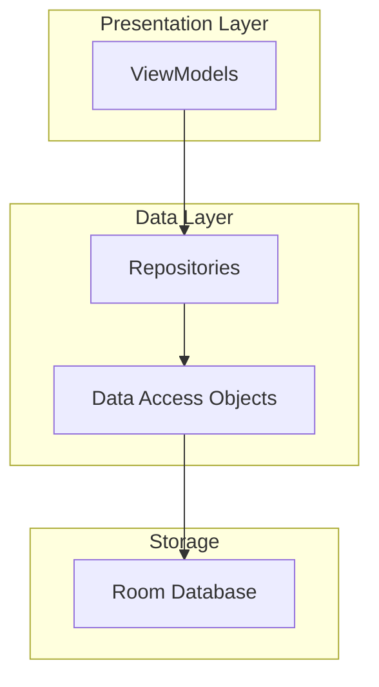
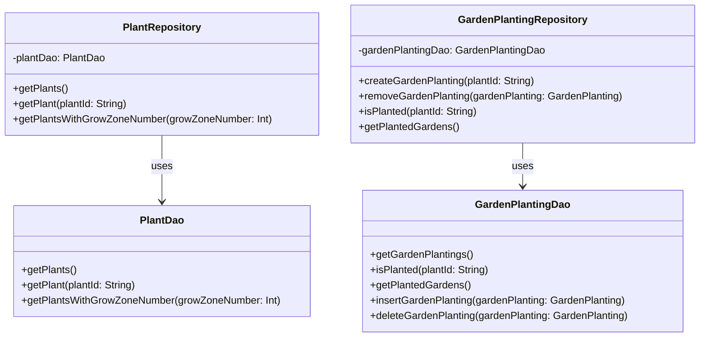
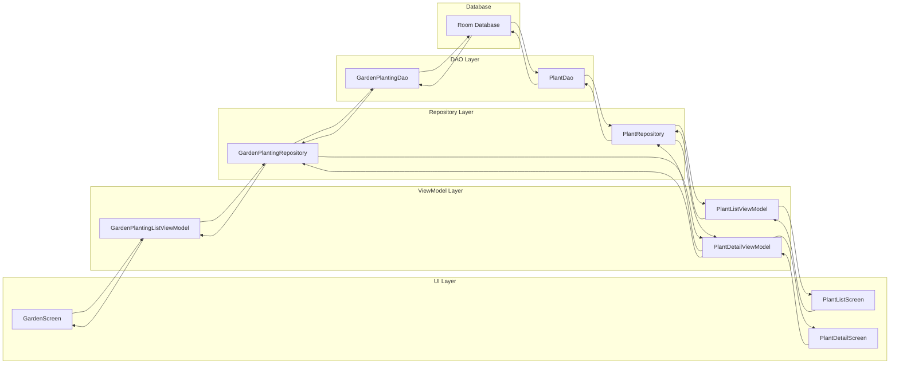
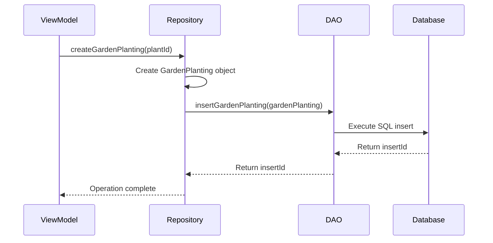

<!-- source: DeepWiki mcp.deepwiki.com · repo android/sunflower · page 2.2 Repository Pattern · fetched 2026-10-23 -->

# Repository Pattern

<details>
<summary>Relevant source files</summary>

The following files were used as context for generating this wiki page:

- [app/src/androidTest/java/com/google/samples/apps/sunflower/data/GardenPlantingDaoTest.kt](app/src/androidTest/java/com/google/samples/apps/sunflower/data/GardenPlantingDaoTest.kt)
- [app/src/main/java/com/google/samples/apps/sunflower/data/GardenPlanting.kt](app/src/main/java/com/google/samples/apps/sunflower/data/GardenPlanting.kt)
- [app/src/main/java/com/google/samples/apps/sunflower/data/GardenPlantingDao.kt](app/src/main/java/com/google/samples/apps/sunflower/data/GardenPlantingDao.kt)
- [app/src/main/java/com/google/samples/apps/sunflower/data/GardenPlantingRepository.kt](app/src/main/java/com/google/samples/apps/sunflower/data/GardenPlantingRepository.kt)
- [app/src/main/java/com/google/samples/apps/sunflower/data/PlantRepository.kt](app/src/main/java/com/google/samples/apps/sunflower/data/PlantRepository.kt)
- [app/src/test/java/com/google/samples/apps/sunflower/data/GardenPlantingTest.kt](app/src/test/java/com/google/samples/apps/sunflower/data/GardenPlantingTest.kt)

</details>


## Purpose and Scope

This document describes the Repository Pattern implementation in the Sunflower application. The Repository Pattern serves as an abstraction layer between data sources and the rest of the application, providing a clean API for data access. This page focuses on how repositories in Sunflower abstract the underlying database operations through Data Access Objects (DAOs) and provide a consistent interface to the presentation layer.

For information about the overall architecture, see [Architecture](#2), and for details on the data layer implementation, see [Data Layer](#2.3).

## What is the Repository Pattern?

The Repository Pattern is a design pattern that separates the logic for accessing data from the business logic of the application. It provides a clean API for data access to the rest of the application and mediates between different data sources.



**Repository Pattern Benefits**

Sources: [app/src/main/java/com/google/samples/apps/sunflower/data/PlantRepository.kt:22-27]()

## Repository Implementations in Sunflower

Sunflower implements two main repositories:

1. **PlantRepository**: Handles operations related to plant data
2. **GardenPlantingRepository**: Manages operations related to garden plantings (plants that users have added to their garden)



**Repository Class Structure**

Sources: 
- [app/src/main/java/com/google/samples/apps/sunflower/data/PlantRepository.kt]()
- [app/src/main/java/com/google/samples/apps/sunflower/data/GardenPlantingRepository.kt]()
- [app/src/main/java/com/google/samples/apps/sunflower/data/GardenPlantingDao.kt]()

## Plant Repository

The `PlantRepository` provides access to plant data in the database through the `PlantDao`.

```
@Singleton
class PlantRepository @Inject constructor(private val plantDao: PlantDao) {
    fun getPlants() = plantDao.getPlants()
    fun getPlant(plantId: String) = plantDao.getPlant(plantId)
    fun getPlantsWithGrowZoneNumber(growZoneNumber: Int) =
        plantDao.getPlantsWithGrowZoneNumber(growZoneNumber)
}
```

Key characteristics:
- Annotated with `@Singleton` to ensure only one instance exists
- Uses dependency injection through the `@Inject` constructor annotation
- Provides methods that directly delegate to the corresponding DAO methods
- Returns Flow objects that allow for reactive UI updates

Sources: [app/src/main/java/com/google/samples/apps/sunflower/data/PlantRepository.kt:28-47]()

## Garden Planting Repository

The `GardenPlantingRepository` manages operations related to plants that the user has added to their garden.

```
@Singleton
class GardenPlantingRepository @Inject constructor(
    private val gardenPlantingDao: GardenPlantingDao
) {
    suspend fun createGardenPlanting(plantId: String) {
        val gardenPlanting = GardenPlanting(plantId)
        gardenPlantingDao.insertGardenPlanting(gardenPlanting)
    }
    
    suspend fun removeGardenPlanting(gardenPlanting: GardenPlanting) {
        gardenPlantingDao.deleteGardenPlanting(gardenPlanting)
    }
    
    fun isPlanted(plantId: String) =
        gardenPlantingDao.isPlanted(plantId)
    
    fun getPlantedGardens() = gardenPlantingDao.getPlantedGardens()
}
```

Key characteristics:
- Annotated with `@Singleton` to ensure only one instance exists
- Uses dependency injection through the `@Inject` constructor annotation
- Provides a higher level of abstraction than `PlantRepository` by including business logic
- Contains suspend functions for database operations that should be executed off the main thread
- Also exposes Flow objects for reactive data observation

Sources: [app/src/main/java/com/google/samples/apps/sunflower/data/GardenPlantingRepository.kt:23-51]()

## Data Flow

The following diagram illustrates how data flows through the repository layer in the Sunflower application:



**Data Flow Through Repository Pattern**

Sources: 
- [app/src/main/java/com/google/samples/apps/sunflower/data/PlantRepository.kt]()
- [app/src/main/java/com/google/samples/apps/sunflower/data/GardenPlantingRepository.kt]()

## Repository Implementation Details

### Method Delegation

Both repositories mostly delegate calls directly to their respective DAOs, serving as a passthrough layer. However, the `GardenPlantingRepository` includes some additional logic, particularly in the `createGardenPlanting` method which creates a new `GardenPlanting` object before passing it to the DAO.



**Repository Method Flow**

Sources: [app/src/main/java/com/google/samples/apps/sunflower/data/GardenPlantingRepository.kt:27-30]()

### Singleton Pattern

Both repositories also implement the Singleton pattern through companion objects with `getInstance` methods:

```kotlin
companion object {
    // For Singleton instantiation
    @Volatile private var instance: PlantRepository? = null

    fun getInstance(plantDao: PlantDao) =
        instance ?: synchronized(this) {
            instance ?: PlantRepository(plantDao).also { instance = it }
        }
}
```

This pattern ensures that only one instance of each repository exists throughout the application, which is important for consistent data access and state management.

Sources: 
- [app/src/main/java/com/google/samples/apps/sunflower/data/PlantRepository.kt:38-47]()
- [app/src/main/java/com/google/samples/apps/sunflower/data/GardenPlantingRepository.kt:41-50]()

### Dependency Injection

The repositories are designed to be easily injectable through Dependency Injection (DI) using the `@Inject` constructor annotation and `@Singleton` scope:

```kotlin
@Singleton
class PlantRepository @Inject constructor(private val plantDao: PlantDao) {
    // Implementation
}

@Singleton
class GardenPlantingRepository @Inject constructor(
    private val gardenPlantingDao: GardenPlantingDao
) {
    // Implementation
}
```

This design makes it easy to provide repository instances to ViewModels and other components that need data access.

Sources: 
- [app/src/main/java/com/google/samples/apps/sunflower/data/PlantRepository.kt:28-29]()
- [app/src/main/java/com/google/samples/apps/sunflower/data/GardenPlantingRepository.kt:23-25]()

## Repository Testing

Testing repositories is straightforward due to their clear responsibilities and dependencies. The Sunflower project includes tests for the interactions between repositories and DAOs:

1. Tests verify that repositories correctly delegate to DAOs
2. Tests ensure the data transformation and business logic is correct

For example, in `GardenPlantingDaoTest.kt`, tests verify the functionality that the repository will depend on:

```kotlin
@Test fun testGetGardenPlantingForPlant() = runBlocking {
    assertTrue(gardenPlantingDao.isPlanted(testPlant.plantId).first())
}
```

Sources: [app/src/androidTest/java/com/google/samples/apps/sunflower/data/GardenPlantingDaoTest.kt:80-82]()

## Benefits of Repository Pattern in Sunflower

The Repository Pattern provides several benefits in the Sunflower application:

1. **Separation of Concerns**: Repositories separate data access logic from business logic and UI
2. **Testability**: Repositories can be easily mocked for testing ViewModels
3. **Single Source of Truth**: Repositories provide a single access point for data
4. **Abstraction**: They hide the complexity of data operations behind a simple API
5. **Maintainability**: Changes to data sources can be made without affecting the rest of the application

| Repository Type | Primary Responsibility | Key Methods |
|-----------------|------------------------|-------------|
| PlantRepository | Access to plant data | `getPlants()`, `getPlant(plantId)`, `getPlantsWithGrowZoneNumber(zone)` |
| GardenPlantingRepository | Management of user's garden | `createGardenPlanting(plantId)`, `removeGardenPlanting(gardenPlanting)`, `isPlanted(plantId)`, `getPlantedGardens()` |

Sources: 
- [app/src/main/java/com/google/samples/apps/sunflower/data/PlantRepository.kt]()
- [app/src/main/java/com/google/samples/apps/sunflower/data/GardenPlantingRepository.kt]()

---

