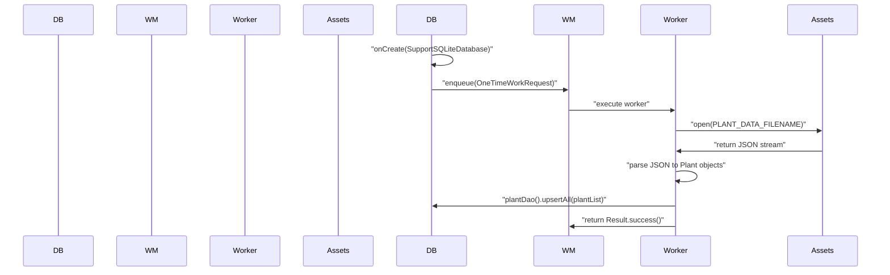
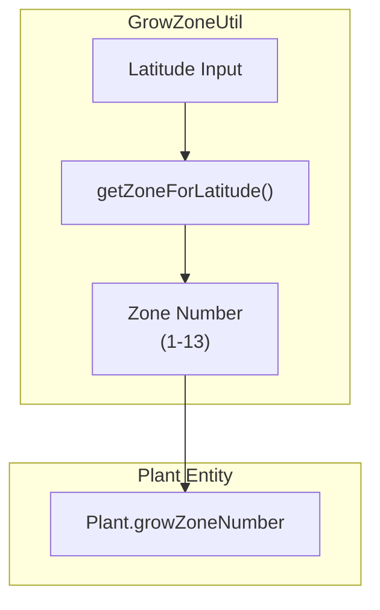
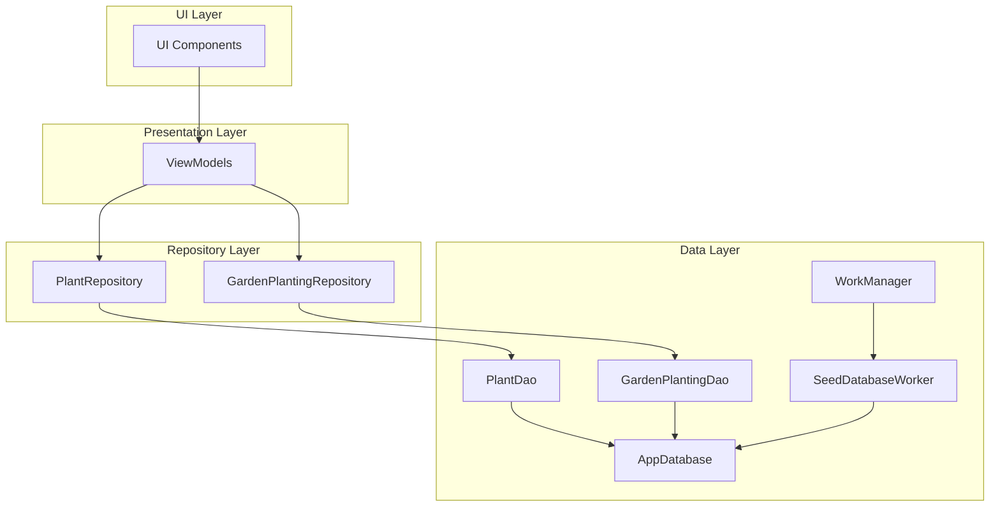

<!-- source: DeepWiki mcp.deepwiki.com · repo android/sunflower · page 2.3 Data Layer · fetched 2026-10-23 -->

# Data Layer

<details>
<summary>Relevant source files</summary>

The following files were used as context for generating this wiki page:

- [ASSETS_LICENSE](ASSETS_LICENSE)
- [app/src/main/assets/plants.json](app/src/main/assets/plants.json)
- [app/src/main/java/com/google/samples/apps/sunflower/data/AppDatabase.kt](app/src/main/java/com/google/samples/apps/sunflower/data/AppDatabase.kt)
- [app/src/main/java/com/google/samples/apps/sunflower/data/Converters.kt](app/src/main/java/com/google/samples/apps/sunflower/data/Converters.kt)
- [app/src/main/java/com/google/samples/apps/sunflower/utilities/GrowZoneUtil.kt](app/src/main/java/com/google/samples/apps/sunflower/utilities/GrowZoneUtil.kt)
- [app/src/main/java/com/google/samples/apps/sunflower/workers/SeedDatabaseWorker.kt](app/src/main/java/com/google/samples/apps/sunflower/workers/SeedDatabaseWorker.kt)
- [app/src/test/java/com/google/samples/apps/sunflower/data/ConvertersTest.kt](app/src/test/java/com/google/samples/apps/sunflower/data/ConvertersTest.kt)
- [app/src/test/java/com/google/samples/apps/sunflower/test/CalendarMatcher.kt](app/src/test/java/com/google/samples/apps/sunflower/test/CalendarMatcher.kt)
- [app/src/test/java/com/google/samples/apps/sunflower/utilities/GrowZoneUtilTest.kt](app/src/test/java/com/google/samples/apps/sunflower/utilities/GrowZoneUtilTest.kt)

</details>


The Data Layer in Sunflower serves as the foundation for managing plant data and user garden information. This document describes how data is structured, stored, and initialized within the application. For information about how this data is exposed to the UI, see [Repository Pattern](#2.2).

## Database Structure

Sunflower uses Room database to persistently store data. The database structure consists of two main entities with a one-to-many relationship.

```mermaid
classDiagram
    class "Plant" {
        +String plantId
        +String name
        +String description
        +int growZoneNumber
        +int wateringInterval
        +String imageUrl
    }
    
    class "GardenPlanting" {
        +Long gardenPlantingId
        +String plantId
        +Calendar plantDate
        +Calendar lastWateringDate
    }
    
    class "AppDatabase" {
        +plantDao(): PlantDao
        +gardenPlantingDao(): GardenPlantingDao
    }
    
    class "Converters" {
        +calendarToDatestamp(Calendar): Long
        +datestampToCalendar(Long): Calendar
    }
    
    "Plant" "1" <-- "0..*" "GardenPlanting" : references
    "AppDatabase" --> "Plant" : manages
    "AppDatabase" --> "GardenPlanting" : manages
    "AppDatabase" ..> "Converters" : uses
```

Sources: [app/src/main/java/com/google/samples/apps/sunflower/data/AppDatabase.kt:36-40]()

### Key Components

The database is defined in `AppDatabase` class which:
- Is annotated with `@Database` to specify the entities
- Uses the singleton pattern for database instantiation
- Provides access to DAOs (Data Access Objects) for database operations
- Implements type converters for handling Calendar objects

```
@Database(entities = [GardenPlanting::class, Plant::class], version = 1, exportSchema = false)
@TypeConverters(Converters::class)
abstract class AppDatabase : RoomDatabase() {
    abstract fun gardenPlantingDao(): GardenPlantingDao
    abstract fun plantDao(): PlantDao
    // ...
}
```

Sources: [app/src/main/java/com/google/samples/apps/sunflower/data/AppDatabase.kt:36-41](), [app/src/main/java/com/google/samples/apps/sunflower/data/Converters.kt:25-30]()

### Type Converters

The `Converters` class provides type conversion between Calendar objects and Long timestamps for Room database:

```
class Converters {
    @TypeConverter fun calendarToDatestamp(calendar: Calendar): Long = calendar.timeInMillis
    @TypeConverter fun datestampToCalendar(value: Long): Calendar =
        Calendar.getInstance().apply { timeInMillis = value }
}
```

These converters are necessary for handling planting and watering dates stored in the `GardenPlanting` entity.

Sources: [app/src/main/java/com/google/samples/apps/sunflower/data/Converters.kt:25-30]()

## Database Initialization

When the application first runs, the database needs to be populated with initial plant data. Sunflower implements this using WorkManager and a custom worker class.



Sources: [app/src/main/java/com/google/samples/apps/sunflower/data/AppDatabase.kt:53-69](), [app/src/main/java/com/google/samples/apps/sunflower/workers/SeedDatabaseWorker.kt:31-63]()

### Implementation Details

1. **Database Creation Callback**

When the Room database is first created, a callback is triggered which schedules a one-time work request to seed the database:

```
private fun buildDatabase(context: Context): AppDatabase {
    return Room.databaseBuilder(context, AppDatabase::class.java, DATABASE_NAME)
        .addCallback(
            object : RoomDatabase.Callback() {
                override fun onCreate(db: SupportSQLiteDatabase) {
                    super.onCreate(db)
                    val request = OneTimeWorkRequestBuilder<SeedDatabaseWorker>()
                            .setInputData(workDataOf(KEY_FILENAME to PLANT_DATA_FILENAME))
                            .build()
                    WorkManager.getInstance(context).enqueue(request)
                }
            }
        )
        .build()
}
```

Sources: [app/src/main/java/com/google/samples/apps/sunflower/data/AppDatabase.kt:55-69]()

2. **SeedDatabaseWorker**

The `SeedDatabaseWorker` loads plant data from a JSON file and inserts it into the database:

```
override suspend fun doWork(): Result = withContext(Dispatchers.IO) {
    try {
        val filename = inputData.getString(KEY_FILENAME)
        if (filename != null) {
            applicationContext.assets.open(filename).use { inputStream ->
                JsonReader(inputStream.reader()).use { jsonReader ->
                    val plantType = object : TypeToken<List<Plant>>() {}.type
                    val plantList: List<Plant> = Gson().fromJson(jsonReader, plantType)
                    
                    val database = AppDatabase.getInstance(applicationContext)
                    database.plantDao().upsertAll(plantList)
                    
                    Result.success()
                }
            }
        } else {
            Log.e(TAG, "Error seeding database - no valid filename")
            Result.failure()
        }
    } catch (ex: Exception) {
        Log.e(TAG, "Error seeding database", ex)
        Result.failure()
    }
}
```

Sources: [app/src/main/java/com/google/samples/apps/sunflower/workers/SeedDatabaseWorker.kt:35-58]()

3. **Initial Plant Data**

The initial plant data is defined in a JSON file (`plants.json`) in the assets folder. The JSON structure contains an array of plant objects, each with properties matching the `Plant` entity:

| Property | Type | Description |
|----------|------|-------------|
| plantId | String | Unique identifier for the plant |
| name | String | Display name of the plant |
| description | String | Detailed HTML description |
| growZoneNumber | int | USDA plant hardiness zone |
| wateringInterval | int | Days between watering |
| imageUrl | String | URL to plant image |

Sources: [app/src/main/assets/plants.json:1-138]()

## GrowZone Utility

The Data Layer includes a utility function to determine a plant's appropriate growing zone based on geographical latitude.



Sources: [app/src/main/java/com/google/samples/apps/sunflower/utilities/GrowZoneUtil.kt:35-49]()

The `getZoneForLatitude` function maps latitude ranges to specific growing zones:

```
fun getZoneForLatitude(latitude: Double) = when (abs(latitude)) {
    in 0.0..7.0 -> 13
    in 7.0..14.0 -> 12
    in 14.0..21.0 -> 11
    in 21.0..28.0 -> 10
    in 28.0..35.0 -> 9
    // ...more zones...
    else -> 1 // Remaining latitudes are assigned to zone 1.
}
```

This utility helps determine which plants are appropriate for specific geographical regions based on the USDA Plant Hardiness Zone Map.

Sources: [app/src/main/java/com/google/samples/apps/sunflower/utilities/GrowZoneUtil.kt:35-49]()

## Data Layer in Application Architecture

The Data Layer serves as the foundation in Sunflower's MVVM architecture, providing data access to the Repository layer.



Sources: [app/src/main/java/com/google/samples/apps/sunflower/data/AppDatabase.kt:36-71](), [app/src/main/java/com/google/samples/apps/sunflower/workers/SeedDatabaseWorker.kt:31-64]()

The Data Layer provides:
1. Persistent storage for plant and garden data
2. Initial data seeding
3. Data access methods through DAOs
4. Type conversion utilities for complex data types
5. Grow zone calculation utilities

The Repository layer then builds upon this foundation to provide abstracted data access to the Presentation Layer.

---

