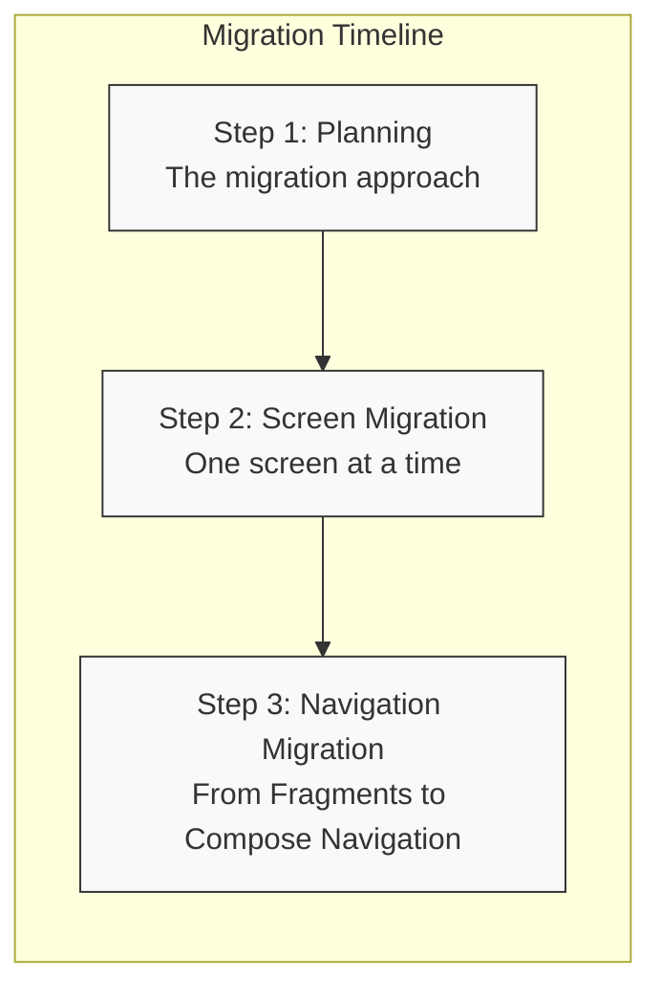
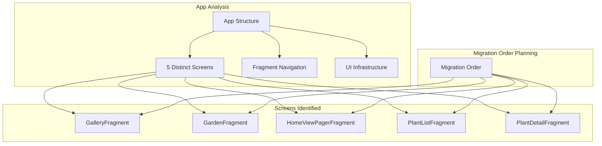
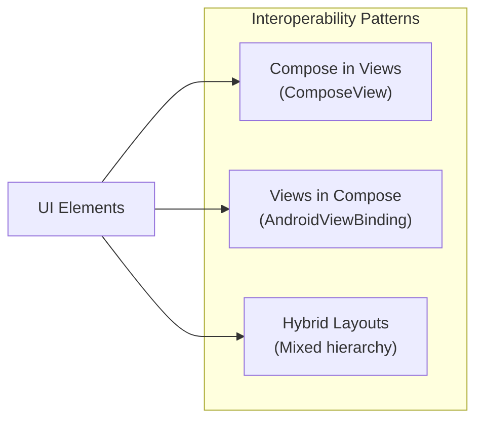
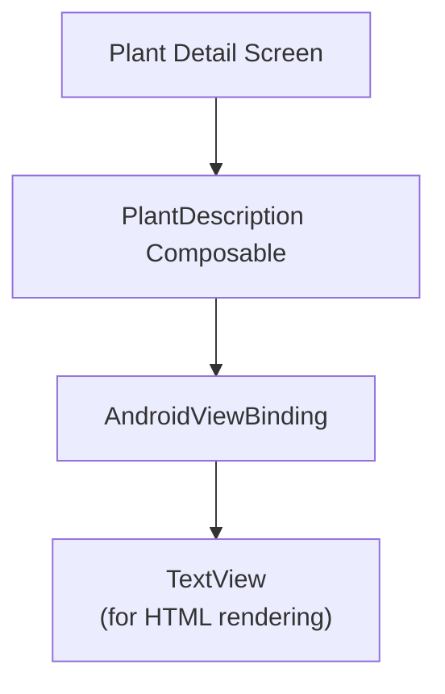
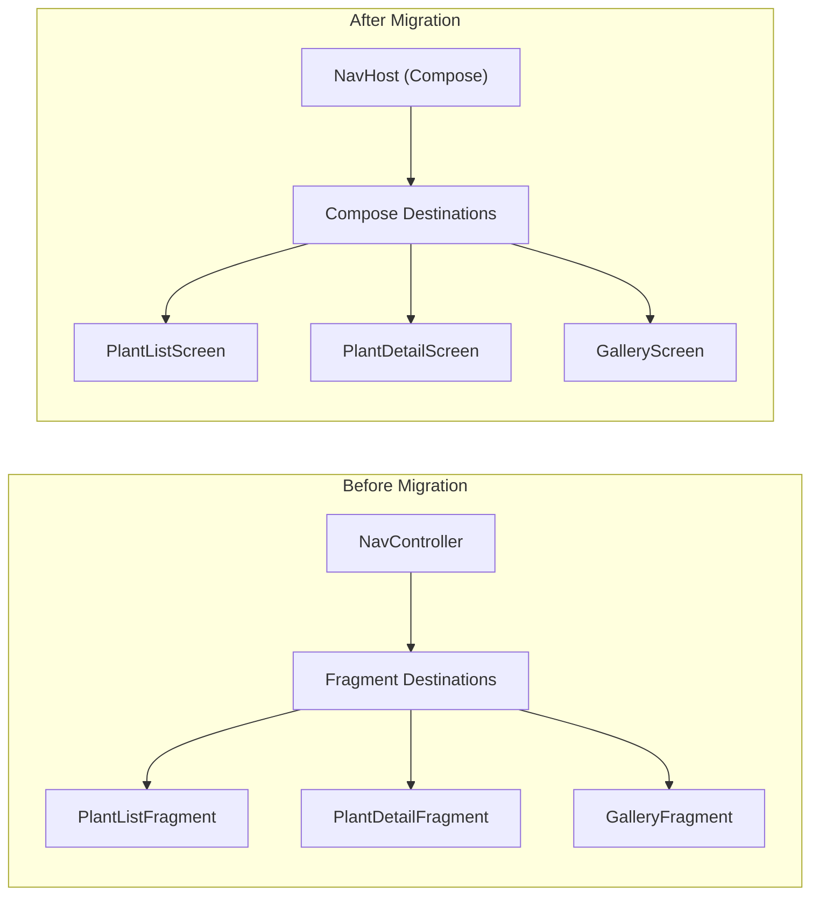
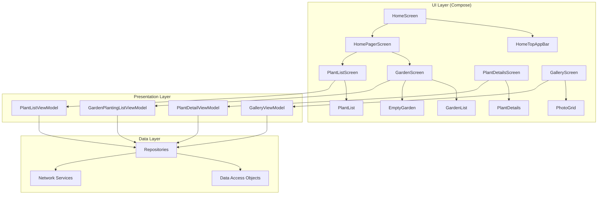
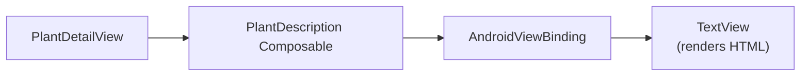
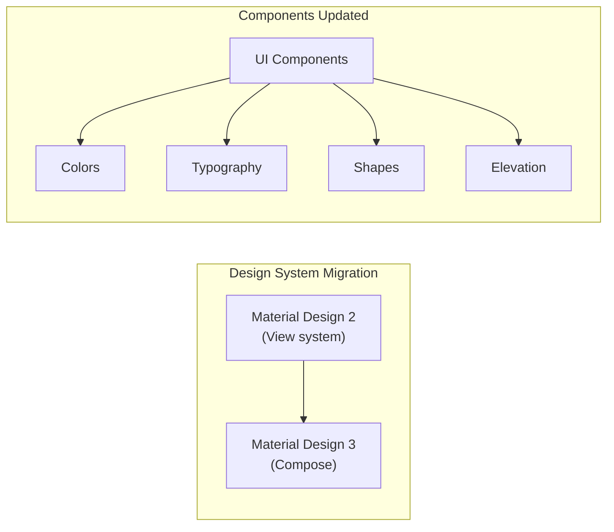
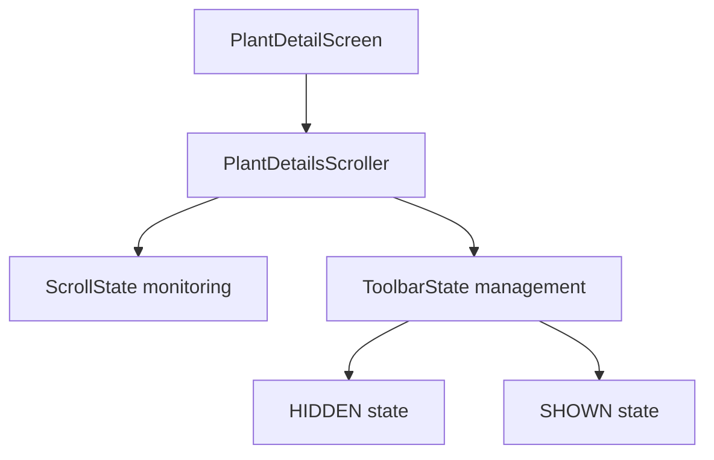

<!-- source: DeepWiki mcp.deepwiki.com · repo android/sunflower · page 3 Compose Migration Journey · fetched 2026-10-23 -->

# Compose Migration Journey

<details>
<summary>Relevant source files</summary>

The following files were used as context for generating this wiki page:

- [.google/packaging.yaml](.google/packaging.yaml)
- [CONTRIBUTING.md](CONTRIBUTING.md)
- [README.md](README.md)
- [app/src/main/java/com/google/samples/apps/sunflower/compose/Dimens.kt](app/src/main/java/com/google/samples/apps/sunflower/compose/Dimens.kt)
- [app/src/main/java/com/google/samples/apps/sunflower/compose/Modifiers.kt](app/src/main/java/com/google/samples/apps/sunflower/compose/Modifiers.kt)
- [app/src/main/java/com/google/samples/apps/sunflower/compose/plantdetail/PlantDetailScroller.kt](app/src/main/java/com/google/samples/apps/sunflower/compose/plantdetail/PlantDetailScroller.kt)
- [app/src/main/java/com/google/samples/apps/sunflower/compose/utils/TextSnackbarContainer.kt](app/src/main/java/com/google/samples/apps/sunflower/compose/utils/TextSnackbarContainer.kt)
- [docs/MigrationJourney.md](docs/MigrationJourney.md)
- [gradle.properties](gradle.properties)
- [screenshots/ic_launcher-web.png](screenshots/ic_launcher-web.png)
- [screenshots/screenshots.png](screenshots/screenshots.png)

</details>


This page documents the process of migrating the Sunflower app from View-based UI to Jetpack Compose. It explains the strategy, implementation steps, and techniques used to incrementally transform the application while maintaining functionality throughout the process.

## Overview

Sunflower started as a traditional View-based Android application, showcasing best practices for several Jetpack libraries. As Jetpack Compose became Google's recommended modern toolkit for building native UI, Sunflower was chosen as a demonstration project to show how existing Android applications can be migrated to Compose.

The migration followed a bottom-up, incremental approach that allowed the app to remain functional throughout the transition. This document explains how this was accomplished and provides a roadmap for other applications following a similar journey.

```mermaid
flowchart TD
    subgraph "Migration Approach"
        start["Traditional View-based App"] --> hybrid["Hybrid State\n(Views + Compose)"]
        hybrid --> end["Compose-only UI"]
    end
```

Sources: [README.md:5-7](), [docs/MigrationJourney.md:3-4]()

## Migration Strategy

The team adopted a bottom-up approach for migrating Sunflower to Compose. This meant:

1. Planning the overall migration strategy
2. Migrating individual screens one by one
3. Finally migrating the navigation framework

This approach allowed the team to:
- Keep the app functional throughout the migration
- Learn and adapt to Compose incrementally
- Focus on quality for each migrated component
- Validate each step before moving to the next
- Experience real-world interoperability challenges and solutions



Sources: [docs/MigrationJourney.md:9-14]()

## Step 1: Planning the Migration Approach

The initial planning phase involved analyzing the app's structure and determining the best approach for migration. Sunflower followed Google's recommended [migration strategy](https://developer.android.com/jetpack/compose/interop/migration-strategy) of focusing on screens one by one.

Key planning considerations included:
- Identifying all screens in the application
- Determining dependencies between screens
- Choosing the order of screen migration
- Planning for interoperability (hybrid state)
- Defining a testing strategy for migrated components



Sources: [docs/MigrationJourney.md:15-22]()

## Step 2: Migrating Screens One by One

The team migrated each screen individually, starting with the Plant Detail screen. This required using Compose's interoperability features to integrate Compose UI elements within the existing Fragment-based architecture.

### Screen Migration Progress

| Screen | Status | Pull Request |
|--------|--------|--------------|
| PlantDetailFragment | Completed | [#638](https://github.com/android/sunflower/pull/638) |
| GalleryFragment | Completed | [#819](https://github.com/android/sunflower/pull/819) |
| GardenFragment | Completed | [#819](https://github.com/android/sunflower/pull/819) |
| PlantListFragment | Completed | [#822](https://github.com/android/sunflower/pull/822) |
| HomeViewPagerFragment | Completed | [#823](https://github.com/android/sunflower/pull/823) |

### Interoperability Techniques

During the migration, various interoperability techniques were employed:

1. **AndroidViewBinding** - Used for embedding traditional Views inside Compose when necessary. This was particularly important for text rendering where Compose couldn't render HTML content directly.



A specific example of this approach was using TextView within Compose to render HTML content in the plant description, as Compose's Text component couldn't directly render HTML at that time:



Sources: [README.md:21-25](), [docs/MigrationJourney.md:24-35]()

## Step 3: Migrating Navigation to Compose

After all individual screens were migrated to Compose, the final step was to replace Fragment-based navigation with Jetpack's Navigation Compose.

This step involved:
1. Setting up a NavHost and defining navigation graphs
2. Replacing Fragment transactions with Compose navigation calls
3. Removing Fragment dependencies completely
4. Handling deep links and navigation arguments



The migration was completed in Pull Request [#827](https://github.com/android/sunflower/pull/827), which enabled the removal of all Fragment-based code from the application.

Sources: [docs/MigrationJourney.md:36-43]()

## The Architecture After Migration

After completing the migration, Sunflower's architecture evolved to a fully Compose-based UI layer, while maintaining the same ViewModel, Repository, and Data layers.



Sources: [README.md:12-14]()

## Challenges and Solutions

Throughout the migration process, the team encountered several challenges that required creative solutions:

### 1. HTML Rendering

One significant challenge was that Compose's Text component couldn't render HTML content, while the plant descriptions contained HTML markup.

**Solution**: The team used AndroidViewBinding to embed a traditional TextView inside Compose:



Sources: [README.md:21-25]()

### 2. Material Design Migration

Alongside the Compose migration, Sunflower also migrated from Material Design 2 to Material Design 3, requiring updates to colors, typography, and component styles.



### 3. Custom UI Components

Some custom UI components required special attention during migration:

**Example**: The PlantDetailsScroller provides toolbar animation based on scroll position:



Sources: [app/src/main/java/com/google/samples/apps/sunflower/compose/plantdetail/PlantDetailScroller.kt:30-53]()

## Lessons Learned

The Sunflower migration to Compose yielded valuable insights for other projects:

1. **Incremental migration** works well for complex apps, allowing for gradual learning and adaptation
2. **Interoperability features** provide essential bridges during transition periods
3. **Plan component by component** rather than trying to migrate everything at once
4. **Testing is crucial** at each step to ensure migrated components work correctly
5. **Update design systems** alongside the migration for a more cohesive result

## Conclusion

Sunflower's migration from View-based UI to Jetpack Compose demonstrates a practical approach to modernizing Android applications. By following a bottom-up strategy and leveraging interoperability features, the team successfully transformed the app while keeping it functional throughout the process.

The completed migration serves as a reference for the Android development community, showcasing both the technical aspects of migration and the resulting improvements in code quality, maintainability, and visual design.

Sources: [README.md:3-10](), [docs/MigrationJourney.md:1-8]()

---

