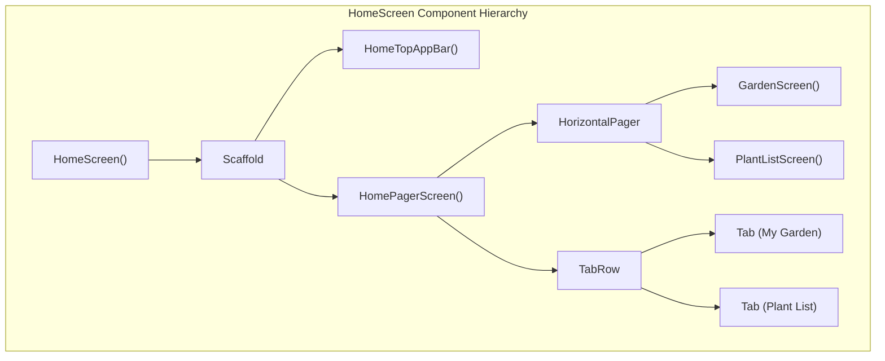
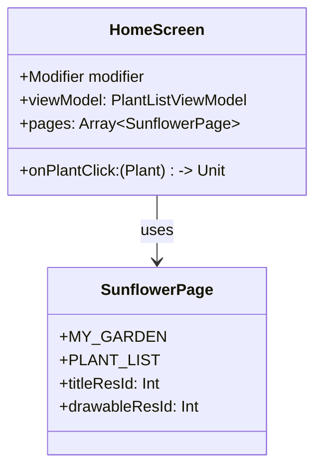
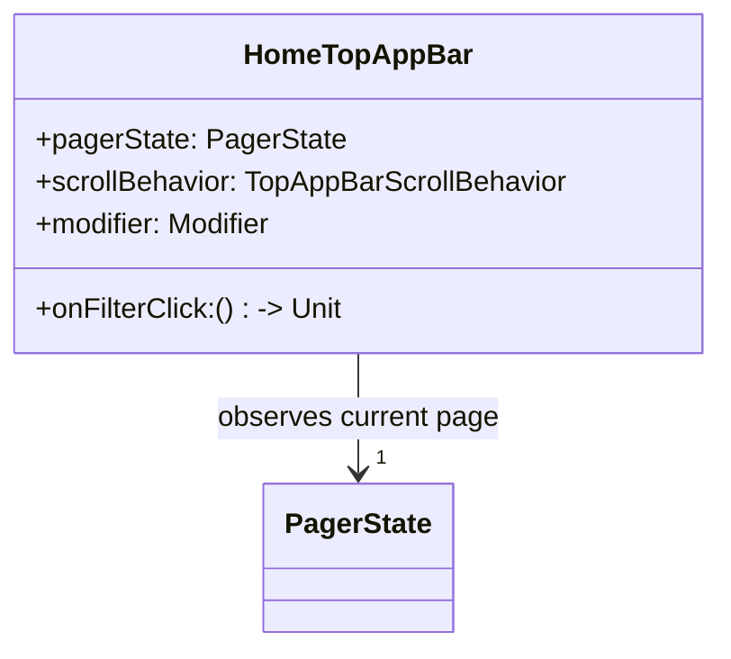
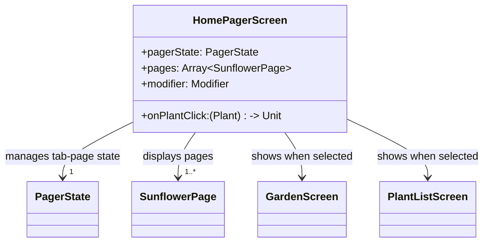
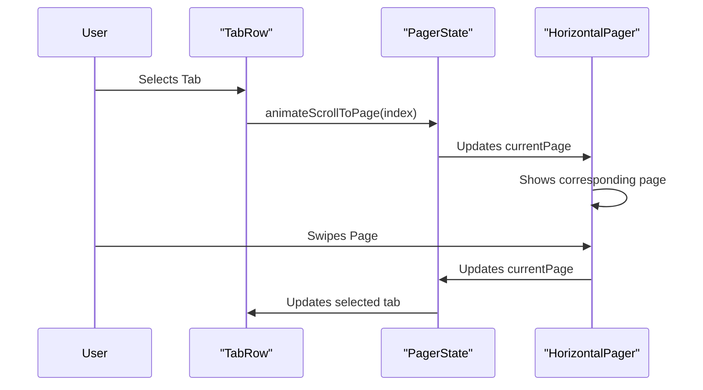
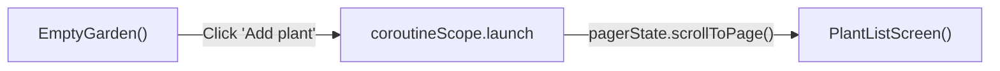
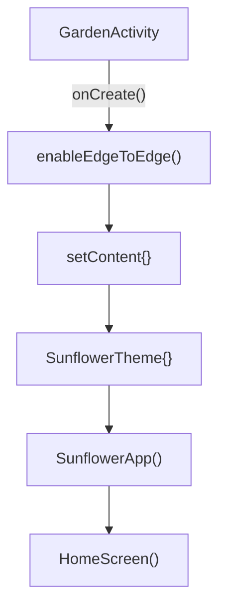
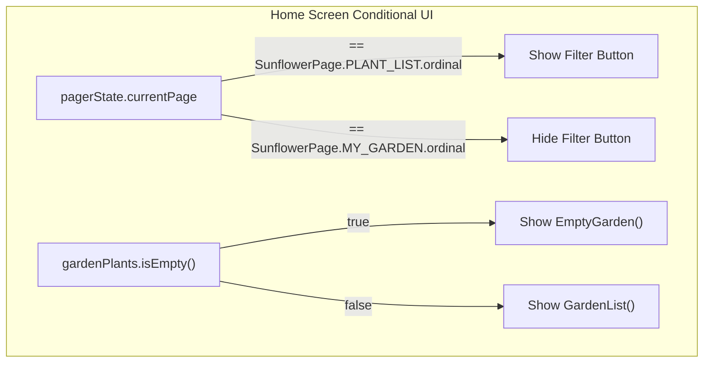

<!-- source: DeepWiki mcp.deepwiki.com · repo android/sunflower · page 3.1 Home Screen · fetched 2026-10-23 -->

# Home Screen

<details>
<summary>Relevant source files</summary>

The following files were used as context for generating this wiki page:

- [app/src/androidTest/java/com/google/samples/apps/sunflower/GardenActivityTest.kt](app/src/androidTest/java/com/google/samples/apps/sunflower/GardenActivityTest.kt)
- [app/src/main/java/com/google/samples/apps/sunflower/GardenActivity.kt](app/src/main/java/com/google/samples/apps/sunflower/GardenActivity.kt)
- [app/src/main/java/com/google/samples/apps/sunflower/compose/gallery/GalleryScreen.kt](app/src/main/java/com/google/samples/apps/sunflower/compose/gallery/GalleryScreen.kt)
- [app/src/main/java/com/google/samples/apps/sunflower/compose/garden/GardenScreen.kt](app/src/main/java/com/google/samples/apps/sunflower/compose/garden/GardenScreen.kt)
- [app/src/main/java/com/google/samples/apps/sunflower/compose/home/HomeScreen.kt](app/src/main/java/com/google/samples/apps/sunflower/compose/home/HomeScreen.kt)
- [app/src/main/java/com/google/samples/apps/sunflower/compose/plantlist/PlantListScreen.kt](app/src/main/java/com/google/samples/apps/sunflower/compose/plantlist/PlantListScreen.kt)

</details>


The Home Screen is the primary user interface component in the Sunflower app, serving as the main navigation hub and container for different sections of the application. It implements a tab-based navigation pattern using Jetpack Compose, allowing users to switch between the Garden and Plant List screens. This document details the Home Screen's architecture, components, and implementation.

For information about specific screens contained within the Home Screen, see [Plant List Screen](#3.2) and [Plant Detail Screen](#3.3).

## 1. Architecture Overview

The Home Screen follows a hierarchical component structure using Jetpack Compose. It serves as a container for the main screens of the app and provides navigation between them.



Sources: [app/src/main/java/com/google/samples/apps/sunflower/compose/home/HomeScreen.kt:69-96](), [app/src/main/java/com/google/samples/apps/sunflower/compose/home/HomeScreen.kt:100-159]()

## 2. Component Structure

The Home Screen is composed of three main components:

1. **HomeScreen** - The main container component
2. **HomeTopAppBar** - The top application bar
3. **HomePagerScreen** - The screen containing tabs and pager

### 2.1 HomeScreen Component

The `HomeScreen` composable function serves as the entry point for the Home Screen UI. It sets up:

- A Scaffold with a top app bar
- A nested scroll connection for coordinated scrolling behavior
- The HomePagerScreen that contains the tab navigation and content pages



Sources: [app/src/main/java/com/google/samples/apps/sunflower/compose/home/HomeScreen.kt:60-66](), [app/src/main/java/com/google/samples/apps/sunflower/compose/home/HomeScreen.kt:69-96]()

### 2.2 HomeTopAppBar Component

The `HomeTopAppBar` provides the app title and context-specific actions:

- Displays the app name "Sunflower"
- Shows a filter button when on the Plant List tab
- Uses a scrolling behavior for collapsing/expanding as the user scrolls



Sources: [app/src/main/java/com/google/samples/apps/sunflower/compose/home/HomeScreen.kt:163-191]()

### 2.3 HomePagerScreen Component

The `HomePagerScreen` implements the tab navigation and content area:

- TabRow with Garden and Plant List tabs
- HorizontalPager that allows swiping between screens
- Handling of tab selection and page changes



Sources: [app/src/main/java/com/google/samples/apps/sunflower/compose/home/HomeScreen.kt:100-159]()

## 3. Navigation Flow

The Home Screen implements tab-based navigation using the Compose Foundation Pager and TabRow components.

```mermaid
stateDiagram-v2
    [*] --> "Initial Load"
    "Initial Load" --> "My Garden Tab"
    
    "My Garden Tab" --> "Plant List Tab": Click Plant List Tab
    "Plant List Tab" --> "My Garden Tab": Click My Garden Tab
    
    "My Garden Tab" --> "Plant List Tab": Click 'Add plant' when garden empty
    "Plant List Tab" --> "Plant Detail": Click on a plant
    
    "My Garden Tab" --> "Plant Detail": Click on garden plant
    
    "Plant Detail" --> "Gallery": Click gallery icon
    "Gallery" --> "Plant Detail": Click back
    
    "Plant Detail" --> "Plant List Tab": Click back
    "Plant Detail" --> "My Garden Tab": Click back
```

Sources: [app/src/main/java/com/google/samples/apps/sunflower/compose/home/HomeScreen.kt:100-159](), [app/src/androidTest/java/com/google/samples/apps/sunflower/GardenActivityTest.kt:60-76]()

## 4. Technical Implementation

### 4.1 SunflowerPage Enum

The `SunflowerPage` enum defines the available tabs in the Home Screen:

| SunflowerPage | Title Resource | Icon Resource |
|---------------|----------------|---------------|
| MY_GARDEN     | my_garden_title | ic_my_garden_active |
| PLANT_LIST    | plant_list_title | ic_plant_list_active |

Sources: [app/src/main/java/com/google/samples/apps/sunflower/compose/home/HomeScreen.kt:60-66]()

### 4.2 PagerState and Tab Synchronization

The Home Screen uses a `PagerState` to keep the tab selection and page content synchronized:



Sources: [app/src/main/java/com/google/samples/apps/sunflower/compose/home/HomeScreen.kt:110-128](), [app/src/main/java/com/google/samples/apps/sunflower/compose/home/HomeScreen.kt:131-157]()

### 4.3 Child Screen Integration

The Home Screen integrates two main child screens within its HorizontalPager:

1. **GardenScreen** - Shows the user's garden plants or an empty state with an "Add plant" button
2. **PlantListScreen** - Shows the list of available plants that can be added to the garden

A key interaction is the navigation from an empty Garden Screen to the Plant List Screen when the user clicks the "Add plant" button:



Sources: [app/src/main/java/com/google/samples/apps/sunflower/compose/home/HomeScreen.kt:137-148](), [app/src/main/java/com/google/samples/apps/sunflower/compose/garden/GardenScreen.kt:84-89](), [app/src/main/java/com/google/samples/apps/sunflower/compose/garden/GardenScreen.kt:201-224]()

## 5. Integration with Activity

The Home Screen is loaded from the `GardenActivity`, which is the main entry point of the app:



Sources: [app/src/main/java/com/google/samples/apps/sunflower/GardenActivity.kt:28-42]()

## 6. Conditional UI Elements

The Home Screen displays different UI elements based on context:

1. The filter button is only shown when on the Plant List tab
2. The GardenScreen shows either a list of plants or an empty state
3. The HomeTopAppBar adapts based on the current page



Sources: [app/src/main/java/com/google/samples/apps/sunflower/compose/home/HomeScreen.kt:178-187](), [app/src/main/java/com/google/samples/apps/sunflower/compose/garden/GardenScreen.kt:84-89]()

## 7. Key Implementation Details

### 7.1 Nested Scroll Connection

The Home Screen implements a nested scroll connection to coordinate scrolling between the top app bar and content:

```
modifier.nestedScroll(scrollBehavior.nestedScrollConnection)
```

This enables the top app bar to collapse or expand as the user scrolls the content.

Sources: [app/src/main/java/com/google/samples/apps/sunflower/compose/home/HomeScreen.kt:80]()

### 7.2 Tab Selection Handling

Tab selection is handled using coroutines to animate page transitions:

```
onClick = { coroutineScope.launch { pagerState.animateScrollToPage(index) } }
```

This creates a smooth animation when switching between tabs.

Sources: [app/src/main/java/com/google/samples/apps/sunflower/compose/home/HomeScreen.kt:117]()

### 7.3 Remembering Pager State

The Home Screen uses `rememberPagerState` to preserve the pager state across recompositions:

```
val pagerState = rememberPagerState(pageCount = { pages.size })
```

This ensures that the selected tab and page content remain consistent during UI updates.

Sources: [app/src/main/java/com/google/samples/apps/sunflower/compose/home/HomeScreen.kt:76]()

---

