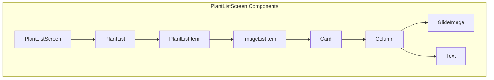
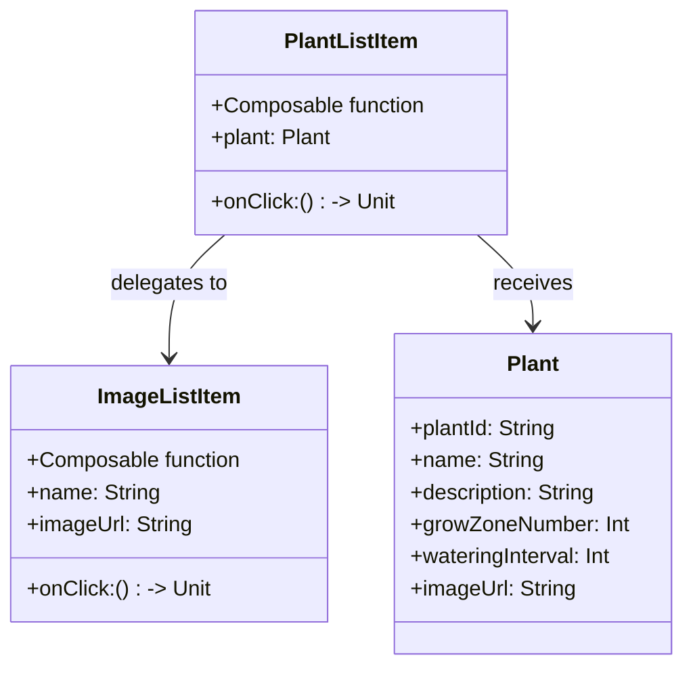
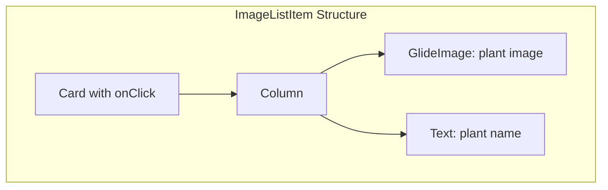

<!-- source: DeepWiki mcp.deepwiki.com · repo android/sunflower · page 3.2 Plant List Screen · fetched 2026-10-23 -->

# Plant List Screen

<details>
<summary>Relevant source files</summary>

The following files were used as context for generating this wiki page:

- [app/src/main/java/com/google/samples/apps/sunflower/compose/plantlist/PlantListItemView.kt](app/src/main/java/com/google/samples/apps/sunflower/compose/plantlist/PlantListItemView.kt)
- [app/src/main/res/drawable/ic_launcher_background.xml](app/src/main/res/drawable/ic_launcher_background.xml)

</details>


## Purpose and Overview

The Plant List Screen is a core UI component of the Sunflower application that displays a browsable catalog of plants available for gardening. This screen serves as the primary entry point for users to discover and select plants they want to add to their garden. It demonstrates modern Android UI implementation using Jetpack Compose, efficient data loading, and responsive design principles.

For information about how users interact with selected plants, see [Plant Detail Screen](#3.3).

## UI Components and Structure

The Plant List Screen consists of a grid of plant cards, each displaying an image and the name of a plant. The screen is built using Jetpack Compose components organized in a hierarchical structure.



The component structure follows a clear hierarchy:

1. **PlantListScreen**: The container component that manages the overall screen layout
2. **PlantList**: A lazy grid component that efficiently displays plant items
3. **PlantListItem**: A component representing each individual plant card
4. **ImageListItem**: A reusable component that displays an image with a text label

The `ImageListItem` component is a versatile UI element that's also used in other parts of the application, such as the Gallery Screen, which demonstrates good code reusability practices.

Sources: [app/src/main/java/com/google/samples/apps/sunflower/compose/plantlist/PlantListItemView.kt:41-44]()

## Plant List Item Design

Each plant in the list is displayed as a card with the following characteristics:

| Component | Description |
|-----------|-------------|
| Card      | Container with rounded corners and elevation, colored using Material Theme's secondaryContainer |
| Image     | Plant image loaded with Glide, displayed at fixed height with crop scaling |
| Text      | Plant name shown in MaterialTheme.typography.titleMedium style, centered and single-line |

The implementation uses Material Design 3 components and follows responsive layout principles with appropriate padding and alignment.



The `PlantListItem` is a specialized component that takes a `Plant` model and delegates its rendering to the more generic `ImageListItem` component, providing the plant's name and image URL.

Sources: [app/src/main/java/com/google/samples/apps/sunflower/compose/plantlist/PlantListItemView.kt:41-82]()

## Data Flow Architecture

The Plant List Screen implements the MVVM (Model-View-ViewModel) architecture pattern, with clear separation between UI components and data handling.

```mermaid
graph LR
    subgraph "UI Layer"
        PLS["PlantListScreen"]
        PLI["PlantListItems"]
    end
    
    subgraph "Presentation Layer"
        PLVM["PlantListViewModel"]
    end
    
    subgraph "Data Layer"
        PR["PlantRepository"]
        PDAO["PlantDao"]
    end
    
    subgraph "Storage"
        DB[("Room Database")]
    end
    
    PLS --> PLVM: "observes state"
    PLVM --> PR: "requests data"
    PR --> PDAO: "queries"
    PDAO --> DB: "reads"
    
    PLVM --> PLS: "provides plants"
    PLS --> PLI: "renders plants"
```

The data flow follows these steps:

1. The ViewModel retrieves plant data from the Repository
2. The Repository accesses the database through the DAO
3. The ViewModel exposes the plant data using Flow or LiveData
4. The PlantListScreen observes this data and updates the UI when it changes

This architecture ensures that UI components remain decoupled from data sources, making the code more maintainable and testable.

## Plant Card Implementation

The Plant List Item is implemented as a Material 3 Card component that responds to user interaction. Here's how it's constructed:



The card implementation includes the following key features:

1. **Touch Handling**: The entire card is clickable and navigates to the plant detail screen
2. **Themed Design**: Uses Material 3 theming with appropriate color schemes
3. **Responsive Layout**: Adapts to different screen sizes with appropriate dimensions
4. **Accessibility**: Includes content descriptions for images to support screen readers

Sources: [app/src/main/java/com/google/samples/apps/sunflower/compose/plantlist/PlantListItemView.kt:51-82]()

## Image Loading Strategy

The Plant List Screen uses the Glide library for efficient image loading, which provides several performance benefits:

1. **Memory Efficiency**: Automatic memory management and caching
2. **Lazy Loading**: Images are loaded only when visible on screen
3. **Error Handling**: Graceful handling of loading failures
4. **Content Scale**: Appropriate cropping to maintain visual consistency

The integration with Compose is done through the GlideImage composable, which is part of Glide's Compose integration library.

Sources: [app/src/main/java/com/google/samples/apps/sunflower/compose/plantlist/PlantListItemView.kt:62-69]()

## Design Considerations

The Plant List Screen design follows several important principles:

1. **Reusability**: The `ImageListItem` component is designed to be reused in multiple contexts
2. **Composition**: UI elements are composed from smaller, focused components
3. **Consistency**: Visual style is consistent with the rest of the application
4. **Performance**: Efficient loading of images and list virtualization

These design decisions contribute to a maintainable, efficient, and user-friendly interface.

## Jetpack Compose Migration

As part of the app's migration from View-based UI to Jetpack Compose, the Plant List Screen demonstrates several migration patterns:

1. **Component Equivalence**: Compose equivalents for RecyclerView and CardView
2. **State Management**: Reactive state management using Compose's state system
3. **Theme Consistency**: Maintaining visual consistency while migrating to Material 3
4. **Navigation Integration**: Integration with Compose Navigation system

The Plant List Screen represents a complete migration from a Fragment-based implementation to a pure Compose implementation, showcasing the benefits of Compose's declarative UI approach.

## Summary

The Plant List Screen is a fundamental component of the Sunflower application that demonstrates best practices in modern Android UI development. It efficiently displays a collection of plants using Jetpack Compose, follows the MVVM architecture pattern, and integrates with the app's navigation system. The screen's implementation showcases Compose's advantages in creating responsive, maintainable, and visually consistent user interfaces.

---

