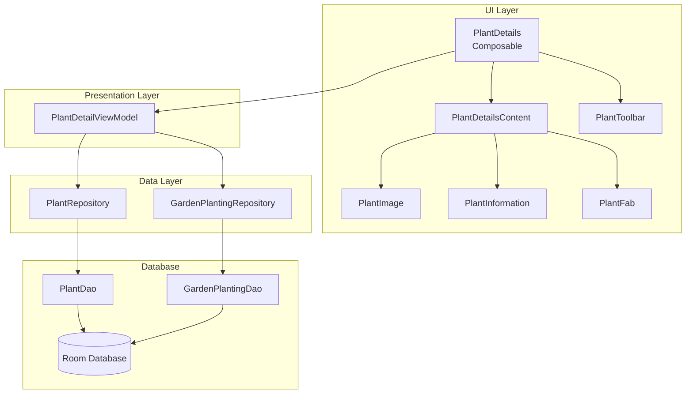
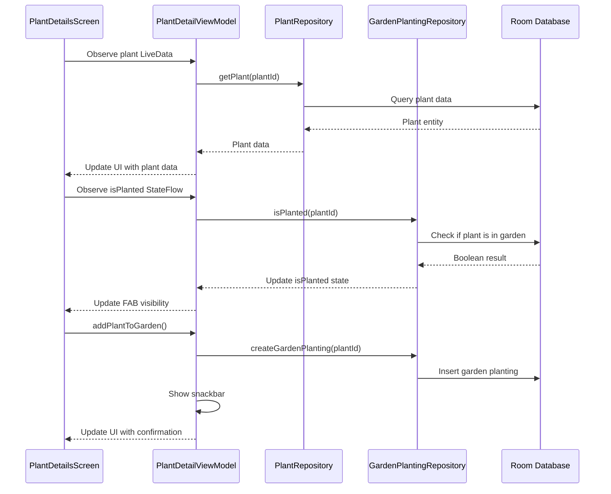

<!-- source: DeepWiki mcp.deepwiki.com · repo android/sunflower · page 3.3 Plant Detail Screen · fetched 2026-10-23 -->

# Plant Detail Screen

<details>
<summary>Relevant source files</summary>

The following files were used as context for generating this wiki page:

- [app/build.gradle.kts](app/build.gradle.kts)
- [app/src/main/java/com/google/samples/apps/sunflower/compose/plantdetail/PlantDetailView.kt](app/src/main/java/com/google/samples/apps/sunflower/compose/plantdetail/PlantDetailView.kt)
- [app/src/main/res/values/dimens.xml](app/src/main/res/values/dimens.xml)
- [gradle/libs.versions.toml](gradle/libs.versions.toml)

</details>


## Overview

The Plant Detail Screen displays comprehensive information about a selected plant, including its image, name, watering needs, and detailed description. This screen serves as a cornerstone of the Sunflower app, allowing users to learn about plants and add them to their garden. This page documents the implementation of the Plant Detail Screen with a focus on its Jetpack Compose UI components and integration with the app's architecture.

For information about the Plant List implementation, see [Plant List Screen](#3.2).

## Architecture and Components

The Plant Detail Screen follows the MVVM (Model-View-ViewModel) architecture pattern as implemented throughout the Sunflower application. It represents a key example of the app's migration journey from traditional View-based UI to Jetpack Compose.



Sources: [app/src/main/java/com/google/samples/apps/sunflower/compose/plantdetail/PlantDetailView.kt:113-146](), [app/src/main/java/com/google/samples/apps/sunflower/compose/plantdetail/PlantDetailView.kt:149-211]()

## UI Components and Hierarchy

The Plant Detail Screen is composed of several nested composable functions that work together to create a cohesive UI experience:

```mermaid
classDiagram
    class PlantDetailsScreen {
        +observes plant data from ViewModel
        +manages snackbar state
        +contains TextSnackbarContainer
    }
    
    class PlantDetails {
        +manages scroll state
        +handles toolbar transition animations
    }
    
    class PlantDetailsContent {
        +contains scrollable content
        +uses ConstraintLayout
    }
    
    class PlantImage {
        +displays plant image
        +handles loading states
    }
    
    class PlantFab {
        +"Add to garden" button
        +only shown if plant not already in garden
    }
    
    class PlantInformation {
        +displays plant name
        +shows watering interval
        +contains plant description
    }
    
    class PlantToolbar {
        +conditionally displays toolbar
        +handles back/share actions
    }
    
    PlantDetailsScreen --> PlantDetails
    PlantDetails --> PlantDetailsContent
    PlantDetails --> PlantToolbar
    PlantDetailsContent --> PlantImage
    PlantDetailsContent --> PlantFab
    PlantDetailsContent --> PlantInformation
    PlantInformation --> "PlantDescription (AndroidViewBinding)"
```

Sources: [app/src/main/java/com/google/samples/apps/sunflower/compose/plantdetail/PlantDetailView.kt:113-211](), [app/src/main/java/com/google/samples/apps/sunflower/compose/plantdetail/PlantDetailView.kt:213-268]()

## Collapsing Toolbar Implementation

One of the key UI features of the Plant Detail Screen is the collapsing toolbar behavior, which provides a smooth transition between two states as the user scrolls:

```mermaid
stateDiagram-v2
    [*] --> "HIDDEN" : Initial state
    "HIDDEN" --> "SHOWN" : Scroll down
    "SHOWN" --> "HIDDEN" : Scroll up past threshold
    
    state "HIDDEN" as Hidden {
        HeaderContent : Plant image visible
        HeaderContent : Plant name below image
        HeaderContent : Transparent header icons
    }
    
    state "SHOWN" as Shown {
        ToolbarContent : Plant name in toolbar
        ToolbarContent : Solid toolbar background
        ToolbarContent : Back/share buttons in toolbar
    }
```

The Plant Detail Screen implements this behavior by:

1. Tracking scroll position via a `ScrollState`
2. Calculating toolbar visibility based on the plant name's position on screen
3. Using Compose animation transitions to smoothly fade between states

Sources: [app/src/main/java/com/google/samples/apps/sunflower/compose/plantdetail/PlantDetailView.kt:157-177](), [app/src/main/java/com/google/samples/apps/sunflower/compose/plantdetail/PlantDetailView.kt:348-372]()

## Data Flow

The Plant Detail Screen demonstrates how data flows from the data layer through the ViewModel to the UI components:



Sources: [app/src/main/java/com/google/samples/apps/sunflower/compose/plantdetail/PlantDetailView.kt:113-146]()

## Key UI Elements Implementation

### Plant Image Display

The Plant Detail Screen uses Glide for image loading with a placeholder while the image is loading:

```
PlantImage (Composable)
├── Loading state management
├── Placeholder display during loading
└── GlideImage for efficient image loading
```

The image appears at the top of the screen with a fixed height defined in the app's dimension resources.

Sources: [app/src/main/java/com/google/samples/apps/sunflower/compose/plantdetail/PlantDetailView.kt:270-324](), [app/src/main/res/values/dimens.xml:27]()

### Conditional Floating Action Button

The Plant Detail Screen shows a Floating Action Button (FAB) only if the plant is not already added to the user's garden:

```
PlantFab (Composable)
├── Only visible when isPlanted == false
├── Positioned at the bottom edge of the plant image
└── Triggers addPlantToGarden() function when clicked
```

Sources: [app/src/main/java/com/google/samples/apps/sunflower/compose/plantdetail/PlantDetailView.kt:238-252](), [app/src/main/java/com/google/samples/apps/sunflower/compose/plantdetail/PlantDetailView.kt:326-345]()

### Plant Information Display

The plant information section shows details about the plant including:

| Component | Description |
|-----------|-------------|
| Plant Name | Displayed in large text, either in the content area or toolbar based on scroll position |
| Watering Needs | Shows how frequently the plant needs to be watered |
| Gallery Link | Conditionally displayed if Unsplash API key is configured |
| Plant Description | HTML-formatted text showing detailed information about the plant |

Sources: [app/src/main/java/com/google/samples/apps/sunflower/compose/plantdetail/PlantDetailView.kt:481-559]()

### View Interoperability

The Plant Description text uses Android View interoperability with Compose to support HTML content with clickable links:

```
AndroidViewBinding (ItemPlantDescriptionBinding)
├── Renders HTML content with HtmlCompat
├── Enables clickable links with LinkMovementMethod
└── Demonstrates Compose-View interoperability
```

This demonstrates how Compose can incorporate traditional Views when necessary for functionality not yet available in Compose.

Sources: [app/src/main/java/com/google/samples/apps/sunflower/compose/plantdetail/PlantDetailView.kt:548-559]()

## Toolbar Behavior and Navigation

The Plant Detail Screen implements two different toolbar states:

1. **Hidden Toolbar**: When at the top of the screen, shows transparent back and share buttons over the plant image
2. **Shown Toolbar**: When scrolled down, shows a Material TopAppBar with plant name and actions

```
Toolbar Navigation Actions
├── Back Button: Returns to previous screen
└── Share Button: Shares plant name externally
```

The screen also has a Gallery navigation option (when enabled) that navigates to the plant's gallery images from Unsplash.

Sources: [app/src/main/java/com/google/samples/apps/sunflower/compose/plantdetail/PlantDetailView.kt:348-479]()

## User Interaction and Feedback

The Plant Detail Screen provides several forms of user feedback:

| Interaction | Feedback |
|-------------|----------|
| Adding plant to garden | Shows snackbar confirmation |
| Clicking share button | Opens system share dialog |
| Clicking gallery button | Navigates to gallery screen |
| Scrolling content | Smoothly animates toolbar transition |

Sources: [app/src/main/java/com/google/samples/apps/sunflower/compose/plantdetail/PlantDetailView.kt:113-146](), [app/src/main/java/com/google/samples/apps/sunflower/compose/plantdetail/PlantDetailView.kt:157-177]()

## Dependencies and Libraries

The Plant Detail Screen utilizes several key dependencies:

- **Jetpack Compose**: Core UI framework
- **Glide Compose Integration**: For efficient image loading
- **ConstraintLayout Compose**: For complex layouts
- **LiveData and StateFlow**: For reactive UI updates
- **Material3 Components**: For consistent Material Design

Sources: [gradle/libs.versions.toml:67-116](), [app/build.gradle.kts:129-143]()

## Summary

The Plant Detail Screen exemplifies modern Android UI development using Jetpack Compose while maintaining interoperability with the View system where needed. It employs the MVVM architectural pattern with reactive data streams, implements complex UI animations, and showcases best practices for component organization and reusability.

---

