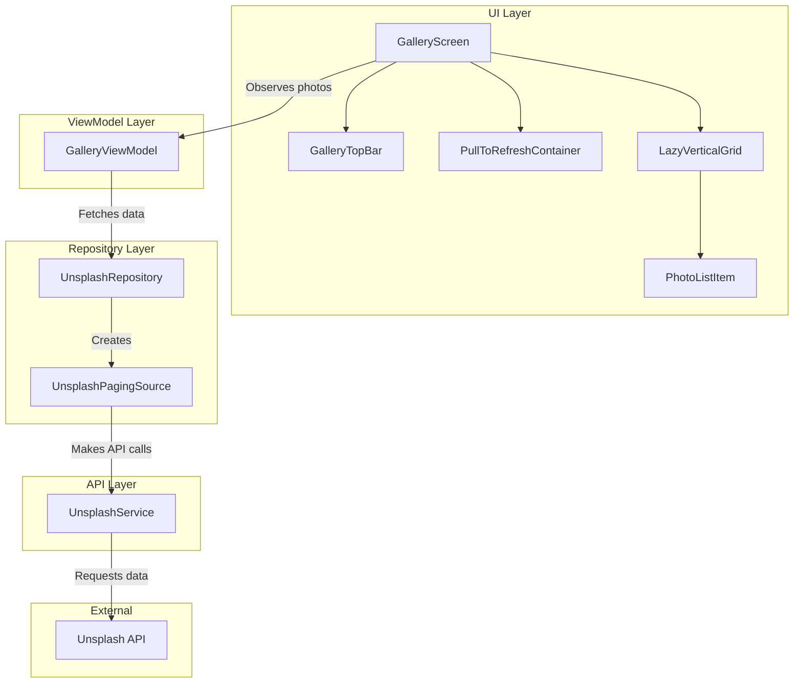
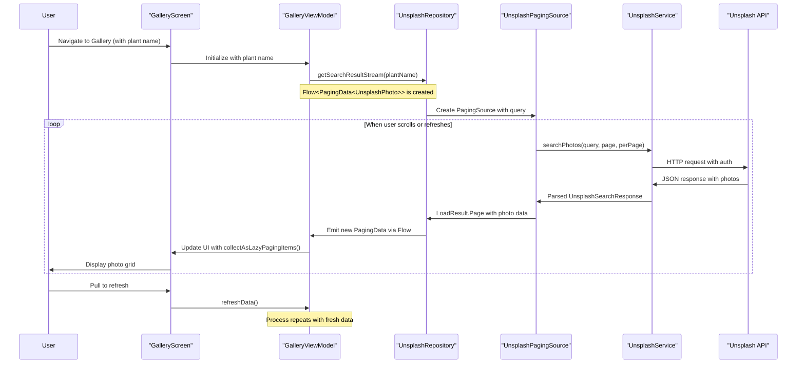

<!-- source: DeepWiki mcp.deepwiki.com · repo android/sunflower · page 3.4 Gallery Screen · fetched 2026-10-23 -->

# Gallery Screen

<details>
<summary>Relevant source files</summary>

The following files were used as context for generating this wiki page:

- [app/src/main/java/com/google/samples/apps/sunflower/api/UnsplashService.kt](app/src/main/java/com/google/samples/apps/sunflower/api/UnsplashService.kt)
- [app/src/main/java/com/google/samples/apps/sunflower/compose/gallery/GalleryScreen.kt](app/src/main/java/com/google/samples/apps/sunflower/compose/gallery/GalleryScreen.kt)
- [app/src/main/java/com/google/samples/apps/sunflower/compose/garden/GardenScreen.kt](app/src/main/java/com/google/samples/apps/sunflower/compose/garden/GardenScreen.kt)
- [app/src/main/java/com/google/samples/apps/sunflower/compose/home/HomeScreen.kt](app/src/main/java/com/google/samples/apps/sunflower/compose/home/HomeScreen.kt)
- [app/src/main/java/com/google/samples/apps/sunflower/compose/plantlist/PlantListScreen.kt](app/src/main/java/com/google/samples/apps/sunflower/compose/plantlist/PlantListScreen.kt)
- [app/src/main/java/com/google/samples/apps/sunflower/data/UnsplashPagingSource.kt](app/src/main/java/com/google/samples/apps/sunflower/data/UnsplashPagingSource.kt)
- [app/src/main/java/com/google/samples/apps/sunflower/data/UnsplashPhotoUrls.kt](app/src/main/java/com/google/samples/apps/sunflower/data/UnsplashPhotoUrls.kt)
- [app/src/main/java/com/google/samples/apps/sunflower/data/UnsplashRepository.kt](app/src/main/java/com/google/samples/apps/sunflower/data/UnsplashRepository.kt)
- [app/src/main/java/com/google/samples/apps/sunflower/data/UnsplashSearchResponse.kt](app/src/main/java/com/google/samples/apps/sunflower/data/UnsplashSearchResponse.kt)
- [app/src/main/java/com/google/samples/apps/sunflower/data/UnsplashUser.kt](app/src/main/java/com/google/samples/apps/sunflower/data/UnsplashUser.kt)
- [app/src/main/java/com/google/samples/apps/sunflower/viewmodels/GalleryViewModel.kt](app/src/main/java/com/google/samples/apps/sunflower/viewmodels/GalleryViewModel.kt)

</details>


## Overview

The Gallery Screen is a component within the Sunflower application that displays a grid of plant-related photos fetched from the Unsplash API. It allows users to search for and view images related to a specific plant selected from the Plant Detail Screen. The screen implements pagination to efficiently load photos as the user scrolls and includes pull-to-refresh functionality to refresh the data.

Sources: [app/src/main/java/com/google/samples/apps/sunflower/compose/gallery/GalleryScreen.kt:60-72]()

## Architecture

The Gallery Screen follows the MVVM (Model-View-ViewModel) architecture pattern that is consistent with the rest of the Sunflower application, with a clear separation of concerns. Below is the architectural diagram showing the key components and their relationships:



Sources:
- [app/src/main/java/com/google/samples/apps/sunflower/compose/gallery/GalleryScreen.kt]()
- [app/src/main/java/com/google/samples/apps/sunflower/viewmodels/GalleryViewModel.kt]()
- [app/src/main/java/com/google/samples/apps/sunflower/data/UnsplashRepository.kt]()

## Data Flow

The following sequence diagram illustrates how data flows from the Unsplash API to the UI:



Sources:
- [app/src/main/java/com/google/samples/apps/sunflower/compose/gallery/GalleryScreen.kt:60-131]()
- [app/src/main/java/com/google/samples/apps/sunflower/viewmodels/GalleryViewModel.kt:35-60]()
- [app/src/main/java/com/google/samples/apps/sunflower/data/UnsplashPagingSource.kt:25-54]()

## Components

### GalleryScreen Composable

The `GalleryScreen` is the main UI component, composed of several parts:

1. A top app bar with a back button
2. A pull-to-refresh container
3. A lazy vertical grid displaying photos
4. Photo list items showing individual images

The implementation consists of two main composables:

| Composable | Description |
|------------|-------------|
| `GalleryScreen` | The entry point that takes a ViewModel and callbacks for photo click and navigation |
| `GalleryScreen` (private) | The implementation that displays the UI using data from the provided Flow |
| `GalleryTopBar` | Displays the screen title and back button |

Sources: [app/src/main/java/com/google/samples/apps/sunflower/compose/gallery/GalleryScreen.kt:60-153]()

### GalleryViewModel

The `GalleryViewModel` class manages the data for the Gallery Screen:

```
GalleryViewModel
├── Input: plantName (from SavedStateHandle)
├── Output: plantPictures (Flow<PagingData<UnsplashPhoto>>)
└── Functions: refreshData()
```

The ViewModel:
1. Receives the plant name from the SavedStateHandle (passed during navigation)
2. Uses the UnsplashRepository to fetch photos related to the plant
3. Exposes a Flow of PagingData for the UI to observe
4. Provides a refreshData() function to reload the data when needed

Sources: [app/src/main/java/com/google/samples/apps/sunflower/viewmodels/GalleryViewModel.kt:35-60]()

## Data Pagination

The Gallery Screen implements pagination using the Jetpack Paging 3 library to efficiently load and display photos from the Unsplash API. This implementation consists of three key components:

1. **UnsplashPagingSource**: Handles the actual pagination logic
2. **UnsplashRepository**: Creates the Pager and configures the paging flow
3. **GalleryScreen**: Collects and displays the paged data

### UnsplashPagingSource

This class extends `PagingSource<Int, UnsplashPhoto>` and is responsible for:

- Loading data pages from the Unsplash API
- Tracking the next and previous page keys
- Handling errors in the loading process

Key methods:
- `load()`: Fetches a page of photos from the API using the provided page key
- `getRefreshKey()`: Determines the page to load when refreshing

Sources: [app/src/main/java/com/google/samples/apps/sunflower/data/UnsplashPagingSource.kt:25-54]()

### Repository Configuration

The `UnsplashRepository` configures the paging system:

```kotlin
fun getSearchResultStream(query: String): Flow<PagingData<UnsplashPhoto>> {
    return Pager(
        config = PagingConfig(enablePlaceholders = false, pageSize = NETWORK_PAGE_SIZE),
        pagingSourceFactory = { UnsplashPagingSource(service, query) }
    ).flow
}
```

This sets up a Pager with:
- A page size of 25 items
- No placeholders (empty items while loading)
- A factory that creates the UnsplashPagingSource with the search query

Sources: [app/src/main/java/com/google/samples/apps/sunflower/data/UnsplashRepository.kt:28-33]()

## Pull-to-Refresh Implementation

The Gallery Screen implements pull-to-refresh functionality using Material 3's `PullToRefreshContainer`. The implementation:

1. Creates a `rememberPullToRefreshState()` to track the refresh state
2. Monitors when the user pulls down on the screen
3. Triggers a refresh of the data when needed
4. Monitors the loading state to end the refresh animation when complete

```kotlin
val pullToRefreshState = rememberPullToRefreshState()

if (pullToRefreshState.isRefreshing) {
    onPullToRefresh()
}

// Monitor loading state to end refresh
LaunchedEffect(pagingItems.loadState) {
    when (pagingItems.loadState.refresh) {
        is LoadState.Loading -> Unit
        is LoadState.Error, is LoadState.NotLoading -> {
            pullToRefreshState.endRefresh()
        }
    }
}
```

Sources: [app/src/main/java/com/google/samples/apps/sunflower/compose/gallery/GalleryScreen.kt:87-103]()

## Integration with Unsplash API

The Gallery Screen interacts with the Unsplash API through the following components:

### UnsplashService

A Retrofit interface that defines the API endpoints:

```kotlin
interface UnsplashService {
    @GET("search/photos")
    suspend fun searchPhotos(
        @Query("query") query: String,
        @Query("page") page: Int,
        @Query("per_page") perPage: Int,
        @Query("client_id") clientId: String
    ): UnsplashSearchResponse
}
```

Sources: [app/src/main/java/com/google/samples/apps/sunflower/api/UnsplashService.kt:32-40]()

### Data Models

Several data classes represent the API responses:

| Class | Purpose |
|-------|---------|
| `UnsplashPhoto` | Represents a photo from Unsplash |
| `UnsplashPhotoUrls` | Contains URLs for different photo sizes |
| `UnsplashUser` | Information about the photographer |
| `UnsplashSearchResponse` | Response from the search API endpoint |

Sources:
- [app/src/main/java/com/google/samples/apps/sunflower/data/UnsplashPhotoUrls.kt]() 
- [app/src/main/java/com/google/samples/apps/sunflower/data/UnsplashUser.kt]()
- [app/src/main/java/com/google/samples/apps/sunflower/data/UnsplashSearchResponse.kt]()

## Navigation Integration

The Gallery Screen is accessed from the Plant Detail Screen, which passes the plant name as a navigation parameter. This parameter is used to search for relevant photos on Unsplash.

```mermaid
graph LR
    PDS["Plant Detail Screen"] -- "Navigate with plantName" --> GS["Gallery Screen"]
    GS -- "Click photo" --> "External Browser or Photo Detail"
    GS -- "Back button" --> PDS
```

Sources: [app/src/main/java/com/google/samples/apps/sunflower/compose/gallery/GalleryScreen.kt:62-64]()

## Error Handling

The Gallery Screen handles errors that might occur when fetching data from the Unsplash API:

1. In the `GalleryViewModel`, errors during data fetching are caught and logged
2. In the `UnsplashPagingSource`, API errors are transformed into `LoadResult.Error`
3. The UI monitors the loading state and can react to errors appropriately

Sources:
- [app/src/main/java/com/google/samples/apps/sunflower/viewmodels/GalleryViewModel.kt:53-59]()
- [app/src/main/java/com/google/samples/apps/sunflower/data/UnsplashPagingSource.kt:40-42]()

## Summary

The Gallery Screen demonstrates modern Android development practices including:

1. Jetpack Compose for UI
2. MVVM architecture pattern
3. Jetpack Paging 3 for efficient data loading
4. Pull-to-refresh using Material 3 components
5. Repository pattern for data abstraction
6. Flow API for reactive programming
7. External API integration with proper error handling

This component showcases the integration of Unsplash's photo API with the Sunflower plant database, enhancing the user experience by providing relevant imagery for plants in the application.

---

