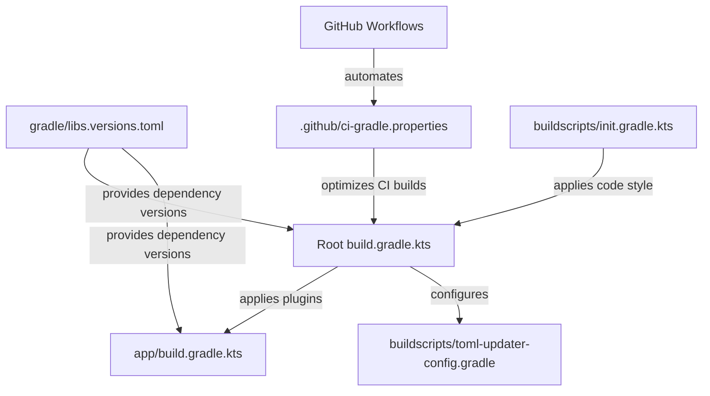
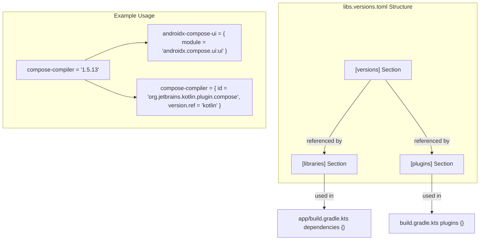
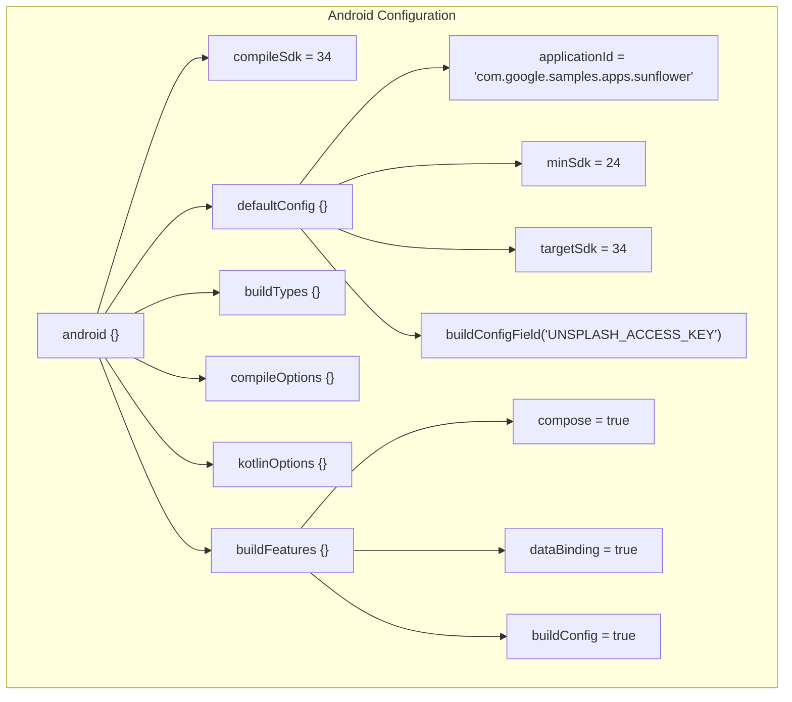
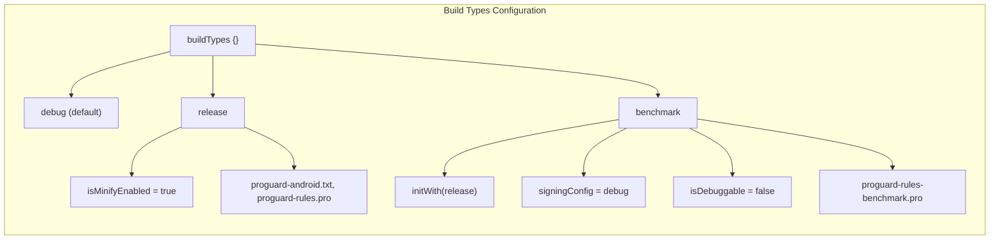
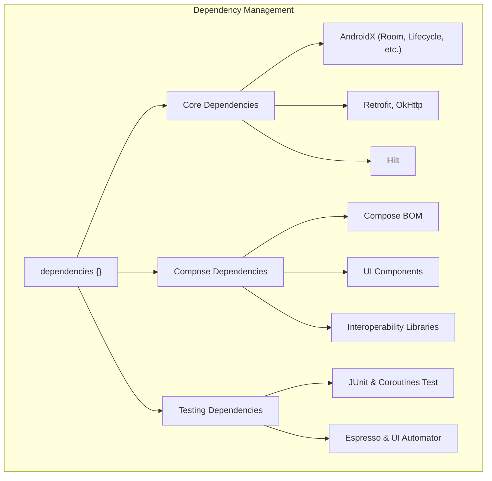
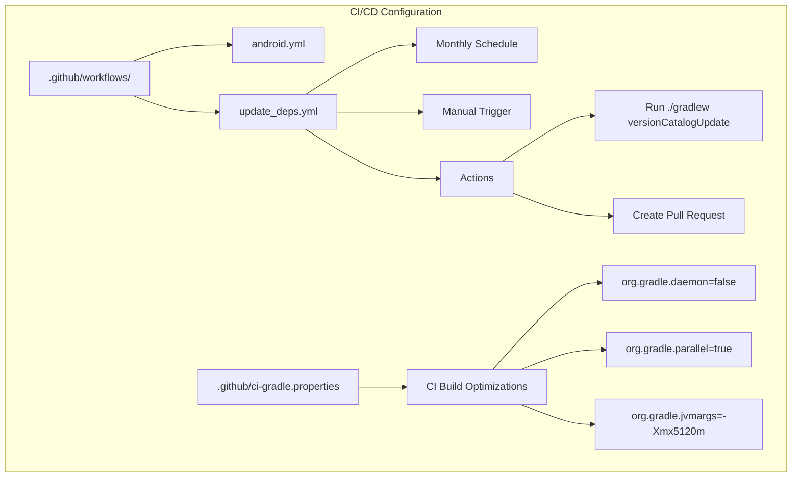
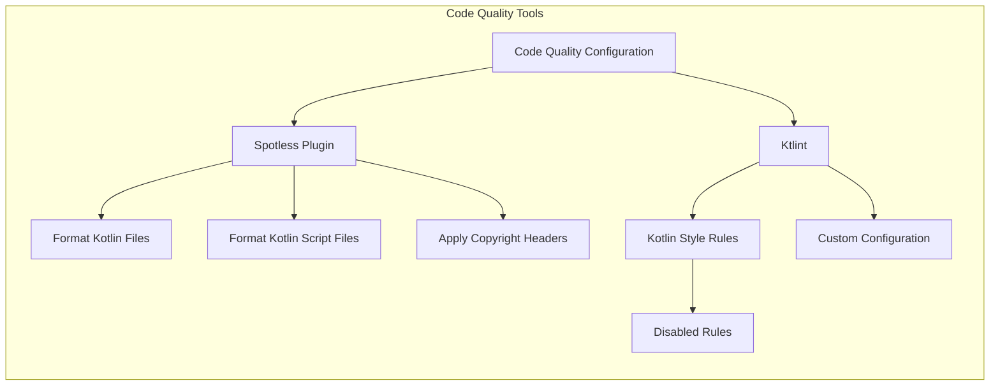
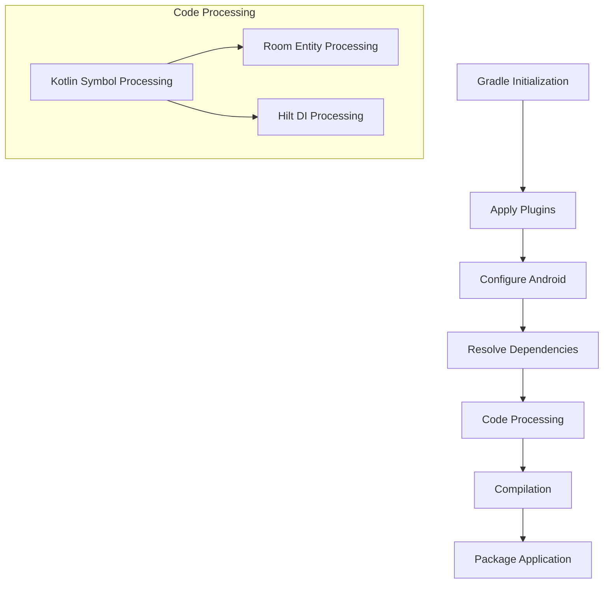

<!-- source: DeepWiki mcp.deepwiki.com · repo android/sunflower · page 4 Build System · fetched 2026-10-23 -->

# Build System

<details>
<summary>Relevant source files</summary>

The following files were used as context for generating this wiki page:

- [.github/ci-gradle.properties](.github/ci-gradle.properties)
- [.github/workflows/update_deps.yml](.github/workflows/update_deps.yml)
- [app/build.gradle.kts](app/build.gradle.kts)
- [app/src/main/java/com/google/samples/apps/sunflower/MainApplication.kt](app/src/main/java/com/google/samples/apps/sunflower/MainApplication.kt)
- [app/src/main/java/com/google/samples/apps/sunflower/compose/plantdetail/PlantDetailView.kt](app/src/main/java/com/google/samples/apps/sunflower/compose/plantdetail/PlantDetailView.kt)
- [build.gradle.kts](build.gradle.kts)
- [buildscripts/init.gradle.kts](buildscripts/init.gradle.kts)
- [buildscripts/toml-updater-config.gradle](buildscripts/toml-updater-config.gradle)
- [gradle/libs.versions.toml](gradle/libs.versions.toml)
- [macrobenchmark/src/main/java/com/google/samples/apps/sunflower/macrobenchmark/BaselineProfileGenerator.kt](macrobenchmark/src/main/java/com/google/samples/apps/sunflower/macrobenchmark/BaselineProfileGenerator.kt)

</details>


## Purpose and Scope

This document provides a comprehensive overview of the Sunflower Android app's build system configuration. It covers the Gradle build setup, dependency management through version catalogs, build types, and CI/CD integration. For detailed information about specific dependency management strategies, please see [Dependency Management](#4.1).

## Overview of Build Configuration

The Sunflower app uses Gradle with Kotlin DSL as its build system. The build configuration is distributed across several key files that define how the application is compiled, packaged, and delivered.



Sources: [build.gradle.kts:1-37](), [app/build.gradle.kts:1-167](), [gradle/libs.versions.toml:1-128](), [buildscripts/toml-updater-config.gradle:1-46]()

## Version Catalog

A central feature of the build system is the version catalog, which centralizes all dependency and plugin version management in a single `libs.versions.toml` file. This approach reduces duplication and ensures consistent versioning across the project.



The version catalog is structured into three main sections:
- **versions**: Defines all version numbers as named constants
- **libraries**: Maps library coordinates to their versions
- **plugins**: Maps Gradle plugin IDs to their versions

Sources: [gradle/libs.versions.toml:16-127]()

## Android Configuration

The Android-specific configuration in the app module's build script defines core settings like SDK versions, application details, and build features.



Key Android configurations include:
- SDK versions (compile, min, target)
- Application identity (ID, version)
- Java 17 compatibility settings
- Compose, DataBinding, and BuildConfig feature toggles

Sources: [app/build.gradle.kts:25-97]()

## Build Types

The application defines multiple build variants to support different build scenarios:

| Build Type | Purpose | Key Configuration |
|------------|---------|-------------------|
| debug | Development | Default settings |
| release | Production | `isMinifyEnabled = true`, ProGuard rules |
| benchmark | Performance testing | Based on release, debuggable=false, special ProGuard rules |



The benchmark build type is specifically configured for performance testing and benchmarking the application with optimized settings.

Sources: [app/build.gradle.kts:45-59]()

## Dependency Management

Dependencies are organized into logical groups in the app module's build script, all referencing the version catalog for version management.



The dependency declaration pattern leverages the version catalog with syntax like:
```kotlin
implementation(libs.androidx.compose.ui)
implementation(platform(libs.androidx.compose.bom))
ksp(libs.androidx.room.compiler)
```

Sources: [app/build.gradle.kts:107-163](), [gradle/libs.versions.toml:66-116]()

## CI/CD Integration

The project includes GitHub workflows for continuous integration and automated dependency updates:



The automated dependency update workflow:
1. Runs on a monthly schedule or manual trigger
2. Executes the version catalog update Gradle task
3. Creates a pull request with the updated dependencies
4. Assigns reviewers for approval

Sources: [.github/workflows/update_deps.yml:1-54](), [.github/ci-gradle.properties:1-27]()

## Code Quality Tools

The build system integrates several code quality tools to maintain consistent code style and formatting:



Spotless and Ktlint enforce code style conventions across the codebase with customized rules for the project.

Sources: [buildscripts/init.gradle.kts:1-73](), [build.gradle.kts:28-34]()

## Plugin Management

The project utilizes multiple Gradle plugins to enhance the build process:

| Plugin | Purpose |
|--------|---------|
| android-application | Core Android build functionality |
| kotlin-android | Kotlin language support |
| ksp | Kotlin Symbol Processing for annotation processing |
| hilt | Dependency injection setup |
| compose-compiler | Jetpack Compose compiler configuration |
| spotless | Code formatting and style enforcement |
| gradle-versions | Dependency version checking |
| version-catalog-update | Automated version catalog updates |

Plugins are applied at different levels (root vs. module) depending on their purpose and scope.

Sources: [build.gradle.kts:24-34](), [app/build.gradle.kts:17-23](), [gradle/libs.versions.toml:118-127]()

## Build Process Flow

The overall build process flow for the Sunflower app follows this sequence:



This build flow integrates several modern Android development technologies, including Kotlin Symbol Processing for compile-time code generation for Room and Hilt.

Sources: [app/build.gradle.kts:1-167](), [build.gradle.kts:1-37]()

---

