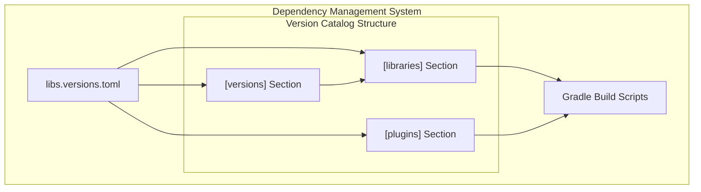
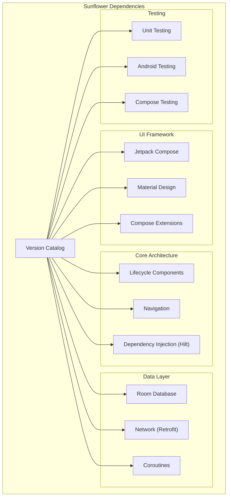

<!-- source: DeepWiki mcp.deepwiki.com · repo android/sunflower · page 4.1 Dependency Management · fetched 2026-10-23 -->

# Dependency Management

<details>
<summary>Relevant source files</summary>

The following files were used as context for generating this wiki page:

- [app/build.gradle.kts](app/build.gradle.kts)
- [app/src/main/java/com/google/samples/apps/sunflower/compose/plantdetail/PlantDetailView.kt](app/src/main/java/com/google/samples/apps/sunflower/compose/plantdetail/PlantDetailView.kt)
- [gradle/libs.versions.toml](gradle/libs.versions.toml)
- [gradle/wrapper/gradle-wrapper.jar](gradle/wrapper/gradle-wrapper.jar)
- [gradle/wrapper/gradle-wrapper.properties](gradle/wrapper/gradle-wrapper.properties)
- [gradlew](gradlew)
- [gradlew.bat](gradlew.bat)

</details>


This document describes the dependency management approach in the Sunflower application, focusing on how library dependencies, their versions, and Gradle plugins are defined, organized, and consumed within the project. For information about the overall build system configuration, see [Build System](#4).

## Version Catalog Overview

Sunflower uses Gradle's version catalog feature to centrally manage dependencies and versions. This approach allows consistent dependency management across the project while making it easier to update and maintain dependencies.

The version catalog is defined in the TOML file format in `gradle/libs.versions.toml` and provides three main sections:
- **Versions**: Centralized version definitions
- **Libraries**: Dependency declarations that reference the versions
- **Plugins**: Gradle plugin declarations



Sources: [gradle/libs.versions.toml:16-127](), [app/build.gradle.kts:17-23](), [app/build.gradle.kts:108-163]()

## Version Catalog Structure

### Versions Section

The `[versions]` section defines specific version numbers that can be referenced by both library and plugin declarations. This makes it easier to coordinate version updates across multiple dependencies.

```toml
[versions]
activityCompose = "1.9.0"
compose-compiler = "1.5.13"
composeBom = "2024.05.00"
coroutines = "1.8.0"
hilt = "2.51.1"
kotlin = "2.0.0"
room = "2.6.1"
```

### Libraries Section

The `[libraries]` section defines the actual library dependencies, often referencing versions from the `[versions]` section using the `version.ref` syntax.

```toml
[libraries]
androidx-activity-compose = { module = "androidx.activity:activity-compose", version.ref = "activityCompose" }
androidx-compose-bom = { module = "androidx.compose:compose-bom", version.ref = "composeBom" }
hilt-android = { module = "com.google.dagger:hilt-android", version.ref = "hilt" }
```

### Plugins Section

The `[plugins]` section defines Gradle plugins that can be referenced in build scripts using the `alias` function.

```toml
[plugins]
android-application = { id = "com.android.application", version.ref = "androidGradlePlugin" }
kotlin-android = { id = "org.jetbrains.kotlin.android", version.ref = "kotlin" }
ksp = { id = "com.google.devtools.ksp", version.ref = "ksp" }
hilt = { id = "com.google.dagger.hilt.android", version.ref = "hilt" }
```

Sources: [gradle/libs.versions.toml:16-65](), [gradle/libs.versions.toml:66-116](), [gradle/libs.versions.toml:118-127]()

## Key Dependency Categories

Sunflower groups its dependencies into several key categories:



### Compose Dependencies

Jetpack Compose is the modern UI toolkit for Android. Sunflower uses a Bill of Materials (BOM) approach for Compose dependencies:

```kotlin
implementation(platform(libs.androidx.compose.bom))
implementation(libs.androidx.activity.compose)
implementation(libs.androidx.compose.ui)
implementation(libs.androidx.compose.foundation)
implementation(libs.androidx.compose.material3)
```

The BOM ensures that all Compose dependencies use compatible versions.

### Architecture Components

Core architecture components include lifecycle-aware components, navigation, and dependency injection:

```kotlin
implementation(libs.androidx.lifecycle.viewmodel.ktx)
implementation(libs.androidx.navigation.compose)
implementation(libs.hilt.android)
```

### Data Layer Dependencies

For the data layer, Sunflower uses Room for local database and Retrofit for network access:

```kotlin
implementation(libs.androidx.room.ktx)
implementation(libs.retrofit2)
```

Sources: [gradle/libs.versions.toml:66-116](), [app/build.gradle.kts:108-144]()

## Dependency Usage in Build Scripts

In Gradle build scripts, dependencies from the version catalog are referenced using the `libs` accessor:

### Plugin Usage

Plugins are applied using the `alias` function:

```kotlin
plugins {
    alias(libs.plugins.android.application)
    alias(libs.plugins.kotlin.android)
    alias(libs.plugins.ksp)
    alias(libs.plugins.hilt)
    alias(libs.plugins.compose.compiler)
}
```

### Library Dependency Usage

Library dependencies are consumed using standard Gradle dependency functions:

```kotlin
dependencies {
    ksp(libs.androidx.room.compiler)
    implementation(libs.androidx.core.ktx)
    implementation(libs.hilt.android)
    
    // Compose
    implementation(platform(libs.androidx.compose.bom))
    implementation(libs.androidx.activity.compose)
    implementation(libs.androidx.compose.ui)
    
    // Testing
    testImplementation(libs.junit)
    androidTestImplementation(libs.androidx.test.ext.junit)
}
```

### Configuration Variables

The version catalog also defines some configuration variables that are used in the build scripts:

```kotlin
compileSdk = libs.versions.compileSdk.get().toInt()

defaultConfig {
    minSdk = libs.versions.minSdk.get().toInt()
    targetSdk = libs.versions.targetSdk.get().toInt()
}
```

Sources: [app/build.gradle.kts:17-23](), [app/build.gradle.kts:26-27](), [app/build.gradle.kts:30-32](), [app/build.gradle.kts:108-144]()

## Gradle Wrapper

The Gradle Wrapper ensures that a specific version of Gradle is used for building the project, providing consistency across different development environments. Sunflower uses Gradle 8.6, as specified in the wrapper properties:

```properties
distributionUrl=https\://services.gradle.org/distributions/gradle-8.6-bin.zip
```

The wrapper files are stored in the `gradle/wrapper` directory, and include:
- `gradle-wrapper.properties`: Configuration for the wrapper
- `gradle-wrapper.jar`: The wrapper executable JAR

Sources: [gradle/wrapper/gradle-wrapper.properties:1-7]()

## Dependency Update Process

Sunflower includes plugins for managing dependency updates:

```toml
[plugins]
gradle-versions = { id = "com.github.ben-manes.versions", version.ref = "gradle-versions" }
version-catalog-update = { id = "nl.littlerobots.version-catalog-update", version.ref = "version-catalog-update" }
```

These plugins can be used to:
1. Check for newer versions of dependencies
2. Update the version catalog automatically
3. Generate reports about outdated dependencies

Certain dependencies in the version catalog are marked with `# @keep` comments, indicating that these versions should not be automatically updated without careful consideration:

```toml
# @keep
compileSdk = "34"
# @keep
compose-compiler = "1.5.13"
```

Sources: [gradle/libs.versions.toml:21-24](), [gradle/libs.versions.toml:121-126]()

## Dependency Management Table

The following table summarizes the major dependency categories and their purpose:

| Category | Key Dependencies | Purpose |
|----------|-----------------|---------|
| UI Framework | Compose, Material3 | Modern declarative UI toolkit |
| Navigation | Navigation Compose | Single-activity architecture navigation |
| Dependency Injection | Hilt | Simplified DI built on Dagger |
| Local Storage | Room | SQLite abstraction with compile-time safety |
| Networking | Retrofit, OkHttp | REST API communication |
| Images | Glide | Image loading and caching |
| Concurrency | Coroutines | Asynchronous programming |
| Testing | JUnit, Espresso, Compose Testing | Comprehensive test coverage |

Sources: [gradle/libs.versions.toml:66-116](), [app/build.gradle.kts:108-162]()

---

