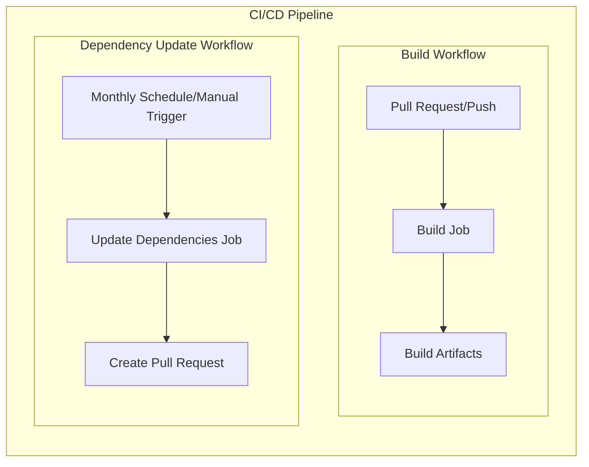
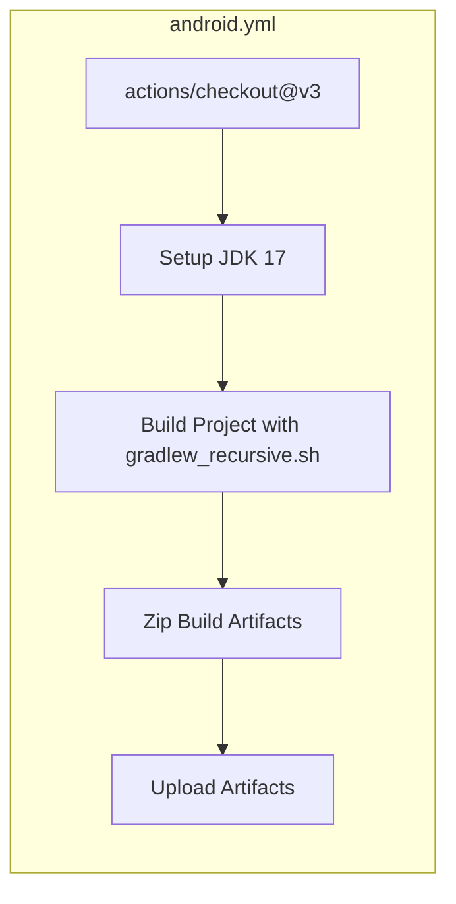
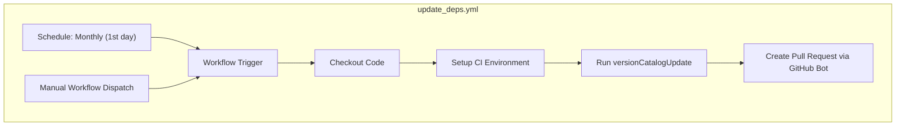
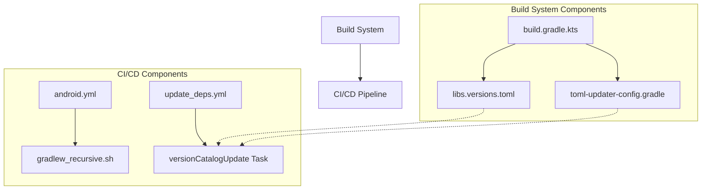

<!-- source: DeepWiki mcp.deepwiki.com · repo android/sunflower · page 4.2 CI/CD Pipeline · fetched 2026-10-23 -->

# CI/CD Pipeline

<details>
<summary>Relevant source files</summary>

The following files were used as context for generating this wiki page:

- [.github/ci-gradle.properties](.github/ci-gradle.properties)
- [.github/workflows/android.yml](.github/workflows/android.yml)
- [.github/workflows/update_deps.yml](.github/workflows/update_deps.yml)
- [app/src/main/java/com/google/samples/apps/sunflower/MainApplication.kt](app/src/main/java/com/google/samples/apps/sunflower/MainApplication.kt)
- [build.gradle.kts](build.gradle.kts)
- [buildscripts/init.gradle.kts](buildscripts/init.gradle.kts)
- [buildscripts/toml-updater-config.gradle](buildscripts/toml-updater-config.gradle)
- [macrobenchmark/build.gradle.kts](macrobenchmark/build.gradle.kts)
- [macrobenchmark/src/main/AndroidManifest.xml](macrobenchmark/src/main/AndroidManifest.xml)
- [macrobenchmark/src/main/java/com/google/samples/apps/sunflower/macrobenchmark/BaselineProfileGenerator.kt](macrobenchmark/src/main/java/com/google/samples/apps/sunflower/macrobenchmark/BaselineProfileGenerator.kt)

</details>


This document describes the Continuous Integration and Continuous Delivery (CI/CD) pipeline set up for the Sunflower application. The pipeline automates building, testing, and dependency management processes to ensure code quality and reliability. For information about the dependency management approach itself, see [Dependency Management](#4.1).

## Overview

The Sunflower project utilizes GitHub Actions for its CI/CD pipeline, which consists of two main workflows:
1. Build verification on every code change
2. Automated dependency updates on a monthly schedule



Sources: [.github/workflows/android.yml:15-22](), [.github/workflows/update_deps.yml:17-23]()

## Continuous Integration Workflow

The core CI workflow runs on every push to the main branch and on all pull requests. It verifies that the application builds correctly and produces artifacts for further inspection.

### Build Job Configuration



Sources: [.github/workflows/android.yml:25-44]()

The Build job:
1. Runs on Ubuntu 20.04
2. Uses JDK 17 (Temurin distribution)
3. Executes a recursive Gradle wrapper script to build the project with debug configuration
4. Archives and uploads build artifacts (.apk, .aab, .aar, .so files)

Configuration details:
- **Runner Environment**: `ubuntu-20.04`
- **JDK Version**: 17
- **Build Command**: `.github/scripts/gradlew_recursive.sh assembleDebug`
- **Artifacts Uploaded**: `assemble.zip` containing all build outputs

Sources: [.github/workflows/android.yml:25-44]()

### Instrumented Tests (Currently Disabled)

The workflow contains a commented-out section for running instrumented tests on a macOS runner using Gradle Managed Devices. According to the comments, this was disabled due to stability issues (referenced as b/251319989).

When enabled, this job would:
1. Run after the build job completes
2. Set up an Android emulator
3. Run instrumented tests with specific GPU and timeout configurations
4. Upload test reports

Sources: [.github/workflows/android.yml:46-75]()

## Dependency Update Automation

The dependency update workflow automatically checks for updated dependencies and creates pull requests with the updates.



Sources: [.github/workflows/update_deps.yml:17-53]()

Key aspects of this workflow:
1. **Schedule**: Runs on the first day of each month at 00:09 UTC
2. **Manual Trigger**: Can be run manually via workflow_dispatch
3. **Environment Setup**:
   - Copies CI-specific Gradle properties
   - Sets up JDK 17
4. **Update Process**:
   - Executes the `versionCatalogUpdate` Gradle task
   - Creates a pull request with a bot account
   - Adds the original triggering user as a reviewer

Sources: [.github/workflows/update_deps.yml:24-53]()

### Version Catalog Update Configuration

The dependency update process is configured in the `buildscripts/toml-updater-config.gradle` file, which specifies:

1. Sort dependencies by key
2. Keep unused versions, libraries, and plugins
3. Filter out non-stable versions unless the current version is also non-stable

This configuration ensures that dependencies are updated safely without introducing unstable versions.

Sources: [buildscripts/toml-updater-config.gradle:17-45]()

## CI Environment Configuration

Special Gradle properties are set for CI environments to optimize build performance and consistency.

```
Table: CI Gradle Properties

| Property                         | Value       | Purpose                                 |
|----------------------------------|-------------|-----------------------------------------|
| org.gradle.daemon                | false       | Prevents daemon usage in CI             |
| org.gradle.parallel             | true        | Enables parallel task execution         |
| org.gradle.jvmargs               | -Xmx5120m   | Sets JVM memory allocation              |
| org.gradle.workers.max           | 2           | Limits worker threads                   |
| kotlin.incremental               | false       | Disables incremental Kotlin compilation |
| kotlin.compiler.execution.strategy| in-process  | Runs Kotlin compiler in-process         |
| warningsAsErrors                 | true        | Treats compiler warnings as errors      |
```

Sources: [.github/ci-gradle.properties:17-26]()

## Code Quality Tools Integration

The CI pipeline integrates with several code quality tools:

### Spotless for Code Formatting

Code style checking is configured via the `init.gradle.kts` script, which sets up Spotless with ktlint for enforcing code style rules on Kotlin files. This helps maintain consistent code style across the project.

Key configurations:
- KtLint version: 0.46.1
- Custom rules for Android code style
- License header checking

Sources: [buildscripts/init.gradle.kts:17-72]()

### Performance Benchmarking

The project includes macrobenchmark tests that can be used to measure app performance metrics. While not directly integrated into the CI pipeline, these tests can be run manually or in a separate workflow.

The macrobenchmark module:
- Is configured to run baseline profile generation
- Measures app startup and UI performance
- Has a specialized "benchmark" build type

Sources: [macrobenchmark/build.gradle.kts:17-66](), [macrobenchmark/src/main/java/com/google/samples/apps/sunflower/macrobenchmark/BaselineProfileGenerator.kt:17-54]()

## Relation to Build System

The CI/CD pipeline integrates with the project's build system, which uses Gradle with Kotlin DSL. The build system and CI configuration work together to ensure consistent builds and dependency management.



Sources: [build.gradle.kts:17-36](), [.github/workflows/android.yml:36-37](), [.github/workflows/update_deps.yml:38-39]()

## Summary

The Sunflower app's CI/CD pipeline provides:

1. Automated build verification for all code changes
2. Structured artifact generation and storage
3. Automated dependency updates on a monthly schedule
4. Performance monitoring capabilities through macrobenchmarks
5. Code quality enforcement through linting and style checking

This comprehensive setup ensures code quality, facilitates contributions, and maintains the project's health over time.

Sources: [.github/workflows/android.yml:15-75](), [.github/workflows/update_deps.yml:17-53](), [buildscripts/toml-updater-config.gradle:17-45]()

---

