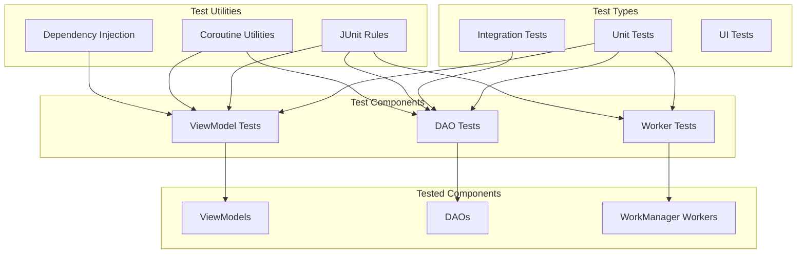
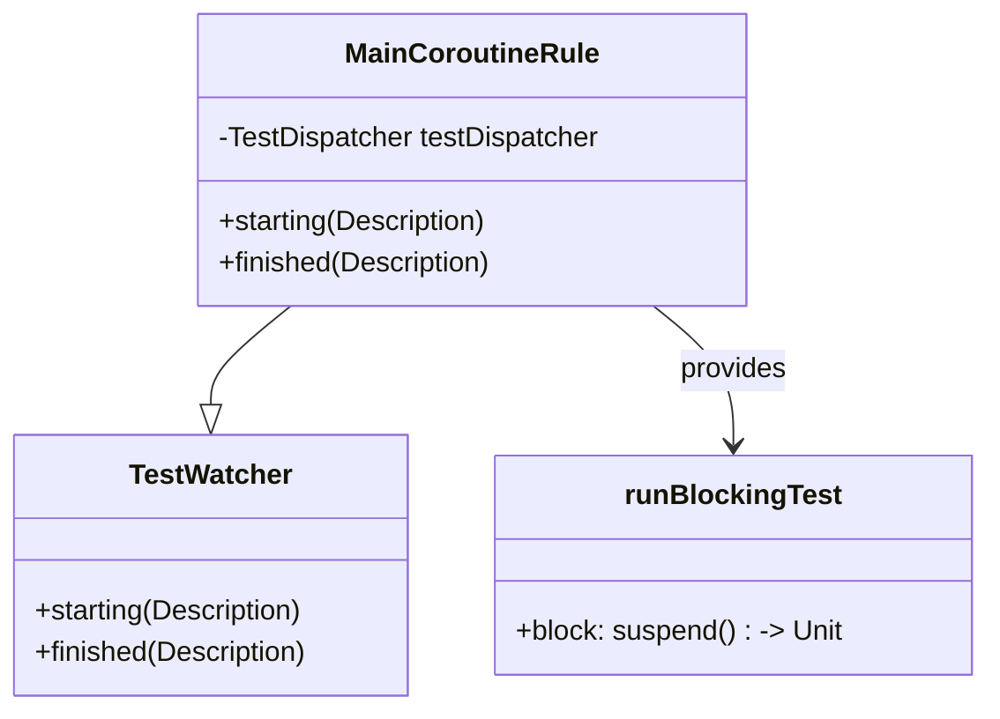
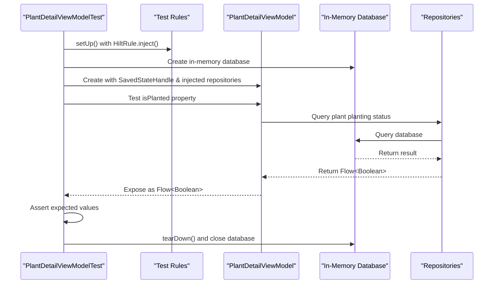
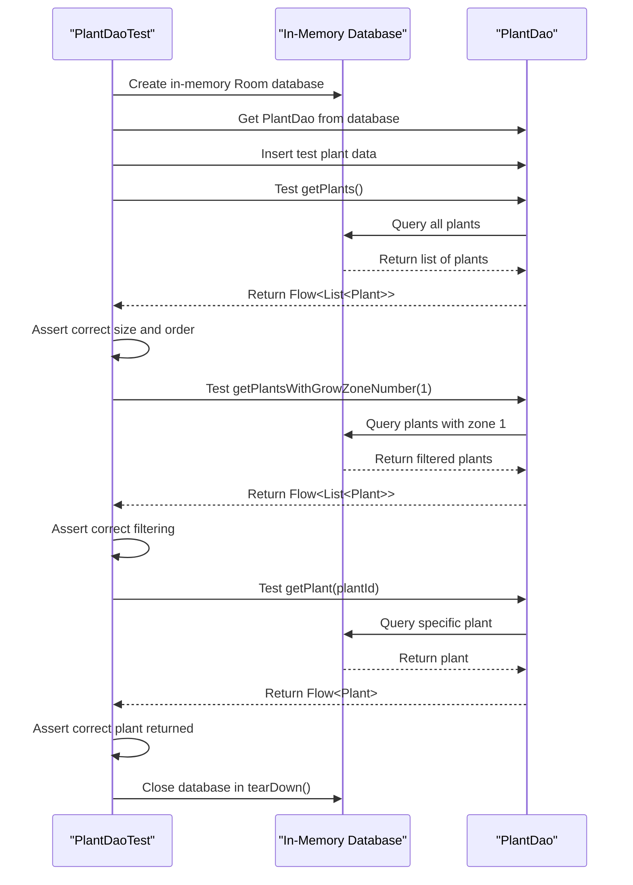
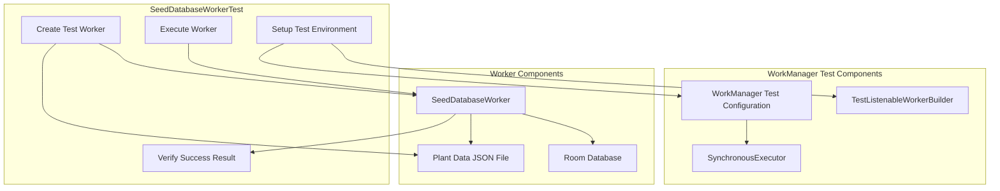
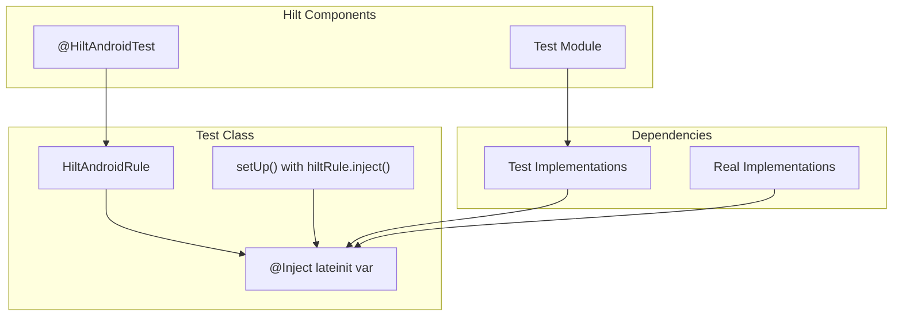

<!-- source: DeepWiki mcp.deepwiki.com · repo android/sunflower · page 5 Testing · fetched 2026-10-23 -->

# Testing

<details>
<summary>Relevant source files</summary>

The following files were used as context for generating this wiki page:

- [.github/workflows/copy-branch.yml](.github/workflows/copy-branch.yml)
- [app/src/androidTest/assets/plants.json](app/src/androidTest/assets/plants.json)
- [app/src/androidTest/java/com/google/samples/apps/sunflower/MainCoroutineRule.kt](app/src/androidTest/java/com/google/samples/apps/sunflower/MainCoroutineRule.kt)
- [app/src/androidTest/java/com/google/samples/apps/sunflower/data/PlantDaoTest.kt](app/src/androidTest/java/com/google/samples/apps/sunflower/data/PlantDaoTest.kt)
- [app/src/androidTest/java/com/google/samples/apps/sunflower/viewmodels/PlantDetailViewModelTest.kt](app/src/androidTest/java/com/google/samples/apps/sunflower/viewmodels/PlantDetailViewModelTest.kt)
- [app/src/androidTest/java/com/google/samples/apps/sunflower/worker/SeedDatabaseWorkerTest.kt](app/src/androidTest/java/com/google/samples/apps/sunflower/worker/SeedDatabaseWorkerTest.kt)
- [app/src/main/java/com/google/samples/apps/sunflower/compose/Dimens.kt](app/src/main/java/com/google/samples/apps/sunflower/compose/Dimens.kt)
- [app/src/main/java/com/google/samples/apps/sunflower/compose/Modifiers.kt](app/src/main/java/com/google/samples/apps/sunflower/compose/Modifiers.kt)
- [app/src/main/java/com/google/samples/apps/sunflower/compose/plantdetail/PlantDetailScroller.kt](app/src/main/java/com/google/samples/apps/sunflower/compose/plantdetail/PlantDetailScroller.kt)
- [app/src/main/java/com/google/samples/apps/sunflower/compose/utils/TextSnackbarContainer.kt](app/src/main/java/com/google/samples/apps/sunflower/compose/utils/TextSnackbarContainer.kt)
- [app/src/main/java/com/google/samples/apps/sunflower/data/PlantDao.kt](app/src/main/java/com/google/samples/apps/sunflower/data/PlantDao.kt)
- [gradle.properties](gradle.properties)

</details>


This document provides a comprehensive overview of the testing approach in the Sunflower application. It covers various testing strategies implemented to ensure code reliability and functionality, including ViewModel tests, DAO tests, and Worker tests. For information about build systems and CI/CD configurations that support testing, see [Build System](#4).

## 1. Testing Architecture Overview

Sunflower implements a multi-layered testing strategy aligned with its architectural components. The testing approach focuses on unit testing key components such as ViewModels, DAOs, and Worker classes.



Sources: [app/src/androidTest/java/com/google/samples/apps/sunflower/viewmodels/PlantDetailViewModelTest.kt:19-55](), [app/src/androidTest/java/com/google/samples/apps/sunflower/data/PlantDaoTest.kt:19-42](), [app/src/androidTest/java/com/google/samples/apps/sunflower/worker/SeedDatabaseWorkerTest.kt:21-28]()

## 2. Test Rules and Utilities

Sunflower uses several test rules and utilities to facilitate testing, particularly for handling asynchronous operations and dependency injection.

### 2.1 MainCoroutineRule

This custom JUnit rule helps manage coroutines in tests by replacing the main dispatcher with a test dispatcher, enabling controlled execution of coroutines during testing.



Sources: [app/src/androidTest/java/com/google/samples/apps/sunflower/MainCoroutineRule.kt:17-41]()

### 2.2 Test Dependency Injection

Hilt is used for dependency injection in tests, allowing for easy replacement of real dependencies with test doubles.

| Rule | Purpose |
|------|---------|
| HiltAndroidRule | Sets up Hilt dependency injection for Android tests |
| InstantTaskExecutorRule | Executes each task synchronously for LiveData testing |
| MainCoroutineRule | Manages coroutines in tests |
| RuleChain | Combines multiple rules with defined ordering |

Sources: [app/src/androidTest/java/com/google/samples/apps/sunflower/viewmodels/PlantDetailViewModelTest.kt:42-55]()

## 3. ViewModel Testing

ViewModels are tested to verify the business logic and data transformations they provide to the UI layer.

### 3.1 PlantDetailViewModel Testing

The PlantDetailViewModel test demonstrates testing a ViewModel with dependencies on repositories and saved state.



Key testing points:
- Uses an in-memory database instead of the real database
- Injects real repository implementations with test data sources
- Tests the ViewModel's exposed state and behavior
- Uses coroutines to test asynchronous operations

Sources: [app/src/androidTest/java/com/google/samples/apps/sunflower/viewmodels/PlantDetailViewModelTest.kt:42-86]()

## 4. DAO Testing

DAO (Data Access Object) tests verify that database operations work correctly and return the expected data.

### 4.1 PlantDao Testing

PlantDao tests verify that database queries correctly retrieve and filter plant data.



Key testing points:
- Uses an in-memory database for isolated testing
- Inserts test data into the database
- Tests multiple query methods (getPlants, getPlantsWithGrowZoneNumber, getPlant)
- Verifies correct data filtering and sorting
- Uses runBlocking to handle coroutines in tests

Sources: [app/src/androidTest/java/com/google/samples/apps/sunflower/data/PlantDaoTest.kt:33-81]()

## 5. Worker Testing

WorkManager Workers are tested to ensure they correctly perform their background tasks.

### 5.1 SeedDatabaseWorker Testing

The SeedDatabaseWorker test verifies that the worker correctly seeds the database with initial plant data.



Key testing points:
- Configures a test WorkManager environment
- Creates a test worker with input data
- Executes the worker synchronously
- Verifies the worker completes successfully

Sources: [app/src/androidTest/java/com/google/samples/apps/sunflower/worker/SeedDatabaseWorkerTest.kt:38-73]()

## 6. Test Data Sources

Sunflower tests use various data sources for testing, including in-memory databases and test assets.

### 6.1 In-Memory Database

Tests use in-memory Room databases instead of persistent storage to ensure test isolation and prevent test interference.

```kotlin
val context = InstrumentationRegistry.getInstrumentation().targetContext
database = Room.inMemoryDatabaseBuilder(context, AppDatabase::class.java).build()
```

Sources: [app/src/androidTest/java/com/google/samples/apps/sunflower/viewmodels/PlantDetailViewModelTest.kt:67-68](), [app/src/androidTest/java/com/google/samples/apps/sunflower/data/PlantDaoTest.kt:44-47]()

### 6.2 Test Assets

The app includes test assets such as a plants.json file that is used to seed the database during testing.

Sources: [app/src/androidTest/assets/plants.json:1-138]()

## 7. Testing Challenges and Solutions

### 7.1 Asynchronous Testing

Testing asynchronous operations like coroutines and LiveData requires special handling:

| Challenge | Solution |
|-----------|----------|
| Coroutines | MainCoroutineRule and runBlockingTest |
| LiveData | InstantTaskExecutorRule |
| WorkManager | SynchronousExecutor and TestListenableWorkerBuilder |
| Database access | In-memory database |

Sources: [app/src/androidTest/java/com/google/samples/apps/sunflower/MainCoroutineRule.kt:17-41](), [app/src/androidTest/java/com/google/samples/apps/sunflower/worker/SeedDatabaseWorkerTest.kt:44-52]()

### 7.2 Dependency Injection in Tests

Hilt provides a framework for dependency injection in tests, allowing for easy replacement of real dependencies with test versions.



Sources: [app/src/androidTest/java/com/google/samples/apps/sunflower/viewmodels/PlantDetailViewModelTest.kt:42-65]()

## 8. Best Practices

Based on the Sunflower testing implementation, here are some testing best practices:

1. Use in-memory databases for DAO testing
2. Test ViewModels with appropriate test rules
3. Inject dependencies using Hilt in tests
4. Set up test data for consistent test execution
5. Test asynchronous code with appropriate coroutine utilities
6. Verify both positive and negative test cases
7. Clean up resources after tests complete

Sources: [app/src/androidTest/java/com/google/samples/apps/sunflower/viewmodels/PlantDetailViewModelTest.kt:63-79](), [app/src/androidTest/java/com/google/samples/apps/sunflower/data/PlantDaoTest.kt:44-54]()

---

