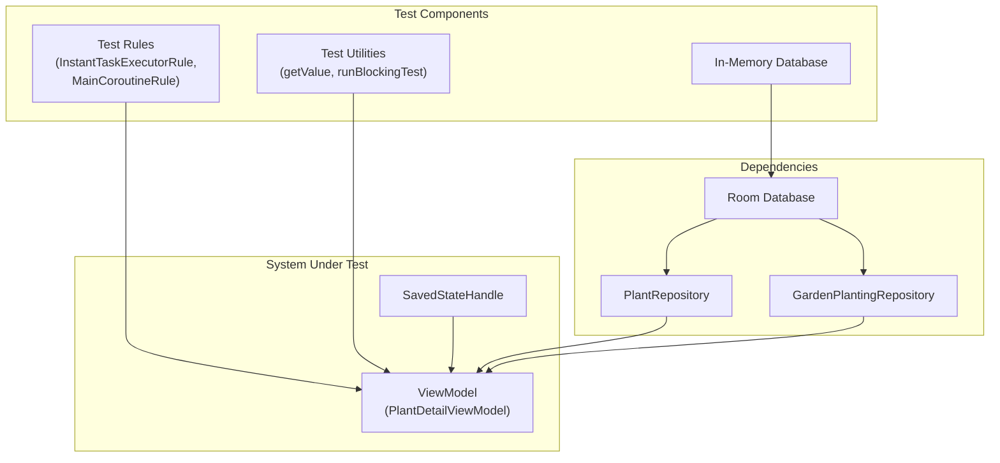
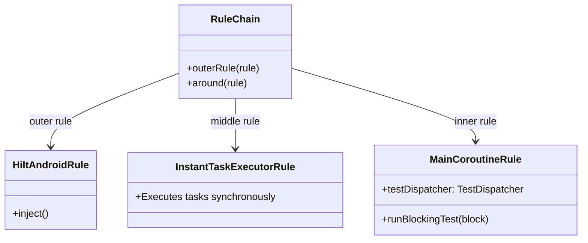
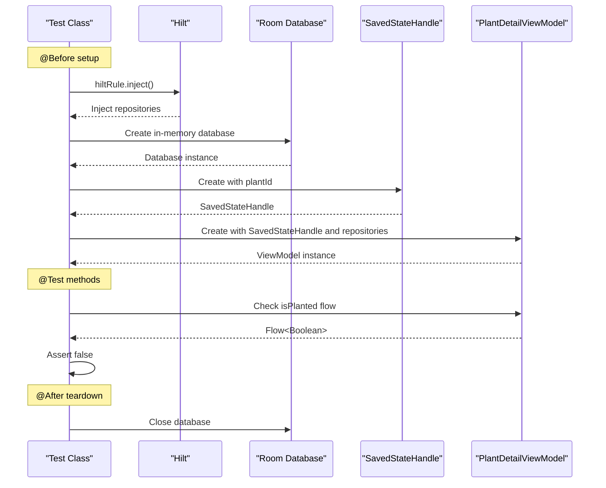
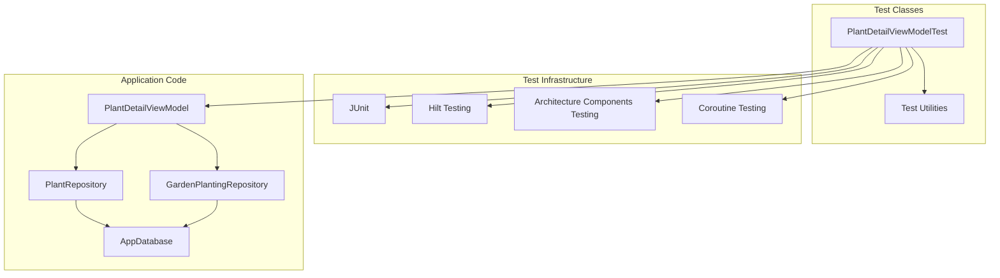

<!-- source: DeepWiki mcp.deepwiki.com · repo android/sunflower · page 5.1 ViewModel Testing · fetched 2026-10-23 -->

# ViewModel Testing

<details>
<summary>Relevant source files</summary>

The following files were used as context for generating this wiki page:

- [.github/workflows/copy-branch.yml](.github/workflows/copy-branch.yml)
- [app/src/androidTest/assets/plants.json](app/src/androidTest/assets/plants.json)
- [app/src/androidTest/java/com/google/samples/apps/sunflower/MainCoroutineRule.kt](app/src/androidTest/java/com/google/samples/apps/sunflower/MainCoroutineRule.kt)
- [app/src/androidTest/java/com/google/samples/apps/sunflower/data/PlantDaoTest.kt](app/src/androidTest/java/com/google/samples/apps/sunflower/data/PlantDaoTest.kt)
- [app/src/androidTest/java/com/google/samples/apps/sunflower/viewmodels/PlantDetailViewModelTest.kt](app/src/androidTest/java/com/google/samples/apps/sunflower/viewmodels/PlantDetailViewModelTest.kt)
- [app/src/androidTest/java/com/google/samples/apps/sunflower/worker/SeedDatabaseWorkerTest.kt](app/src/androidTest/java/com/google/samples/apps/sunflower/worker/SeedDatabaseWorkerTest.kt)
- [app/src/main/java/com/google/samples/apps/sunflower/data/Converters.kt](app/src/main/java/com/google/samples/apps/sunflower/data/Converters.kt)
- [app/src/main/java/com/google/samples/apps/sunflower/data/PlantDao.kt](app/src/main/java/com/google/samples/apps/sunflower/data/PlantDao.kt)
- [app/src/main/java/com/google/samples/apps/sunflower/utilities/GrowZoneUtil.kt](app/src/main/java/com/google/samples/apps/sunflower/utilities/GrowZoneUtil.kt)
- [app/src/test/java/com/google/samples/apps/sunflower/data/ConvertersTest.kt](app/src/test/java/com/google/samples/apps/sunflower/data/ConvertersTest.kt)
- [app/src/test/java/com/google/samples/apps/sunflower/test/CalendarMatcher.kt](app/src/test/java/com/google/samples/apps/sunflower/test/CalendarMatcher.kt)
- [app/src/test/java/com/google/samples/apps/sunflower/utilities/GrowZoneUtilTest.kt](app/src/test/java/com/google/samples/apps/sunflower/utilities/GrowZoneUtilTest.kt)

</details>


This guide covers the process of testing ViewModels in the Sunflower application, focusing on the techniques, patterns, and tools used to ensure the proper functioning of the presentation layer. For information about testing Data Access Objects (DAOs), see [DAO Testing](#5.2), and for Compose UI testing, see [Compose Testing](#5.3).

## Overview of ViewModel Testing in Sunflower

In the Sunflower app, ViewModels serve as the bridge between the UI layer and the data layer, managing UI-related data and handling business logic. Testing ViewModels is critical to ensure they correctly transform data from repositories and expose the right state to the UI.



Sources: [app/src/androidTest/java/com/google/samples/apps/sunflower/viewmodels/PlantDetailViewModelTest.kt:42-86]()

## Testing Framework Setup

Sunflower uses a combination of testing frameworks and tools to test ViewModels effectively:

1. **JUnit 4**: The base testing framework
2. **Hilt**: For dependency injection in tests
3. **Architecture Components Testing**: For LiveData and other Android Architecture Components
4. **Coroutine Testing**: For testing asynchronous operations

### Test Rules Configuration

Test rules are used to configure the test environment properly:



Sources: [app/src/androidTest/java/com/google/samples/apps/sunflower/viewmodels/PlantDetailViewModelTest.kt:45-55](), [app/src/androidTest/java/com/google/samples/apps/sunflower/MainCoroutineRule.kt:24-41]()

The test rules serve the following purposes:

1. **HiltAndroidRule**: Handles dependency injection in the test environment, allowing repositories to be injected into the test
2. **InstantTaskExecutorRule**: Makes LiveData operations execute synchronously on the same thread
3. **MainCoroutineRule**: Replaces the main dispatcher with a test dispatcher to control coroutine execution in tests

## Testing PlantDetailViewModel

The `PlantDetailViewModel` is tested using an instrumentation test that verifies its behavior with real (but in-memory) dependencies.

### Test Setup Process



Sources: [app/src/androidTest/java/com/google/samples/apps/sunflower/viewmodels/PlantDetailViewModelTest.kt:63-86]()

### Key Components of the PlantDetailViewModel Test

1. **Dependencies Injection**: The test uses Hilt to inject the required repositories
   ```
   @Inject
   lateinit var plantRepository: PlantRepository
   
   @Inject
   lateinit var gardenPlantingRepository: GardenPlantingRepository
   ```

2. **In-Memory Database**: An in-memory Room database is created for testing, ensuring test isolation
   ```
   appDatabase = Room.inMemoryDatabaseBuilder(context, AppDatabase::class.java).build()
   ```

3. **SavedStateHandle**: A SavedStateHandle is created with the plantId to simulate how the ViewModel receives parameters
   ```
   val savedStateHandle: SavedStateHandle = SavedStateHandle().apply {
       set("plantId", testPlant.plantId)
   }
   ```

4. **ViewModel Instantiation**: The ViewModel is created with the injected dependencies
   ```
   viewModel = PlantDetailViewModel(savedStateHandle, plantRepository, gardenPlantingRepository)
   ```

5. **Testing Flow**: The test verifies that the `isPlanted` Flow initially emits `false`
   ```
   assertFalse(viewModel.isPlanted.first())
   ```

## Testing Patterns and Best Practices

The following table outlines key patterns used in ViewModel testing in the Sunflower app:

| Pattern | Purpose | Implementation in Sunflower |
|---------|---------|----------------------------|
| In-Memory Database | Isolate tests from real database | `Room.inMemoryDatabaseBuilder()` |
| Dependency Injection | Provide test doubles | Hilt's `@HiltAndroidTest` and `hiltRule.inject()` |
| Coroutine Testing | Test asynchronous code | `MainCoroutineRule` and `runBlockingTest` |
| Flow Testing | Test Flow emissions | `flow.first()` to collect first value |
| SavedStateHandle | Test ViewModel initialization | Create with test data (`testPlant.plantId`) |

Sources: [app/src/androidTest/java/com/google/samples/apps/sunflower/viewmodels/PlantDetailViewModelTest.kt:42-86](), [app/src/androidTest/java/com/google/samples/apps/sunflower/MainCoroutineRule.kt:24-41]()

## Testing Considerations for ViewModels

When writing tests for ViewModels in the Sunflower application, consider the following:

1. **Scope of Testing**: Tests should verify that:
   - The ViewModel transforms data from repositories correctly
   - State is exposed properly to the UI
   - Business logic works as expected

2. **Repository Integration**: The Sunflower app uses real repositories with in-memory databases rather than mocks, providing more comprehensive integration testing.

3. **Test Efficiency**: Using in-memory databases and controlled coroutine execution ensures tests run quickly and deterministically.

4. **Lifecycle Awareness**: The `InstantTaskExecutorRule` ensures LiveData operations are synchronous in tests, simplifying assertions.

## ViewModel Testing Architecture



Sources: [app/src/androidTest/java/com/google/samples/apps/sunflower/viewmodels/PlantDetailViewModelTest.kt:17-40]()

## Conclusion

Testing ViewModels in the Sunflower application follows a structured approach that leverages Android's testing libraries and custom test utilities. By using in-memory databases, dependency injection, and specialized test rules, the tests can verify ViewModel behavior efficiently and reliably.

The current tests focus on validating the core functionality of ViewModels, such as checking initial states and data transformations. As the application evolves, additional test cases could be added to cover more complex scenarios and user interactions.

---

