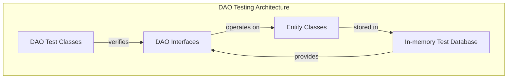
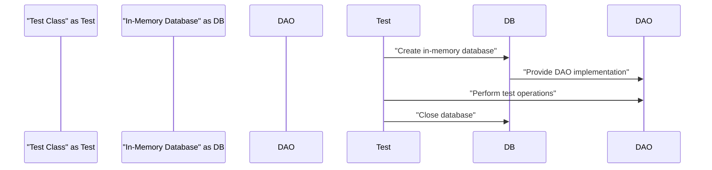
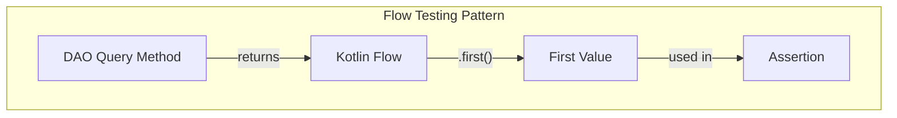
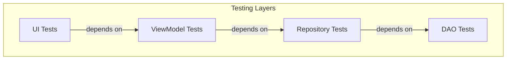

<!-- source: DeepWiki mcp.deepwiki.com · repo android/sunflower · page 5.2 DAO Testing · fetched 2026-10-23 -->

# DAO Testing

<details>
<summary>Relevant source files</summary>

The following files were used as context for generating this wiki page:

- [app/src/androidTest/java/com/google/samples/apps/sunflower/data/GardenPlantingDaoTest.kt](app/src/androidTest/java/com/google/samples/apps/sunflower/data/GardenPlantingDaoTest.kt)
- [app/src/main/java/com/google/samples/apps/sunflower/data/GardenPlanting.kt](app/src/main/java/com/google/samples/apps/sunflower/data/GardenPlanting.kt)
- [app/src/main/java/com/google/samples/apps/sunflower/data/GardenPlantingDao.kt](app/src/main/java/com/google/samples/apps/sunflower/data/GardenPlantingDao.kt)
- [app/src/main/java/com/google/samples/apps/sunflower/data/GardenPlantingRepository.kt](app/src/main/java/com/google/samples/apps/sunflower/data/GardenPlantingRepository.kt)
- [app/src/test/java/com/google/samples/apps/sunflower/data/GardenPlantingTest.kt](app/src/test/java/com/google/samples/apps/sunflower/data/GardenPlantingTest.kt)

</details>


## Purpose and Scope

This document covers the testing of Data Access Objects (DAOs) in the Sunflower app. It explains how to test database operations effectively using Room's testing utilities. For information about ViewModel testing, see [ViewModel Testing](#5.1), and for testing Compose UI components, see [Compose Testing](#5.3).

## Overview

The Sunflower app uses Room as its database layer, with DAOs providing the interface for interacting with the database. Testing DAOs ensures that database operations function correctly and maintain data integrity.



Sources: [app/src/androidTest/java/com/google/samples/apps/sunflower/data/GardenPlantingDaoTest.kt:37-99](), [app/src/main/java/com/google/samples/apps/sunflower/data/GardenPlantingDao.kt:29-50]()

## Test Setup

### In-Memory Database

For testing DAOs, Sunflower uses an in-memory Room database that exists only during test execution. This approach isolates tests from the production database and ensures tests start with a clean state.



### Test Lifecycle

```kotlin
@Before fun createDb() = runBlocking {
    val context = InstrumentationRegistry.getInstrumentation().targetContext
    database = Room.inMemoryDatabaseBuilder(context, AppDatabase::class.java).build()
    gardenPlantingDao = database.gardenPlantingDao()
    
    database.plantDao().upsertAll(testPlants)
    testGardenPlantingId = gardenPlantingDao.insertGardenPlanting(testGardenPlanting)
}

@After fun closeDb() {
    database.close()
}
```

Sources: [app/src/androidTest/java/com/google/samples/apps/sunflower/data/GardenPlantingDaoTest.kt:45-56]()

## Testing DAO Operations

The Sunflower app includes tests for all major database operations through the `GardenPlantingDao` interface.

### Entity Structure

Before diving into the tests, it's important to understand the structure of the `GardenPlanting` entity:

```mermaid
classDiagram
    class "GardenPlanting" {
        +Long gardenPlantingId
        +String plantId
        +Calendar plantDate
        +Calendar lastWateringDate
    }
    
    class "Plant" {
        +String plantId
        +String name
        +String description
        +int growZoneNumber
        +int wateringInterval
        +String imageUrl
    }
    
    class "PlantAndGardenPlantings" {
        +Plant plant
        +List~GardenPlanting~ gardenPlantings
    }
    
    "Plant" "1" -- "0..*" "GardenPlanting" : has
    "PlantAndGardenPlantings" *-- "Plant" : contains
    "PlantAndGardenPlantings" *-- "GardenPlanting" : contains
```

Sources: [app/src/main/java/com/google/samples/apps/sunflower/data/GardenPlanting.kt:41-60]()

### Query Tests

Sunflower tests both simple and complex queries to ensure they return the expected results.

#### Testing Basic Queries

```kotlin
@Test fun testGetGardenPlantings() = runBlocking {
    val gardenPlanting2 = GardenPlanting(
        testPlants[1].plantId,
        testCalendar,
        testCalendar
    ).also { it.gardenPlantingId = 2 }
    gardenPlantingDao.insertGardenPlanting(gardenPlanting2)
    assertThat(gardenPlantingDao.getGardenPlantings().first().size, equalTo(2))
}
```

Sources: [app/src/androidTest/java/com/google/samples/apps/sunflower/data/GardenPlantingDaoTest.kt:58-66]()

#### Testing Complex Relationships

One of the more complex tests verifies that the `getPlantedGardens()` method correctly retrieves a list of `PlantAndGardenPlantings` objects, which join data from multiple tables:

```kotlin
@Test fun testGetPlantAndGardenPlantings() = runBlocking {
    val plantAndGardenPlantings = gardenPlantingDao.getPlantedGardens().first()
    assertThat(plantAndGardenPlantings.size, equalTo(1))

    assertThat(plantAndGardenPlantings[0].plant, equalTo(testPlant))
    assertThat(plantAndGardenPlantings[0].gardenPlantings.size, equalTo(1))
    assertThat(plantAndGardenPlantings[0].gardenPlantings[0], equalTo(testGardenPlanting))
}
```

Sources: [app/src/androidTest/java/com/google/samples/apps/sunflower/data/GardenPlantingDaoTest.kt:88-98]()

### Mutation Tests

Sunflower also tests database mutation operations to ensure they correctly modify the database state.

#### Insert Tests

Insert tests verify that records are correctly added to the database:

```kotlin
// Insert operations are tested indirectly in other tests
// The @Before method already tests insertion by adding test data
```

#### Delete Tests

Delete tests verify that records are correctly removed from the database:

```kotlin
@Test fun testDeleteGardenPlanting() = runBlocking {
    val gardenPlanting2 = GardenPlanting(
        testPlants[1].plantId,
        testCalendar,
        testCalendar
    ).also { it.gardenPlantingId = 2 }
    gardenPlantingDao.insertGardenPlanting(gardenPlanting2)
    assertThat(gardenPlantingDao.getGardenPlantings().first().size, equalTo(2))
    gardenPlantingDao.deleteGardenPlanting(gardenPlanting2)
    assertThat(gardenPlantingDao.getGardenPlantings().first().size, equalTo(1))
}
```

Sources: [app/src/androidTest/java/com/google/samples/apps/sunflower/data/GardenPlantingDaoTest.kt:68-78]()

## Testing Flow Return Types

Sunflower DAOs use Kotlin Flow for database queries. Testing these requires collecting the Flow values:



Example pattern:

```kotlin
@Test fun testGetGardenPlantingForPlant() = runBlocking {
    assertTrue(gardenPlantingDao.isPlanted(testPlant.plantId).first())
}

@Test fun testGetGardenPlantingForPlant_notFound() = runBlocking {
    assertFalse(gardenPlantingDao.isPlanted(testPlants[2].plantId).first())
}
```

Sources: [app/src/androidTest/java/com/google/samples/apps/sunflower/data/GardenPlantingDaoTest.kt:80-86](), [app/src/main/java/com/google/samples/apps/sunflower/data/GardenPlantingDao.kt:34-35]()

## Key Testing Components

| Component | Purpose | Usage in Sunflower |
|-----------|---------|-------------------|
| `InstantTaskExecutorRule` | Makes background tasks run synchronously for testing | Used as a JUnit rule in all DAO tests |
| `Room.inMemoryDatabaseBuilder` | Creates an in-memory database for isolated testing | Used in the `@Before` setup method |
| `runBlocking` | Runs suspending functions in a blocking way for testing | Used to run coroutine-based DAO operations |
| `first()` | Gets the first value from a Flow for testing | Used to retrieve Flow results for assertions |

Sources: [app/src/androidTest/java/com/google/samples/apps/sunflower/data/GardenPlantingDaoTest.kt:19-35]()

## Best Practices

1. **Use in-memory databases**: Isolates tests and makes them faster
2. **Test each DAO method**: Ensure complete coverage of all database operations
3. **Test edge cases**: Include tests for empty results and error conditions
4. **Clean up after tests**: Close database connections to prevent resource leaks
5. **Use appropriate test data**: Create test data that exercises all aspects of queries
6. **Test relationships**: Verify that complex relationships between entities work correctly

Sources: [app/src/androidTest/java/com/google/samples/apps/sunflower/data/GardenPlantingDaoTest.kt:37-99]()

## Relationship with Repository Layer

The DAO tests focus on the database layer in isolation. In a complete testing strategy, these tests complement repository tests that verify the integration of DAOs with other components.



Sources: [app/src/main/java/com/google/samples/apps/sunflower/data/GardenPlantingRepository.kt:23-51]()

---

