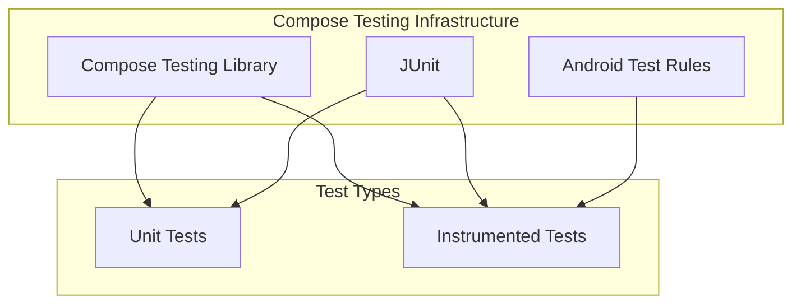
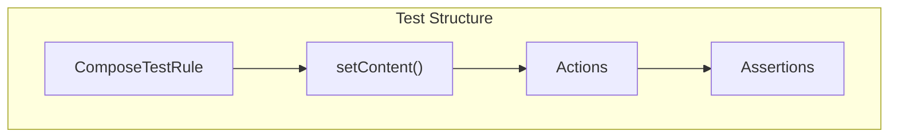
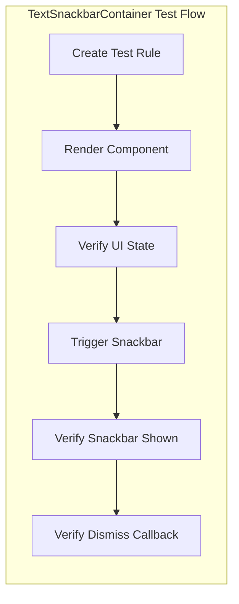
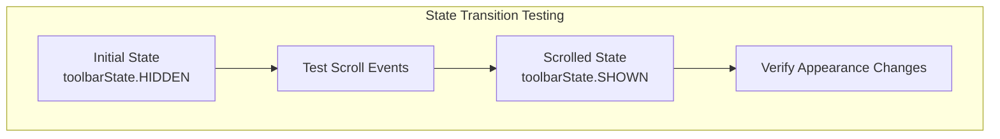
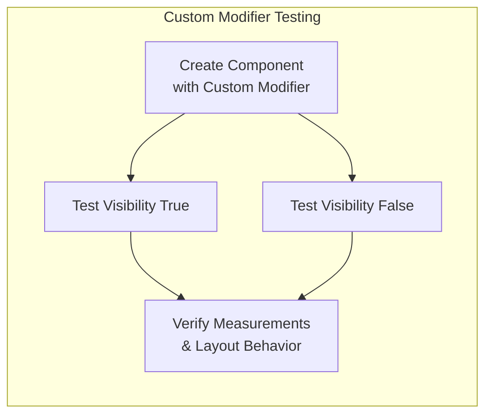
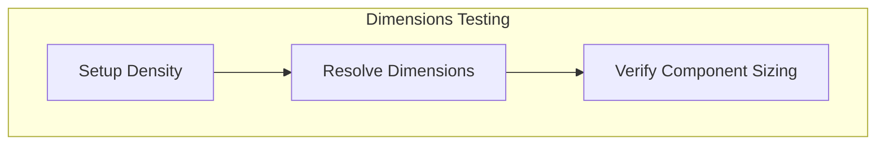
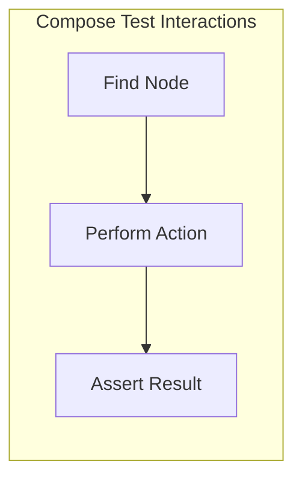
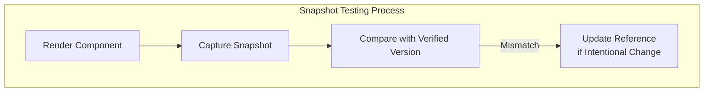
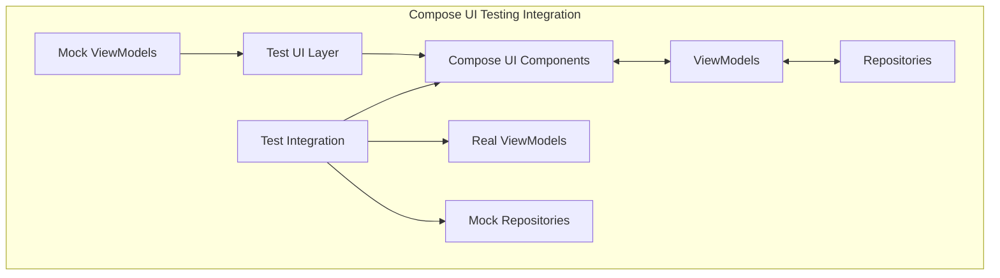
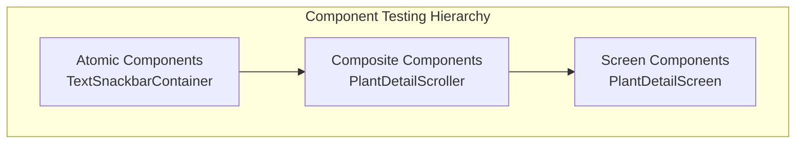

<!-- source: DeepWiki mcp.deepwiki.com · repo android/sunflower · page 5.3 Compose Testing · fetched 2026-10-23 -->

# Compose Testing

Relevant source files

The following files were used as context for generating this wiki page:

- [app/src/main/java/com/google/samples/apps/sunflower/compose/Dimens.kt](app/src/main/java/com/google/samples/apps/sunflower/compose/Dimens.kt)
- [app/src/main/java/com/google/samples/apps/sunflower/compose/Modifiers.kt](app/src/main/java/com/google/samples/apps/sunflower/compose/Modifiers.kt)
- [app/src/main/java/com/google/samples/apps/sunflower/compose/plantdetail/PlantDetailScroller.kt](app/src/main/java/com/google/samples/apps/sunflower/compose/plantdetail/PlantDetailScroller.kt)
- [app/src/main/java/com/google/samples/apps/sunflower/compose/utils/TextSnackbarContainer.kt](app/src/main/java/com/google/samples/apps/sunflower/compose/utils/TextSnackbarContainer.kt)
- [gradle.properties](gradle.properties)

## Purpose and Scope

This document outlines the testing approaches, methodologies, and best practices for Jetpack Compose UI components in the Sunflower application. It focuses specifically on testing Compose UI elements, including test setup, component verification, and interaction testing. For information about testing other aspects of the application, see [ViewModel Testing](#5.1) and [DAO Testing](#5.2).

## Testing Framework and Setup

Sunflower's Compose testing infrastructure relies on the Jetpack Compose Testing Library, which provides utilities specifically designed for testing Compose UI components.

Sources: 
- gradle.properties

### Test Dependencies

The primary dependencies for Compose testing include:

- `androidx.compose.ui:ui-test-junit4` - Core testing library for Compose UI
- `androidx.compose.ui:ui-test-manifest` - Required for setting up test environment
- `androidx.test.espresso:espresso-core` - For device interactions

### Test Rule Setup

Compose tests typically require a `ComposeTestRule` to manage the test lifecycle and provide utility methods for UI interactions:

Sources:
- app/src/main/java/com/google/samples/apps/sunflower/compose/utils/TextSnackbarContainer.kt

## Component Testing Strategies

### Testing Simple Composables

For standalone components like `TextSnackbarContainer`, tests verify both appearance and behavior.

The test would verify:
1. Component renders correctly initially
2. Snackbar appears when `showSnackbar` is true
3. Correct text is displayed
4. `onDismissSnackbar` is called when snackbar is dismissed

Sources:
- app/src/main/java/com/google/samples/apps/sunflower/compose/utils/TextSnackbarContainer.kt

### Testing State-Based Components

For components with internal state like `PlantDetailScroller`, tests focus on state transitions and their UI effects.

Key test scenarios include:
- Verifying initial toolbar state is HIDDEN
- Simulating scroll events
- Confirming toolbar state changes to SHOWN at the correct scroll position
- Validating visual changes match expected behavior

Sources:
- app/src/main/java/com/google/samples/apps/sunflower/compose/plantdetail/PlantDetailScroller.kt

## Testing Custom Modifiers

Custom modifiers like the `visible` modifier in Sunflower require specialized testing approaches.

Testing strategy:
1. Create a simple test composable with the custom modifier
2. Test with visibility parameter returning true
3. Test with visibility parameter returning false
4. Verify the component occupies space but only renders when visible

Sources:
- app/src/main/java/com/google/samples/apps/sunflower/compose/Modifiers.kt

## UI Dimensions Testing

Testing dimension-related aspects ensures UI consistency across the application.

For dimensions in `Dimens.kt`, tests verify:
- Correct resolution of dimension resources
- Appropriate application to UI components
- Consistent usage across different screen densities

Sources:
- app/src/main/java/com/google/samples/apps/sunflower/compose/Dimens.kt

## Semantic Testing

Semantic testing focuses on finding and interacting with components based on their semantic properties rather than implementation details.

### Composable Finder Methods

The following table outlines common finder methods used in Compose tests:

| Method | Purpose | Example |
|--------|---------|---------|
| `onNodeWithText()` | Find node with exact text | `onNodeWithText("Add plant")` |
| `onNodeWithContentDescription()` | Find node with accessibility description | `onNodeWithContentDescription("Back")` |
| `onNodeWithTag()` | Find node with test tag | `onNodeWithTag("plant_list")` |
| `onAllNodesWithText()` | Find all nodes with text | `onAllNodesWithText("Tomato")` |

### Interaction Methods

Common interaction methods include:
- `performClick()` - Simulate tap gesture
- `performTextInput()` - Enter text
- `performScrollTo()` - Scroll to make node visible
- `performGesture { swipe() }` - Perform complex gestures

Sources:
- app/src/main/java/com/google/samples/apps/sunflower/compose/utils/TextSnackbarContainer.kt

## Snapshot Testing

Snapshot testing captures the rendered UI and compares it against a known-good reference image.

Key considerations:
- Snapshots should be device-independent
- Tests should run on the same device/emulator for consistency
- Reference images should be stored in version control
- Changes require explicit approval

## Integration Testing

Integration tests verify that Compose UI components work properly with the rest of the application.

Integration tests typically:
1. Test UI components with mock ViewModels to isolate UI behavior
2. Test UI and ViewModel integration with mock Repositories
3. Test end-to-end flows with real components where appropriate

Sources:
- app/src/main/java/com/google/samples/apps/sunflower/compose/utils/TextSnackbarContainer.kt

## Best Practices

### Testing Component Hierarchies

### Test Isolation and Composition

1. **Test in isolation**: Test individual components with mock data and callbacks
2. **Compose test components**: Build test hierarchies similar to production code
3. **Control state explicitly**: Provide test-specific state rather than relying on internal state

### Practical Tips

- Use `createComposeRule()` for component-focused tests
- Use `createAndroidComposeRule<YourActivity>()` for activity-integrated tests
- Add semantics and test tags to components to make them easier to find in tests
- Prefer semantic selectors over implementation-specific selectors
- Test both light and dark themes when appearance is important
- Consider accessibility in tests (content descriptions, touch target sizes)

Sources:
- app/src/main/java/com/google/samples/apps/sunflower/compose/utils/TextSnackbarContainer.kt
- app/src/main/java/com/google/samples/apps/sunflower/compose/plantdetail/PlantDetailScroller.kt

## Common Testing Scenarios

The following table outlines common testing scenarios for Compose components in Sunflower:

| Component | Testing Focus | Key Assertions |
|-----------|---------------|----------------|
| TextSnackbarContainer | Snackbar visibility and text | Correct message displayed, proper dismissal |
| PlantDetailScroller | Scroll behavior and toolbar state | State transitions at correct scroll positions |
| Custom Modifiers | Layout behavior | Component visibility and space occupation |
| Theme Elements | Visual appearance | Correct colors, typography, and shapes |

## Test Debugging and Troubleshooting

When tests fail, several debugging approaches are helpful:

1. **Use `printToLog()`** on node finders to see what's in the hierarchy
2. **Take screenshots** during test execution to visualize state
3. **Use test tags** to identify components that are difficult to find
4. **Simplify test components** to isolate issues

---

