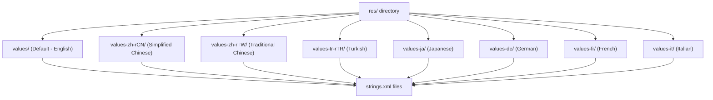
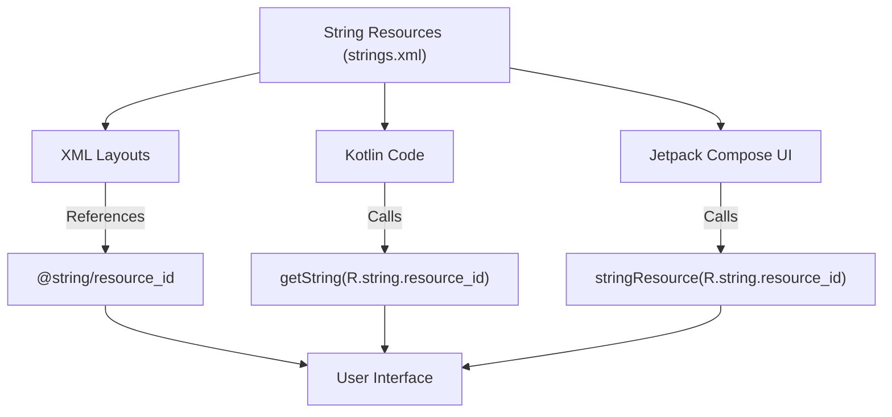

<!-- source: DeepWiki mcp.deepwiki.com · repo android/sunflower · page 6 Localization · fetched 2026-10-23 -->

# Localization

<details>
<summary>Relevant source files</summary>

The following files were used as context for generating this wiki page:

- [app/src/main/AndroidManifest.xml](app/src/main/AndroidManifest.xml)
- [app/src/main/res/values-de/strings.xml](app/src/main/res/values-de/strings.xml)
- [app/src/main/res/values-fr/strings.xml](app/src/main/res/values-fr/strings.xml)
- [app/src/main/res/values-it/strings.xml](app/src/main/res/values-it/strings.xml)
- [app/src/main/res/values-ja/strings.xml](app/src/main/res/values-ja/strings.xml)
- [app/src/main/res/values-tr-rTR/strings.xml](app/src/main/res/values-tr-rTR/strings.xml)
- [app/src/main/res/values-zh-rCN/strings.xml](app/src/main/res/values-zh-rCN/strings.xml)
- [app/src/main/res/values-zh-rTW/strings.xml](app/src/main/res/values-zh-rTW/strings.xml)
- [app/src/main/res/values/strings.xml](app/src/main/res/values/strings.xml)

</details>


## Purpose and Scope

This document describes the localization system implemented in the Sunflower Android application. It covers how string resources are organized, managed, and accessed across the codebase, and explains the technical approaches used for supporting multiple languages, pluralization, and right-to-left (RTL) layouts.

## Overview

Sunflower implements a standard Android localization approach using resource directories with language qualifiers. The application currently supports multiple languages including English (default), Simplified Chinese, Traditional Chinese, Turkish, Japanese, German, French, and Italian.

## Resource Organization

The localization resources in Sunflower follow Android's resource organization pattern with qualified resource directories for each supported language.



Sources: [app/src/main/res/values/strings.xml](), [app/src/main/res/values-zh-rCN/strings.xml](), [app/src/main/res/values-zh-rTW/strings.xml](), [app/src/main/res/values-tr-rTR/strings.xml](), [app/src/main/res/values-ja/strings.xml](), [app/src/main/res/values-de/strings.xml](), [app/src/main/res/values-fr/strings.xml](), [app/src/main/res/values-it/strings.xml]()

## String Resource Categories

Sunflower's string resources are organized into logical categories to facilitate maintenance and translation.

```mermaid
graph TD
    StringResources["String Resources (R.string)"]
    
    AppInfo["App Information"]
    ScreenTitles["Screen Titles"]
    UIElements["UI Elements"]
    Messages["User Messages"]
    A11y["Accessibility Strings"]
    Plurals["Pluralized Strings (R.plurals)"]
    
    AppName["app_name: 'Sunflower' (non-translatable)"]
    
    MyGardenTitle["my_garden_title"]
    PlantListTitle["plant_list_title"]
    PlantDetailsTitle["plant_details_title"]
    GalleryTitle["gallery_title"]
    
    AddPlant["add_plant"]
    MenuFilter["menu_filter_by_grow_zone"]
    MenuShare["menu_item_share_plant"]
    
    AddedPlant["added_plant_to_garden"]
    GardenEmpty["garden_empty"]
    ShareText["share_text_plant"]
    
    A11yPlantImage["a11y_plant_item_image"]
    A11yPlantDetail["plant_detail_image_content_description"]
    
    WateringNeedsSuffix["watering_needs_suffix"]
    WateringNext["watering_next"]
    
    StringResources --> AppInfo
    StringResources --> ScreenTitles
    StringResources --> UIElements
    StringResources --> Messages
    StringResources --> A11y
    StringResources --> Plurals
    
    AppInfo --> AppName
    
    ScreenTitles --> MyGardenTitle
    ScreenTitles --> PlantListTitle
    ScreenTitles --> PlantDetailsTitle
    ScreenTitles --> GalleryTitle
    
    UIElements --> AddPlant
    UIElements --> MenuFilter
    UIElements --> MenuShare
    
    Messages --> AddedPlant
    Messages --> GardenEmpty
    Messages --> ShareText
    
    A11y --> A11yPlantImage
    A11y --> A11yPlantDetail
    
    Plurals --> WateringNeedsSuffix
    Plurals --> WateringNext
```



Sources: [app/src/main/res/values/strings.xml:19-54]()

## Translation Management

### String Declaration and Annotation

Sunflower implements a robust approach to string resource management:

1. **Translation Descriptions**: Each string includes a `translation_description` attribute that provides context for translators:

```xml
<string name="my_garden_title" translation_description="Title for the 'My garden' screen where the user can see the list of plants that have been added to their garden.">My garden</string>
```

2. **Non-translatable Strings**: Strings that should not be translated are explicitly marked:

```xml
<string name="app_name" translatable="false">Sunflower</string>
```

3. **Format Strings**: Strings with dynamic content use format specifiers:

```xml
<string name="share_text_plant">Check out the %s plant in the Android Sunflower app</string>
```

Sources: [app/src/main/res/values/strings.xml:19-34]()

### Pluralization Handling

Sunflower uses Android's plurals system to handle different grammatical quantities:

```xml
<plurals name="watering_needs_suffix">
    <item quantity="one">every day</item>
    <item quantity="other">every %d days</item>
</plurals>
```

Different languages implement pluralization rules according to their grammar:

| Language | One | Other |
|----------|-----|-------|
| English | every day | every %d days |
| French | %d fois par jour | Tous les %d jours |
| Chinese | N/A | 每隔 %d 天 |

Some languages like Chinese and Japanese only implement the "other" quantity because they don't have special forms for singular quantities:

```xml
<!-- Item quantities for zero and one are not used in Chinese -->
<plurals name="watering_needs_suffix">
    <item quantity="other">每隔 %d 天</item>
</plurals>
```

Sources: [app/src/main/res/values/strings.xml:38-47](), [app/src/main/res/values-zh-rCN/strings.xml:33-37](), [app/src/main/res/values-fr/strings.xml:33-37]()

## Implementation Details

### Resource Access Pattern

In a standard Android application like Sunflower, string resources are accessed in different ways depending on the UI technology being used:



The application references string resources in AndroidManifest.xml:

```xml
android:label="@string/app_name"
```

Sources: [app/src/main/AndroidManifest.xml:28]()

### RTL Support

Sunflower declares support for right-to-left (RTL) languages in its AndroidManifest.xml:

```xml
android:supportsRtl="true"
```

This ensures that UI layouts automatically mirror for languages that are written from right to left, such as Arabic and Hebrew (though these languages aren't currently implemented in the provided string resources).

Sources: [app/src/main/AndroidManifest.xml:30]()

## Translation Status

Not all strings are fully translated in all languages. Some language resource files contain placeholder text indicated by comments or "(translate me)" markers:

```xml
<string name="gallery_title">(translate me) Photos by Unsplash</string>
```

This approach allows for incremental translation while ensuring the app remains functional in all supported languages.

Sources: [app/src/main/res/values-ja/strings.xml:45-46](), [app/src/main/res/values-de/strings.xml:46-47]()

## Language-Specific Adaptations

Different languages may require specific adaptations beyond direct translation. For example:

1. **Character Set Differences**: 
   - Simplified Chinese (简体中文): `app/src/main/res/values-zh-rCN/strings.xml`
   - Traditional Chinese (繁體中文): `app/src/main/res/values-zh-rTW/strings.xml`

2. **Grammatical Structure**: 
   Languages with different grammatical structures may reorder sentence components or use different constructions for the same meaning. For instance, compare the English and Turkish implementations of the watering next string:

   **English**: "water tomorrow." / "water in %d days."  
   **Turkish**: "yarın sulayın." / "%d gün içinde sulayın."

Sources: [app/src/main/res/values/strings.xml:44-47](), [app/src/main/res/values-tr-rTR/strings.xml:39-42]()

## Best Practices

From the implementation in Sunflower, we can identify these localization best practices:

1. Always provide context with `translation_description` attributes
2. Explicitly mark non-translatable strings
3. Handle pluralization correctly using the `plurals` tag
4. Account for language-specific grammatical rules
5. Support RTL layouts for appropriate language coverage
6. Include accessibility text in all translations

## Conclusion

Sunflower implements a comprehensive localization system following Android platform standards. The use of qualified resource directories, detailed translation descriptions, and proper pluralization handling ensures that the application can be effectively translated to multiple languages while maintaining a consistent user experience.