# Page: Overview

# Overview

<details>
<summary>Relevant source files</summary>

The following files were used as context for generating this wiki page:

- [.google/packaging.yaml](.google/packaging.yaml)
- [CONTRIBUTING.md](CONTRIBUTING.md)
- [README.md](README.md)
- [docs/MigrationJourney.md](docs/MigrationJourney.md)
- [screenshots/ic_launcher-web.png](screenshots/ic_launcher-web.png)
- [screenshots/jetpack_donut.png](screenshots/jetpack_donut.png)
- [screenshots/phone_my_garden.png](screenshots/phone_my_garden.png)
- [screenshots/phone_plant_detail.png](screenshots/phone_plant_detail.png)
- [screenshots/phone_plant_list.png](screenshots/phone_plant_list.png)
- [screenshots/screenshots.png](screenshots/screenshots.png)

</details>


The Android Sunflower application is a gardening app that demonstrates Android development best practices with a particular focus on the migration from traditional View-based UI to Jetpack Compose. It serves as a reference implementation showcasing proper architecture, component integration, and modern Android development techniques.

For detailed information about specific aspects of the application, refer to:
- For architecture patterns and implementation details, see [Architecture](#2)
- For details about the Compose migration process, see [Compose Migration Journey](#3)
- For build system configuration and dependency management, see [Build System](#4)
- For testing approaches used in the application, see [Testing](#5)

Sources: [README.md:3-10]()

## Application Features

Sunflower demonstrates the following functionalities:

- Browsing a catalog of plants
- Viewing detailed information about each plant
- Adding plants to a user's garden
- Tracking planted plants with watering schedule
- Searching for plant images using the Unsplash API

The application showcases these technical implementations:

- Modern Android UI with Jetpack Compose
- MVVM Architecture with ViewModels
- Repository pattern for data operations
- Local persistence with Room database
- Background processing with WorkManager
- Navigation using Navigation Compose
- Reactive programming with Flow

Sources: [README.md:16-25](), [.google/packaging.yaml:20-47]()

## High-Level Architecture

### Application Architecture Overview

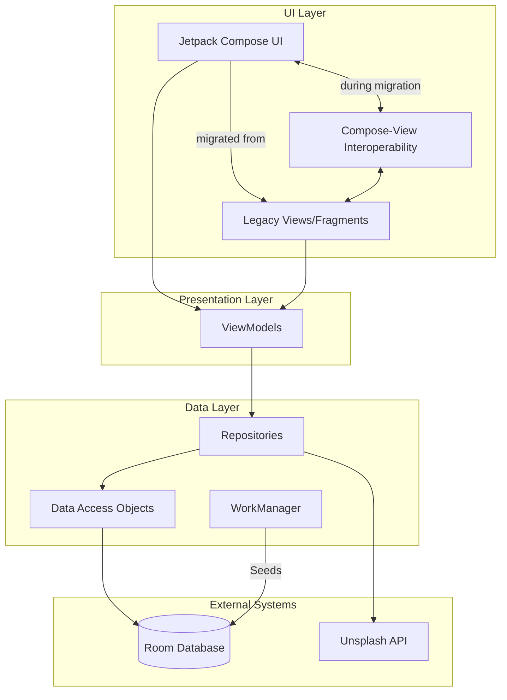

The Sunflower app follows a clean architecture approach with clear separation of concerns between layers:

- **UI Layer**: Contains the app's user interface, fully migrated from Views to Compose
- **Presentation Layer**: Contains ViewModels that expose data to the UI and handle user interactions
- **Data Layer**: Contains repositories that abstract data sources and WorkManager for background tasks
- **External Systems**: Room database for local storage and Unsplash API for remote image retrieval

Sources: [README.md:5-10](), [.google/packaging.yaml:20-47]()

## Data Flow and Component Interaction

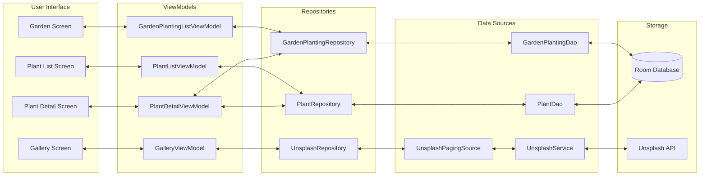

The data flow diagram illustrates how data moves through the application:

1. Each screen is backed by a dedicated ViewModel
2. ViewModels interact with repositories to fetch and modify data
3. Repositories abstract the data sources (Room database and Unsplash API)
4. Data is exposed to the UI using LiveData or StateFlow for reactive updates

Sources: [README.md:16-25](), [.google/packaging.yaml:20-47]()

## Database and Data Model

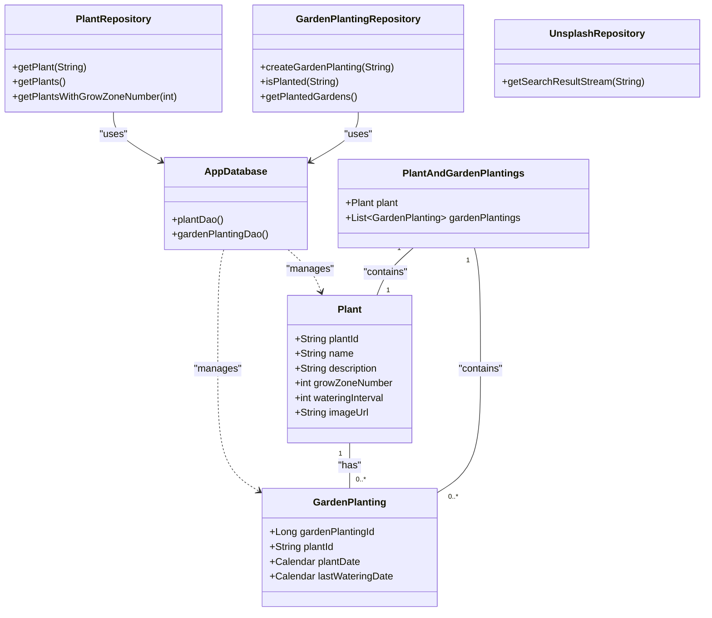

The data model consists of two primary entities:

- **Plant**: Represents a plant in the catalog with details like name, description, and watering requirements
- **GardenPlanting**: Represents a plant that has been added to the user's garden with planting date and watering information

The `PlantAndGardenPlantings` class is a convenience container that combines a Plant with its associated GardenPlantings. Each repository handles specific data access operations for its domain.

Sources: [.google/packaging.yaml:25-30]()

## UI Component Hierarchy

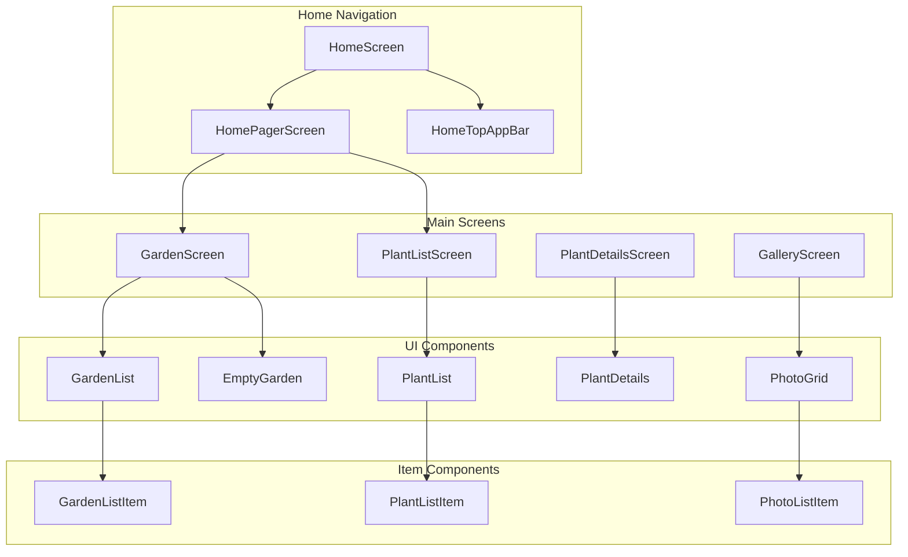

The UI structure follows a hierarchical organization:

- **HomeScreen**: Serves as the main container with a top app bar and view pager
- **Main Screens**: Include GardenScreen, PlantListScreen, PlantDetailScreen, and GalleryScreen
- **UI Components**: Reusable components like lists and grid displays
- **Item Components**: Individual items within lists and grids

This structure demonstrates a modular, component-based UI architecture that facilitates maintenance and reuse.

Sources: [README.md:24-25](), [docs/MigrationJourney.md:27-36]()

## Migration Journey from Views to Compose

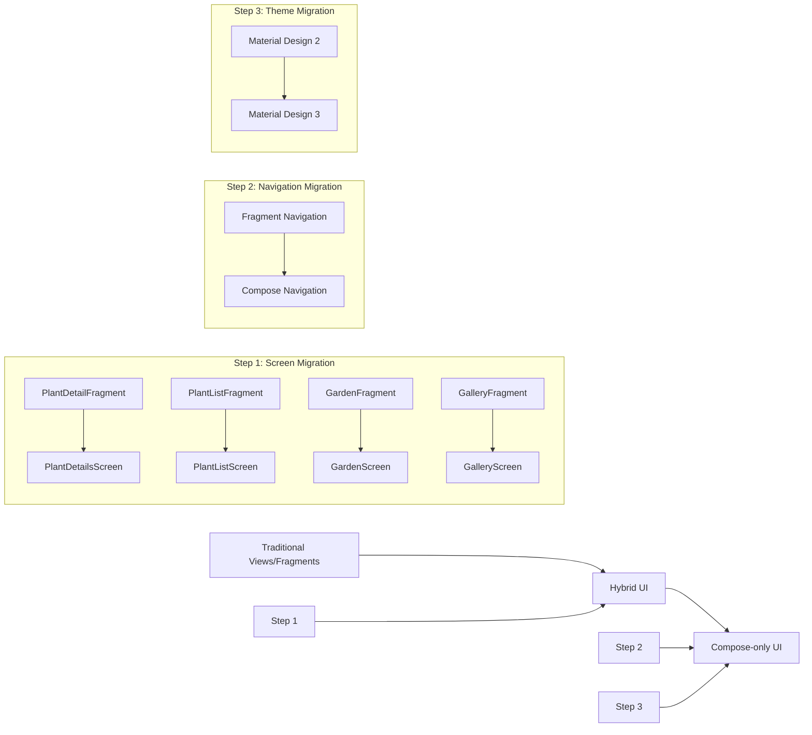

The Sunflower app demonstrates a phased, incremental migration approach from traditional Views to Jetpack Compose:

1. **Screen Migration**: Each screen was migrated individually, starting with PlantDetailFragment
2. **Navigation Migration**: After all screens were migrated, Fragment-based navigation was replaced with Navigation Compose
3. **Theme Migration**: UI styling was updated from Material Design 2 to Material Design 3

This migration strategy, known as the "bottom-up approach," allows for incremental adoption of Compose while maintaining app functionality throughout the process.

Sources: [README.md:5-10](), [docs/MigrationJourney.md:9-43]()

## External Dependencies

The Sunflower app integrates with the following external systems:

| External System | Purpose |
|-----------------|---------|
| Room Database | Local storage for plant catalog and garden plantings |
| Unsplash API | Provides plant-related images for the gallery screen |
| WorkManager | Handles background tasks like database seeding |
| Hilt | Provides dependency injection throughout the app |
| Navigation Compose | Manages navigation between screens |

To use the app with the Unsplash API, developers need to obtain an API key as described in the README.

Sources: [README.md:29-42](), [.google/packaging.yaml:42-47]()

## Development Status

It's important to note that as of the time of this documentation, the Sunflower repository is no longer under maintenance. The Android team is prioritizing https://github.com/android/compose-samples as the up-to-date source of truth for Compose best practices.

Sources: [README.md:3-10]()

---

# Page: Architecture

# Architecture

<details>
<summary>Relevant source files</summary>

The following files were used as context for generating this wiki page:

- [app/src/androidTest/java/com/google/samples/apps/sunflower/data/GardenPlantingDaoTest.kt](app/src/androidTest/java/com/google/samples/apps/sunflower/data/GardenPlantingDaoTest.kt)
- [app/src/main/java/com/google/samples/apps/sunflower/data/GardenPlanting.kt](app/src/main/java/com/google/samples/apps/sunflower/data/GardenPlanting.kt)
- [app/src/main/java/com/google/samples/apps/sunflower/data/GardenPlantingDao.kt](app/src/main/java/com/google/samples/apps/sunflower/data/GardenPlantingDao.kt)
- [app/src/main/java/com/google/samples/apps/sunflower/data/GardenPlantingRepository.kt](app/src/main/java/com/google/samples/apps/sunflower/data/GardenPlantingRepository.kt)
- [app/src/main/java/com/google/samples/apps/sunflower/viewmodels/GardenPlantingListViewModel.kt](app/src/main/java/com/google/samples/apps/sunflower/viewmodels/GardenPlantingListViewModel.kt)
- [app/src/main/java/com/google/samples/apps/sunflower/viewmodels/PlantDetailViewModel.kt](app/src/main/java/com/google/samples/apps/sunflower/viewmodels/PlantDetailViewModel.kt)
- [app/src/main/java/com/google/samples/apps/sunflower/viewmodels/PlantListViewModel.kt](app/src/main/java/com/google/samples/apps/sunflower/viewmodels/PlantListViewModel.kt)
- [app/src/test/java/com/google/samples/apps/sunflower/data/GardenPlantingTest.kt](app/src/test/java/com/google/samples/apps/sunflower/data/GardenPlantingTest.kt)

</details>


## Purpose and Scope

This document outlines the high-level architecture of the Sunflower application, explaining the separation of concerns, data flow patterns, and key architectural components. It provides a technical overview of how different parts of the system interact with each other. For specific implementation details about the MVVM pattern, see [MVVM Pattern](#2.1). For details about how repositories are implemented, see [Repository Pattern](#2.2). For in-depth information about the database and data entities, see [Data Layer](#2.3).

## Architectural Overview

Sunflower implements a clean architecture with distinct layers that separate concerns to promote testability and maintainability.

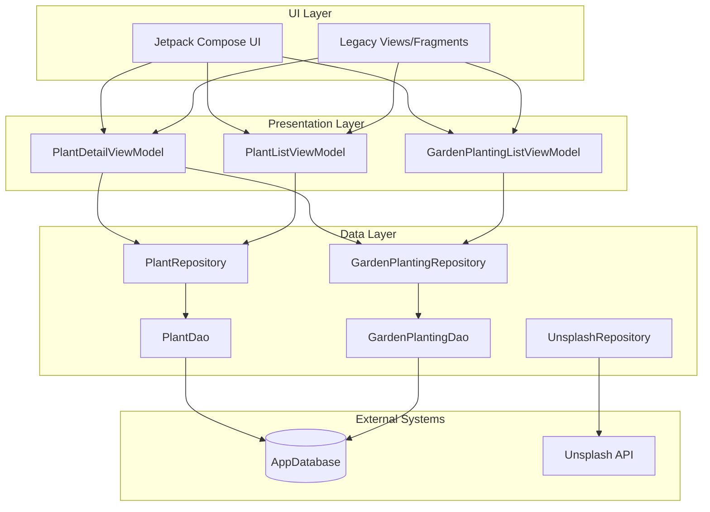

Sources:
- [app/src/main/java/com/google/samples/apps/sunflower/viewmodels/PlantDetailViewModel.kt]()
- [app/src/main/java/com/google/samples/apps/sunflower/viewmodels/PlantListViewModel.kt]()
- [app/src/main/java/com/google/samples/apps/sunflower/viewmodels/GardenPlantingListViewModel.kt]()
- [app/src/main/java/com/google/samples/apps/sunflower/data/GardenPlantingRepository.kt]()
- [app/src/main/java/com/google/samples/apps/sunflower/data/GardenPlantingDao.kt]()

## Key Components

### ViewModels

ViewModels serve as the bridge between UI and data layers, exposing data through LiveData or StateFlow for reactive UI updates.

#### PlantDetailViewModel

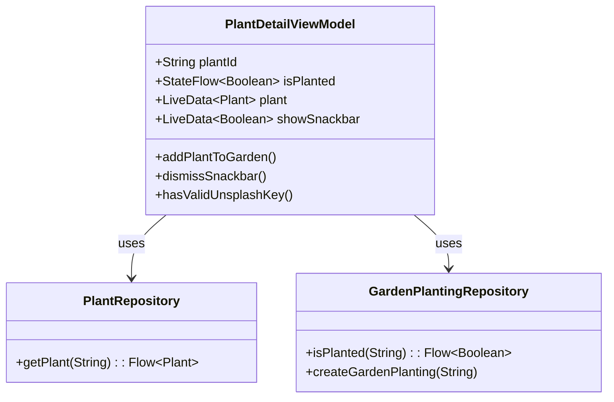

Sources:
- [app/src/main/java/com/google/samples/apps/sunflower/viewmodels/PlantDetailViewModel.kt:38-74]()

The `PlantDetailViewModel` retrieves plant details and manages garden planting operations. It uses `SavedStateHandle` to persist the plant ID across configuration changes and process death, and exposes plant data and planting status through reactive streams.

#### PlantListViewModel

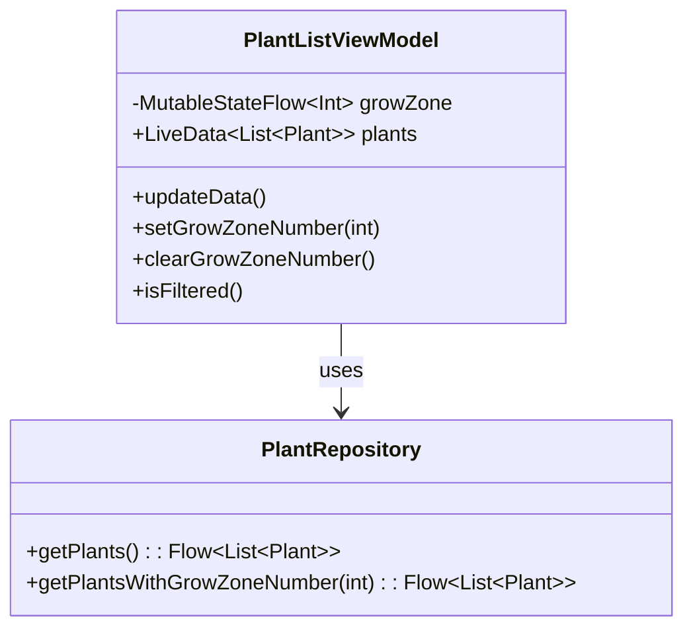

Sources:
- [app/src/main/java/com/google/samples/apps/sunflower/viewmodels/PlantListViewModel.kt:36-111]()

`PlantListViewModel` manages the plant list and filtering functionality. It uses `flatMapLatest` to switch between data sources when the grow zone filter changes, ensuring the UI always displays the most current data.

#### GardenPlantingListViewModel

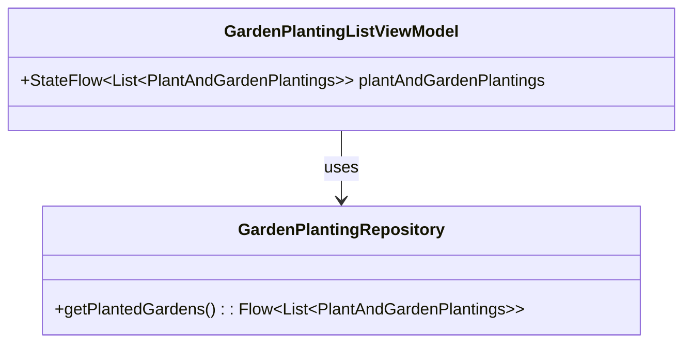

Sources:
- [app/src/main/java/com/google/samples/apps/sunflower/viewmodels/GardenPlantingListViewModel.kt:30-41]()

`GardenPlantingListViewModel` provides access to the user's garden plants, exposing them as a `StateFlow` for reactive UI updates.

### Repositories

Repositories abstract data access logic and provide a clean API for ViewModels.

#### GardenPlantingRepository

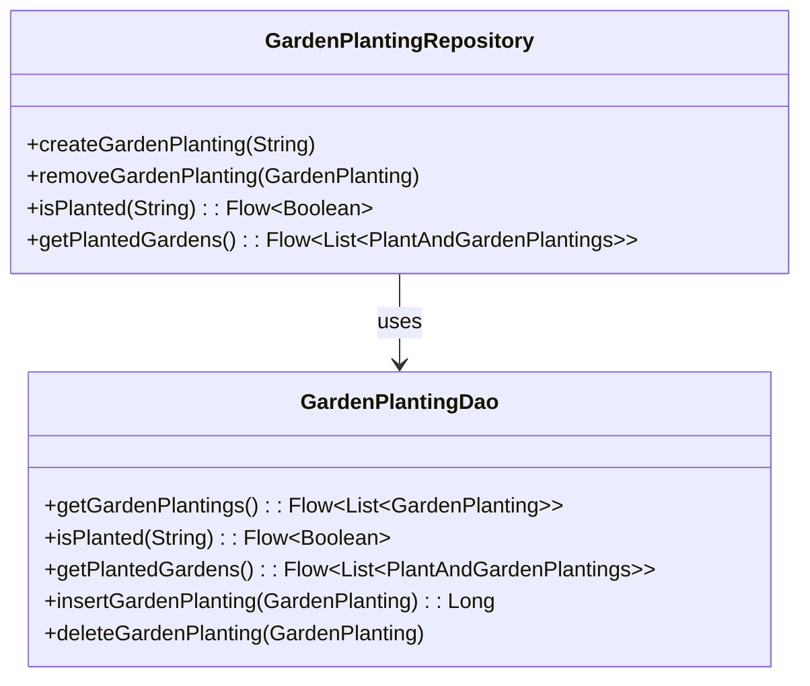

Sources:
- [app/src/main/java/com/google/samples/apps/sunflower/data/GardenPlantingRepository.kt:23-51]()
- [app/src/main/java/com/google/samples/apps/sunflower/data/GardenPlantingDao.kt:30-50]()

`GardenPlantingRepository` manages garden-related operations, delegating database operations to the DAO. It's annotated with `@Singleton` to ensure a single instance exists throughout the application's lifecycle.

### Data Access Objects (DAOs)

DAOs define the interface for database operations, using Room annotations to generate SQL queries.

#### GardenPlantingDao

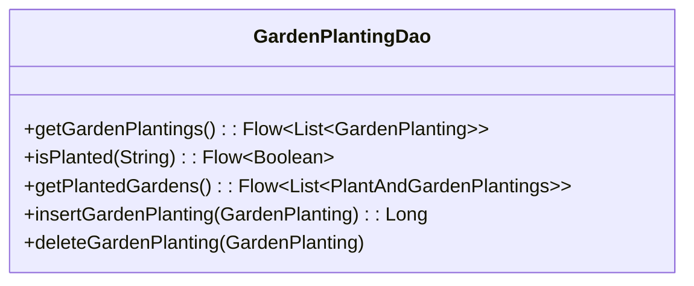

Sources:
- [app/src/main/java/com/google/samples/apps/sunflower/data/GardenPlantingDao.kt:30-50]()

`GardenPlantingDao` defines database operations for garden plantings, returning results as Kotlin Flows to enable reactive programming. The `@Transaction` annotation on `getPlantedGardens()` ensures atomicity when fetching related entities.

### Data Entities

#### Entity Relationships

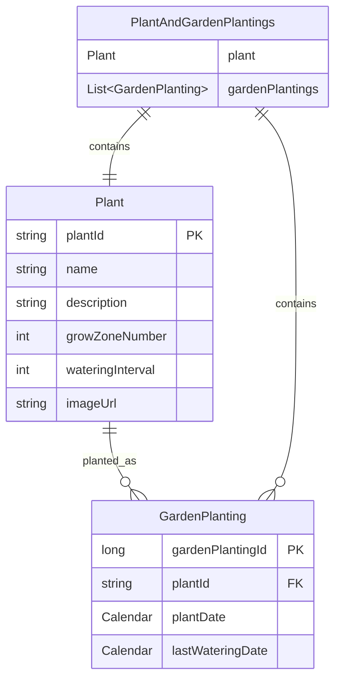

Sources:
- [app/src/main/java/com/google/samples/apps/sunflower/data/GardenPlanting.kt:41-60]()
- [app/src/androidTest/java/com/google/samples/apps/sunflower/data/GardenPlantingDaoTest.kt:88-98]()

The diagram illustrates the relationships between database entities:
- `Plant` represents a plant species with cultivation information
- `GardenPlanting` represents a plant added to the user's garden with tracking metadata
- `PlantAndGardenPlantings` is a convenience class that combines a `Plant` with its associated `GardenPlanting` entries

## Data Flow

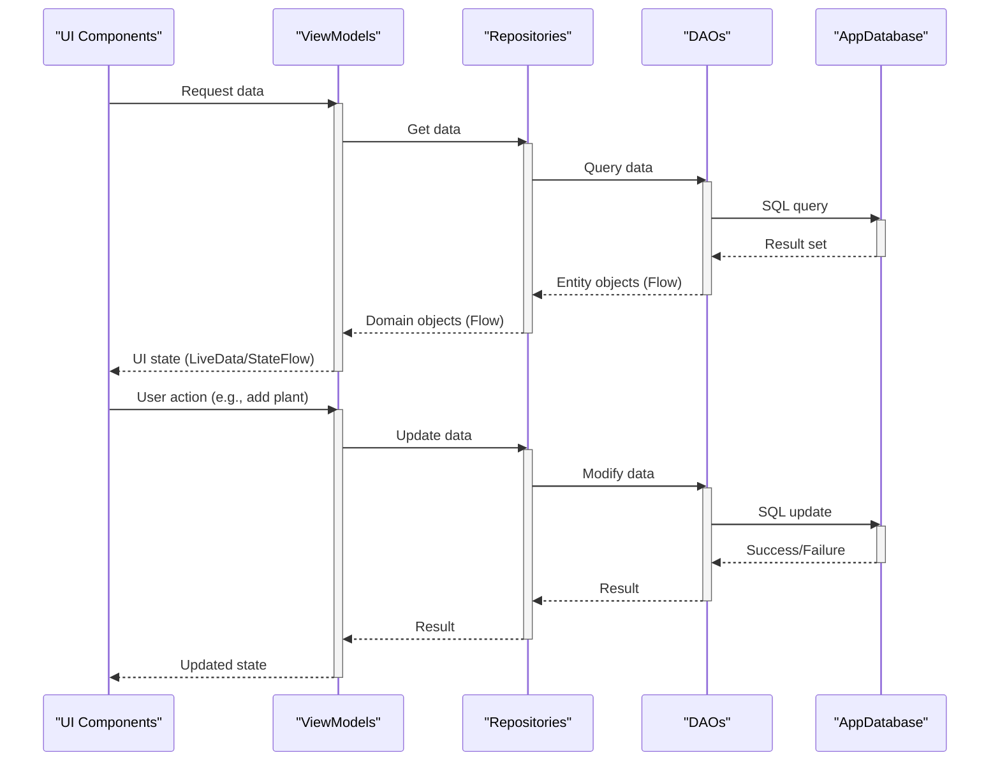

Sources:
- [app/src/main/java/com/google/samples/apps/sunflower/viewmodels/PlantDetailViewModel.kt:46-67]()
- [app/src/main/java/com/google/samples/apps/sunflower/viewmodels/PlantListViewModel.kt:45-51]()
- [app/src/main/java/com/google/samples/apps/sunflower/data/GardenPlantingRepository.kt:27-39]()
- [app/src/main/java/com/google/samples/apps/sunflower/data/GardenPlantingDao.kt:31-49]()

This diagram illustrates the reactive data flow pattern used in Sunflower:

1. UI layer requests data from ViewModels
2. ViewModels delegate to Repositories
3. Repositories retrieve data from DAOs or remote sources
4. Data flows back as reactive streams (Flows)
5. ViewModels transform Flows to LiveData/StateFlow for UI consumption
6. Updates follow the same path in reverse

## Dependency Injection with Hilt

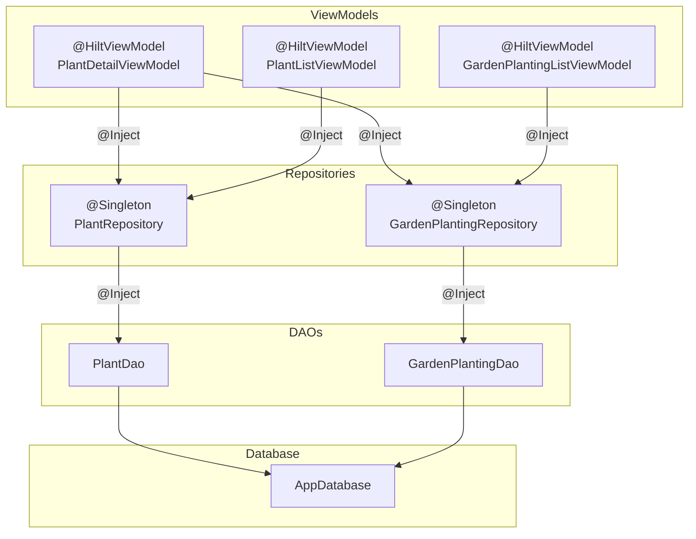

Sources:
- [app/src/main/java/com/google/samples/apps/sunflower/viewmodels/PlantDetailViewModel.kt:37-38]()
- [app/src/main/java/com/google/samples/apps/sunflower/viewmodels/PlantListViewModel.kt:35-36]()
- [app/src/main/java/com/google/samples/apps/sunflower/viewmodels/GardenPlantingListViewModel.kt:29-30]()
- [app/src/main/java/com/google/samples/apps/sunflower/data/GardenPlantingRepository.kt:22-23]()

Sunflower uses Hilt for dependency injection:
- `@HiltViewModel` identifies ViewModels for Hilt to inject
- `@Inject` constructor parameters receive dependencies from Hilt
- `@Singleton` ensures only one instance of repositories exist

This approach eliminates manual dependency management and facilitates testing through dependency substitution.

## Testing Architecture

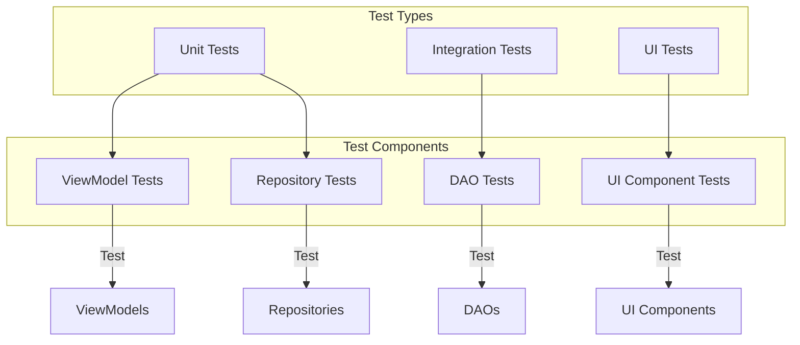

Sources:
- [app/src/androidTest/java/com/google/samples/apps/sunflower/data/GardenPlantingDaoTest.kt:37-99]()
- [app/src/test/java/com/google/samples/apps/sunflower/data/GardenPlantingTest.kt:25-35]()

The clean architecture facilitates extensive testing:

| Layer | Test Type | Testing Focus | Example |
|-------|-----------|---------------|---------|
| ViewModel | Unit Tests | Business logic, state management | Testing `PlantListViewModel.updateData()` |
| Repository | Unit Tests | Data transformation, caching | Testing `GardenPlantingRepository.createGardenPlanting()` |
| DAO | Integration Tests | SQL queries, data persistence | `GardenPlantingDaoTest.testGetPlantAndGardenPlantings()` |
| UI | UI Tests | Component rendering, user interaction | Testing navigation between screens |

This layered approach enables precise testing of each component with appropriate isolation or integration.

---

# Page: MVVM Pattern

# MVVM Pattern

<details>
<summary>Relevant source files</summary>

The following files were used as context for generating this wiki page:

- [app/src/main/java/com/google/samples/apps/sunflower/api/UnsplashService.kt](app/src/main/java/com/google/samples/apps/sunflower/api/UnsplashService.kt)
- [app/src/main/java/com/google/samples/apps/sunflower/data/UnsplashPagingSource.kt](app/src/main/java/com/google/samples/apps/sunflower/data/UnsplashPagingSource.kt)
- [app/src/main/java/com/google/samples/apps/sunflower/data/UnsplashPhotoUrls.kt](app/src/main/java/com/google/samples/apps/sunflower/data/UnsplashPhotoUrls.kt)
- [app/src/main/java/com/google/samples/apps/sunflower/data/UnsplashRepository.kt](app/src/main/java/com/google/samples/apps/sunflower/data/UnsplashRepository.kt)
- [app/src/main/java/com/google/samples/apps/sunflower/data/UnsplashSearchResponse.kt](app/src/main/java/com/google/samples/apps/sunflower/data/UnsplashSearchResponse.kt)
- [app/src/main/java/com/google/samples/apps/sunflower/data/UnsplashUser.kt](app/src/main/java/com/google/samples/apps/sunflower/data/UnsplashUser.kt)
- [app/src/main/java/com/google/samples/apps/sunflower/viewmodels/GalleryViewModel.kt](app/src/main/java/com/google/samples/apps/sunflower/viewmodels/GalleryViewModel.kt)
- [app/src/main/java/com/google/samples/apps/sunflower/viewmodels/GardenPlantingListViewModel.kt](app/src/main/java/com/google/samples/apps/sunflower/viewmodels/GardenPlantingListViewModel.kt)
- [app/src/main/java/com/google/samples/apps/sunflower/viewmodels/PlantAndGardenPlantingsViewModel.kt](app/src/main/java/com/google/samples/apps/sunflower/viewmodels/PlantAndGardenPlantingsViewModel.kt)
- [app/src/main/java/com/google/samples/apps/sunflower/viewmodels/PlantDetailViewModel.kt](app/src/main/java/com/google/samples/apps/sunflower/viewmodels/PlantDetailViewModel.kt)
- [app/src/main/java/com/google/samples/apps/sunflower/viewmodels/PlantListViewModel.kt](app/src/main/java/com/google/samples/apps/sunflower/viewmodels/PlantListViewModel.kt)

</details>


## Purpose and Scope

This document details the implementation of the Model-View-ViewModel (MVVM) architectural pattern in the Sunflower application. It covers how ViewModels interact with repositories to provide data to the UI, the data flow between components, and the specific implementations of key ViewModels. For information about the Repository pattern implementation, see [Repository Pattern](#2.2).

## Overview of MVVM in Sunflower

The MVVM architectural pattern separates an application into three distinct layers:

- **Model**: Represents the data and business logic (repositories, data classes)
- **View**: Represents the UI components (Compose UI, Fragments)
- **ViewModel**: Acts as a mediator, preparing and managing data for the View

Sunflower implements MVVM using Android Architecture Components, including `ViewModel`, `LiveData`, `StateFlow`, and coroutines.

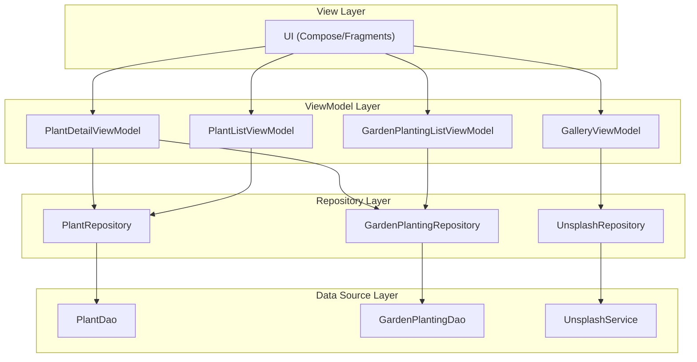

**Title: MVVM Architecture in Sunflower**

Sources: 
- [app/src/main/java/com/google/samples/apps/sunflower/viewmodels/PlantDetailViewModel.kt]()
- [app/src/main/java/com/google/samples/apps/sunflower/viewmodels/PlantListViewModel.kt]()
- [app/src/main/java/com/google/samples/apps/sunflower/viewmodels/GardenPlantingListViewModel.kt]()
- [app/src/main/java/com/google/samples/apps/sunflower/viewmodels/GalleryViewModel.kt]()

## Key ViewModels in Sunflower

Sunflower contains several ViewModels, each responsible for a specific part of the application:

| ViewModel | Purpose | Key Features |
|-----------|---------|--------------|
| `PlantDetailViewModel` | Manages data for plant details screen | Plant data, planting status, add plant functionality |
| `PlantListViewModel` | Manages plant list with filtering | Grow zone filtering, plant list data |
| `GardenPlantingListViewModel` | Manages garden plants list | List of user's planted plants |
| `GalleryViewModel` | Manages plant photos from Unsplash | Photo pagination, search functionality |
| `PlantAndGardenPlantingsViewModel` | Formatting for plant & planting data | Date formatting, display data |

## PlantDetailViewModel Implementation

The `PlantDetailViewModel` demonstrates the core principles of MVVM in Sunflower:

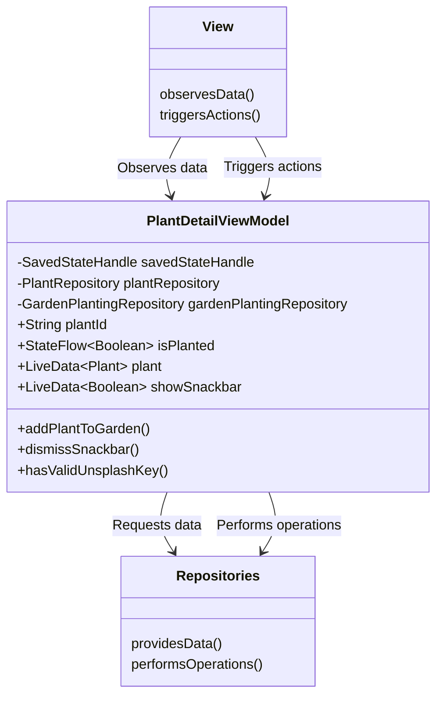

**Title: PlantDetailViewModel Class Structure**

Sources:
- [app/src/main/java/com/google/samples/apps/sunflower/viewmodels/PlantDetailViewModel.kt:38-74]()

Key aspects of the implementation:

1. **Dependency Injection** - ViewModels are injected using Hilt:
   ```kotlin
   @HiltViewModel
   class PlantDetailViewModel @Inject constructor(
       savedStateHandle: SavedStateHandle,
       plantRepository: PlantRepository,
       private val gardenPlantingRepository: GardenPlantingRepository,
   ) : ViewModel() {
   ```

2. **State Management** - Uses SavedStateHandle to preserve state:
   ```kotlin
   val plantId: String = savedStateHandle.get<String>(PLANT_ID_SAVED_STATE_KEY)!!
   ```

3. **Reactive Data** - Exposes data as LiveData and StateFlow:
   ```kotlin
   val isPlanted = gardenPlantingRepository.isPlanted(plantId)
       .stateIn(
           viewModelScope,
           SharingStarted.WhileSubscribed(5000),
           false
       )
   val plant = plantRepository.getPlant(plantId).asLiveData()
   ```

4. **User Actions** - Handles business logic for user actions:
   ```kotlin
   fun addPlantToGarden() {
       viewModelScope.launch {
           gardenPlantingRepository.createGardenPlanting(plantId)
           _showSnackbar.value = true
       }
   }
   ```

5. **UI State** - Manages UI state like showing snackbars:
   ```kotlin
   private val _showSnackbar = MutableLiveData(false)
   val showSnackbar: LiveData<Boolean>
       get() = _showSnackbar
   ```

Sources:
- [app/src/main/java/com/google/samples/apps/sunflower/viewmodels/PlantDetailViewModel.kt:38-74]()

## Data Flow in MVVM

The following diagram illustrates how data flows through the MVVM components in Sunflower:

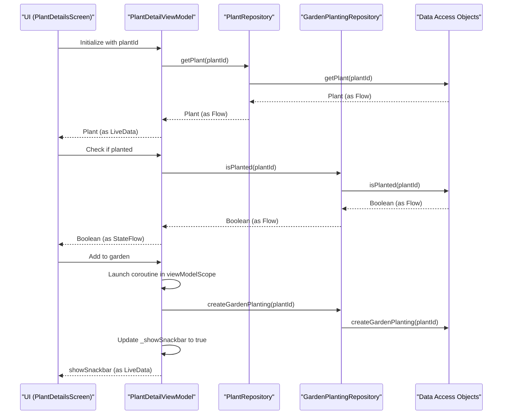

**Title: Data Flow in PlantDetailViewModel**

Sources:
- [app/src/main/java/com/google/samples/apps/sunflower/viewmodels/PlantDetailViewModel.kt:44-67]()

## PlantListViewModel Implementation

The `PlantListViewModel` demonstrates how to handle filtered data and state preservation:

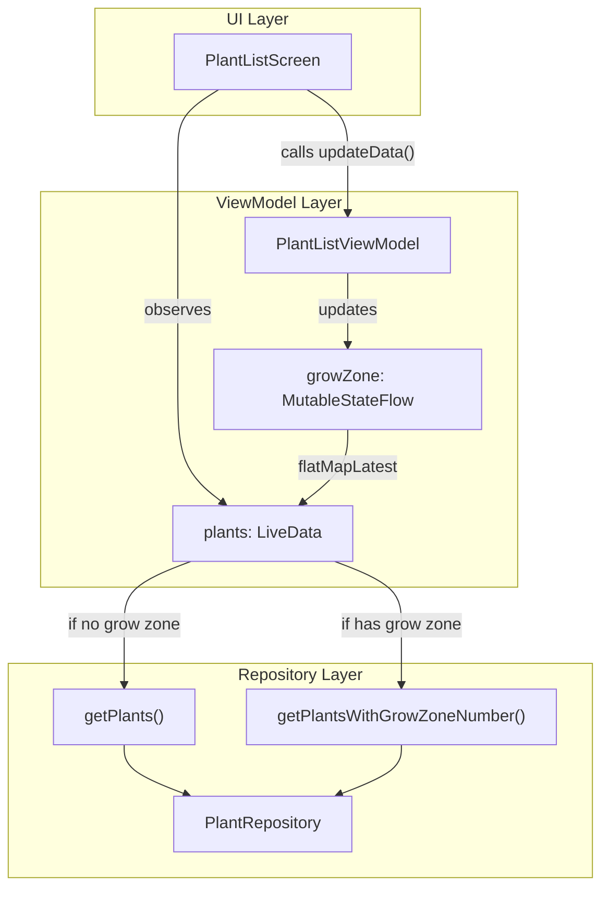

**Title: Data Flow in PlantListViewModel**

Sources:
- [app/src/main/java/com/google/samples/apps/sunflower/viewmodels/PlantListViewModel.kt:36-106]()

Key implementation details:

1. **State Management** - Uses MutableStateFlow for grow zone state:
   ```kotlin
   private val growZone: MutableStateFlow<Int> = MutableStateFlow(
       savedStateHandle.get(GROW_ZONE_SAVED_STATE_KEY) ?: NO_GROW_ZONE
   )
   ```

2. **Reactive Transformations** - Uses Flow operators to transform data:
   ```kotlin
   val plants: LiveData<List<Plant>> = growZone.flatMapLatest { zone ->
       if (zone == NO_GROW_ZONE) {
           plantRepository.getPlants()
       } else {
           plantRepository.getPlantsWithGrowZoneNumber(zone)
       }
   }.asLiveData()
   ```

3. **State Persistence** - Saves state changes to SavedStateHandle:
   ```kotlin
   viewModelScope.launch {
       growZone.collect { newGrowZone ->
           savedStateHandle.set(GROW_ZONE_SAVED_STATE_KEY, newGrowZone)
       }
   }
   ```

4. **Action Handlers** - Provides methods for UI actions:
   ```kotlin
   fun updateData() {
       if (isFiltered()) {
           clearGrowZoneNumber()
       } else {
           setGrowZoneNumber(9)
       }
   }
   ```

Sources:
- [app/src/main/java/com/google/samples/apps/sunflower/viewmodels/PlantListViewModel.kt:41-105]()

## GardenPlantingListViewModel

The `GardenPlantingListViewModel` provides a simple example of exposing repository data to the UI:

```kotlin
@HiltViewModel
class GardenPlantingListViewModel @Inject internal constructor(
    gardenPlantingRepository: GardenPlantingRepository
) : ViewModel() {
    val plantAndGardenPlantings: StateFlow<List<PlantAndGardenPlantings>> =
        gardenPlantingRepository
            .getPlantedGardens()
            .stateIn(
                viewModelScope,
                SharingStarted.WhileSubscribed(5000),
                emptyList()
            )
}
```

This ViewModel:
1. Receives the repository through dependency injection
2. Converts the repository's Flow to a StateFlow with a default value
3. Exposes the data to the UI as a StateFlow

Sources:
- [app/src/main/java/com/google/samples/apps/sunflower/viewmodels/GardenPlantingListViewModel.kt:30-41]()

## GalleryViewModel

The `GalleryViewModel` shows how to handle paginated data from a network source:

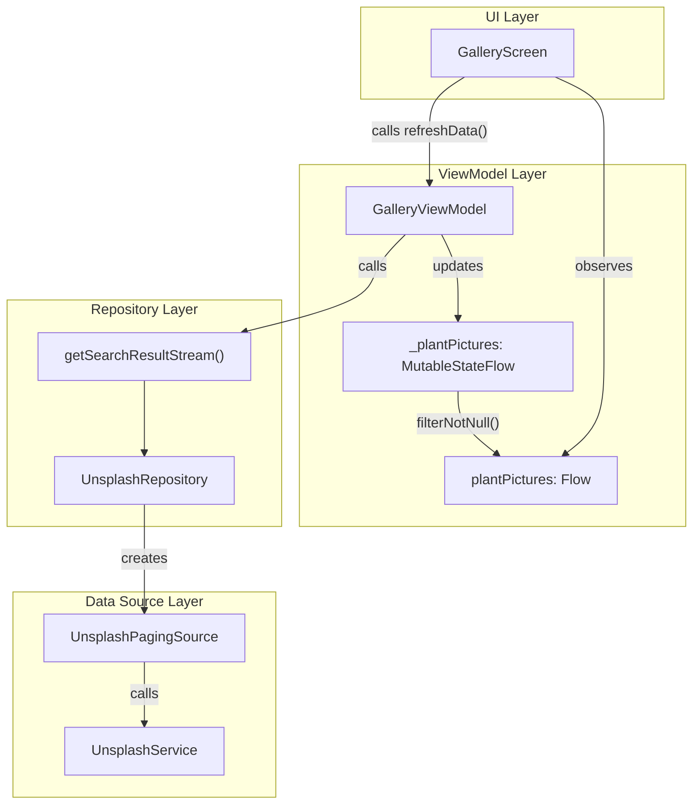

**Title: Data Flow in GalleryViewModel**

Sources:
- [app/src/main/java/com/google/samples/apps/sunflower/viewmodels/GalleryViewModel.kt:35-61]()
- [app/src/main/java/com/google/samples/apps/sunflower/data/UnsplashPagingSource.kt:25-54]()
- [app/src/main/java/com/google/samples/apps/sunflower/data/UnsplashRepository.kt:26-38]()

Key implementation details:
1. Retrieves the plant name from SavedStateHandle
2. Uses Flow and MutableStateFlow to manage the paged data
3. Exposes a filtered Flow of PagingData to the UI
4. Uses viewModelScope to launch coroutines for data fetching

## Benefits of MVVM in Sunflower

The MVVM pattern provides several benefits for the Sunflower application:

1. **Separation of Concerns**: UI code is separate from business logic, making the codebase more maintainable.

2. **Testability**: ViewModels can be tested independently of UI components, as demonstrated in the project's test files.

3. **Lifecycle Management**: ViewModels survive configuration changes, preserving data during screen rotations and other configuration changes.

4. **Reactive UI Updates**: Using LiveData and StateFlow provides automatic UI updates when the underlying data changes.

5. **State Preservation**: SavedStateHandle helps preserve state across process death.

6. **Clean Dependencies**: Dependency injection with Hilt provides clean dependency management.

Sources:
- [app/src/main/java/com/google/samples/apps/sunflower/viewmodels/PlantDetailViewModel.kt]()
- [app/src/main/java/com/google/samples/apps/sunflower/viewmodels/PlantListViewModel.kt]()
- [app/src/main/java/com/google/samples/apps/sunflower/viewmodels/GardenPlantingListViewModel.kt]()
- [app/src/main/java/com/google/samples/apps/sunflower/viewmodels/GalleryViewModel.kt]()

---

# Page: Repository Pattern

# Repository Pattern

<details>
<summary>Relevant source files</summary>

The following files were used as context for generating this wiki page:

- [app/src/androidTest/java/com/google/samples/apps/sunflower/data/GardenPlantingDaoTest.kt](app/src/androidTest/java/com/google/samples/apps/sunflower/data/GardenPlantingDaoTest.kt)
- [app/src/main/java/com/google/samples/apps/sunflower/data/GardenPlanting.kt](app/src/main/java/com/google/samples/apps/sunflower/data/GardenPlanting.kt)
- [app/src/main/java/com/google/samples/apps/sunflower/data/GardenPlantingDao.kt](app/src/main/java/com/google/samples/apps/sunflower/data/GardenPlantingDao.kt)
- [app/src/main/java/com/google/samples/apps/sunflower/data/GardenPlantingRepository.kt](app/src/main/java/com/google/samples/apps/sunflower/data/GardenPlantingRepository.kt)
- [app/src/main/java/com/google/samples/apps/sunflower/data/PlantRepository.kt](app/src/main/java/com/google/samples/apps/sunflower/data/PlantRepository.kt)
- [app/src/test/java/com/google/samples/apps/sunflower/data/GardenPlantingTest.kt](app/src/test/java/com/google/samples/apps/sunflower/data/GardenPlantingTest.kt)

</details>


## Purpose and Scope

This document describes the Repository Pattern implementation in the Sunflower application. The Repository Pattern serves as an abstraction layer between data sources and the rest of the application, providing a clean API for data access. This page focuses on how repositories in Sunflower abstract the underlying database operations through Data Access Objects (DAOs) and provide a consistent interface to the presentation layer.

For information about the overall architecture, see [Architecture](#2), and for details on the data layer implementation, see [Data Layer](#2.3).

## What is the Repository Pattern?

The Repository Pattern is a design pattern that separates the logic for accessing data from the business logic of the application. It provides a clean API for data access to the rest of the application and mediates between different data sources.

```mermaid
graph TD
    subgraph "Presentation Layer"
        VM["ViewModels"]
    end
    
    subgraph "Data Layer"
        R["Repositories"]
        DAO["Data Access Objects"]
    end
    
    subgraph "Storage"
        DB["Room Database"]
    end
    
    VM --> R
    R --> DAO
    DAO --> DB
```

**Repository Pattern Benefits**

Sources: [app/src/main/java/com/google/samples/apps/sunflower/data/PlantRepository.kt:22-27]()

## Repository Implementations in Sunflower

Sunflower implements two main repositories:

1. **PlantRepository**: Handles operations related to plant data
2. **GardenPlantingRepository**: Manages operations related to garden plantings (plants that users have added to their garden)

```mermaid
classDiagram
    class PlantRepository {
        -plantDao: PlantDao
        +getPlants()
        +getPlant(plantId: String)
        +getPlantsWithGrowZoneNumber(growZoneNumber: Int)
    }
    
    class GardenPlantingRepository {
        -gardenPlantingDao: GardenPlantingDao
        +createGardenPlanting(plantId: String)
        +removeGardenPlanting(gardenPlanting: GardenPlanting)
        +isPlanted(plantId: String)
        +getPlantedGardens()
    }
    
    class PlantDao {
        +getPlants()
        +getPlant(plantId: String)
        +getPlantsWithGrowZoneNumber(growZoneNumber: Int)
    }
    
    class GardenPlantingDao {
        +getGardenPlantings()
        +isPlanted(plantId: String)
        +getPlantedGardens()
        +insertGardenPlanting(gardenPlanting: GardenPlanting)
        +deleteGardenPlanting(gardenPlanting: GardenPlanting)
    }
    
    PlantRepository --> PlantDao : uses
    GardenPlantingRepository --> GardenPlantingDao : uses
```

**Repository Class Structure**

Sources: 
- [app/src/main/java/com/google/samples/apps/sunflower/data/PlantRepository.kt]()
- [app/src/main/java/com/google/samples/apps/sunflower/data/GardenPlantingRepository.kt]()
- [app/src/main/java/com/google/samples/apps/sunflower/data/GardenPlantingDao.kt]()

## Plant Repository

The `PlantRepository` provides access to plant data in the database through the `PlantDao`.

```
@Singleton
class PlantRepository @Inject constructor(private val plantDao: PlantDao) {
    fun getPlants() = plantDao.getPlants()
    fun getPlant(plantId: String) = plantDao.getPlant(plantId)
    fun getPlantsWithGrowZoneNumber(growZoneNumber: Int) =
        plantDao.getPlantsWithGrowZoneNumber(growZoneNumber)
}
```

Key characteristics:
- Annotated with `@Singleton` to ensure only one instance exists
- Uses dependency injection through the `@Inject` constructor annotation
- Provides methods that directly delegate to the corresponding DAO methods
- Returns Flow objects that allow for reactive UI updates

Sources: [app/src/main/java/com/google/samples/apps/sunflower/data/PlantRepository.kt:28-47]()

## Garden Planting Repository

The `GardenPlantingRepository` manages operations related to plants that the user has added to their garden.

```
@Singleton
class GardenPlantingRepository @Inject constructor(
    private val gardenPlantingDao: GardenPlantingDao
) {
    suspend fun createGardenPlanting(plantId: String) {
        val gardenPlanting = GardenPlanting(plantId)
        gardenPlantingDao.insertGardenPlanting(gardenPlanting)
    }
    
    suspend fun removeGardenPlanting(gardenPlanting: GardenPlanting) {
        gardenPlantingDao.deleteGardenPlanting(gardenPlanting)
    }
    
    fun isPlanted(plantId: String) =
        gardenPlantingDao.isPlanted(plantId)
    
    fun getPlantedGardens() = gardenPlantingDao.getPlantedGardens()
}
```

Key characteristics:
- Annotated with `@Singleton` to ensure only one instance exists
- Uses dependency injection through the `@Inject` constructor annotation
- Provides a higher level of abstraction than `PlantRepository` by including business logic
- Contains suspend functions for database operations that should be executed off the main thread
- Also exposes Flow objects for reactive data observation

Sources: [app/src/main/java/com/google/samples/apps/sunflower/data/GardenPlantingRepository.kt:23-51]()

## Data Flow

The following diagram illustrates how data flows through the repository layer in the Sunflower application:

```mermaid
graph LR
    subgraph "UI Layer"
        GS["GardenScreen"]
        PLS["PlantListScreen"]
        PDS["PlantDetailScreen"]
    end
    
    subgraph "ViewModel Layer"
        GPLVM["GardenPlantingListViewModel"]
        PLVM["PlantListViewModel"]
        PDVM["PlantDetailViewModel"]
    end
    
    subgraph "Repository Layer"
        GPR["GardenPlantingRepository"]
        PR["PlantRepository"]
    end
    
    subgraph "DAO Layer"
        GPDAO["GardenPlantingDao"]
        PDAO["PlantDao"]
    end
    
    subgraph "Database"
        DB["Room Database"]
    end
    
    GS --> GPLVM
    PLS --> PLVM
    PDS --> PDVM
    
    GPLVM --> GPR
    PLVM --> PR
    PDVM --> PR
    PDVM --> GPR
    
    GPR --> GPDAO
    PR --> PDAO
    
    GPDAO --> DB
    PDAO --> DB
    
    %% Data flow is bidirectional
    DB --> GPDAO
    DB --> PDAO
    GPDAO --> GPR
    PDAO --> PR
    GPR --> GPLVM
    PR --> PLVM
    PR --> PDVM
    GPR --> PDVM
    GPLVM --> GS
    PLVM --> PLS
    PDVM --> PDS
```

**Data Flow Through Repository Pattern**

Sources: 
- [app/src/main/java/com/google/samples/apps/sunflower/data/PlantRepository.kt]()
- [app/src/main/java/com/google/samples/apps/sunflower/data/GardenPlantingRepository.kt]()

## Repository Implementation Details

### Method Delegation

Both repositories mostly delegate calls directly to their respective DAOs, serving as a passthrough layer. However, the `GardenPlantingRepository` includes some additional logic, particularly in the `createGardenPlanting` method which creates a new `GardenPlanting` object before passing it to the DAO.

```mermaid
sequenceDiagram
    participant ViewModel
    participant Repository
    participant DAO
    participant Database
    
    ViewModel->>Repository: createGardenPlanting(plantId)
    Repository->>Repository: Create GardenPlanting object
    Repository->>DAO: insertGardenPlanting(gardenPlanting)
    DAO->>Database: Execute SQL insert
    Database-->>DAO: Return insertId
    DAO-->>Repository: Return insertId
    Repository-->>ViewModel: Operation complete
```

**Repository Method Flow**

Sources: [app/src/main/java/com/google/samples/apps/sunflower/data/GardenPlantingRepository.kt:27-30]()

### Singleton Pattern

Both repositories also implement the Singleton pattern through companion objects with `getInstance` methods:

```kotlin
companion object {
    // For Singleton instantiation
    @Volatile private var instance: PlantRepository? = null

    fun getInstance(plantDao: PlantDao) =
        instance ?: synchronized(this) {
            instance ?: PlantRepository(plantDao).also { instance = it }
        }
}
```

This pattern ensures that only one instance of each repository exists throughout the application, which is important for consistent data access and state management.

Sources: 
- [app/src/main/java/com/google/samples/apps/sunflower/data/PlantRepository.kt:38-47]()
- [app/src/main/java/com/google/samples/apps/sunflower/data/GardenPlantingRepository.kt:41-50]()

### Dependency Injection

The repositories are designed to be easily injectable through Dependency Injection (DI) using the `@Inject` constructor annotation and `@Singleton` scope:

```kotlin
@Singleton
class PlantRepository @Inject constructor(private val plantDao: PlantDao) {
    // Implementation
}

@Singleton
class GardenPlantingRepository @Inject constructor(
    private val gardenPlantingDao: GardenPlantingDao
) {
    // Implementation
}
```

This design makes it easy to provide repository instances to ViewModels and other components that need data access.

Sources: 
- [app/src/main/java/com/google/samples/apps/sunflower/data/PlantRepository.kt:28-29]()
- [app/src/main/java/com/google/samples/apps/sunflower/data/GardenPlantingRepository.kt:23-25]()

## Repository Testing

Testing repositories is straightforward due to their clear responsibilities and dependencies. The Sunflower project includes tests for the interactions between repositories and DAOs:

1. Tests verify that repositories correctly delegate to DAOs
2. Tests ensure the data transformation and business logic is correct

For example, in `GardenPlantingDaoTest.kt`, tests verify the functionality that the repository will depend on:

```kotlin
@Test fun testGetGardenPlantingForPlant() = runBlocking {
    assertTrue(gardenPlantingDao.isPlanted(testPlant.plantId).first())
}
```

Sources: [app/src/androidTest/java/com/google/samples/apps/sunflower/data/GardenPlantingDaoTest.kt:80-82]()

## Benefits of Repository Pattern in Sunflower

The Repository Pattern provides several benefits in the Sunflower application:

1. **Separation of Concerns**: Repositories separate data access logic from business logic and UI
2. **Testability**: Repositories can be easily mocked for testing ViewModels
3. **Single Source of Truth**: Repositories provide a single access point for data
4. **Abstraction**: They hide the complexity of data operations behind a simple API
5. **Maintainability**: Changes to data sources can be made without affecting the rest of the application

| Repository Type | Primary Responsibility | Key Methods |
|-----------------|------------------------|-------------|
| PlantRepository | Access to plant data | `getPlants()`, `getPlant(plantId)`, `getPlantsWithGrowZoneNumber(zone)` |
| GardenPlantingRepository | Management of user's garden | `createGardenPlanting(plantId)`, `removeGardenPlanting(gardenPlanting)`, `isPlanted(plantId)`, `getPlantedGardens()` |

Sources: 
- [app/src/main/java/com/google/samples/apps/sunflower/data/PlantRepository.kt]()
- [app/src/main/java/com/google/samples/apps/sunflower/data/GardenPlantingRepository.kt]()

---

# Page: Data Layer

# Data Layer

<details>
<summary>Relevant source files</summary>

The following files were used as context for generating this wiki page:

- [ASSETS_LICENSE](ASSETS_LICENSE)
- [app/src/main/assets/plants.json](app/src/main/assets/plants.json)
- [app/src/main/java/com/google/samples/apps/sunflower/data/AppDatabase.kt](app/src/main/java/com/google/samples/apps/sunflower/data/AppDatabase.kt)
- [app/src/main/java/com/google/samples/apps/sunflower/data/Converters.kt](app/src/main/java/com/google/samples/apps/sunflower/data/Converters.kt)
- [app/src/main/java/com/google/samples/apps/sunflower/utilities/GrowZoneUtil.kt](app/src/main/java/com/google/samples/apps/sunflower/utilities/GrowZoneUtil.kt)
- [app/src/main/java/com/google/samples/apps/sunflower/workers/SeedDatabaseWorker.kt](app/src/main/java/com/google/samples/apps/sunflower/workers/SeedDatabaseWorker.kt)
- [app/src/test/java/com/google/samples/apps/sunflower/data/ConvertersTest.kt](app/src/test/java/com/google/samples/apps/sunflower/data/ConvertersTest.kt)
- [app/src/test/java/com/google/samples/apps/sunflower/test/CalendarMatcher.kt](app/src/test/java/com/google/samples/apps/sunflower/test/CalendarMatcher.kt)
- [app/src/test/java/com/google/samples/apps/sunflower/utilities/GrowZoneUtilTest.kt](app/src/test/java/com/google/samples/apps/sunflower/utilities/GrowZoneUtilTest.kt)

</details>


The Data Layer in Sunflower serves as the foundation for managing plant data and user garden information. This document describes how data is structured, stored, and initialized within the application. For information about how this data is exposed to the UI, see [Repository Pattern](#2.2).

## Database Structure

Sunflower uses Room database to persistently store data. The database structure consists of two main entities with a one-to-many relationship.

```mermaid
classDiagram
    class "Plant" {
        +String plantId
        +String name
        +String description
        +int growZoneNumber
        +int wateringInterval
        +String imageUrl
    }
    
    class "GardenPlanting" {
        +Long gardenPlantingId
        +String plantId
        +Calendar plantDate
        +Calendar lastWateringDate
    }
    
    class "AppDatabase" {
        +plantDao(): PlantDao
        +gardenPlantingDao(): GardenPlantingDao
    }
    
    class "Converters" {
        +calendarToDatestamp(Calendar): Long
        +datestampToCalendar(Long): Calendar
    }
    
    "Plant" "1" <-- "0..*" "GardenPlanting" : references
    "AppDatabase" --> "Plant" : manages
    "AppDatabase" --> "GardenPlanting" : manages
    "AppDatabase" ..> "Converters" : uses
```

Sources: [app/src/main/java/com/google/samples/apps/sunflower/data/AppDatabase.kt:36-40]()

### Key Components

The database is defined in `AppDatabase` class which:
- Is annotated with `@Database` to specify the entities
- Uses the singleton pattern for database instantiation
- Provides access to DAOs (Data Access Objects) for database operations
- Implements type converters for handling Calendar objects

```
@Database(entities = [GardenPlanting::class, Plant::class], version = 1, exportSchema = false)
@TypeConverters(Converters::class)
abstract class AppDatabase : RoomDatabase() {
    abstract fun gardenPlantingDao(): GardenPlantingDao
    abstract fun plantDao(): PlantDao
    // ...
}
```

Sources: [app/src/main/java/com/google/samples/apps/sunflower/data/AppDatabase.kt:36-41](), [app/src/main/java/com/google/samples/apps/sunflower/data/Converters.kt:25-30]()

### Type Converters

The `Converters` class provides type conversion between Calendar objects and Long timestamps for Room database:

```
class Converters {
    @TypeConverter fun calendarToDatestamp(calendar: Calendar): Long = calendar.timeInMillis
    @TypeConverter fun datestampToCalendar(value: Long): Calendar =
        Calendar.getInstance().apply { timeInMillis = value }
}
```

These converters are necessary for handling planting and watering dates stored in the `GardenPlanting` entity.

Sources: [app/src/main/java/com/google/samples/apps/sunflower/data/Converters.kt:25-30]()

## Database Initialization

When the application first runs, the database needs to be populated with initial plant data. Sunflower implements this using WorkManager and a custom worker class.

```mermaid
sequenceDiagram
    participant "AppDatabase" as DB
    participant "WorkManager" as WM
    participant "SeedDatabaseWorker" as Worker
    participant "Assets" as Assets
    
    DB->>DB: "onCreate(SupportSQLiteDatabase)"
    DB->>WM: "enqueue(OneTimeWorkRequest)"
    WM->>Worker: "execute worker"
    Worker->>Assets: "open(PLANT_DATA_FILENAME)"
    Assets->>Worker: "return JSON stream"
    Worker->>Worker: "parse JSON to Plant objects"
    Worker->>DB: "plantDao().upsertAll(plantList)"
    Worker->>WM: "return Result.success()"
```

Sources: [app/src/main/java/com/google/samples/apps/sunflower/data/AppDatabase.kt:53-69](), [app/src/main/java/com/google/samples/apps/sunflower/workers/SeedDatabaseWorker.kt:31-63]()

### Implementation Details

1. **Database Creation Callback**

When the Room database is first created, a callback is triggered which schedules a one-time work request to seed the database:

```
private fun buildDatabase(context: Context): AppDatabase {
    return Room.databaseBuilder(context, AppDatabase::class.java, DATABASE_NAME)
        .addCallback(
            object : RoomDatabase.Callback() {
                override fun onCreate(db: SupportSQLiteDatabase) {
                    super.onCreate(db)
                    val request = OneTimeWorkRequestBuilder<SeedDatabaseWorker>()
                            .setInputData(workDataOf(KEY_FILENAME to PLANT_DATA_FILENAME))
                            .build()
                    WorkManager.getInstance(context).enqueue(request)
                }
            }
        )
        .build()
}
```

Sources: [app/src/main/java/com/google/samples/apps/sunflower/data/AppDatabase.kt:55-69]()

2. **SeedDatabaseWorker**

The `SeedDatabaseWorker` loads plant data from a JSON file and inserts it into the database:

```
override suspend fun doWork(): Result = withContext(Dispatchers.IO) {
    try {
        val filename = inputData.getString(KEY_FILENAME)
        if (filename != null) {
            applicationContext.assets.open(filename).use { inputStream ->
                JsonReader(inputStream.reader()).use { jsonReader ->
                    val plantType = object : TypeToken<List<Plant>>() {}.type
                    val plantList: List<Plant> = Gson().fromJson(jsonReader, plantType)
                    
                    val database = AppDatabase.getInstance(applicationContext)
                    database.plantDao().upsertAll(plantList)
                    
                    Result.success()
                }
            }
        } else {
            Log.e(TAG, "Error seeding database - no valid filename")
            Result.failure()
        }
    } catch (ex: Exception) {
        Log.e(TAG, "Error seeding database", ex)
        Result.failure()
    }
}
```

Sources: [app/src/main/java/com/google/samples/apps/sunflower/workers/SeedDatabaseWorker.kt:35-58]()

3. **Initial Plant Data**

The initial plant data is defined in a JSON file (`plants.json`) in the assets folder. The JSON structure contains an array of plant objects, each with properties matching the `Plant` entity:

| Property | Type | Description |
|----------|------|-------------|
| plantId | String | Unique identifier for the plant |
| name | String | Display name of the plant |
| description | String | Detailed HTML description |
| growZoneNumber | int | USDA plant hardiness zone |
| wateringInterval | int | Days between watering |
| imageUrl | String | URL to plant image |

Sources: [app/src/main/assets/plants.json:1-138]()

## GrowZone Utility

The Data Layer includes a utility function to determine a plant's appropriate growing zone based on geographical latitude.

```mermaid
graph TD
    subgraph "GrowZoneUtil"
        L["Latitude Input"] --> GZ["getZoneForLatitude()"]
        GZ --> Z["Zone Number<br>(1-13)"]
    end
    
    subgraph "Plant Entity"
        Z --> P["Plant.growZoneNumber"]
    end
```

Sources: [app/src/main/java/com/google/samples/apps/sunflower/utilities/GrowZoneUtil.kt:35-49]()

The `getZoneForLatitude` function maps latitude ranges to specific growing zones:

```
fun getZoneForLatitude(latitude: Double) = when (abs(latitude)) {
    in 0.0..7.0 -> 13
    in 7.0..14.0 -> 12
    in 14.0..21.0 -> 11
    in 21.0..28.0 -> 10
    in 28.0..35.0 -> 9
    // ...more zones...
    else -> 1 // Remaining latitudes are assigned to zone 1.
}
```

This utility helps determine which plants are appropriate for specific geographical regions based on the USDA Plant Hardiness Zone Map.

Sources: [app/src/main/java/com/google/samples/apps/sunflower/utilities/GrowZoneUtil.kt:35-49]()

## Data Layer in Application Architecture

The Data Layer serves as the foundation in Sunflower's MVVM architecture, providing data access to the Repository layer.

```mermaid
flowchart TB
    subgraph "UI Layer"
        UI["UI Components"]
    end
    
    subgraph "Presentation Layer"
        VM["ViewModels"]
    end
    
    subgraph "Repository Layer"
        PR["PlantRepository"]
        GPR["GardenPlantingRepository"]
    end
    
    subgraph "Data Layer"
        DB["AppDatabase"]
        PDAO["PlantDao"]
        GPDAO["GardenPlantingDao"]
        WM["WorkManager"]
        SW["SeedDatabaseWorker"]
    end
    
    UI --> VM
    VM --> PR
    VM --> GPR
    PR --> PDAO
    GPR --> GPDAO
    PDAO --> DB
    GPDAO --> DB
    WM --> SW
    SW --> DB
```

Sources: [app/src/main/java/com/google/samples/apps/sunflower/data/AppDatabase.kt:36-71](), [app/src/main/java/com/google/samples/apps/sunflower/workers/SeedDatabaseWorker.kt:31-64]()

The Data Layer provides:
1. Persistent storage for plant and garden data
2. Initial data seeding
3. Data access methods through DAOs
4. Type conversion utilities for complex data types
5. Grow zone calculation utilities

The Repository layer then builds upon this foundation to provide abstracted data access to the Presentation Layer.

---

# Page: Compose Migration Journey

# Compose Migration Journey

<details>
<summary>Relevant source files</summary>

The following files were used as context for generating this wiki page:

- [.google/packaging.yaml](.google/packaging.yaml)
- [CONTRIBUTING.md](CONTRIBUTING.md)
- [README.md](README.md)
- [app/src/main/java/com/google/samples/apps/sunflower/compose/Dimens.kt](app/src/main/java/com/google/samples/apps/sunflower/compose/Dimens.kt)
- [app/src/main/java/com/google/samples/apps/sunflower/compose/Modifiers.kt](app/src/main/java/com/google/samples/apps/sunflower/compose/Modifiers.kt)
- [app/src/main/java/com/google/samples/apps/sunflower/compose/plantdetail/PlantDetailScroller.kt](app/src/main/java/com/google/samples/apps/sunflower/compose/plantdetail/PlantDetailScroller.kt)
- [app/src/main/java/com/google/samples/apps/sunflower/compose/utils/TextSnackbarContainer.kt](app/src/main/java/com/google/samples/apps/sunflower/compose/utils/TextSnackbarContainer.kt)
- [docs/MigrationJourney.md](docs/MigrationJourney.md)
- [gradle.properties](gradle.properties)
- [screenshots/ic_launcher-web.png](screenshots/ic_launcher-web.png)
- [screenshots/screenshots.png](screenshots/screenshots.png)

</details>


This page documents the process of migrating the Sunflower app from View-based UI to Jetpack Compose. It explains the strategy, implementation steps, and techniques used to incrementally transform the application while maintaining functionality throughout the process.

## Overview

Sunflower started as a traditional View-based Android application, showcasing best practices for several Jetpack libraries. As Jetpack Compose became Google's recommended modern toolkit for building native UI, Sunflower was chosen as a demonstration project to show how existing Android applications can be migrated to Compose.

The migration followed a bottom-up, incremental approach that allowed the app to remain functional throughout the transition. This document explains how this was accomplished and provides a roadmap for other applications following a similar journey.

```mermaid
flowchart TD
    subgraph "Migration Approach"
        start["Traditional View-based App"] --> hybrid["Hybrid State\n(Views + Compose)"]
        hybrid --> end["Compose-only UI"]
    end
```

Sources: [README.md:5-7](), [docs/MigrationJourney.md:3-4]()

## Migration Strategy

The team adopted a bottom-up approach for migrating Sunflower to Compose. This meant:

1. Planning the overall migration strategy
2. Migrating individual screens one by one
3. Finally migrating the navigation framework

This approach allowed the team to:
- Keep the app functional throughout the migration
- Learn and adapt to Compose incrementally
- Focus on quality for each migrated component
- Validate each step before moving to the next
- Experience real-world interoperability challenges and solutions

```mermaid
flowchart LR
    subgraph "Migration Timeline"
        A["Step 1: Planning\nThe migration approach"] --> B["Step 2: Screen Migration\nOne screen at a time"]
        B --> C["Step 3: Navigation Migration\nFrom Fragments to Compose Navigation"]
    end

    classDef step fill:#f9f9f9,stroke:#333,stroke-width:1px
    class A,B,C step
```

Sources: [docs/MigrationJourney.md:9-14]()

## Step 1: Planning the Migration Approach

The initial planning phase involved analyzing the app's structure and determining the best approach for migration. Sunflower followed Google's recommended [migration strategy](https://developer.android.com/jetpack/compose/interop/migration-strategy) of focusing on screens one by one.

Key planning considerations included:
- Identifying all screens in the application
- Determining dependencies between screens
- Choosing the order of screen migration
- Planning for interoperability (hybrid state)
- Defining a testing strategy for migrated components

```mermaid
graph TD
    subgraph "App Analysis"
        AppStructure["App Structure"] --> Screens["5 Distinct Screens"]
        AppStructure --> Navigation["Fragment Navigation"]
        AppStructure --> Infrastructure["UI Infrastructure"]
    end
    
    subgraph "Screens Identified"
        Screens --> Screen1["GalleryFragment"]
        Screens --> Screen2["GardenFragment"]
        Screens --> Screen3["HomeViewPagerFragment"]
        Screens --> Screen4["PlantListFragment"]
        Screens --> Screen5["PlantDetailFragment"]
    end
    
    subgraph "Migration Order Planning"
        Order["Migration Order"] --> Screen5
        Order --> Screen1
        Order --> Screen2
        Order --> Screen4
        Order --> Screen3
    end
```

Sources: [docs/MigrationJourney.md:15-22]()

## Step 2: Migrating Screens One by One

The team migrated each screen individually, starting with the Plant Detail screen. This required using Compose's interoperability features to integrate Compose UI elements within the existing Fragment-based architecture.

### Screen Migration Progress

| Screen | Status | Pull Request |
|--------|--------|--------------|
| PlantDetailFragment | Completed | [#638](https://github.com/android/sunflower/pull/638) |
| GalleryFragment | Completed | [#819](https://github.com/android/sunflower/pull/819) |
| GardenFragment | Completed | [#819](https://github.com/android/sunflower/pull/819) |
| PlantListFragment | Completed | [#822](https://github.com/android/sunflower/pull/822) |
| HomeViewPagerFragment | Completed | [#823](https://github.com/android/sunflower/pull/823) |

### Interoperability Techniques

During the migration, various interoperability techniques were employed:

1. **AndroidViewBinding** - Used for embedding traditional Views inside Compose when necessary. This was particularly important for text rendering where Compose couldn't render HTML content directly.

```mermaid
flowchart LR
    subgraph "Interoperability Patterns"
        ComposeInViews["Compose in Views\n(ComposeView)"]
        ViewsInCompose["Views in Compose\n(AndroidViewBinding)"]
        HybridLayouts["Hybrid Layouts\n(Mixed hierarchy)"]
    end
    
    UI["UI Elements"] --> ComposeInViews
    UI --> ViewsInCompose
    UI --> HybridLayouts
```

A specific example of this approach was using TextView within Compose to render HTML content in the plant description, as Compose's Text component couldn't directly render HTML at that time:

```mermaid
flowchart TD
    PlantDetailScreen["Plant Detail Screen"] --> PlantDescription["PlantDescription Composable"]
    PlantDescription --> AndroidViewBinding["AndroidViewBinding"]
    AndroidViewBinding --> TextView["TextView\n(for HTML rendering)"]
```

Sources: [README.md:21-25](), [docs/MigrationJourney.md:24-35]()

## Step 3: Migrating Navigation to Compose

After all individual screens were migrated to Compose, the final step was to replace Fragment-based navigation with Jetpack's Navigation Compose.

This step involved:
1. Setting up a NavHost and defining navigation graphs
2. Replacing Fragment transactions with Compose navigation calls
3. Removing Fragment dependencies completely
4. Handling deep links and navigation arguments

```mermaid
flowchart LR
    subgraph "Before Migration"
        direction TB
        NavControllerOld["NavController"] --> FragmentDestinations["Fragment Destinations"]
        FragmentDestinations --> Fragment1["PlantListFragment"]
        FragmentDestinations --> Fragment2["PlantDetailFragment"]
        FragmentDestinations --> Fragment3["GalleryFragment"]
    end
    
    subgraph "After Migration"
        direction TB
        NavHostCompose["NavHost (Compose)"] --> ComposeDestinations["Compose Destinations"]
        ComposeDestinations --> Screen1["PlantListScreen"]
        ComposeDestinations --> Screen2["PlantDetailScreen"]
        ComposeDestinations --> Screen3["GalleryScreen"] 
    end
```

The migration was completed in Pull Request [#827](https://github.com/android/sunflower/pull/827), which enabled the removal of all Fragment-based code from the application.

Sources: [docs/MigrationJourney.md:36-43]()

## The Architecture After Migration

After completing the migration, Sunflower's architecture evolved to a fully Compose-based UI layer, while maintaining the same ViewModel, Repository, and Data layers.

```mermaid
graph TD
    subgraph "UI Layer (Compose)"
        HomeScreen["HomeScreen"]
        GardenScreen["GardenScreen"]
        PlantListScreen["PlantListScreen"]
        PlantDetailScreen["PlantDetailsScreen"]
        GalleryScreen["GalleryScreen"]
        
        HomeScreen --> HomeTopAppBar["HomeTopAppBar"]
        HomeScreen --> HomePager["HomePagerScreen"]
        HomePager --> GardenScreen
        HomePager --> PlantListScreen
        
        GardenScreen --> GardenList["GardenList"]
        GardenScreen --> EmptyGarden["EmptyGarden"]
        PlantListScreen --> PlantList["PlantList"]
        PlantDetailScreen --> PlantDetails["PlantDetails"]
        GalleryScreen --> PhotoGrid["PhotoGrid"]
    end
    
    subgraph "Presentation Layer"
        GardenViewModel["GardenPlantingListViewModel"]
        PlantListViewModel["PlantListViewModel"]
        PlantDetailViewModel["PlantDetailViewModel"]
        GalleryViewModel["GalleryViewModel"]
    end
    
    subgraph "Data Layer"
        Repositories["Repositories"]
        DAOs["Data Access Objects"]
        NetworkServices["Network Services"]
    end
    
    GardenScreen --> GardenViewModel
    PlantListScreen --> PlantListViewModel
    PlantDetailScreen --> PlantDetailViewModel
    GalleryScreen --> GalleryViewModel
    
    GardenViewModel --> Repositories
    PlantListViewModel --> Repositories
    PlantDetailViewModel --> Repositories
    GalleryViewModel --> Repositories
    
    Repositories --> DAOs
    Repositories --> NetworkServices
```

Sources: [README.md:12-14]()

## Challenges and Solutions

Throughout the migration process, the team encountered several challenges that required creative solutions:

### 1. HTML Rendering

One significant challenge was that Compose's Text component couldn't render HTML content, while the plant descriptions contained HTML markup.

**Solution**: The team used AndroidViewBinding to embed a traditional TextView inside Compose:

```mermaid
flowchart LR
    PlantDetailView["PlantDetailView"] --> PlantDescription["PlantDescription Composable"]
    PlantDescription --> AndroidViewBinding["AndroidViewBinding"]
    AndroidViewBinding --> TextView["TextView\n(renders HTML)"]
```

Sources: [README.md:21-25]()

### 2. Material Design Migration

Alongside the Compose migration, Sunflower also migrated from Material Design 2 to Material Design 3, requiring updates to colors, typography, and component styles.

```mermaid
flowchart LR
    subgraph "Design System Migration"
        MD2["Material Design 2\n(View system)"] --> MD3["Material Design 3\n(Compose)"]
    end
    
    subgraph "Components Updated"
        direction TB
        Components["UI Components"] --> Colors["Colors"]
        Components --> Typography["Typography"]
        Components --> Shapes["Shapes"]
        Components --> Elevation["Elevation"]
    end
```

### 3. Custom UI Components

Some custom UI components required special attention during migration:

**Example**: The PlantDetailsScroller provides toolbar animation based on scroll position:

```mermaid
flowchart TD
    PlantDetailScreen["PlantDetailScreen"] --> PlantDetailsScroller["PlantDetailsScroller"]
    PlantDetailsScroller --> ScrollState["ScrollState monitoring"]
    PlantDetailsScroller --> ToolbarState["ToolbarState management"]
    ToolbarState --> Hidden["HIDDEN state"]
    ToolbarState --> Shown["SHOWN state"]
```

Sources: [app/src/main/java/com/google/samples/apps/sunflower/compose/plantdetail/PlantDetailScroller.kt:30-53]()

## Lessons Learned

The Sunflower migration to Compose yielded valuable insights for other projects:

1. **Incremental migration** works well for complex apps, allowing for gradual learning and adaptation
2. **Interoperability features** provide essential bridges during transition periods
3. **Plan component by component** rather than trying to migrate everything at once
4. **Testing is crucial** at each step to ensure migrated components work correctly
5. **Update design systems** alongside the migration for a more cohesive result

## Conclusion

Sunflower's migration from View-based UI to Jetpack Compose demonstrates a practical approach to modernizing Android applications. By following a bottom-up strategy and leveraging interoperability features, the team successfully transformed the app while keeping it functional throughout the process.

The completed migration serves as a reference for the Android development community, showcasing both the technical aspects of migration and the resulting improvements in code quality, maintainability, and visual design.

Sources: [README.md:3-10](), [docs/MigrationJourney.md:1-8]()

---

# Page: Home Screen

# Home Screen

<details>
<summary>Relevant source files</summary>

The following files were used as context for generating this wiki page:

- [app/src/androidTest/java/com/google/samples/apps/sunflower/GardenActivityTest.kt](app/src/androidTest/java/com/google/samples/apps/sunflower/GardenActivityTest.kt)
- [app/src/main/java/com/google/samples/apps/sunflower/GardenActivity.kt](app/src/main/java/com/google/samples/apps/sunflower/GardenActivity.kt)
- [app/src/main/java/com/google/samples/apps/sunflower/compose/gallery/GalleryScreen.kt](app/src/main/java/com/google/samples/apps/sunflower/compose/gallery/GalleryScreen.kt)
- [app/src/main/java/com/google/samples/apps/sunflower/compose/garden/GardenScreen.kt](app/src/main/java/com/google/samples/apps/sunflower/compose/garden/GardenScreen.kt)
- [app/src/main/java/com/google/samples/apps/sunflower/compose/home/HomeScreen.kt](app/src/main/java/com/google/samples/apps/sunflower/compose/home/HomeScreen.kt)
- [app/src/main/java/com/google/samples/apps/sunflower/compose/plantlist/PlantListScreen.kt](app/src/main/java/com/google/samples/apps/sunflower/compose/plantlist/PlantListScreen.kt)

</details>


The Home Screen is the primary user interface component in the Sunflower app, serving as the main navigation hub and container for different sections of the application. It implements a tab-based navigation pattern using Jetpack Compose, allowing users to switch between the Garden and Plant List screens. This document details the Home Screen's architecture, components, and implementation.

For information about specific screens contained within the Home Screen, see [Plant List Screen](#3.2) and [Plant Detail Screen](#3.3).

## 1. Architecture Overview

The Home Screen follows a hierarchical component structure using Jetpack Compose. It serves as a container for the main screens of the app and provides navigation between them.

```mermaid
flowchart TD
    subgraph "HomeScreen Component Hierarchy"
        HomeScreen["HomeScreen()"] --> Scaffold["Scaffold"]
        Scaffold --> HomeTopAppBar["HomeTopAppBar()"]
        Scaffold --> HomePagerScreen["HomePagerScreen()"]
        
        HomePagerScreen --> TabRow["TabRow"]
        HomePagerScreen --> HorizPager["HorizontalPager"]
        
        HorizPager --> GardenScreen["GardenScreen()"]
        HorizPager --> PlantListScreen["PlantListScreen()"]
        
        TabRow --> Tab1["Tab (My Garden)"]
        TabRow --> Tab2["Tab (Plant List)"]
    end
```

Sources: [app/src/main/java/com/google/samples/apps/sunflower/compose/home/HomeScreen.kt:69-96](), [app/src/main/java/com/google/samples/apps/sunflower/compose/home/HomeScreen.kt:100-159]()

## 2. Component Structure

The Home Screen is composed of three main components:

1. **HomeScreen** - The main container component
2. **HomeTopAppBar** - The top application bar
3. **HomePagerScreen** - The screen containing tabs and pager

### 2.1 HomeScreen Component

The `HomeScreen` composable function serves as the entry point for the Home Screen UI. It sets up:

- A Scaffold with a top app bar
- A nested scroll connection for coordinated scrolling behavior
- The HomePagerScreen that contains the tab navigation and content pages

```mermaid
classDiagram
    class HomeScreen {
        +Modifier modifier
        +onPlantClick: (Plant) -> Unit
        +viewModel: PlantListViewModel
        +pages: Array~SunflowerPage~
    }
    
    class SunflowerPage {
        +MY_GARDEN
        +PLANT_LIST
        +titleResId: Int
        +drawableResId: Int
    }
    
    HomeScreen --> SunflowerPage: uses
```

Sources: [app/src/main/java/com/google/samples/apps/sunflower/compose/home/HomeScreen.kt:60-66](), [app/src/main/java/com/google/samples/apps/sunflower/compose/home/HomeScreen.kt:69-96]()

### 2.2 HomeTopAppBar Component

The `HomeTopAppBar` provides the app title and context-specific actions:

- Displays the app name "Sunflower"
- Shows a filter button when on the Plant List tab
- Uses a scrolling behavior for collapsing/expanding as the user scrolls

```mermaid
classDiagram
    class HomeTopAppBar {
        +pagerState: PagerState
        +onFilterClick: () -> Unit
        +scrollBehavior: TopAppBarScrollBehavior
        +modifier: Modifier
    }
    
    HomeTopAppBar --> "1" PagerState: observes current page
```

Sources: [app/src/main/java/com/google/samples/apps/sunflower/compose/home/HomeScreen.kt:163-191]()

### 2.3 HomePagerScreen Component

The `HomePagerScreen` implements the tab navigation and content area:

- TabRow with Garden and Plant List tabs
- HorizontalPager that allows swiping between screens
- Handling of tab selection and page changes

```mermaid
classDiagram
    class HomePagerScreen {
        +onPlantClick: (Plant) -> Unit
        +pagerState: PagerState
        +pages: Array~SunflowerPage~
        +modifier: Modifier
    }
    
    HomePagerScreen --> "1" PagerState: manages tab-page state
    HomePagerScreen --> "1..*" SunflowerPage: displays pages
    HomePagerScreen --> GardenScreen: shows when selected
    HomePagerScreen --> PlantListScreen: shows when selected
```

Sources: [app/src/main/java/com/google/samples/apps/sunflower/compose/home/HomeScreen.kt:100-159]()

## 3. Navigation Flow

The Home Screen implements tab-based navigation using the Compose Foundation Pager and TabRow components.

```mermaid
stateDiagram-v2
    [*] --> "Initial Load"
    "Initial Load" --> "My Garden Tab"
    
    "My Garden Tab" --> "Plant List Tab": Click Plant List Tab
    "Plant List Tab" --> "My Garden Tab": Click My Garden Tab
    
    "My Garden Tab" --> "Plant List Tab": Click 'Add plant' when garden empty
    "Plant List Tab" --> "Plant Detail": Click on a plant
    
    "My Garden Tab" --> "Plant Detail": Click on garden plant
    
    "Plant Detail" --> "Gallery": Click gallery icon
    "Gallery" --> "Plant Detail": Click back
    
    "Plant Detail" --> "Plant List Tab": Click back
    "Plant Detail" --> "My Garden Tab": Click back
```

Sources: [app/src/main/java/com/google/samples/apps/sunflower/compose/home/HomeScreen.kt:100-159](), [app/src/androidTest/java/com/google/samples/apps/sunflower/GardenActivityTest.kt:60-76]()

## 4. Technical Implementation

### 4.1 SunflowerPage Enum

The `SunflowerPage` enum defines the available tabs in the Home Screen:

| SunflowerPage | Title Resource | Icon Resource |
|---------------|----------------|---------------|
| MY_GARDEN     | my_garden_title | ic_my_garden_active |
| PLANT_LIST    | plant_list_title | ic_plant_list_active |

Sources: [app/src/main/java/com/google/samples/apps/sunflower/compose/home/HomeScreen.kt:60-66]()

### 4.2 PagerState and Tab Synchronization

The Home Screen uses a `PagerState` to keep the tab selection and page content synchronized:

```mermaid
sequenceDiagram
    participant User
    participant TabRow as "TabRow"
    participant PagerState as "PagerState"
    participant Pager as "HorizontalPager"
    
    User->>TabRow: Selects Tab
    TabRow->>PagerState: animateScrollToPage(index)
    PagerState->>Pager: Updates currentPage
    Pager->>Pager: Shows corresponding page
    
    User->>Pager: Swipes Page
    Pager->>PagerState: Updates currentPage
    PagerState->>TabRow: Updates selected tab
```

Sources: [app/src/main/java/com/google/samples/apps/sunflower/compose/home/HomeScreen.kt:110-128](), [app/src/main/java/com/google/samples/apps/sunflower/compose/home/HomeScreen.kt:131-157]()

### 4.3 Child Screen Integration

The Home Screen integrates two main child screens within its HorizontalPager:

1. **GardenScreen** - Shows the user's garden plants or an empty state with an "Add plant" button
2. **PlantListScreen** - Shows the list of available plants that can be added to the garden

A key interaction is the navigation from an empty Garden Screen to the Plant List Screen when the user clicks the "Add plant" button:

```mermaid
flowchart LR
    EmptyGarden["EmptyGarden()"] -->|"Click 'Add plant'"| coroutine["coroutineScope.launch"]
    coroutine -->|"pagerState.scrollToPage()"| PlantList["PlantListScreen()"]
```

Sources: [app/src/main/java/com/google/samples/apps/sunflower/compose/home/HomeScreen.kt:137-148](), [app/src/main/java/com/google/samples/apps/sunflower/compose/garden/GardenScreen.kt:84-89](), [app/src/main/java/com/google/samples/apps/sunflower/compose/garden/GardenScreen.kt:201-224]()

## 5. Integration with Activity

The Home Screen is loaded from the `GardenActivity`, which is the main entry point of the app:

```mermaid
flowchart TD
    GardenActivity["GardenActivity"] -->|"onCreate()"| EnableEdgeToEdge["enableEdgeToEdge()"]
    EnableEdgeToEdge --> SetContent["setContent{}"]
    SetContent --> SunflowerTheme["SunflowerTheme{}"]
    SunflowerTheme --> SunflowerApp["SunflowerApp()"]
    SunflowerApp --> HomeScreen["HomeScreen()"]
```

Sources: [app/src/main/java/com/google/samples/apps/sunflower/GardenActivity.kt:28-42]()

## 6. Conditional UI Elements

The Home Screen displays different UI elements based on context:

1. The filter button is only shown when on the Plant List tab
2. The GardenScreen shows either a list of plants or an empty state
3. The HomeTopAppBar adapts based on the current page

```mermaid
flowchart TD
    subgraph "Home Screen Conditional UI"
        PagerState["pagerState.currentPage"] -->|"== SunflowerPage.PLANT_LIST.ordinal"| ShowFilter["Show Filter Button"]
        PagerState -->|"== SunflowerPage.MY_GARDEN.ordinal"| HideFilter["Hide Filter Button"]
        
        GardenPlants["gardenPlants.isEmpty()"] -->|"true"| EmptyGarden["Show EmptyGarden()"]
        GardenPlants -->|"false"| GardenList["Show GardenList()"]
    end
```

Sources: [app/src/main/java/com/google/samples/apps/sunflower/compose/home/HomeScreen.kt:178-187](), [app/src/main/java/com/google/samples/apps/sunflower/compose/garden/GardenScreen.kt:84-89]()

## 7. Key Implementation Details

### 7.1 Nested Scroll Connection

The Home Screen implements a nested scroll connection to coordinate scrolling between the top app bar and content:

```
modifier.nestedScroll(scrollBehavior.nestedScrollConnection)
```

This enables the top app bar to collapse or expand as the user scrolls the content.

Sources: [app/src/main/java/com/google/samples/apps/sunflower/compose/home/HomeScreen.kt:80]()

### 7.2 Tab Selection Handling

Tab selection is handled using coroutines to animate page transitions:

```
onClick = { coroutineScope.launch { pagerState.animateScrollToPage(index) } }
```

This creates a smooth animation when switching between tabs.

Sources: [app/src/main/java/com/google/samples/apps/sunflower/compose/home/HomeScreen.kt:117]()

### 7.3 Remembering Pager State

The Home Screen uses `rememberPagerState` to preserve the pager state across recompositions:

```
val pagerState = rememberPagerState(pageCount = { pages.size })
```

This ensures that the selected tab and page content remain consistent during UI updates.

Sources: [app/src/main/java/com/google/samples/apps/sunflower/compose/home/HomeScreen.kt:76]()

---

# Page: Plant List Screen

# Plant List Screen

<details>
<summary>Relevant source files</summary>

The following files were used as context for generating this wiki page:

- [app/src/main/java/com/google/samples/apps/sunflower/compose/plantlist/PlantListItemView.kt](app/src/main/java/com/google/samples/apps/sunflower/compose/plantlist/PlantListItemView.kt)
- [app/src/main/res/drawable/ic_launcher_background.xml](app/src/main/res/drawable/ic_launcher_background.xml)

</details>


## Purpose and Overview

The Plant List Screen is a core UI component of the Sunflower application that displays a browsable catalog of plants available for gardening. This screen serves as the primary entry point for users to discover and select plants they want to add to their garden. It demonstrates modern Android UI implementation using Jetpack Compose, efficient data loading, and responsive design principles.

For information about how users interact with selected plants, see [Plant Detail Screen](#3.3).

## UI Components and Structure

The Plant List Screen consists of a grid of plant cards, each displaying an image and the name of a plant. The screen is built using Jetpack Compose components organized in a hierarchical structure.

```mermaid
graph TD
    subgraph "PlantListScreen Components"
        PLS["PlantListScreen"] --> PL["PlantList"]
        PL --> PLI["PlantListItem"]
        PLI --> ILI["ImageListItem"]
        ILI --> C["Card"]
        C --> COL["Column"]
        COL --> GI["GlideImage"]
        COL --> T["Text"]
    end
```

The component structure follows a clear hierarchy:

1. **PlantListScreen**: The container component that manages the overall screen layout
2. **PlantList**: A lazy grid component that efficiently displays plant items
3. **PlantListItem**: A component representing each individual plant card
4. **ImageListItem**: A reusable component that displays an image with a text label

The `ImageListItem` component is a versatile UI element that's also used in other parts of the application, such as the Gallery Screen, which demonstrates good code reusability practices.

Sources: [app/src/main/java/com/google/samples/apps/sunflower/compose/plantlist/PlantListItemView.kt:41-44]()

## Plant List Item Design

Each plant in the list is displayed as a card with the following characteristics:

| Component | Description |
|-----------|-------------|
| Card      | Container with rounded corners and elevation, colored using Material Theme's secondaryContainer |
| Image     | Plant image loaded with Glide, displayed at fixed height with crop scaling |
| Text      | Plant name shown in MaterialTheme.typography.titleMedium style, centered and single-line |

The implementation uses Material Design 3 components and follows responsive layout principles with appropriate padding and alignment.

```mermaid
classDiagram
    class PlantListItem {
        +Composable function
        +plant: Plant
        +onClick: () -> Unit
    }
    
    class ImageListItem {
        +Composable function
        +name: String
        +imageUrl: String
        +onClick: () -> Unit
    }
    
    class Plant {
        +plantId: String
        +name: String
        +description: String
        +growZoneNumber: Int
        +wateringInterval: Int
        +imageUrl: String
    }
    
    PlantListItem --> ImageListItem: delegates to
    PlantListItem --> Plant: receives
```

The `PlantListItem` is a specialized component that takes a `Plant` model and delegates its rendering to the more generic `ImageListItem` component, providing the plant's name and image URL.

Sources: [app/src/main/java/com/google/samples/apps/sunflower/compose/plantlist/PlantListItemView.kt:41-82]()

## Data Flow Architecture

The Plant List Screen implements the MVVM (Model-View-ViewModel) architecture pattern, with clear separation between UI components and data handling.

```mermaid
graph LR
    subgraph "UI Layer"
        PLS["PlantListScreen"]
        PLI["PlantListItems"]
    end
    
    subgraph "Presentation Layer"
        PLVM["PlantListViewModel"]
    end
    
    subgraph "Data Layer"
        PR["PlantRepository"]
        PDAO["PlantDao"]
    end
    
    subgraph "Storage"
        DB[("Room Database")]
    end
    
    PLS --> PLVM: "observes state"
    PLVM --> PR: "requests data"
    PR --> PDAO: "queries"
    PDAO --> DB: "reads"
    
    PLVM --> PLS: "provides plants"
    PLS --> PLI: "renders plants"
```

The data flow follows these steps:

1. The ViewModel retrieves plant data from the Repository
2. The Repository accesses the database through the DAO
3. The ViewModel exposes the plant data using Flow or LiveData
4. The PlantListScreen observes this data and updates the UI when it changes

This architecture ensures that UI components remain decoupled from data sources, making the code more maintainable and testable.

## Plant Card Implementation

The Plant List Item is implemented as a Material 3 Card component that responds to user interaction. Here's how it's constructed:

```mermaid
graph TD
    subgraph "ImageListItem Structure"
        C["Card with onClick"]
        C --> COL["Column"]
        COL --> IMG["GlideImage: plant image"]
        COL --> TXT["Text: plant name"]
    end
```

The card implementation includes the following key features:

1. **Touch Handling**: The entire card is clickable and navigates to the plant detail screen
2. **Themed Design**: Uses Material 3 theming with appropriate color schemes
3. **Responsive Layout**: Adapts to different screen sizes with appropriate dimensions
4. **Accessibility**: Includes content descriptions for images to support screen readers

Sources: [app/src/main/java/com/google/samples/apps/sunflower/compose/plantlist/PlantListItemView.kt:51-82]()

## Image Loading Strategy

The Plant List Screen uses the Glide library for efficient image loading, which provides several performance benefits:

1. **Memory Efficiency**: Automatic memory management and caching
2. **Lazy Loading**: Images are loaded only when visible on screen
3. **Error Handling**: Graceful handling of loading failures
4. **Content Scale**: Appropriate cropping to maintain visual consistency

The integration with Compose is done through the GlideImage composable, which is part of Glide's Compose integration library.

Sources: [app/src/main/java/com/google/samples/apps/sunflower/compose/plantlist/PlantListItemView.kt:62-69]()

## Design Considerations

The Plant List Screen design follows several important principles:

1. **Reusability**: The `ImageListItem` component is designed to be reused in multiple contexts
2. **Composition**: UI elements are composed from smaller, focused components
3. **Consistency**: Visual style is consistent with the rest of the application
4. **Performance**: Efficient loading of images and list virtualization

These design decisions contribute to a maintainable, efficient, and user-friendly interface.

## Jetpack Compose Migration

As part of the app's migration from View-based UI to Jetpack Compose, the Plant List Screen demonstrates several migration patterns:

1. **Component Equivalence**: Compose equivalents for RecyclerView and CardView
2. **State Management**: Reactive state management using Compose's state system
3. **Theme Consistency**: Maintaining visual consistency while migrating to Material 3
4. **Navigation Integration**: Integration with Compose Navigation system

The Plant List Screen represents a complete migration from a Fragment-based implementation to a pure Compose implementation, showcasing the benefits of Compose's declarative UI approach.

## Summary

The Plant List Screen is a fundamental component of the Sunflower application that demonstrates best practices in modern Android UI development. It efficiently displays a collection of plants using Jetpack Compose, follows the MVVM architecture pattern, and integrates with the app's navigation system. The screen's implementation showcases Compose's advantages in creating responsive, maintainable, and visually consistent user interfaces.

---

# Page: Plant Detail Screen

# Plant Detail Screen

<details>
<summary>Relevant source files</summary>

The following files were used as context for generating this wiki page:

- [app/build.gradle.kts](app/build.gradle.kts)
- [app/src/main/java/com/google/samples/apps/sunflower/compose/plantdetail/PlantDetailView.kt](app/src/main/java/com/google/samples/apps/sunflower/compose/plantdetail/PlantDetailView.kt)
- [app/src/main/res/values/dimens.xml](app/src/main/res/values/dimens.xml)
- [gradle/libs.versions.toml](gradle/libs.versions.toml)

</details>


## Overview

The Plant Detail Screen displays comprehensive information about a selected plant, including its image, name, watering needs, and detailed description. This screen serves as a cornerstone of the Sunflower app, allowing users to learn about plants and add them to their garden. This page documents the implementation of the Plant Detail Screen with a focus on its Jetpack Compose UI components and integration with the app's architecture.

For information about the Plant List implementation, see [Plant List Screen](#3.2).

## Architecture and Components

The Plant Detail Screen follows the MVVM (Model-View-ViewModel) architecture pattern as implemented throughout the Sunflower application. It represents a key example of the app's migration journey from traditional View-based UI to Jetpack Compose.

```mermaid
flowchart TD
    subgraph "UI Layer"
        PlantDetails["PlantDetails\nComposable"]
        PlantDetailsContent["PlantDetailsContent"]
        PlantImage["PlantImage"]
        PlantInformation["PlantInformation"]
        PlantToolbar["PlantToolbar"]
        PlantFab["PlantFab"]
    end

    subgraph "Presentation Layer"
        PlantDetailVM["PlantDetailViewModel"]
    end

    subgraph "Data Layer"
        PlantRepo["PlantRepository"]
        GardenPlantingRepo["GardenPlantingRepository"]
    end

    subgraph "Database"
        PlantDAO["PlantDao"]
        GardenPlantingDAO["GardenPlantingDao"]
        RoomDB[(Room Database)]
    end

    PlantDetails --> PlantDetailsContent
    PlantDetails --> PlantToolbar
    PlantDetailsContent --> PlantImage
    PlantDetailsContent --> PlantInformation
    PlantDetailsContent --> PlantFab
    
    PlantDetails --> PlantDetailVM
    PlantDetailVM --> PlantRepo
    PlantDetailVM --> GardenPlantingRepo
    PlantRepo --> PlantDAO
    GardenPlantingRepo --> GardenPlantingDAO
    PlantDAO --> RoomDB
    GardenPlantingDAO --> RoomDB
```

Sources: [app/src/main/java/com/google/samples/apps/sunflower/compose/plantdetail/PlantDetailView.kt:113-146](), [app/src/main/java/com/google/samples/apps/sunflower/compose/plantdetail/PlantDetailView.kt:149-211]()

## UI Components and Hierarchy

The Plant Detail Screen is composed of several nested composable functions that work together to create a cohesive UI experience:

```mermaid
classDiagram
    class PlantDetailsScreen {
        +observes plant data from ViewModel
        +manages snackbar state
        +contains TextSnackbarContainer
    }
    
    class PlantDetails {
        +manages scroll state
        +handles toolbar transition animations
    }
    
    class PlantDetailsContent {
        +contains scrollable content
        +uses ConstraintLayout
    }
    
    class PlantImage {
        +displays plant image
        +handles loading states
    }
    
    class PlantFab {
        +"Add to garden" button
        +only shown if plant not already in garden
    }
    
    class PlantInformation {
        +displays plant name
        +shows watering interval
        +contains plant description
    }
    
    class PlantToolbar {
        +conditionally displays toolbar
        +handles back/share actions
    }
    
    PlantDetailsScreen --> PlantDetails
    PlantDetails --> PlantDetailsContent
    PlantDetails --> PlantToolbar
    PlantDetailsContent --> PlantImage
    PlantDetailsContent --> PlantFab
    PlantDetailsContent --> PlantInformation
    PlantInformation --> "PlantDescription (AndroidViewBinding)"
```

Sources: [app/src/main/java/com/google/samples/apps/sunflower/compose/plantdetail/PlantDetailView.kt:113-211](), [app/src/main/java/com/google/samples/apps/sunflower/compose/plantdetail/PlantDetailView.kt:213-268]()

## Collapsing Toolbar Implementation

One of the key UI features of the Plant Detail Screen is the collapsing toolbar behavior, which provides a smooth transition between two states as the user scrolls:

```mermaid
stateDiagram-v2
    [*] --> "HIDDEN" : Initial state
    "HIDDEN" --> "SHOWN" : Scroll down
    "SHOWN" --> "HIDDEN" : Scroll up past threshold
    
    state "HIDDEN" as Hidden {
        HeaderContent : Plant image visible
        HeaderContent : Plant name below image
        HeaderContent : Transparent header icons
    }
    
    state "SHOWN" as Shown {
        ToolbarContent : Plant name in toolbar
        ToolbarContent : Solid toolbar background
        ToolbarContent : Back/share buttons in toolbar
    }
```

The Plant Detail Screen implements this behavior by:

1. Tracking scroll position via a `ScrollState`
2. Calculating toolbar visibility based on the plant name's position on screen
3. Using Compose animation transitions to smoothly fade between states

Sources: [app/src/main/java/com/google/samples/apps/sunflower/compose/plantdetail/PlantDetailView.kt:157-177](), [app/src/main/java/com/google/samples/apps/sunflower/compose/plantdetail/PlantDetailView.kt:348-372]()

## Data Flow

The Plant Detail Screen demonstrates how data flows from the data layer through the ViewModel to the UI components:

```mermaid
sequenceDiagram
    participant UI as PlantDetailsScreen
    participant VM as PlantDetailViewModel
    participant Repo1 as PlantRepository
    participant Repo2 as GardenPlantingRepository
    participant DB as Room Database
    
    UI->>VM: Observe plant LiveData
    VM->>Repo1: getPlant(plantId)
    Repo1->>DB: Query plant data
    DB-->>Repo1: Plant entity
    Repo1-->>VM: Plant data
    VM-->>UI: Update UI with plant data
    
    UI->>VM: Observe isPlanted StateFlow
    VM->>Repo2: isPlanted(plantId)
    Repo2->>DB: Check if plant is in garden
    DB-->>Repo2: Boolean result
    Repo2-->>VM: Update isPlanted state
    VM-->>UI: Update FAB visibility
    
    UI->>VM: addPlantToGarden()
    VM->>Repo2: createGardenPlanting(plantId)
    Repo2->>DB: Insert garden planting
    VM->>VM: Show snackbar
    VM-->>UI: Update UI with confirmation
```

Sources: [app/src/main/java/com/google/samples/apps/sunflower/compose/plantdetail/PlantDetailView.kt:113-146]()

## Key UI Elements Implementation

### Plant Image Display

The Plant Detail Screen uses Glide for image loading with a placeholder while the image is loading:

```
PlantImage (Composable)
├── Loading state management
├── Placeholder display during loading
└── GlideImage for efficient image loading
```

The image appears at the top of the screen with a fixed height defined in the app's dimension resources.

Sources: [app/src/main/java/com/google/samples/apps/sunflower/compose/plantdetail/PlantDetailView.kt:270-324](), [app/src/main/res/values/dimens.xml:27]()

### Conditional Floating Action Button

The Plant Detail Screen shows a Floating Action Button (FAB) only if the plant is not already added to the user's garden:

```
PlantFab (Composable)
├── Only visible when isPlanted == false
├── Positioned at the bottom edge of the plant image
└── Triggers addPlantToGarden() function when clicked
```

Sources: [app/src/main/java/com/google/samples/apps/sunflower/compose/plantdetail/PlantDetailView.kt:238-252](), [app/src/main/java/com/google/samples/apps/sunflower/compose/plantdetail/PlantDetailView.kt:326-345]()

### Plant Information Display

The plant information section shows details about the plant including:

| Component | Description |
|-----------|-------------|
| Plant Name | Displayed in large text, either in the content area or toolbar based on scroll position |
| Watering Needs | Shows how frequently the plant needs to be watered |
| Gallery Link | Conditionally displayed if Unsplash API key is configured |
| Plant Description | HTML-formatted text showing detailed information about the plant |

Sources: [app/src/main/java/com/google/samples/apps/sunflower/compose/plantdetail/PlantDetailView.kt:481-559]()

### View Interoperability

The Plant Description text uses Android View interoperability with Compose to support HTML content with clickable links:

```
AndroidViewBinding (ItemPlantDescriptionBinding)
├── Renders HTML content with HtmlCompat
├── Enables clickable links with LinkMovementMethod
└── Demonstrates Compose-View interoperability
```

This demonstrates how Compose can incorporate traditional Views when necessary for functionality not yet available in Compose.

Sources: [app/src/main/java/com/google/samples/apps/sunflower/compose/plantdetail/PlantDetailView.kt:548-559]()

## Toolbar Behavior and Navigation

The Plant Detail Screen implements two different toolbar states:

1. **Hidden Toolbar**: When at the top of the screen, shows transparent back and share buttons over the plant image
2. **Shown Toolbar**: When scrolled down, shows a Material TopAppBar with plant name and actions

```
Toolbar Navigation Actions
├── Back Button: Returns to previous screen
└── Share Button: Shares plant name externally
```

The screen also has a Gallery navigation option (when enabled) that navigates to the plant's gallery images from Unsplash.

Sources: [app/src/main/java/com/google/samples/apps/sunflower/compose/plantdetail/PlantDetailView.kt:348-479]()

## User Interaction and Feedback

The Plant Detail Screen provides several forms of user feedback:

| Interaction | Feedback |
|-------------|----------|
| Adding plant to garden | Shows snackbar confirmation |
| Clicking share button | Opens system share dialog |
| Clicking gallery button | Navigates to gallery screen |
| Scrolling content | Smoothly animates toolbar transition |

Sources: [app/src/main/java/com/google/samples/apps/sunflower/compose/plantdetail/PlantDetailView.kt:113-146](), [app/src/main/java/com/google/samples/apps/sunflower/compose/plantdetail/PlantDetailView.kt:157-177]()

## Dependencies and Libraries

The Plant Detail Screen utilizes several key dependencies:

- **Jetpack Compose**: Core UI framework
- **Glide Compose Integration**: For efficient image loading
- **ConstraintLayout Compose**: For complex layouts
- **LiveData and StateFlow**: For reactive UI updates
- **Material3 Components**: For consistent Material Design

Sources: [gradle/libs.versions.toml:67-116](), [app/build.gradle.kts:129-143]()

## Summary

The Plant Detail Screen exemplifies modern Android UI development using Jetpack Compose while maintaining interoperability with the View system where needed. It employs the MVVM architectural pattern with reactive data streams, implements complex UI animations, and showcases best practices for component organization and reusability.

---

# Page: Gallery Screen

# Gallery Screen

<details>
<summary>Relevant source files</summary>

The following files were used as context for generating this wiki page:

- [app/src/main/java/com/google/samples/apps/sunflower/api/UnsplashService.kt](app/src/main/java/com/google/samples/apps/sunflower/api/UnsplashService.kt)
- [app/src/main/java/com/google/samples/apps/sunflower/compose/gallery/GalleryScreen.kt](app/src/main/java/com/google/samples/apps/sunflower/compose/gallery/GalleryScreen.kt)
- [app/src/main/java/com/google/samples/apps/sunflower/compose/garden/GardenScreen.kt](app/src/main/java/com/google/samples/apps/sunflower/compose/garden/GardenScreen.kt)
- [app/src/main/java/com/google/samples/apps/sunflower/compose/home/HomeScreen.kt](app/src/main/java/com/google/samples/apps/sunflower/compose/home/HomeScreen.kt)
- [app/src/main/java/com/google/samples/apps/sunflower/compose/plantlist/PlantListScreen.kt](app/src/main/java/com/google/samples/apps/sunflower/compose/plantlist/PlantListScreen.kt)
- [app/src/main/java/com/google/samples/apps/sunflower/data/UnsplashPagingSource.kt](app/src/main/java/com/google/samples/apps/sunflower/data/UnsplashPagingSource.kt)
- [app/src/main/java/com/google/samples/apps/sunflower/data/UnsplashPhotoUrls.kt](app/src/main/java/com/google/samples/apps/sunflower/data/UnsplashPhotoUrls.kt)
- [app/src/main/java/com/google/samples/apps/sunflower/data/UnsplashRepository.kt](app/src/main/java/com/google/samples/apps/sunflower/data/UnsplashRepository.kt)
- [app/src/main/java/com/google/samples/apps/sunflower/data/UnsplashSearchResponse.kt](app/src/main/java/com/google/samples/apps/sunflower/data/UnsplashSearchResponse.kt)
- [app/src/main/java/com/google/samples/apps/sunflower/data/UnsplashUser.kt](app/src/main/java/com/google/samples/apps/sunflower/data/UnsplashUser.kt)
- [app/src/main/java/com/google/samples/apps/sunflower/viewmodels/GalleryViewModel.kt](app/src/main/java/com/google/samples/apps/sunflower/viewmodels/GalleryViewModel.kt)

</details>


## Overview

The Gallery Screen is a component within the Sunflower application that displays a grid of plant-related photos fetched from the Unsplash API. It allows users to search for and view images related to a specific plant selected from the Plant Detail Screen. The screen implements pagination to efficiently load photos as the user scrolls and includes pull-to-refresh functionality to refresh the data.

Sources: [app/src/main/java/com/google/samples/apps/sunflower/compose/gallery/GalleryScreen.kt:60-72]()

## Architecture

The Gallery Screen follows the MVVM (Model-View-ViewModel) architecture pattern that is consistent with the rest of the Sunflower application, with a clear separation of concerns. Below is the architectural diagram showing the key components and their relationships:

```mermaid
graph TD
    subgraph "UI Layer"
        GS["GalleryScreen"]
        GST["GalleryTopBar"]
        PTRC["PullToRefreshContainer"]
        LVG["LazyVerticalGrid"]
        PLI["PhotoListItem"]
    end
    
    subgraph "ViewModel Layer"
        GVM["GalleryViewModel"]
    end
    
    subgraph "Repository Layer"
        UR["UnsplashRepository"]
        UPS["UnsplashPagingSource"]
    end
    
    subgraph "API Layer"
        US["UnsplashService"]
    end
    
    subgraph "External"
        UA["Unsplash API"]
    end
    
    GS --> GST
    GS --> PTRC
    GS --> LVG
    LVG --> PLI
    
    GS -- "Observes photos" --> GVM
    GVM -- "Fetches data" --> UR
    UR -- "Creates" --> UPS
    UPS -- "Makes API calls" --> US
    US -- "Requests data" --> UA
```

Sources:
- [app/src/main/java/com/google/samples/apps/sunflower/compose/gallery/GalleryScreen.kt]()
- [app/src/main/java/com/google/samples/apps/sunflower/viewmodels/GalleryViewModel.kt]()
- [app/src/main/java/com/google/samples/apps/sunflower/data/UnsplashRepository.kt]()

## Data Flow

The following sequence diagram illustrates how data flows from the Unsplash API to the UI:

```mermaid
sequenceDiagram
    participant User
    participant GS as "GalleryScreen"
    participant GVM as "GalleryViewModel"
    participant UR as "UnsplashRepository"
    participant UPS as "UnsplashPagingSource"
    participant US as "UnsplashService"
    participant UA as "Unsplash API"
    
    User->>GS: Navigate to Gallery (with plant name)
    GS->>GVM: Initialize with plant name
    GVM->>UR: getSearchResultStream(plantName)
    Note over GVM,UR: Flow<PagingData<UnsplashPhoto>> is created
    UR->>UPS: Create PagingSource with query
    
    loop When user scrolls or refreshes
        UPS->>US: searchPhotos(query, page, perPage)
        US->>UA: HTTP request with auth
        UA->>US: JSON response with photos
        US->>UPS: Parsed UnsplashSearchResponse
        UPS->>UR: LoadResult.Page with photo data
        UR->>GVM: Emit new PagingData via Flow
        GVM->>GS: Update UI with collectAsLazyPagingItems()
        GS->>User: Display photo grid
    end
    
    User->>GS: Pull to refresh
    GS->>GVM: refreshData()
    Note over GVM: Process repeats with fresh data
```

Sources:
- [app/src/main/java/com/google/samples/apps/sunflower/compose/gallery/GalleryScreen.kt:60-131]()
- [app/src/main/java/com/google/samples/apps/sunflower/viewmodels/GalleryViewModel.kt:35-60]()
- [app/src/main/java/com/google/samples/apps/sunflower/data/UnsplashPagingSource.kt:25-54]()

## Components

### GalleryScreen Composable

The `GalleryScreen` is the main UI component, composed of several parts:

1. A top app bar with a back button
2. A pull-to-refresh container
3. A lazy vertical grid displaying photos
4. Photo list items showing individual images

The implementation consists of two main composables:

| Composable | Description |
|------------|-------------|
| `GalleryScreen` | The entry point that takes a ViewModel and callbacks for photo click and navigation |
| `GalleryScreen` (private) | The implementation that displays the UI using data from the provided Flow |
| `GalleryTopBar` | Displays the screen title and back button |

Sources: [app/src/main/java/com/google/samples/apps/sunflower/compose/gallery/GalleryScreen.kt:60-153]()

### GalleryViewModel

The `GalleryViewModel` class manages the data for the Gallery Screen:

```
GalleryViewModel
├── Input: plantName (from SavedStateHandle)
├── Output: plantPictures (Flow<PagingData<UnsplashPhoto>>)
└── Functions: refreshData()
```

The ViewModel:
1. Receives the plant name from the SavedStateHandle (passed during navigation)
2. Uses the UnsplashRepository to fetch photos related to the plant
3. Exposes a Flow of PagingData for the UI to observe
4. Provides a refreshData() function to reload the data when needed

Sources: [app/src/main/java/com/google/samples/apps/sunflower/viewmodels/GalleryViewModel.kt:35-60]()

## Data Pagination

The Gallery Screen implements pagination using the Jetpack Paging 3 library to efficiently load and display photos from the Unsplash API. This implementation consists of three key components:

1. **UnsplashPagingSource**: Handles the actual pagination logic
2. **UnsplashRepository**: Creates the Pager and configures the paging flow
3. **GalleryScreen**: Collects and displays the paged data

### UnsplashPagingSource

This class extends `PagingSource<Int, UnsplashPhoto>` and is responsible for:

- Loading data pages from the Unsplash API
- Tracking the next and previous page keys
- Handling errors in the loading process

Key methods:
- `load()`: Fetches a page of photos from the API using the provided page key
- `getRefreshKey()`: Determines the page to load when refreshing

Sources: [app/src/main/java/com/google/samples/apps/sunflower/data/UnsplashPagingSource.kt:25-54]()

### Repository Configuration

The `UnsplashRepository` configures the paging system:

```kotlin
fun getSearchResultStream(query: String): Flow<PagingData<UnsplashPhoto>> {
    return Pager(
        config = PagingConfig(enablePlaceholders = false, pageSize = NETWORK_PAGE_SIZE),
        pagingSourceFactory = { UnsplashPagingSource(service, query) }
    ).flow
}
```

This sets up a Pager with:
- A page size of 25 items
- No placeholders (empty items while loading)
- A factory that creates the UnsplashPagingSource with the search query

Sources: [app/src/main/java/com/google/samples/apps/sunflower/data/UnsplashRepository.kt:28-33]()

## Pull-to-Refresh Implementation

The Gallery Screen implements pull-to-refresh functionality using Material 3's `PullToRefreshContainer`. The implementation:

1. Creates a `rememberPullToRefreshState()` to track the refresh state
2. Monitors when the user pulls down on the screen
3. Triggers a refresh of the data when needed
4. Monitors the loading state to end the refresh animation when complete

```kotlin
val pullToRefreshState = rememberPullToRefreshState()

if (pullToRefreshState.isRefreshing) {
    onPullToRefresh()
}

// Monitor loading state to end refresh
LaunchedEffect(pagingItems.loadState) {
    when (pagingItems.loadState.refresh) {
        is LoadState.Loading -> Unit
        is LoadState.Error, is LoadState.NotLoading -> {
            pullToRefreshState.endRefresh()
        }
    }
}
```

Sources: [app/src/main/java/com/google/samples/apps/sunflower/compose/gallery/GalleryScreen.kt:87-103]()

## Integration with Unsplash API

The Gallery Screen interacts with the Unsplash API through the following components:

### UnsplashService

A Retrofit interface that defines the API endpoints:

```kotlin
interface UnsplashService {
    @GET("search/photos")
    suspend fun searchPhotos(
        @Query("query") query: String,
        @Query("page") page: Int,
        @Query("per_page") perPage: Int,
        @Query("client_id") clientId: String
    ): UnsplashSearchResponse
}
```

Sources: [app/src/main/java/com/google/samples/apps/sunflower/api/UnsplashService.kt:32-40]()

### Data Models

Several data classes represent the API responses:

| Class | Purpose |
|-------|---------|
| `UnsplashPhoto` | Represents a photo from Unsplash |
| `UnsplashPhotoUrls` | Contains URLs for different photo sizes |
| `UnsplashUser` | Information about the photographer |
| `UnsplashSearchResponse` | Response from the search API endpoint |

Sources:
- [app/src/main/java/com/google/samples/apps/sunflower/data/UnsplashPhotoUrls.kt]() 
- [app/src/main/java/com/google/samples/apps/sunflower/data/UnsplashUser.kt]()
- [app/src/main/java/com/google/samples/apps/sunflower/data/UnsplashSearchResponse.kt]()

## Navigation Integration

The Gallery Screen is accessed from the Plant Detail Screen, which passes the plant name as a navigation parameter. This parameter is used to search for relevant photos on Unsplash.

```mermaid
graph LR
    PDS["Plant Detail Screen"] -- "Navigate with plantName" --> GS["Gallery Screen"]
    GS -- "Click photo" --> "External Browser or Photo Detail"
    GS -- "Back button" --> PDS
```

Sources: [app/src/main/java/com/google/samples/apps/sunflower/compose/gallery/GalleryScreen.kt:62-64]()

## Error Handling

The Gallery Screen handles errors that might occur when fetching data from the Unsplash API:

1. In the `GalleryViewModel`, errors during data fetching are caught and logged
2. In the `UnsplashPagingSource`, API errors are transformed into `LoadResult.Error`
3. The UI monitors the loading state and can react to errors appropriately

Sources:
- [app/src/main/java/com/google/samples/apps/sunflower/viewmodels/GalleryViewModel.kt:53-59]()
- [app/src/main/java/com/google/samples/apps/sunflower/data/UnsplashPagingSource.kt:40-42]()

## Summary

The Gallery Screen demonstrates modern Android development practices including:

1. Jetpack Compose for UI
2. MVVM architecture pattern
3. Jetpack Paging 3 for efficient data loading
4. Pull-to-refresh using Material 3 components
5. Repository pattern for data abstraction
6. Flow API for reactive programming
7. External API integration with proper error handling

This component showcases the integration of Unsplash's photo API with the Sunflower plant database, enhancing the user experience by providing relevant imagery for plants in the application.

---

# Page: Build System

# Build System

<details>
<summary>Relevant source files</summary>

The following files were used as context for generating this wiki page:

- [.github/ci-gradle.properties](.github/ci-gradle.properties)
- [.github/workflows/update_deps.yml](.github/workflows/update_deps.yml)
- [app/build.gradle.kts](app/build.gradle.kts)
- [app/src/main/java/com/google/samples/apps/sunflower/MainApplication.kt](app/src/main/java/com/google/samples/apps/sunflower/MainApplication.kt)
- [app/src/main/java/com/google/samples/apps/sunflower/compose/plantdetail/PlantDetailView.kt](app/src/main/java/com/google/samples/apps/sunflower/compose/plantdetail/PlantDetailView.kt)
- [build.gradle.kts](build.gradle.kts)
- [buildscripts/init.gradle.kts](buildscripts/init.gradle.kts)
- [buildscripts/toml-updater-config.gradle](buildscripts/toml-updater-config.gradle)
- [gradle/libs.versions.toml](gradle/libs.versions.toml)
- [macrobenchmark/src/main/java/com/google/samples/apps/sunflower/macrobenchmark/BaselineProfileGenerator.kt](macrobenchmark/src/main/java/com/google/samples/apps/sunflower/macrobenchmark/BaselineProfileGenerator.kt)

</details>


## Purpose and Scope

This document provides a comprehensive overview of the Sunflower Android app's build system configuration. It covers the Gradle build setup, dependency management through version catalogs, build types, and CI/CD integration. For detailed information about specific dependency management strategies, please see [Dependency Management](#4.1).

## Overview of Build Configuration

The Sunflower app uses Gradle with Kotlin DSL as its build system. The build configuration is distributed across several key files that define how the application is compiled, packaged, and delivered.

```mermaid
graph TD
    RootBuildGradle["Root build.gradle.kts"] --> |"applies plugins"| AppBuildGradle["app/build.gradle.kts"]
    VersionCatalog["gradle/libs.versions.toml"] --> |"provides dependency versions"| RootBuildGradle
    VersionCatalog --> |"provides dependency versions"| AppBuildGradle
    RootBuildGradle --> |"configures"| TomlUpdater["buildscripts/toml-updater-config.gradle"]
    GithubWorkflows["GitHub Workflows"] --> |"automates"| CIGradleProps[".github/ci-gradle.properties"]
    CIGradleProps --> |"optimizes CI builds"| RootBuildGradle
    KotlintConfig["buildscripts/init.gradle.kts"] --> |"applies code style"| RootBuildGradle
```

Sources: [build.gradle.kts:1-37](), [app/build.gradle.kts:1-167](), [gradle/libs.versions.toml:1-128](), [buildscripts/toml-updater-config.gradle:1-46]()

## Version Catalog

A central feature of the build system is the version catalog, which centralizes all dependency and plugin version management in a single `libs.versions.toml` file. This approach reduces duplication and ensures consistent versioning across the project.

```mermaid
graph TD
    subgraph "libs.versions.toml Structure"
        Versions["[versions] Section"] --> |"referenced by"| Libraries["[libraries] Section"]
        Versions --> |"referenced by"| Plugins["[plugins] Section"]
    end
    
    Libraries --> |"used in"| Dependencies["app/build.gradle.kts dependencies {}"]
    Plugins --> |"used in"| PluginsBlock["build.gradle.kts plugins {}"]
    
    subgraph "Example Usage"
        VersionDef["compose-compiler = '1.5.13'"] --> LibraryDef["androidx-compose-ui = { module = 'androidx.compose.ui:ui' }"]
        VersionDef --> PluginDef["compose-compiler = { id = 'org.jetbrains.kotlin.plugin.compose', version.ref = 'kotlin' }"]
    end
```

The version catalog is structured into three main sections:
- **versions**: Defines all version numbers as named constants
- **libraries**: Maps library coordinates to their versions
- **plugins**: Maps Gradle plugin IDs to their versions

Sources: [gradle/libs.versions.toml:16-127]()

## Android Configuration

The Android-specific configuration in the app module's build script defines core settings like SDK versions, application details, and build features.

```mermaid
graph TD
    subgraph "Android Configuration"
        AndroidBlock["android {}"] --> CompileSdk["compileSdk = 34"]
        AndroidBlock --> DefaultConfig["defaultConfig {}"]
        AndroidBlock --> BuildTypes["buildTypes {}"]
        AndroidBlock --> CompileOptions["compileOptions {}"]
        AndroidBlock --> KotlinOptions["kotlinOptions {}"]
        AndroidBlock --> BuildFeatures["buildFeatures {}"]
        
        DefaultConfig --> AppId["applicationId = 'com.google.samples.apps.sunflower'"]
        DefaultConfig --> MinSdk["minSdk = 24"]
        DefaultConfig --> TargetSdk["targetSdk = 34"]
        DefaultConfig --> UnsplashKey["buildConfigField('UNSPLASH_ACCESS_KEY')"]
        
        BuildFeatures --> Compose["compose = true"]
        BuildFeatures --> DataBinding["dataBinding = true"]
        BuildFeatures --> BuildConfig["buildConfig = true"]
    end
```

Key Android configurations include:
- SDK versions (compile, min, target)
- Application identity (ID, version)
- Java 17 compatibility settings
- Compose, DataBinding, and BuildConfig feature toggles

Sources: [app/build.gradle.kts:25-97]()

## Build Types

The application defines multiple build variants to support different build scenarios:

| Build Type | Purpose | Key Configuration |
|------------|---------|-------------------|
| debug | Development | Default settings |
| release | Production | `isMinifyEnabled = true`, ProGuard rules |
| benchmark | Performance testing | Based on release, debuggable=false, special ProGuard rules |

```mermaid
graph LR
    subgraph "Build Types Configuration"
        BuildTypes["buildTypes {}"] --> Debug["debug (default)"]
        BuildTypes --> Release["release"]
        BuildTypes --> Benchmark["benchmark"]
        
        Release --> Minify["isMinifyEnabled = true"]
        Release --> Proguard["proguard-android.txt, proguard-rules.pro"]
        
        Benchmark --> ReleaseBase["initWith(release)"]
        Benchmark --> DebugSigning["signingConfig = debug"]
        Benchmark --> NotDebuggable["isDebuggable = false"]
        Benchmark --> BenchmarkProguard["proguard-rules-benchmark.pro"]
    end
```

The benchmark build type is specifically configured for performance testing and benchmarking the application with optimized settings.

Sources: [app/build.gradle.kts:45-59]()

## Dependency Management

Dependencies are organized into logical groups in the app module's build script, all referencing the version catalog for version management.

```mermaid
graph TD
    subgraph "Dependency Management"
        Dependencies["dependencies {}"] --> Core["Core Dependencies"]
        Dependencies --> Compose["Compose Dependencies"]
        Dependencies --> Testing["Testing Dependencies"]
        
        Core --> AndroidX["AndroidX (Room, Lifecycle, etc.)"]
        Core --> Networking["Retrofit, OkHttp"]
        Core --> DI["Hilt"]
        
        Compose --> ComposeBOM["Compose BOM"]
        Compose --> ComposeUI["UI Components"]
        Compose --> ComposeIntegration["Interoperability Libraries"]
        
        Testing --> UnitTest["JUnit & Coroutines Test"]
        Testing --> AndroidTest["Espresso & UI Automator"]
    end
```

The dependency declaration pattern leverages the version catalog with syntax like:
```kotlin
implementation(libs.androidx.compose.ui)
implementation(platform(libs.androidx.compose.bom))
ksp(libs.androidx.room.compiler)
```

Sources: [app/build.gradle.kts:107-163](), [gradle/libs.versions.toml:66-116]()

## CI/CD Integration

The project includes GitHub workflows for continuous integration and automated dependency updates:

```mermaid
graph TD
    subgraph "CI/CD Configuration"
        Workflows[".github/workflows/"] --> AndroidCI["android.yml"]
        Workflows --> UpdateDeps["update_deps.yml"]
        
        UpdateDeps --> Schedule["Monthly Schedule"]
        UpdateDeps --> Manual["Manual Trigger"]
        UpdateDeps --> Actions["Actions"]
        
        Actions --> RunGradle["Run ./gradlew versionCatalogUpdate"]
        Actions --> CreatePR["Create Pull Request"]
        
        CIProps[".github/ci-gradle.properties"] --> OptimizeCI["CI Build Optimizations"]
        OptimizeCI --> DisableDaemon["org.gradle.daemon=false"]
        OptimizeCI --> ParallelExecution["org.gradle.parallel=true"]
        OptimizeCI --> Memory["org.gradle.jvmargs=-Xmx5120m"]
    end
```

The automated dependency update workflow:
1. Runs on a monthly schedule or manual trigger
2. Executes the version catalog update Gradle task
3. Creates a pull request with the updated dependencies
4. Assigns reviewers for approval

Sources: [.github/workflows/update_deps.yml:1-54](), [.github/ci-gradle.properties:1-27]()

## Code Quality Tools

The build system integrates several code quality tools to maintain consistent code style and formatting:

```mermaid
graph LR
    subgraph "Code Quality Tools"
        Tools["Code Quality Configuration"] --> Spotless["Spotless Plugin"]
        Tools --> Ktlint["Ktlint"]
        
        Spotless --> FormatKotlin["Format Kotlin Files"]
        Spotless --> FormatKTS["Format Kotlin Script Files"]
        Spotless --> Copyright["Apply Copyright Headers"]
        
        Ktlint --> StyleRules["Kotlin Style Rules"]
        Ktlint --> CustomConfig["Custom Configuration"]
        
        StyleRules --> DisabledRules["Disabled Rules"]
    end
```

Spotless and Ktlint enforce code style conventions across the codebase with customized rules for the project.

Sources: [buildscripts/init.gradle.kts:1-73](), [build.gradle.kts:28-34]()

## Plugin Management

The project utilizes multiple Gradle plugins to enhance the build process:

| Plugin | Purpose |
|--------|---------|
| android-application | Core Android build functionality |
| kotlin-android | Kotlin language support |
| ksp | Kotlin Symbol Processing for annotation processing |
| hilt | Dependency injection setup |
| compose-compiler | Jetpack Compose compiler configuration |
| spotless | Code formatting and style enforcement |
| gradle-versions | Dependency version checking |
| version-catalog-update | Automated version catalog updates |

Plugins are applied at different levels (root vs. module) depending on their purpose and scope.

Sources: [build.gradle.kts:24-34](), [app/build.gradle.kts:17-23](), [gradle/libs.versions.toml:118-127]()

## Build Process Flow

The overall build process flow for the Sunflower app follows this sequence:

```mermaid
flowchart TB
    GradleInit["Gradle Initialization"] --> ApplyPlugins["Apply Plugins"]
    ApplyPlugins --> ConfigAndroid["Configure Android"]
    ConfigAndroid --> ResolveDeps["Resolve Dependencies"]
    ResolveDeps --> Process["Code Processing"]
    Process --> Compile["Compilation"]
    Compile --> Package["Package Application"]
    
    subgraph "Code Processing"
        KSP["Kotlin Symbol Processing"] --> RoomProcessor["Room Entity Processing"]
        KSP --> HiltProcessor["Hilt DI Processing"]
    end
```

This build flow integrates several modern Android development technologies, including Kotlin Symbol Processing for compile-time code generation for Room and Hilt.

Sources: [app/build.gradle.kts:1-167](), [build.gradle.kts:1-37]()

---

# Page: Dependency Management

# Dependency Management

<details>
<summary>Relevant source files</summary>

The following files were used as context for generating this wiki page:

- [app/build.gradle.kts](app/build.gradle.kts)
- [app/src/main/java/com/google/samples/apps/sunflower/compose/plantdetail/PlantDetailView.kt](app/src/main/java/com/google/samples/apps/sunflower/compose/plantdetail/PlantDetailView.kt)
- [gradle/libs.versions.toml](gradle/libs.versions.toml)
- [gradle/wrapper/gradle-wrapper.jar](gradle/wrapper/gradle-wrapper.jar)
- [gradle/wrapper/gradle-wrapper.properties](gradle/wrapper/gradle-wrapper.properties)
- [gradlew](gradlew)
- [gradlew.bat](gradlew.bat)

</details>


This document describes the dependency management approach in the Sunflower application, focusing on how library dependencies, their versions, and Gradle plugins are defined, organized, and consumed within the project. For information about the overall build system configuration, see [Build System](#4).

## Version Catalog Overview

Sunflower uses Gradle's version catalog feature to centrally manage dependencies and versions. This approach allows consistent dependency management across the project while making it easier to update and maintain dependencies.

The version catalog is defined in the TOML file format in `gradle/libs.versions.toml` and provides three main sections:
- **Versions**: Centralized version definitions
- **Libraries**: Dependency declarations that reference the versions
- **Plugins**: Gradle plugin declarations

```mermaid
flowchart TD
    subgraph "Dependency Management System"
        VersionCatalog["libs.versions.toml"]
        BuildFiles["Gradle Build Scripts"]
        
        subgraph "Version Catalog Structure"
            Versions["[versions] Section"]
            Libraries["[libraries] Section"]
            Plugins["[plugins] Section"]
        end
        
        VersionCatalog --> Versions
        VersionCatalog --> Libraries
        VersionCatalog --> Plugins
        
        Versions --> Libraries
        Libraries --> BuildFiles
        Plugins --> BuildFiles
    end
```

Sources: [gradle/libs.versions.toml:16-127](), [app/build.gradle.kts:17-23](), [app/build.gradle.kts:108-163]()

## Version Catalog Structure

### Versions Section

The `[versions]` section defines specific version numbers that can be referenced by both library and plugin declarations. This makes it easier to coordinate version updates across multiple dependencies.

```toml
[versions]
activityCompose = "1.9.0"
compose-compiler = "1.5.13"
composeBom = "2024.05.00"
coroutines = "1.8.0"
hilt = "2.51.1"
kotlin = "2.0.0"
room = "2.6.1"
```

### Libraries Section

The `[libraries]` section defines the actual library dependencies, often referencing versions from the `[versions]` section using the `version.ref` syntax.

```toml
[libraries]
androidx-activity-compose = { module = "androidx.activity:activity-compose", version.ref = "activityCompose" }
androidx-compose-bom = { module = "androidx.compose:compose-bom", version.ref = "composeBom" }
hilt-android = { module = "com.google.dagger:hilt-android", version.ref = "hilt" }
```

### Plugins Section

The `[plugins]` section defines Gradle plugins that can be referenced in build scripts using the `alias` function.

```toml
[plugins]
android-application = { id = "com.android.application", version.ref = "androidGradlePlugin" }
kotlin-android = { id = "org.jetbrains.kotlin.android", version.ref = "kotlin" }
ksp = { id = "com.google.devtools.ksp", version.ref = "ksp" }
hilt = { id = "com.google.dagger.hilt.android", version.ref = "hilt" }
```

Sources: [gradle/libs.versions.toml:16-65](), [gradle/libs.versions.toml:66-116](), [gradle/libs.versions.toml:118-127]()

## Key Dependency Categories

Sunflower groups its dependencies into several key categories:

```mermaid
graph TD
    subgraph "Sunflower Dependencies"
        VC["Version Catalog"]
        
        subgraph "UI Framework"
            Compose["Jetpack Compose"]
            Material["Material Design"]
            ComposeExtensions["Compose Extensions"]
        end
        
        subgraph "Core Architecture"
            Lifecycle["Lifecycle Components"]
            Navigation["Navigation"]
            Hilt["Dependency Injection (Hilt)"]
        end
        
        subgraph "Data Layer"
            Room["Room Database"]
            Retrofit["Network (Retrofit)"]
            Coroutines["Coroutines"]
        end
        
        subgraph "Testing"
            UnitTest["Unit Testing"]
            AndroidTest["Android Testing"]
            ComposeTest["Compose Testing"]
        end
        
        VC --> Compose
        VC --> Material
        VC --> ComposeExtensions
        VC --> Lifecycle
        VC --> Navigation
        VC --> Hilt
        VC --> Room
        VC --> Retrofit
        VC --> Coroutines
        VC --> UnitTest
        VC --> AndroidTest
        VC --> ComposeTest
    end
```

### Compose Dependencies

Jetpack Compose is the modern UI toolkit for Android. Sunflower uses a Bill of Materials (BOM) approach for Compose dependencies:

```kotlin
implementation(platform(libs.androidx.compose.bom))
implementation(libs.androidx.activity.compose)
implementation(libs.androidx.compose.ui)
implementation(libs.androidx.compose.foundation)
implementation(libs.androidx.compose.material3)
```

The BOM ensures that all Compose dependencies use compatible versions.

### Architecture Components

Core architecture components include lifecycle-aware components, navigation, and dependency injection:

```kotlin
implementation(libs.androidx.lifecycle.viewmodel.ktx)
implementation(libs.androidx.navigation.compose)
implementation(libs.hilt.android)
```

### Data Layer Dependencies

For the data layer, Sunflower uses Room for local database and Retrofit for network access:

```kotlin
implementation(libs.androidx.room.ktx)
implementation(libs.retrofit2)
```

Sources: [gradle/libs.versions.toml:66-116](), [app/build.gradle.kts:108-144]()

## Dependency Usage in Build Scripts

In Gradle build scripts, dependencies from the version catalog are referenced using the `libs` accessor:

### Plugin Usage

Plugins are applied using the `alias` function:

```kotlin
plugins {
    alias(libs.plugins.android.application)
    alias(libs.plugins.kotlin.android)
    alias(libs.plugins.ksp)
    alias(libs.plugins.hilt)
    alias(libs.plugins.compose.compiler)
}
```

### Library Dependency Usage

Library dependencies are consumed using standard Gradle dependency functions:

```kotlin
dependencies {
    ksp(libs.androidx.room.compiler)
    implementation(libs.androidx.core.ktx)
    implementation(libs.hilt.android)
    
    // Compose
    implementation(platform(libs.androidx.compose.bom))
    implementation(libs.androidx.activity.compose)
    implementation(libs.androidx.compose.ui)
    
    // Testing
    testImplementation(libs.junit)
    androidTestImplementation(libs.androidx.test.ext.junit)
}
```

### Configuration Variables

The version catalog also defines some configuration variables that are used in the build scripts:

```kotlin
compileSdk = libs.versions.compileSdk.get().toInt()

defaultConfig {
    minSdk = libs.versions.minSdk.get().toInt()
    targetSdk = libs.versions.targetSdk.get().toInt()
}
```

Sources: [app/build.gradle.kts:17-23](), [app/build.gradle.kts:26-27](), [app/build.gradle.kts:30-32](), [app/build.gradle.kts:108-144]()

## Gradle Wrapper

The Gradle Wrapper ensures that a specific version of Gradle is used for building the project, providing consistency across different development environments. Sunflower uses Gradle 8.6, as specified in the wrapper properties:

```properties
distributionUrl=https\://services.gradle.org/distributions/gradle-8.6-bin.zip
```

The wrapper files are stored in the `gradle/wrapper` directory, and include:
- `gradle-wrapper.properties`: Configuration for the wrapper
- `gradle-wrapper.jar`: The wrapper executable JAR

Sources: [gradle/wrapper/gradle-wrapper.properties:1-7]()

## Dependency Update Process

Sunflower includes plugins for managing dependency updates:

```toml
[plugins]
gradle-versions = { id = "com.github.ben-manes.versions", version.ref = "gradle-versions" }
version-catalog-update = { id = "nl.littlerobots.version-catalog-update", version.ref = "version-catalog-update" }
```

These plugins can be used to:
1. Check for newer versions of dependencies
2. Update the version catalog automatically
3. Generate reports about outdated dependencies

Certain dependencies in the version catalog are marked with `# @keep` comments, indicating that these versions should not be automatically updated without careful consideration:

```toml
# @keep
compileSdk = "34"
# @keep
compose-compiler = "1.5.13"
```

Sources: [gradle/libs.versions.toml:21-24](), [gradle/libs.versions.toml:121-126]()

## Dependency Management Table

The following table summarizes the major dependency categories and their purpose:

| Category | Key Dependencies | Purpose |
|----------|-----------------|---------|
| UI Framework | Compose, Material3 | Modern declarative UI toolkit |
| Navigation | Navigation Compose | Single-activity architecture navigation |
| Dependency Injection | Hilt | Simplified DI built on Dagger |
| Local Storage | Room | SQLite abstraction with compile-time safety |
| Networking | Retrofit, OkHttp | REST API communication |
| Images | Glide | Image loading and caching |
| Concurrency | Coroutines | Asynchronous programming |
| Testing | JUnit, Espresso, Compose Testing | Comprehensive test coverage |

Sources: [gradle/libs.versions.toml:66-116](), [app/build.gradle.kts:108-162]()

---

# Page: CI/CD Pipeline

# CI/CD Pipeline

<details>
<summary>Relevant source files</summary>

The following files were used as context for generating this wiki page:

- [.github/ci-gradle.properties](.github/ci-gradle.properties)
- [.github/workflows/android.yml](.github/workflows/android.yml)
- [.github/workflows/update_deps.yml](.github/workflows/update_deps.yml)
- [app/src/main/java/com/google/samples/apps/sunflower/MainApplication.kt](app/src/main/java/com/google/samples/apps/sunflower/MainApplication.kt)
- [build.gradle.kts](build.gradle.kts)
- [buildscripts/init.gradle.kts](buildscripts/init.gradle.kts)
- [buildscripts/toml-updater-config.gradle](buildscripts/toml-updater-config.gradle)
- [macrobenchmark/build.gradle.kts](macrobenchmark/build.gradle.kts)
- [macrobenchmark/src/main/AndroidManifest.xml](macrobenchmark/src/main/AndroidManifest.xml)
- [macrobenchmark/src/main/java/com/google/samples/apps/sunflower/macrobenchmark/BaselineProfileGenerator.kt](macrobenchmark/src/main/java/com/google/samples/apps/sunflower/macrobenchmark/BaselineProfileGenerator.kt)

</details>


This document describes the Continuous Integration and Continuous Delivery (CI/CD) pipeline set up for the Sunflower application. The pipeline automates building, testing, and dependency management processes to ensure code quality and reliability. For information about the dependency management approach itself, see [Dependency Management](#4.1).

## Overview

The Sunflower project utilizes GitHub Actions for its CI/CD pipeline, which consists of two main workflows:
1. Build verification on every code change
2. Automated dependency updates on a monthly schedule

```mermaid
flowchart TD
    subgraph "CI/CD Pipeline"
        direction TB
        subgraph "Build Workflow"
            direction TB
            PR["Pull Request/Push"] --> BuildJob["Build Job"]
            BuildJob --> BuildArtifacts["Build Artifacts"]
        end
        
        subgraph "Dependency Update Workflow"
            direction TB
            Schedule["Monthly Schedule/Manual Trigger"] --> UpdateJob["Update Dependencies Job"]
            UpdateJob --> CreatePR["Create Pull Request"]
        end
    end
```

Sources: [.github/workflows/android.yml:15-22](), [.github/workflows/update_deps.yml:17-23]()

## Continuous Integration Workflow

The core CI workflow runs on every push to the main branch and on all pull requests. It verifies that the application builds correctly and produces artifacts for further inspection.

### Build Job Configuration

```mermaid
flowchart LR
    subgraph "android.yml"
        direction TB
        Checkout["actions/checkout@v3"] --> SetupJDK["Setup JDK 17"]
        SetupJDK --> BuildProject["Build Project with gradlew_recursive.sh"]
        BuildProject --> ZipArtifacts["Zip Build Artifacts"]
        ZipArtifacts --> UploadArtifacts["Upload Artifacts"]
    end
```

Sources: [.github/workflows/android.yml:25-44]()

The Build job:
1. Runs on Ubuntu 20.04
2. Uses JDK 17 (Temurin distribution)
3. Executes a recursive Gradle wrapper script to build the project with debug configuration
4. Archives and uploads build artifacts (.apk, .aab, .aar, .so files)

Configuration details:
- **Runner Environment**: `ubuntu-20.04`
- **JDK Version**: 17
- **Build Command**: `.github/scripts/gradlew_recursive.sh assembleDebug`
- **Artifacts Uploaded**: `assemble.zip` containing all build outputs

Sources: [.github/workflows/android.yml:25-44]()

### Instrumented Tests (Currently Disabled)

The workflow contains a commented-out section for running instrumented tests on a macOS runner using Gradle Managed Devices. According to the comments, this was disabled due to stability issues (referenced as b/251319989).

When enabled, this job would:
1. Run after the build job completes
2. Set up an Android emulator
3. Run instrumented tests with specific GPU and timeout configurations
4. Upload test reports

Sources: [.github/workflows/android.yml:46-75]()

## Dependency Update Automation

The dependency update workflow automatically checks for updated dependencies and creates pull requests with the updates.

```mermaid
flowchart TB
    subgraph "update_deps.yml"
        Schedule["Schedule: Monthly (1st day)"] --> Trigger["Workflow Trigger"]
        ManualDispatch["Manual Workflow Dispatch"] --> Trigger
        Trigger --> Checkout["Checkout Code"]
        Checkout --> SetupEnv["Setup CI Environment"]
        SetupEnv --> RunUpdate["Run versionCatalogUpdate"]
        RunUpdate --> CreatePR["Create Pull Request via GitHub Bot"]
    end
```

Sources: [.github/workflows/update_deps.yml:17-53]()

Key aspects of this workflow:
1. **Schedule**: Runs on the first day of each month at 00:09 UTC
2. **Manual Trigger**: Can be run manually via workflow_dispatch
3. **Environment Setup**:
   - Copies CI-specific Gradle properties
   - Sets up JDK 17
4. **Update Process**:
   - Executes the `versionCatalogUpdate` Gradle task
   - Creates a pull request with a bot account
   - Adds the original triggering user as a reviewer

Sources: [.github/workflows/update_deps.yml:24-53]()

### Version Catalog Update Configuration

The dependency update process is configured in the `buildscripts/toml-updater-config.gradle` file, which specifies:

1. Sort dependencies by key
2. Keep unused versions, libraries, and plugins
3. Filter out non-stable versions unless the current version is also non-stable

This configuration ensures that dependencies are updated safely without introducing unstable versions.

Sources: [buildscripts/toml-updater-config.gradle:17-45]()

## CI Environment Configuration

Special Gradle properties are set for CI environments to optimize build performance and consistency.

```
Table: CI Gradle Properties

| Property                         | Value       | Purpose                                 |
|----------------------------------|-------------|-----------------------------------------|
| org.gradle.daemon                | false       | Prevents daemon usage in CI             |
| org.gradle.parallel             | true        | Enables parallel task execution         |
| org.gradle.jvmargs               | -Xmx5120m   | Sets JVM memory allocation              |
| org.gradle.workers.max           | 2           | Limits worker threads                   |
| kotlin.incremental               | false       | Disables incremental Kotlin compilation |
| kotlin.compiler.execution.strategy| in-process  | Runs Kotlin compiler in-process         |
| warningsAsErrors                 | true        | Treats compiler warnings as errors      |
```

Sources: [.github/ci-gradle.properties:17-26]()

## Code Quality Tools Integration

The CI pipeline integrates with several code quality tools:

### Spotless for Code Formatting

Code style checking is configured via the `init.gradle.kts` script, which sets up Spotless with ktlint for enforcing code style rules on Kotlin files. This helps maintain consistent code style across the project.

Key configurations:
- KtLint version: 0.46.1
- Custom rules for Android code style
- License header checking

Sources: [buildscripts/init.gradle.kts:17-72]()

### Performance Benchmarking

The project includes macrobenchmark tests that can be used to measure app performance metrics. While not directly integrated into the CI pipeline, these tests can be run manually or in a separate workflow.

The macrobenchmark module:
- Is configured to run baseline profile generation
- Measures app startup and UI performance
- Has a specialized "benchmark" build type

Sources: [macrobenchmark/build.gradle.kts:17-66](), [macrobenchmark/src/main/java/com/google/samples/apps/sunflower/macrobenchmark/BaselineProfileGenerator.kt:17-54]()

## Relation to Build System

The CI/CD pipeline integrates with the project's build system, which uses Gradle with Kotlin DSL. The build system and CI configuration work together to ensure consistent builds and dependency management.

```mermaid
graph TD
    subgraph "Build System Components"
        BuildGradle["build.gradle.kts"] --> VersionCatalog["libs.versions.toml"]
        BuildGradle --> TomlUpdater["toml-updater-config.gradle"]
    end
    
    subgraph "CI/CD Components"
        AndroidYml["android.yml"] --> BuildScript["gradlew_recursive.sh"]
        UpdateDepsYml["update_deps.yml"] --> VersionCatalogUpdate["versionCatalogUpdate Task"]
    end
    
    BuildSystem["Build System"] --> CICD["CI/CD Pipeline"]
    VersionCatalog -.-> VersionCatalogUpdate
    TomlUpdater -.-> VersionCatalogUpdate
```

Sources: [build.gradle.kts:17-36](), [.github/workflows/android.yml:36-37](), [.github/workflows/update_deps.yml:38-39]()

## Summary

The Sunflower app's CI/CD pipeline provides:

1. Automated build verification for all code changes
2. Structured artifact generation and storage
3. Automated dependency updates on a monthly schedule
4. Performance monitoring capabilities through macrobenchmarks
5. Code quality enforcement through linting and style checking

This comprehensive setup ensures code quality, facilitates contributions, and maintains the project's health over time.

Sources: [.github/workflows/android.yml:15-75](), [.github/workflows/update_deps.yml:17-53](), [buildscripts/toml-updater-config.gradle:17-45]()

---

# Page: Testing

# Testing

<details>
<summary>Relevant source files</summary>

The following files were used as context for generating this wiki page:

- [.github/workflows/copy-branch.yml](.github/workflows/copy-branch.yml)
- [app/src/androidTest/assets/plants.json](app/src/androidTest/assets/plants.json)
- [app/src/androidTest/java/com/google/samples/apps/sunflower/MainCoroutineRule.kt](app/src/androidTest/java/com/google/samples/apps/sunflower/MainCoroutineRule.kt)
- [app/src/androidTest/java/com/google/samples/apps/sunflower/data/PlantDaoTest.kt](app/src/androidTest/java/com/google/samples/apps/sunflower/data/PlantDaoTest.kt)
- [app/src/androidTest/java/com/google/samples/apps/sunflower/viewmodels/PlantDetailViewModelTest.kt](app/src/androidTest/java/com/google/samples/apps/sunflower/viewmodels/PlantDetailViewModelTest.kt)
- [app/src/androidTest/java/com/google/samples/apps/sunflower/worker/SeedDatabaseWorkerTest.kt](app/src/androidTest/java/com/google/samples/apps/sunflower/worker/SeedDatabaseWorkerTest.kt)
- [app/src/main/java/com/google/samples/apps/sunflower/compose/Dimens.kt](app/src/main/java/com/google/samples/apps/sunflower/compose/Dimens.kt)
- [app/src/main/java/com/google/samples/apps/sunflower/compose/Modifiers.kt](app/src/main/java/com/google/samples/apps/sunflower/compose/Modifiers.kt)
- [app/src/main/java/com/google/samples/apps/sunflower/compose/plantdetail/PlantDetailScroller.kt](app/src/main/java/com/google/samples/apps/sunflower/compose/plantdetail/PlantDetailScroller.kt)
- [app/src/main/java/com/google/samples/apps/sunflower/compose/utils/TextSnackbarContainer.kt](app/src/main/java/com/google/samples/apps/sunflower/compose/utils/TextSnackbarContainer.kt)
- [app/src/main/java/com/google/samples/apps/sunflower/data/PlantDao.kt](app/src/main/java/com/google/samples/apps/sunflower/data/PlantDao.kt)
- [gradle.properties](gradle.properties)

</details>


This document provides a comprehensive overview of the testing approach in the Sunflower application. It covers various testing strategies implemented to ensure code reliability and functionality, including ViewModel tests, DAO tests, and Worker tests. For information about build systems and CI/CD configurations that support testing, see [Build System](#4).

## 1. Testing Architecture Overview

Sunflower implements a multi-layered testing strategy aligned with its architectural components. The testing approach focuses on unit testing key components such as ViewModels, DAOs, and Worker classes.

```mermaid
flowchart TD
    subgraph "Test Types"
        unit["Unit Tests"]
        integration["Integration Tests"]
        ui["UI Tests"]
    end

    subgraph "Test Components"
        ViewModelTests["ViewModel Tests"]
        DAOTests["DAO Tests"]
        WorkerTests["Worker Tests"]
    end

    subgraph "Test Utilities"
        TestRules["JUnit Rules"]
        TestCoroutines["Coroutine Utilities"]
        TestDI["Dependency Injection"]
    end

    subgraph "Tested Components"
        ViewModels["ViewModels"]
        DAOs["DAOs"]
        Workers["WorkManager Workers"]
    end

    unit --> ViewModelTests
    unit --> DAOTests
    unit --> WorkerTests
    
    integration --> DAOTests
    
    TestRules --> ViewModelTests
    TestRules --> DAOTests
    TestRules --> WorkerTests
    
    TestCoroutines --> ViewModelTests
    TestCoroutines --> DAOTests
    
    TestDI --> ViewModelTests
    
    ViewModelTests --> ViewModels
    DAOTests --> DAOs
    WorkerTests --> Workers
```

Sources: [app/src/androidTest/java/com/google/samples/apps/sunflower/viewmodels/PlantDetailViewModelTest.kt:19-55](), [app/src/androidTest/java/com/google/samples/apps/sunflower/data/PlantDaoTest.kt:19-42](), [app/src/androidTest/java/com/google/samples/apps/sunflower/worker/SeedDatabaseWorkerTest.kt:21-28]()

## 2. Test Rules and Utilities

Sunflower uses several test rules and utilities to facilitate testing, particularly for handling asynchronous operations and dependency injection.

### 2.1 MainCoroutineRule

This custom JUnit rule helps manage coroutines in tests by replacing the main dispatcher with a test dispatcher, enabling controlled execution of coroutines during testing.

```mermaid
classDiagram
    class MainCoroutineRule {
        -TestDispatcher testDispatcher
        +starting(Description)
        +finished(Description)
    }
    
    class TestWatcher {
        +starting(Description)
        +finished(Description)
    }
    
    class runBlockingTest {
        +block: suspend () -> Unit
    }
    
    MainCoroutineRule --|> TestWatcher
    MainCoroutineRule --> runBlockingTest : provides
```

Sources: [app/src/androidTest/java/com/google/samples/apps/sunflower/MainCoroutineRule.kt:17-41]()

### 2.2 Test Dependency Injection

Hilt is used for dependency injection in tests, allowing for easy replacement of real dependencies with test doubles.

| Rule | Purpose |
|------|---------|
| HiltAndroidRule | Sets up Hilt dependency injection for Android tests |
| InstantTaskExecutorRule | Executes each task synchronously for LiveData testing |
| MainCoroutineRule | Manages coroutines in tests |
| RuleChain | Combines multiple rules with defined ordering |

Sources: [app/src/androidTest/java/com/google/samples/apps/sunflower/viewmodels/PlantDetailViewModelTest.kt:42-55]()

## 3. ViewModel Testing

ViewModels are tested to verify the business logic and data transformations they provide to the UI layer.

### 3.1 PlantDetailViewModel Testing

The PlantDetailViewModel test demonstrates testing a ViewModel with dependencies on repositories and saved state.

```mermaid
sequenceDiagram
    participant Test as "PlantDetailViewModelTest"
    participant Rule as "Test Rules"
    participant VM as "PlantDetailViewModel"
    participant DB as "In-Memory Database"
    participant Repo as "Repositories"
    
    Test->>Rule: setUp() with HiltRule.inject()
    Test->>DB: Create in-memory database
    Test->>VM: Create with SavedStateHandle & injected repositories
    Test->>VM: Test isPlanted property
    VM->>Repo: Query plant planting status
    Repo->>DB: Query database
    DB-->>Repo: Return result
    Repo-->>VM: Return Flow<Boolean>
    VM-->>Test: Expose as Flow<Boolean>
    Test->>Test: Assert expected values
    Test->>DB: tearDown() and close database
```

Key testing points:
- Uses an in-memory database instead of the real database
- Injects real repository implementations with test data sources
- Tests the ViewModel's exposed state and behavior
- Uses coroutines to test asynchronous operations

Sources: [app/src/androidTest/java/com/google/samples/apps/sunflower/viewmodels/PlantDetailViewModelTest.kt:42-86]()

## 4. DAO Testing

DAO (Data Access Object) tests verify that database operations work correctly and return the expected data.

### 4.1 PlantDao Testing

PlantDao tests verify that database queries correctly retrieve and filter plant data.

```mermaid
sequenceDiagram
    participant Test as "PlantDaoTest"
    participant DB as "In-Memory Database"
    participant Dao as "PlantDao"
    
    Test->>DB: Create in-memory Room database
    Test->>Dao: Get PlantDao from database
    Test->>Dao: Insert test plant data
    Test->>Dao: Test getPlants()
    Dao->>DB: Query all plants
    DB-->>Dao: Return list of plants
    Dao-->>Test: Return Flow<List<Plant>>
    Test->>Test: Assert correct size and order
    
    Test->>Dao: Test getPlantsWithGrowZoneNumber(1)
    Dao->>DB: Query plants with zone 1
    DB-->>Dao: Return filtered plants
    Dao-->>Test: Return Flow<List<Plant>>
    Test->>Test: Assert correct filtering
    
    Test->>Dao: Test getPlant(plantId)
    Dao->>DB: Query specific plant
    DB-->>Dao: Return plant
    Dao-->>Test: Return Flow<Plant>
    Test->>Test: Assert correct plant returned
    
    Test->>DB: Close database in tearDown()
```

Key testing points:
- Uses an in-memory database for isolated testing
- Inserts test data into the database
- Tests multiple query methods (getPlants, getPlantsWithGrowZoneNumber, getPlant)
- Verifies correct data filtering and sorting
- Uses runBlocking to handle coroutines in tests

Sources: [app/src/androidTest/java/com/google/samples/apps/sunflower/data/PlantDaoTest.kt:33-81]()

## 5. Worker Testing

WorkManager Workers are tested to ensure they correctly perform their background tasks.

### 5.1 SeedDatabaseWorker Testing

The SeedDatabaseWorker test verifies that the worker correctly seeds the database with initial plant data.

```mermaid
flowchart TD
    subgraph "SeedDatabaseWorkerTest"
        setup["Setup Test Environment"]
        createWorker["Create Test Worker"]
        executeWorker["Execute Worker"]
        verifyResult["Verify Success Result"]
    end
    
    subgraph "WorkManager Test Components"
        testConfig["WorkManager Test Configuration"]
        syncExecutor["SynchronousExecutor"]
        workerBuilder["TestListenableWorkerBuilder"]
    end
    
    subgraph "Worker Components"
        worker["SeedDatabaseWorker"]
        dataFile["Plant Data JSON File"]
        database["Room Database"]
    end
    
    setup --> testConfig
    testConfig --> syncExecutor
    setup --> workerBuilder
    
    createWorker --> worker
    createWorker --> dataFile
    
    executeWorker --> worker
    worker --> database
    worker --> dataFile
    
    worker --> verifyResult
```

Key testing points:
- Configures a test WorkManager environment
- Creates a test worker with input data
- Executes the worker synchronously
- Verifies the worker completes successfully

Sources: [app/src/androidTest/java/com/google/samples/apps/sunflower/worker/SeedDatabaseWorkerTest.kt:38-73]()

## 6. Test Data Sources

Sunflower tests use various data sources for testing, including in-memory databases and test assets.

### 6.1 In-Memory Database

Tests use in-memory Room databases instead of persistent storage to ensure test isolation and prevent test interference.

```kotlin
val context = InstrumentationRegistry.getInstrumentation().targetContext
database = Room.inMemoryDatabaseBuilder(context, AppDatabase::class.java).build()
```

Sources: [app/src/androidTest/java/com/google/samples/apps/sunflower/viewmodels/PlantDetailViewModelTest.kt:67-68](), [app/src/androidTest/java/com/google/samples/apps/sunflower/data/PlantDaoTest.kt:44-47]()

### 6.2 Test Assets

The app includes test assets such as a plants.json file that is used to seed the database during testing.

Sources: [app/src/androidTest/assets/plants.json:1-138]()

## 7. Testing Challenges and Solutions

### 7.1 Asynchronous Testing

Testing asynchronous operations like coroutines and LiveData requires special handling:

| Challenge | Solution |
|-----------|----------|
| Coroutines | MainCoroutineRule and runBlockingTest |
| LiveData | InstantTaskExecutorRule |
| WorkManager | SynchronousExecutor and TestListenableWorkerBuilder |
| Database access | In-memory database |

Sources: [app/src/androidTest/java/com/google/samples/apps/sunflower/MainCoroutineRule.kt:17-41](), [app/src/androidTest/java/com/google/samples/apps/sunflower/worker/SeedDatabaseWorkerTest.kt:44-52]()

### 7.2 Dependency Injection in Tests

Hilt provides a framework for dependency injection in tests, allowing for easy replacement of real dependencies with test versions.

```mermaid
flowchart TD
    subgraph "Test Class"
        hiltRule["HiltAndroidRule"]
        injectMethod["@Inject lateinit var"]
        setUp["setUp() with hiltRule.inject()"]
    end
    
    subgraph "Hilt Components"
        hiltTest["@HiltAndroidTest"]
        testModule["Test Module"]
    end
    
    subgraph "Dependencies"
        realImpl["Real Implementations"]
        testImpl["Test Implementations"]
    end
    
    hiltTest --> hiltRule
    hiltRule --> injectMethod
    setUp --> injectMethod
    
    testModule --> testImpl
    testImpl --> injectMethod
    realImpl --> injectMethod
```

Sources: [app/src/androidTest/java/com/google/samples/apps/sunflower/viewmodels/PlantDetailViewModelTest.kt:42-65]()

## 8. Best Practices

Based on the Sunflower testing implementation, here are some testing best practices:

1. Use in-memory databases for DAO testing
2. Test ViewModels with appropriate test rules
3. Inject dependencies using Hilt in tests
4. Set up test data for consistent test execution
5. Test asynchronous code with appropriate coroutine utilities
6. Verify both positive and negative test cases
7. Clean up resources after tests complete

Sources: [app/src/androidTest/java/com/google/samples/apps/sunflower/viewmodels/PlantDetailViewModelTest.kt:63-79](), [app/src/androidTest/java/com/google/samples/apps/sunflower/data/PlantDaoTest.kt:44-54]()

---

# Page: ViewModel Testing

# ViewModel Testing

<details>
<summary>Relevant source files</summary>

The following files were used as context for generating this wiki page:

- [.github/workflows/copy-branch.yml](.github/workflows/copy-branch.yml)
- [app/src/androidTest/assets/plants.json](app/src/androidTest/assets/plants.json)
- [app/src/androidTest/java/com/google/samples/apps/sunflower/MainCoroutineRule.kt](app/src/androidTest/java/com/google/samples/apps/sunflower/MainCoroutineRule.kt)
- [app/src/androidTest/java/com/google/samples/apps/sunflower/data/PlantDaoTest.kt](app/src/androidTest/java/com/google/samples/apps/sunflower/data/PlantDaoTest.kt)
- [app/src/androidTest/java/com/google/samples/apps/sunflower/viewmodels/PlantDetailViewModelTest.kt](app/src/androidTest/java/com/google/samples/apps/sunflower/viewmodels/PlantDetailViewModelTest.kt)
- [app/src/androidTest/java/com/google/samples/apps/sunflower/worker/SeedDatabaseWorkerTest.kt](app/src/androidTest/java/com/google/samples/apps/sunflower/worker/SeedDatabaseWorkerTest.kt)
- [app/src/main/java/com/google/samples/apps/sunflower/data/Converters.kt](app/src/main/java/com/google/samples/apps/sunflower/data/Converters.kt)
- [app/src/main/java/com/google/samples/apps/sunflower/data/PlantDao.kt](app/src/main/java/com/google/samples/apps/sunflower/data/PlantDao.kt)
- [app/src/main/java/com/google/samples/apps/sunflower/utilities/GrowZoneUtil.kt](app/src/main/java/com/google/samples/apps/sunflower/utilities/GrowZoneUtil.kt)
- [app/src/test/java/com/google/samples/apps/sunflower/data/ConvertersTest.kt](app/src/test/java/com/google/samples/apps/sunflower/data/ConvertersTest.kt)
- [app/src/test/java/com/google/samples/apps/sunflower/test/CalendarMatcher.kt](app/src/test/java/com/google/samples/apps/sunflower/test/CalendarMatcher.kt)
- [app/src/test/java/com/google/samples/apps/sunflower/utilities/GrowZoneUtilTest.kt](app/src/test/java/com/google/samples/apps/sunflower/utilities/GrowZoneUtilTest.kt)

</details>


This guide covers the process of testing ViewModels in the Sunflower application, focusing on the techniques, patterns, and tools used to ensure the proper functioning of the presentation layer. For information about testing Data Access Objects (DAOs), see [DAO Testing](#5.2), and for Compose UI testing, see [Compose Testing](#5.3).

## Overview of ViewModel Testing in Sunflower

In the Sunflower app, ViewModels serve as the bridge between the UI layer and the data layer, managing UI-related data and handling business logic. Testing ViewModels is critical to ensure they correctly transform data from repositories and expose the right state to the UI.

```mermaid
flowchart TB
    subgraph "Test Components"
        TestRules["Test Rules<br>(InstantTaskExecutorRule,<br>MainCoroutineRule)"]
        TestUtils["Test Utilities<br>(getValue, runBlockingTest)"]
        InMemoryDB["In-Memory Database"]
    end
    
    subgraph "System Under Test"
        ViewModel["ViewModel<br>(PlantDetailViewModel)"]
        SavedState["SavedStateHandle"]
    end
    
    subgraph "Dependencies"
        Repo1["PlantRepository"]
        Repo2["GardenPlantingRepository"]
        DB["Room Database"]
    end
    
    TestRules --> ViewModel
    TestUtils --> ViewModel
    SavedState --> ViewModel
    Repo1 --> ViewModel
    Repo2 --> ViewModel
    InMemoryDB --> DB
    DB --> Repo1
    DB --> Repo2
```

Sources: [app/src/androidTest/java/com/google/samples/apps/sunflower/viewmodels/PlantDetailViewModelTest.kt:42-86]()

## Testing Framework Setup

Sunflower uses a combination of testing frameworks and tools to test ViewModels effectively:

1. **JUnit 4**: The base testing framework
2. **Hilt**: For dependency injection in tests
3. **Architecture Components Testing**: For LiveData and other Android Architecture Components
4. **Coroutine Testing**: For testing asynchronous operations

### Test Rules Configuration

Test rules are used to configure the test environment properly:

```mermaid
classDiagram
    class RuleChain {
        +outerRule(rule)
        +around(rule)
    }
    
    class HiltAndroidRule {
        +inject()
    }
    
    class InstantTaskExecutorRule {
        +Executes tasks synchronously
    }
    
    class MainCoroutineRule {
        +testDispatcher: TestDispatcher
        +runBlockingTest(block)
    }
    
    RuleChain --> HiltAndroidRule: outer rule
    RuleChain --> InstantTaskExecutorRule: middle rule
    RuleChain --> MainCoroutineRule: inner rule
```

Sources: [app/src/androidTest/java/com/google/samples/apps/sunflower/viewmodels/PlantDetailViewModelTest.kt:45-55](), [app/src/androidTest/java/com/google/samples/apps/sunflower/MainCoroutineRule.kt:24-41]()

The test rules serve the following purposes:

1. **HiltAndroidRule**: Handles dependency injection in the test environment, allowing repositories to be injected into the test
2. **InstantTaskExecutorRule**: Makes LiveData operations execute synchronously on the same thread
3. **MainCoroutineRule**: Replaces the main dispatcher with a test dispatcher to control coroutine execution in tests

## Testing PlantDetailViewModel

The `PlantDetailViewModel` is tested using an instrumentation test that verifies its behavior with real (but in-memory) dependencies.

### Test Setup Process

```mermaid
sequenceDiagram
    participant Test as "Test Class"
    participant Hilt as "Hilt"
    participant Room as "Room Database"
    participant SavedState as "SavedStateHandle"
    participant ViewModel as "PlantDetailViewModel"
    
    Note over Test: @Before setup
    Test->>Hilt: hiltRule.inject()
    Hilt-->>Test: Inject repositories
    
    Test->>Room: Create in-memory database
    Room-->>Test: Database instance
    
    Test->>SavedState: Create with plantId
    SavedState-->>Test: SavedStateHandle
    
    Test->>ViewModel: Create with SavedStateHandle and repositories
    ViewModel-->>Test: ViewModel instance
    
    Note over Test: @Test methods
    Test->>ViewModel: Check isPlanted flow
    ViewModel-->>Test: Flow<Boolean>
    Test->>Test: Assert false
    
    Note over Test: @After teardown
    Test->>Room: Close database
```

Sources: [app/src/androidTest/java/com/google/samples/apps/sunflower/viewmodels/PlantDetailViewModelTest.kt:63-86]()

### Key Components of the PlantDetailViewModel Test

1. **Dependencies Injection**: The test uses Hilt to inject the required repositories
   ```
   @Inject
   lateinit var plantRepository: PlantRepository
   
   @Inject
   lateinit var gardenPlantingRepository: GardenPlantingRepository
   ```

2. **In-Memory Database**: An in-memory Room database is created for testing, ensuring test isolation
   ```
   appDatabase = Room.inMemoryDatabaseBuilder(context, AppDatabase::class.java).build()
   ```

3. **SavedStateHandle**: A SavedStateHandle is created with the plantId to simulate how the ViewModel receives parameters
   ```
   val savedStateHandle: SavedStateHandle = SavedStateHandle().apply {
       set("plantId", testPlant.plantId)
   }
   ```

4. **ViewModel Instantiation**: The ViewModel is created with the injected dependencies
   ```
   viewModel = PlantDetailViewModel(savedStateHandle, plantRepository, gardenPlantingRepository)
   ```

5. **Testing Flow**: The test verifies that the `isPlanted` Flow initially emits `false`
   ```
   assertFalse(viewModel.isPlanted.first())
   ```

## Testing Patterns and Best Practices

The following table outlines key patterns used in ViewModel testing in the Sunflower app:

| Pattern | Purpose | Implementation in Sunflower |
|---------|---------|----------------------------|
| In-Memory Database | Isolate tests from real database | `Room.inMemoryDatabaseBuilder()` |
| Dependency Injection | Provide test doubles | Hilt's `@HiltAndroidTest` and `hiltRule.inject()` |
| Coroutine Testing | Test asynchronous code | `MainCoroutineRule` and `runBlockingTest` |
| Flow Testing | Test Flow emissions | `flow.first()` to collect first value |
| SavedStateHandle | Test ViewModel initialization | Create with test data (`testPlant.plantId`) |

Sources: [app/src/androidTest/java/com/google/samples/apps/sunflower/viewmodels/PlantDetailViewModelTest.kt:42-86](), [app/src/androidTest/java/com/google/samples/apps/sunflower/MainCoroutineRule.kt:24-41]()

## Testing Considerations for ViewModels

When writing tests for ViewModels in the Sunflower application, consider the following:

1. **Scope of Testing**: Tests should verify that:
   - The ViewModel transforms data from repositories correctly
   - State is exposed properly to the UI
   - Business logic works as expected

2. **Repository Integration**: The Sunflower app uses real repositories with in-memory databases rather than mocks, providing more comprehensive integration testing.

3. **Test Efficiency**: Using in-memory databases and controlled coroutine execution ensures tests run quickly and deterministically.

4. **Lifecycle Awareness**: The `InstantTaskExecutorRule` ensures LiveData operations are synchronous in tests, simplifying assertions.

## ViewModel Testing Architecture

```mermaid
graph TD
    subgraph "Test Classes"
        PDVMT["PlantDetailViewModelTest"]
        TestUtil["Test Utilities"]
    end
    
    subgraph "Test Infrastructure"
        JUnit["JUnit"]
        Hilt["Hilt Testing"]
        ArchTesting["Architecture Components Testing"]
        CoroutineTesting["Coroutine Testing"]
    end
    
    subgraph "Application Code"
        PDV["PlantDetailViewModel"]
        PR["PlantRepository"]
        GPR["GardenPlantingRepository"]
        AppDB["AppDatabase"]
    end
    
    PDVMT --> PDV
    PDVMT --> TestUtil
    PDVMT --> JUnit
    PDVMT --> Hilt
    PDVMT --> ArchTesting
    PDVMT --> CoroutineTesting
    
    PDV --> PR
    PDV --> GPR
    PR --> AppDB
    GPR --> AppDB
```

Sources: [app/src/androidTest/java/com/google/samples/apps/sunflower/viewmodels/PlantDetailViewModelTest.kt:17-40]()

## Conclusion

Testing ViewModels in the Sunflower application follows a structured approach that leverages Android's testing libraries and custom test utilities. By using in-memory databases, dependency injection, and specialized test rules, the tests can verify ViewModel behavior efficiently and reliably.

The current tests focus on validating the core functionality of ViewModels, such as checking initial states and data transformations. As the application evolves, additional test cases could be added to cover more complex scenarios and user interactions.

---

# Page: DAO Testing

# DAO Testing

<details>
<summary>Relevant source files</summary>

The following files were used as context for generating this wiki page:

- [app/src/androidTest/java/com/google/samples/apps/sunflower/data/GardenPlantingDaoTest.kt](app/src/androidTest/java/com/google/samples/apps/sunflower/data/GardenPlantingDaoTest.kt)
- [app/src/main/java/com/google/samples/apps/sunflower/data/GardenPlanting.kt](app/src/main/java/com/google/samples/apps/sunflower/data/GardenPlanting.kt)
- [app/src/main/java/com/google/samples/apps/sunflower/data/GardenPlantingDao.kt](app/src/main/java/com/google/samples/apps/sunflower/data/GardenPlantingDao.kt)
- [app/src/main/java/com/google/samples/apps/sunflower/data/GardenPlantingRepository.kt](app/src/main/java/com/google/samples/apps/sunflower/data/GardenPlantingRepository.kt)
- [app/src/test/java/com/google/samples/apps/sunflower/data/GardenPlantingTest.kt](app/src/test/java/com/google/samples/apps/sunflower/data/GardenPlantingTest.kt)

</details>


## Purpose and Scope

This document covers the testing of Data Access Objects (DAOs) in the Sunflower app. It explains how to test database operations effectively using Room's testing utilities. For information about ViewModel testing, see [ViewModel Testing](#5.1), and for testing Compose UI components, see [Compose Testing](#5.3).

## Overview

The Sunflower app uses Room as its database layer, with DAOs providing the interface for interacting with the database. Testing DAOs ensures that database operations function correctly and maintain data integrity.

```mermaid
graph TD
    subgraph "DAO Testing Architecture"
        Test["DAO Test Classes"]
        DAO["DAO Interfaces"]
        Entity["Entity Classes"]
        TestDB["In-memory Test Database"]
        
        Test -->|"verifies"| DAO
        DAO -->|"operates on"| Entity
        TestDB -->|"provides"| DAO
        Entity -->|"stored in"| TestDB
    end
```

Sources: [app/src/androidTest/java/com/google/samples/apps/sunflower/data/GardenPlantingDaoTest.kt:37-99](), [app/src/main/java/com/google/samples/apps/sunflower/data/GardenPlantingDao.kt:29-50]()

## Test Setup

### In-Memory Database

For testing DAOs, Sunflower uses an in-memory Room database that exists only during test execution. This approach isolates tests from the production database and ensures tests start with a clean state.

```mermaid
sequenceDiagram
    participant "Test Class" as Test
    participant "In-Memory Database" as DB
    participant "DAO" as DAO
    
    Test->>DB: "Create in-memory database"
    DB->>DAO: "Provide DAO implementation"
    Test->>DAO: "Perform test operations"
    Test->>DB: "Close database"
```

### Test Lifecycle

```kotlin
@Before fun createDb() = runBlocking {
    val context = InstrumentationRegistry.getInstrumentation().targetContext
    database = Room.inMemoryDatabaseBuilder(context, AppDatabase::class.java).build()
    gardenPlantingDao = database.gardenPlantingDao()
    
    database.plantDao().upsertAll(testPlants)
    testGardenPlantingId = gardenPlantingDao.insertGardenPlanting(testGardenPlanting)
}

@After fun closeDb() {
    database.close()
}
```

Sources: [app/src/androidTest/java/com/google/samples/apps/sunflower/data/GardenPlantingDaoTest.kt:45-56]()

## Testing DAO Operations

The Sunflower app includes tests for all major database operations through the `GardenPlantingDao` interface.

### Entity Structure

Before diving into the tests, it's important to understand the structure of the `GardenPlanting` entity:

```mermaid
classDiagram
    class "GardenPlanting" {
        +Long gardenPlantingId
        +String plantId
        +Calendar plantDate
        +Calendar lastWateringDate
    }
    
    class "Plant" {
        +String plantId
        +String name
        +String description
        +int growZoneNumber
        +int wateringInterval
        +String imageUrl
    }
    
    class "PlantAndGardenPlantings" {
        +Plant plant
        +List~GardenPlanting~ gardenPlantings
    }
    
    "Plant" "1" -- "0..*" "GardenPlanting" : has
    "PlantAndGardenPlantings" *-- "Plant" : contains
    "PlantAndGardenPlantings" *-- "GardenPlanting" : contains
```

Sources: [app/src/main/java/com/google/samples/apps/sunflower/data/GardenPlanting.kt:41-60]()

### Query Tests

Sunflower tests both simple and complex queries to ensure they return the expected results.

#### Testing Basic Queries

```kotlin
@Test fun testGetGardenPlantings() = runBlocking {
    val gardenPlanting2 = GardenPlanting(
        testPlants[1].plantId,
        testCalendar,
        testCalendar
    ).also { it.gardenPlantingId = 2 }
    gardenPlantingDao.insertGardenPlanting(gardenPlanting2)
    assertThat(gardenPlantingDao.getGardenPlantings().first().size, equalTo(2))
}
```

Sources: [app/src/androidTest/java/com/google/samples/apps/sunflower/data/GardenPlantingDaoTest.kt:58-66]()

#### Testing Complex Relationships

One of the more complex tests verifies that the `getPlantedGardens()` method correctly retrieves a list of `PlantAndGardenPlantings` objects, which join data from multiple tables:

```kotlin
@Test fun testGetPlantAndGardenPlantings() = runBlocking {
    val plantAndGardenPlantings = gardenPlantingDao.getPlantedGardens().first()
    assertThat(plantAndGardenPlantings.size, equalTo(1))

    assertThat(plantAndGardenPlantings[0].plant, equalTo(testPlant))
    assertThat(plantAndGardenPlantings[0].gardenPlantings.size, equalTo(1))
    assertThat(plantAndGardenPlantings[0].gardenPlantings[0], equalTo(testGardenPlanting))
}
```

Sources: [app/src/androidTest/java/com/google/samples/apps/sunflower/data/GardenPlantingDaoTest.kt:88-98]()

### Mutation Tests

Sunflower also tests database mutation operations to ensure they correctly modify the database state.

#### Insert Tests

Insert tests verify that records are correctly added to the database:

```kotlin
// Insert operations are tested indirectly in other tests
// The @Before method already tests insertion by adding test data
```

#### Delete Tests

Delete tests verify that records are correctly removed from the database:

```kotlin
@Test fun testDeleteGardenPlanting() = runBlocking {
    val gardenPlanting2 = GardenPlanting(
        testPlants[1].plantId,
        testCalendar,
        testCalendar
    ).also { it.gardenPlantingId = 2 }
    gardenPlantingDao.insertGardenPlanting(gardenPlanting2)
    assertThat(gardenPlantingDao.getGardenPlantings().first().size, equalTo(2))
    gardenPlantingDao.deleteGardenPlanting(gardenPlanting2)
    assertThat(gardenPlantingDao.getGardenPlantings().first().size, equalTo(1))
}
```

Sources: [app/src/androidTest/java/com/google/samples/apps/sunflower/data/GardenPlantingDaoTest.kt:68-78]()

## Testing Flow Return Types

Sunflower DAOs use Kotlin Flow for database queries. Testing these requires collecting the Flow values:

```mermaid
graph TD
    subgraph "Flow Testing Pattern"
        Query["DAO Query Method"]
        Flow["Kotlin Flow"]
        First["First Value"]
        Assertion["Assertion"]
        
        Query -->|"returns"| Flow
        Flow -->|".first()"| First
        First -->|"used in"| Assertion
    end
```

Example pattern:

```kotlin
@Test fun testGetGardenPlantingForPlant() = runBlocking {
    assertTrue(gardenPlantingDao.isPlanted(testPlant.plantId).first())
}

@Test fun testGetGardenPlantingForPlant_notFound() = runBlocking {
    assertFalse(gardenPlantingDao.isPlanted(testPlants[2].plantId).first())
}
```

Sources: [app/src/androidTest/java/com/google/samples/apps/sunflower/data/GardenPlantingDaoTest.kt:80-86](), [app/src/main/java/com/google/samples/apps/sunflower/data/GardenPlantingDao.kt:34-35]()

## Key Testing Components

| Component | Purpose | Usage in Sunflower |
|-----------|---------|-------------------|
| `InstantTaskExecutorRule` | Makes background tasks run synchronously for testing | Used as a JUnit rule in all DAO tests |
| `Room.inMemoryDatabaseBuilder` | Creates an in-memory database for isolated testing | Used in the `@Before` setup method |
| `runBlocking` | Runs suspending functions in a blocking way for testing | Used to run coroutine-based DAO operations |
| `first()` | Gets the first value from a Flow for testing | Used to retrieve Flow results for assertions |

Sources: [app/src/androidTest/java/com/google/samples/apps/sunflower/data/GardenPlantingDaoTest.kt:19-35]()

## Best Practices

1. **Use in-memory databases**: Isolates tests and makes them faster
2. **Test each DAO method**: Ensure complete coverage of all database operations
3. **Test edge cases**: Include tests for empty results and error conditions
4. **Clean up after tests**: Close database connections to prevent resource leaks
5. **Use appropriate test data**: Create test data that exercises all aspects of queries
6. **Test relationships**: Verify that complex relationships between entities work correctly

Sources: [app/src/androidTest/java/com/google/samples/apps/sunflower/data/GardenPlantingDaoTest.kt:37-99]()

## Relationship with Repository Layer

The DAO tests focus on the database layer in isolation. In a complete testing strategy, these tests complement repository tests that verify the integration of DAOs with other components.

```mermaid
graph TD
    subgraph "Testing Layers"
        ViewModel["ViewModel Tests"]
        Repository["Repository Tests"]
        DAO["DAO Tests"]
        UI["UI Tests"]
        
        UI -->|"depends on"| ViewModel
        ViewModel -->|"depends on"| Repository
        Repository -->|"depends on"| DAO
    end
```

Sources: [app/src/main/java/com/google/samples/apps/sunflower/data/GardenPlantingRepository.kt:23-51]()

---

# Page: Compose Testing

# Compose Testing

<details>
<summary>Relevant source files</summary>

The following files were used as context for generating this wiki page:

- [app/src/main/java/com/google/samples/apps/sunflower/compose/Dimens.kt](app/src/main/java/com/google/samples/apps/sunflower/compose/Dimens.kt)
- [app/src/main/java/com/google/samples/apps/sunflower/compose/Modifiers.kt](app/src/main/java/com/google/samples/apps/sunflower/compose/Modifiers.kt)
- [app/src/main/java/com/google/samples/apps/sunflower/compose/plantdetail/PlantDetailScroller.kt](app/src/main/java/com/google/samples/apps/sunflower/compose/plantdetail/PlantDetailScroller.kt)
- [app/src/main/java/com/google/samples/apps/sunflower/compose/utils/TextSnackbarContainer.kt](app/src/main/java/com/google/samples/apps/sunflower/compose/utils/TextSnackbarContainer.kt)
- [gradle.properties](gradle.properties)

</details>


## Purpose and Scope

This document outlines the testing approaches, methodologies, and best practices for Jetpack Compose UI components in the Sunflower application. It focuses specifically on testing Compose UI elements, including test setup, component verification, and interaction testing. For information about testing other aspects of the application, see [ViewModel Testing](#5.1) and [DAO Testing](#5.2).

## Testing Framework and Setup

Sunflower's Compose testing infrastructure relies on the Jetpack Compose Testing Library, which provides utilities specifically designed for testing Compose UI components.

```mermaid
graph TD
    subgraph "Compose Testing Infrastructure"
        CTL["Compose Testing Library"]
        JU["JUnit"]
        ATR["Android Test Rules"]
    end
    
    subgraph "Test Types"
        UT["Unit Tests"]
        IT["Instrumented Tests"]
    end
    
    CTL --> UT
    CTL --> IT
    JU --> UT
    JU --> IT
    ATR --> IT
```

Sources: 
- gradle.properties

### Test Dependencies

The primary dependencies for Compose testing include:

- `androidx.compose.ui:ui-test-junit4` - Core testing library for Compose UI
- `androidx.compose.ui:ui-test-manifest` - Required for setting up test environment
- `androidx.test.espresso:espresso-core` - For device interactions

### Test Rule Setup

Compose tests typically require a `ComposeTestRule` to manage the test lifecycle and provide utility methods for UI interactions:

```mermaid
flowchart TD
    subgraph "Test Structure"
        TR["ComposeTestRule"]
        ST["setContent()"]
        AC["Actions"]
        AS["Assertions"]
    end
    
    TR --> ST
    ST --> AC
    AC --> AS
```

Sources:
- app/src/main/java/com/google/samples/apps/sunflower/compose/utils/TextSnackbarContainer.kt

## Component Testing Strategies

### Testing Simple Composables

For standalone components like `TextSnackbarContainer`, tests verify both appearance and behavior.

```mermaid
flowchart LR
    subgraph "TextSnackbarContainer Test Flow"
        Setup["Create Test Rule"]
        Render["Render Component"]
        VerifyUI["Verify UI State"]
        Interact["Trigger Snackbar"]
        VerifyBehavior["Verify Snackbar Shown"]
        VerifyDismiss["Verify Dismiss Callback"]
    end
    
    Setup --> Render
    Render --> VerifyUI
    VerifyUI --> Interact
    Interact --> VerifyBehavior
    VerifyBehavior --> VerifyDismiss
```

The test would verify:
1. Component renders correctly initially
2. Snackbar appears when `showSnackbar` is true
3. Correct text is displayed
4. `onDismissSnackbar` is called when snackbar is dismissed

Sources:
- app/src/main/java/com/google/samples/apps/sunflower/compose/utils/TextSnackbarContainer.kt

### Testing State-Based Components

For components with internal state like `PlantDetailScroller`, tests focus on state transitions and their UI effects.

```mermaid
flowchart TD
    subgraph "State Transition Testing"
        IS["Initial State<br>toolbarState.HIDDEN"]
        SS["Scrolled State<br>toolbarState.SHOWN"]
        TS["Test Scroll Events"]
        VA["Verify Appearance Changes"]
    end
    
    IS --> TS
    TS --> SS
    SS --> VA
```

Key test scenarios include:
- Verifying initial toolbar state is HIDDEN
- Simulating scroll events
- Confirming toolbar state changes to SHOWN at the correct scroll position
- Validating visual changes match expected behavior

Sources:
- app/src/main/java/com/google/samples/apps/sunflower/compose/plantdetail/PlantDetailScroller.kt

## Testing Custom Modifiers

Custom modifiers like the `visible` modifier in Sunflower require specialized testing approaches.

```mermaid
flowchart LR
    subgraph "Custom Modifier Testing"
        CM["Create Component<br>with Custom Modifier"]
        TV["Test Visibility True"]
        FV["Test Visibility False"]
        VM["Verify Measurements<br>& Layout Behavior"]
    end
    
    CM --> TV
    CM --> FV
    TV --> VM
    FV --> VM
```

Testing strategy:
1. Create a simple test composable with the custom modifier
2. Test with visibility parameter returning true
3. Test with visibility parameter returning false
4. Verify the component occupies space but only renders when visible

Sources:
- app/src/main/java/com/google/samples/apps/sunflower/compose/Modifiers.kt

## UI Dimensions Testing

Testing dimension-related aspects ensures UI consistency across the application.

```mermaid
flowchart TD
    subgraph "Dimensions Testing"
        SD["Setup Density"]
        RD["Resolve Dimensions"]
        VC["Verify Component Sizing"]
    end
    
    SD --> RD
    RD --> VC
```

For dimensions in `Dimens.kt`, tests verify:
- Correct resolution of dimension resources
- Appropriate application to UI components
- Consistent usage across different screen densities

Sources:
- app/src/main/java/com/google/samples/apps/sunflower/compose/Dimens.kt

## Semantic Testing

Semantic testing focuses on finding and interacting with components based on their semantic properties rather than implementation details.

### Composable Finder Methods

The following table outlines common finder methods used in Compose tests:

| Method | Purpose | Example |
|--------|---------|---------|
| `onNodeWithText()` | Find node with exact text | `onNodeWithText("Add plant")` |
| `onNodeWithContentDescription()` | Find node with accessibility description | `onNodeWithContentDescription("Back")` |
| `onNodeWithTag()` | Find node with test tag | `onNodeWithTag("plant_list")` |
| `onAllNodesWithText()` | Find all nodes with text | `onAllNodesWithText("Tomato")` |

### Interaction Methods

```mermaid
flowchart LR
    subgraph "Compose Test Interactions"
        Find["Find Node"]
        Perform["Perform Action"]
        Assert["Assert Result"]
    end
    
    Find --> Perform
    Perform --> Assert
```

Common interaction methods include:
- `performClick()` - Simulate tap gesture
- `performTextInput()` - Enter text
- `performScrollTo()` - Scroll to make node visible
- `performGesture { swipe() }` - Perform complex gestures

Sources:
- app/src/main/java/com/google/samples/apps/sunflower/compose/utils/TextSnackbarContainer.kt

## Snapshot Testing

Snapshot testing captures the rendered UI and compares it against a known-good reference image.

```mermaid
flowchart TD
    subgraph "Snapshot Testing Process"
        RC["Render Component"]
        CS["Capture Snapshot"]
        CV["Compare with Verified Version"]
        Update["Update Reference<br>if Intentional Change"]
    end
    
    RC --> CS
    CS --> CV
    CV -->|"Mismatch"| Update
```

Key considerations:
- Snapshots should be device-independent
- Tests should run on the same device/emulator for consistency
- Reference images should be stored in version control
- Changes require explicit approval

## Integration Testing

Integration tests verify that Compose UI components work properly with the rest of the application.

```mermaid
flowchart TD
    subgraph "Compose UI Testing Integration"
        UI["Compose UI Components"]
        VM["ViewModels"]
        Repo["Repositories"]
        
        TestUI["Test UI Layer"]
        TestIntegration["Test Integration"]
        
        MockVM["Mock ViewModels"]
        RealVM["Real ViewModels"]
        MockRepo["Mock Repositories"]
    end
    
    UI <--> VM
    VM <--> Repo
    
    TestUI --> UI
    TestIntegration --> UI
    TestIntegration --> RealVM
    TestIntegration --> MockRepo
    
    MockVM --> TestUI
```

Integration tests typically:
1. Test UI components with mock ViewModels to isolate UI behavior
2. Test UI and ViewModel integration with mock Repositories
3. Test end-to-end flows with real components where appropriate

Sources:
- app/src/main/java/com/google/samples/apps/sunflower/compose/utils/TextSnackbarContainer.kt

## Best Practices

### Testing Component Hierarchies

```mermaid
flowchart TD
    subgraph "Component Testing Hierarchy"
        Atom["Atomic Components<br>TextSnackbarContainer"]
        Composite["Composite Components<br>PlantDetailScroller"]
        Screen["Screen Components<br>PlantDetailScreen"]
    end
    
    Atom --> Composite
    Composite --> Screen
```

### Test Isolation and Composition

1. **Test in isolation**: Test individual components with mock data and callbacks
2. **Compose test components**: Build test hierarchies similar to production code
3. **Control state explicitly**: Provide test-specific state rather than relying on internal state

### Practical Tips

- Use `createComposeRule()` for component-focused tests
- Use `createAndroidComposeRule<YourActivity>()` for activity-integrated tests
- Add semantics and test tags to components to make them easier to find in tests
- Prefer semantic selectors over implementation-specific selectors
- Test both light and dark themes when appearance is important
- Consider accessibility in tests (content descriptions, touch target sizes)

Sources:
- app/src/main/java/com/google/samples/apps/sunflower/compose/utils/TextSnackbarContainer.kt
- app/src/main/java/com/google/samples/apps/sunflower/compose/plantdetail/PlantDetailScroller.kt

## Common Testing Scenarios

The following table outlines common testing scenarios for Compose components in Sunflower:

| Component | Testing Focus | Key Assertions |
|-----------|---------------|----------------|
| TextSnackbarContainer | Snackbar visibility and text | Correct message displayed, proper dismissal |
| PlantDetailScroller | Scroll behavior and toolbar state | State transitions at correct scroll positions |
| Custom Modifiers | Layout behavior | Component visibility and space occupation |
| Theme Elements | Visual appearance | Correct colors, typography, and shapes |

## Test Debugging and Troubleshooting

When tests fail, several debugging approaches are helpful:

1. **Use `printToLog()`** on node finders to see what's in the hierarchy
2. **Take screenshots** during test execution to visualize state
3. **Use test tags** to identify components that are difficult to find
4. **Simplify test components** to isolate issues

---

# Page: Localization

# Localization

<details>
<summary>Relevant source files</summary>

The following files were used as context for generating this wiki page:

- [app/src/main/AndroidManifest.xml](app/src/main/AndroidManifest.xml)
- [app/src/main/res/values-de/strings.xml](app/src/main/res/values-de/strings.xml)
- [app/src/main/res/values-fr/strings.xml](app/src/main/res/values-fr/strings.xml)
- [app/src/main/res/values-it/strings.xml](app/src/main/res/values-it/strings.xml)
- [app/src/main/res/values-ja/strings.xml](app/src/main/res/values-ja/strings.xml)
- [app/src/main/res/values-tr-rTR/strings.xml](app/src/main/res/values-tr-rTR/strings.xml)
- [app/src/main/res/values-zh-rCN/strings.xml](app/src/main/res/values-zh-rCN/strings.xml)
- [app/src/main/res/values-zh-rTW/strings.xml](app/src/main/res/values-zh-rTW/strings.xml)
- [app/src/main/res/values/strings.xml](app/src/main/res/values/strings.xml)

</details>


## Purpose and Scope

This document describes the localization system implemented in the Sunflower Android application. It covers how string resources are organized, managed, and accessed across the codebase, and explains the technical approaches used for supporting multiple languages, pluralization, and right-to-left (RTL) layouts.

## Overview

Sunflower implements a standard Android localization approach using resource directories with language qualifiers. The application currently supports multiple languages including English (default), Simplified Chinese, Traditional Chinese, Turkish, Japanese, German, French, and Italian.

## Resource Organization

The localization resources in Sunflower follow Android's resource organization pattern with qualified resource directories for each supported language.

```mermaid
graph TD
    ResDir["res/ directory"]
    ValuesDir["values/ (Default - English)"]
    ValuesZhCN["values-zh-rCN/ (Simplified Chinese)"]
    ValuesZhTW["values-zh-rTW/ (Traditional Chinese)"]
    ValuesTrTR["values-tr-rTR/ (Turkish)"]
    ValuesJa["values-ja/ (Japanese)"]
    ValuesDe["values-de/ (German)"]
    ValuesFr["values-fr/ (French)"]
    ValuesIt["values-it/ (Italian)"]
    
    StringsXmlFiles["strings.xml files"]
    
    ResDir --> ValuesDir
    ResDir --> ValuesZhCN
    ResDir --> ValuesZhTW
    ResDir --> ValuesTrTR
    ResDir --> ValuesJa
    ResDir --> ValuesDe
    ResDir --> ValuesFr
    ResDir --> ValuesIt
    
    ValuesDir --> StringsXmlFiles
    ValuesZhCN --> StringsXmlFiles
    ValuesZhTW --> StringsXmlFiles
    ValuesTrTR --> StringsXmlFiles
    ValuesJa --> StringsXmlFiles
    ValuesDe --> StringsXmlFiles
    ValuesFr --> StringsXmlFiles
    ValuesIt --> StringsXmlFiles
```

Sources: [app/src/main/res/values/strings.xml](), [app/src/main/res/values-zh-rCN/strings.xml](), [app/src/main/res/values-zh-rTW/strings.xml](), [app/src/main/res/values-tr-rTR/strings.xml](), [app/src/main/res/values-ja/strings.xml](), [app/src/main/res/values-de/strings.xml](), [app/src/main/res/values-fr/strings.xml](), [app/src/main/res/values-it/strings.xml]()

## String Resource Categories

Sunflower's string resources are organized into logical categories to facilitate maintenance and translation.

```mermaid
graph TD
    StringResources["String Resources (R.string)"]
    
    AppInfo["App Information"]
    ScreenTitles["Screen Titles"]
    UIElements["UI Elements"]
    Messages["User Messages"]
    A11y["Accessibility Strings"]
    Plurals["Pluralized Strings (R.plurals)"]
    
    AppName["app_name: 'Sunflower' (non-translatable)"]
    
    MyGardenTitle["my_garden_title"]
    PlantListTitle["plant_list_title"]
    PlantDetailsTitle["plant_details_title"]
    GalleryTitle["gallery_title"]
    
    AddPlant["add_plant"]
    MenuFilter["menu_filter_by_grow_zone"]
    MenuShare["menu_item_share_plant"]
    
    AddedPlant["added_plant_to_garden"]
    GardenEmpty["garden_empty"]
    ShareText["share_text_plant"]
    
    A11yPlantImage["a11y_plant_item_image"]
    A11yPlantDetail["plant_detail_image_content_description"]
    
    WateringNeedsSuffix["watering_needs_suffix"]
    WateringNext["watering_next"]
    
    StringResources --> AppInfo
    StringResources --> ScreenTitles
    StringResources --> UIElements
    StringResources --> Messages
    StringResources --> A11y
    StringResources --> Plurals
    
    AppInfo --> AppName
    
    ScreenTitles --> MyGardenTitle
    ScreenTitles --> PlantListTitle
    ScreenTitles --> PlantDetailsTitle
    ScreenTitles --> GalleryTitle
    
    UIElements --> AddPlant
    UIElements --> MenuFilter
    UIElements --> MenuShare
    
    Messages --> AddedPlant
    Messages --> GardenEmpty
    Messages --> ShareText
    
    A11y --> A11yPlantImage
    A11y --> A11yPlantDetail
    
    Plurals --> WateringNeedsSuffix
    Plurals --> WateringNext
```

Sources: [app/src/main/res/values/strings.xml:19-54]()

## Translation Management

### String Declaration and Annotation

Sunflower implements a robust approach to string resource management:

1. **Translation Descriptions**: Each string includes a `translation_description` attribute that provides context for translators:

```xml
<string name="my_garden_title" translation_description="Title for the 'My garden' screen where the user can see the list of plants that have been added to their garden.">My garden</string>
```

2. **Non-translatable Strings**: Strings that should not be translated are explicitly marked:

```xml
<string name="app_name" translatable="false">Sunflower</string>
```

3. **Format Strings**: Strings with dynamic content use format specifiers:

```xml
<string name="share_text_plant">Check out the %s plant in the Android Sunflower app</string>
```

Sources: [app/src/main/res/values/strings.xml:19-34]()

### Pluralization Handling

Sunflower uses Android's plurals system to handle different grammatical quantities:

```xml
<plurals name="watering_needs_suffix">
    <item quantity="one">every day</item>
    <item quantity="other">every %d days</item>
</plurals>
```

Different languages implement pluralization rules according to their grammar:

| Language | One | Other |
|----------|-----|-------|
| English | every day | every %d days |
| French | %d fois par jour | Tous les %d jours |
| Chinese | N/A | 每隔 %d 天 |

Some languages like Chinese and Japanese only implement the "other" quantity because they don't have special forms for singular quantities:

```xml
<!-- Item quantities for zero and one are not used in Chinese -->
<plurals name="watering_needs_suffix">
    <item quantity="other">每隔 %d 天</item>
</plurals>
```

Sources: [app/src/main/res/values/strings.xml:38-47](), [app/src/main/res/values-zh-rCN/strings.xml:33-37](), [app/src/main/res/values-fr/strings.xml:33-37]()

## Implementation Details

### Resource Access Pattern

In a standard Android application like Sunflower, string resources are accessed in different ways depending on the UI technology being used:

```mermaid
graph TD
    StringResources["String Resources (strings.xml)"]
    
    XMLLayouts["XML Layouts"]
    KotlinCode["Kotlin Code"]
    ComposeUI["Jetpack Compose UI"]
    
    XMLReference["@string/resource_id"]
    GetString["getString(R.string.resource_id)"]
    StringResource["stringResource(R.string.resource_id)"]
    
    UI["User Interface"]
    
    StringResources --> XMLLayouts
    StringResources --> KotlinCode
    StringResources --> ComposeUI
    
    XMLLayouts -- "References" --> XMLReference
    KotlinCode -- "Calls" --> GetString
    ComposeUI -- "Calls" --> StringResource
    
    XMLReference --> UI
    GetString --> UI
    StringResource --> UI
```

The application references string resources in AndroidManifest.xml:

```xml
android:label="@string/app_name"
```

Sources: [app/src/main/AndroidManifest.xml:28]()

### RTL Support

Sunflower declares support for right-to-left (RTL) languages in its AndroidManifest.xml:

```xml
android:supportsRtl="true"
```

This ensures that UI layouts automatically mirror for languages that are written from right to left, such as Arabic and Hebrew (though these languages aren't currently implemented in the provided string resources).

Sources: [app/src/main/AndroidManifest.xml:30]()

## Translation Status

Not all strings are fully translated in all languages. Some language resource files contain placeholder text indicated by comments or "(translate me)" markers:

```xml
<string name="gallery_title">(translate me) Photos by Unsplash</string>
```

This approach allows for incremental translation while ensuring the app remains functional in all supported languages.

Sources: [app/src/main/res/values-ja/strings.xml:45-46](), [app/src/main/res/values-de/strings.xml:46-47]()

## Language-Specific Adaptations

Different languages may require specific adaptations beyond direct translation. For example:

1. **Character Set Differences**: 
   - Simplified Chinese (简体中文): `app/src/main/res/values-zh-rCN/strings.xml`
   - Traditional Chinese (繁體中文): `app/src/main/res/values-zh-rTW/strings.xml`

2. **Grammatical Structure**: 
   Languages with different grammatical structures may reorder sentence components or use different constructions for the same meaning. For instance, compare the English and Turkish implementations of the watering next string:

   **English**: "water tomorrow." / "water in %d days."  
   **Turkish**: "yarın sulayın." / "%d gün içinde sulayın."

Sources: [app/src/main/res/values/strings.xml:44-47](), [app/src/main/res/values-tr-rTR/strings.xml:39-42]()

## Best Practices

From the implementation in Sunflower, we can identify these localization best practices:

1. Always provide context with `translation_description` attributes
2. Explicitly mark non-translatable strings
3. Handle pluralization correctly using the `plurals` tag
4. Account for language-specific grammatical rules
5. Support RTL layouts for appropriate language coverage
6. Include accessibility text in all translations

## Conclusion

Sunflower implements a comprehensive localization system following Android platform standards. The use of qualified resource directories, detailed translation descriptions, and proper pluralization handling ensures that the application can be effectively translated to multiple languages while maintaining a consistent user experience.