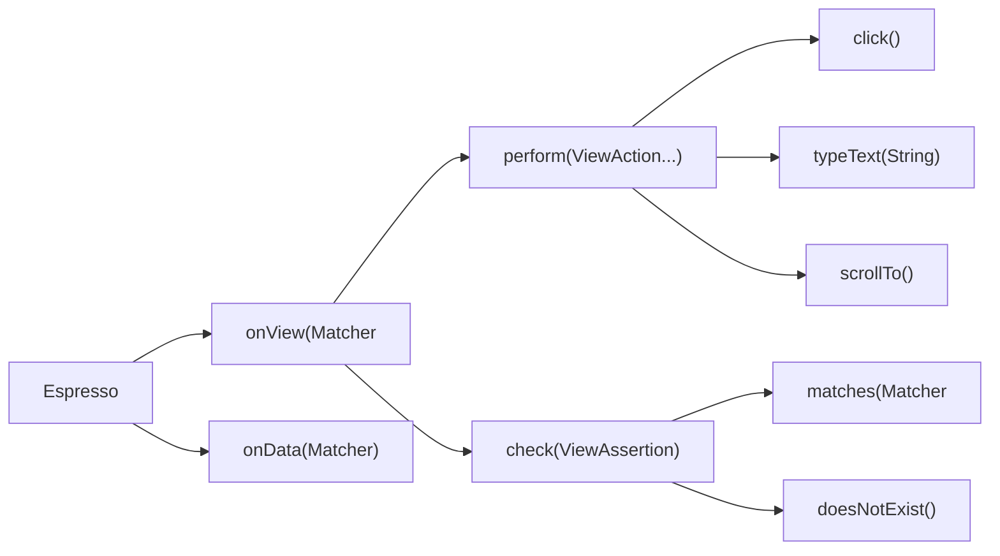
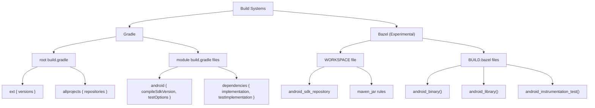

<!-- source: DeepWiki mcp.deepwiki.com · repo android/testing-samples · page 1 Overview · fetched 2026-10-23 -->

# Overview

Relevant source files

The following files were used as context for generating this wiki page:

- [CONTRIBUTING.md](CONTRIBUTING.md)
- [LICENSE](LICENSE)
- [README.md](README.md)
- [ui/espresso/MultiProcessSample/README.md](ui/espresso/MultiProcessSample/README.md)

The Android Testing Samples repository provides a comprehensive collection of code examples demonstrating various testing frameworks and techniques for Android applications. This document introduces the repository organization, available samples, and supported testing approaches.

## Purpose and Scope

This repository serves as a practical reference for Android developers implementing automated testing in their applications. It contains working sample projects that demonstrate different testing strategies, including:

- UI testing with Espresso and UI Automator
- Unit testing with JUnit4
- Integration testing with Android Test Rules
- Test runners configuration and usage
- Specialized testing scenarios (asynchronous operations, multi-process, WebViews)

For detailed information about specific build systems configurations used in these samples, see [Build Systems](#2).

## Repository Structure

The repository is organized hierarchically by testing category and framework:

```mermaid
graph TD
    root["android-testing-samples/"] --> ui["ui/"]
    root --> runner["runner/"]
    root --> integration["integration/"]
    root --> unit["unit/"]
    
    ui --> espresso["espresso/"]
    ui --> uiautomator["uiautomator/"]
    
    espresso --> BasicSample["BasicSample/"]
    espresso --> CustomMatcherSample["CustomMatcherSample/"]
    espresso --> DataAdapterSample["DataAdapterSample/"]
    espresso --> FragmentScenarioSample["FragmentScenarioSample/"]
    espresso --> IdlingResourceSample["IdlingResourceSample/"]
    espresso --> IntentsBasicSample["IntentsBasicSample/"]
    espresso --> IntentsAdvancedSample["IntentsAdvancedSample/"]
    espresso --> MultiWindowSample["MultiWindowSample/"]
    espresso --> RecyclerViewSample["RecyclerViewSample/"]
    espresso --> ScreenshotSample["ScreenshotSample/"]
    espresso --> WebBasicSample["WebBasicSample/"]
    espresso --> MultiProcessSample["MultiProcessSample/"]
    
    uiautomator --> UiaBasicSample["BasicSample/"]
    
    runner --> AndroidJUnitRunnerSample["AndroidJunitRunnerSample/"]
    runner --> OrchestratorSample["AndroidTestOrchestratorSample/"]
    runner --> OrchestratorCoverageSample["AndroidTestOrchestratorWithTestCoverageSample/"]
    
    integration --> ServiceTestRuleSample["ServiceTestRuleSample/"]
    
    unit --> UnitBasicSample["BasicSample/"]
```

Sources: [README.md:1-43]()

## Testing Framework Architecture

The repository demonstrates various AndroidX Test components and their relationships:

```mermaid
graph TD
    androidx["androidx.test.*"] --> runner["androidx.test.runner"]
    androidx --> rules["androidx.test.rules"]
    androidx --> espresso["androidx.test.espresso"]
    androidx --> uiautomator["androidx.test.uiautomator"]
    androidx --> core["androidx.test.core"]
    
    runner --> AndroidJUnitRunner["AndroidJUnitRunner"]
    runner --> TestOrchestrator["AndroidTestOrchestrator"]
    
    rules --> ActivityTestRule["ActivityTestRule"]
    rules --> ServiceTestRule["ServiceTestRule"]
    rules --> GrantPermissionRule["GrantPermissionRule"]
    
    espresso --> espresso_core["espresso-core"]
    espresso --> espresso_intents["espresso-intents"]
    espresso --> espresso_web["espresso-web"]
    espresso --> espresso_idling["espresso-idling-resource"]
    espresso --> espresso_contrib["espresso-contrib"]
    
    espresso_core --> Espresso["Espresso class"]
    espresso_core --> ViewMatchers["ViewMatchers class"]
    espresso_core --> ViewActions["ViewActions class"]
    espresso_core --> ViewAssertions["ViewAssertions class"]
    
    espresso_intents --> Intents["Intents class"]
    espresso_intents --> IntentMatchers["IntentMatchers class"]
    
    uiautomator --> UiDevice["UiDevice class"]
    uiautomator --> UiObject["UiObject class"]
    uiautomator --> UiObject2["UiObject2 class"]
    uiautomator --> UiSelector["UiSelector class"]
    
    core --> FragmentScenario["FragmentScenario class"]
    core --> ActivityScenario["ActivityScenario class"]
    core --> ScreenCapture["ScreenCapture class"]
```

Sources: [README.md:6-43]()

## Sample Categories

The repository includes samples for the following testing categories:

| Category | Directory | Key Classes/Frameworks |
|----------|-----------|------------------------|
| UI Testing | `ui/espresso/` | `Espresso`, `ViewMatchers`, `ViewActions`, `ViewAssertions` |
| UI Automation | `ui/uiautomator/` | `UiDevice`, `UiObject`, `UiSelector` |
| Test Runners | `runner/` | `AndroidJUnitRunner`, `AndroidTestOrchestrator` |
| Integration Testing | `integration/` | `ServiceTestRule` |
| Unit Testing | `unit/` | JUnit4 (`@Test`, `@Before`, `@After`) |

Sources: [README.md:4-49]()

## UI Testing Samples

### Espresso Framework Usage

Espresso provides a fluent API for UI testing as demonstrated in this interaction flow:

Sources: [README.md:6-32]()

### Espresso Sample Modules

| Sample | Path | Key Features |
|--------|------|-------------|
| Basic Sample | `ui/espresso/BasicSample` | Simple view interactions with `onView()`, `perform()`, and `check()` |
| CustomMatcher Sample | `ui/espresso/CustomMatcherSample` | Extending Espresso with custom view matchers |
| DataAdapter Sample | `ui/espresso/DataAdapterSample` | AdapterView testing using `onData()` |
| IdlingResource Sample | `ui/espresso/IdlingResourceSample` | Handling asynchronous operations with `IdlingResource` interface |
| Intents Samples | `ui/espresso/IntentsBasicSample` | Intent verification with `intended()` and stubbing with `intending()` |
| RecyclerView Sample | `ui/espresso/RecyclerViewSample` | RecyclerView testing with `RecyclerViewActions` |
| WebView Sample | `ui/espresso/WebBasicSample` | WebView testing using `WebView` matchers and actions |
| MultiProcess Sample | `ui/espresso/MultiProcessSample` | Testing components across app processes |

Sources: [README.md:6-32](), [ui/espresso/MultiProcessSample/README.md:1-22]()

### UI Automator

UI Automator enables system-wide UI testing across multiple apps:

| Sample | Path | Key Features |
|--------|------|-------------|
| Basic Sample | `ui/uiautomator/BasicSample` | Cross-application UI testing with `UiDevice` and `UiSelector` |

Sources: [README.md:33-35]()

## Test Runner Samples

The repository provides examples for configuring and using test runners:

| Sample | Path | Key Features |
|--------|------|-------------|
| AndroidJUnitRunner Sample | `runner/AndroidJunitRunnerSample` | Test annotations, parameterized tests, test suite creation |
| Test Orchestrator Sample | `runner/AndroidTestOrchestratorSample` | Test isolation with Android Test Orchestrator |
| Test Coverage Sample | `runner/AndroidTestOrchestratorWithTestCoverageSample` | Code coverage with Test Orchestrator |

Sources: [README.md:37-39]()

## Integration and Unit Testing

The repository includes samples for service testing and basic unit testing:

| Sample | Path | Key Features |
|--------|------|-------------|
| ServiceTestRule Sample | `integration/ServiceTestRuleSample` | Testing Android services with `ServiceTestRule` |
| Basic Unit Sample | `unit/BasicSample` | Local unit tests with JUnit4 |

Sources: [README.md:43-49]()

## Build Systems Support

The repository supports two build systems:

Sources: [README.md:51-129]()

## Getting Started

### Prerequisites

- Android SDK v28+
- Android Build Tools v28.03+
- For Bazel: Bazel 0.12.0+

### Running Tests

Execute tests using:

- **Gradle**: 
  - `./gradlew connectedAndroidTest` for instrumentation tests
  - `./gradlew test` for unit tests

- **Bazel (Experimental)**:
  - `bazel test //... --config=headless` for headless testing
  - `bazel test //... --config=gui` for GUI testing
  - `bazel test //... --config=local_device` for testing on a connected device

Sources: [README.md:51-117]()

---

