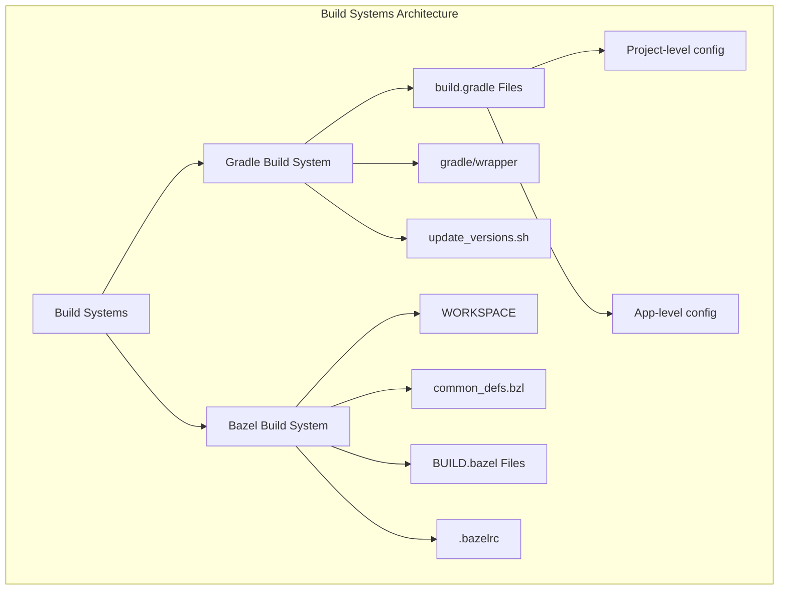
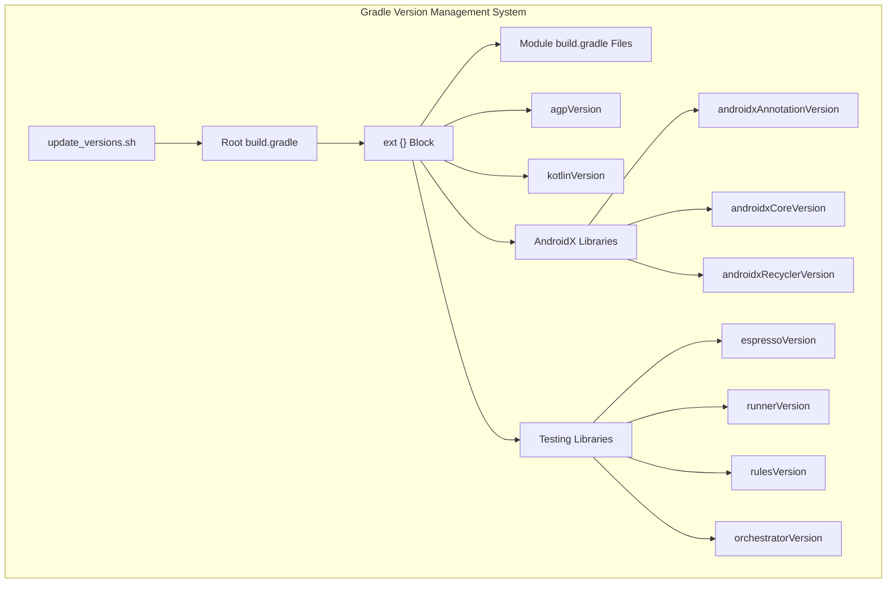
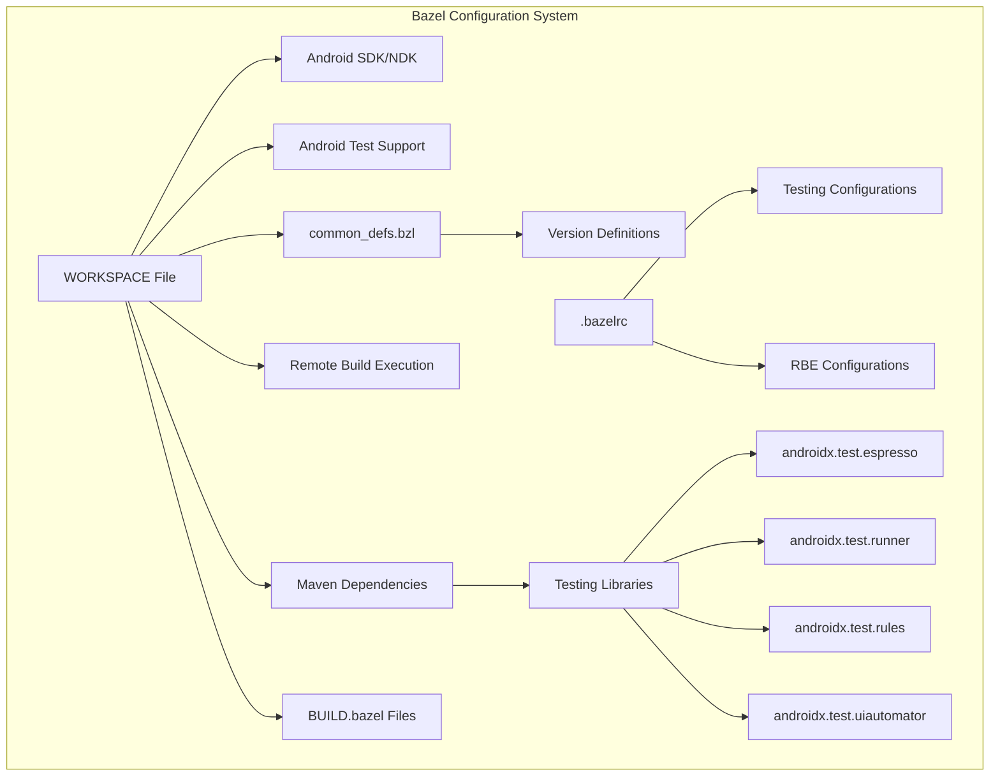
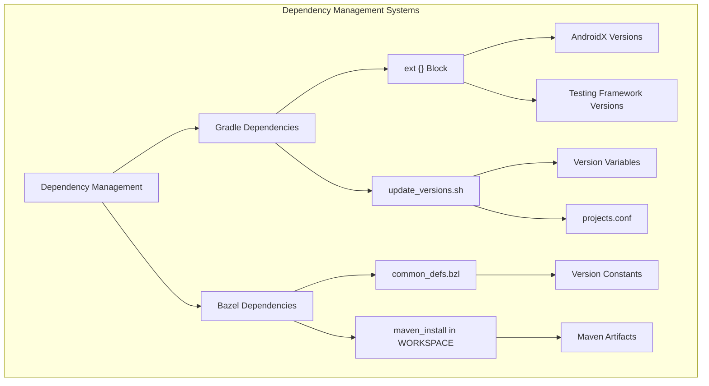

<!-- source: DeepWiki mcp.deepwiki.com · repo android/testing-samples · page 2 Build Systems · fetched 2026-10-23 -->

# Build Systems

<details>
<summary>Relevant source files</summary>

The following files were used as context for generating this wiki page:

- [.bazelrc](.bazelrc)
- [WORKSPACE](WORKSPACE)
- [bazelci/buildkite-pipeline.yml](bazelci/buildkite-pipeline.yml)
- [common_defs.bzl](common_defs.bzl)
- [integration/ServiceTestRuleSample/build.gradle](integration/ServiceTestRuleSample/build.gradle)
- [runner/AndroidJunitRunnerSample/build.gradle](runner/AndroidJunitRunnerSample/build.gradle)
- [runner/AndroidTestOrchestratorSample/build.gradle](runner/AndroidTestOrchestratorSample/build.gradle)
- [ui/espresso/BasicSample/build.gradle](ui/espresso/BasicSample/build.gradle)
- [ui/espresso/CustomMatcherSample/build.gradle](ui/espresso/CustomMatcherSample/build.gradle)
- [ui/espresso/DataAdapterSample/build.gradle](ui/espresso/DataAdapterSample/build.gradle)
- [ui/espresso/IdlingResourceSample/build.gradle](ui/espresso/IdlingResourceSample/build.gradle)
- [ui/espresso/IntentsAdvancedSample/build.gradle](ui/espresso/IntentsAdvancedSample/build.gradle)
- [ui/espresso/IntentsBasicSample/build.gradle](ui/espresso/IntentsBasicSample/build.gradle)
- [ui/espresso/MultiWindowSample/build.gradle](ui/espresso/MultiWindowSample/build.gradle)
- [ui/espresso/RecyclerViewSample/build.gradle](ui/espresso/RecyclerViewSample/build.gradle)
- [ui/espresso/WebBasicSample/build.gradle](ui/espresso/WebBasicSample/build.gradle)
- [ui/uiautomator/BasicSample/build.gradle](ui/uiautomator/BasicSample/build.gradle)
- [update_versions.sh](update_versions.sh)

</details>


This document outlines the build systems used in the Android Testing Samples repository, explaining how they're configured for Android testing. It covers both Gradle and Bazel build systems, their configuration files, dependency management, and test setups. For detailed information about specific build configuration components, see [Gradle Configuration](#2.1) and [Bazel Configuration](#2.2).

## Overview of Build Systems

The Android Testing Samples repository supports two build systems:

1. **Gradle** - The primary build system used by default in Android development
2. **Bazel** - An alternative build system that provides hermetic builds and supports remote execution

Both build systems are configured to support Android instrumentation testing and unit testing across the sample projects.



Sources: [ui/espresso/BasicSample/build.gradle](), [WORKSPACE](), [common_defs.bzl](), [.bazelrc]()

## Gradle Build System

Gradle is the primary build system used across all sample projects. Each sample has its own build configuration that defines dependencies, SDK versions, and test setups.

### Project Structure

Each sample project follows a similar Gradle structure:
- Root `build.gradle` - Contains common configurations and version definitions
- Module-level `build.gradle` - Contains app-specific configurations
- `gradle/wrapper` - Contains the Gradle wrapper to ensure consistent builds

### Version Management

Library versions are managed through the `ext` block in the root `build.gradle` file. Common testing library versions are defined here to ensure consistency across modules.



Sources: [ui/espresso/BasicSample/build.gradle:28-37](), [update_versions.sh:11-35]()

### Common Version Definitions

The repository maintains consistent library versions across all samples. A typical version definition block looks like:

```
ext {
    androidxAnnotationVersion = "1.5.0"
    robolectricVersion = "4.13"
    guavaVersion = "31.1-android"
    extTruthVersion = "1.6.0"
    coreVersion = "1.6.1"
    extJUnitVersion = "1.2.1"
    runnerVersion = "1.6.1"
    espressoVersion = "3.6.1"
}
```

Sources: [ui/espresso/BasicSample/build.gradle:28-37]()

### Version Update Script

The repository includes a script (`update_versions.sh`) that automates updating library versions across all sample projects. This script ensures that all samples use consistent library versions.

The script:
1. Defines the current versions of all dependencies
2. Iterates through each project defined in `projects.conf`
3. Updates version numbers in each project's build.gradle file

Sources: [update_versions.sh:1-78]()

## Bazel Build System

The repository also supports building and testing with Bazel, which provides hermetic builds and remote execution capabilities.

### Workspace Configuration

The `WORKSPACE` file defines the Bazel workspace and external dependencies:

- Android SDK and NDK repositories
- Android Test Support tools
- Maven artifacts for testing libraries
- Remote Build Execution (RBE) configuration



Sources: [WORKSPACE:1-116](), [common_defs.bzl:1-16](), [.bazelrc:1-75]()

### Common Definitions

The `common_defs.bzl` file contains shared constants for Bazel builds, similar to the ext block in Gradle:

```
androidxLibVersion = "1.0.0"
coreVersion = "1.2.0-beta01"
extJUnitVersion = "1.1.1-beta01"
extTruthVersion = "1.2.0-beta01"
runnerVersion = "1.2.0-beta01"
rulesVersion = "1.2.0-beta01"
espressoVersion = "3.2.0-beta01"
uiAutomatorVersion = "2.2.0"
```

Sources: [common_defs.bzl:6-15]()

### Testing Configuration

Bazel testing is configured through the `.bazelrc` file, which provides several testing configurations:

- Headless instrumentation tests
- Graphical instrumentation tests
- Testing with local emulators or devices
- Remote Build Execution (RBE) configuration

Sources: [.bazelrc:4-74]()

### Remote Build Execution

The repository supports remote execution of builds and tests through Bazel's Remote Build Execution (RBE) feature. This is configured in both the `WORKSPACE` file and `.bazelrc`.

The RBE configuration:
- Sets up the remote instance
- Configures authentication
- Defines execution strategies
- Sets up platform configurations for Android

Sources: [WORKSPACE:102-115](), [.bazelrc:25-74]()

## Comparison of Gradle vs Bazel

| Feature | Gradle | Bazel |
|---------|--------|-------|
| **Primary Use** | Default Android build system | Alternative build system |
| **Build Speed** | Fast for incremental builds | Fast for clean builds, hermetic builds |
| **Configuration** | build.gradle files | WORKSPACE, BUILD.bazel files |
| **Dependency Management** | Managed in ext block | Managed in WORKSPACE and common_defs.bzl |
| **Version Updates** | Via update_versions.sh | Manual updates in common_defs.bzl |
| **Remote Execution** | Limited support | Native support through RBE |
| **CI Integration** | Various CI systems | BazelCI configured |

Sources: [ui/espresso/BasicSample/build.gradle](), [WORKSPACE](), [bazelci/buildkite-pipeline.yml]()

## Dependency Management

The repository employs a consistent strategy for managing dependencies across both build systems. For more details on dependency management, see [Dependency Management](#2.3).



Sources: [ui/espresso/BasicSample/build.gradle:28-37](), [update_versions.sh:11-35](), [WORKSPACE:56-101](), [common_defs.bzl:6-15]()

## Gradle Wrapper

The Gradle Wrapper ensures consistent builds across different development environments. For detailed information about the Gradle Wrapper configuration, see [Gradle Wrapper](#2.4).

Sources: [ui/espresso/BasicSample/build.gradle:3-18]()

---

