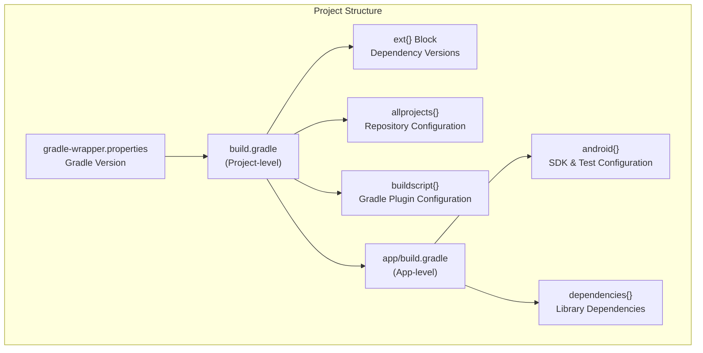
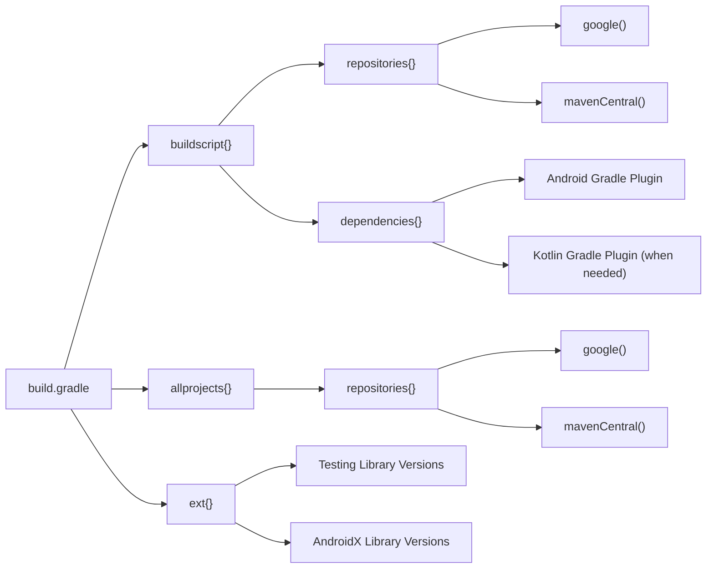
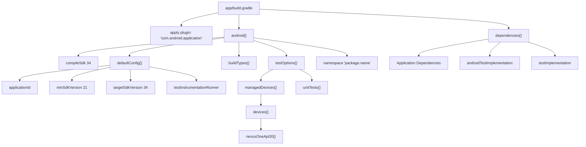
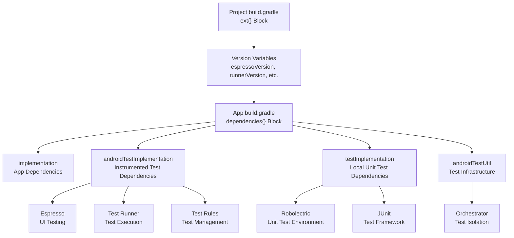
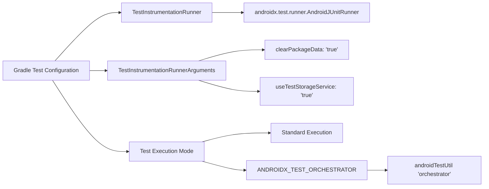

<!-- source: DeepWiki mcp.deepwiki.com · repo android/testing-samples · page 2.1 Gradle Configuration · fetched 2026-10-23 -->

# Gradle Configuration

<details>
<summary>Relevant source files</summary>

The following files were used as context for generating this wiki page:

- [integration/ServiceTestRuleSample/app/build.gradle](integration/ServiceTestRuleSample/app/build.gradle)
- [integration/ServiceTestRuleSample/build.gradle](integration/ServiceTestRuleSample/build.gradle)
- [runner/AndroidJunitRunnerSample/app/build.gradle](runner/AndroidJunitRunnerSample/app/build.gradle)
- [runner/AndroidJunitRunnerSample/build.gradle](runner/AndroidJunitRunnerSample/build.gradle)
- [runner/AndroidTestOrchestratorSample/app/build.gradle](runner/AndroidTestOrchestratorSample/app/build.gradle)
- [runner/AndroidTestOrchestratorWithTestCoverageSample/app/build.gradle](runner/AndroidTestOrchestratorWithTestCoverageSample/app/build.gradle)
- [runner/AndroidTestOrchestratorWithTestCoverageSample/build.gradle](runner/AndroidTestOrchestratorWithTestCoverageSample/build.gradle)
- [ui/espresso/BasicSample/app/build.gradle](ui/espresso/BasicSample/app/build.gradle)
- [ui/espresso/BasicSample/build.gradle](ui/espresso/BasicSample/build.gradle)
- [ui/espresso/CustomMatcherSample/app/build.gradle](ui/espresso/CustomMatcherSample/app/build.gradle)
- [ui/espresso/CustomMatcherSample/build.gradle](ui/espresso/CustomMatcherSample/build.gradle)
- [ui/espresso/DataAdapterSample/app/build.gradle](ui/espresso/DataAdapterSample/app/build.gradle)
- [ui/espresso/DataAdapterSample/build.gradle](ui/espresso/DataAdapterSample/build.gradle)
- [ui/espresso/EspressoDeviceSample/app/build.gradle](ui/espresso/EspressoDeviceSample/app/build.gradle)
- [ui/espresso/EspressoDeviceSample/build.gradle](ui/espresso/EspressoDeviceSample/build.gradle)
- [ui/espresso/EspressoDeviceSample/gradle/wrapper/gradle-wrapper.properties](ui/espresso/EspressoDeviceSample/gradle/wrapper/gradle-wrapper.properties)
- [ui/espresso/FragmentScenarioSample/app/build.gradle](ui/espresso/FragmentScenarioSample/app/build.gradle)
- [ui/espresso/IdlingResourceSample/app/build.gradle](ui/espresso/IdlingResourceSample/app/build.gradle)
- [ui/espresso/IdlingResourceSample/build.gradle](ui/espresso/IdlingResourceSample/build.gradle)
- [ui/espresso/IntentsAdvancedSample/app/build.gradle](ui/espresso/IntentsAdvancedSample/app/build.gradle)
- [ui/espresso/IntentsAdvancedSample/build.gradle](ui/espresso/IntentsAdvancedSample/build.gradle)
- [ui/espresso/IntentsBasicSample/app/build.gradle](ui/espresso/IntentsBasicSample/app/build.gradle)
- [ui/espresso/IntentsBasicSample/build.gradle](ui/espresso/IntentsBasicSample/build.gradle)
- [ui/espresso/MultiProcessSample/app/build.gradle](ui/espresso/MultiProcessSample/app/build.gradle)
- [ui/espresso/MultiWindowSample/app/build.gradle](ui/espresso/MultiWindowSample/app/build.gradle)
- [ui/espresso/MultiWindowSample/build.gradle](ui/espresso/MultiWindowSample/build.gradle)
- [ui/espresso/RecyclerViewSample/app/build.gradle](ui/espresso/RecyclerViewSample/app/build.gradle)
- [ui/espresso/RecyclerViewSample/build.gradle](ui/espresso/RecyclerViewSample/build.gradle)
- [ui/espresso/ScreenshotSample/gradle/wrapper/gradle-wrapper.properties](ui/espresso/ScreenshotSample/gradle/wrapper/gradle-wrapper.properties)
- [ui/espresso/WebBasicSample/app/build.gradle](ui/espresso/WebBasicSample/app/build.gradle)
- [ui/espresso/WebBasicSample/build.gradle](ui/espresso/WebBasicSample/build.gradle)
- [ui/uiautomator/BasicSample/app/build.gradle](ui/uiautomator/BasicSample/app/build.gradle)
- [ui/uiautomator/BasicSample/build.gradle](ui/uiautomator/BasicSample/build.gradle)
- [unit/BasicSample/app/build.gradle](unit/BasicSample/app/build.gradle)
- [unit/BasicUnitAndroidTest/app/build.gradle](unit/BasicUnitAndroidTest/app/build.gradle)

</details>


## Purpose and Scope

This document describes the Gradle build configuration used across the Android Testing Samples repository. It explains how the build system is structured, how dependencies are managed, and how tests are configured for execution. For information about Bazel configuration, see [Bazel Configuration](#2.2). For information about dependency management across build systems, see [Dependency Management](#2.3).

## Gradle Configuration Structure

The Android Testing Samples repository follows a standard Android multi-module project structure with a consistent Gradle configuration pattern across sample projects. Each sample contains both project-level and module-level Gradle configuration files.



Sources: [ui/espresso/BasicSample/build.gradle:1-38](), [ui/espresso/BasicSample/app/build.gradle:1-71](), [ui/espresso/ScreenshotSample/gradle/wrapper/gradle-wrapper.properties:1-7]()

## Project-Level Gradle Configuration 

The top-level `build.gradle` file defines common configurations applied to all modules in a sample. This includes:

1. Plugin versions
2. Repository configurations
3. Common dependency versions

### Common Project-Level Structure

The project-level `build.gradle` follows a consistent structure across samples:



Sources: [ui/espresso/BasicSample/build.gradle:3-26](), [ui/espresso/DataAdapterSample/build.gradle:3-25]()

### Key Project-Level Configurations

#### Android Gradle Plugin Configuration

The Android Gradle Plugin (AGP) version is defined as an extension property and used in the buildscript dependencies:

```
buildscript {
    ext.agpVersion = "8.5.0"
    ...
    dependencies {
        classpath "com.android.tools.build:gradle:$agpVersion"
        ...
    }
}
```

Sources: [ui/espresso/BasicSample/build.gradle:3-17](), [ui/espresso/DataAdapterSample/build.gradle:3-16]()

#### Repository Configuration

Repositories are defined in both the `buildscript` and `allprojects` blocks:

```
buildscript {
    repositories {
        // Insert local test repo here
        google()
        mavenCentral()
    }
}

allprojects {
    repositories {
        // Insert local test repo here
        google()
        mavenCentral()
    }
}
```

Sources: [ui/espresso/BasicSample/build.gradle:6-25](), [ui/espresso/DataAdapterSample/build.gradle:5-24]()

#### Dependency Version Declaration

Testing dependencies are defined in the `ext` block, making them accessible to all modules:

```
ext {
    androidxAnnotationVersion = "1.5.0"
    robolectricVersion = "4.13"
    guavaVersion = "31.1-android"
    extTruthVersion = "1.6.0"
    coreVersion = "1.6.1"
    extJUnitVersion = "1.2.1"
    runnerVersion = "1.6.1"
    espressoVersion = "3.6.1"
}
```

Sources: [ui/espresso/BasicSample/build.gradle:28-37](), [ui/espresso/DataAdapterSample/build.gradle:26-34]()

## App-Level Gradle Configuration

The app-level `build.gradle` file contains module-specific configurations including:

1. SDK configurations
2. Application properties
3. Test instrumentation configuration
4. Dependency declarations

### Common App-Level Structure



Sources: [ui/espresso/BasicSample/app/build.gradle:1-41](), [runner/AndroidJunitRunnerSample/app/build.gradle:1-42]()

### Key App-Level Configurations

#### Android SDK Configuration

SDK versions are defined in the Android block:

```
android {
    compileSdk 34
    defaultConfig {
        minSdkVersion 21
        targetSdkVersion 34
        ...
    }
}
```

Sources: [ui/espresso/BasicSample/app/build.gradle:5-9](), [runner/AndroidJunitRunnerSample/app/build.gradle:4-9]()

#### Test Instrumentation Configuration

The test instrumentation runner is specified in the defaultConfig block:

```
defaultConfig {
    ...
    testInstrumentationRunner "androidx.test.runner.AndroidJUnitRunner"
}
```

Some samples include additional test instrumentation arguments:

```
defaultConfig {
    ...
    testInstrumentationRunner "androidx.test.runner.AndroidJUnitRunner"
    testInstrumentationRunnerArguments clearPackageData: "true"
}
```

Sources: [ui/espresso/BasicSample/app/build.gradle:14-15](), [runner/AndroidTestOrchestratorSample/app/build.gradle:12-13]()

#### Managed Devices Configuration

Virtual devices for testing are configured in the testOptions block:

```
testOptions {
    managedDevices {
        devices {
            nexusOneApi30(com.android.build.api.dsl.ManagedVirtualDevice) {
                device = "Nexus One"
                apiLevel = 30
                systemImageSource = "aosp-atd"
            }
        }
    }
}
```

Sources: [ui/espresso/BasicSample/app/build.gradle:24-33](), [runner/AndroidJunitRunnerSample/app/build.gradle:23-35]()

#### Test Orchestrator Configuration

For samples using the Android Test Orchestrator, additional configuration is required:

```
testOptions {
    execution "ANDROIDX_TEST_ORCHESTRATOR"
}
```

And additional dependencies:

```
androidTestUtil "androidx.test:orchestrator:" + rootProject.orchestratorVersion
```

Sources: [runner/AndroidTestOrchestratorSample/app/build.gradle:24-25](), [runner/AndroidTestOrchestratorSample/app/build.gradle:54]()

## Dependency Management

Dependencies in the Android Testing Samples are managed using version variables defined in the top-level `build.gradle` file. This approach ensures consistent dependency versions across all modules.

### Dependency Declaration Flow



Sources: [ui/espresso/BasicSample/build.gradle:28-37](), [ui/espresso/BasicSample/app/build.gradle:50-70]()

### Common Testing Dependencies

The samples include several common testing dependencies:

| Dependency Type | Purpose | Example Declaration |
|-----------------|---------|---------------------|
| Unit Testing | Local tests running on JVM | `testImplementation "androidx.test:core:" + rootProject.coreVersion` |
| Instrumented Testing | Android device tests | `androidTestImplementation "androidx.test.espresso:espresso-core:" + rootProject.espressoVersion` |
| Test Infrastructure | Test setup | `androidTestUtil "androidx.test:orchestrator:" + rootProject.orchestratorVersion` |

Sources: [ui/espresso/BasicSample/app/build.gradle:56-69](), [runner/AndroidTestOrchestratorSample/app/build.gradle:48-54]()

### Version Management

Dependency versions are centrally defined in the top-level build.gradle file and referenced in module-level build.gradle files:

```
// In project-level build.gradle
ext {
    espressoVersion = "3.6.1"
    runnerVersion = "1.6.1"
}

// In app-level build.gradle
dependencies {
    androidTestImplementation "androidx.test.espresso:espresso-core:" + rootProject.espressoVersion
    androidTestImplementation "androidx.test:runner:" + rootProject.runnerVersion
}
```

Sources: [ui/espresso/BasicSample/build.gradle:28-37](), [ui/espresso/BasicSample/app/build.gradle:61]()

## Test Configuration

The Android Testing Samples repository includes various test configurations for different testing scenarios.

### Instrumented Test Configuration Flow



Sources: [runner/AndroidJunitRunnerSample/app/build.gradle:13-14](), [runner/AndroidTestOrchestratorSample/app/build.gradle:12-14](), [runner/AndroidTestOrchestratorSample/app/build.gradle:24-25]()

### Local Unit Test Configuration

Local unit tests are configured in the testOptions block:

```
testOptions {
    unitTests {
        includeAndroidResources = true
    }
}
```

This enables access to Android resources in local unit tests, particularly useful with Robolectric.

Sources: [ui/espresso/BasicSample/app/build.gradle:19-21](), [ui/espresso/DataAdapterSample/app/build.gradle:17-19]()

### Test Coverage Configuration

For projects that require test coverage reporting, additional configuration is needed:

```
buildTypes {
    debug {
        testCoverageEnabled true
    }
}
```

Sources: [runner/AndroidTestOrchestratorWithTestCoverageSample/app/build.gradle:17-19]()

### Source Set Configuration

Some samples share test code between instrumented and local unit tests:

```
sourceSets {
    test {
        java.srcDir "src/sharedTest/java"
    }
    androidTest {
        java.srcDir "src/sharedTest/java"
    }
}
```

Sources: [ui/espresso/IntentsBasicSample/app/build.gradle:34-41](), [ui/espresso/DataAdapterSample/app/build.gradle:34-41]()

## Gradle Tasks for Testing

The Android Testing Samples include several Gradle tasks for executing tests.

### Common Test Tasks

| Task | Description | Example Usage |
|------|-------------|--------------|
| `testDebugUnitTest` | Runs local unit tests on the debug variant | `./gradlew testDebugUnitTest` |
| `connectedDebugAndroidTest` | Runs instrumented tests on a connected device | `./gradlew connectedDebugAndroidTest` |
| `nexusOneApi30DebugAndroidTest` | Runs instrumented tests on a managed device | `./gradlew nexusOneApi30DebugAndroidTest` |

Sources: [ui/espresso/BasicSample/app/build.gradle:26](), [runner/AndroidJunitRunnerSample/app/build.gradle:27]()

## Gradle Wrapper Configuration

The Gradle Wrapper ensures consistent builds across different environments by specifying a fixed Gradle version. The configuration is stored in `gradle-wrapper.properties`:

```
distributionBase=GRADLE_USER_HOME
distributionPath=wrapper/dists
distributionUrl=https\://services.gradle.org/distributions/gradle-8.7-bin.zip
zipStoreBase=GRADLE_USER_HOME
zipStorePath=wrapper/dists
```

Sources: [ui/espresso/ScreenshotSample/gradle/wrapper/gradle-wrapper.properties:1-7](), [ui/espresso/EspressoDeviceSample/gradle/wrapper/gradle-wrapper.properties:1-6]()

---

