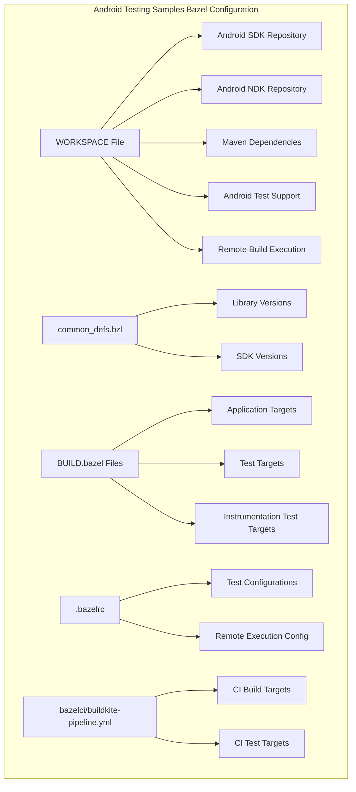
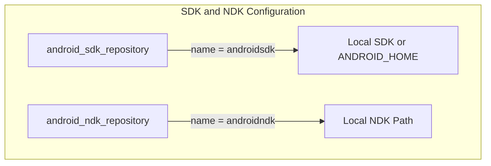
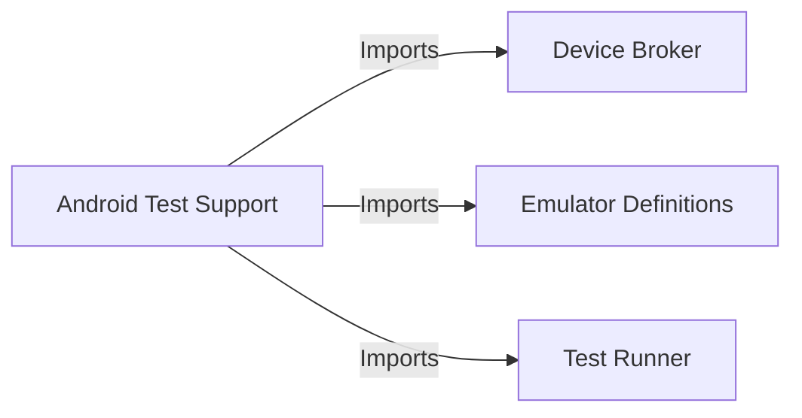
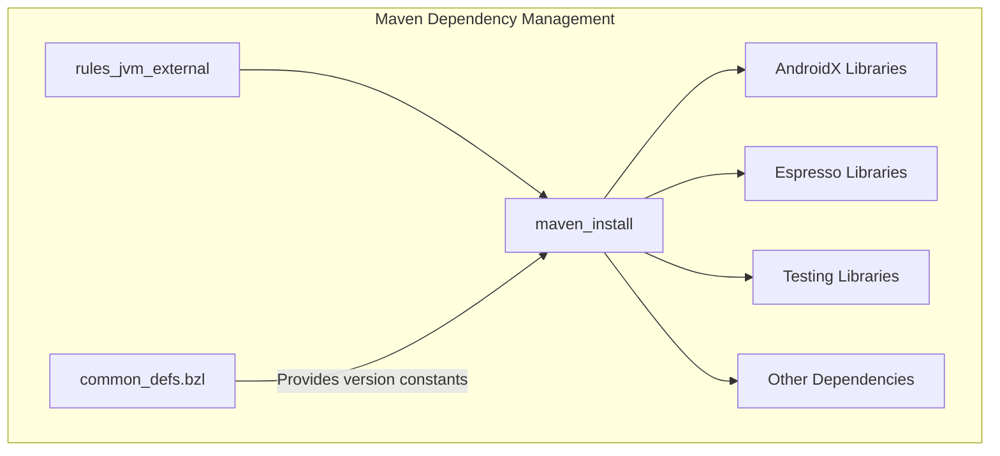
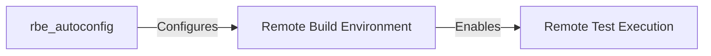
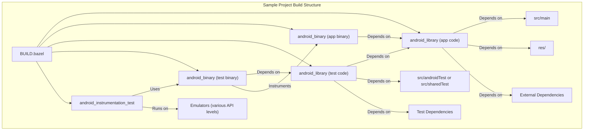
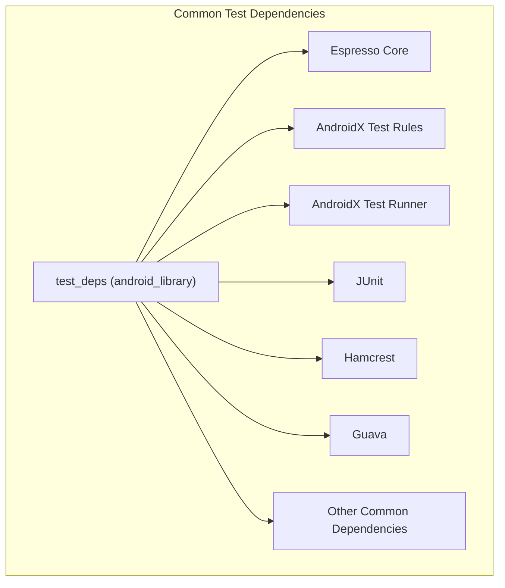
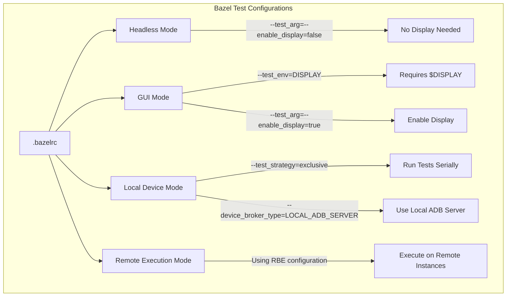

<!-- source: DeepWiki mcp.deepwiki.com · repo android/testing-samples · page 2.2 Bazel Configuration · fetched 2026-10-23 -->

# Bazel Configuration

<details>
<summary>Relevant source files</summary>

The following files were used as context for generating this wiki page:

- [.bazelrc](.bazelrc)
- [BUILD.bazel](BUILD.bazel)
- [WORKSPACE](WORKSPACE)
- [bazelci/buildkite-pipeline.yml](bazelci/buildkite-pipeline.yml)
- [common_defs.bzl](common_defs.bzl)
- [ui/espresso/BasicSample/BUILD.bazel](ui/espresso/BasicSample/BUILD.bazel)
- [ui/espresso/CustomMatcherSample/BUILD.bazel](ui/espresso/CustomMatcherSample/BUILD.bazel)
- [ui/espresso/DataAdapterSample/BUILD.bazel](ui/espresso/DataAdapterSample/BUILD.bazel)
- [ui/espresso/IdlingResourceSample/BUILD.bazel](ui/espresso/IdlingResourceSample/BUILD.bazel)
- [ui/espresso/IntentsAdvancedSample/BUILD.bazel](ui/espresso/IntentsAdvancedSample/BUILD.bazel)
- [ui/espresso/IntentsBasicSample/BUILD.bazel](ui/espresso/IntentsBasicSample/BUILD.bazel)
- [ui/espresso/MultiWindowSample/BUILD.bazel](ui/espresso/MultiWindowSample/BUILD.bazel)
- [ui/espresso/RecyclerViewSample/BUILD.bazel](ui/espresso/RecyclerViewSample/BUILD.bazel)
- [ui/uiautomator/BasicSample/BUILD.bazel](ui/uiautomator/BasicSample/BUILD.bazel)

</details>


This page explains how the Android Testing Samples repository is configured to use Bazel as a build system for compiling and testing Android applications. It covers the workspace setup, dependency management, build definitions, and test configurations. For information about Gradle configuration, see [Gradle Configuration](#2.1).

## 1. Overview of Bazel in Android Testing Samples

Bazel is a build system developed by Google that focuses on fast, reproducible builds with explicit dependencies. In the Android Testing Samples repository, Bazel provides an alternative build system to Gradle, offering:

- Consistent builds across different environments
- Efficient parallel execution and caching
- Precise control over test execution
- Remote Build Execution (RBE) capabilities

The repository uses Bazel to demonstrate how to configure and run Android instrumentation tests across different API levels and test environments.



Sources: [WORKSPACE](), [common_defs.bzl](), [BUILD.bazel](), [.bazelrc](), [bazelci/buildkite-pipeline.yml]()

## 2. Workspace Configuration

The `WORKSPACE` file serves as the primary configuration file for Bazel, defining external dependencies and tools needed for building and testing Android applications.

### 2.1. Android SDK and NDK Setup

Bazel needs access to the Android SDK and NDK to build Android applications. These are configured with repository rules at the top of the `WORKSPACE` file:



Sources: [WORKSPACE:4-8]()

### 2.2. Android Test Support

Android Test Support provides tools for running Android instrumentation tests, including emulator definitions and test runners:



Sources: [WORKSPACE:10-27]()

### 2.3. Maven Dependencies

The repository uses `rules_jvm_external` to manage Maven dependencies, providing a familiar Maven-like dependency system within Bazel:



Sources: [WORKSPACE:29-101](), [common_defs.bzl:1-15]()

The key dependencies loaded include:
- AndroidX libraries (Annotation, Core, RecyclerView)
- Espresso testing framework components
- JUnit and related extensions
- Support libraries for testing

Each dependency is specified with a version that is defined in the `common_defs.bzl` file, allowing for centralized version management.

### 2.4. Remote Build Execution

The `WORKSPACE` file also configures Remote Build Execution (RBE), which enables tests to run on remote instances:



Sources: [WORKSPACE:102-115](), [.bazelrc:25-74]()

## 3. Common Definitions and Constants

The `common_defs.bzl` file defines constants used throughout the Bazel configuration, ensuring consistency across the repository.

| Constant | Purpose | Example Value |
|----------|---------|---------------|
| androidxLibVersion | Version for AndroidX libraries | 1.0.0 |
| coreVersion | Version for AndroidX test core | 1.2.0-beta01 |
| espressoVersion | Version for Espresso libraries | 3.2.0-beta01 |
| runnerVersion | Version for test runner | 1.2.0-beta01 |
| minSdkVersion | Minimum supported Android SDK | 14 |
| targetSdkVersion | Target Android SDK version | 28 |

Sources: [common_defs.bzl:1-15]()

## 4. Project Structure and Build Files

Each sample project in the repository contains a `BUILD.bazel` file that defines how the application and its tests are built.

### 4.1. Basic Build Target Structure



Sources: [ui/espresso/BasicSample/BUILD.bazel:1-61](), [ui/uiautomator/BasicSample/BUILD.bazel:1-52]()

### 4.2. Application Build Configuration

The application code is defined as an `android_library` target, which includes the source code, resources, and manifest:

```
android_library(
    name = "SampleLib",
    srcs = glob(["app/src/main/**/*.java"]),
    custom_package = "com.example.android.testing...",
    manifest = "app/src/main/AndroidManifest.xml",
    resource_files = glob(["app/src/main/res/**/*"]),
    deps = [
        # Dependencies
    ],
)
```

This library is then used to create an `android_binary` target, which is the actual application:

```
android_binary(
    name = "Sample",
    custom_package = "com.example.android.testing...",
    manifest = "app/src/main/AppManifest.xml",
    manifest_values = {
        "minSdkVersion": minSdkVersion,
        "targetSdkVersion": targetSdkVersion,
    },
    deps = [":SampleLib"],
)
```

Sources: [ui/espresso/BasicSample/BUILD.bazel:6-26](), [ui/espresso/IdlingResourceSample/BUILD.bazel:6-28]()

### 4.3. Test Build Configuration

Tests are also defined as an `android_library` and `android_binary`, but with additional configuration:

```
android_library(
    name = "SampleTestLib",
    srcs = glob(["app/src/androidTest/**/*.java"]),
    custom_package = "com.example.android.testing...test",
    deps = [
        ":SampleLib",
        "//:test_deps",
        # Other test-specific dependencies
    ],
)

android_binary(
    name = "SampleTest",
    custom_package = "com.example.android.testing...test",
    instruments = ":Sample",
    manifest = "app/src/androidTest/AndroidManifest.xml",
    manifest_values = {
        "minSdkVersion": minSdkVersion,
        "targetSdkVersion": targetSdkVersion,
    },
    deps = [":SampleTestLib"],
)
```

Sources: [ui/espresso/BasicSample/BUILD.bazel:28-48](), [ui/espresso/IntentsBasicSample/BUILD.bazel:30-56]()

### 4.4. Instrumentation Test Configuration

Instrumentation tests are defined for multiple API levels using a list comprehension:

```
API_LEVELS = [
    "19_x86",
    "21_x86",
    "22_x86",
    "23_x86",
]

[android_instrumentation_test(
    name = "SampleInstrumentationTest_%s" % API_LEVEL,
    target_device = "@android_test_support//tools/android/emulated_devices/generic_phone:android_%s_qemu2" % API_LEVEL,
    test_app = ":SampleTest",
) for API_LEVEL in API_LEVELS]
```

This creates separate test targets for each API level, allowing tests to be run on different Android versions.

Sources: [ui/espresso/BasicSample/BUILD.bazel:50-61](), [ui/uiautomator/BasicSample/BUILD.bazel:41-52]()

## 5. Common Test Dependencies

The root `BUILD.bazel` file defines a common set of test dependencies used across all samples:



Sources: [BUILD.bazel:6-23]()

## 6. Runtime Configuration

The `.bazelrc` file provides runtime configuration options for Bazel, defining how tests are executed in different environments.

### 6.1. Test Execution Modes



Sources: [.bazelrc:1-74]()

### 6.2. Remote Build Execution Configuration

The `.bazelrc` file includes detailed configuration for Remote Build Execution (RBE), which allows tests to be run on remote machines:

```
# Remote instance setup
build:remote --remote_instance_name=projects/bazel-untrusted/instances/default_instance
build:remote --project_id=bazel-untrusted

# Set various strategies for remote execution
build:remote --spawn_strategy=remote
build:remote --define=EXECUTOR=remote

# Enable the remote cache and execution
build:remote --remote_cache=remotebuildexecution.googleapis.com
build:remote --remote_executor=remotebuildexecution.googleapis.com
```

Additionally, there is specialized configuration for Android remote execution:

```
build:remote_android --config=remote  # Reuse general configuration
build:remote_android --extra_execution_platforms=:android_platform
build:remote_android --host_platform=:android_platform
build:remote_android --platforms=:android_platform
```

Sources: [.bazelrc:25-74](), [BUILD.bazel:26-54]()

## 7. Continuous Integration Support

The repository includes configuration for Bazel Continuous Integration (CI) in the `bazelci/buildkite-pipeline.yml` file.

### 7.1. CI Build and Test Targets

The CI configuration specifies:
- Build targets (what to build)
- Test targets (what to test)
- Test flags (how to run tests)
- Platform-specific configurations (Ubuntu, macOS, Windows)

For example, on Ubuntu:

```
platforms:
  ubuntu1804:
    build_targets:
    - "//..."
    - "-//ui/uiautomator/BasicSample:BasicSampleInstrumentationTest_23_x86" # Excluded
    test_flags:
    - "--config=remote_android"
    - "--flaky_test_attempts=3"
    test_targets:
    - "//..."
    - "-//ui/espresso/AccessibilitySample/..." # Excluded
```

Note that certain tests are excluded from CI as they require an Android emulator that is not available in the CI environment.

Sources: [bazelci/buildkite-pipeline.yml:1-137]()

## 8. Summary

Bazel provides a robust build system for the Android Testing Samples repository, with precise control over dependencies, build configurations, and test execution. The key components of the Bazel configuration are:

1. The `WORKSPACE` file for external dependencies and tools
2. `common_defs.bzl` for shared constants and versions
3. Project-specific `BUILD.bazel` files for application and test targets
4. The `.bazelrc` file for runtime configuration
5. CI configuration for automated testing

This structure enables consistent, reliable builds and tests across different environments, from local development to continuous integration.

---

