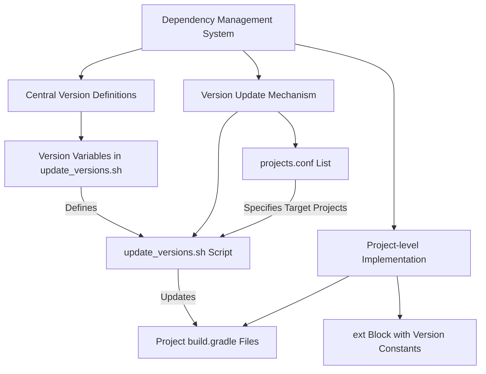
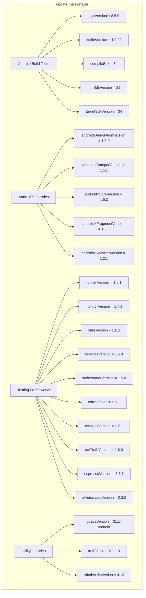
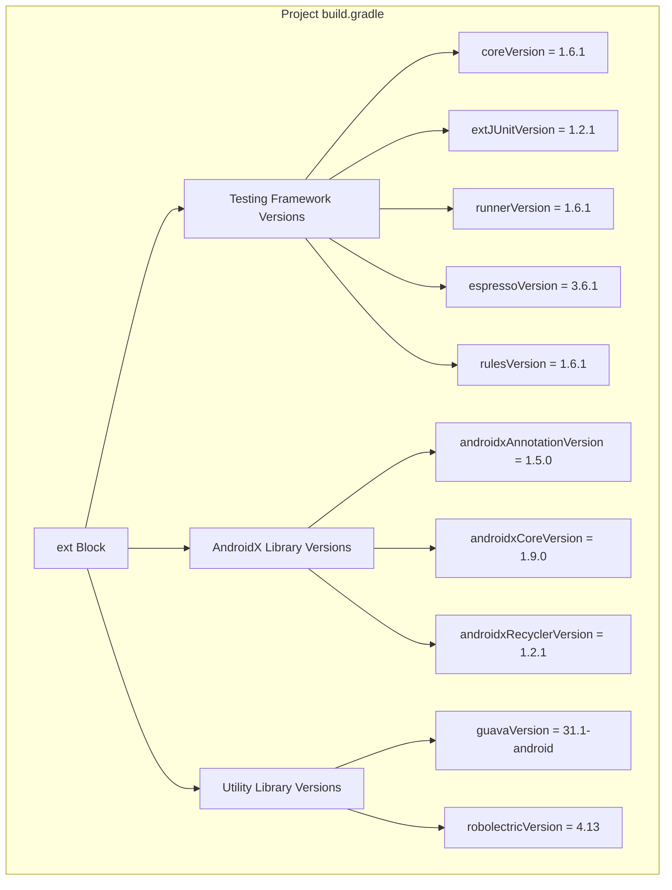
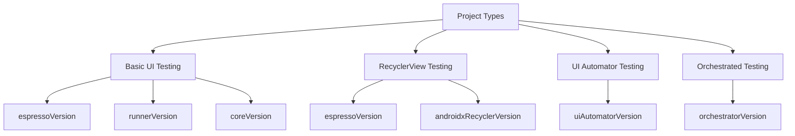
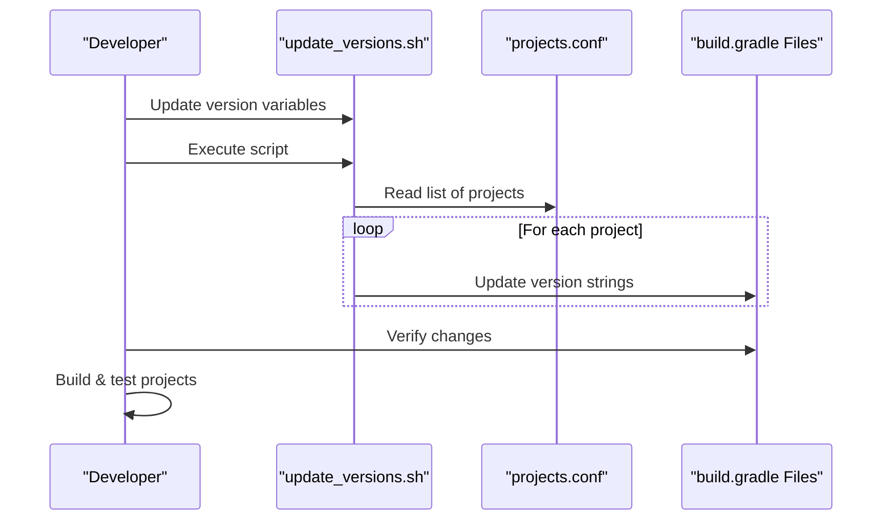

<!-- source: DeepWiki mcp.deepwiki.com · repo android/testing-samples · page 2.3 Dependency Management · fetched 2026-10-23 -->

# Dependency Management

<details>
<summary>Relevant source files</summary>

The following files were used as context for generating this wiki page:

- [integration/ServiceTestRuleSample/build.gradle](integration/ServiceTestRuleSample/build.gradle)
- [runner/AndroidJunitRunnerSample/build.gradle](runner/AndroidJunitRunnerSample/build.gradle)
- [runner/AndroidTestOrchestratorSample/build.gradle](runner/AndroidTestOrchestratorSample/build.gradle)
- [ui/espresso/BasicSample/build.gradle](ui/espresso/BasicSample/build.gradle)
- [ui/espresso/CustomMatcherSample/build.gradle](ui/espresso/CustomMatcherSample/build.gradle)
- [ui/espresso/DataAdapterSample/build.gradle](ui/espresso/DataAdapterSample/build.gradle)
- [ui/espresso/IdlingResourceSample/build.gradle](ui/espresso/IdlingResourceSample/build.gradle)
- [ui/espresso/IntentsAdvancedSample/build.gradle](ui/espresso/IntentsAdvancedSample/build.gradle)
- [ui/espresso/IntentsBasicSample/build.gradle](ui/espresso/IntentsBasicSample/build.gradle)
- [ui/espresso/MultiWindowSample/build.gradle](ui/espresso/MultiWindowSample/build.gradle)
- [ui/espresso/RecyclerViewSample/build.gradle](ui/espresso/RecyclerViewSample/build.gradle)
- [ui/espresso/WebBasicSample/build.gradle](ui/espresso/WebBasicSample/build.gradle)
- [ui/uiautomator/BasicSample/build.gradle](ui/uiautomator/BasicSample/build.gradle)
- [update_versions.sh](update_versions.sh)

</details>


## Purpose and Scope

This document describes the dependency management system used across the Android Testing Samples repository. It explains how library versions are defined, managed, and updated consistently across the various sample projects. This includes how version numbers are stored, how they are referenced in build files, and the mechanisms for updating them.

For information about specific Gradle configuration details, see [Gradle Configuration](#2.1). For Bazel-specific dependency management, see [Bazel Configuration](#2.2).

## Overview

The Android Testing Samples repository contains numerous example projects demonstrating different testing techniques, each requiring consistent dependency versions to ensure compatibility. To facilitate this, the repository implements a centralized dependency management system.



Sources: [update_versions.sh](), [ui/espresso/BasicSample/build.gradle]()

## Version Definition Structure

Dependency versions are primarily defined in two places: the `update_versions.sh` script (the source of truth) and project-level `build.gradle` files (which are updated by the script).

### Central Version Definitions

The `update_versions.sh` script contains the master definitions of all dependency versions used across the samples:



Sources: [update_versions.sh:11-35]()

### Project-level Implementation

Each project defines its required dependency versions in the `ext` block of its root `build.gradle` file. While projects may use different subsets of dependencies based on their requirements, the version numbers are kept consistent across all projects.



Sources: [ui/espresso/BasicSample/build.gradle:28-37](), [ui/espresso/RecyclerViewSample/build.gradle:42-51]()

## Version Update Mechanism

The repository includes a shell script (`update_versions.sh`) that automates the process of updating dependency versions across all projects.

### Update Script Workflow

```mermaid
flowchart TD
    A["update_versions.sh"] -->|"1. Read"| B["projects.conf"]
    A -->|"2. Define"| C["Version Variables"]
    A -->|"3. For each project"| D["Update build.gradle Files"]
    
    B -->|"Lists all projects to update"| D
    C -->|"Provides version values"| D
    
    D -->|"Using sed commands"| E["Replace Version Strings"]
    E -->|"Updates"| F["Project build.gradle"]
    
    G["Example: espressoVersion = 3.5.0"]
    -->|"Updated to"| 
    H["espressoVersion = 3.6.1"]
```

Sources: [update_versions.sh:37-75]()

### Sed Commands for Version Updates

The script uses a series of `sed` commands to update version variables in each project's build.gradle files. Each command targets a specific dependency version pattern:

```bash
sed -i "s/espressoVersion = \([\"']\).*\1/espressoVersion = \"$espressoVersion\"/" build.gradle
```

This pattern ensures that only the version number is updated while maintaining the variable name and syntax.

Sources: [update_versions.sh:45-67]()

## Common Dependencies

The following table lists the most common dependencies managed across the sample projects:

| Category | Dependency | Variable Name | Typical Version |
|----------|------------|---------------|----------------|
| Testing Frameworks | Espresso | espressoVersion | 3.6.1 |
| | AndroidX Test Runner | runnerVersion | 1.6.1 |
| | AndroidX Test Rules | rulesVersion | 1.6.1 |
| | AndroidX JUnit | extJUnitVersion | 1.2.1 |
| | AndroidX Test Core | coreVersion | 1.6.1 |
| | UI Automator | uiAutomatorVersion | 2.3.0 |
| | Test Orchestrator | orchestratorVersion | 1.5.0 |
| AndroidX Libraries | Annotation | androidxAnnotationVersion | 1.5.0 |
| | Core | androidxCoreVersion | 1.9.0 |
| | RecyclerView | androidxRecyclerVersion | 1.2.1 |
| | Fragment | androidxFragmentVersion | 1.5.3 |
| Utility Libraries | Guava | guavaVersion | 31.1-android |
| | Truth | truthVersion | 1.1.3 |
| | Robolectric | robolectricVersion | 4.13 |
| Build Tools | Android Gradle Plugin | agpVersion | 8.5.0 |
| | Kotlin | kotlinVersion | 1.9.22 |

Sources: [update_versions.sh:11-35](), [ui/espresso/BasicSample/build.gradle:28-37]()

## Dependency Definition in Build Files

### Root build.gradle Structure

Each project's root build.gradle file follows a consistent structure:

1. Buildscript block with repositories and dependencies
2. Allprojects block with repository definitions
3. Ext block with version constants

Example structure from BasicSample:

```
buildscript {
    ext.kotlinVersion = "1.9.22"
    ext.agpVersion = "8.5.0"
    repositories { ... }
    dependencies { ... }
}

allprojects {
    repositories { ... }
}

ext {
    androidxAnnotationVersion = "1.5.0"
    robolectricVersion = "4.13"
    guavaVersion = "31.1-android"
    extTruthVersion = "1.6.0"
    coreVersion = "1.6.1"
    extJUnitVersion = "1.2.1"
    runnerVersion = "1.6.1"
    espressoVersion = "3.6.1"
}
```

Sources: [ui/espresso/BasicSample/build.gradle:3-37]()

### Project-specific Dependencies

While the version numbers are kept consistent, each project includes only the dependencies it requires. For example:

- Basic UI testing samples typically include core Espresso dependencies
- RecyclerView samples add the RecyclerView-specific Espresso dependencies
- UI Automator samples include the UI Automator dependency
- Projects with orchestrated tests include the orchestrator dependency



Sources: [ui/espresso/RecyclerViewSample/build.gradle:42-51](), [ui/uiautomator/BasicSample/build.gradle:23-33](), [runner/AndroidTestOrchestratorSample/build.gradle:26-37]()

## Dependency Update Workflow

When updating dependencies across the repository, the typical workflow is:

1. Modify version variables in the `update_versions.sh` script
2. Run the script to update all project build.gradle files
3. Verify that all projects build successfully with the new versions



Sources: [update_versions.sh]()

## Integration with Other Build Systems

While Gradle is the primary build system for the Android Testing Samples repository, the consistent version management strategy also facilitates integration with other build systems like Bazel. For details on Bazel-specific dependency management, see [Bazel Configuration](#2.2).

## Conclusion

The dependency management system in the Android Testing Samples repository ensures consistent dependency versions across all sample projects while allowing each project to specify only the dependencies it needs. The central update mechanism via the `update_versions.sh` script makes it easy to maintain and update dependencies as new versions become available.

---

