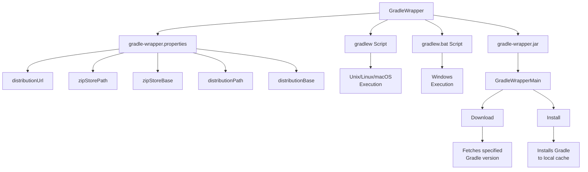
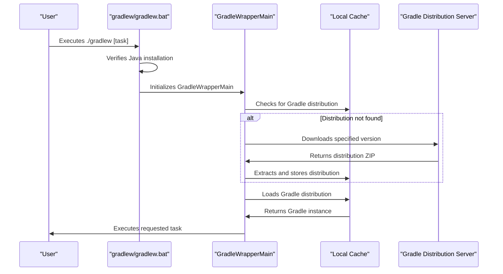
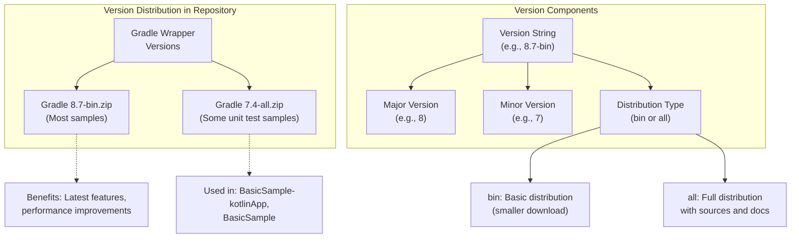
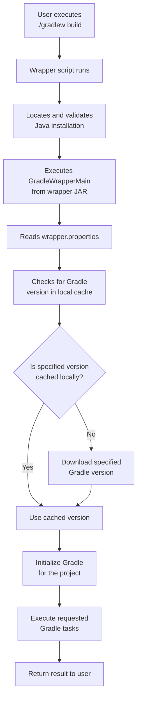

<!-- source: DeepWiki mcp.deepwiki.com · repo android/testing-samples · page 2.4 Gradle Wrapper · fetched 2026-10-23 -->

# Gradle Wrapper

<details>
<summary>Relevant source files</summary>

The following files were used as context for generating this wiki page:

- [integration/ServiceTestRuleSample/gradle/wrapper/gradle-wrapper.properties](integration/ServiceTestRuleSample/gradle/wrapper/gradle-wrapper.properties)
- [runner/AndroidTestOrchestratorSample/gradle/wrapper/gradle-wrapper.jar](runner/AndroidTestOrchestratorSample/gradle/wrapper/gradle-wrapper.jar)
- [runner/AndroidTestOrchestratorSample/gradle/wrapper/gradle-wrapper.properties](runner/AndroidTestOrchestratorSample/gradle/wrapper/gradle-wrapper.properties)
- [runner/AndroidTestOrchestratorSample/gradlew](runner/AndroidTestOrchestratorSample/gradlew)
- [runner/AndroidTestOrchestratorSample/gradlew.bat](runner/AndroidTestOrchestratorSample/gradlew.bat)
- [ui/espresso/BasicSample/gradle/wrapper/gradle-wrapper.properties](ui/espresso/BasicSample/gradle/wrapper/gradle-wrapper.properties)
- [ui/espresso/CustomMatcherSample/gradle/wrapper/gradle-wrapper.properties](ui/espresso/CustomMatcherSample/gradle/wrapper/gradle-wrapper.properties)
- [ui/espresso/DataAdapterSample/gradle/wrapper/gradle-wrapper.properties](ui/espresso/DataAdapterSample/gradle/wrapper/gradle-wrapper.properties)
- [ui/espresso/IdlingResourceSample/gradle/wrapper/gradle-wrapper.properties](ui/espresso/IdlingResourceSample/gradle/wrapper/gradle-wrapper.properties)
- [ui/espresso/IntentsAdvancedSample/gradle/wrapper/gradle-wrapper.properties](ui/espresso/IntentsAdvancedSample/gradle/wrapper/gradle-wrapper.properties)
- [ui/espresso/IntentsBasicSample/gradle/wrapper/gradle-wrapper.properties](ui/espresso/IntentsBasicSample/gradle/wrapper/gradle-wrapper.properties)
- [ui/espresso/MultiWindowSample/gradle/wrapper/gradle-wrapper.properties](ui/espresso/MultiWindowSample/gradle/wrapper/gradle-wrapper.properties)
- [ui/espresso/RecyclerViewSample/gradle/wrapper/gradle-wrapper.properties](ui/espresso/RecyclerViewSample/gradle/wrapper/gradle-wrapper.properties)
- [ui/espresso/WebBasicSample/gradle/wrapper/gradle-wrapper.properties](ui/espresso/WebBasicSample/gradle/wrapper/gradle-wrapper.properties)
- [ui/uiautomator/BasicSample/gradle/wrapper/gradle-wrapper.properties](ui/uiautomator/BasicSample/gradle/wrapper/gradle-wrapper.properties)
- [unit/BasicSample-kotlinApp/gradle/wrapper/gradle-wrapper.jar](unit/BasicSample-kotlinApp/gradle/wrapper/gradle-wrapper.jar)
- [unit/BasicSample-kotlinApp/gradle/wrapper/gradle-wrapper.properties](unit/BasicSample-kotlinApp/gradle/wrapper/gradle-wrapper.properties)
- [unit/BasicSample-kotlinApp/gradlew](unit/BasicSample-kotlinApp/gradlew)
- [unit/BasicSample-kotlinApp/gradlew.bat](unit/BasicSample-kotlinApp/gradlew.bat)
- [unit/BasicSample/gradle/wrapper/gradle-wrapper.jar](unit/BasicSample/gradle/wrapper/gradle-wrapper.jar)
- [unit/BasicSample/gradle/wrapper/gradle-wrapper.properties](unit/BasicSample/gradle/wrapper/gradle-wrapper.properties)
- [unit/BasicSample/gradlew](unit/BasicSample/gradlew)
- [unit/BasicSample/gradlew.bat](unit/BasicSample/gradlew.bat)
- [unit/BasicUnitAndroidTest/gradle/wrapper/gradle-wrapper.jar](unit/BasicUnitAndroidTest/gradle/wrapper/gradle-wrapper.jar)
- [unit/BasicUnitAndroidTest/gradlew](unit/BasicUnitAndroidTest/gradlew)

</details>


The Gradle Wrapper is a critical component of the Android Testing Samples build system that ensures consistent and reliable builds across different environments. It enables execution of Gradle tasks without requiring a locally installed Gradle distribution, ensuring that all developers and CI systems use the exact same Gradle version when building a project.

For information about general Gradle configuration in the Android Testing Samples, see [Gradle Configuration](#2.1). For details about dependency management, see [Dependency Management](#2.3).

## Overview

The Gradle Wrapper consists of several key files that work together to download and use a specific Gradle version. These files are checked into version control, allowing anyone who clones the repository to build the project with the exact same Gradle version.

### Gradle Wrapper Components



Sources:
- [integration/ServiceTestRuleSample/gradle/wrapper/gradle-wrapper.properties:1-6]()
- [runner/AndroidTestOrchestratorSample/gradle/wrapper/gradle-wrapper.properties:1-6]()
- [runner/AndroidTestOrchestratorSample/gradlew:1-234]()
- [runner/AndroidTestOrchestratorSample/gradlew.bat:1-89]()
- [runner/AndroidTestOrchestratorSample/gradle/wrapper/gradle-wrapper.jar]()

## Wrapper Components in Detail

### Properties File

The `gradle-wrapper.properties` file is the cornerstone of the Gradle Wrapper configuration. It defines which Gradle version to use and where to store the downloaded distribution.

Key properties:

| Property | Purpose | Example Value |
|----------|---------|---------------|
| distributionUrl | URL to download the specific Gradle version | https://services.gradle.org/distributions/gradle-8.7-bin.zip |
| distributionBase | Base directory for the Gradle distribution | GRADLE_USER_HOME |
| distributionPath | Path where the distribution is unpacked | wrapper/dists |
| zipStoreBase | Base directory for the downloaded ZIP file | GRADLE_USER_HOME |
| zipStorePath | Path where the ZIP file is stored | wrapper/dists |

Most sample projects in the repository consistently use Gradle 8.7-bin.zip, ensuring uniformity across the samples.

Sources:
- [integration/ServiceTestRuleSample/gradle/wrapper/gradle-wrapper.properties:1-6]()
- [ui/espresso/BasicSample/gradle/wrapper/gradle-wrapper.properties:1-6]()
- [unit/BasicSample/gradle/wrapper/gradle-wrapper.properties:1-6]()

### Wrapper Scripts

The Gradle Wrapper provides platform-specific scripts for executing Gradle commands:

1. **gradlew (Shell Script)**: For Unix-based systems (Linux, macOS)
2. **gradlew.bat (Batch Script)**: For Windows systems

These scripts handle:
- Locating Java on the system
- Setting up appropriate environment variables
- Downloading the specified Gradle distribution (if not already present)
- Invoking Gradle with the provided arguments



Sources:
- [runner/AndroidTestOrchestratorSample/gradlew:1-234]()
- [runner/AndroidTestOrchestratorSample/gradlew.bat:1-89]()
- [runner/AndroidTestOrchestratorSample/gradle/wrapper/gradle-wrapper.jar]()

### Wrapper JAR File

The `gradle-wrapper.jar` file contains the Java classes necessary for the wrapper's operation. Key classes include:

- `GradleWrapperMain`: Entry point for the wrapper
- `Download`: Handles downloading the Gradle distribution
- `Install`: Manages installing the distribution locally
- `PathAssembler`: Determines paths for storing distributions
- `WrapperConfiguration`: Holds wrapper configuration from properties file

These classes work together to manage Gradle versions and execute builds consistently.

Sources:
- [runner/AndroidTestOrchestratorSample/gradle/wrapper/gradle-wrapper.jar]()

## Version Consistency

The Android Testing Samples repository maintains consistent Gradle versions across most projects. Most samples use Gradle 8.7, while a few older samples use Gradle 7.4.



Different distribution types:
- **bin**: Contains only what's needed to run Gradle (smaller download)
- **all**: Includes sources and documentation (larger download)

Sources:
- [integration/ServiceTestRuleSample/gradle/wrapper/gradle-wrapper.properties:3]()
- [ui/espresso/BasicSample/gradle/wrapper/gradle-wrapper.properties:3]()
- [unit/BasicSample/gradle/wrapper/gradle-wrapper.properties:3]()
- [unit/BasicSample-kotlinApp/gradle/wrapper/gradle-wrapper.properties:3]()

## Wrapper Execution Flow

When a Gradle task is executed through the wrapper, the following sequence occurs:

1. User invokes `./gradlew` (Unix) or `gradlew.bat` (Windows) with task arguments
2. The script locates Java on the system
3. The script executes the Java application in `gradle-wrapper.jar`
4. `GradleWrapperMain` reads settings from `gradle-wrapper.properties` 
5. If the specified Gradle version isn't cached locally, it's downloaded
6. The cached or downloaded Gradle distribution is used to execute the requested task



Sources:
- [runner/AndroidTestOrchestratorSample/gradlew:117-206]()
- [runner/AndroidTestOrchestratorSample/gradlew.bat:67-74]()

## Integration with Android Testing Samples

In the Android Testing Samples repository, the Gradle Wrapper is used consistently across all sample projects to ensure build reliability and to demonstrate best practices for Android project setup.

### Key Features in Android Testing Samples

1. **Consistent Versioning**: Almost all sample projects use the same Gradle version (8.7), ensuring compatibility across samples.

2. **Identical Configuration**: The wrapper configuration across projects is standardized, with all projects following the same wrapper structure.

3. **Parallel Development**: The consistent wrapper enables seamless switching between samples without Gradle version conflicts.

### Location in Project Structure

Each sample project in the repository has its own Gradle Wrapper, located at:
- `[sample-project]/gradle/wrapper/gradle-wrapper.properties`
- `[sample-project]/gradle/wrapper/gradle-wrapper.jar`
- `[sample-project]/gradlew`
- `[sample-project]/gradlew.bat`

## Using the Gradle Wrapper

### Basic Usage

Instead of using a globally installed Gradle, you would use the wrapper scripts to execute Gradle tasks:

- On Unix-based systems (Linux, macOS):
  ```
  ./gradlew [task]
  ```

- On Windows:
  ```
  gradlew.bat [task]
  ```

### Common Commands

Some common commands when working with Android Testing Samples:

- Build the project: `./gradlew build`
- Run tests: `./gradlew test`
- Clean build directory: `./gradlew clean`
- Install debug APK: `./gradlew installDebug`
- Run Android tests: `./gradlew connectedAndroidTest`

### Benefits of Using the Wrapper

1. **Build Consistency**: Ensures all developers and CI systems use the exact same Gradle version
2. **No Manual Installation**: No need to install Gradle manually
3. **Version Control**: The Gradle version is tracked in version control
4. **Automatic Updates**: Easy to update Gradle by changing the wrapper properties file

## Relationship to Other Build System Components

The Gradle Wrapper works in conjunction with other components of the build system:

1. **Gradle Configuration** ([#2.1](#2.1)): The wrapper ensures that the defined configurations in build.gradle files are interpreted consistently.

2. **Dependency Management** ([#2.3](#2.3)): The wrapper executes the dependency resolution process using a consistent Gradle version, ensuring dependencies are handled identically across environments.

3. **Test Execution**: Provides a reliable foundation for running tests across different sample projects.

This reliability is particularly important in a repository like Android Testing Samples, which demonstrates various testing approaches that must work consistently for educational purposes.

---

