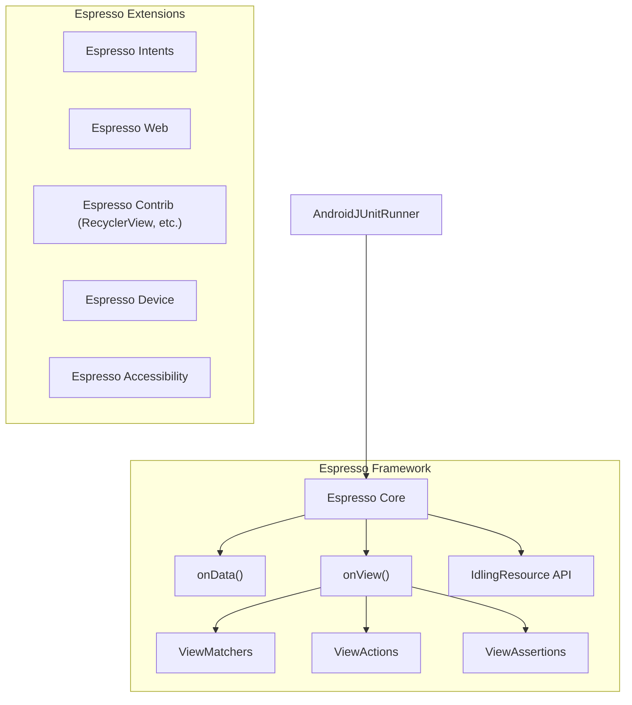
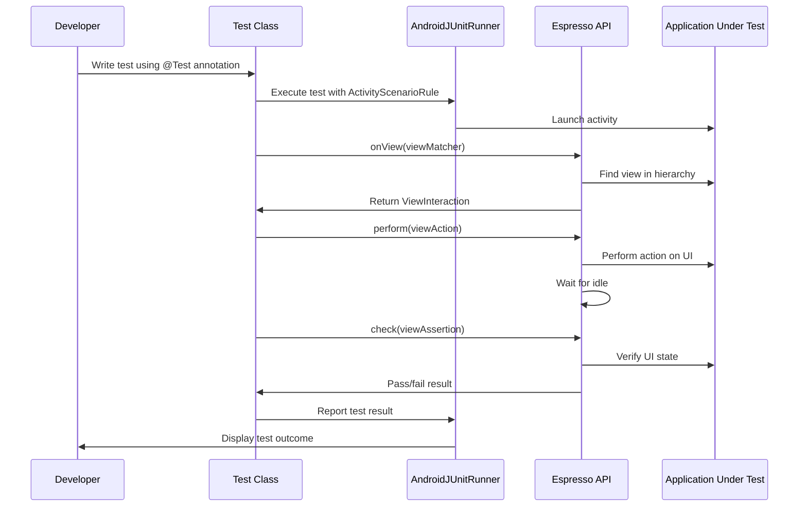
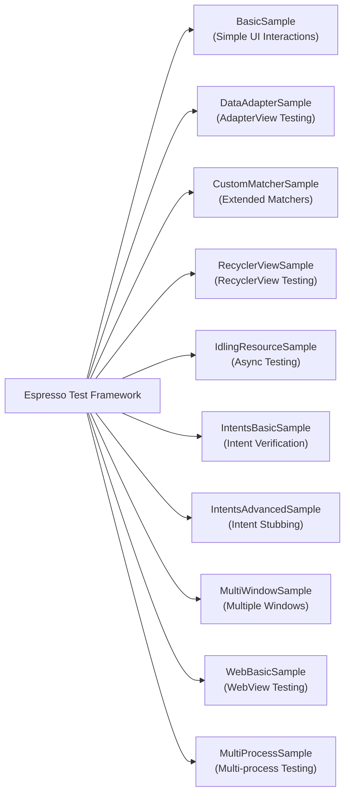

<!-- source: DeepWiki mcp.deepwiki.com · repo android/testing-samples · page 3 UI Testing with Espresso · fetched 2026-10-23 -->

# UI Testing with Espresso

<details>
<summary>Relevant source files</summary>

The following files were used as context for generating this wiki page:

- [README.md](README.md)
- [integration/ServiceTestRuleSample/build.gradle](integration/ServiceTestRuleSample/build.gradle)
- [runner/AndroidJunitRunnerSample/README.md](runner/AndroidJunitRunnerSample/README.md)
- [runner/AndroidJunitRunnerSample/build.gradle](runner/AndroidJunitRunnerSample/build.gradle)
- [ui/espresso/BasicSample/README.md](ui/espresso/BasicSample/README.md)
- [ui/espresso/BasicSample/build.gradle](ui/espresso/BasicSample/build.gradle)
- [ui/espresso/CustomMatcherSample/README.md](ui/espresso/CustomMatcherSample/README.md)
- [ui/espresso/CustomMatcherSample/build.gradle](ui/espresso/CustomMatcherSample/build.gradle)
- [ui/espresso/DataAdapterSample/README.md](ui/espresso/DataAdapterSample/README.md)
- [ui/espresso/DataAdapterSample/build.gradle](ui/espresso/DataAdapterSample/build.gradle)
- [ui/espresso/IdlingResourceSample/build.gradle](ui/espresso/IdlingResourceSample/build.gradle)
- [ui/espresso/IntentsAdvancedSample/README.md](ui/espresso/IntentsAdvancedSample/README.md)
- [ui/espresso/IntentsAdvancedSample/build.gradle](ui/espresso/IntentsAdvancedSample/build.gradle)
- [ui/espresso/IntentsBasicSample/README.md](ui/espresso/IntentsBasicSample/README.md)
- [ui/espresso/IntentsBasicSample/app/src/main/AndroidManifest.xml](ui/espresso/IntentsBasicSample/app/src/main/AndroidManifest.xml)
- [ui/espresso/IntentsBasicSample/app/src/main/res/layout/activity_dialer.xml](ui/espresso/IntentsBasicSample/app/src/main/res/layout/activity_dialer.xml)
- [ui/espresso/IntentsBasicSample/build.gradle](ui/espresso/IntentsBasicSample/build.gradle)
- [ui/espresso/IntentsBasicSample/gradle.properties](ui/espresso/IntentsBasicSample/gradle.properties)
- [ui/espresso/MultiProcessSample/README.md](ui/espresso/MultiProcessSample/README.md)
- [ui/espresso/MultiWindowSample/README.md](ui/espresso/MultiWindowSample/README.md)
- [ui/espresso/MultiWindowSample/build.gradle](ui/espresso/MultiWindowSample/build.gradle)
- [ui/espresso/RecyclerViewSample/app/src/androidTest/java/com/example/android/testing/espresso/RecyclerViewSample/RecyclerViewSampleTest.java](ui/espresso/RecyclerViewSample/app/src/androidTest/java/com/example/android/testing/espresso/RecyclerViewSample/RecyclerViewSampleTest.java)
- [ui/espresso/RecyclerViewSample/build.gradle](ui/espresso/RecyclerViewSample/build.gradle)
- [ui/espresso/WebBasicSample/README.md](ui/espresso/WebBasicSample/README.md)
- [ui/espresso/WebBasicSample/build.gradle](ui/espresso/WebBasicSample/build.gradle)
- [ui/uiautomator/BasicSample/build.gradle](ui/uiautomator/BasicSample/build.gradle)

</details>


## Purpose and Scope

This document provides an overview of the Espresso testing framework as implemented in the Android Testing Samples repository. It covers the fundamental components of Espresso, key features for UI testing, and how these are demonstrated across different sample projects. For information about cross-app UI testing, see [UI Testing with UI Automator](#4).

## Introduction to Espresso

Espresso is a UI testing framework for Android that enables developers to write concise, reliable automated tests for their Android applications. It provides a simple API to interact with UI elements, verify states, and automate user interactions.

Espresso's key advantages include:

- Automatic synchronization with the application under test
- Fluent API for locating and interacting with UI elements
- Built-in thread synchronization to minimize flakiness
- AndroidX Test library integration

Sources: [README.md:7-31]()

## Espresso Architecture



Sources: [ui/espresso/BasicSample/build.gradle:29-36](), [ui/espresso/IntentsBasicSample/build.gradle:27-36](), [README.md:7-31]()

## Espresso Test Flow



Sources: [ui/espresso/RecyclerViewSample/app/src/androidTest/java/com/example/android/testing/espresso/RecyclerViewSample/RecyclerViewSampleTest.java:47-111]()

## Key Components

### 1. Espresso Core

The foundation of the Espresso framework includes:

- **ViewMatchers**: Used to find view(s) in the view hierarchy (e.g., `withId()`, `withText()`)
- **ViewActions**: Represent user interactions (e.g., `click()`, `typeText()`, `swipeLeft()`)
- **ViewAssertions**: Verify the state of views (e.g., `matches()`, `doesNotExist()`)
- **Espresso**: The main entry point with methods like `onView()` and coordination functions

### 2. Espresso Extensions

| Extension Module | Purpose | Build Dependency | Sample Project |
|------------------|---------|------------------|----------------|
| Espresso-Intents | Test app interactions via Intents | androidx.test.espresso:espresso-intents | IntentsBasicSample |
| Espresso-Web | Test WebViews | androidx.test.espresso:espresso-web | WebBasicSample |
| Espresso-Contrib | Test complex views (RecyclerView, etc.) | androidx.test.espresso:espresso-contrib | RecyclerViewSample |
| Espresso-IdlingResource | Synchronize with background operations | androidx.test.espresso:espresso-idling-resource | IdlingResourceSample |

Sources: [ui/espresso/BasicSample/build.gradle:29-36](), [ui/espresso/IntentsBasicSample/build.gradle:27-36]()

## Sample Projects Overview



Sources: [README.md:7-31]()

### Basic Sample

The BasicSample demonstrates fundamental Espresso capabilities:
- Finding views with `onView()`
- Performing actions with `perform()`
- Verifying state with `check()`

This sample serves as the entry point for developers new to Espresso testing.

Sources: [ui/espresso/BasicSample/README.md:1-30]()

### RecyclerView Sample

The RecyclerViewSample demonstrates how to test RecyclerView components using the Espresso-Contrib module:
- Scrolling to specific positions with `RecyclerViewActions.scrollToPosition()`
- Performing actions on specific items with `RecyclerViewActions.actionOnItemAtPosition()`
- Finding items by custom matchers with `RecyclerViewActions.scrollTo()`

Sources: [ui/espresso/RecyclerViewSample/app/src/androidTest/java/com/example/android/testing/espresso/RecyclerViewSample/RecyclerViewSampleTest.java:47-111](), [ui/espresso/RecyclerViewSample/build.gradle:42-51]()

### Intents Testing

Espresso Intents extends Espresso to verify and stub intents for hermetic testing:

#### IntentsBasicSample
- Basic usage of `intended()` to verify intents were sent
- Using `intending()` to stub responses from other activities
- Testing dialer app interactions

#### IntentsAdvancedSample
- Simulating camera interactions
- Stubbing complex intent results

Sources: [ui/espresso/IntentsBasicSample/README.md:1-32](), [ui/espresso/IntentsBasicSample/app/src/main/AndroidManifest.xml:1-42](), [ui/espresso/IntentsAdvancedSample/README.md:1-28]()

### Asynchronous Testing with IdlingResource

The IdlingResourceSample demonstrates how to synchronize tests with asynchronous operations:
- Implementation of custom IdlingResource
- Registration with Espresso to wait for background operations
- Preventing test flakiness in operations like network calls or database operations

Sources: [ui/espresso/IdlingResourceSample/build.gradle:42-49]()

### Multi-Window Testing

The MultiWindowSample shows how to test applications with multiple windows:
- Customizing the window selection heuristic
- Testing UI elements in popup windows or dialogs
- Handling auto-complete suggestions and dropdown menus

Sources: [ui/espresso/MultiWindowSample/README.md:1-40]()

### WebView Testing

The WebBasicSample demonstrates testing WebViews using Espresso-Web:
- Using WebView-specific matchers and actions
- Interacting with HTML elements inside WebViews
- Performing JavaScript evaluation

Sources: [ui/espresso/WebBasicSample/README.md:1-30](), [ui/espresso/WebBasicSample/build.gradle:27-34]()

## Writing Espresso Tests

### Basic Test Structure

A typical Espresso test follows this pattern:

1. Find a view using `onView()` with a ViewMatcher
2. Perform an action using `perform()` with one or more ViewActions
3. Verify the result using `check()` with a ViewAssertion

Example:
```java
@Test
public void buttonClickChangesText() {
    // Find a view
    onView(withId(R.id.button))
        // Perform an action
        .perform(click())
        // Verify the result
        .check(matches(isDisplayed()));
        
    // Verify resulting text change
    onView(withId(R.id.result_text))
        .check(matches(withText("Button clicked!")));
}
```

### Test Rule Setup

Espresso tests typically use ActivityScenarioRule to launch the activity under test:

```java
@Rule
public ActivityScenarioRule<MainActivity> activityScenarioRule =
    new ActivityScenarioRule<>(MainActivity.class);
```

Sources: [ui/espresso/RecyclerViewSample/app/src/androidTest/java/com/example/android/testing/espresso/RecyclerViewSample/RecyclerViewSampleTest.java:47-111]()

## Configuration

### Gradle Dependencies

To use Espresso in your project, add the appropriate dependencies:

```gradle
dependencies {
    // Core Espresso dependencies
    androidTestImplementation "androidx.test.espresso:espresso-core:$espressoVersion"
    
    // Optional modules based on testing needs
    androidTestImplementation "androidx.test.espresso:espresso-contrib:$espressoVersion"  // For RecyclerView, etc.
    androidTestImplementation "androidx.test.espresso:espresso-intents:$espressoVersion" // For Intent testing
    androidTestImplementation "androidx.test.espresso:espresso-web:$espressoVersion"     // For WebView testing
    
    // JUnit and AndroidX Test dependencies
    androidTestImplementation "androidx.test.ext:junit:$extJUnitVersion"
    androidTestImplementation "androidx.test:runner:$runnerVersion"
    androidTestImplementation "androidx.test:rules:$rulesVersion"
}
```

Sources: [ui/espresso/BasicSample/build.gradle:29-36](), [ui/espresso/RecyclerViewSample/build.gradle:42-51]()

### Running Tests

Tests can be run using:
- Android Studio: Right-click on test class and select "Run"
- Command line: `./gradlew connectedAndroidTest`

For best results:
- Turn off animations on the test device (under Developer Options)
- Clear app data between test runs if necessary
- Use test orchestration for test isolation

Sources: [README.md:52-66]()

## Best Practices

1. **Use ViewMatchers properly**: Choose the most specific matcher to find your view
2. **Handle asynchronous operations**: Use IdlingResource to wait for background operations
3. **Keep tests independent**: Each test should be self-contained and not depend on other tests
4. **Disable animations**: Animations can cause flaky tests
5. **Test on multiple device sizes**: UI behavior may vary on different screen sizes
6. **Use test orchestration**: Isolate tests with Android Test Orchestrator for reliability

Sources: [ui/espresso/BasicSample/README.md:1-30](), [ui/espresso/IdlingResourceSample/build.gradle:42-49](), [README.md:52-66]()

---

