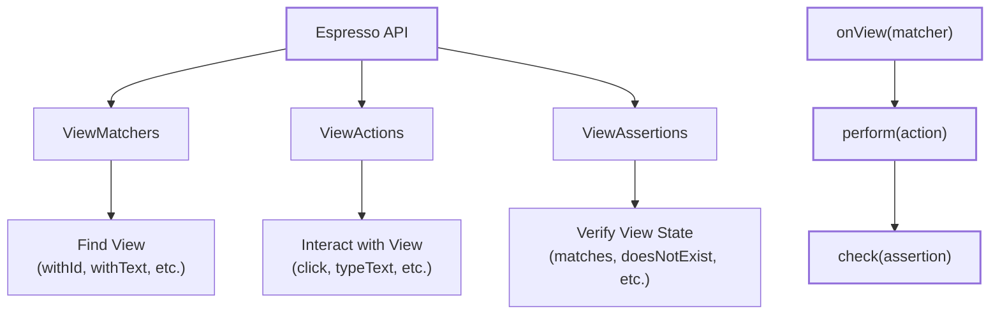
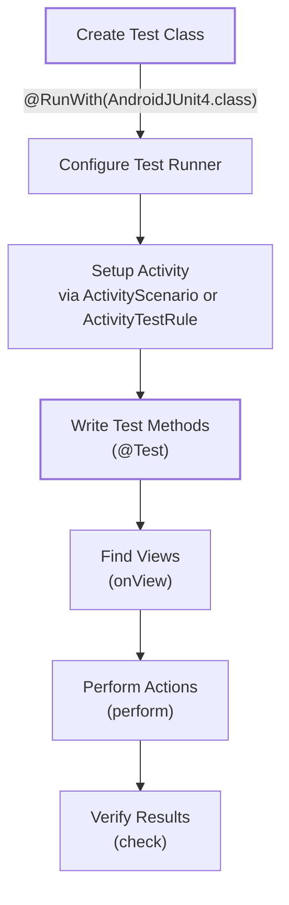
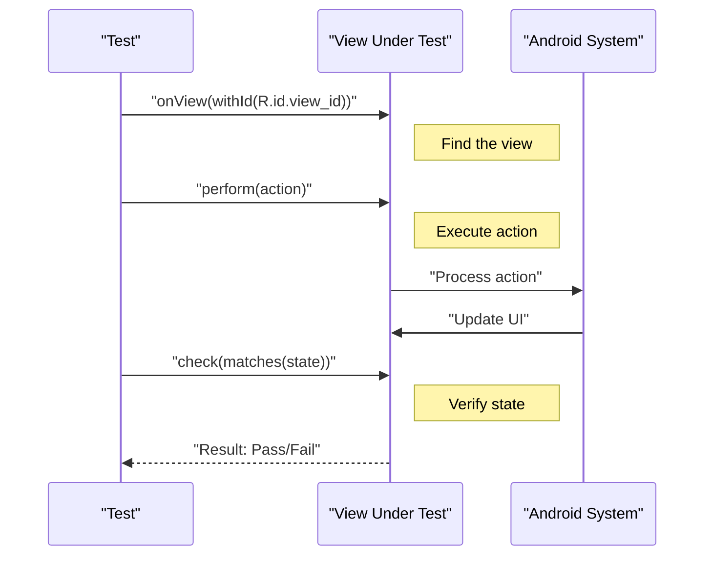
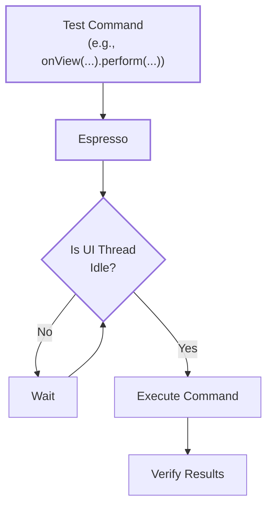

<!-- source: DeepWiki mcp.deepwiki.com · repo android/testing-samples · page 3.1 Basic Espresso Testing · fetched 2026-10-23 -->

# Basic Espresso Testing

<details>
<summary>Relevant source files</summary>

The following files were used as context for generating this wiki page:

- [runner/AndroidJunitRunnerSample/README.md](runner/AndroidJunitRunnerSample/README.md)
- [runner/AndroidJunitRunnerSample/app/src/androidTest/java/com/example/android/testing/androidjunitrunnersample/CalculatorInstrumentationTest.java](runner/AndroidJunitRunnerSample/app/src/androidTest/java/com/example/android/testing/androidjunitrunnersample/CalculatorInstrumentationTest.java)
- [ui/espresso/BasicSample/README.md](ui/espresso/BasicSample/README.md)
- [ui/espresso/CustomMatcherSample/README.md](ui/espresso/CustomMatcherSample/README.md)
- [ui/espresso/DataAdapterSample/README.md](ui/espresso/DataAdapterSample/README.md)
- [ui/espresso/IdlingResourceSample/app/src/androidTest/java/com/example/android/testing/espresso/IdlingResourceSample/ChangeTextBehaviorTest.java](ui/espresso/IdlingResourceSample/app/src/androidTest/java/com/example/android/testing/espresso/IdlingResourceSample/ChangeTextBehaviorTest.java)
- [ui/espresso/IntentsAdvancedSample/README.md](ui/espresso/IntentsAdvancedSample/README.md)
- [ui/espresso/IntentsAdvancedSample/app/src/androidTest/java/com/example/android/testing/espresso/intents/AdvancedSample/ImageViewHasDrawableMatcher.java](ui/espresso/IntentsAdvancedSample/app/src/androidTest/java/com/example/android/testing/espresso/intents/AdvancedSample/ImageViewHasDrawableMatcher.java)
- [ui/espresso/IntentsAdvancedSample/app/src/androidTest/java/com/example/android/testing/espresso/intents/AdvancedSample/ImageViewerActivityTest.java](ui/espresso/IntentsAdvancedSample/app/src/androidTest/java/com/example/android/testing/espresso/intents/AdvancedSample/ImageViewerActivityTest.java)
- [ui/espresso/IntentsBasicSample/README.md](ui/espresso/IntentsBasicSample/README.md)
- [ui/espresso/MultiWindowSample/README.md](ui/espresso/MultiWindowSample/README.md)
- [ui/espresso/MultiWindowSample/app/src/androidTest/java/com/example/android/testing/espresso/MultiWindowSample/MultiWindowTest.java](ui/espresso/MultiWindowSample/app/src/androidTest/java/com/example/android/testing/espresso/MultiWindowSample/MultiWindowTest.java)
- [ui/espresso/WebBasicSample/README.md](ui/espresso/WebBasicSample/README.md)
- [ui/espresso/WebBasicSample/app/src/androidTest/java/com/example/android/testing/espresso/web/BasicSample/WebViewActivityTest.java](ui/espresso/WebBasicSample/app/src/androidTest/java/com/example/android/testing/espresso/web/BasicSample/WebViewActivityTest.java)
- [unit/BasicUnitAndroidTest/app/src/androidTest/java/com/example/android/testing/unittesting/basicunitandroidtest/LogHistoryAndroidUnitTest.java](unit/BasicUnitAndroidTest/app/src/androidTest/java/com/example/android/testing/unittesting/basicunitandroidtest/LogHistoryAndroidUnitTest.java)

</details>


This document provides an introduction to UI testing with Espresso, focusing on simple interactions and assertions. It covers the fundamentals of writing Espresso tests for Android applications, including how to find views, perform actions, and verify results. For more advanced topics like testing RecyclerViews or handling asynchronous operations, see [RecyclerView Testing](#3.2) and [IdlingResource for Asynchronous Testing](#3.4).

## What is Espresso?

Espresso is a testing framework for Android that makes it easy to write reliable UI tests. It provides a simple and flexible API for simulating user interactions and verifying UI elements.

Key advantages of Espresso:
- Automatic synchronization with the UI thread
- Highly deterministic tests
- Natural Android testing syntax
- Integrated with AndroidX Test library

### Espresso Architecture



Sources: 
- [runner/AndroidJunitRunnerSample/app/src/androidTest/java/com/example/android/testing/androidjunitrunnersample/CalculatorInstrumentationTest.java:32-38]()
- [ui/espresso/IdlingResourceSample/app/src/androidTest/java/com/example/android/testing/espresso/IdlingResourceSample/ChangeTextBehaviorTest.java:19-25]()

## Setting Up Espresso Tests

### Required Dependencies

To use Espresso in your Android project, you need to add the following dependencies to your `build.gradle` file:

```
dependencies {
    // Core Espresso library
    androidTestImplementation 'androidx.test.espresso:espresso-core:x.x.x'
    
    // AndroidJUnitRunner
    androidTestImplementation 'androidx.test:runner:x.x.x'
    androidTestImplementation 'androidx.test:rules:x.x.x'
    androidTestImplementation 'androidx.test.ext:junit:x.x.x'
}
```

### Test Configuration

You must configure your test runner in the module-level `build.gradle`:

```
android {
    defaultConfig {
        testInstrumentationRunner "androidx.test.runner.AndroidJUnitRunner"
    }
}
```

### Test Setup Process



Sources:
- [ui/espresso/BasicSample/README.md:1-31]()
- [runner/AndroidJunitRunnerSample/app/src/androidTest/java/com/example/android/testing/androidjunitrunnersample/CalculatorInstrumentationTest.java:49-51]()
- [runner/AndroidJunitRunnerSample/app/src/androidTest/java/com/example/android/testing/androidjunitrunnersample/CalculatorInstrumentationTest.java:56-59]()

## Core Espresso Components

### ViewMatchers

ViewMatchers are used to find views in the view hierarchy.

| ViewMatcher | Description |
|-------------|-------------|
| `withId(R.id.view_id)` | Matches a view with the specified ID |
| `withText("text")` | Matches a view with the specified text |
| `isDisplayed()` | Matches views that are currently displayed on screen |
| `withContentDescription("desc")` | Matches views with the specified content description |
| `withClassName(is("className"))` | Matches views with the specified class name |

### ViewActions

ViewActions specify the actions to perform on views.

| ViewAction | Description |
|------------|-------------|
| `click()` | Clicks on a view |
| `typeText("text")` | Types text into an EditText |
| `closeSoftKeyboard()` | Closes the soft keyboard |
| `scrollTo()` | Scrolls to a view if it's inside a ScrollView |
| `clearText()` | Clears text from an EditText |

### ViewAssertions

ViewAssertions verify the state of the views.

| ViewAssertion | Description |
|---------------|-------------|
| `matches(Matcher)` | Asserts that the view matches the specified matcher |
| `doesNotExist()` | Asserts that the view does not exist |
| `selectedDescendantsMatch(...)` | Asserts that selected descendants match the specified matcher |

Sources:
- [runner/AndroidJunitRunnerSample/app/src/androidTest/java/com/example/android/testing/androidjunitrunnersample/CalculatorInstrumentationTest.java:32-38]()
- [ui/espresso/IdlingResourceSample/app/src/androidTest/java/com/example/android/testing/espresso/IdlingResourceSample/ChangeTextBehaviorTest.java:19-25]()

## The Espresso Test Pattern

The typical structure of an Espresso test follows this pattern:



Sources:
- [runner/AndroidJunitRunnerSample/app/src/androidTest/java/com/example/android/testing/androidjunitrunnersample/CalculatorInstrumentationTest.java:62-66]()
- [runner/AndroidJunitRunnerSample/app/src/androidTest/java/com/example/android/testing/androidjunitrunnersample/CalculatorInstrumentationTest.java:94-107]()

## Example: Basic Espresso Test

The following example demonstrates a basic Espresso test that:
1. Types text into an input field
2. Clicks a button
3. Verifies that the output text matches the expected result

```java
@Test
public void typeTextInInput_clickButton_checkOutputText() {
    // Type text into the input field
    onView(withId(R.id.editTextUserInput))
            .perform(typeText("Espresso"), closeSoftKeyboard());
            
    // Click a button
    onView(withId(R.id.changeTextBt)).perform(click());
    
    // Verify that the output text matches expected value
    onView(withId(R.id.textToBeChanged)).check(matches(withText("Espresso")));
}
```

Sources:
- [ui/espresso/IdlingResourceSample/app/src/androidTest/java/com/example/android/testing/espresso/IdlingResourceSample/ChangeTextBehaviorTest.java:69-78]()

## Example: Calculator Test

Here's a more complex example testing a calculator application:

```java
@Test
public void typeOperandsAndPerformAddOperation() {
    // Type the two operands in the EditText fields
    onView(withId(R.id.operand_one_edit_text))
            .perform(typeText("16.0"), closeSoftKeyboard());
    onView(withId(R.id.operand_two_edit_text))
            .perform(typeText("16.0"), closeSoftKeyboard());
    
    // Click on the operation button
    onView(withId(R.id.operation_add_btn)).perform(click());
    
    // Check the expected result is displayed
    onView(withId(R.id.operation_result_text_view))
            .check(matches(withText("32.0")));
}
```

Sources:
- [runner/AndroidJunitRunnerSample/app/src/androidTest/java/com/example/android/testing/androidjunitrunnersample/CalculatorInstrumentationTest.java:68-71]()
- [runner/AndroidJunitRunnerSample/app/src/androidTest/java/com/example/android/testing/androidjunitrunnersample/CalculatorInstrumentationTest.java:94-107]()

## Activity Setup in Espresso Tests

Espresso tests need to launch the activity under test. There are two main approaches:

### Using ActivityScenario (Recommended)

```java
@Before
public void launchActivity() {
    ActivityScenario.launch(MyActivity.class);
}
```

This is the modern approach that gives you more control over the activity lifecycle.

### Using ActivityTestRule (Legacy)

```java
@Rule
public ActivityTestRule<MyActivity> mActivityRule = 
    new ActivityTestRule<>(MyActivity.class);
```

This was the traditional way to launch activities in tests.

Sources:
- [runner/AndroidJunitRunnerSample/app/src/androidTest/java/com/example/android/testing/androidjunitrunnersample/CalculatorInstrumentationTest.java:56-59]()
- [ui/espresso/MultiWindowSample/app/src/androidTest/java/com/example/android/testing/espresso/MultiWindowSample/MultiWindowTest.java:82-84]()
- [ui/espresso/IntentsAdvancedSample/app/src/androidTest/java/com/example/android/testing/espresso/intents/AdvancedSample/ImageViewerActivityTest.java:58-60]()

## Best Practices for Espresso Testing

### 1. Disable Animations

Animations can cause flaky tests. Always disable animations on your test device:
- Window animation scale
- Transition animation scale
- Animator duration scale

### 2. Handle the Keyboard

Always close the soft keyboard after typing text to avoid UI interference:

```java
onView(withId(R.id.editText))
    .perform(typeText("Hello"), closeSoftKeyboard());
```

### 3. Follow the Arrange-Act-Assert Pattern

Structure your tests using the Arrange-Act-Assert pattern:
- **Arrange**: Set up test conditions
- **Act**: Perform the action being tested
- **Assert**: Verify the expected outcome

### 4. Keep Tests Independent

Each test should be independent and should not rely on the state from other tests.

Sources:
- [ui/espresso/BasicSample/README.md:18-20]()
- [ui/espresso/MultiWindowSample/README.md:33-35]()
- [ui/espresso/IntentsAdvancedSample/README.md:21-22]()
- [ui/espresso/IntentsBasicSample/README.md:19-20]()

## Espresso Synchronization

Espresso automatically waits for the UI thread to be idle before performing actions or assertions. This automatic synchronization handles most cases, but for complex scenarios involving background work, you may need to use IdlingResource (see [IdlingResource for Asynchronous Testing](#3.4)).



Sources:
- [ui/espresso/IdlingResourceSample/app/src/androidTest/java/com/example/android/testing/espresso/IdlingResourceSample/ChangeTextBehaviorTest.java:40-44]()

## Common Issues and Troubleshooting

### View Not Found

If Espresso throws a "NoMatchingViewException", it means the view specified by your matcher wasn't found. Check that:
- The view ID is correct
- The view is visible on screen
- You're not trying to interact with a view in a different window (see [Multi-Window Testing](#3.5))

### Test Timing Issues

If your test is flaky and sometimes passes, sometimes fails:
- Ensure animations are disabled
- Consider using IdlingResource for background operations
- Verify that your UI operations are properly synchronized

Sources:
- [ui/espresso/MultiWindowSample/README.md:8-11]()
- [ui/espresso/MultiWindowSample/app/src/androidTest/java/com/example/android/testing/espresso/MultiWindowSample/MultiWindowTest.java:53-58]()

## Conclusion

Espresso provides a powerful framework for writing UI tests for Android applications. By following the patterns and best practices outlined in this document, you can create reliable, maintainable tests that verify your app's UI behavior.

For more advanced testing scenarios, refer to:
- [RecyclerView Testing](#3.2) for testing lists and grids
- [Intents Testing](#3.3) for testing app interactions
- [IdlingResource for Asynchronous Testing](#3.4) for handling background operations
- [Multi-Window Testing](#3.5) for testing apps with multiple windows

---

