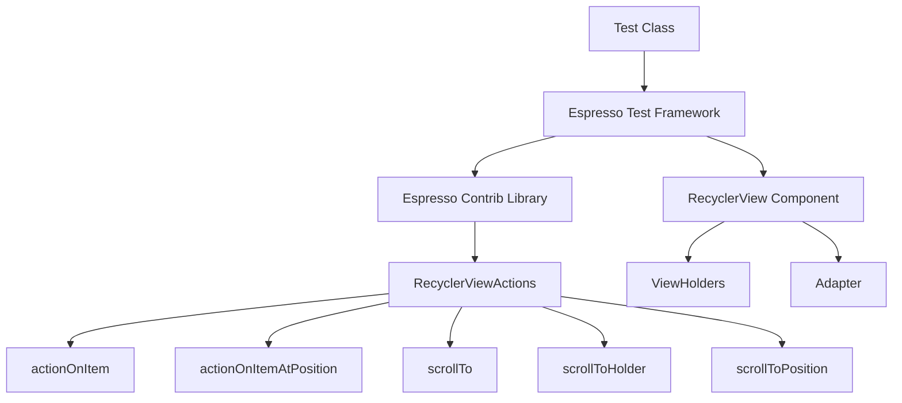
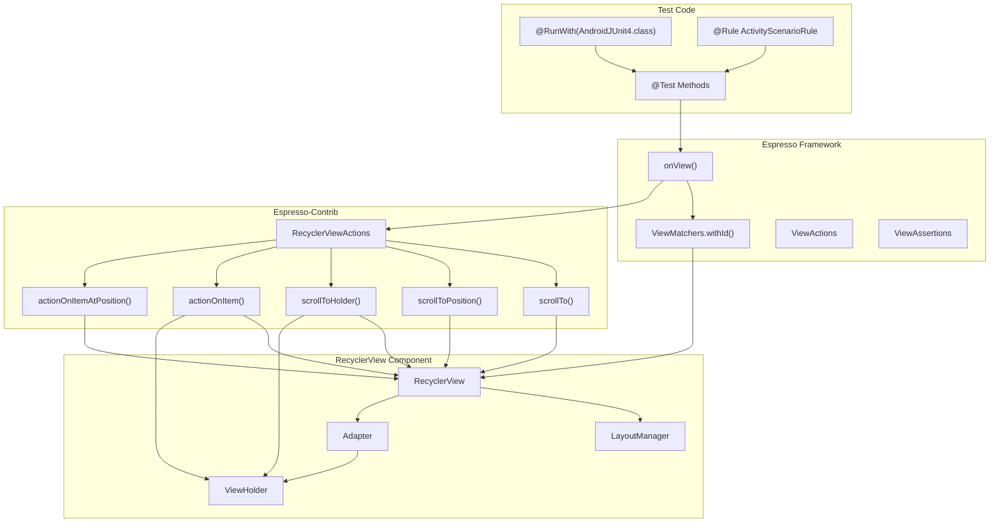
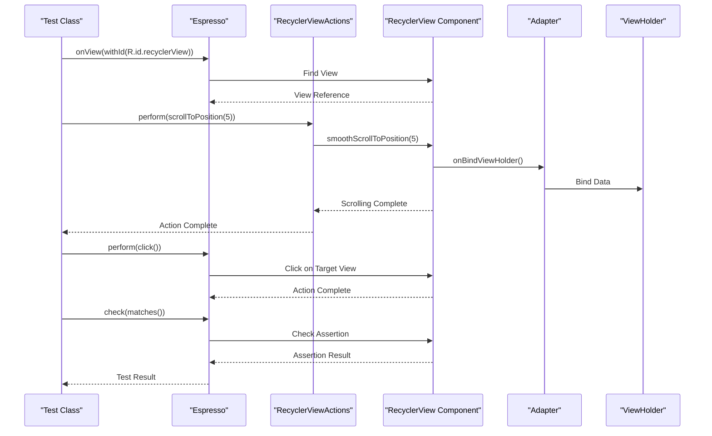

<!-- source: DeepWiki mcp.deepwiki.com · repo android/testing-samples · page 3.2 RecyclerView Testing · fetched 2026-10-23 -->

# RecyclerView Testing

<details>
<summary>Relevant source files</summary>

The following files were used as context for generating this wiki page:

- [integration/ServiceTestRuleSample/app/build.gradle](integration/ServiceTestRuleSample/app/build.gradle)
- [runner/AndroidJunitRunnerSample/app/build.gradle](runner/AndroidJunitRunnerSample/app/build.gradle)
- [ui/espresso/BasicSample/app/build.gradle](ui/espresso/BasicSample/app/build.gradle)
- [ui/espresso/CustomMatcherSample/app/build.gradle](ui/espresso/CustomMatcherSample/app/build.gradle)
- [ui/espresso/DataAdapterSample/app/build.gradle](ui/espresso/DataAdapterSample/app/build.gradle)
- [ui/espresso/IdlingResourceSample/app/build.gradle](ui/espresso/IdlingResourceSample/app/build.gradle)
- [ui/espresso/IntentsAdvancedSample/app/build.gradle](ui/espresso/IntentsAdvancedSample/app/build.gradle)
- [ui/espresso/IntentsBasicSample/app/build.gradle](ui/espresso/IntentsBasicSample/app/build.gradle)
- [ui/espresso/IntentsBasicSample/app/src/main/AndroidManifest.xml](ui/espresso/IntentsBasicSample/app/src/main/AndroidManifest.xml)
- [ui/espresso/IntentsBasicSample/app/src/main/res/layout/activity_dialer.xml](ui/espresso/IntentsBasicSample/app/src/main/res/layout/activity_dialer.xml)
- [ui/espresso/IntentsBasicSample/gradle.properties](ui/espresso/IntentsBasicSample/gradle.properties)
- [ui/espresso/MultiProcessSample/app/build.gradle](ui/espresso/MultiProcessSample/app/build.gradle)
- [ui/espresso/MultiWindowSample/app/build.gradle](ui/espresso/MultiWindowSample/app/build.gradle)
- [ui/espresso/RecyclerViewSample/app/build.gradle](ui/espresso/RecyclerViewSample/app/build.gradle)
- [ui/espresso/RecyclerViewSample/app/src/androidTest/java/com/example/android/testing/espresso/RecyclerViewSample/RecyclerViewSampleTest.java](ui/espresso/RecyclerViewSample/app/src/androidTest/java/com/example/android/testing/espresso/RecyclerViewSample/RecyclerViewSampleTest.java)
- [ui/espresso/WebBasicSample/app/build.gradle](ui/espresso/WebBasicSample/app/build.gradle)
- [ui/uiautomator/BasicSample/app/build.gradle](ui/uiautomator/BasicSample/app/build.gradle)

</details>


## Purpose and Scope

This document explains how to test Android applications that use RecyclerView components using Espresso and the Espresso Contrib library. It covers setting up the test environment, common testing patterns, and best practices for RecyclerView testing in Android applications. For general Espresso UI testing basics, see [Basic Espresso Testing](#3.1).

## Overview

Testing RecyclerView components presents unique challenges due to their dynamic nature and the fact that not all items are visible on screen at once. The Espresso Contrib library provides specialized tools for interacting with RecyclerViews in tests.



Sources: 
- [ui/espresso/RecyclerViewSample/app/src/androidTest/java/com/example/android/testing/espresso/RecyclerViewSample/RecyclerViewSampleTest.java:19-111]()
- [ui/espresso/RecyclerViewSample/app/build.gradle:62-73]()

## Setup for RecyclerView Testing

### Required Dependencies

To test RecyclerViews with Espresso, you need to include the Espresso Contrib library, which contains specialized actions for RecyclerView:

```
dependencies {
    // Core testing dependencies
    androidTestImplementation "androidx.test:core:" + rootProject.coreVersion;
    androidTestImplementation "androidx.test.ext:junit:" + rootProject.extJUnitVersion;
    androidTestImplementation "androidx.test:runner:" + rootProject.runnerVersion;
    androidTestImplementation "androidx.test.espresso:espresso-core:" + rootProject.espressoVersion;
    
    // Specialized RecyclerView testing support
    androidTestImplementation "androidx.test.espresso:espresso-contrib:" + rootProject.espressoVersion;
}
```

Sources:
- [ui/espresso/RecyclerViewSample/app/build.gradle:61-73]()

### Test Configuration

Configure the test runner in your application's `build.gradle` file:

```
android {
    defaultConfig {
        testInstrumentationRunner "androidx.test.runner.AndroidJUnitRunner"
    }
}
```

Sources:
- [ui/espresso/RecyclerViewSample/app/build.gradle:20-31]()

## RecyclerView Testing Architecture

The following diagram illustrates how RecyclerView testing fits into the Espresso testing architecture:



Sources:
- [ui/espresso/RecyclerViewSample/app/src/androidTest/java/com/example/android/testing/espresso/RecyclerViewSample/RecyclerViewSampleTest.java:19-111]()
- [ui/espresso/RecyclerViewSample/app/build.gradle:72]()

## Key Testing Operations

### 1. Scrolling to Items

RecyclerViewActions provides several methods to scroll to items in a RecyclerView:

| Method | Description | Example Use Case |
|--------|-------------|-----------------|
| `scrollTo(Matcher<View>)` | Scrolls to item matching a view condition | Find item with specific text |
| `scrollToPosition(int)` | Scrolls to item at specified position | Access a known position item |
| `scrollToHolder(Matcher<VH>)` | Scrolls to ViewHolder matching condition | Find items matching custom criteria |

Example of scrolling to an item that contains specific text:

```java
onView(withId(R.id.recyclerView))
    .perform(RecyclerViewActions.scrollTo(
        hasDescendant(withText("specific text"))
    ));
```

Sources:
- [ui/espresso/RecyclerViewSample/app/src/androidTest/java/com/example/android/testing/espresso/RecyclerViewSample/RecyclerViewSampleTest.java:61-69]()
- [ui/espresso/RecyclerViewSample/app/src/androidTest/java/com/example/android/testing/espresso/RecyclerViewSample/RecyclerViewSampleTest.java:83-93]()

### 2. Acting on Items

To perform actions on specific items in a RecyclerView:

| Method | Description | Example Use Case |
|--------|-------------|------------------|
| `actionOnItemAtPosition(int, ViewAction)` | Performs action on item at position | Click item at position 5 |
| `actionOnItem(Matcher<View>, ViewAction)` | Performs action on matching item | Click item with specific text |
| `actionOnHolderItem(Matcher<VH>, ViewAction)` | Performs action on matching ViewHolder | Click item with custom ViewHolder state |

Example of clicking an item at a specific position:

```java
onView(withId(R.id.recyclerView))
    .perform(RecyclerViewActions.actionOnItemAtPosition(ITEM_POSITION, click()));
```

Sources:
- [ui/espresso/RecyclerViewSample/app/src/androidTest/java/com/example/android/testing/espresso/RecyclerViewSample/RecyclerViewSampleTest.java:72-81]()

### 3. Creating Custom ViewHolder Matchers

For complex RecyclerView testing scenarios, you can create custom matchers that match based on ViewHolder properties:

```java
private static Matcher<CustomAdapter.ViewHolder> isInTheMiddle() {
    return new TypeSafeMatcher<CustomAdapter.ViewHolder>() {
        @Override
        protected boolean matchesSafely(CustomAdapter.ViewHolder customHolder) {
            return customHolder.getIsInTheMiddle();
        }

        @Override
        public void describeTo(Description description) {
            description.appendText("item in the middle");
        }
    };
}
```

Then use this custom matcher with `scrollToHolder()`:

```java
onView(withId(R.id.recyclerView))
    .perform(RecyclerViewActions.scrollToHolder(isInTheMiddle()));
```

Sources:
- [ui/espresso/RecyclerViewSample/app/src/androidTest/java/com/example/android/testing/espresso/RecyclerViewSample/RecyclerViewSampleTest.java:98-110]()
- [ui/espresso/RecyclerViewSample/app/src/androidTest/java/com/example/android/testing/espresso/RecyclerViewSample/RecyclerViewSampleTest.java:83-93]()

## Common Testing Patterns

### Testing for Item Existence

To test that an item does not exist in a RecyclerView:

```java
@Test(expected = PerformException.class)
public void itemWithText_doesNotExist() {
    // This will fail with PerformException if item doesn't exist
    onView(withId(R.id.recyclerView))
            .perform(RecyclerViewActions.scrollTo(
                    hasDescendant(withText("not in the list"))
            ));
}
```

Sources:
- [ui/espresso/RecyclerViewSample/app/src/androidTest/java/com/example/android/testing/espresso/RecyclerViewSample/RecyclerViewSampleTest.java:61-69]()

### Testing Items Below the Fold

To test items that aren't initially visible:

```java
@Test
public void scrollToItemBelowFold_checkItsText() {
    // First scroll to position and click
    onView(withId(R.id.recyclerView))
            .perform(RecyclerViewActions.actionOnItemAtPosition(ITEM_BELOW_THE_FOLD, click()));

    // Verify the text is displayed
    onView(withText(expectedText)).check(matches(isDisplayed()));
}
```

Sources:
- [ui/espresso/RecyclerViewSample/app/src/androidTest/java/com/example/android/testing/espresso/RecyclerViewSample/RecyclerViewSampleTest.java:71-81]()

## RecyclerView Test Execution Flow

The following diagram illustrates the test execution flow when testing RecyclerViews:



Sources:
- [ui/espresso/RecyclerViewSample/app/src/androidTest/java/com/example/android/testing/espresso/RecyclerViewSample/RecyclerViewSampleTest.java:19-111]()

## Best Practices

### Performance Considerations

1. **Minimize scrolling**: Excessive scrolling operations in tests can slow down test execution
2. **Use position-based operations** when possible as they're more efficient than matcher-based operations
3. **Avoid unnecessary assertions** on items that are not relevant to the test

### Stability Considerations

1. **Handle empty lists**: Your tests should properly handle cases when RecyclerView might be empty
2. **Consider animations**: Set `setHasStableIds(true)` on your adapter to improve test stability
3. **Provide descriptive error messages** in custom matchers to simplify troubleshooting

## Common Pitfalls

1. **RecyclerView item animations**: Can cause flaky tests; consider disabling them during testing
2. **ViewHolder recycling**: Be aware that ViewHolders are reused, which can affect tests
3. **Visibility issues**: Items must be fully visible for some actions; use `scrollTo` before interaction
4. **Custom RecyclerViews**: May require custom test logic if they override standard behavior

## Summary

Testing RecyclerViews with Espresso requires the Espresso Contrib library and special actions designed for dynamic list content. Key operations include scrolling to items (by position or condition), performing actions on specific items, and creating custom matchers for complex scenarios. Following the best practices outlined in this document will help create reliable and maintainable RecyclerView tests.

---

