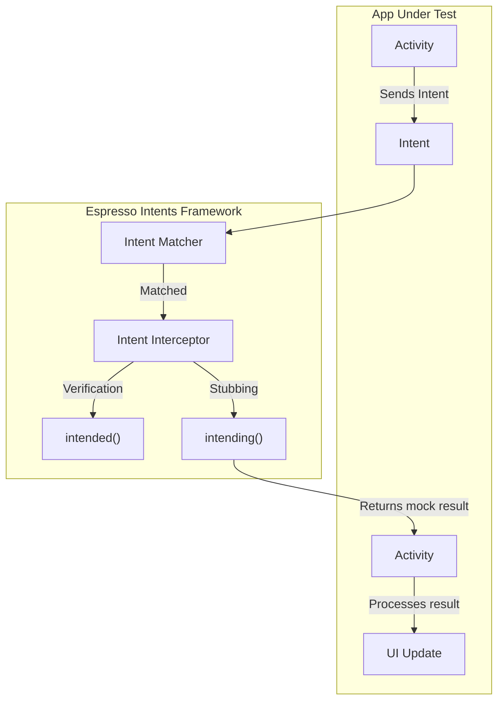
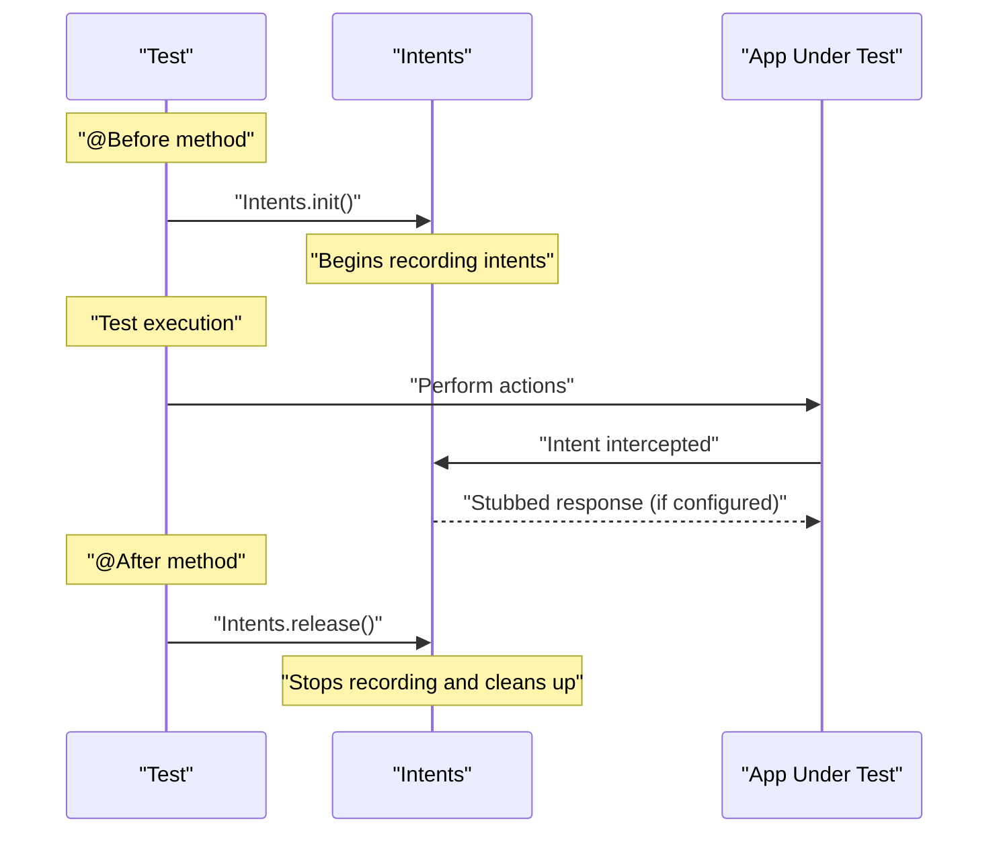
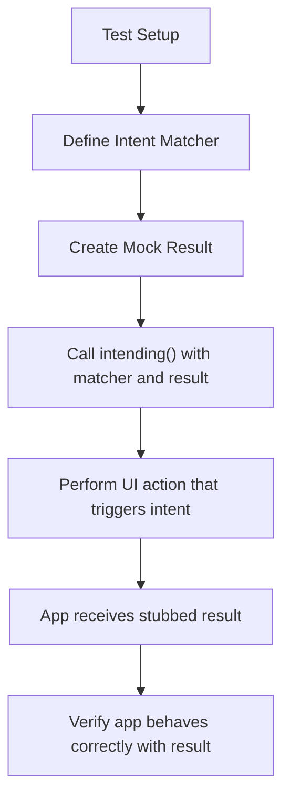
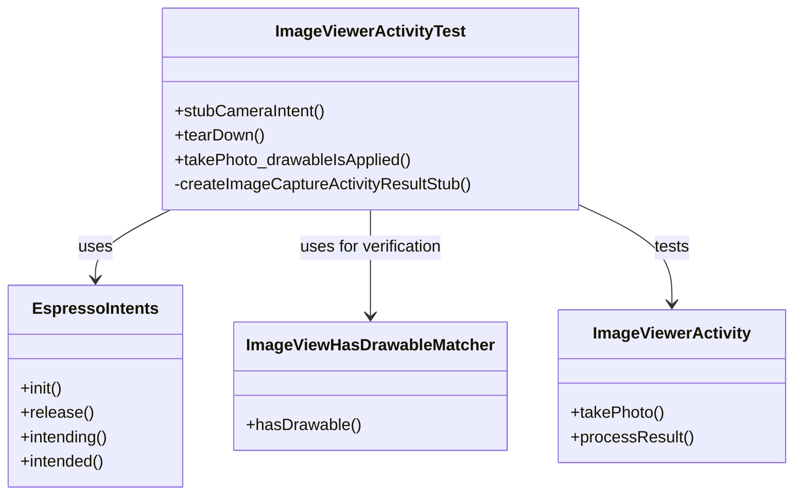

<!-- source: DeepWiki mcp.deepwiki.com · repo android/testing-samples · page 3.3 Intents Testing · fetched 2026-10-23 -->

# Intents Testing

<details>
<summary>Relevant source files</summary>

The following files were used as context for generating this wiki page:

- [runner/AndroidJunitRunnerSample/README.md](runner/AndroidJunitRunnerSample/README.md)
- [runner/AndroidJunitRunnerSample/app/src/androidTest/java/com/example/android/testing/androidjunitrunnersample/CalculatorInstrumentationTest.java](runner/AndroidJunitRunnerSample/app/src/androidTest/java/com/example/android/testing/androidjunitrunnersample/CalculatorInstrumentationTest.java)
- [ui/espresso/BasicSample/README.md](ui/espresso/BasicSample/README.md)
- [ui/espresso/CustomMatcherSample/README.md](ui/espresso/CustomMatcherSample/README.md)
- [ui/espresso/DataAdapterSample/README.md](ui/espresso/DataAdapterSample/README.md)
- [ui/espresso/IdlingResourceSample/app/src/androidTest/java/com/example/android/testing/espresso/IdlingResourceSample/ChangeTextBehaviorTest.java](ui/espresso/IdlingResourceSample/app/src/androidTest/java/com/example/android/testing/espresso/IdlingResourceSample/ChangeTextBehaviorTest.java)
- [ui/espresso/IntentsAdvancedSample/README.md](ui/espresso/IntentsAdvancedSample/README.md)
- [ui/espresso/IntentsAdvancedSample/app/src/androidTest/java/com/example/android/testing/espresso/intents/AdvancedSample/ImageViewHasDrawableMatcher.java](ui/espresso/IntentsAdvancedSample/app/src/androidTest/java/com/example/android/testing/espresso/intents/AdvancedSample/ImageViewHasDrawableMatcher.java)
- [ui/espresso/IntentsAdvancedSample/app/src/androidTest/java/com/example/android/testing/espresso/intents/AdvancedSample/ImageViewerActivityTest.java](ui/espresso/IntentsAdvancedSample/app/src/androidTest/java/com/example/android/testing/espresso/intents/AdvancedSample/ImageViewerActivityTest.java)
- [ui/espresso/IntentsBasicSample/README.md](ui/espresso/IntentsBasicSample/README.md)
- [ui/espresso/MultiWindowSample/README.md](ui/espresso/MultiWindowSample/README.md)
- [ui/espresso/MultiWindowSample/app/src/androidTest/java/com/example/android/testing/espresso/MultiWindowSample/MultiWindowTest.java](ui/espresso/MultiWindowSample/app/src/androidTest/java/com/example/android/testing/espresso/MultiWindowSample/MultiWindowTest.java)
- [ui/espresso/WebBasicSample/README.md](ui/espresso/WebBasicSample/README.md)
- [ui/espresso/WebBasicSample/app/src/androidTest/java/com/example/android/testing/espresso/web/BasicSample/WebViewActivityTest.java](ui/espresso/WebBasicSample/app/src/androidTest/java/com/example/android/testing/espresso/web/BasicSample/WebViewActivityTest.java)
- [unit/BasicUnitAndroidTest/app/src/androidTest/java/com/example/android/testing/unittesting/basicunitandroidtest/LogHistoryAndroidUnitTest.java](unit/BasicUnitAndroidTest/app/src/androidTest/java/com/example/android/testing/unittesting/basicunitandroidtest/LogHistoryAndroidUnitTest.java)

</details>


## Purpose and Scope

This document covers how to test Android applications that interact with other components through Intents using Espresso Intents. It explains Intent verification and stubbing for hermetic inter-app testing without requiring actual component launches. For information about basic UI testing with Espresso, see [Basic Espresso Testing](#3.1).

## Introduction to Intents Testing

Android applications frequently communicate with other components (Activities, Services, BroadcastReceivers) through Intents. Testing these interactions traditionally required launching actual components, which can be unreliable and slow. Espresso Intents solves this problem by providing a Mockito-like API for:

1. **Intent Verification** - Confirming that your app sends the correct Intents
2. **Intent Stubbing** - Providing mock responses for Intents without launching actual components

Sources: 
- [ui/espresso/IntentsAdvancedSample/README.md]()
- [ui/espresso/IntentsBasicSample/README.md]()

## Espresso Intents Architecture

### Intents Testing Flow Diagram



Sources:
- [ui/espresso/IntentsAdvancedSample/app/src/androidTest/java/com/example/android/testing/espresso/intents/AdvancedSample/ImageViewerActivityTest.java]()

## Setup and Initialization

### Initialize and Release

All Intents tests require proper initialization and cleanup:



In your test class, you must initialize Intents before the test and release resources afterward:

```java
@Before
public void setUp() {
    // Initialize Intents
    Intents.init();
}

@After
public void tearDown() {
    // Clean up resources
    Intents.release();
}
```

Sources:
- [ui/espresso/IntentsAdvancedSample/app/src/androidTest/java/com/example/android/testing/espresso/intents/AdvancedSample/ImageViewerActivityTest.java:62-76]()

## Intent Verification

Intent verification confirms that your app sends the expected Intents with correct data. It uses `intended()` to verify an intent was sent that matches specific criteria.

### Verification Example

```java
// Perform action that should trigger an intent
onView(withId(R.id.button_send_email)).perform(click());

// Verify that an intent with the email action was sent
intended(hasAction(Intent.ACTION_SENDTO));

// You can verify multiple properties
intended(allOf(
    hasAction(Intent.ACTION_SENDTO),
    hasExtra(Intent.EXTRA_SUBJECT, "Test Subject"),
    hasData(Uri.parse("mailto:test@example.com"))
));
```

Common intent matchers include:
- `hasAction()` - Matches the intent's action
- `hasData()` - Matches the intent's data URI
- `hasExtra()` - Matches an extra in the intent
- `hasComponent()` - Matches the component name

Sources:
- [ui/espresso/IntentsBasicSample/README.md]()

## Intent Stubbing

Intent stubbing intercepts outgoing intents and provides mock responses, avoiding the need to launch actual components.

### Stubbing Workflow Diagram



### Stubbing Example

The following shows how to stub a camera intent:

```java
// Create a result to return when the camera intent is sent
ActivityResult result = createImageCaptureActivityResultStub();

// Register the response for the camera intent
intending(hasAction(MediaStore.ACTION_IMAGE_CAPTURE)).respondWith(result);

// Perform action that triggers camera intent
onView(withId(R.id.button_take_photo)).perform(click());

// Verify the app processed the result correctly
onView(withId(R.id.imageView)).check(matches(hasDrawable()));
```

The `createImageCaptureActivityResultStub()` method creates a mock result with image data:

```java
private ActivityResult createImageCaptureActivityResultStub() {
    // Create a bundle with the image data
    Bundle bundle = new Bundle();
    bundle.putParcelable(KEY_IMAGE_DATA, BitmapFactory.decodeResource(
            getInstrumentation().getTargetContext().getResources(),
            R.drawable.ic_launcher));

    // Create an intent with the bundle
    Intent resultData = new Intent();
    resultData.putExtras(bundle);

    // Return an ActivityResult with RESULT_OK and the intent
    return new ActivityResult(Activity.RESULT_OK, resultData);
}
```

Sources:
- [ui/espresso/IntentsAdvancedSample/app/src/androidTest/java/com/example/android/testing/espresso/intents/AdvancedSample/ImageViewerActivityTest.java:67-70]()
- [ui/espresso/IntentsAdvancedSample/app/src/androidTest/java/com/example/android/testing/espresso/intents/AdvancedSample/ImageViewerActivityTest.java:91-104]()

## Advanced Example: Camera Intent Stubbing

The `ImageViewerActivityTest` demonstrates testing a photo capture scenario without launching an actual camera app:

### Camera Test Implementation

1. **Setup**: Initialize Intents and stub the camera intent in `@Before`
2. **Test**: Click a button that triggers the camera intent
3. **Verify**: Check that the returned image is displayed correctly

### Implementation Components Diagram



### Custom Matcher for Verification

The sample uses a custom matcher to verify that an `ImageView` has a drawable set after processing the camera result:

```java
public static Matcher<View> hasDrawable() {
    return new BoundedDiagnosingMatcher<View, ImageView>(ImageView.class) {
        @Override
        protected void describeMoreTo(Description description) {
            description.appendText("has drawable");
        }

        @Override
        protected boolean matchesSafely(ImageView imageView, Description mismatchDescription) {
            return imageView.getDrawable() != null;
        }
    };
}
```

This matcher greatly simplifies checking if the camera result was properly processed and displayed.

Sources:
- [ui/espresso/IntentsAdvancedSample/app/src/androidTest/java/com/example/android/testing/espresso/intents/AdvancedSample/ImageViewHasDrawableMatcher.java:31-43]()
- [ui/espresso/IntentsAdvancedSample/app/src/androidTest/java/com/example/android/testing/espresso/intents/AdvancedSample/ImageViewerActivityTest.java:79-89]()

## Best Practices for Intents Testing

| Practice | Description |
|----------|-------------|
| Always initialize and release | Call `Intents.init()` before and `Intents.release()` after each test |
| Use precise intent matchers | Be specific about which intents to match to avoid intercepting unintended intents |
| Test failure scenarios | Stub intents with error results (e.g., `RESULT_CANCELED`) to test error handling |
| Keep stub responses realistic | Ensure mock data resembles what would be returned by the real component |
| Combine with UI verification | Verify that UI updates correctly after receiving stubbed intent results |
| Create custom matchers | Use custom matchers for specific verification needs |

Sources:
- [ui/espresso/IntentsAdvancedSample/app/src/androidTest/java/com/example/android/testing/espresso/intents/AdvancedSample/ImageViewerActivityTest.java]()
- [ui/espresso/IntentsAdvancedSample/README.md]()

## Integration with Other Espresso Features

Intents testing can be combined with other Espresso features for more comprehensive testing:

| Feature | Integration with Intents Testing |
|---------|----------------------------------|
| ViewMatchers | Verify UI state before sending intents and after processing results |
| ViewActions | Trigger actions that will send intents |
| ViewAssertions | Verify UI correctly reflects the processed intent results |
| IdlingResources | Synchronize tests with background processing of intent results |

For example, you might use IdlingResource to wait for image processing after a camera intent result, as shown in [IdlingResource for Asynchronous Testing](#3.4).

Sources:
- [ui/espresso/IdlingResourceSample/app/src/androidTest/java/com/example/android/testing/espresso/IdlingResourceSample/ChangeTextBehaviorTest.java]()
- [runner/AndroidJunitRunnerSample/app/src/androidTest/java/com/example/android/testing/androidjunitrunnersample/CalculatorInstrumentationTest.java]()

## Conclusion

Espresso Intents provides a powerful way to test inter-component communications without depending on external components. By using intent verification and stubbing, you can create hermetic tests that are faster and more reliable than tests that launch actual components.

For testing other aspects of your app, consider exploring:
- [RecyclerView Testing](#3.2) for list interactions
- [IdlingResource for Asynchronous Testing](#3.4) for tests involving asynchronous operations
- [Multi-Window Testing](#3.5) for apps with multiple windows

---

