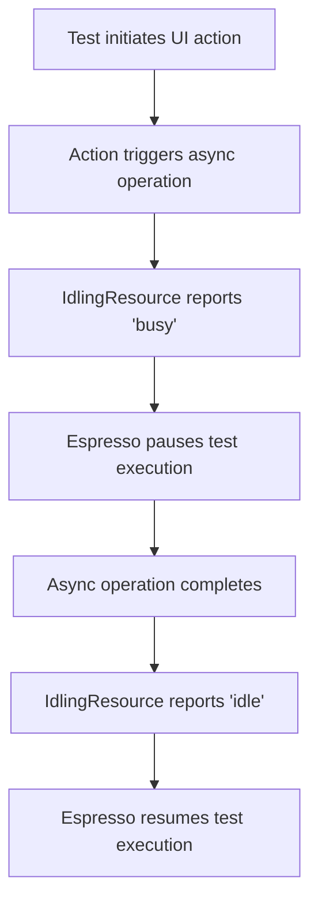
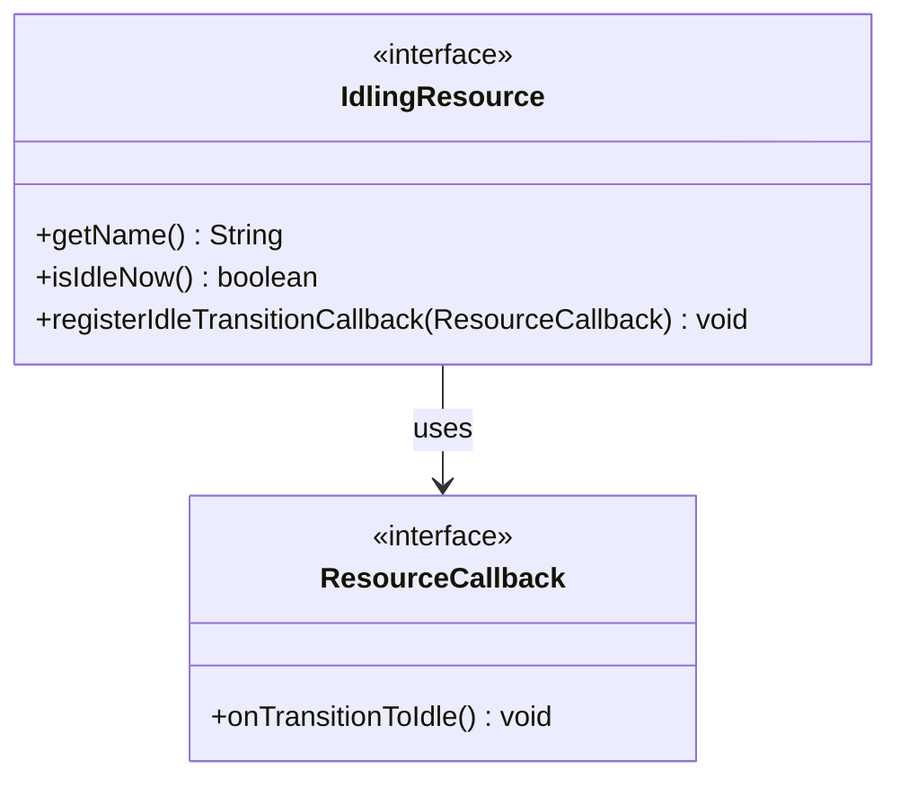
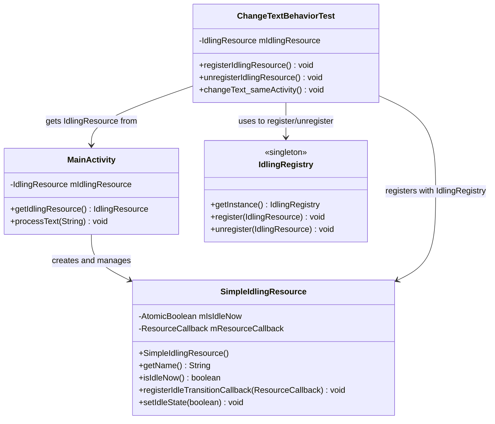
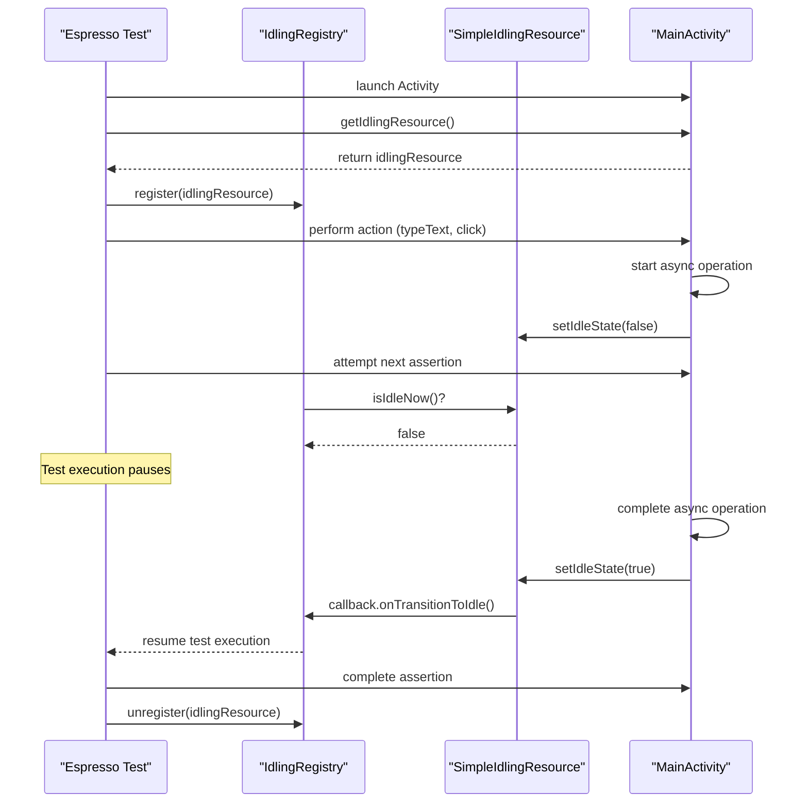
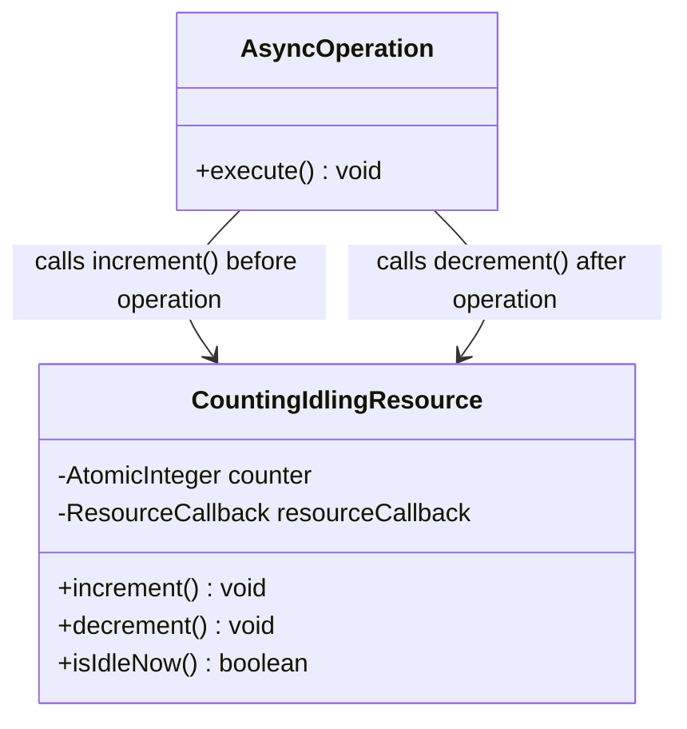
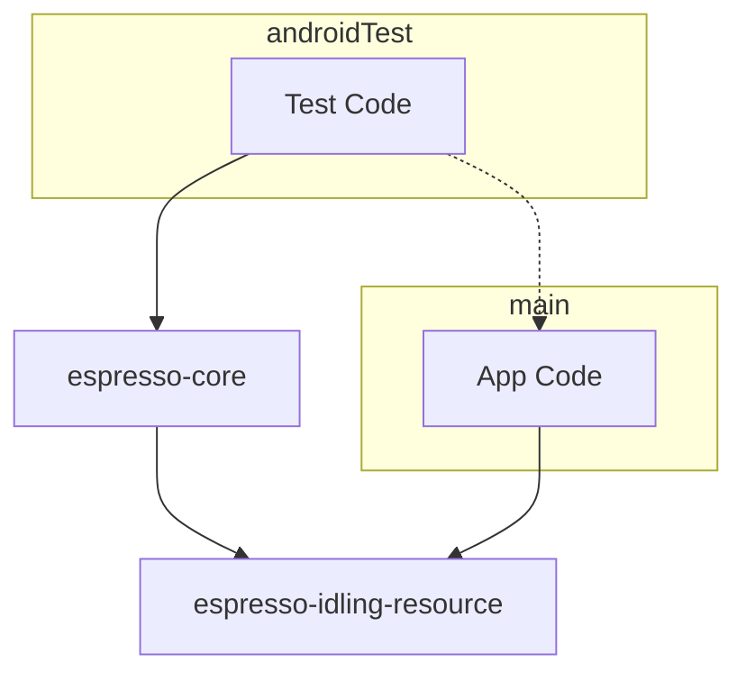
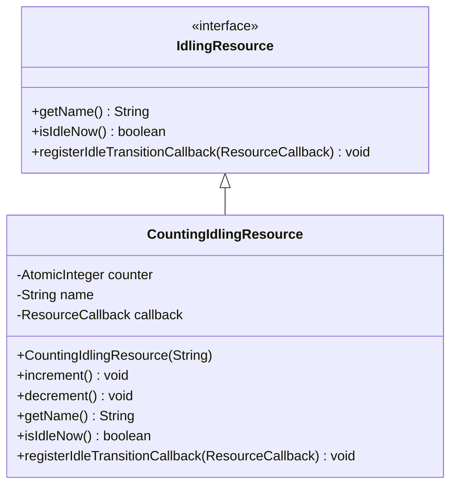

<!-- source: DeepWiki mcp.deepwiki.com · repo android/testing-samples · page 3.4 IdlingResource for Asynchronous Testing · fetched 2026-10-23 -->

# IdlingResource for Asynchronous Testing

<details>
<summary>Relevant source files</summary>

The following files were used as context for generating this wiki page:

- [integration/ServiceTestRuleSample/app/build.gradle](integration/ServiceTestRuleSample/app/build.gradle)
- [runner/AndroidJunitRunnerSample/app/build.gradle](runner/AndroidJunitRunnerSample/app/build.gradle)
- [runner/AndroidJunitRunnerSample/app/src/androidTest/java/com/example/android/testing/androidjunitrunnersample/CalculatorInstrumentationTest.java](runner/AndroidJunitRunnerSample/app/src/androidTest/java/com/example/android/testing/androidjunitrunnersample/CalculatorInstrumentationTest.java)
- [ui/espresso/BasicSample/app/build.gradle](ui/espresso/BasicSample/app/build.gradle)
- [ui/espresso/CustomMatcherSample/app/build.gradle](ui/espresso/CustomMatcherSample/app/build.gradle)
- [ui/espresso/DataAdapterSample/app/build.gradle](ui/espresso/DataAdapterSample/app/build.gradle)
- [ui/espresso/IdlingResourceSample/app/build.gradle](ui/espresso/IdlingResourceSample/app/build.gradle)
- [ui/espresso/IdlingResourceSample/app/src/androidTest/java/com/example/android/testing/espresso/IdlingResourceSample/ChangeTextBehaviorTest.java](ui/espresso/IdlingResourceSample/app/src/androidTest/java/com/example/android/testing/espresso/IdlingResourceSample/ChangeTextBehaviorTest.java)
- [ui/espresso/IntentsAdvancedSample/app/build.gradle](ui/espresso/IntentsAdvancedSample/app/build.gradle)
- [ui/espresso/IntentsAdvancedSample/app/src/androidTest/java/com/example/android/testing/espresso/intents/AdvancedSample/ImageViewHasDrawableMatcher.java](ui/espresso/IntentsAdvancedSample/app/src/androidTest/java/com/example/android/testing/espresso/intents/AdvancedSample/ImageViewHasDrawableMatcher.java)
- [ui/espresso/IntentsAdvancedSample/app/src/androidTest/java/com/example/android/testing/espresso/intents/AdvancedSample/ImageViewerActivityTest.java](ui/espresso/IntentsAdvancedSample/app/src/androidTest/java/com/example/android/testing/espresso/intents/AdvancedSample/ImageViewerActivityTest.java)
- [ui/espresso/IntentsBasicSample/app/build.gradle](ui/espresso/IntentsBasicSample/app/build.gradle)
- [ui/espresso/MultiProcessSample/app/build.gradle](ui/espresso/MultiProcessSample/app/build.gradle)
- [ui/espresso/MultiWindowSample/app/build.gradle](ui/espresso/MultiWindowSample/app/build.gradle)
- [ui/espresso/MultiWindowSample/app/src/androidTest/java/com/example/android/testing/espresso/MultiWindowSample/MultiWindowTest.java](ui/espresso/MultiWindowSample/app/src/androidTest/java/com/example/android/testing/espresso/MultiWindowSample/MultiWindowTest.java)
- [ui/espresso/RecyclerViewSample/app/build.gradle](ui/espresso/RecyclerViewSample/app/build.gradle)
- [ui/espresso/WebBasicSample/app/build.gradle](ui/espresso/WebBasicSample/app/build.gradle)
- [ui/espresso/WebBasicSample/app/src/androidTest/java/com/example/android/testing/espresso/web/BasicSample/WebViewActivityTest.java](ui/espresso/WebBasicSample/app/src/androidTest/java/com/example/android/testing/espresso/web/BasicSample/WebViewActivityTest.java)
- [ui/uiautomator/BasicSample/app/build.gradle](ui/uiautomator/BasicSample/app/build.gradle)
- [unit/BasicUnitAndroidTest/app/src/androidTest/java/com/example/android/testing/unittesting/basicunitandroidtest/LogHistoryAndroidUnitTest.java](unit/BasicUnitAndroidTest/app/src/androidTest/java/com/example/android/testing/unittesting/basicunitandroidtest/LogHistoryAndroidUnitTest.java)

</details>


## Purpose and Scope

This document explains how to use Espresso's IdlingResource mechanism to handle asynchronous operations in Android UI tests. When your app performs background work like network calls, database operations, or any lengthy computations, IdlingResource helps synchronize your tests with these operations, preventing flaky test results. 

For information about other Espresso testing approaches, see [Basic Espresso Testing](#3.1) or [Intents Testing](#3.3).

## Problem: The Asynchronous Testing Challenge

Without proper synchronization, tests that interact with asynchronous operations often fail unpredictably:

- Tests might attempt to interact with UI elements before they're populated with data
- Assertions might run before operations complete
- Tests may pass or fail based on timing rather than actual functionality

Traditional solutions like Thread.sleep() are unreliable and inefficient.

Sources:
- `ui/espresso/IdlingResourceSample/app/build.gradle`

## Solution: IdlingResource

IdlingResource is an interface provided by Espresso that creates a communication channel between your application code and test code. It informs Espresso when your application is "busy" with background work and when it's "idle" and ready for the next test action.



Sources:
- `ui/espresso/IdlingResourceSample/app/src/androidTest/java/com/example/android/testing/espresso/IdlingResourceSample/ChangeTextBehaviorTest.java`

## Understanding the IdlingResource Interface

The IdlingResource interface requires implementing three methods:



- `getName()`: Returns a name for debugging purposes
- `isIdleNow()`: Returns the current idle state
- `registerIdleTransitionCallback()`: Registers a callback that will be invoked when the resource transitions to idle

Sources:
- `ui/espresso/IdlingResourceSample/app/build.gradle:66`

## Implementation in the Sample App

In the IdlingResourceSample app, IdlingResource is used to handle a delayed text change operation. The implementation consists of the following components:



Sources:
- `ui/espresso/IdlingResourceSample/app/src/androidTest/java/com/example/android/testing/espresso/IdlingResourceSample/ChangeTextBehaviorTest.java`
- `ui/espresso/IdlingResourceSample/app/build.gradle:66`

## Usage in the Test

The test class demonstrates the proper pattern for using IdlingResource:

1. **Get the IdlingResource from the activity being tested:**

```java
ActivityScenario activityScenario = ActivityScenario.launch(MainActivity.class);
activityScenario.onActivity(activity -> {
    mIdlingResource = activity.getIdlingResource();
    IdlingRegistry.getInstance().register(mIdlingResource);
});
```

2. **Perform the test actions that trigger async operations:**

```java
onView(withId(R.id.editTextUserInput))
        .perform(typeText(STRING_TO_BE_TYPED), closeSoftKeyboard());
onView(withId(R.id.changeTextBt)).perform(click());
```

3. **Assert the expected results (Espresso automatically waits for the IdlingResource to be idle):**

```java
onView(withId(R.id.textToBeChanged)).check(matches(withText(STRING_TO_BE_TYPED)));
```

4. **Clean up by unregistering the IdlingResource:**

```java
if (mIdlingResource != null) {
    IdlingRegistry.getInstance().unregister(mIdlingResource);
}
```

Sources:
- `ui/espresso/IdlingResourceSample/app/src/androidTest/java/com/example/android/testing/espresso/IdlingResourceSample/ChangeTextBehaviorTest.java:57-84`

## IdlingResource Lifecycle

This sequence diagram shows how IdlingResource coordinates between the test and application:



Sources:
- `ui/espresso/IdlingResourceSample/app/src/androidTest/java/com/example/android/testing/espresso/IdlingResourceSample/ChangeTextBehaviorTest.java`

## Implementation Patterns

### Simple Counter Pattern

For operations that have definite start and end points:



### Dependency Structure



Sources:
- `ui/espresso/IdlingResourceSample/app/build.gradle:64-66`

## Best Practices

1. **Keep IdlingResource in production code minimal**:
   - Only include what's needed for test synchronization
   - Consider using product flavors or build types to include IdlingResource only in test builds

2. **Balance resource counting**:
   - For every `increment()` call, ensure there's a matching `decrement()`
   - Use try-finally blocks to ensure operations are decremented even if exceptions occur

3. **Use CountingIdlingResource for complex scenarios**:
   - When multiple async operations might be running concurrently
   - When operations might be nested

4. **Avoid test-only code in production**:
   - Use dependency injection to provide IdlingResource implementations
   - Consider conditional compilation to remove IdlingResource from release builds

5. **Always unregister IdlingResources**:
   - Use @After to ensure cleanup even if tests fail

Sources:
- `ui/espresso/IdlingResourceSample/app/src/androidTest/java/com/example/android/testing/espresso/IdlingResourceSample/ChangeTextBehaviorTest.java:80-84`

## Related Testing Approaches

For other testing approaches that complement IdlingResource:

- For testing RecyclerView components, see [RecyclerView Testing](#3.2)
- For testing WebViews, see [WebView Testing](#3.6)
- For understanding test orchestration, see [Android Test Orchestrator](#5.2)

## Common Implementations

### CountingIdlingResource

The most commonly used implementation that maintains a counter of ongoing operations:



### Common Asynchronous Operations That Need IdlingResource

| Operation Type | Implementation Approach |
|----------------|-------------------------|
| Network calls | Wrap OkHttp or Retrofit client with IdlingResource |
| Database operations | Wrap Room DAO methods or add callback hooks |
| Image loading | Custom Glide or Picasso listeners |
| Animations | Register animation listeners |
| Service operations | Use CountingIdlingResource around service calls |
| Custom background tasks | Instrument Handler, Thread, AsyncTask with IdlingResource |

Sources:
- `ui/espresso/IdlingResourceSample/app/build.gradle:60-66`

## Conclusion

IdlingResource provides a robust solution for the asynchronous testing problem in Android UI tests. By properly implementing and registering IdlingResources, your tests can reliably wait for background operations to complete, resulting in more stable and reliable test suites.

By integrating IdlingResource into your app's architecture, you maintain a clear separation between production and test code while still enabling effective testing of asynchronous operations.

---

