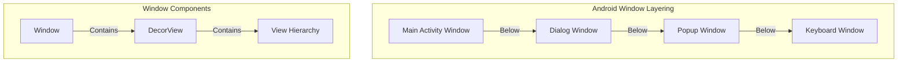
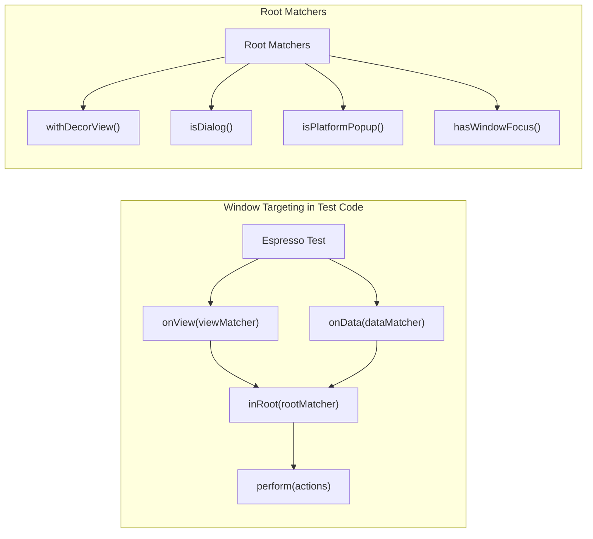
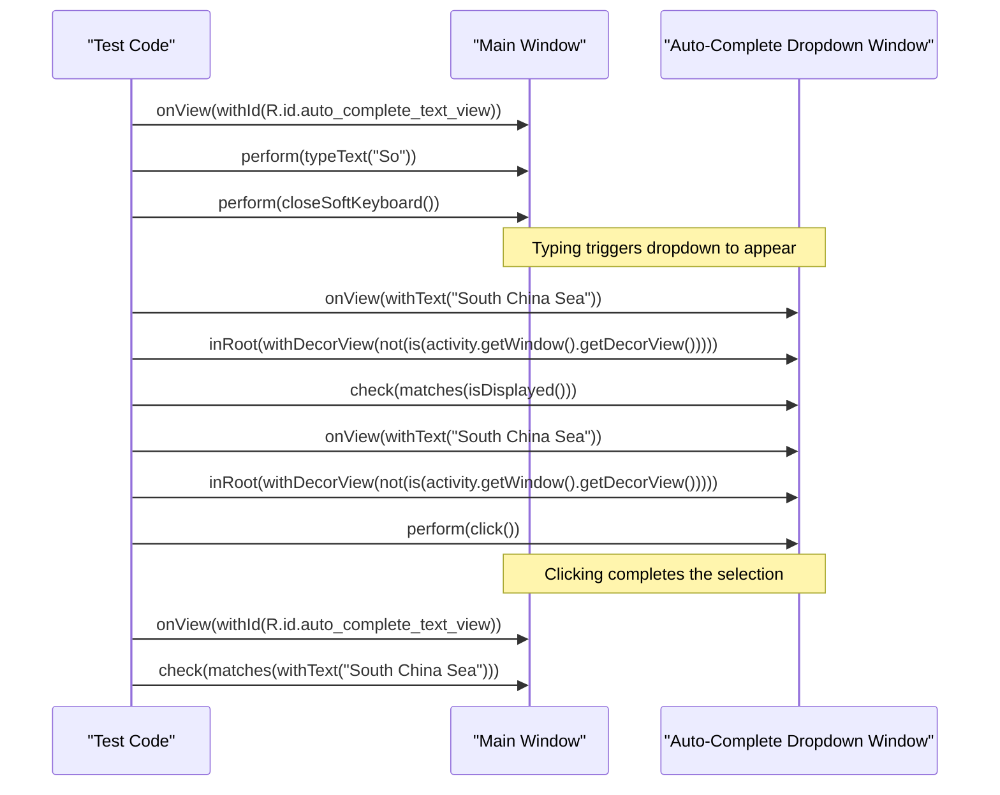
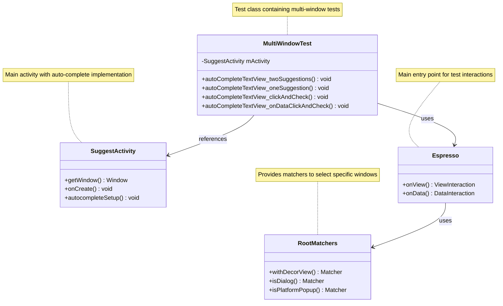

<!-- source: DeepWiki mcp.deepwiki.com · repo android/testing-samples · page 3.5 Multi-Window Testing · fetched 2026-10-23 -->

# Multi-Window Testing

<details>
<summary>Relevant source files</summary>

The following files were used as context for generating this wiki page:

- [runner/AndroidJunitRunnerSample/README.md](runner/AndroidJunitRunnerSample/README.md)
- [runner/AndroidJunitRunnerSample/app/src/androidTest/java/com/example/android/testing/androidjunitrunnersample/CalculatorInstrumentationTest.java](runner/AndroidJunitRunnerSample/app/src/androidTest/java/com/example/android/testing/androidjunitrunnersample/CalculatorInstrumentationTest.java)
- [ui/espresso/BasicSample/README.md](ui/espresso/BasicSample/README.md)
- [ui/espresso/CustomMatcherSample/README.md](ui/espresso/CustomMatcherSample/README.md)
- [ui/espresso/DataAdapterSample/README.md](ui/espresso/DataAdapterSample/README.md)
- [ui/espresso/IdlingResourceSample/app/src/androidTest/java/com/example/android/testing/espresso/IdlingResourceSample/ChangeTextBehaviorTest.java](ui/espresso/IdlingResourceSample/app/src/androidTest/java/com/example/android/testing/espresso/IdlingResourceSample/ChangeTextBehaviorTest.java)
- [ui/espresso/IntentsAdvancedSample/README.md](ui/espresso/IntentsAdvancedSample/README.md)
- [ui/espresso/IntentsAdvancedSample/app/src/androidTest/java/com/example/android/testing/espresso/intents/AdvancedSample/ImageViewHasDrawableMatcher.java](ui/espresso/IntentsAdvancedSample/app/src/androidTest/java/com/example/android/testing/espresso/intents/AdvancedSample/ImageViewHasDrawableMatcher.java)
- [ui/espresso/IntentsAdvancedSample/app/src/androidTest/java/com/example/android/testing/espresso/intents/AdvancedSample/ImageViewerActivityTest.java](ui/espresso/IntentsAdvancedSample/app/src/androidTest/java/com/example/android/testing/espresso/intents/AdvancedSample/ImageViewerActivityTest.java)
- [ui/espresso/IntentsBasicSample/README.md](ui/espresso/IntentsBasicSample/README.md)
- [ui/espresso/MultiWindowSample/README.md](ui/espresso/MultiWindowSample/README.md)
- [ui/espresso/MultiWindowSample/app/src/androidTest/java/com/example/android/testing/espresso/MultiWindowSample/MultiWindowTest.java](ui/espresso/MultiWindowSample/app/src/androidTest/java/com/example/android/testing/espresso/MultiWindowSample/MultiWindowTest.java)
- [ui/espresso/WebBasicSample/README.md](ui/espresso/WebBasicSample/README.md)
- [ui/espresso/WebBasicSample/app/src/androidTest/java/com/example/android/testing/espresso/web/BasicSample/WebViewActivityTest.java](ui/espresso/WebBasicSample/app/src/androidTest/java/com/example/android/testing/espresso/web/BasicSample/WebViewActivityTest.java)
- [unit/BasicUnitAndroidTest/app/src/androidTest/java/com/example/android/testing/unittesting/basicunitandroidtest/LogHistoryAndroidUnitTest.java](unit/BasicUnitAndroidTest/app/src/androidTest/java/com/example/android/testing/unittesting/basicunitandroidtest/LogHistoryAndroidUnitTest.java)

</details>


## Purpose and Scope

This document explains how to test Android applications that utilize multiple windows using Espresso. It covers the Android window system, how Espresso selects windows during testing, and techniques for properly targeting and testing UI elements that exist in different window layers. For related UI testing approaches, see [UI Testing with Espresso](#3) and [WebView Testing](#3.6).

## Android Window System Overview

Android's window system allows multiple view hierarchies to layer on top of each other, similar to overhead projector transparencies stacked together. Each window is a transparency, and what is drawn on that transparency is a view hierarchy. Common examples of multiple windows include:

- Auto-complete suggestion lists
- Drop-down menus
- Dialogs and popups
- Floating keyboards



Sources: [ui/espresso/MultiWindowSample/README.md:3-7]()

## Espresso's Default Window Selection

By default, Espresso uses a heuristic to guess which window you intend to interact with. This heuristic is usually adequate for standard UI interactions, but has limitations:

1. It typically targets the window with current input focus
2. It may ignore certain types of windows (like auto-complete dropdowns) 
3. It doesn't handle all layered UI scenarios correctly

When Espresso cannot correctly identify the target window, your tests may fail with errors like:
- "No views in hierarchy found matching..."
- "Animations or transitions are enabled on the target device..."
- "Multiple views match..."

Sources: [ui/espresso/MultiWindowSample/README.md:9-14]()

## Custom Window Selection

Espresso provides the ability to customize window selection for both `onView()` and `onData()` interactions. This is done using the `.inRoot()` method with appropriate matchers.



Sources: [ui/espresso/MultiWindowSample/app/src/androidTest/java/com/example/android/testing/espresso/MultiWindowSample/MultiWindowTest.java:44-66]()

## Common Multi-Window Test Patterns

### Testing Auto-Complete Suggestions

Auto-complete dropdown suggestions appear in a separate window overlay. To test them:

1. Use `withDecorView(not(is(activity.getWindow().getDecorView())))` to target the suggestion window
2. Combine with view matchers to find elements within the suggestion window

```java
// Example test pattern for auto-complete suggestions
onView(withText("Suggestion Text"))
    .inRoot(withDecorView(not(is(activity.getWindow().getDecorView()))))
    .check(matches(isDisplayed()));
```

Table: Approach Comparison for Auto-Complete Testing

| Method | Advantages | Limitations |
|--------|------------|-------------|
| `onView()` with `inRoot()` | Direct view targeting, simpler for basic cases | May not see all items in large lists |
| `onData()` with `inRoot()` | Can access all adapter items, even if not visible | Requires adapter items to be accessible |

Sources: [ui/espresso/MultiWindowSample/app/src/androidTest/java/com/example/android/testing/espresso/MultiWindowSample/MultiWindowTest.java:93-105](), [ui/espresso/MultiWindowSample/app/src/androidTest/java/com/example/android/testing/espresso/MultiWindowSample/MultiWindowTest.java:141-157]()

### Checking Existence and Non-Existence

When testing multi-window scenarios, verifying that elements are present or not present in specific windows is a common requirement:

```java
// Check that element exists
onView(withText("Expected Text"))
    .inRoot(withDecorView(not(is(activity.getWindow().getDecorView()))))
    .check(matches(isDisplayed()));

// Check that element does not exist
onView(withText("Should Not Be Present"))
    .inRoot(withDecorView(not(is(activity.getWindow().getDecorView()))))
    .check(doesNotExist());
```

Sources: [ui/espresso/MultiWindowSample/app/src/androidTest/java/com/example/android/testing/espresso/MultiWindowSample/MultiWindowTest.java:114-122]()

## Example: Testing Auto-Complete Text View

The following sequence diagram illustrates a typical flow for testing an auto-complete text view:



Sources: [ui/espresso/MultiWindowSample/app/src/androidTest/java/com/example/android/testing/espresso/MultiWindowSample/MultiWindowTest.java:126-139]()

## Using onData() with Multiple Windows

For more complex scenarios, particularly with large lists of suggestions, `onData()` provides a more robust approach:

1. `onData()` can access items not currently visible in the view hierarchy
2. Uses adapters to access the underlying data
3. Must be combined with `.inRoot()` for multi-window targeting

```java
onData(allOf(instanceOf(String.class), is("Desired Text")))
    .inRoot(withDecorView(not(is(activity.getWindow().getDecorView()))))
    .perform(click());
```

Sources: [ui/espresso/MultiWindowSample/app/src/androidTest/java/com/example/android/testing/espresso/MultiWindowSample/MultiWindowTest.java:141-157]()

## Implementation Structure

The following diagram shows how the different components of multi-window testing work together in the MultiWindowSample project:



Sources: [ui/espresso/MultiWindowSample/app/src/androidTest/java/com/example/android/testing/espresso/MultiWindowSample/MultiWindowTest.java:69-89]()

## Best Practices

1. **Get the correct window reference**: Always ensure you have the correct reference to the target window's DecorView.

2. **Combine with appropriate view matchers**: Window matching is just the first step; you still need precise view matchers.

3. **Handle timing issues**: Multi-window interactions may involve animations or delayed rendering. Use `IdlingResources` when necessary (see [IdlingResource for Asynchronous Testing](#3.4)).

4. **Verify window state before and after**: Check that windows appear and disappear as expected during test flows.

5. **Use `onData()` for complex lists**: For long adapter-backed lists where not all items may be rendered, use `onData()` instead of `onView()`.

6. **Test both selection and cancellation flows**: Ensure your tests cover both selecting from multi-window UI elements and dismissing them.

Sources: [ui/espresso/MultiWindowSample/app/src/androidTest/java/com/example/android/testing/espresso/MultiWindowSample/MultiWindowTest.java:93-157]()

## Common Pitfalls and Solutions

| Issue | Cause | Solution |
|-------|-------|----------|
| Test can't find elements in popup | Wrong window targeted | Use `.inRoot()` with appropriate matcher |
| "Multiple matches" errors | Multiple similar elements in different windows | Add more specific view matchers or window constraints |
| Element found but interaction fails | Window may not have focus | Ensure correct window has focus or use direct targeting |
| Tests work intermittently | Race conditions with window animations | Disable animations on test device or add IdlingResources |
| Can't access all list items | Not all adapter items are rendered | Use `onData()` instead of `onView()` |

Sources: [ui/espresso/MultiWindowSample/README.md:32-34]()

## Related Resources

For deeper understanding of Espresso testing patterns, consider exploring:
- [Basic Espresso Testing](#3.1) for fundamental Espresso concepts
- [RecyclerView Testing](#3.2) for complex list interactions
- [IdlingResource for Asynchronous Testing](#3.4) for handling asynchronous operations

---

