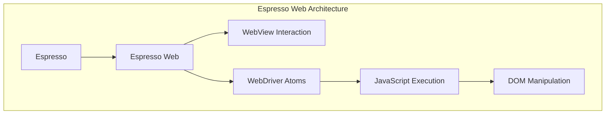
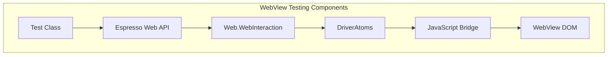
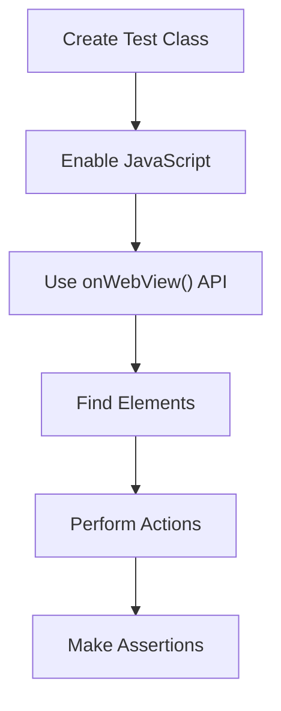
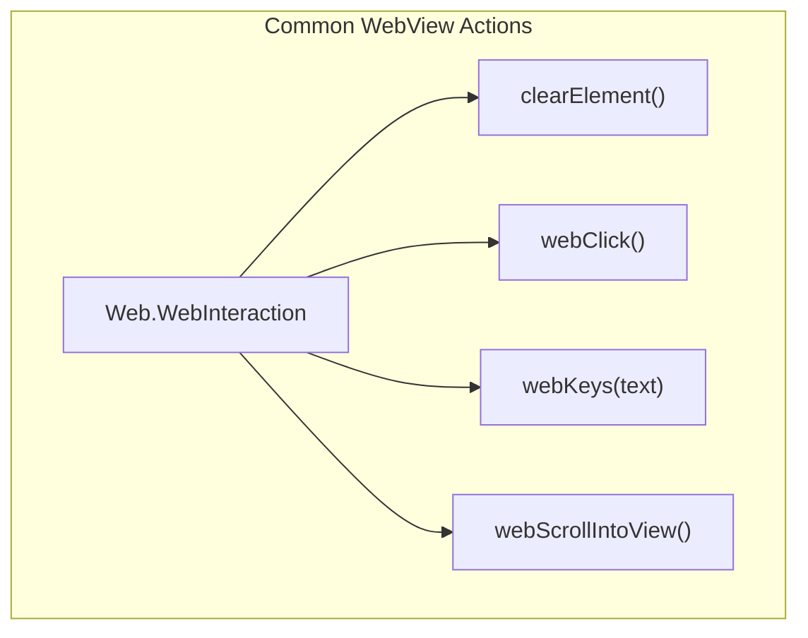
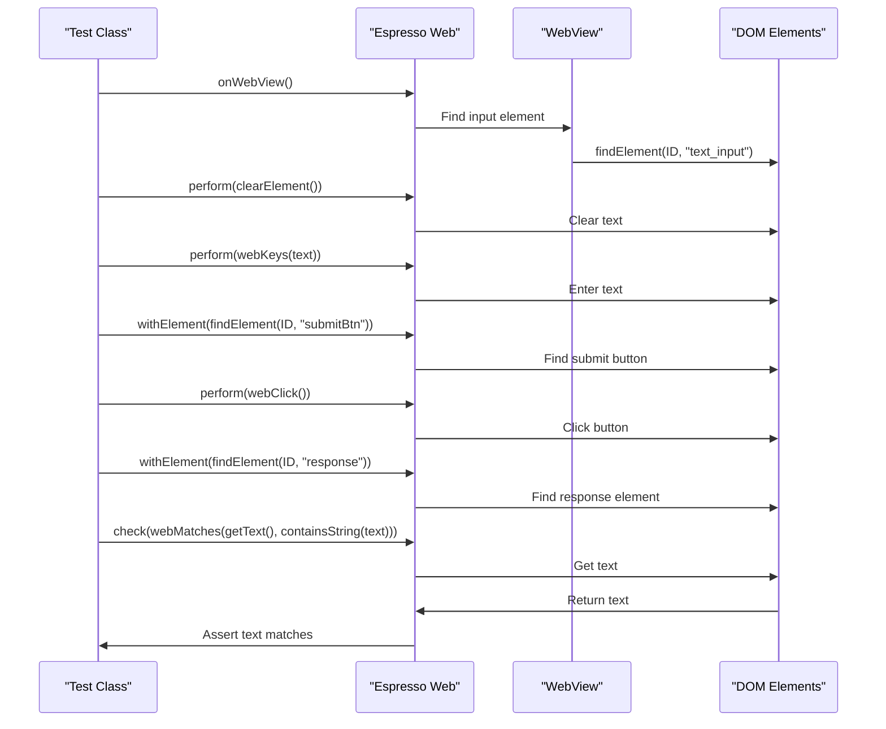
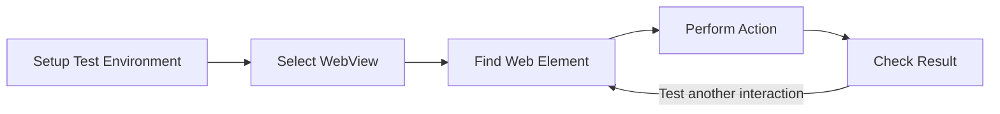

<!-- source: DeepWiki mcp.deepwiki.com · repo android/testing-samples · page 3.6 WebView Testing · fetched 2026-10-23 -->

# WebView Testing

<details>
<summary>Relevant source files</summary>

The following files were used as context for generating this wiki page:

- [runner/AndroidJunitRunnerSample/README.md](runner/AndroidJunitRunnerSample/README.md)
- [runner/AndroidJunitRunnerSample/app/src/androidTest/java/com/example/android/testing/androidjunitrunnersample/CalculatorInstrumentationTest.java](runner/AndroidJunitRunnerSample/app/src/androidTest/java/com/example/android/testing/androidjunitrunnersample/CalculatorInstrumentationTest.java)
- [ui/espresso/BasicSample/README.md](ui/espresso/BasicSample/README.md)
- [ui/espresso/CustomMatcherSample/README.md](ui/espresso/CustomMatcherSample/README.md)
- [ui/espresso/DataAdapterSample/README.md](ui/espresso/DataAdapterSample/README.md)
- [ui/espresso/IdlingResourceSample/app/src/androidTest/java/com/example/android/testing/espresso/IdlingResourceSample/ChangeTextBehaviorTest.java](ui/espresso/IdlingResourceSample/app/src/androidTest/java/com/example/android/testing/espresso/IdlingResourceSample/ChangeTextBehaviorTest.java)
- [ui/espresso/IntentsAdvancedSample/README.md](ui/espresso/IntentsAdvancedSample/README.md)
- [ui/espresso/IntentsAdvancedSample/app/src/androidTest/java/com/example/android/testing/espresso/intents/AdvancedSample/ImageViewHasDrawableMatcher.java](ui/espresso/IntentsAdvancedSample/app/src/androidTest/java/com/example/android/testing/espresso/intents/AdvancedSample/ImageViewHasDrawableMatcher.java)
- [ui/espresso/IntentsAdvancedSample/app/src/androidTest/java/com/example/android/testing/espresso/intents/AdvancedSample/ImageViewerActivityTest.java](ui/espresso/IntentsAdvancedSample/app/src/androidTest/java/com/example/android/testing/espresso/intents/AdvancedSample/ImageViewerActivityTest.java)
- [ui/espresso/IntentsBasicSample/README.md](ui/espresso/IntentsBasicSample/README.md)
- [ui/espresso/MultiWindowSample/README.md](ui/espresso/MultiWindowSample/README.md)
- [ui/espresso/MultiWindowSample/app/src/androidTest/java/com/example/android/testing/espresso/MultiWindowSample/MultiWindowTest.java](ui/espresso/MultiWindowSample/app/src/androidTest/java/com/example/android/testing/espresso/MultiWindowSample/MultiWindowTest.java)
- [ui/espresso/WebBasicSample/README.md](ui/espresso/WebBasicSample/README.md)
- [ui/espresso/WebBasicSample/app/src/androidTest/java/com/example/android/testing/espresso/web/BasicSample/WebViewActivityTest.java](ui/espresso/WebBasicSample/app/src/androidTest/java/com/example/android/testing/espresso/web/BasicSample/WebViewActivityTest.java)
- [unit/BasicUnitAndroidTest/app/src/androidTest/java/com/example/android/testing/unittesting/basicunitandroidtest/LogHistoryAndroidUnitTest.java](unit/BasicUnitAndroidTest/app/src/androidTest/java/com/example/android/testing/unittesting/basicunitandroidtest/LogHistoryAndroidUnitTest.java)

</details>


This document describes how to test Android applications that contain WebView components using Espresso Web. Espresso Web is an API specifically designed for testing hybrid applications that combine native Android components with web content in WebViews.

For testing standard Android UI components, see [Basic Espresso Testing](#3.1). For testing across applications, see [UI Testing with UI Automator](#4).

## Introduction to Espresso Web

Espresso Web extends the standard Espresso framework to enable interaction with WebView content. It bridges the gap between Android UI testing and web testing by using WebDriver atoms (small JavaScript functions) to interact with web elements inside WebViews.



Sources: [ui/espresso/WebBasicSample/README.md:1-9]()

## Key Components of WebView Testing

The WebView testing architecture consists of several layers that work together to enable testing of web content within Android applications:



Sources: [ui/espresso/WebBasicSample/app/src/androidTest/java/com/example/android/testing/espresso/web/BasicSample/WebViewActivityTest.java:27-41]()

### Core Components

| Component | Description |
|-----------|-------------|
| `Web.onWebView()` | Entry point for WebView interactions |
| `DriverAtoms` | JavaScript functions that interact with web elements |
| `WebViewMatcher` | Used to select specific WebView instances |
| `WebAssertion` | Used to verify conditions on web elements |

Sources: [ui/espresso/WebBasicSample/app/src/androidTest/java/com/example/android/testing/espresso/web/BasicSample/WebViewActivityTest.java:35-41]()

## Setting Up WebView Testing

Before you can test WebViews, you need to ensure JavaScript is enabled in the WebView. Espresso Web requires JavaScript to interact with the DOM elements inside the WebView.



Sources: [ui/espresso/WebBasicSample/app/src/androidTest/java/com/example/android/testing/espresso/web/BasicSample/WebViewActivityTest.java:67-77]()

### JavaScript Enabling

In the sample, JavaScript is enabled in the test setup by calling `onWebView().forceJavascriptEnabled()`. This is critical because all WebView interactions in Espresso are performed through JavaScript execution.

```java
@Rule
public ActivityTestRule<WebViewActivity> mActivityRule = new ActivityTestRule<WebViewActivity>(
        WebViewActivity.class, false, false) {
    @Override
    protected void afterActivityLaunched() {
        onWebView().forceJavascriptEnabled();
    }
};
```

Sources: [ui/espresso/WebBasicSample/app/src/androidTest/java/com/example/android/testing/espresso/web/BasicSample/WebViewActivityTest.java:67-77]()

## Basic WebView Testing Operations

### Selecting a WebView

If your layout contains multiple WebViews, you can use a matcher to select a specific one:

```java
onWebView(withId(R.id.web_view))
```

If there's only one WebView in your layout, you can simply use:

```java
onWebView()
```

Sources: [ui/espresso/WebBasicSample/app/src/androidTest/java/com/example/android/testing/espresso/web/BasicSample/WebViewActivityTest.java:84-86](), [ui/espresso/WebBasicSample/app/src/androidTest/java/com/example/android/testing/espresso/web/BasicSample/WebViewActivityTest.java:108-110]()

### Finding Web Elements

Espresso Web uses WebDriver's locator strategy to find elements within a WebView. Common locators include:

| Locator Type | Description | Example |
|--------------|-------------|---------|
| ID | Finds elements by their ID attribute | `findElement(Locator.ID, "submit_button")` |
| CLASS_NAME | Finds elements by their CSS class | `findElement(Locator.CLASS_NAME, "input-field")` |
| CSS_SELECTOR | Finds elements using CSS selectors | `findElement(Locator.CSS_SELECTOR, "#form .submit")` |
| XPATH | Finds elements using XPath expressions | `findElement(Locator.XPATH, "//input[@type='text']")` |

Sources: [ui/espresso/WebBasicSample/app/src/androidTest/java/com/example/android/testing/espresso/web/BasicSample/WebViewActivityTest.java:87-88](), [ui/espresso/WebBasicSample/app/src/androidTest/java/com/example/android/testing/espresso/web/BasicSample/WebViewActivityTest.java:97-98]()

### Performing Actions

Espresso Web provides various actions to interact with web elements:



Sources: [ui/espresso/WebBasicSample/app/src/androidTest/java/com/example/android/testing/espresso/web/BasicSample/WebViewActivityTest.java:89-96]()

#### Example: Typing Text and Clicking

```java
onWebView()
        .withElement(findElement(Locator.ID, "text_input"))
        .perform(clearElement())
        .perform(DriverAtoms.webKeys("Macchiato"))
        .withElement(findElement(Locator.ID, "submitBtn"))
        .perform(webClick());
```

Sources: [ui/espresso/WebBasicSample/app/src/androidTest/java/com/example/android/testing/espresso/web/BasicSample/WebViewActivityTest.java:86-96]()

### Making Assertions

After performing actions, you can verify the results using WebView assertions:

```java
onWebView()
        .withElement(findElement(Locator.ID, "response"))
        .check(webMatches(getText(), containsString("Macchiato")));
```

This checks if the element with ID "response" contains the text "Macchiato".

Sources: [ui/espresso/WebBasicSample/app/src/androidTest/java/com/example/android/testing/espresso/web/BasicSample/WebViewActivityTest.java:97-100]()

## Complete WebView Test Example

Let's examine a complete test that:
1. Types text into an input field
2. Clicks a button to submit a form
3. Verifies the response contains the expected text



Sources: [ui/espresso/WebBasicSample/app/src/androidTest/java/com/example/android/testing/espresso/web/BasicSample/WebViewActivityTest.java:79-101]()

Here's the complete test method from the sample:

```java
@Test
public void typeTextInInput_clickButton_SubmitsForm() {
    // Lazily launch the Activity with a custom start Intent per test
    mActivityRule.launchActivity(withWebFormIntent());

    // Selects the WebView in your layout
    onWebView()
            // Find the input element by ID
            .withElement(findElement(Locator.ID, "text_input"))
            // Clear previous input
            .perform(clearElement())
            // Enter text into the input element
            .perform(DriverAtoms.webKeys(MACCHIATO))
            // Find the submit button
            .withElement(findElement(Locator.ID, "submitBtn"))
            // Simulate a click via javascript
            .perform(webClick())
            // Find the response element by ID
            .withElement(findElement(Locator.ID, "response"))
            // Verify that the response page contains the entered text
            .check(webMatches(getText(), containsString(MACCHIATO)));
}
```

Sources: [ui/espresso/WebBasicSample/app/src/androidTest/java/com/example/android/testing/espresso/web/BasicSample/WebViewActivityTest.java:79-101]()

## WebView Testing Workflow

The typical workflow for WebView testing follows these steps:



Sources: [ui/espresso/WebBasicSample/app/src/androidTest/java/com/example/android/testing/espresso/web/BasicSample/WebViewActivityTest.java:79-101](), [ui/espresso/WebBasicSample/app/src/androidTest/java/com/example/android/testing/espresso/web/BasicSample/WebViewActivityTest.java:103-125]()

## Best Practices

1. **Always Enable JavaScript**: Ensure JavaScript is enabled for your WebView during testing using `forceJavascriptEnabled()`.

2. **Use Appropriate Locators**: Choose the most specific and stable locators (preferably IDs) to find elements.

3. **Chain Operations**: Espresso Web supports method chaining, which makes tests more readable and concise.

4. **Separate Test Intent Creation**: Create helper methods to generate test-specific intents, as shown in the sample with `withWebFormIntent()`.

5. **Test Different Interactions**: Test various user interactions, such as form submission, text changes, and navigation.

Sources: [ui/espresso/WebBasicSample/app/src/androidTest/java/com/example/android/testing/espresso/web/BasicSample/WebViewActivityTest.java:67-77](), [ui/espresso/WebBasicSample/app/src/androidTest/java/com/example/android/testing/espresso/web/BasicSample/WebViewActivityTest.java:127-134]()

## Common Challenges and Solutions

| Challenge | Solution |
|-----------|----------|
| JavaScript Disabled | Use `forceJavascriptEnabled()` in your test setup |
| Element Not Found | Check if the element is in an iframe or if you need to wait for dynamic content to load |
| Synchronization Issues | Espresso Web handles most synchronization automatically, but you may need custom IdlingResources for complex AJAX operations |
| Multiple WebViews | Use `onWebView(withId(...))` to target a specific WebView |

Sources: [ui/espresso/WebBasicSample/README.md:3-7](), [ui/espresso/WebBasicSample/app/src/androidTest/java/com/example/android/testing/espresso/web/BasicSample/WebViewActivityTest.java:67-77]()

## Conclusion

Espresso Web provides a powerful way to test WebView content in Android applications. By leveraging WebDriver atoms, it enables testers to interact with and verify web elements without leaving the Espresso testing framework.

For testing other UI components, refer to the appropriate sections in this wiki:
- For testing complex UI interactions, see [IdlingResource for Asynchronous Testing](#3.4)
- For testing across multiple windows, see [Multi-Window Testing](#3.5)

---

