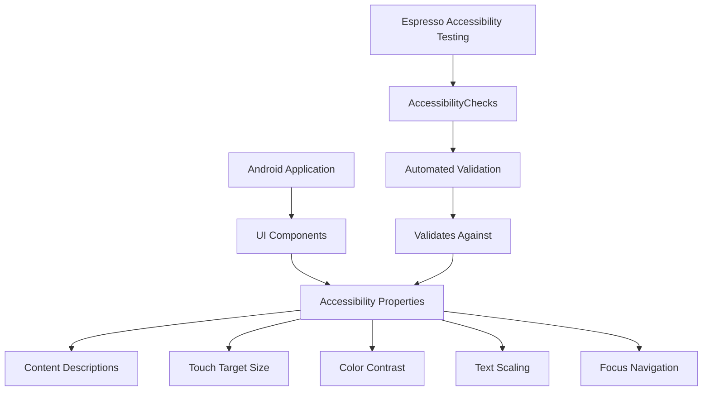
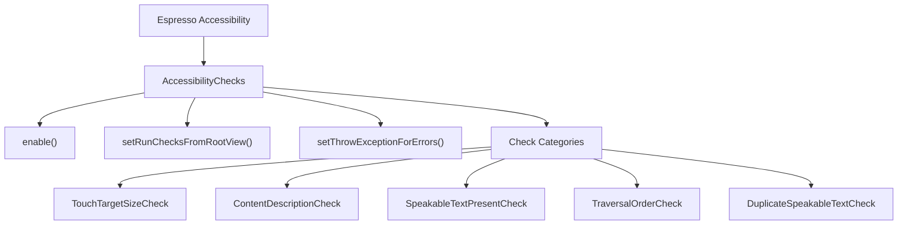
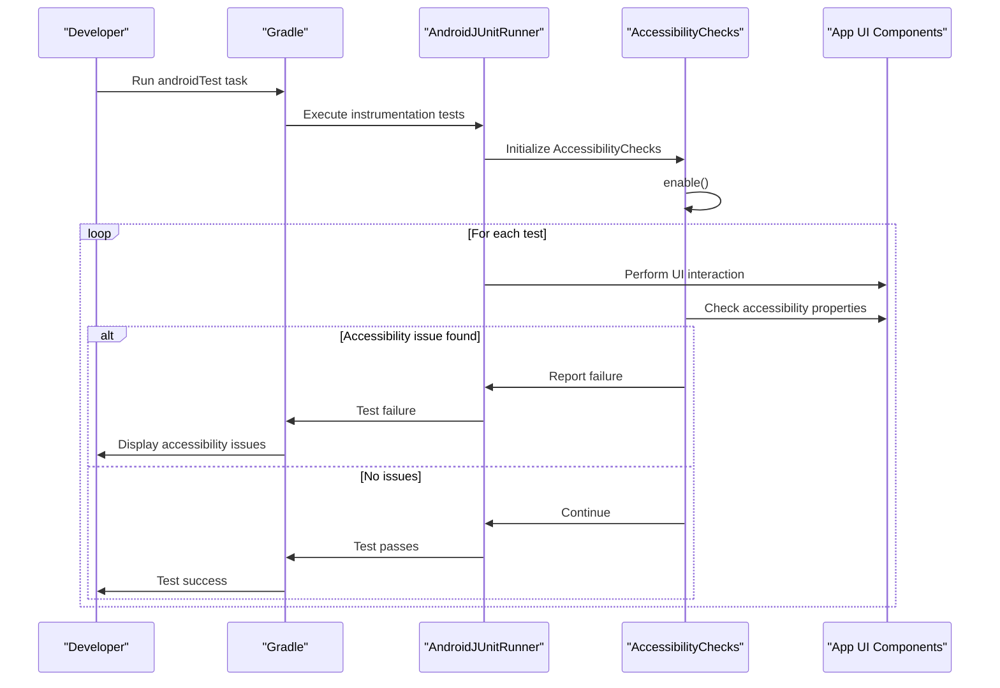
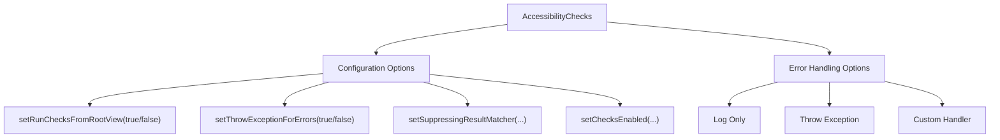
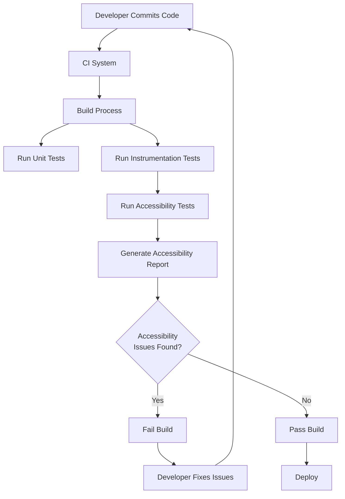

<!-- source: DeepWiki mcp.deepwiki.com · repo android/testing-samples · page 3.7 Accessibility Testing · fetched 2026-10-23 -->

# Accessibility Testing

<details>
<summary>Relevant source files</summary>

The following files were used as context for generating this wiki page:

- [ui/espresso/AccessibilitySample/app/build.gradle](ui/espresso/AccessibilitySample/app/build.gradle)
- [ui/espresso/AccessibilitySample/gradle/wrapper/gradle-wrapper.properties](ui/espresso/AccessibilitySample/gradle/wrapper/gradle-wrapper.properties)

</details>


## Purpose and Scope

This document covers the accessibility testing capabilities available in the Android Testing Samples repository, focusing on how to use Espresso Accessibility for automated accessibility validation. It explains how to implement and execute accessibility tests to verify that Android applications meet accessibility standards, ensuring they're usable by people with disabilities.

For information about testing WebViews, see [WebView Testing](#3.6). For information about UI testing fundamentals, see [Basic Espresso Testing](#3.1).

## Introduction to Accessibility Testing

Accessibility testing ensures that applications are usable by people with disabilities, including those with visual, auditory, motor, or cognitive impairments. In Android development, automated accessibility testing helps identify common accessibility issues early in the development cycle.

The AccessibilitySample demonstrates how to use the Espresso Accessibility testing framework to validate accessibility properties of UI elements, ensuring compliance with accessibility guidelines.



Sources: [ui/espresso/AccessibilitySample/app/build.gradle:65-68]()

## Espresso Accessibility Framework

The Espresso Accessibility framework provides automated checks for common accessibility issues. It extends the standard Espresso testing framework with specialized accessibility validation capabilities.

### Key Components



Sources: [ui/espresso/AccessibilitySample/app/build.gradle:65-68]()

### Integration in Test Setup

The AccessibilitySample demonstrates how to integrate accessibility checks into Espresso tests. The framework is configured in the test setup and then automatically evaluates accessibility criteria during test execution.

## Setup and Configuration

To implement accessibility testing in an Android project, the following setup is required:

1. Add the Espresso Accessibility dependency to your project:

```gradle
androidTestImplementation("androidx.test.espresso:espresso-accessibility:" + rootProject.espressoVersion) {
    // workaround for https://github.com/android/android-test/issues/861
    exclude group: "org.checkerframework", module: "checker"
}
```

2. Enable accessibility checks in your test classes.

Sources: [ui/espresso/AccessibilitySample/app/build.gradle:65-68]()

## Running Accessibility Tests

The AccessibilitySample is configured to use AndroidJUnitRunner as the test instrumentation runner. Tests can be executed on physical devices, emulators, or using managed devices configured in the build.gradle file.



Sources: [ui/espresso/AccessibilitySample/app/build.gradle:12-14](), [ui/espresso/AccessibilitySample/app/build.gradle:22-33]()

## Common Accessibility Checks

The Espresso Accessibility framework automatically validates the following aspects of accessibility:

| Accessibility Check | Description | Impact |
|---------------------|-------------|--------|
| Touch Target Size | Ensures interactive elements are sufficiently large (48dp × 48dp minimum) | Motor impairments |
| Content Description | Verifies that images and controls have proper descriptions | Screen readers, visual impairments |
| Speakable Text | Checks that text elements can be properly voiced by screen readers | Screen readers, visual impairments |
| Traversal Order | Validates that the focus traversal order is logical | Screen readers, motor impairments |
| Duplicate Speakable Text | Identifies duplicate content descriptions that may confuse users | Screen readers, visual impairments |
| Text Contrast | Ensures sufficient contrast between text and background | Visual impairments, color blindness |

Sources: [ui/espresso/AccessibilitySample/app/build.gradle:65-68]()

## Test Configuration Options

Espresso Accessibility provides several configuration options to customize how accessibility checks are performed and reported:



Sources: [ui/espresso/AccessibilitySample/app/build.gradle:65-68]()

## Integration with Continuous Integration

Accessibility tests can be integrated into continuous integration workflows to catch accessibility regressions early. The AccessibilitySample is configured to work with managed devices, making it suitable for automated CI environments.



Sources: [ui/espresso/AccessibilitySample/app/build.gradle:22-33]()

## Best Practices for Accessibility Testing

1. **Early Integration**: Incorporate accessibility testing early in the development process
2. **Complete Coverage**: Test all UI components that users interact with
3. **Real Device Testing**: Verify with actual accessibility services like TalkBack
4. **Combine with Manual Testing**: Automated tests cannot catch all accessibility issues
5. **Consider Context**: Some UI components may require custom accessibility solutions

## Example Implementation Patterns

When implementing accessibility tests in your application, consider the following patterns demonstrated in the AccessibilitySample:

1. **Global Enabling**: Enable accessibility checks once for all tests
2. **Selective Testing**: Enable checks only for specific test suites or test cases
3. **Exception Suppression**: Suppress known issues using matchers
4. **Custom Checks**: Implement application-specific accessibility validations

## Related Resources

For further information on related testing topics:

- For UI testing fundamentals: [Basic Espresso Testing](#3.1)
- For testing RecyclerViews: [RecyclerView Testing](#3.2)
- For testing WebViews: [WebView Testing](#3.6)
- For screenshot testing: [Screenshot Testing](#3.8)

Sources: [ui/espresso/AccessibilitySample/app/build.gradle:1-70](), [ui/espresso/AccessibilitySample/gradle/wrapper/gradle-wrapper.properties:1-6]()

---

