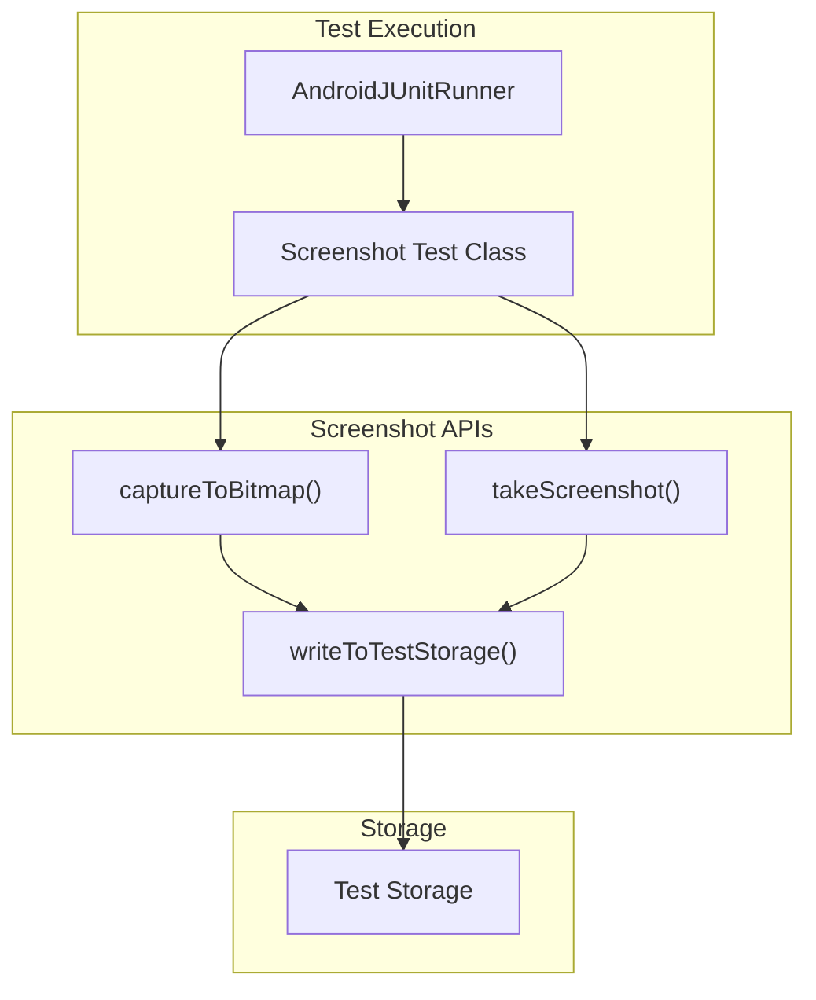
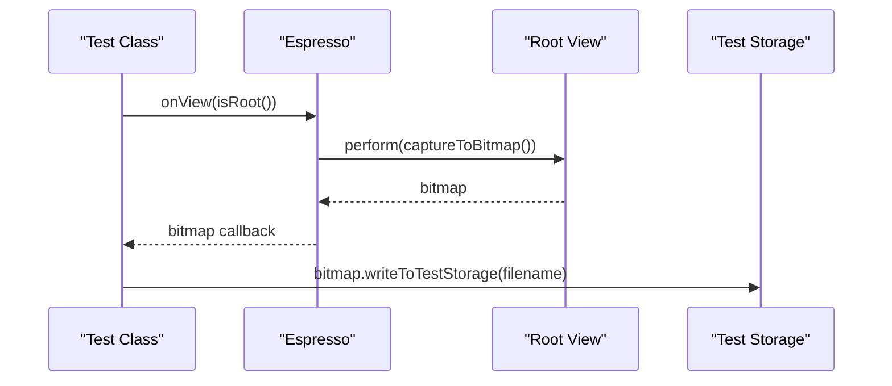
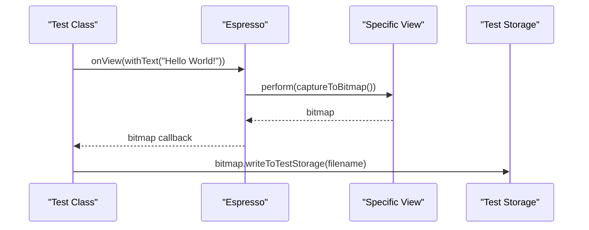
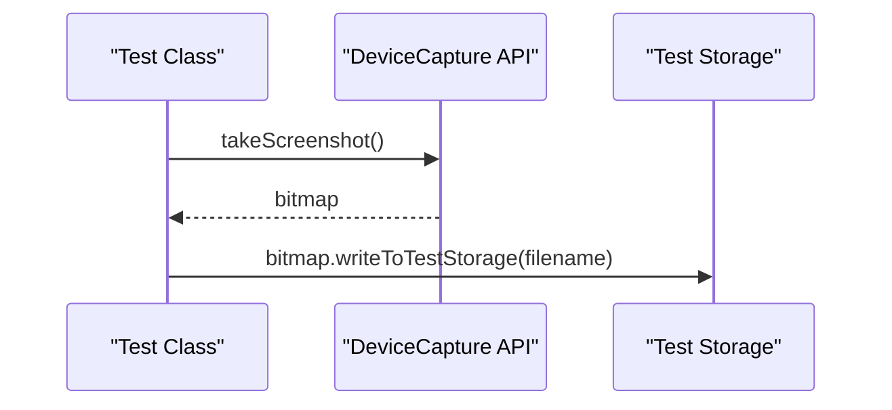
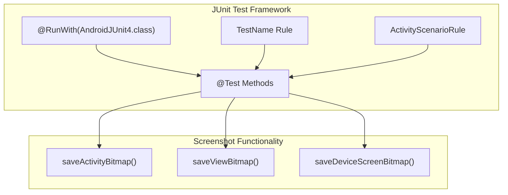

<!-- source: DeepWiki mcp.deepwiki.com · repo android/testing-samples · page 3.8 Screenshot Testing · fetched 2026-10-23 -->

# Screenshot Testing

<details>
<summary>Relevant source files</summary>

The following files were used as context for generating this wiki page:

- [ui/espresso/ScreenshotSample/.gitignore](ui/espresso/ScreenshotSample/.gitignore)
- [ui/espresso/ScreenshotSample/app/.gitignore](ui/espresso/ScreenshotSample/app/.gitignore)
- [ui/espresso/ScreenshotSample/app/proguard-rules.pro](ui/espresso/ScreenshotSample/app/proguard-rules.pro)
- [ui/espresso/ScreenshotSample/app/src/androidTest/java/com/example/android/testing/espresso/screenshotsample/ScreenshotJavaTest.java](ui/espresso/ScreenshotSample/app/src/androidTest/java/com/example/android/testing/espresso/screenshotsample/ScreenshotJavaTest.java)
- [ui/espresso/ScreenshotSample/app/src/androidTest/java/com/example/android/testing/espresso/screenshotsample/ScreenshotTest.kt](ui/espresso/ScreenshotSample/app/src/androidTest/java/com/example/android/testing/espresso/screenshotsample/ScreenshotTest.kt)
- [ui/espresso/ScreenshotSample/app/src/main/AndroidManifest.xml](ui/espresso/ScreenshotSample/app/src/main/AndroidManifest.xml)
- [ui/espresso/ScreenshotSample/app/src/main/java/com/example/android/testing/espresso/screenshotsample/MainActivity.kt](ui/espresso/ScreenshotSample/app/src/main/java/com/example/android/testing/espresso/screenshotsample/MainActivity.kt)
- [ui/espresso/ScreenshotSample/app/src/main/res/drawable-v24/ic_launcher_foreground.xml](ui/espresso/ScreenshotSample/app/src/main/res/drawable-v24/ic_launcher_foreground.xml)
- [ui/espresso/ScreenshotSample/app/src/main/res/drawable/ic_launcher_background.xml](ui/espresso/ScreenshotSample/app/src/main/res/drawable/ic_launcher_background.xml)

</details>


## Purpose and Scope

This document describes the screenshot testing capabilities provided in the Android Testing Samples repository. Screenshot testing allows developers to capture and save images of UI components during test execution, which can be used for visual verification and regression testing. This document covers the available screenshot APIs, capture methods, storage mechanisms, and integration with test frameworks.

For information about general Espresso UI testing, see [Basic Espresso Testing](#3.1). For accessibility testing, see [Accessibility Testing](#3.7).

## Overview of Screenshot Testing

Screenshot testing enables visual verification of UI components by capturing images during test execution. The Android Testing Samples repository demonstrates three primary screenshot capture methods:

1. Capturing an entire Activity
2. Capturing a specific View
3. Capturing the entire device screen

These capabilities are demonstrated in both Kotlin and Java implementations.

Sources: [ui/espresso/ScreenshotSample/app/src/androidTest/java/com/example/android/testing/espresso/screenshotsample/ScreenshotTest.kt:20-25](), [ui/espresso/ScreenshotSample/app/src/androidTest/java/com/example/android/testing/espresso/screenshotsample/ScreenshotJavaTest.java:23-25]()

## Screenshot Testing Architecture

The following diagram illustrates the architecture of the screenshot testing framework:



Sources: [ui/espresso/ScreenshotSample/app/src/androidTest/java/com/example/android/testing/espresso/screenshotsample/ScreenshotTest.kt:3-8](), [ui/espresso/ScreenshotSample/app/src/androidTest/java/com/example/android/testing/espresso/screenshotsample/ScreenshotJavaTest.java:3-8]()

## Screenshot Testing APIs

The screenshot testing sample demonstrates the use of several key APIs:

| API | Package | Purpose |
|-----|---------|---------|
| `takeScreenshot()` | `androidx.test.core.app` | Captures the entire device screen |
| `writeToTestStorage()` | `androidx.test.core.graphics` | Saves a bitmap to test storage |
| `captureToBitmap()` | `androidx.test.espresso.action.ViewActions` | Captures a specific view as a bitmap |

These APIs work together to provide a complete screenshot testing solution that integrates with the Espresso testing framework.

Sources: [ui/espresso/ScreenshotSample/app/src/androidTest/java/com/example/android/testing/espresso/screenshotsample/ScreenshotTest.kt:3-8](), [ui/espresso/ScreenshotSample/app/src/androidTest/java/com/example/android/testing/espresso/screenshotsample/ScreenshotJavaTest.java:3-8]()

## Screenshot Capture Methods

### Activity Screenshot Capture

The sample demonstrates how to capture screenshots of an entire Activity:



In the Kotlin implementation, this is achieved through:

```
onView(isRoot())
    .perform(captureToBitmap({ bitmap: Bitmap -> 
        bitmap.writeToTestStorage("${javaClass.simpleName}_${nameRule.methodName}") 
    }))
```

Sources: [ui/espresso/ScreenshotSample/app/src/androidTest/java/com/example/android/testing/espresso/screenshotsample/ScreenshotTest.kt:40-45](), [ui/espresso/ScreenshotSample/app/src/androidTest/java/com/example/android/testing/espresso/screenshotsample/ScreenshotJavaTest.java:39-51]()

### View Screenshot Capture

For capturing a specific view, the sample shows:



This is implemented in Kotlin as:

```
onView(withText("Hello World!"))
    .perform(captureToBitmap({ bitmap: Bitmap -> 
        bitmap.writeToTestStorage("${javaClass.simpleName}_${nameRule.methodName}") 
    }))
```

Sources: [ui/espresso/ScreenshotSample/app/src/androidTest/java/com/example/android/testing/espresso/screenshotsample/ScreenshotTest.kt:50-55](), [ui/espresso/ScreenshotSample/app/src/androidTest/java/com/example/android/testing/espresso/screenshotsample/ScreenshotJavaTest.java:56-70]()

### Device Screen Capture

For capturing the entire device screen:



Implemented in Kotlin as:

```
takeScreenshot()
    .writeToTestStorage("${javaClass.simpleName}_${nameRule.methodName}")
```

Sources: [ui/espresso/ScreenshotSample/app/src/androidTest/java/com/example/android/testing/espresso/screenshotsample/ScreenshotTest.kt:60-65](), [ui/espresso/ScreenshotSample/app/src/androidTest/java/com/example/android/testing/espresso/screenshotsample/ScreenshotJavaTest.java:75-78]()

## Storage and File Management

Screenshots are saved to test storage, which varies based on how tests are executed. When using Gradle managed devices, screenshots are stored at:

```
build/outputs/managed_device_android_test_additional_output/debugAndroidTest/managedDevice/nexusOneApi30/
```

The samples demonstrate a best practice of using unique filenames for each test case by combining:
- The test class name: `javaClass.simpleName`
- The test method name: `nameRule.methodName`

This naming convention ensures that screenshots from different test methods don't overwrite each other.

Sources: [ui/espresso/ScreenshotSample/app/src/androidTest/java/com/example/android/testing/espresso/screenshotsample/ScreenshotTest.kt:20-25](), [ui/espresso/ScreenshotSample/app/src/androidTest/java/com/example/android/testing/espresso/screenshotsample/ScreenshotTest.kt:30-32]()

## Integration with JUnit Test Framework

The screenshot tests integrate with JUnit through several key mechanisms:



The test class uses:
- `@RunWith(AndroidJUnit4.class)` to specify the test runner
- `TestName` rule to access the current test method name for filename generation
- `ActivityScenarioRule` to launch the activity being tested

Sources: [ui/espresso/ScreenshotSample/app/src/androidTest/java/com/example/android/testing/espresso/screenshotsample/ScreenshotTest.kt:26-35](), [ui/espresso/ScreenshotSample/app/src/androidTest/java/com/example/android/testing/espresso/screenshotsample/ScreenshotJavaTest.java:26-34]()

## Sample Test Class Structure

Both Kotlin and Java implementations demonstrate the same screenshot testing capabilities, following this structure:

| Component | Purpose |
|-----------|---------|
| Test class annotation | `@RunWith(AndroidJUnit4.class)` specifies the test runner |
| TestName rule | Provides access to the current test method name |
| ActivityScenarioRule | Launches the activity being tested |
| saveActivityBitmap() | Captures and saves the entire activity |
| saveViewBitmap() | Captures and saves a specific view |
| saveDeviceScreenBitmap() | Captures and saves the entire device screen |

Sources: [ui/espresso/ScreenshotSample/app/src/androidTest/java/com/example/android/testing/espresso/screenshotsample/ScreenshotTest.kt:26-65](), [ui/espresso/ScreenshotSample/app/src/androidTest/java/com/example/android/testing/espresso/screenshotsample/ScreenshotJavaTest.java:26-78]()

## Implementation Differences: Kotlin vs Java

While both Kotlin and Java implementations provide the same functionality, there are syntax differences worth noting:

### Kotlin Implementation

- Uses extension functions: `bitmap.writeToTestStorage()`
- Uses lambda expressions for bitmap handling
- Applies concise Kotlin syntax for writing to test storage

Sources: [ui/espresso/ScreenshotSample/app/src/androidTest/java/com/example/android/testing/espresso/screenshotsample/ScreenshotTest.kt:40-65]()

### Java Implementation

- Uses static method imports for API calls
- Implements `BitmapReceiver` interface using anonymous classes
- Requires additional exception handling in the bitmap receiver

Sources: [ui/espresso/ScreenshotSample/app/src/androidTest/java/com/example/android/testing/espresso/screenshotsample/ScreenshotJavaTest.java:39-78]()

## Best Practices for Screenshot Testing

Based on the samples, several best practices emerge for screenshot testing:

1. **Unique filenames**: Use test class and method names to create unique filenames
2. **Targeted captures**: Capture specific views for more focused testing
3. **Multiple capture methods**: Use the appropriate capture method based on testing needs
4. **Exception handling**: Handle potential IOExceptions that may occur during bitmap storage
5. **Integration with JUnit**: Use JUnit rules to manage test state and activity lifecycle

Sources: [ui/espresso/ScreenshotSample/app/src/androidTest/java/com/example/android/testing/espresso/screenshotsample/ScreenshotTest.kt:26-65](), [ui/espresso/ScreenshotSample/app/src/androidTest/java/com/example/android/testing/espresso/screenshotsample/ScreenshotJavaTest.java:26-78]()

## Conclusion

The Screenshot Testing sample demonstrates how to capture and save screenshots during UI tests using Espresso and Android's testing framework. By providing examples in both Kotlin and Java, it shows how to implement screenshot testing for entire activities, specific views, and the device screen, with appropriate file naming and storage practices.

---

