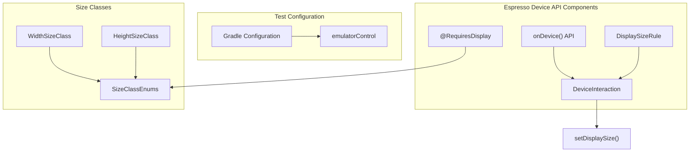
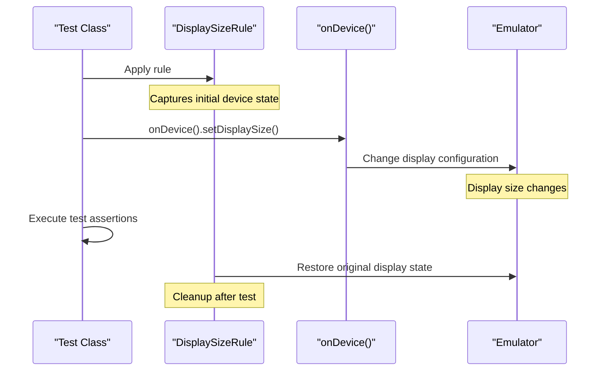
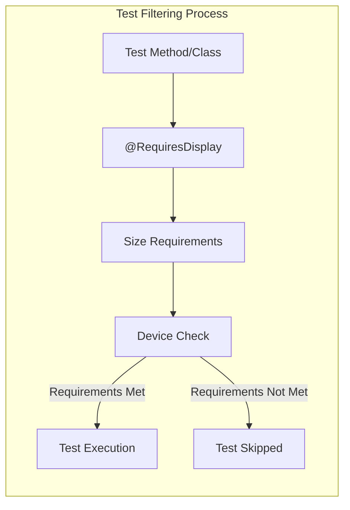

<!-- source: DeepWiki mcp.deepwiki.com · repo android/testing-samples · page 3.9 Device Control Testing · fetched 2026-10-23 -->

# Device Control Testing

<details>
<summary>Relevant source files</summary>

The following files were used as context for generating this wiki page:

- [ui/espresso/EspressoDeviceSample/.gitignore](ui/espresso/EspressoDeviceSample/.gitignore)
- [ui/espresso/EspressoDeviceSample/BUILD.bazel](ui/espresso/EspressoDeviceSample/BUILD.bazel)
- [ui/espresso/EspressoDeviceSample/README.md](ui/espresso/EspressoDeviceSample/README.md)
- [ui/espresso/EspressoDeviceSample/app/build.gradle](ui/espresso/EspressoDeviceSample/app/build.gradle)
- [ui/espresso/EspressoDeviceSample/app/src/androidTest/AndroidManifest.xml](ui/espresso/EspressoDeviceSample/app/src/androidTest/AndroidManifest.xml)
- [ui/espresso/EspressoDeviceSample/app/src/androidTest/java/com/example/android/testing/espresso/EspressoDeviceSample/RequiresDisplayTest.kt](ui/espresso/EspressoDeviceSample/app/src/androidTest/java/com/example/android/testing/espresso/EspressoDeviceSample/RequiresDisplayTest.kt)
- [ui/espresso/EspressoDeviceSample/app/src/androidTest/java/com/example/android/testing/espresso/EspressoDeviceSample/ResizeDisplayTest.kt](ui/espresso/EspressoDeviceSample/app/src/androidTest/java/com/example/android/testing/espresso/EspressoDeviceSample/ResizeDisplayTest.kt)
- [ui/espresso/EspressoDeviceSample/app/src/main/AndroidManifest.xml](ui/espresso/EspressoDeviceSample/app/src/main/AndroidManifest.xml)
- [ui/espresso/EspressoDeviceSample/app/src/main/AppManifest.xml](ui/espresso/EspressoDeviceSample/app/src/main/AppManifest.xml)
- [ui/espresso/EspressoDeviceSample/app/src/main/java/com/example/android/testing/espresso/EspressoDeviceSample/MainActivity.java](ui/espresso/EspressoDeviceSample/app/src/main/java/com/example/android/testing/espresso/EspressoDeviceSample/MainActivity.java)
- [ui/espresso/EspressoDeviceSample/app/src/main/res/drawable-hdpi/ic_launcher.png](ui/espresso/EspressoDeviceSample/app/src/main/res/drawable-hdpi/ic_launcher.png)
- [ui/espresso/EspressoDeviceSample/app/src/main/res/drawable-mdpi/ic_launcher.png](ui/espresso/EspressoDeviceSample/app/src/main/res/drawable-mdpi/ic_launcher.png)
- [ui/espresso/EspressoDeviceSample/app/src/main/res/drawable-xhdpi/ic_launcher.png](ui/espresso/EspressoDeviceSample/app/src/main/res/drawable-xhdpi/ic_launcher.png)
- [ui/espresso/EspressoDeviceSample/build.gradle](ui/espresso/EspressoDeviceSample/build.gradle)
- [ui/espresso/EspressoDeviceSample/gradle.properties](ui/espresso/EspressoDeviceSample/gradle.properties)
- [ui/espresso/EspressoDeviceSample/gradle/wrapper/gradle-wrapper.properties](ui/espresso/EspressoDeviceSample/gradle/wrapper/gradle-wrapper.properties)
- [ui/espresso/ScreenshotSample/gradle/wrapper/gradle-wrapper.properties](ui/espresso/ScreenshotSample/gradle/wrapper/gradle-wrapper.properties)

</details>


## Purpose and Scope

This page documents the Espresso Device API, which enables synchronized interactions with test devices during UI testing. The API allows controlling device properties like display size and filtering tests based on device characteristics. Note that this functionality differs from Screenshot Testing covered in [Screenshot Testing](#3.8), which focuses on capturing and verifying visual output.

The Espresso Device API is experimental and currently supported only on instrumentation tests run on emulators.

Sources: [ui/espresso/EspressoDeviceSample/README.md:1-7]()

## Overview of Espresso Device

Espresso Device extends the Espresso testing framework by providing APIs to control device-level characteristics during test execution. This allows tests to verify application behavior across different device configurations without requiring multiple physical devices.

### Component Architecture



Sources: [ui/espresso/EspressoDeviceSample/app/src/androidTest/java/com/example/android/testing/espresso/EspressoDeviceSample/ResizeDisplayTest.kt:17-43]()
[ui/espresso/EspressoDeviceSample/app/src/androidTest/java/com/example/android/testing/espresso/EspressoDeviceSample/RequiresDisplayTest.kt:16-29]()

## Setup and Configuration

### Gradle Configuration

To use Espresso Device, you need to include the dependency and enable emulator control in your project.

#### Dependencies

Add the Espresso Device dependency to your app-level `build.gradle` file:

```
androidTestImplementation "androidx.test.espresso:espresso-device:<version>"
```

The current version used in the sample is defined in the root `build.gradle` file:

Sources: [ui/espresso/EspressoDeviceSample/build.gradle:28-33]()
[ui/espresso/EspressoDeviceSample/app/build.gradle:54-58]()

#### Enable Emulator Control

Enable emulator control in your app-level `build.gradle` file:

```
android {
    testOptions {
        emulatorControl {
            enable = true
        }
    }
}
```

Sources: [ui/espresso/EspressoDeviceSample/app/build.gradle:18-22]()

You also need to add the following property to your `gradle.properties` file:

```
android.experimental.androidTest.enableEmulatorControl=true
```

Sources: [ui/espresso/EspressoDeviceSample/gradle.properties:19-23]()

### Test Execution Flow



Sources: [ui/espresso/EspressoDeviceSample/app/src/androidTest/java/com/example/android/testing/espresso/EspressoDeviceSample/ResizeDisplayTest.kt:40-43]()

## Display Size Control

The Espresso Device API allows changing the device's display size during test execution through the `onDevice()` API and `setDisplaySize()` method. 

### Size Classes

The API uses size classes to represent different display dimensions:

| Size Class | Description |
|------------|-------------|
| COMPACT    | Represents smaller display dimensions |
| MEDIUM     | Represents medium display dimensions |
| EXPANDED   | Represents larger display dimensions |

Both width and height dimensions can be classified into these size classes.

Sources: [ui/espresso/EspressoDeviceSample/app/src/androidTest/java/com/example/android/testing/espresso/EspressoDeviceSample/ResizeDisplayTest.kt:19-26]()

### Changing Display Size

To resize the display during a test, use the `onDevice()` API with `setDisplaySize()`:

```kotlin
onDevice().setDisplaySize(
    widthSizeClass = WidthSizeClass.COMPACT,
    heightSizeClass = HeightSizeClass.COMPACT
)
```

After changing the display size, you can perform assertions to verify your app's behavior in the new configuration.

Sources: [ui/espresso/EspressoDeviceSample/app/src/androidTest/java/com/example/android/testing/espresso/EspressoDeviceSample/ResizeDisplayTest.kt:46-51]()

### Display Size Rule

To ensure that the device returns to its original display size after the test, use the `DisplaySizeRule`:

```kotlin
@get:Rule(order = 2) var displaySizeRule: DisplaySizeRule = DisplaySizeRule()
```

The rule should have a higher order value than your activity rule to ensure proper cleanup.

Sources: [ui/espresso/EspressoDeviceSample/app/src/androidTest/java/com/example/android/testing/espresso/EspressoDeviceSample/ResizeDisplayTest.kt:42-43]()

## Test Filtering with @RequiresDisplay

The `@RequiresDisplay` annotation allows you to filter tests based on the device's display characteristics. Tests annotated with this will only run on devices that match the specified requirements.

### Using @RequiresDisplay



Sources: [ui/espresso/EspressoDeviceSample/app/src/androidTest/java/com/example/android/testing/espresso/EspressoDeviceSample/RequiresDisplayTest.kt:16-92]()

### Annotation Examples

The `@RequiresDisplay` annotation can be applied to both test methods and test classes:

```kotlin
@RequiresDisplay(
    widthSizeClass = WidthSizeClass.Companion.WidthSizeClassEnum.EXPANDED,
    heightSizeClass = HeightSizeClass.Companion.HeightSizeClassEnum.EXPANDED
)
@Test
fun testOnDevicesWithExpandedWidthAndHeight() {}
```

This test will only run on devices with both expanded width and height.

You can specify different combinations of width and height size classes:

| Width Size Class | Height Size Class | Use Case |
|------------------|-------------------|----------|
| COMPACT          | COMPACT           | Phone in portrait |
| MEDIUM           | COMPACT           | Small tablet in landscape |
| EXPANDED         | MEDIUM            | Large tablet in landscape |
| COMPACT          | EXPANDED          | Phone in landscape |

Sources: [ui/espresso/EspressoDeviceSample/app/src/androidTest/java/com/example/android/testing/espresso/EspressoDeviceSample/RequiresDisplayTest.kt:30-92]()
[ui/espresso/EspressoDeviceSample/app/src/androidTest/java/com/example/android/testing/espresso/EspressoDeviceSample/ResizeDisplayTest.kt:58-61]()

## Managed Device Integration

Espresso Device works well with the Gradle Managed Devices feature, which allows testing on predefined emulator configurations.

### Configuring Managed Devices

```kotlin
testOptions {
    managedDevices {
        devices {
            nexusOneApi30(com.android.build.api.dsl.ManagedVirtualDevice) {
                device = "Nexus One"
                apiLevel = 30
                systemImageSource = "aosp-atd"
            }
        }
    }
}
```

This configuration can be used to run tests with specific emulator configurations.

Sources: [ui/espresso/EspressoDeviceSample/app/build.gradle:26-39]()

## Complete API Reference

| API Component | Function | Description |
|---------------|----------|-------------|
| `onDevice()` | Entry point | Main entry point for Espresso Device APIs |
| `DeviceInteraction` | Interaction | Object returned by `onDevice()` that provides device operations |
| `setDisplaySize()` | Operation | Changes the device's display size based on width and height size classes |
| `@RequiresDisplay` | Annotation | Filters tests based on device display characteristics |
| `DisplaySizeRule` | Test rule | Ensures display is restored after test execution |
| `WidthSizeClass` | Constants | Defines width size classifications (COMPACT, MEDIUM, EXPANDED) |
| `HeightSizeClass` | Constants | Defines height size classifications (COMPACT, MEDIUM, EXPANDED) |

Sources: [ui/espresso/EspressoDeviceSample/app/src/androidTest/java/com/example/android/testing/espresso/EspressoDeviceSample/ResizeDisplayTest.kt:17-26]()
[ui/espresso/EspressoDeviceSample/app/src/androidTest/java/com/example/android/testing/espresso/EspressoDeviceSample/RequiresDisplayTest.kt:18-20]()

## Limitations and Requirements

- Currently, Espresso Device API is experimental and subject to change
- Only supported on instrumentation tests run on emulators
- Requires API level 21 or higher
- For display size testing, API level 30 or higher is recommended
- The emulator's hardware GPU mode may affect display size changes

Sources: [ui/espresso/EspressoDeviceSample/README.md:1-7]()
[ui/espresso/EspressoDeviceSample/app/build.gradle:5-15]()

---

