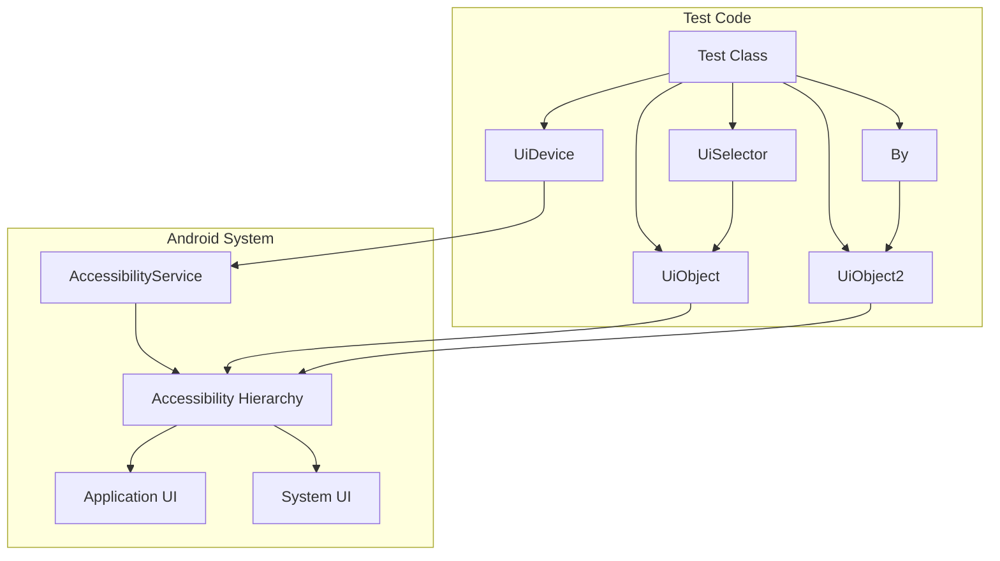
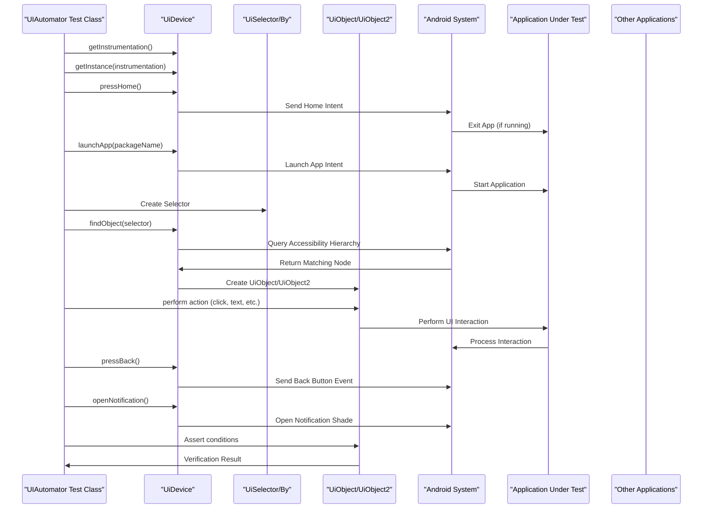
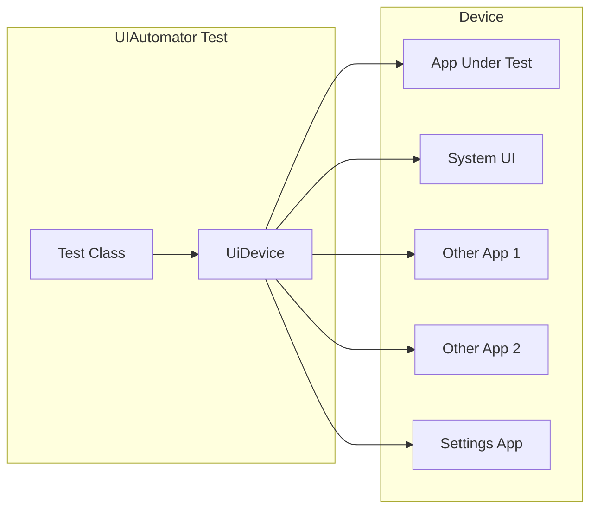
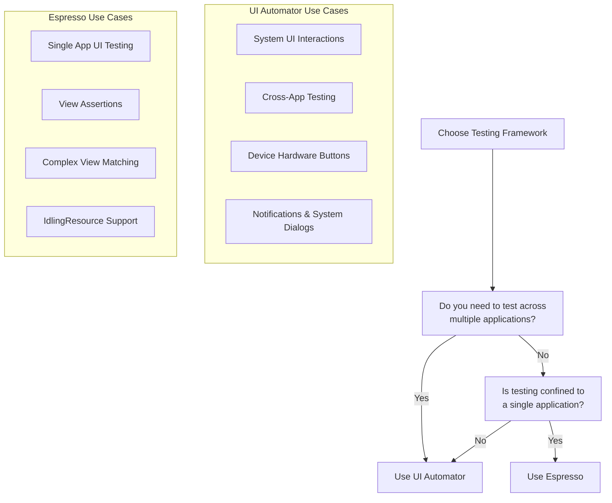

<!-- source: DeepWiki mcp.deepwiki.com · repo android/testing-samples · page 4 UI Testing with UI Automator · fetched 2026-10-23 -->

# UI Testing with UI Automator

<details>
<summary>Relevant source files</summary>

The following files were used as context for generating this wiki page:

- [README.md](README.md)
- [integration/ServiceTestRuleSample/app/build.gradle](integration/ServiceTestRuleSample/app/build.gradle)
- [integration/ServiceTestRuleSample/build.gradle](integration/ServiceTestRuleSample/build.gradle)
- [runner/AndroidJunitRunnerSample/app/build.gradle](runner/AndroidJunitRunnerSample/app/build.gradle)
- [runner/AndroidJunitRunnerSample/build.gradle](runner/AndroidJunitRunnerSample/build.gradle)
- [ui/espresso/BasicSample/app/build.gradle](ui/espresso/BasicSample/app/build.gradle)
- [ui/espresso/BasicSample/build.gradle](ui/espresso/BasicSample/build.gradle)
- [ui/espresso/CustomMatcherSample/app/build.gradle](ui/espresso/CustomMatcherSample/app/build.gradle)
- [ui/espresso/CustomMatcherSample/build.gradle](ui/espresso/CustomMatcherSample/build.gradle)
- [ui/espresso/DataAdapterSample/app/build.gradle](ui/espresso/DataAdapterSample/app/build.gradle)
- [ui/espresso/DataAdapterSample/build.gradle](ui/espresso/DataAdapterSample/build.gradle)
- [ui/espresso/IdlingResourceSample/app/build.gradle](ui/espresso/IdlingResourceSample/app/build.gradle)
- [ui/espresso/IdlingResourceSample/build.gradle](ui/espresso/IdlingResourceSample/build.gradle)
- [ui/espresso/IntentsAdvancedSample/app/build.gradle](ui/espresso/IntentsAdvancedSample/app/build.gradle)
- [ui/espresso/IntentsAdvancedSample/build.gradle](ui/espresso/IntentsAdvancedSample/build.gradle)
- [ui/espresso/IntentsBasicSample/app/build.gradle](ui/espresso/IntentsBasicSample/app/build.gradle)
- [ui/espresso/IntentsBasicSample/build.gradle](ui/espresso/IntentsBasicSample/build.gradle)
- [ui/espresso/MultiProcessSample/README.md](ui/espresso/MultiProcessSample/README.md)
- [ui/espresso/MultiProcessSample/app/build.gradle](ui/espresso/MultiProcessSample/app/build.gradle)
- [ui/espresso/MultiWindowSample/app/build.gradle](ui/espresso/MultiWindowSample/app/build.gradle)
- [ui/espresso/MultiWindowSample/build.gradle](ui/espresso/MultiWindowSample/build.gradle)
- [ui/espresso/RecyclerViewSample/app/build.gradle](ui/espresso/RecyclerViewSample/app/build.gradle)
- [ui/espresso/RecyclerViewSample/build.gradle](ui/espresso/RecyclerViewSample/build.gradle)
- [ui/espresso/WebBasicSample/app/build.gradle](ui/espresso/WebBasicSample/app/build.gradle)
- [ui/espresso/WebBasicSample/build.gradle](ui/espresso/WebBasicSample/build.gradle)
- [ui/uiautomator/BasicSample/app/build.gradle](ui/uiautomator/BasicSample/app/build.gradle)
- [ui/uiautomator/BasicSample/build.gradle](ui/uiautomator/BasicSample/build.gradle)

</details>


## Purpose and Scope

This document provides a technical overview of UI Automator, a testing framework designed for cross-app UI testing on Android. UI Automator allows you to write tests that interact with system and third-party apps, providing capabilities beyond the scope of app-specific testing frameworks such as Espresso (for Espresso testing information, see [UI Testing with Espresso](#3)).

UI Automator enables you to:
- Simulate user interactions on system UI elements
- Perform operations across multiple apps
- Control device-level functions (such as home button, back button)
- Test app interactions with system settings and notifications

Sources: [README.md:33-35](), [ui/uiautomator/BasicSample/app/build.gradle:49-50]()

## UI Automator Architecture

The diagram below shows the key components of the UI Automator framework and how they interact with the Android system.



Sources: [ui/uiautomator/BasicSample/app/build.gradle:49-50]()

## Setting Up UI Automator in Your Project

### Dependencies

To use UI Automator, you need to add the following dependency to your app's build.gradle file:

```
androidTestImplementation "androidx.test.uiautomator:uiautomator:2.3.0"
```

The UI Automator version is defined in the root build.gradle file:

Sources: [ui/uiautomator/BasicSample/build.gradle:32](), [ui/uiautomator/BasicSample/app/build.gradle:49-50]()

### Test Configuration

Configure your test instrumentation runner in the app's build.gradle file:

```
defaultConfig {
    testInstrumentationRunner "androidx.test.runner.AndroidJUnitRunner"
}
```

UI Automator requires a minimum API level of 18, though the sample in this repository targets API level 21 and above.

Sources: [ui/uiautomator/BasicSample/app/build.gradle:7-13]()

## UI Automator Testing Flow

The following diagram illustrates the typical flow of a UI Automator test:



Sources: [ui/uiautomator/BasicSample/app/build.gradle:49-50]()

## Key Components

### UiDevice

The `UiDevice` class represents the device on which the test is running. It provides methods to:
- Access device properties
- Perform device-level operations (press hardware buttons, rotate screen)
- Launch applications
- Search for UI elements

#### Initialization

```java
UiDevice device = UiDevice.getInstance(InstrumentationRegistry.getInstrumentation());
```

### UI Element Selection and Interaction

UI Automator provides two approaches for finding and interacting with UI elements:

#### 1. UiObject with UiSelector

The older API that uses `UiSelector` to build queries and returns `UiObject` instances.

```java
UiObject settingsApp = device.findObject(new UiSelector()
    .resourceId("com.android.launcher3:id/app_icon")
    .text("Settings"));
settingsApp.click();
```

#### 2. UiObject2 with By

The newer, more flexible API that uses `By` to find elements and returns `UiObject2` instances.

```java
UiObject2 settingsApp = device.findObject(By.res("com.android.launcher3:id/app_icon")
    .text("Settings"));
settingsApp.click();
```

### Comparison Table: UiObject vs UiObject2

| Feature | UiObject | UiObject2 |
|---------|----------|-----------|
| Selection method | UiSelector | By |
| Caching | State is not cached | State is cached |
| Refresh | Manual refresh required | Auto-refreshes |
| Chaining | Limited | More flexible |
| Performance | Slower | Faster |
| API Style | Older | Modern |

Sources: [ui/uiautomator/BasicSample/app/build.gradle:49-50]()

## Testing Across Applications

UI Automator's primary advantage is its ability to test interactions that span multiple applications. The diagram below illustrates this capability:



Sources: [README.md:33-35]()

## Common UI Automator Operations

### Device Operations

| Operation | Method | Description |
|-----------|--------|-------------|
| Press Home | `device.pressHome()` | Simulates pressing the home button |
| Press Back | `device.pressBack()` | Simulates pressing the back button |
| Open Notifications | `device.openNotification()` | Opens the notification shade |
| Take Screenshot | `device.takeScreenshot(file)` | Captures the screen |
| Device Rotation | `device.setOrientationLeft()` | Rotates the device |
| Screen Size | `device.getDisplayWidth()` | Gets screen dimensions |

### Application Operations

| Operation | Method | Description |
|-----------|--------|-------------|
| Launch App | `device.launchApp(packageName)` | Launches an application |
| Check if App is Running | `device.hasObject(By.pkg(packageName))` | Checks if an app is visible |
| Wait for App | `device.wait(Until.hasObject(By.pkg(packageName)), timeout)` | Waits for an app to appear |

### UI Element Operations

| Operation | Method (UiObject2) | Description |
|-----------|------------------|-------------|
| Click | `object.click()` | Clicks on an element |
| Long Click | `object.longClick()` | Long presses an element |
| Text Input | `object.setText(text)` | Enters text into a field |
| Clear Text | `object.clear()` | Clears text from a field |
| Scroll | `object.scroll(direction, percent)` | Scrolls in a container |
| Get Text | `object.getText()` | Gets the text of an element |
| Check if Element Exists | `device.hasObject(By.text("text"))` | Checks if an element exists |

Sources: [ui/uiautomator/BasicSample/app/build.gradle:49-50]()

## Synchronization in UI Automator

UI Automator provides several methods for synchronizing test execution with the UI:

### Wait Methods

| Method | Description |
|--------|-------------|
| `device.wait(Until.hasObject(selector), timeout)` | Waits for an object to appear |
| `device.wait(Until.gone(selector), timeout)` | Waits for an object to disappear |
| `device.waitForWindowUpdate(packageName, timeout)` | Waits for a window update |

### Wait Until Example

```java
// Wait for the settings app to appear
device.wait(Until.hasObject(By.pkg("com.android.settings").depth(0)), 5000);
```

Sources: [ui/uiautomator/BasicSample/app/build.gradle:49-50]()

## UI Automator vs. Espresso

The following diagram illustrates when to use UI Automator versus Espresso:



### When to Use UI Automator

- Testing interactions that span multiple apps
- Testing system UI elements (notifications, settings)
- Operations that require hardware buttons (home, back)
- Testing app interactions with system services

### When to Use Espresso

For single-app focused testing, see [UI Testing with Espresso](#3)

Sources: [README.md:33-35](), [ui/uiautomator/BasicSample/app/build.gradle:49-50]()

## Basic UI Automator Test Structure

A typical UI Automator test follows this structure:

```java
@RunWith(AndroidJUnit4.class)
public class SampleTest {

    private UiDevice mDevice;
    
    @Before
    public void setUp() {
        // Initialize UiDevice instance
        mDevice = UiDevice.getInstance(InstrumentationRegistry.getInstrumentation());
        
        // Start from the home screen
        mDevice.pressHome();
        
        // Wait for launcher
        final String launcherPackage = mDevice.getLauncherPackageName();
        mDevice.wait(Until.hasObject(By.pkg(launcherPackage).depth(0)), 5000);
    }
    
    @Test
    public void testOpenApp() {
        // Launch the app
        Context context = InstrumentationRegistry.getInstrumentation().getContext();
        final Intent intent = context.getPackageManager()
                .getLaunchIntentForPackage(APP_PACKAGE);
        intent.addFlags(Intent.FLAG_ACTIVITY_CLEAR_TASK);
        context.startActivity(intent);
        
        // Wait for the app to appear
        mDevice.wait(Until.hasObject(By.pkg(APP_PACKAGE).depth(0)), 5000);
        
        // Perform test actions
        UiObject2 button = mDevice.findObject(By.text("OK"));
        button.click();
        
        // Verify results
        UiObject2 result = mDevice.findObject(By.res(APP_PACKAGE, "result_text"));
        assertEquals("Success", result.getText());
    }
}
```

Sources: [ui/uiautomator/BasicSample/app/build.gradle:49-50]()

## Best Practices for UI Automator Testing

1. **Stable Element Identification**
   - Prefer resource IDs over text or content descriptions
   - Use multiple attributes when identifying elements to increase reliability

2. **Proper Synchronization**
   - Always use wait methods before interactions
   - Use appropriate timeouts based on operation complexity

3. **Device State Management**
   - Always reset to a known state (usually home screen) at test start
   - Clean up after tests to avoid influencing subsequent tests

4. **App Launching**
   - Use consistent methods to launch apps (Intent vs. UI interaction)
   - Verify app launch before proceeding with interactions

5. **Error Handling**
   - Catch UiObjectNotFoundException and provide meaningful test failures
   - Add screenshots on test failures for debugging

6. **Performance Considerations**
   - Use UiObject2 over UiObject when possible
   - Minimize the number of findObject calls

Sources: [ui/uiautomator/BasicSample/app/build.gradle:49-50]()

## Limitations of UI Automator

- Requires API level 18 or higher
- Tests run slower than Espresso tests (due to accessibility layer queries)
- Limited access to application internals compared to Espresso
- May be affected by changes in system UI across different Android versions

Sources: [ui/uiautomator/BasicSample/app/build.gradle:7-8]()

## Conclusion

UI Automator provides powerful capabilities for testing across application boundaries and interacting with system UI components. While Espresso is generally the better choice for app-specific UI testing due to its speed and integration with application internals, UI Automator excels at testing scenarios that involve multiple applications or system interactions.

For more information on other testing approaches available in this repository, see:
- [UI Testing with Espresso](#3) for single-app UI testing
- [Test Runners](#5) for information about test execution

Sources: [README.md:33-35](), [ui/uiautomator/BasicSample/app/build.gradle:49-50]()

---

