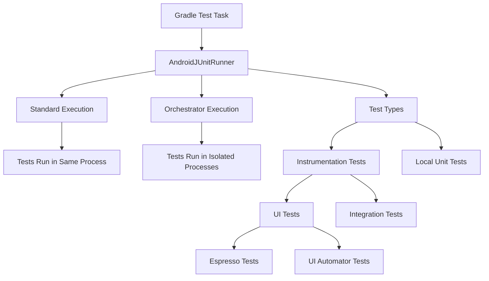
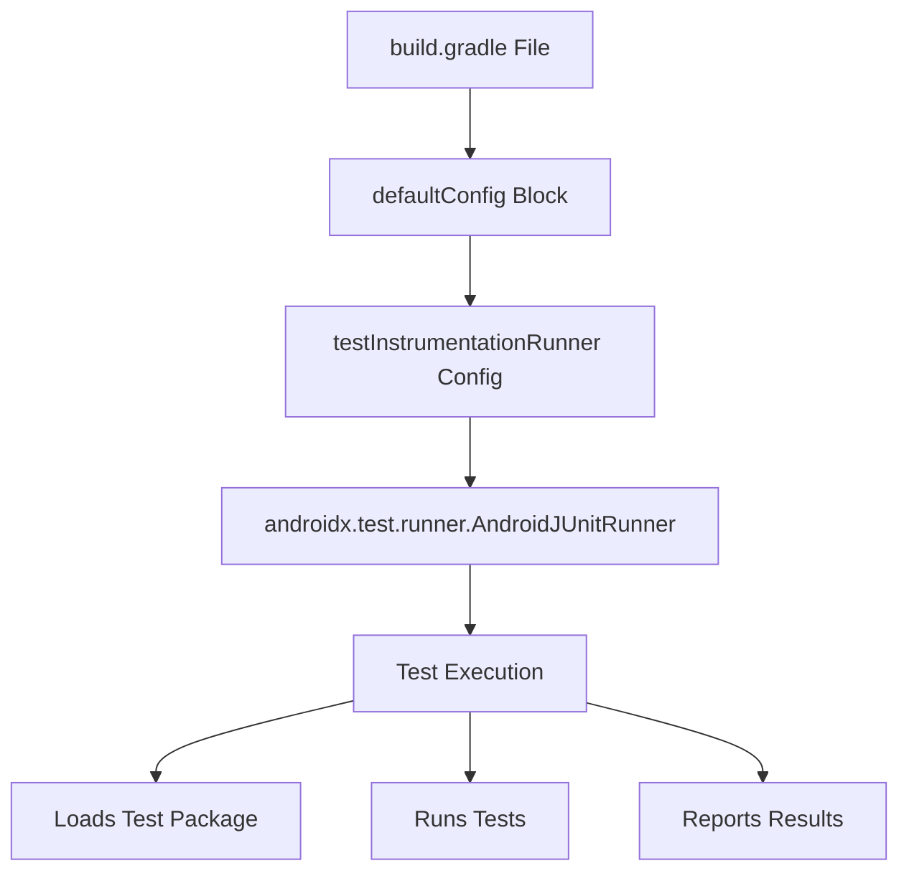
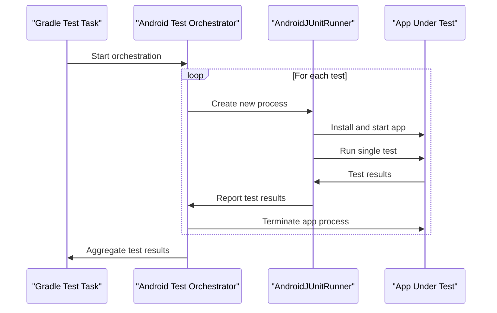
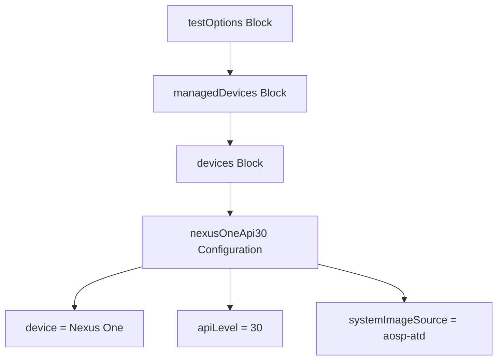
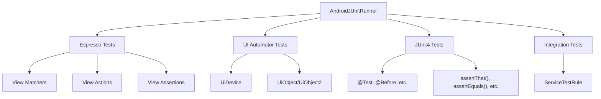

<!-- source: DeepWiki mcp.deepwiki.com · repo android/testing-samples · page 5 Test Runners · fetched 2026-10-23 -->

# Test Runners

<details>
<summary>Relevant source files</summary>

The following files were used as context for generating this wiki page:

- [README.md](README.md)
- [integration/ServiceTestRuleSample/app/build.gradle](integration/ServiceTestRuleSample/app/build.gradle)
- [runner/AndroidJunitRunnerSample/app/build.gradle](runner/AndroidJunitRunnerSample/app/build.gradle)
- [ui/espresso/BasicSample/app/build.gradle](ui/espresso/BasicSample/app/build.gradle)
- [ui/espresso/CustomMatcherSample/app/build.gradle](ui/espresso/CustomMatcherSample/app/build.gradle)
- [ui/espresso/DataAdapterSample/app/build.gradle](ui/espresso/DataAdapterSample/app/build.gradle)
- [ui/espresso/IdlingResourceSample/app/build.gradle](ui/espresso/IdlingResourceSample/app/build.gradle)
- [ui/espresso/IntentsAdvancedSample/app/build.gradle](ui/espresso/IntentsAdvancedSample/app/build.gradle)
- [ui/espresso/IntentsBasicSample/app/build.gradle](ui/espresso/IntentsBasicSample/app/build.gradle)
- [ui/espresso/MultiProcessSample/README.md](ui/espresso/MultiProcessSample/README.md)
- [ui/espresso/MultiProcessSample/app/build.gradle](ui/espresso/MultiProcessSample/app/build.gradle)
- [ui/espresso/MultiWindowSample/app/build.gradle](ui/espresso/MultiWindowSample/app/build.gradle)
- [ui/espresso/RecyclerViewSample/app/build.gradle](ui/espresso/RecyclerViewSample/app/build.gradle)
- [ui/espresso/WebBasicSample/app/build.gradle](ui/espresso/WebBasicSample/app/build.gradle)
- [ui/uiautomator/BasicSample/app/build.gradle](ui/uiautomator/BasicSample/app/build.gradle)

</details>


This document provides a comprehensive overview of test runners in the Android Testing Samples repository. It covers the different types of test runners available, their configuration, and their use cases within the Android testing ecosystem. For information about specific UI testing frameworks like Espresso or UI Automator, see [UI Testing with Espresso](#3) or [UI Testing with UI Automator](#4).

## Introduction to Test Runners

Test runners are components that execute tests and report their results. In Android testing, they serve as the bridge between your test code and the Android runtime environment. The Android Testing Samples repository demonstrates the use of several test runners, with the primary focus on AndroidJUnitRunner and Android Test Orchestrator.



Sources: [README.md:38-39](), [ui/espresso/BasicSample/app/build.gradle:14-15]()

## AndroidJUnitRunner

AndroidJUnitRunner is the default test runner for Android instrumentation tests. It's an extension of JUnit that allows running JUnit tests on Android devices. The runner handles loading your test package and test app onto a device, running the tests, and reporting results.

### Configuration

To use AndroidJUnitRunner, it needs to be specified in the `build.gradle` file of your app module:



Sources: [runner/AndroidJunitRunnerSample/app/build.gradle:13-14](), [ui/espresso/BasicSample/app/build.gradle:14-15](), [ui/uiautomator/BasicSample/app/build.gradle:12-13]()

AndroidJUnitRunner supports both JUnit3 and JUnit4 tests and includes features like:
- Running tests annotated with `@LargeTest`, `@MediumTest`, and `@SmallTest`
- Parameterized tests
- Test suite creation

### Running Tests with AndroidJUnitRunner

Tests can be executed through:
1. Android Studio's test configuration
2. Command line using Gradle:
   ```
   ./gradlew connectedAndroidTest
   ```

This executes all instrumentation tests, with results typically displayed in the console and as HTML reports.

## Android Test Orchestrator

Android Test Orchestrator runs each test in its own instrumentation process, providing better test isolation. This isolation prevents test pollution where state from one test might affect subsequent tests.

### Key Benefits

| Feature | Standard Runner | Test Orchestrator |
|---------|----------------|-------------------|
| Process Isolation | Tests share process | Each test in separate process |
| State Cleanup | Manual cleanup needed | Automatic app state cleanup |
| Test Pollution | Possible | Prevented |
| Test Flakiness | Higher potential | Reduced |
| Crash Impact | All subsequent tests fail | Only the crashed test fails |

### Test Orchestrator Execution Flow



Sources: [README.md:38-39]()

### Configuring Test Orchestrator

To use Android Test Orchestrator, additional dependencies and configurations are needed in the app module's `build.gradle` file:

1. Add the orchestrator dependency
2. Configure the AndroidJUnitRunner to use the orchestrator
3. Configure test options to use the orchestrator

## Test Coverage

Code coverage reports provide insights into which parts of your code are executed during tests. AndroidJUnitRunner supports generating code coverage reports for instrumentation tests.

### Coverage Configuration

To enable coverage reporting with AndroidJUnitRunner, you need to:

1. Include coverage-related configurations in your app's `build.gradle` file
2. Configure test execution to gather coverage data
3. Specify where to store coverage reports

### Coverage with Test Orchestrator

Combining test coverage with Android Test Orchestrator requires special configuration since tests run in separate processes. The Android Testing Samples repository demonstrates how this can be achieved.

## Test Runner Comparison

| Feature | AndroidJUnitRunner | AndroidJUnitRunner + Orchestrator |
|---------|-------------------|-----------------------------------|
| Execution Environment | Device/Emulator | Device/Emulator |
| Test Isolation | Limited | Complete |
| Test Cleanup | Manual | Automatic |
| Configuration Complexity | Simple | Moderate |
| Execution Speed | Faster | Slower (process creation overhead) |
| Memory Usage | Lower | Higher |
| Suitable For | Small test suites, Quick tests | Large test suites, Integration tests |

## Additional Configuration Options

Test runners can be configured with additional options to customize test execution:

### Managed Devices

Several sample projects demonstrate using managed devices in test configuration:



Sources: [ui/espresso/BasicSample/app/build.gradle:18-35](), [runner/AndroidJunitRunnerSample/app/build.gradle:23-36]()

This configuration allows tests to be run on specific device configurations using the Gradle managed devices API.

## Integration with Testing Frameworks

The test runners integrate with various testing frameworks in the Android Testing Samples repository:



Sources: [ui/espresso/BasicSample/app/build.gradle:49-70](), [ui/uiautomator/BasicSample/app/build.gradle:43-52](), [integration/ServiceTestRuleSample/app/build.gradle:36-42]()

## Running Tests Through Gradle

The most common way to run tests with these test runners is through Gradle commands:

- `./gradlew connectedAndroidTest` - Runs all instrumentation tests
- `./gradlew test` - Runs all local unit tests
- `./gradlew nexusOneApi30DebugAndroidTest` - Runs tests on a specific managed device configuration

These commands trigger the appropriate test runner with the configured options.

## Bazel Support

The repository also includes experimental support for running tests with Bazel:

- `bazel test //... --config=headless` - Runs all tests in headless mode
- `bazel test //ui/uiautomator/BasicSample:BasicSampleInstrumentationTest_21_x86 --config=headless` - Runs a specific test

Bazel integration uses the same underlying test runners but with a different build and execution environment.

Sources: [README.md:71-118]()

---

