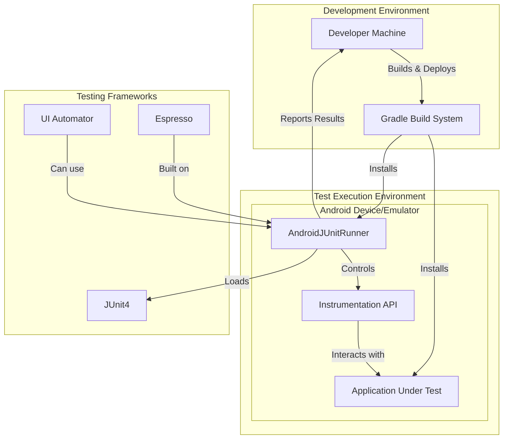
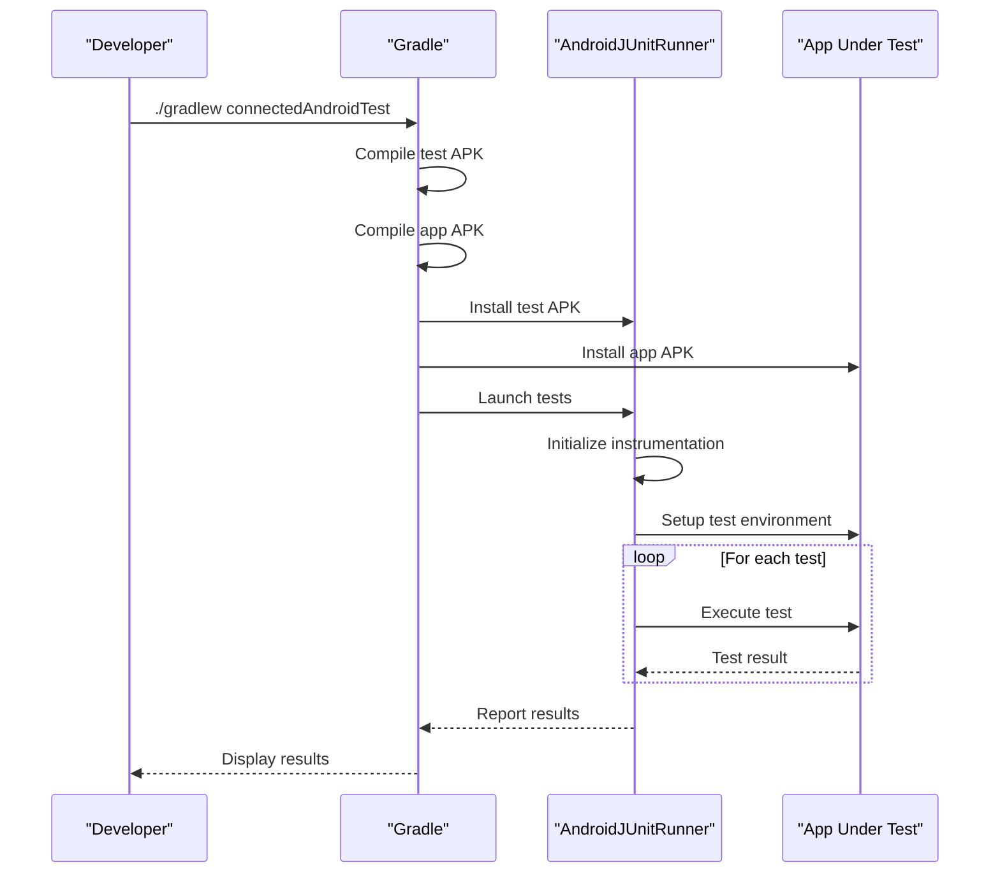
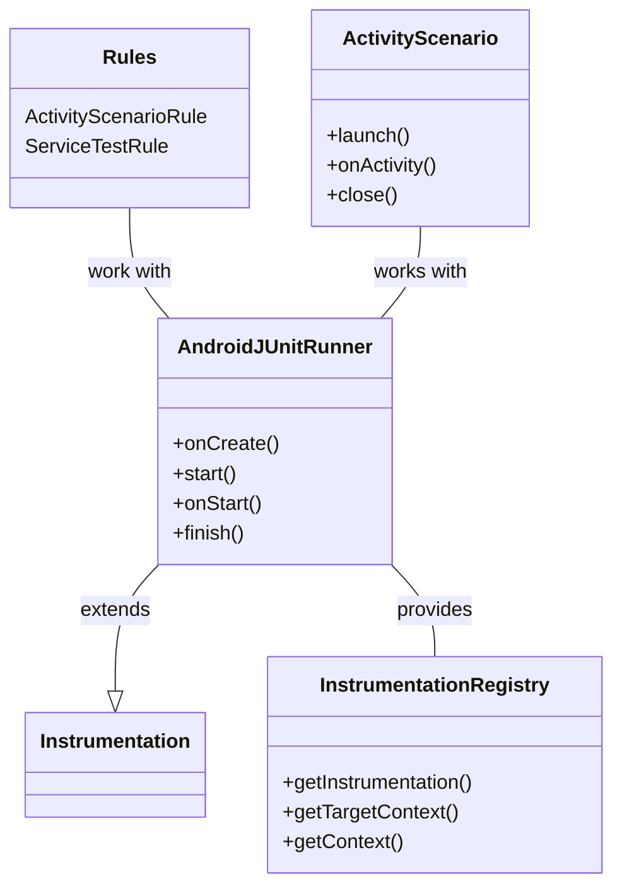
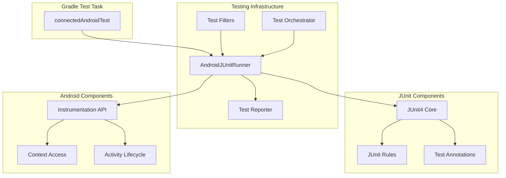

<!-- source: DeepWiki mcp.deepwiki.com · repo android/testing-samples · page 5.1 AndroidJUnitRunner · fetched 2026-10-23 -->

# AndroidJUnitRunner

<details>
<summary>Relevant source files</summary>

The following files were used as context for generating this wiki page:

- [integration/ServiceTestRuleSample/app/build.gradle](integration/ServiceTestRuleSample/app/build.gradle)
- [runner/AndroidJunitRunnerSample/app/build.gradle](runner/AndroidJunitRunnerSample/app/build.gradle)
- [runner/AndroidJunitRunnerSample/app/src/androidTest/java/com/example/android/testing/androidjunitrunnersample/CalculatorInstrumentationTest.java](runner/AndroidJunitRunnerSample/app/src/androidTest/java/com/example/android/testing/androidjunitrunnersample/CalculatorInstrumentationTest.java)
- [ui/espresso/BasicSample/app/build.gradle](ui/espresso/BasicSample/app/build.gradle)
- [ui/espresso/CustomMatcherSample/app/build.gradle](ui/espresso/CustomMatcherSample/app/build.gradle)
- [ui/espresso/DataAdapterSample/app/build.gradle](ui/espresso/DataAdapterSample/app/build.gradle)
- [ui/espresso/IdlingResourceSample/app/build.gradle](ui/espresso/IdlingResourceSample/app/build.gradle)
- [ui/espresso/IdlingResourceSample/app/src/androidTest/java/com/example/android/testing/espresso/IdlingResourceSample/ChangeTextBehaviorTest.java](ui/espresso/IdlingResourceSample/app/src/androidTest/java/com/example/android/testing/espresso/IdlingResourceSample/ChangeTextBehaviorTest.java)
- [ui/espresso/IntentsAdvancedSample/app/build.gradle](ui/espresso/IntentsAdvancedSample/app/build.gradle)
- [ui/espresso/IntentsAdvancedSample/app/src/androidTest/java/com/example/android/testing/espresso/intents/AdvancedSample/ImageViewHasDrawableMatcher.java](ui/espresso/IntentsAdvancedSample/app/src/androidTest/java/com/example/android/testing/espresso/intents/AdvancedSample/ImageViewHasDrawableMatcher.java)
- [ui/espresso/IntentsAdvancedSample/app/src/androidTest/java/com/example/android/testing/espresso/intents/AdvancedSample/ImageViewerActivityTest.java](ui/espresso/IntentsAdvancedSample/app/src/androidTest/java/com/example/android/testing/espresso/intents/AdvancedSample/ImageViewerActivityTest.java)
- [ui/espresso/IntentsBasicSample/app/build.gradle](ui/espresso/IntentsBasicSample/app/build.gradle)
- [ui/espresso/MultiProcessSample/app/build.gradle](ui/espresso/MultiProcessSample/app/build.gradle)
- [ui/espresso/MultiWindowSample/app/build.gradle](ui/espresso/MultiWindowSample/app/build.gradle)
- [ui/espresso/MultiWindowSample/app/src/androidTest/java/com/example/android/testing/espresso/MultiWindowSample/MultiWindowTest.java](ui/espresso/MultiWindowSample/app/src/androidTest/java/com/example/android/testing/espresso/MultiWindowSample/MultiWindowTest.java)
- [ui/espresso/RecyclerViewSample/app/build.gradle](ui/espresso/RecyclerViewSample/app/build.gradle)
- [ui/espresso/WebBasicSample/app/build.gradle](ui/espresso/WebBasicSample/app/build.gradle)
- [ui/espresso/WebBasicSample/app/src/androidTest/java/com/example/android/testing/espresso/web/BasicSample/WebViewActivityTest.java](ui/espresso/WebBasicSample/app/src/androidTest/java/com/example/android/testing/espresso/web/BasicSample/WebViewActivityTest.java)
- [ui/uiautomator/BasicSample/app/build.gradle](ui/uiautomator/BasicSample/app/build.gradle)
- [unit/BasicUnitAndroidTest/app/src/androidTest/java/com/example/android/testing/unittesting/basicunitandroidtest/LogHistoryAndroidUnitTest.java](unit/BasicUnitAndroidTest/app/src/androidTest/java/com/example/android/testing/unittesting/basicunitandroidtest/LogHistoryAndroidUnitTest.java)

</details>


AndroidJUnitRunner is the standard instrumentation test runner for Android applications that enables running JUnit tests on Android devices. It serves as the bridge between your test code and the Android runtime, allowing tests to interact with Android components in an instrumented environment. For information about running tests with Android Test Orchestrator for improved test isolation, see [Android Test Orchestrator](#5.2).

## Purpose and Overview

AndroidJUnitRunner is a JUnit test runner that:
- Loads your test package and the app under test onto a device
- Runs the tests against the app
- Reports the results back to the development machine

It supports both JUnit 3 and JUnit 4 style tests, and serves as the foundation for UI testing frameworks like Espresso and UI Automator.

### AndroidJUnitRunner in the Android Testing Ecosystem



Sources: [runner/AndroidJunitRunnerSample/app/build.gradle:13](). [ui/espresso/BasicSample/app/build.gradle:14](). [ui/uiautomator/BasicSample/app/build.gradle:12]().

## Configuration

### Gradle Configuration

To use AndroidJUnitRunner in your project, you need to specify it as the instrumentation test runner in your app's `build.gradle` file:

```
android {
    defaultConfig {
        testInstrumentationRunner "androidx.test.runner.AndroidJUnitRunner"
    }
}
```

You also need to include the necessary dependencies:

```
dependencies {
    // Core AndroidX Test libraries
    androidTestImplementation "androidx.test:core:$coreVersion"
    androidTestImplementation "androidx.test.ext:junit:$extJUnitVersion"
    androidTestImplementation "androidx.test:runner:$runnerVersion"
}
```

Sources: [runner/AndroidJunitRunnerSample/app/build.gradle:4-14](). [runner/AndroidJunitRunnerSample/app/build.gradle:45-57]().

### Test Execution Flow



Sources: [runner/AndroidJunitRunnerSample/app/build.gradle:13](). [ui/espresso/BasicSample/app/build.gradle:14]().

## Key Components and Features

### Core Features

AndroidJUnitRunner provides several important features for Android testing:

1. **JUnit 4 Support**: Full support for JUnit 4 annotations and test style
2. **Instrumentation**: Access to instrumentation APIs for interacting with the device
3. **Test Filtering**: Ability to run specific test classes or methods
4. **Lifecycle Management**: Handles test lifecycle and application lifecycle integration

### Test Annotations

AndroidJUnitRunner supports various annotations to control test execution:

| Annotation | Package | Purpose |
|------------|---------|---------|
| `@RunWith(AndroidJUnit4.class)` | `androidx.test.ext.junit.runners` | Specifies the test runner |
| `@SmallTest`, `@MediumTest`, `@LargeTest` | `androidx.test.filters` | Categorizes tests by execution time |
| `@RequiresDevice` | `androidx.test.filters` | Specifies test requires a physical device |
| `@SdkSuppress` | `androidx.test.filters` | Restricts test to specific API levels |

Sources: [runner/AndroidJunitRunnerSample/app/src/androidTest/java/com/example/android/testing/androidjunitrunnersample/CalculatorInstrumentationTest.java:49-50](). [unit/BasicUnitAndroidTest/app/src/androidTest/java/com/example/android/testing/unittesting/basicunitandroidtest/LogHistoryAndroidUnitTest.java:36]().

### Architecture



Sources: [runner/AndroidJunitRunnerSample/app/src/androidTest/java/com/example/android/testing/androidjunitrunnersample/CalculatorInstrumentationTest.java:54-56](). [ui/espresso/IntentsAdvancedSample/app/src/androidTest/java/com/example/android/testing/espresso/intents/AdvancedSample/ImageViewerActivityTest.java:58-60]().

## Writing Tests with AndroidJUnitRunner

### Basic Test Structure

Here's the typical structure of a test using AndroidJUnitRunner:

```java
@RunWith(AndroidJUnit4.class)
@LargeTest
public class MyInstrumentedTest {

    @Rule
    public ActivityScenarioRule<MainActivity> activityRule = 
            new ActivityScenarioRule<>(MainActivity.class);

    @Before
    public void setUp() {
        // Setup code
    }

    @Test
    public void testSomething() {
        // Test code
    }

    @After
    public void tearDown() {
        // Cleanup code
    }
}
```

This structure is demonstrated in the sample project, particularly in `CalculatorInstrumentationTest.java`.

Sources: [runner/AndroidJunitRunnerSample/app/src/androidTest/java/com/example/android/testing/androidjunitrunnersample/CalculatorInstrumentationTest.java:49-109]().

### Launching Activities for Testing

There are two main approaches to launching activities for testing:

1. **ActivityScenario**: The recommended way to launch activities for testing
   ```java
   @Before
   public void launchActivity() {
       ActivityScenario.launch(MyActivity.class);
   }
   ```

2. **ActivityScenarioRule**: A JUnit rule that handles the activity lifecycle
   ```java
   @Rule
   public ActivityScenarioRule<MyActivity> activityRule = 
           new ActivityScenarioRule<>(MyActivity.class);
   ```

Sources: [runner/AndroidJunitRunnerSample/app/src/androidTest/java/com/example/android/testing/androidjunitrunnersample/CalculatorInstrumentationTest.java:56-59](). [ui/espresso/IntentsAdvancedSample/app/src/androidTest/java/com/example/android/testing/espresso/intents/AdvancedSample/ImageViewerActivityTest.java:58-60]().

## Integration with UI Testing Frameworks

### Espresso Integration

AndroidJUnitRunner serves as the foundation for Espresso tests. The integration allows you to:

- Use Espresso's ViewMatchers, ViewActions, and ViewAssertions
- Synchronize UI tests with the application main thread
- Automate UI interactions

Example of Espresso with AndroidJUnitRunner:

```java
@RunWith(AndroidJUnit4.class)
@LargeTest
public class EspressoTest {
    @Rule
    public ActivityScenarioRule<MainActivity> activityRule = 
            new ActivityScenarioRule<>(MainActivity.class);
            
    @Test
    public void testUI() {
        onView(withId(R.id.my_button))
            .perform(click())
            .check(matches(isDisplayed()));
    }
}
```

Sources: [runner/AndroidJunitRunnerSample/app/src/androidTest/java/com/example/android/testing/androidjunitrunnersample/CalculatorInstrumentationTest.java:62-107](). [ui/espresso/IdlingResourceSample/app/src/androidTest/java/com/example/android/testing/espresso/IdlingResourceSample/ChangeTextBehaviorTest.java:42-78]().

### UI Automator Integration

AndroidJUnitRunner can also be used with UI Automator for testing across different apps:

```java
@RunWith(AndroidJUnit4.class)
public class UiAutomatorTest {
    private UiDevice device;
    
    @Before
    public void setUp() {
        device = UiDevice.getInstance(getInstrumentation());
    }
    
    @Test
    public void testCrossAppInteraction() {
        // UI Automator code here
    }
}
```

Sources: [ui/uiautomator/BasicSample/app/build.gradle:46-51]().

## Test Execution Components



Sources: [runner/AndroidJunitRunnerSample/app/build.gradle:13](). [runner/AndroidJunitRunnerSample/app/src/androidTest/java/com/example/android/testing/androidjunitrunnersample/CalculatorInstrumentationTest.java:49-50]().

## Running Tests

### Command Line

You can run tests from the command line using Gradle:

```bash
# Run all tests
./gradlew connectedAndroidTest

# Run a specific test class
./gradlew connectedAndroidTest -Pandroid.testInstrumentationRunnerArguments.class=com.example.MyTest

# Run a specific test method
./gradlew connectedAndroidTest -Pandroid.testInstrumentationRunnerArguments.class=com.example.MyTest#testMethod
```

### Managed Devices

AndroidJUnitRunner supports running tests on managed devices, as configured in the `build.gradle` files:

```
testOptions {
    managedDevices {
        devices {
            nexusOneApi30(com.android.build.api.dsl.ManagedVirtualDevice) {
                device = "Nexus One"
                apiLevel = 30
                systemImageSource = "aosp-atd"
            }
        }
    }
}
```

To run tests on a managed device:
```bash
./gradlew nexusOneApi30DebugAndroidTest
```

Sources: [runner/AndroidJunitRunnerSample/app/build.gradle:23-37](). [ui/espresso/BasicSample/app/build.gradle:22-35]().

## Best Practices

1. **Test Independence**: Ensure each test is independent and can run in isolation
2. **Test Size Annotation**: Use `@SmallTest`, `@MediumTest`, or `@LargeTest` to categorize tests
3. **Activity Management**: Use `ActivityScenarioRule` or `ActivityScenario` to manage activities
4. **Context Access**: Use `InstrumentationRegistry.getInstrumentation().getTargetContext()` to access the app's context
5. **Filter Tests**: Use annotations with test runners to filter tests
6. **Avoid Test Interdependence**: Don't assume a particular test execution order
7. **Consider Test Orchestrator**: For test isolation, consider using Android Test Orchestrator, covered in [Android Test Orchestrator](#5.2)

## Summary

AndroidJUnitRunner is the foundation of Android instrumentation testing. It:
- Connects your JUnit 4 tests to the Android runtime
- Enables UI testing through frameworks like Espresso and UI Automator
- Provides context access and lifecycle management for your tests
- Supports flexible test configuration and filtering
- Integrates with the Gradle build system for easy execution

For more advanced testing scenarios, such as isolated test runs, you may consider the Android Test Orchestrator, which is covered in [Android Test Orchestrator](#5.2).

Sources: [runner/AndroidJunitRunnerSample/app/build.gradle:13](). [runner/AndroidJunitRunnerSample/app/src/androidTest/java/com/example/android/testing/androidjunitrunnersample/CalculatorInstrumentationTest.java:29-41]().

---

